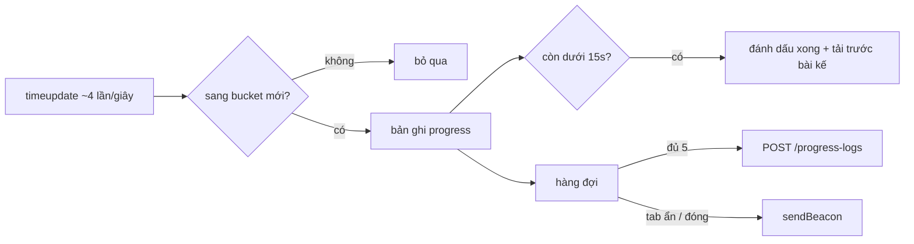

Một nền tảng học online cần biết học viên xem tới đâu: để "học tiếp" mở đúng chỗ, để đánh dấu bài đã xong, để tính chứng chỉ, và để giảng viên thấy học viên bỏ ngang ở phút nào. Thẻ `<video>` bắn `timeupdate` khoảng 4 lần mỗi giây. Gửi hết lên server thì một bài 10 phút là 2.400 request.

Player của Udemy (`video-player.mobx-store.js`, và bản shaka `shaka-video-player.mobx-store.ts`) cùng `video-viewer.mobx-store.js` giải quyết bằng vài quy tắc đơn giản. Bài này đọc từng quy tắc, chạy lại để xem chúng hỏng ở đâu, rồi viết lại.

> [!TIP]
> **Tóm tắt**
> - Chia thời lượng thành **bucket 15 giây**, chỉ báo tiến độ khi sang bucket mới: bài 10 phút còn khoảng 40 bản ghi thay vì 2.400.
> - Gom **5 bản ghi** mới gửi một lần. Còn **dưới 15 giây** thì coi như học xong và tải trước bài kế.
> - Lỗi mạng thì thử lại sau **500·n² ms** (0,5s, 2s, 4,5s, 8s, 12,5s), tối đa 5 lần.
> - Bản gốc làm mất dữ liệu ở bốn chỗ: batch bị xoá trước khi gửi xong, gửi lúc đóng tab bằng axios, video dưới 15 giây "xong" ngay giây đầu, và bộ đếm lỗi không bao giờ về 0.

<iframe class="demo-frame" src="/demos/web-patterns/index.html?theme=dark#/ud-progress" title="Demo ud-progress" loading="lazy" style="height: 1350px"></iframe>

<p class="demo-links">▶ <a href="/demos/web-patterns/index.html#/ud-progress" target="_blank" rel="noopener">Mở demo toàn màn hình ↗</a> · <a href="https://stackblitz.com/github/hunghg255/blog-hunghg/tree/master/examples/web-patterns?file=src/lib/udProgress.ts" target="_blank" rel="noopener">Sửa code trên StackBlitz ↗</a> · <a href="https://github.com/hunghg255/blog-hunghg/blob/master/examples/web-patterns/src/lib/udProgress.ts" target="_blank" rel="noopener">Xem source trên GitHub ↗</a></p>

Video trong demo là giả lập: mỗi 250ms tăng thời gian và bắn một `timeupdate`. Cột trái chạy lại đúng logic gốc của Udemy, cột phải là bản viết lại. Các bước nên thử:

- **Phát ở 4×** vài giây: hơn chục `timeupdate` nhưng chỉ vài bản ghi progress.
- **"Tua tới gần cuối"** ngay từ đầu: Udemy đánh dấu học xong. Bản viết lại (khi bật "đòi xem ≥ 80%") thì không, vì mới xem thật vài giây.
- **Bật "Server progress lỗi 503"** rồi phát tiếp: lô 5 bản ghi của Udemy mất hẳn, bản viết lại giữ lại để gửi sau. Bấm **"Đóng tab"**: phần đang chờ của Udemy mất, bản viết lại gửi bằng `sendBeacon`.
- Chọn **video 10 giây** rồi phát: Udemy báo xong ngay ở bản ghi đầu tiên.
- Bấm **"Mạng chớp (sau 20 phút xem ổn)"** 6 lần: lần thứ 6 Udemy không thử lại nữa, dù giữa các lần có 20 phút xem bình thường.

## Udemy làm thế nào?

### Bucket 15 giây

```js
handleVideoProgress(event) {
    const position = Math.ceil(this.currentTime / this.videoProgressInterval);
    if (this.lastPosition === position || position <= 0) {
        return;
    }
    this.lastPosition = position;
    // At the end of the video, just use the video duration,
    // otherwise use the smaller out of the duration and the interval 'bucket'.
    const time =
        event.type === 'ended'
            ? this.duration
            : Math.min(position * this.videoProgressInterval, this.duration);
    const progressData = { total: Math.floor(this.duration), position: Math.floor(time) };
    this.onVideoProgress(event, progressData);
}
```

`videoProgressInterval` là `VIDEO_PROGRESS_INTERVAL = 15`. Handler gắn vào cả `timeupdate` lẫn `ended`. Từ `timeupdate` thứ hai trong cùng bucket trở đi, hàm thoát ngay ở dòng `if`: một phép chia, một phép so sánh, không cấp phát gì. Tua ngược về bucket trước cũng sinh bản ghi, vì chỉ so với bucket **vừa báo**.

Có một chi tiết: `Math.ceil` báo bucket **đang chạy**, không phải bucket đã xong. Ở giây 0,1 hàm báo `position = 15`: học viên mới xem 0,1 giây đã được ghi là tới giây 15. Sai số tối đa một bucket, chấp nhận được với "học tiếp", nhưng đáng để biết nếu dùng số này cho thống kê thời gian xem.

### Gom 5 bản ghi, coi như xong khi còn 15 giây

```js
onVideoProgress(event, progressData) {
    // Only fire LectureStarted if video is actually playing, from (near) the beginning
    if (progressData.position <= VIDEO_START_OFFSET_WINDOW && this.isPlaying) {
        this.lectureViewStore.fireLectureStartedEvent();
    }
    if (progressData.position > 0 && progressData.position > progressData.total - VIDEO_COMPLETION_OFFSET) {
        this.courseTakingStore.markCurrentItemComplete();
        this.lectureViewStore.fireLectureCompletedEvent();
    }
    if (this.videoProgressBatchData.length >= VIDEO_PROGRESS_BATCH_COUNT) {
        this.sendLectureProgress();
    }
    progressData.time = new Date().toISOString();
    progressData.captions = activeTrack && activeTrack.language;
    progressData.openPanel = this.courseTakingStore.activeSidebarContent;
    progressData.isFullscreen = this.lectureViewStore.fullscreenStore.isFullscreen;
    this.videoProgressBatchData.push(progressData);
}

sendLectureProgress() {
    if (this.videoProgressBatchData.length) {
        this.lectureViewStore.lecture.updateProgress(this.videoProgressBatchData);
        this.videoProgressBatchData = [];
    }
}
```

`VIDEO_PROGRESS_BATCH_COUNT = 5`, `VIDEO_COMPLETION_OFFSET = 15`, `VIDEO_START_OFFSET_WINDOW = 2 * 15`. Mỗi bản ghi mang theo ngữ cảnh: giờ, ngôn ngữ phụ đề đang bật, panel bên cạnh đang mở, có toàn màn hình không. Đó là dữ liệu cho phân tích hành vi chứ không chỉ "xem tới đâu". `markCurrentItemComplete` còn kích hoạt tải trước bài kế (bài #2).

Một chỗ hay khác: `onTimeUpdate` lưu `lastWatchedSecond` để "học tiếp", và **đặt về đầu** nếu đã gần hết bài:

```js
// If watched video lecture to the end, reset position to start.
if (timeEstimation - position < VIDEO_COMPLETION_OFFSET) {
    position = undefined;
}
```

Học viên xem lại bài đã xong sẽ bắt đầu từ đầu, thay vì mở ra ở 15 giây cuối. Ngược lại, `onPlayerReady` không tự phát nếu vị trí khôi phục nằm trong 15 giây cuối.

### Thử lại 500·n² ms

`handleVideoError` cho thử lại tối đa `retryLimit = 5` lần khi lỗi là `MEDIA_ERR_NETWORK` hoặc `MEDIA_ERR_SRC_NOT_SUPPORTED`. Mỗi lần, `_retry` tăng `numErrors`, chờ `500 * numErrors²` ms rồi gán lại `src` cho player.

::: spoiler Xem code thử lại của Udemy

```js
const retryLimit = 5;
const shouldRetry = this.numErrors < retryLimit && this.numPlaylistRetries <= 2;
if (shouldRetry && error.code === MediaError.MEDIA_ERR_NETWORK) {
    this._retry(error); // The connection sucks. Retry.
} else if (shouldRetry && error.code === MediaError.MEDIA_ERR_SRC_NOT_SUPPORTED) {
    this._retry(error); // Either the connection sucks or source is unsupported. Retry.
} else {
    this.showError(/* … */);
}

_retry(error) {
    this.numErrors += 1;
    setTimeout(() => {
        if (!this._videoPlayer || !this._videoPlayer.el_) return; // unmounted
        this._videoPlayer.src(this.activeResolution.sources);
    }, 500 * this.numErrors * this.numErrors);
    this._logErrorWithHttpStatus(error, 'videoplayer.error.retry');
}
```

:::

Độ trễ tăng theo bình phương: 0,5s, 2s, 4,5s, 8s, 12,5s, tổng gần nửa phút trước khi bỏ cuộc. `MEDIA_ERR_SRC_NOT_SUPPORTED` cũng được thử lại vì trình duyệt báo lỗi này cả khi playlist tải hỏng giữa chừng, không chỉ khi định dạng thật sự không hỗ trợ. `_logErrorWithHttpStatus` gửi thêm một request `HEAD` tới URL lỗi để log mã HTTP thật (403 hay 404 hay 500), vì `MediaError` không cho biết.

Bản shaka cũng có `_retry` với cùng công thức, nhưng thân `setTimeout` đang bị comment (`// TODO tsmigrate src() is undefined`): ở player mới, việc thử lại thực tế do shaka tự lo bằng `retryParameters`.

## Bốn chỗ làm mất dữ liệu

**1. Batch bị xoá trước khi gửi xong.** `sendLectureProgress` gọi `updateProgress` (một `udApi.post`) rồi gán ngay `videoProgressBatchData = []`, không chờ kết quả. POST lỗi (503, mất mạng, token hết hạn) là 5 bản ghi biến mất. Demo: bật "Server progress lỗi 503", phát tiếp, cột Udemy báo "mất luôn".

**2. Gửi lúc đóng tab bằng axios.**

```js
window.addEventListener('beforeunload', this.videoViewerStore.sendLectureProgress);
```

Request XHR/fetch thường gửi bắt đầu trong `beforeunload` hay bị huỷ khi trang đóng. Thêm nữa, trên mobile `beforeunload` thường không chạy khi người dùng vuốt tắt app hay chuyển sang app khác. Tối đa 4 bản ghi cuối (gần một phút xem) có thể mất ở mỗi lần thoát. Cách chuẩn là `navigator.sendBeacon` (hoặc `fetch` với `keepalive: true`) trong `visibilitychange → hidden` và `pagehide`, như bài [Banzai: gom log theo lô](/blogs/facebook-batch-logger) của series Facebook.

**3. Video ngắn "xong" ngay giây đầu.** Điều kiện xong là `position > total - 15`. Với video 10 giây, `total - 15 = -5`, và bản ghi đầu tiên (`position = 10` vì `Math.ceil` đẩy lên bucket 15 rồi kẹp về thời lượng) đã thoả. Bấm play là bài được đánh dấu học xong. Video 30 giây thì "xong" ngay khi qua giây 15 (bucket thứ hai báo `position = 30`). Demo chọn video 10 giây để thấy.

**4. Bộ đếm lỗi không bao giờ về 0.** `numErrors` chỉ tăng, không có chỗ nào reset. Một buổi học dài với 5 lần mạng chớp rải rác (mỗi lần thử lại thành công) là hết quyền thử lại: lần chớp thứ 6, dù cách lần trước cả tiếng, hiện ngay màn hình lỗi.

Ngoài ra, điều kiện "học xong" chỉ dựa vào **vị trí**: kéo thanh tua tới cuối là xong, không cần xem. Có lẽ đây là chủ ý (Udemy không chặn tua, học viên có quyền bỏ qua phần đã biết), nên bản viết lại để nó thành tuỳ chọn.

## Bên trong: luồng dữ liệu



## Viết lại

```ts title=src/lib/udProgress.ts
  function update(currentTime: number, duration: number, type: 'timeupdate' | 'ended' | 'seeked' = 'timeupdate') {
    if (!(duration > 0)) return;

    // Cộng thời gian đã xem: chỉ tính bước nhảy nhỏ giữa hai timeupdate liên tiếp
    // (timeupdate bắn khoảng 4 lần/giây; ở tốc độ 2x mỗi bước ~0.5 giây).
    // Bước lớn hoặc âm là người dùng tua, không cộng.
    if (type !== 'seeked' && lastTime !== null) {
      const delta = currentTime - lastTime;
      if (delta > 0 && delta < 2) watched = Math.min(duration, watched + delta);
    }
    lastTime = currentTime;

    const bucket = Math.floor(currentTime / interval);
    const record: ProgressRecord = {
      position: type === 'ended' ? Math.floor(duration) : Math.floor(currentTime),
      total: Math.floor(duration),
      watched: Math.floor(watched),
      type: type === 'ended' ? 'ended' : 'progress',
    };
    // 'ended' luôn được báo, kể cả khi vẫn nằm trong bucket cuối đã báo trước đó
    if (type === 'ended' || (bucket !== lastBucket && bucket > 0)) {
      lastBucket = bucket;
      onProgress(record);
    }

    if (!completed && isNearEnd(currentTime, duration, type) && watched >= duration * minWatchedRatio) {
      completed = true;
      onComplete(record);
    }
  }

  /**
   * Video ngắn hơn ngưỡng (vd 10 giây với ngưỡng 15) thì "còn dưới 15 giây" đúng ngay từ đầu;
   * khi đó đòi phải xem tới cuối thật.
```

```ts title=src/lib/udProgress.ts
export function createRetryBudget({ limit = 5, healthyMs = 60_000, now = Date.now } = {}) {
  let failures = 0;
  let lastFailureAt = -Infinity;
  return {
    /** gọi khi player lỗi; trả về độ trễ trước khi thử lại, hoặc null nếu hết quyền */
    onError(): number | null {
      if (now() - lastFailureAt >= healthyMs) failures = 0;
      lastFailureAt = now();
      if (failures >= limit) return null;
      failures++;
      return retryDelay(failures);
    },
    get failures() {
      return failures;
    },
```

::: spoiler Xem toàn bộ src/lib/udProgress.ts

```ts title=src/lib/udProgress.ts
/**
 * Ghi tiến độ xem video mà không gọi API mỗi lần `timeupdate`
 * (ý tưởng từ handleVideoProgress + video-viewer.mobx-store.js của Udemy):
 * - chia thời lượng thành bucket 15 giây, chỉ báo khi sang bucket mới;
 * - gom 5 bản ghi mới gửi một lần;
 * - coi như học xong khi còn dưới 15 giây;
 * - player lỗi mạng thì thử lại với độ trễ 500·n² ms.
 * Bản viết lại thêm: đếm số giây thật sự đã xem, không mất batch khi gửi lỗi hay đóng tab,
 * và ngân sách thử lại tự hồi phục.
 */

export interface ProgressRecord {
  /** giây đã tới, làm tròn xuống */
  position: number;
  total: number;
  /** số giây thật sự đã phát (không tính đoạn tua qua) */
  watched: number;
  type: 'progress' | 'ended';
}

export interface ProgressTrackerOptions {
  interval?: number;
  completionOffset?: number;
  /** tỉ lệ thời lượng phải xem thật mới tính là xong; 0 = giống Udemy, chỉ cần tới gần cuối */
  minWatchedRatio?: number;
  onProgress(record: ProgressRecord): void;
  onComplete(record: ProgressRecord): void;
}

export function createProgressTracker({
  interval = 15,
  completionOffset = 15,
  minWatchedRatio = 0,
  onProgress,
  onComplete,
}: ProgressTrackerOptions) {
  let lastBucket = 0;
  let lastTime: number | null = null;
  let watched = 0;
  let completed = false;

  function update(currentTime: number, duration: number, type: 'timeupdate' | 'ended' | 'seeked' = 'timeupdate') {
    if (!(duration > 0)) return;

    // Cộng thời gian đã xem: chỉ tính bước nhảy nhỏ giữa hai timeupdate liên tiếp
    // (timeupdate bắn khoảng 4 lần/giây; ở tốc độ 2x mỗi bước ~0.5 giây).
    // Bước lớn hoặc âm là người dùng tua, không cộng.
    if (type !== 'seeked' && lastTime !== null) {
      const delta = currentTime - lastTime;
      if (delta > 0 && delta < 2) watched = Math.min(duration, watched + delta);
    }
    lastTime = currentTime;

    const bucket = Math.floor(currentTime / interval);
    const record: ProgressRecord = {
      position: type === 'ended' ? Math.floor(duration) : Math.floor(currentTime),
      total: Math.floor(duration),
      watched: Math.floor(watched),
      type: type === 'ended' ? 'ended' : 'progress',
    };
    // 'ended' luôn được báo, kể cả khi vẫn nằm trong bucket cuối đã báo trước đó
    if (type === 'ended' || (bucket !== lastBucket && bucket > 0)) {
      lastBucket = bucket;
      onProgress(record);
    }

    if (!completed && isNearEnd(currentTime, duration, type) && watched >= duration * minWatchedRatio) {
      completed = true;
      onComplete(record);
    }
  }

  /**
   * Video ngắn hơn ngưỡng (vd 10 giây với ngưỡng 15) thì "còn dưới 15 giây" đúng ngay từ đầu;
   * khi đó đòi phải xem tới cuối thật.
   */
  function isNearEnd(currentTime: number, duration: number, type: string) {
    if (type === 'ended') return true;
    if (duration <= completionOffset) return duration - currentTime <= 0.5;
    return duration - currentTime < completionOffset;
  }

  return {
    update,
    get watched() {
      return watched;
    },
    get completed() {
      return completed;
    },
    reset() {
      lastBucket = 0;
      lastTime = null;
      watched = 0;
      completed = false;
    },
  };
}

export interface BatchSenderOptions<T> {
  size?: number;
  send(items: T[]): Promise<void>;
  /** gửi lúc trang sắp đóng; trả false nếu trình duyệt từ chối */
  beacon(items: T[]): boolean;
}

/**
 * Gom bản ghi rồi gửi theo lô. Khác bản gốc ở hai chỗ:
 * - chỉ xoá khỏi hàng đợi khi server nhận thành công (Udemy xoá ngay khi bắt đầu gửi);
 * - lúc tab bị ẩn/đóng thì gửi bằng sendBeacon (Udemy gọi axios trong beforeunload,
 *   request đó thường bị huỷ cùng trang).
 */
export function createBatchSender<T>({ size = 5, send, beacon }: BatchSenderOptions<T>) {
  let queue: T[] = [];
  let sending = false;

  async function flush() {
    if (sending || queue.length === 0) return;
    sending = true;
    const batch = queue.slice(0, size);
    try {
      await send(batch);
      queue = queue.slice(batch.length);
    } catch {
      // giữ nguyên trong hàng đợi, lần sau gửi lại
    } finally {
      sending = false;
    }
  }

  return {
    push(item: T) {
      queue.push(item);
      if (queue.length >= size) void flush();
    },
    flush,
    /** gọi trong pagehide / visibilitychange → hidden */
    flushWithBeacon() {
      if (queue.length && beacon(queue)) queue = [];
    },
    get pending() {
      return queue.length;
    },
  };
}

/** 500·n² ms giống Udemy, có trần và thêm jitter ±25% để nhiều người xem không cùng thử lại một lúc. */
export function retryDelay(attempt: number, cap = 15_000, random = Math.random) {
  const base = Math.min(500 * attempt * attempt, cap);
  return Math.round(base * (0.75 + random() * 0.5));
}

/**
 * Ngân sách thử lại tự hồi phục: tối đa `limit` lần, nhưng đã qua `healthyMs` không có lỗi nào
 * thì đếm lại từ đầu. Udemy đếm `numErrors` suốt đời player: 5 lần chớp mạng rải rác
 * trong một buổi học là hết quyền thử lại.
 */
export function createRetryBudget({ limit = 5, healthyMs = 60_000, now = Date.now } = {}) {
  let failures = 0;
  let lastFailureAt = -Infinity;
  return {
    /** gọi khi player lỗi; trả về độ trễ trước khi thử lại, hoặc null nếu hết quyền */
    onError(): number | null {
      if (now() - lastFailureAt >= healthyMs) failures = 0;
      lastFailureAt = now();
      if (failures >= limit) return null;
      failures++;
      return retryDelay(failures);
    },
    get failures() {
      return failures;
    },
  };
}
```

:::

**Khác bản gốc:**

- Bucket dùng `Math.floor`: bản ghi chỉ ra khi đã **qua** mốc 15 giây, `position` là giây thật đã tới. Sự kiện `ended` luôn được báo (bản gốc bỏ qua `ended` nếu nó rơi vào cùng bucket với `timeupdate` trước đó, thường là có).
- Đếm `watched`: cộng các bước nhỏ giữa hai `timeupdate` liên tiếp (dưới 2 giây), bỏ qua bước nhảy do tua. Server nhận cả "tới đâu" lẫn "xem thật bao nhiêu".
- Điều kiện xong: video ngắn hơn ngưỡng thì phải xem tới cuối; `minWatchedRatio` tuỳ chọn để đòi xem thật một tỉ lệ (mặc định 0, giống Udemy).
- `createBatchSender` chỉ xoá bản ghi sau khi server nhận, và có `flushWithBeacon` cho lúc ẩn tab.
- `retryDelay` có trần 15 giây và jitter ±25%. `createRetryBudget` đếm lại từ 0 khi đã `healthyMs` (mặc định 60 giây) không lỗi.

## Đi qua code

- `update(currentTime, duration, type)` nhận cả `'seeked'`: lúc tua, chỉ cập nhật `lastTime` mà không cộng `watched`. Không truyền `'seeked'` cũng không sao, vì bước nhảy lớn hơn 2 giây tự bị loại; chỉ những lần tua ngắn dưới 2 giây (bấm phím mũi tên) bị cộng nhầm.
- Ngưỡng 2 giây đủ cho tốc độ 2× (mỗi `timeupdate` cách ~0,5 giây media). Player cho tốc độ tới 4× thì nên tăng ngưỡng theo `playbackRate`.
- `isNearEnd` tách riêng trường hợp `duration <= completionOffset`.
- `createBatchSender.flush` dùng cờ `sending` để không gửi hai lô chồng nhau, và cắt đúng số đã gửi (`queue.slice(batch.length)`) để bản ghi mới đến trong lúc chờ không bị xoá nhầm.

## Tại sao không làm cách khác?

**Sao không gửi theo thời gian (mỗi 30 giây) thay vì theo bucket?** Gửi theo đồng hồ vẫn gửi khi video đang dừng, và hai lần gửi có thể mang cùng một vị trí. Bucket gắn với **nội dung**: dừng thì không gửi, tua qua tua lại thì vẫn đủ dấu vết. Gom 5 bản ghi để giảm request là lớp thứ hai, độc lập với cách sinh bản ghi.

**Sao không dùng `played` (TimeRanges) của thẻ video?** `video.played` cho biết những đoạn đã phát trong phiên hiện tại, chính xác hơn tự cộng `timeupdate`. Nhưng nó mất khi đổi `src` (đổi độ phân giải ở player cũ của Udemy là đổi `src`) và không gộp qua nhiều phiên. Cách tự cộng dễ mang theo qua các lần đổi nguồn; nếu player của bạn không đổi `src` giữa chừng thì `played` là lựa chọn tốt.

**Sao không thử lại vô hạn?** Lỗi do nguồn hỏng thật (file thiếu, URL hết hạn, bài #2) sẽ không tự hết. Thử lại mãi chỉ làm người xem nhìn spinner thay vì một thông báo có nút "tải lại". Giới hạn số lần nhưng cho hồi phục theo thời gian là cân bằng giữa hai đầu.

## Edge case và cạm bẫy

- **Tốc độ phát**: 2× thì bucket 15 giây media trôi qua trong 7,5 giây thật, số request gấp đôi. Nếu server tính "thời gian học" từ bản ghi, hãy gửi kèm `playbackRate`.
- **Nhiều tab cùng bài**: mỗi tab gửi bản ghi riêng; server nên lấy `max(position)` cho "học tiếp" và gộp `watched` theo khoảng, không cộng thẳng.
- **sendBeacon có giới hạn kích thước** (khoảng 64KB cho mọi request keepalive đang bay). Bản ghi progress nhỏ nên ít khi chạm tới, nhưng nếu nhét thêm dữ liệu thì cần chia lô.
- **Bản ghi gửi lại có thể trùng** (lô lỗi được gửi lại nhưng thật ra server đã nhận). Thêm id cho từng bản ghi để server bỏ trùng.

## Dùng trong dự án

```ts
const sender = createBatchSender<ProgressRecord>({
  size: 5,
  send: (items) => api.post(`/lectures/${id}/progress`, items),
  beacon: (items) => navigator.sendBeacon(`/api/lectures/${id}/progress`, new Blob([JSON.stringify(items)], { type: 'text/plain' })),
});
const tracker = createProgressTracker({
  onProgress: (r) => sender.push(r),
  onComplete: () => markLectureComplete(id),
});

video.addEventListener('timeupdate', () => tracker.update(video.currentTime, video.duration));
video.addEventListener('seeked', () => tracker.update(video.currentTime, video.duration, 'seeked'));
video.addEventListener('ended', () => tracker.update(video.duration, video.duration, 'ended'));
document.addEventListener('visibilitychange', () => document.visibilityState === 'hidden' && sender.flushWithBeacon());
window.addEventListener('pagehide', () => sender.flushWithBeacon());

const budget = createRetryBudget();
video.addEventListener('error', () => {
  const delay = budget.onError();
  if (delay === null) showError();
  else setTimeout(() => reloadSource(video), delay);
});
```

::: spoiler Ví dụ test (bản phác, không có trong repo)

```ts
import { describe, expect, it, vi } from 'vitest';
import { createBatchSender, createProgressTracker, createRetryBudget, retryDelay } from './udProgress';

function play(tracker: ReturnType<typeof createProgressTracker>, from: number, to: number, duration: number) {
  for (let t = from; t <= to + 1e-9; t += 0.25) tracker.update(t, duration);
}

describe('createProgressTracker', () => {
  it('báo một lần mỗi bucket 15 giây', () => {
    const onProgress = vi.fn();
    const tracker = createProgressTracker({ onProgress, onComplete: () => {} });
    play(tracker, 0, 60, 600);
    expect(onProgress.mock.calls.map((c) => c[0].position)).toEqual([15, 30, 45, 60]);
  });

  it('video 10 giây chỉ xong khi xem tới cuối', () => {
    const onComplete = vi.fn();
    const tracker = createProgressTracker({ onProgress: () => {}, onComplete });
    play(tracker, 0, 5, 10);
    expect(onComplete).not.toHaveBeenCalled();
    play(tracker, 5.25, 10, 10);
    expect(onComplete).toHaveBeenCalledTimes(1);
  });

  it('tua tới cuối không cộng vào watched; đòi 80% thì chưa xong', () => {
    const onComplete = vi.fn();
    const tracker = createProgressTracker({ minWatchedRatio: 0.8, onProgress: () => {}, onComplete });
    play(tracker, 0, 10, 300);
    tracker.update(295, 300, 'seeked');
    expect(tracker.watched).toBeCloseTo(10, 0);
    expect(onComplete).not.toHaveBeenCalled();
  });
});

describe('createBatchSender', () => {
  it('lô lỗi được giữ lại và gửi ở lần sau', async () => {
    const send = vi.fn().mockRejectedValueOnce(new Error('503')).mockResolvedValue(undefined);
    const sender = createBatchSender<number>({ size: 2, send, beacon: () => true });
    sender.push(1);
    sender.push(2); // đủ lô → tự gửi, lần này lỗi
    await new Promise((r) => setTimeout(r));
    expect(sender.pending).toBe(2);
    await sender.flush();
    expect(send).toHaveBeenLastCalledWith([1, 2]);
    expect(sender.pending).toBe(0);
  });
});

describe('retry', () => {
  it('500·n² có trần', () => {
    expect([1, 2, 3, 10].map((n) => retryDelay(n, 15_000, () => 0.5))).toEqual([500, 2000, 4500, 15000]);
  });
  it('hết 5 lần thì null, nhưng qua 60 giây không lỗi thì đếm lại', () => {
    let now = 0;
    const budget = createRetryBudget({ now: () => now });
    for (let i = 0; i < 5; i++) expect(budget.onError()).not.toBeNull();
    expect(budget.onError()).toBeNull();
    now += 61_000;
    expect(budget.onError()).not.toBeNull();
  });
});
```

:::

## So với thư viện

- **Mux Data, Conviva, YouTube Analytics** tự đo thời gian xem, buffer, lỗi ở phía player; Udemy cũng dùng Mux cho chất lượng phát. Nhưng tiến độ học (xong bài, học tiếp) là dữ liệu nghiệp vụ, vẫn phải tự gửi về server của mình.
- **xAPI / SCORM** có động từ chuẩn cho video (`played`, `paused`, `seeked`, `completed`) và khái niệm "played segments", gần với cách đếm `watched` ở đây. Nếu nền tảng của bạn cần xuất dữ liệu sang LMS, đáng theo định dạng đó.
- **shaka-player `retryParameters`** (`maxAttempts`, `baseDelay`, `backoffFactor`, `fuzzFactor`) làm phần thử lại ở tầng tải segment, có sẵn jitter. Phần "khi nào thì bỏ cuộc và báo người dùng" vẫn thuộc ứng dụng.

---

Bài này thuộc series **[Học từ mã nguồn Udemy](/series/udemy)** (21 bài, đọc theo thứ tự).

::: spoiler Xem nhanh danh sách bài trong series

*Mở đầu*

- [Mở đầu: bên trong frontend của Udemy](/blogs/learn-from-udemy-source-code)

*Phần 1: video và học bài*

- [#1 DRM đa hệ: Widevine, PlayReady, FairPlay](/blogs/udemy-drm-multi-key-system)
- [#2 URL ký và license hết hạn: tự làm mới, tải trước bài kế](/blogs/udemy-expiring-media-urls)
- **#3 Ghi tiến độ xem theo bucket, tự hoàn thành, backoff lỗi** (bài này)
- [#4 Thumbnail sprite từ WebVTT và slide trên seekbar](/blogs/udemy-sprite-thumbnails-vtt)
- [#5 Phụ đề: tự chọn ngôn ngữ và editor có phím tắt](/blogs/udemy-captions-auto-select-editor)
- [#6 Đo băng thông, autoplay Safari, iPad giả làm Mac](/blogs/udemy-video-quirks-autoplay)

*Phần 2: bài tập, bài thi, lab*

- [#7 Preview code HTML/React trong iframe sandbox](/blogs/udemy-code-preview-sandbox)
- [#8 Bài thi có giờ: tạm dừng khi rảnh, autosave theo dấu vân tay](/blogs/udemy-timed-exam)
- [#9 Chấm code realtime: đăng ký kênh trước, có đường dự phòng](/blogs/udemy-realtime-grading)
- [#10 Mở lab không bị chặn popup, heartbeat, xung đột phiên](/blogs/udemy-lab-launcher)

*Phần 3: editor và nội dung*

- [#11 ProseMirror: schema theo flag, NodeView React, HTML cho email](/blogs/udemy-prosemirror-integration)
- [#12 Parse HTML an toàn bằng document tách rời](/blogs/udemy-safe-html-parse)
- [#13 Sinh file .ics có VTIMEZONE tự dò giờ mùa hè](/blogs/udemy-ics-vtimezone)
- [#14 Đọc Open Badges giấu trong ảnh PNG và SVG](/blogs/udemy-open-badges-image)

*Phần 4: hạ tầng và trải nghiệm*

- [#15 Pipeline tracking: batch, sendBeacon, bfcache, HTTP 207](/blogs/udemy-event-tracking-pipeline)
- [#16 Gợi ý tính năng mới qua nhiều phiên bằng máy trạng thái](/blogs/udemy-feature-discoverability)
- [#17 Kéo cạnh để resize và mép cuộn mờ dần](/blogs/udemy-resizer-gradient-scroll)
- [#18 Gom request giá khoá học, cập nhật một phần khi áp coupon](/blogs/udemy-price-dataloader-partial-update)
- [#19 Trả lời lạc quan có rollback, autocomplete hai tầng cache](/blogs/udemy-optimistic-reply-autocomplete)
- [#20 Nạp app theo ưu tiên, registry store, HTML cache công khai](/blogs/udemy-app-loader-registry)

:::

Code + demo: [`examples/web-patterns`](https://github.com/hunghg255/blog-hunghg/tree/master/examples/web-patterns) · [Mở trên StackBlitz](https://stackblitz.com/github/hunghg255/blog-hunghg/tree/master/examples/web-patterns)
