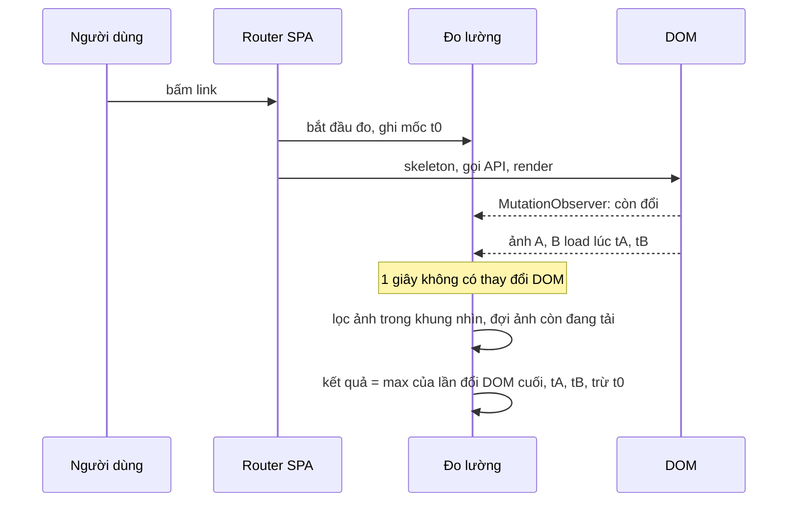

Với một trang bán hàng, con số người ta quan tâm nhất không phải "trang tải xong" (`load`) mà là **"lúc khách nhìn thấy sản phẩm"**: mọi thứ trong màn hình đầu tiên (above the fold), đặc biệt là ảnh, đã hiện đủ. Trình duyệt có sẵn Largest Contentful Paint (LCP), nhưng LCP chỉ đo **lần tải trang đầu**. Trong một SPA, phần lớn lượt xem là chuyển trang bằng JavaScript (soft navigation): URL đổi, trang không tải lại, và LCP không đo gì cả.

Zappos tự đo con số này cho cả hai kiểu chuyển trang, bằng `MutationObserver` và sự kiện `load` của ảnh. Bài này đọc cách họ làm, chỉ ra ba trường hợp đo sai, và gộp thêm hai công cụ đo nhỏ từ Outlook và Best Buy.

> [!TIP]
> **Tóm tắt**
> - Màn hình đầu "xong" = DOM trong vùng app đã **yên** (không đổi trong một khoảng, Zappos dùng 1 giây) **và** mọi ảnh đang nằm trong khung nhìn đã tải xong.
> - Ghi lại **thời điểm** từng ảnh tải xong ngay khi nó xảy ra. Zappos đợi DOM yên rồi mới đếm ảnh và trừ đi 1 giây chờ, nên đo sai khi ảnh về muộn, và không bao giờ gửi kết quả khi màn hình không có ảnh.
> - Độ trễ khi bấm = `performance.now() - event.timeStamp` đo trong một listener capture (Outlook).
> - Request khác origin không có `Timing-Allow-Origin` thì các mốc chi tiết của Resource Timing đều bằng 0; công thức cộng từng khoảng của Best Buy cho ra số rất lớn.

<iframe class="demo-frame" src="/demos/web-patterns/index.html?theme=dark#/above-fold" title="Demo above-fold" loading="lazy" style="height: 1020px"></iframe>

<p class="demo-links">▶ <a href="/demos/web-patterns/index.html#/above-fold" target="_blank" rel="noopener">Mở demo toàn màn hình ↗</a> · <a href="https://stackblitz.com/github/hunghg255/blog-hunghg/tree/master/examples/web-patterns?file=src/lib/aboveFoldTiming.ts" target="_blank" rel="noopener">Sửa code trên StackBlitz ↗</a> · <a href="https://github.com/hunghg255/blog-hunghg/blob/master/examples/web-patterns/src/lib/aboveFoldTiming.ts" target="_blank" rel="noopener">Xem source trên GitHub ↗</a></p>

Chọn một tình huống rồi bấm **Chuyển trang**. Cột "thực tế" lấy từ sự kiện `load` của từng ảnh. Với ảnh lazy-load (gán `src` muộn), cách đo kiểu Zappos báo khoảng 300ms trong khi ảnh hiện ở khoảng 2,3 giây; với trang không có ảnh, nó không gửi gì.

## Zappos làm thế nào?

Code nằm trong [`zappos.com/src/helpers/LatencyTracking.js`](https://github.com/hunghg255/codebase/blob/main/zappos.com/src/helpers/LatencyTracking.js). Footer của trang tạo một đối tượng `LatencyTracking` lúc mount (lần tải trang đầu), và gọi `triggerSoftNavigation()` mỗi khi `pathname` đổi trong `componentDidUpdate`.

### Lần tải trang đầu

Constructor gọi ngay `getAboveTheFoldImages()`: duyệt `document.images`, giữ ảnh nằm trong khung nhìn và không bị `visibility: hidden`. Ảnh nào `complete` thì đếm luôn, chưa thì gắn listener `load`/`error`. Khi đếm đủ, `trackPerformance` lấy `performance.now()` làm kết quả và chờ sự kiện `load` của trang để gửi kèm toàn bộ `performance.timing` qua `navigator.sendBeacon` tới `/martypixel`.

### Chuyển trang trong SPA

```js
this.mutationThreshold = 1000;
this.observer = new MutationObserver(debounce(mutationCallback, this.mutationThreshold));

triggerSoftNavigation = () => {
  // reset bộ đếm...
  this.clientRouted = true;
  this.pNowOffset = this.p.now();
  this.observer.observe(document.getElementById(REACT_CONTAINER_ID), { childList: true, subtree: true });
};
```

Với chuyển trang, không có sự kiện nào báo "trang mới đã render xong", vì dữ liệu về lúc nào, React vẽ bao nhiêu lần là tuỳ trang. Zappos dùng cách mà thư viện Boomerang (có link trong chú thích) cũng dùng: theo dõi mọi thay đổi DOM trong container của React, và coi **1 giây không có thay đổi** là đã render xong. Lúc đó mới quét ảnh trong khung nhìn và đợi chúng tải.

Kết quả được tính như sau:

```js
let pNow = this.p.now() - this.pNowOffset;
if (this.clientRouted) {
  pNow -= this.mutationThreshold; // observer có debounce, trừ đi thời gian chờ
}
```

Ngoài ra Zappos gửi kèm `pageViewType=soft|hard`, `navigationType` (navigate, reload, back/forward), số phần tử, số ảnh, số script trên trang.

### Ba trường hợp đo sai

**1. Ảnh về muộn hơn lúc DOM yên.** Trừ đúng 1 giây chỉ đúng khi mọi ảnh đã tải xong **trước** lúc debounce bắn. Ví dụ DOM yên ở 400ms, debounce bắn ở 1400ms, nhưng ảnh trên mạng chậm về ở 3000ms: kết quả là 3000 - 1000 = 2000ms, thiếu 1 giây so với thực tế.

**2. Ảnh chưa có `src` được tính là đã xong.** Một `` không có `src` (ảnh lazy-load chưa tới lượt, hoặc component gán `src` sau khi có dữ liệu) có `complete === true`. Zappos đếm nó ngay. Đây là tình huống "lazy-load" trong demo: báo 300ms dù ảnh hiện ở 2,3 giây.

**3. Không có ảnh nào thì không bao giờ gửi.** `viewportImgs.forEach(this.checkImg)` không chạy lần nào khi mảng rỗng, nên `trackPerformance` không bao giờ được gọi. Trang lỗi, trang chỉ có chữ, trang giỏ hàng trống đều biến mất khỏi số liệu.

Hai lỗi nhỏ hơn:
- `img.addEventListener('load', this.countImg.bind(null, img))` rồi `removeEventListener('load', this.countImg)`: hàm đã `bind` là một hàm khác, nên listener không bao giờ được gỡ. React thường dùng lại thẻ `` khi chuyển giữa hai trang cùng bố cục và chỉ đổi `src`; listener của lần đo trước vẫn còn và tăng `imgsLoaded` của lần đo sau, khiến lần đo sau kết thúc sớm.
- Nếu trang mới đã render xong **trước** khi `triggerSoftNavigation` chạy (Footer cập nhật trong cùng lần commit), không còn thay đổi DOM nào nữa, debounce không bao giờ bắn.

## Bên trong trình duyệt



- **`MutationObserver`** gom các thay đổi DOM và gọi callback một lần sau khi đoạn JavaScript hiện tại chạy xong (microtask). Theo dõi `subtree` của container app là đủ; không cần theo dõi cả `document`.
- **`img.complete`** là `true` khi ảnh đã tải xong, đã lỗi, **hoặc chưa có `src`**. Không thể dùng một mình nó để biết ảnh đã hiện.
- **LCP** (`PerformanceObserver` với type `largest-contentful-paint`) chỉ chạy cho lần tải trang đầu. Chrome đã thử nghiệm một API đo soft navigation, nhưng chưa thành chuẩn chung trên các trình duyệt (tính tới 10/2026).

## Viết lại

Mỗi ảnh được theo dõi ngay khi xuất hiện trong DOM, thời điểm tải xong được ghi lại lúc nó xảy ra:

```ts title=src/lib/aboveFoldTiming.ts
  const track = (img: HTMLImageElement) => {
    //  chưa có src (ảnh lazy-load chưa tới lượt) cũng có complete = true: coi là đang chờ, không phải đã xong
    const hasSource = Boolean(img.getAttribute('src') || img.getAttribute('srcset'));
    if (img.complete && hasSource) {
      // đã có sẵn (cache hoặc data URL): coi như xong lúc mình nhìn thấy nó
      loadedAt.set(img, performance.now());
      return;
    }
    loadedAt.set(img, undefined);
    const done = () => {
      loadedAt.set(img, performance.now());
      settle?.();
    };
    // lỗi tải cũng tính là "xong": ảnh hỏng không được làm kết quả treo mãi
    img.addEventListener('load', done, { once: true, signal });
    img.addEventListener('error', done, { once: true, signal });
  };
  const scan = () => root.querySelectorAll('img').forEach((img) => loadedAt.has(img) || track(img));
```

Bộ đếm "DOM yên" được hẹn **ngay từ đầu**, và mỗi lần DOM đổi thì hẹn lại:

```ts title=src/lib/aboveFoldTiming.ts
    const observer = new MutationObserver((records) => {
      lastMutationAt = performance.now();
      for (const record of records) {
        // React có thể dùng lại thẻ  cũ và chỉ đổi src: theo dõi lại từ đầu
        if (record.type === 'attributes' && record.target instanceof HTMLImageElement) loadedAt.delete(record.target);
      }
      scan();
      clearTimeout(quietTimer);
      quietTimer = window.setTimeout(onQuiet, quietMs);
    });
    const onQuiet = () => {
      observer.disconnect();
      settle = () => finish(false);
      finish(false);
    };

    observer.observe(root, { childList: true, subtree: true, attributes: true, attributeFilter: ['src', 'srcset'] });
    signal.addEventListener('abort', () => {
      observer.disconnect();
      clearTimeout(quietTimer);
      clearTimeout(timeoutTimer);
    });
    scan();
    // hẹn giờ ngay từ đầu: nếu DOM đã render xong trước khi bắt đầu đo thì vẫn có kết quả
    quietTimer = window.setTimeout(onQuiet, quietMs);
    timeoutTimer = window.setTimeout(() => finish(true), timeoutMs);
```

::: spoiler Xem toàn bộ src/lib/aboveFoldTiming.ts

```ts title=src/lib/aboveFoldTiming.ts
/**
 * Đo thời điểm phần đầu màn hình (above the fold) hiển thị xong, cả lần tải trang lẫn chuyển trang trong SPA
 * (ý tưởng từ zappos.com: src/helpers/LatencyTracking.js).
 *
 * "Xong" = DOM trong vùng gốc đã yên (không đổi trong `quietMs`) VÀ mọi ảnh đang nằm trong khung nhìn đã tải xong.
 * Khác bản Zappos:
 * - Ghi thời điểm từng ảnh tải xong ngay khi nó xảy ra, nên không phải trừ hú hoạ thời gian chờ.
 * - Không có ảnh nào trong khung nhìn vẫn ra kết quả (Zappos thì không bao giờ gửi).
 * - Mỗi lần đo có AbortController riêng: listener của lần đo trước không đếm nhầm sang lần sau.
 */

export interface AboveFoldResult {
  /** mốc bắt đầu (performance.now), 0 = lúc bắt đầu tải trang */
  startedAt: number;
  /** lần cuối DOM đổi trước khi yên */
  domStableAt: number;
  /** ảnh cuối cùng trong khung nhìn tải xong (bằng startedAt nếu không có ảnh) */
  imagesDoneAt: number;
  /** kết quả: max(domStableAt, imagesDoneAt) - startedAt, đơn vị ms */
  aboveTheFold: number;
  imageCount: number;
  timedOut: boolean;
}

export interface MeasureOptions {
  root: Element;
  /** mốc bắt đầu, mặc định là lúc gọi hàm. Lần tải trang đầu tiên thì truyền 0. */
  startedAt?: number;
  /** DOM không đổi trong khoảng này thì coi là đã yên (Zappos: 1000ms) */
  quietMs?: number;
  /** chờ ảnh tối đa bao lâu */
  timeoutMs?: number;
}

/** Ảnh có nằm (ít nhất một phần) trong khung nhìn và đang hiện không. */
export function isInViewport(el: Element) {
  const rect = el.getBoundingClientRect();
  if (rect.width === 0 || rect.height === 0) return false;
  if (rect.bottom < 0 || rect.right < 0 || rect.top > innerHeight || rect.left > innerWidth) return false;
  return getComputedStyle(el).visibility !== 'hidden';
}

export function measureAboveTheFold({
  root,
  startedAt = performance.now(),
  quietMs = 1000,
  timeoutMs = 15000,
}: MeasureOptions) {
  const controller = new AbortController();
  const { signal } = controller;
  // thời điểm từng ảnh tải xong; undefined = đang tải
  const loadedAt = new Map<HTMLImageElement, number | undefined>();
  let lastMutationAt = startedAt;
  let quietTimer = 0;
  let timeoutTimer = 0;
  let settle: (() => void) | null = null;

  const track = (img: HTMLImageElement) => {
    //  chưa có src (ảnh lazy-load chưa tới lượt) cũng có complete = true: coi là đang chờ, không phải đã xong
    const hasSource = Boolean(img.getAttribute('src') || img.getAttribute('srcset'));
    if (img.complete && hasSource) {
      // đã có sẵn (cache hoặc data URL): coi như xong lúc mình nhìn thấy nó
      loadedAt.set(img, performance.now());
      return;
    }
    loadedAt.set(img, undefined);
    const done = () => {
      loadedAt.set(img, performance.now());
      settle?.();
    };
    // lỗi tải cũng tính là "xong": ảnh hỏng không được làm kết quả treo mãi
    img.addEventListener('load', done, { once: true, signal });
    img.addEventListener('error', done, { once: true, signal });
  };
  const scan = () => root.querySelectorAll('img').forEach((img) => loadedAt.has(img) || track(img));

  const result = new Promise<AboveFoldResult>((resolve) => {
    const finish = (timedOut: boolean) => {
      const visible = [...loadedAt.keys()].filter(isInViewport);
      const times = visible.map((img) => loadedAt.get(img));
      if (!timedOut && times.some((t) => t === undefined)) return; // còn ảnh đang tải
      const imagesDoneAt = Math.max(startedAt, ...times.map((t) => t ?? performance.now()));
      controller.abort();
      clearTimeout(timeoutTimer);
      resolve({
        startedAt,
        domStableAt: lastMutationAt,
        imagesDoneAt,
        aboveTheFold: Math.max(lastMutationAt, imagesDoneAt) - startedAt,
        imageCount: visible.length,
        timedOut,
      });
    };

    const observer = new MutationObserver((records) => {
      lastMutationAt = performance.now();
      for (const record of records) {
        // React có thể dùng lại thẻ  cũ và chỉ đổi src: theo dõi lại từ đầu
        if (record.type === 'attributes' && record.target instanceof HTMLImageElement) loadedAt.delete(record.target);
      }
      scan();
      clearTimeout(quietTimer);
      quietTimer = window.setTimeout(onQuiet, quietMs);
    });
    const onQuiet = () => {
      observer.disconnect();
      settle = () => finish(false);
      finish(false);
    };

    observer.observe(root, { childList: true, subtree: true, attributes: true, attributeFilter: ['src', 'srcset'] });
    signal.addEventListener('abort', () => {
      observer.disconnect();
      clearTimeout(quietTimer);
      clearTimeout(timeoutTimer);
    });
    scan();
    // hẹn giờ ngay từ đầu: nếu DOM đã render xong trước khi bắt đầu đo thì vẫn có kết quả
    quietTimer = window.setTimeout(onQuiet, quietMs);
    timeoutTimer = window.setTimeout(() => finish(true), timeoutMs);
  });

  return { result, cancel: () => controller.abort() };
}
```

:::

## Đi qua code

- **`track`** phân biệt ảnh đã xong thật (`complete` **và** có `src`/`srcset`) với ảnh chưa có nguồn. Ảnh chưa xong được gắn listener `load` và `error` với `{ once: true, signal }`: `signal` của `AbortController` gỡ toàn bộ listener khi lần đo kết thúc, nên lần đo sau không bị listener cũ quấy.
- **`scan`** chạy lúc bắt đầu và sau mỗi lô thay đổi DOM, chỉ theo dõi ảnh mới.
- **Thay đổi thuộc tính `src`/`srcset`** của một ảnh đã theo dõi thì xoá nó khỏi `loadedAt` để theo dõi lại: đó là trường hợp React dùng lại thẻ cũ.
- **`onQuiet`** ngắt observer và gọi `finish`. `finish` lọc ảnh **đang** nằm trong khung nhìn (bố cục đã ổn định), nếu còn ảnh đang tải thì chờ: listener `load` của ảnh đó sẽ gọi lại `finish` qua `settle`.
- **Kết quả** là `max(lần đổi DOM cuối, ảnh cuối cùng tải xong) - startedAt`. Không có ảnh thì chỉ còn mốc DOM, vẫn có kết quả. Quá `timeoutMs` (mặc định 15 giây) thì trả về với `timedOut: true` thay vì treo.

**Khác bản gốc:**
- Không trừ thời gian chờ; dùng mốc thật của từng sự kiện.
- `` chưa có `src` được coi là đang chờ. Hệ quả: một `` trong khung nhìn **không bao giờ** có `src` sẽ làm kết quả chờ tới `timeoutMs`; loại trừ nó bằng một thuộc tính đánh dấu nếu gặp.
- Chỉ trả số liệu; gửi bằng `sendBeacon` hay gom vào batch là việc của nơi gọi (xem [bài batch logger của Facebook](/blogs/facebook-batch-logger)).

## Thêm hai công cụ nhỏ

### Độ trễ khi bấm (Outlook)

[`owa-useractivity-manager/src/userActivityManager.ts`](https://github.com/hunghg255/codebase/blob/main/outlook.live.com/src/modules/owa-useractivity-manager/src/userActivityManager.ts) gắn listener `mousedown`, `keydown`, `scroll`, `mousewheel` lên `document` với `{ capture: true, passive: true }`. Với mỗi `mousedown`:

```ts
const lag = now - event.timeStamp;
let reportIt = lagReports.some(r => lag > r.threshold);
if (reportIt) {
  // report these outside the envelope of the handler to not add to the lag problem
  factoryMethods.queueTask(() => { /* gọi callback */ });
}
```

`event.timeStamp` là lúc sự kiện được tạo; `performance.now()` trong handler là lúc main thread kịp xử lý. Khoảng cách giữa hai mốc là thời gian người dùng bấm mà trang chưa phản hồi. Listener `capture` trên `document` chạy trước mọi handler khác của trang, nên đo đúng phần chờ, chưa cộng thời gian xử lý. Việc báo cáo được đẩy sang `setTimeout` để không làm sự kiện đang trễ trễ thêm. Module này còn ghi lần bấm đầu tiên (`firstClick`, `firstLag`) và mốc hoạt động cuối để biết người dùng có đang rảnh (idle) không.

Bản viết lại (`observeInputDelay`) dùng `pointerdown` thay cho `mousedown` để tính cả chạm cảm ứng. Trong demo, bấm **Làm main thread bận 800ms** rồi bấm **Bấm thử** ngay: độ trễ đo được khoảng vài trăm mili giây.

### Tách thời gian một request (Best Buy)

[`client/utils/analytics/performanceInstrumentation.ts`](https://github.com/hunghg255/codebase/blob/main/bestbuy.ca/src(1)/client/utils/analytics/performanceInstrumentation.ts) lấy entry Resource Timing mới nhất của một URL API rồi cộng bốn khoảng: DNS, kết nối, chờ server, tải nội dung. Mỗi khoảng được kiểm tra `!== undefined`.

Vấn đề: với request **khác origin** mà server không gửi header `Timing-Allow-Origin`, các mốc chi tiết không phải `undefined` mà là **0**, riêng `responseEnd` vẫn có giá trị thật. Khoảng "tải nội dung" thành `responseEnd - 0`, tức số mili giây tính từ lúc mở trang. Demo cho ra hơn 20 giây cho một request 182ms. Ngoài ra dòng kiểm tra của khoảng kết nối viết nhầm `resouceTiming !== undefined` thay vì `connectStart !== undefined`.

Bản viết lại kiểm tra `responseStart === 0` trước: không có chi tiết thì chỉ trả `entry.duration` (luôn có), có chi tiết thì mới tách từng khoảng.

::: spoiler Xem src/lib/aboveFoldInputDelay.ts và src/lib/aboveFoldResourceTiming.ts

```ts title=src/lib/aboveFoldInputDelay.ts
/**
 * Đo độ trễ khi người dùng bấm: từ lúc trình duyệt nhận sự kiện tới lúc handler kịp chạy
 * (ý tưởng từ outlook.live.com: owa-useractivity-manager/src/userActivityManager.ts).
 *
 * `event.timeStamp` là lúc sự kiện được tạo, `performance.now()` trong handler là lúc nó được xử lý.
 * Main thread đang bận (JS dài, layout lớn) thì khoảng cách này lớn: người dùng thấy trang "đơ".
 */

export interface InputDelayReport {
  type: string;
  delay: number;
  /** thời điểm sự kiện xảy ra (performance.now) */
  at: number;
}

export function observeInputDelay(
  onReport: (report: InputDelayReport) => void,
  { threshold = 50, target = document as Document | Element }: { threshold?: number; target?: Document | Element } = {},
) {
  const handle = (event: Event) => {
    // Alt/Shift đơn lẻ thường là một phần của tổ hợp phím, Outlook cũng bỏ qua
    const key = (event as KeyboardEvent).key;
    if (key === 'Alt' || key === 'Shift') return;
    const delay = performance.now() - event.timeStamp;
    if (delay < threshold) return;
    // Báo cáo ở task sau, ngoài handler: không làm sự kiện đang trễ trễ thêm
    setTimeout(() => onReport({ type: event.type, delay, at: event.timeStamp }));
  };
  // capture: chạy trước mọi handler khác; passive: không bao giờ preventDefault, trình duyệt khỏi phải chờ
  const options = { capture: true, passive: true };
  target.addEventListener('pointerdown', handle, options);
  target.addEventListener('keydown', handle, options);
  return () => {
    target.removeEventListener('pointerdown', handle, options);
    target.removeEventListener('keydown', handle, options);
  };
}
```

```ts title=src/lib/aboveFoldResourceTiming.ts
/**
 * Tách thời gian tải một request thành DNS / kết nối / TLS / chờ server / tải nội dung
 * (ý tưởng từ bestbuy.ca: client/utils/analytics/performanceInstrumentation.ts).
 */

export interface ResourceBreakdown {
  url: string;
  /** tổng thời gian request, luôn có */
  total: number;
  /** false: request khác origin không có Timing-Allow-Origin, các mốc chi tiết đều bằng 0 */
  detailed: boolean;
  dns?: number;
  connect?: number;
  tls?: number;
  waiting?: number;
  download?: number;
}

export function breakdown(entry: PerformanceResourceTiming): ResourceBreakdown {
  const base = { url: entry.name, total: entry.duration };
  // Không có Timing-Allow-Origin: domainLookupStart, connectStart, requestStart, responseStart... đều là 0.
  // responseEnd thì vẫn có. Lấy responseEnd - responseStart lúc này ra một số rất lớn (tính từ lúc mở trang).
  if (entry.responseStart === 0) return { ...base, detailed: false };
  return {
    ...base,
    detailed: true,
    dns: entry.domainLookupEnd - entry.domainLookupStart,
    connect: entry.connectEnd - entry.connectStart,
    // secureConnectionStart = 0 khi không dùng HTTPS hoặc dùng lại kết nối cũ
    tls: entry.secureConnectionStart > 0 ? entry.connectEnd - entry.secureConnectionStart : 0,
    waiting: entry.responseStart - entry.requestStart,
    download: entry.responseEnd - entry.responseStart,
  };
}

/** Lấy entry MỚI NHẤT của một URL (cùng URL gọi nhiều lần sẽ có nhiều entry). */
export function latestEntry(url: string) {
  const entries = performance.getEntriesByName(url, 'resource') as PerformanceResourceTiming[];
  return entries[entries.length - 1];
}
```

:::

## Tại sao không làm cách khác?

**Chỉ dùng LCP?** Không đo soft navigation, và LCP là **một** phần tử lớn nhất, không phải "mọi ảnh trong màn hình đầu".

**Đo tới lúc API trả về?** Lúc đó trang chưa vẽ gì. Người dùng chỉ thấy sản phẩm khi DOM đã render **và** ảnh đã tải.

**Dùng `requestAnimationFrame` sau lần render cuối thay vì chờ 1 giây?** Không biết lần render nào là cuối: dữ liệu có thể về thành nhiều đợt. Khoảng chờ yên là cách chấp nhận sai số để không cần mỗi trang tự báo "tôi đã xong". Trang nào biết chính xác (vd sau khi danh sách sản phẩm render) thì nên tự đặt mốc bằng `performance.mark()`.

## Edge case và cạm bẫy

- **Trang có animation hay đồng hồ đếm ngược** đổi DOM liên tục: DOM không bao giờ "yên". Loại vùng đó khỏi `root`, hoặc dựa vào `timeoutMs`.
- **Ảnh nền CSS** (`background-image`) không phải ``, không được tính.
- **Người dùng cuộn trong lúc đo:** ảnh "trong khung nhìn" được xét lúc DOM yên. Đo chính xác hơn thì ghi lại vị trí cuộn lúc bắt đầu.
- **Tab bị ẩn giữa chừng:** `setTimeout` bị giãn, ảnh có thể không tải. Bỏ kết quả nếu `document.visibilityState` từng là `hidden` trong lúc đo.
- **Bộ đệm Resource Timing** mặc định giữ 250 entry. SPA chạy lâu sẽ đầy, entry mới không được ghi; nghe sự kiện `resourcetimingbufferfull` để xử lý hoặc tăng bằng `performance.setResourceTimingBufferSize()`.
- **`unload`**: Zappos gửi beacon cả ở `unload`. Sự kiện này không chạy đáng tin trên điện thoại và đang bị các trình duyệt bỏ dần; dùng `visibilitychange`/`pagehide`.

## Dùng trong dự án

```ts
router.beforeEach(() => {
  pending?.cancel();
  pending = measureAboveTheFold({ root: document.getElementById('app')! });
  pending.result.then((r) => logger.log('atf', { ms: Math.round(r.aboveTheFold), images: r.imageCount, timedOut: r.timedOut }));
});

// lần tải trang đầu: mốc 0 là lúc bắt đầu điều hướng
measureAboveTheFold({ root: document.getElementById('app')!, startedAt: 0 });

observeInputDelay((r) => logger.log('input-delay', r), { threshold: 100 });
```

::: spoiler Ví dụ test (bản phác, không có trong repo)

```ts
import { afterEach, beforeEach, describe, expect, it, vi } from 'vitest';
import { measureAboveTheFold } from './aboveFoldTiming';
import { breakdown } from './aboveFoldResourceTiming';

// jsdom không có layout: cho mọi phần tử một hình chữ nhật nằm trong khung nhìn
beforeEach(() => {
  vi.useFakeTimers();
  vi.spyOn(Element.prototype, 'getBoundingClientRect').mockReturnValue({ top: 10, left: 10, bottom: 110, right: 110, width: 100, height: 100 } as DOMRect);
});
afterEach(() => {
  vi.useRealTimers();
  vi.restoreAllMocks();
});

describe('measureAboveTheFold', () => {
  it('không có ảnh vẫn ra kết quả sau khoảng chờ', async () => {
    const root = document.createElement('div');
    document.body.append(root);
    const { result } = measureAboveTheFold({ root, quietMs: 1000 });
    await vi.advanceTimersByTimeAsync(1000);
    await expect(result).resolves.toMatchObject({ imageCount: 0, timedOut: false });
  });

  it('ảnh chưa có src được coi là đang chờ, xong khi ảnh tải', async () => {
    const root = document.createElement('div');
    document.body.append(root);
    const img = document.createElement('img');
    root.append(img);
    const { result } = measureAboveTheFold({ root, quietMs: 1000, timeoutMs: 10000 });
    let done = false;
    void result.then(() => (done = true));
    await vi.advanceTimersByTimeAsync(1500);
    expect(done).toBe(false); // DOM đã yên nhưng ảnh chưa có
    img.dispatchEvent(new Event('load'));
    await vi.advanceTimersByTimeAsync(0);
    await expect(result).resolves.toMatchObject({ imageCount: 1, timedOut: false });
  });
});

describe('breakdown', () => {
  it('request không có Timing-Allow-Origin: chỉ có tổng', () => {
    const entry = { name: 'x', duration: 120, responseStart: 0, responseEnd: 50000 } as PerformanceResourceTiming;
    expect(breakdown(entry)).toEqual({ url: 'x', total: 120, detailed: false });
  });
});
```

:::

## So với thư viện và chuẩn web

- **Event Timing API** (`PerformanceObserver` type `event`, nền tảng của INP) đo độ trễ tương tác đầy đủ hơn cách của Outlook: tách được phần chờ (`processingStart - startTime`), phần xử lý và phần vẽ lại. Cách của Outlook vẫn có ích ở trình duyệt chưa hỗ trợ, và vì nó cực nhẹ.
- **Element Timing** (`elementtiming` attribute) báo lúc một ảnh hay khối chữ cụ thể được vẽ, nhưng hiện chỉ có trên Chromium (tính tới 10/2026) và cũng không dành cho soft navigation.
- **Boomerang** (thư viện RUM của Akamai, có plugin SPA) dùng cùng ý tưởng chờ DOM yên. Zappos đặt tên bộ đếm `aboveTheFold` theo custom timer của mPulse, sản phẩm RUM dựa trên Boomerang.
- Liên quan trong series: [tự đo LCP/CLS/TBT](/blogs/web-rum-adaptive-loading), [performance span](/blogs/web-performance-spans-long-tasks), [Visual Completion của Facebook](/blogs/facebook-visual-completion).

---

Bài này thuộc series **[Học từ mã nguồn các web lớn](/series/web)** (65 bài, đọc theo thứ tự).

::: spoiler Xem nhanh danh sách bài trong series

*Mở đầu*

- [Mở đầu: đọc code production của 28 trang web](/blogs/learn-from-big-web-apps)

*Phần 1: trải nghiệm người dùng*

- [#1 Dark mode không nháy (Gatsby)](/blogs/web-dark-mode-no-flash)
- [#2 useValueByMedia: giá trị theo breakpoint (Toptal)](/blogs/web-use-value-by-media)
- [#3 Đoán ý định: idle, exit-intent, lắc chuột (Toptal, InVision)](/blogs/web-user-intent-idle-exit-wiggle)
- [#4 Validate form thân thiện (Udacity, Pipedrive)](/blogs/web-form-validation-ux)
- [#5 Magic number, EXIF và dán ảnh (Ello)](/blogs/web-file-magic-number-exif-paste)
- [#6 fastSmoothScroll: cuộn xa vẫn nhanh (Telegram)](/blogs/web-telegram-fast-smooth-scroll)
- [#7 Countdown time-travel và tombstone giỏ hàng (Best Buy)](/blogs/web-countdown-time-travel-tombstone)

*Phần 2: hiệu năng và đo lường*

- [#8 Hàng đợi requestAnimationFrame 3ms (Apple)](/blogs/web-raf-queue-3ms)
- [#9 srcset cho artwork và preconnect tự động (Apple)](/blogs/web-responsive-artwork-preconnect)
- [#10 Quick-fetch: gọi API trước khi bundle tải xong (HubSpot)](/blogs/web-quick-fetch-early-requests)
- [#11 Performance span và long task (Postman, Calibre)](/blogs/web-performance-spans-long-tasks)
- [#12 Gọi Web Worker như hàm async (Telegram)](/blogs/web-worker-promise-rpc)
- [#13 Đồng hồ media: đếm giờ xem và sửa lệch (Skillshare, Simplified)](/blogs/web-media-clock-watch-time-drift)

*Phần 3: nhiều tab, phiên đăng nhập, cập nhật*

- [#14 Bầu tab chủ cho thông báo (HubSpot, Telegram)](/blogs/web-leader-tab-notifications)
- [#15 Đồng bộ đăng nhập giữa tab và giới hạn cookie (Elastic, InVision)](/blogs/web-cross-tab-auth-cookie-guard)
- [#16 SPA tự cập nhật: Trello, Zappos, Facebook, Elastic](/blogs/web-spa-self-update-strategies)

*Phần 4: kiến trúc*

- [#17 Reverse portal: di chuyển component không remount (Zappos)](/blogs/web-reverse-portal)
- [#18 Page behaviors: gắn hành vi từ CMS (Intercom)](/blogs/web-page-behaviors-cms)
- [#19 Giới hạn tần suất hiển thị bằng bitmask (Outlook)](/blogs/web-frequency-cap-bitmask)
- [#20 Chuyển REST sang GraphQL dần dần (Coursera)](/blogs/web-rest-to-graphql-hybrid-link)

*Phần 5: soạn thảo và hiển thị nội dung*

- [#21 Autocomplete tại con trỏ trong contenteditable (Ello, Telegram)](/blogs/web-caret-autocomplete-contenteditable)
- [#22 Dark mode cho email HTML bằng CIELAB (Outlook)](/blogs/web-email-dark-mode-cielab)
- [#23 Thu nhỏ bảng rộng cho vừa khung, vá font emoji (Outlook)](/blogs/web-email-wide-content-scale)
- [#24 Cảnh báo quên đính kèm file (Outlook)](/blogs/web-forgotten-attachment-warning)
- [#25 Cắt chữ nhiều dòng chính xác (Pipedrive, Apple, Toptal)](/blogs/web-multiline-truncate-measure-text)
- [#26 Parse ngày giờ gõ tay khoan dung (Outlook, Elastic)](/blogs/web-lenient-date-parser)

*Phần 6: tương tác*

- [#27 menuAim: rê chéo vào submenu không bị đóng (Udemy)](/blogs/web-menu-aim-triangle)
- [#28 Kéo, vuốt chung cho chuột và cảm ứng (Telegram)](/blogs/web-unified-pointer-gestures)
- [#29 Phím tắt theo phạm vi, IME và bàn phím phi Latinh (Trello)](/blogs/web-scoped-keyboard-shortcuts)
- [#30 Nội suy màu: đổi theme và nền theo cuộn (Telegram, Anchor)](/blogs/web-color-interpolation-theme-scroll)
- [#31 Đường gióng hút cạnh và undo/redo trên canvas (Simplified)](/blogs/web-canvas-snap-guides-undo)
- [#32 Giả lập mù màu bằng feColorMatrix (Trello)](/blogs/web-color-vision-simulator)
- [#33 Vạch thước theo mức zoom và cấp phát màu cho biểu đồ (Anchor, Similarweb)](/blogs/web-timeline-ticks-color-stack)

*Phần 7: mạng, dữ liệu và async*

- [#34 Ô tìm kiếm chuẩn production (Similarweb, Udemy, Pipedrive)](/blogs/web-production-search-box)
- [#35 Điều phối async: latest-wins, single-flight (Glitch, Toptal)](/blogs/web-async-coordination-latest-wins)
- [#36 Polling thưa dần và debounce động (Trello)](/blogs/web-decaying-polling-dynamic-debounce)
- [#37 Cache phía client theo version (Similarweb, Telegram, Udemy)](/blogs/web-client-cache-versioned)
- [#38 Upload file lớn theo chunk (Outlook, Tribe)](/blogs/web-chunked-upload-pipeline)
- [#39 Phát video qua Service Worker bằng Range request (Telegram, Outlook)](/blogs/web-service-worker-range-streaming)

*Phần 8: hiệu năng và vận hành*

- [#40 TTI governor: hoãn việc phụ tới sau khi trang dùng được (Outlook)](/blogs/web-tti-governor)
- [#41 Tự đo LCP/CLS/TBT và phục vụ bản nhẹ cho máy yếu (Udemy)](/blogs/web-rum-adaptive-loading)

*Phần 9: thuật toán và dữ liệu phía client*

- [#42 Three-way merge ngay trên trình duyệt (Postman)](/blogs/web-three-way-merge-client)
- [#43 Dọn cache GraphQL bằng đếm tham chiếu (Outlook)](/blogs/web-graphql-cache-refcount-gc)
- [#44 LRU cache theo 3 cách (Apple, Similarweb, Outlook)](/blogs/web-lru-cache-three-ways)
- [#45 Lọc tăng dần trong Web Worker (Similarweb)](/blogs/web-incremental-filter-worker)
- [#46 Xếp hạng gợi ý trên client, so ngầm với server (Outlook)](/blogs/web-client-side-ranking-shadow-test)
- [#47 Nối OT với editor: undo stack và chặn echo (Glitch)](/blogs/web-ot-codemirror-undo)
- [#48 Ngôn ngữ markup riêng dịch hai chiều với HTML (Coursera)](/blogs/web-custom-markup-compiler)

*Phần 10: thời gian, ngôn ngữ, định dạng*

- [#49 Xử lý giờ mùa hè không cần thư viện (Udemy, Pipedrive)](/blogs/web-dst-without-library)
- [#50 Intl thực chiến: Segmenter, số rút gọn, số nhiều, fallback locale (Apple, Outlook)](/blogs/web-intl-in-production)
- [#51 WebVTT và bôi chọn transcript (Udemy, Coursera)](/blogs/web-webvtt-transcript-selection)

*Phần 11: tương tác và giao diện*

- [#52 Kéo-thả trên lịch (Pipedrive)](/blogs/web-calendar-drag-drop)
- [#53 Focus stack cho popup lồng nhau (Outlook)](/blogs/web-focus-stack-nested-popups)
- [#54 Clipboard: copy, dán chữ thuần, dán thông minh (Trello, Anchor, Pipedrive, Tribe)](/blogs/web-clipboard-tricks)
- [#55 Khôi phục vị trí cuộn khi trang còn đang tải (Apple, Zappos)](/blogs/web-scroll-restore-wait-height)
- [#56 Lấy màu từ ảnh: gradient nền, màu chữ (Apple, Telegram, Trello)](/blogs/web-colors-from-images)
- [#57 JS đọc breakpoint từ CSS, phát hiện chế độ PWA (Ello, Apple)](/blogs/web-css-js-breakpoint-bridge)

*Phần 12: media*

- [#58 Tin nhắn thoại: ghi âm, waveform realtime, nén 5-bit (Telegram)](/blogs/web-voice-message-waveform)
- [#59 Chụp frame video thành ảnh, canvas bị taint (Coursera, Outlook)](/blogs/web-video-frame-snapshot)

*Phần 13: đo lường, bảo mật, vận hành*

- **#60 Đo lúc ảnh màn hình đầu tải xong, cả khi chuyển trang SPA (Zappos, Best Buy, Outlook)** (bài này)
- [#61 Buffer analytics chờ SDK, phát hiện adblock (Best Buy)](/blogs/web-analytics-buffer-adblock)
- [#62 Proof-of-work trên client để chặn API ẩn danh (Udemy)](/blogs/web-client-proof-of-work)
- [#63 Prefetch không làm lệch số liệu, nén cài đặt bằng bit (Outlook)](/blogs/web-synthetic-prefetch-bit-flags)
- [#64 Micro-frontend: AngularJS và React chung app, giao tiếp xuyên frame (Similarweb, InVision, HubSpot)](/blogs/web-micro-frontend-bridges)

:::

Code + demo: [`examples/web-patterns`](https://github.com/hunghg255/blog-hunghg/tree/master/examples/web-patterns) · [Mở trên StackBlitz](https://stackblitz.com/github/hunghg255/blog-hunghg/tree/master/examples/web-patterns)
