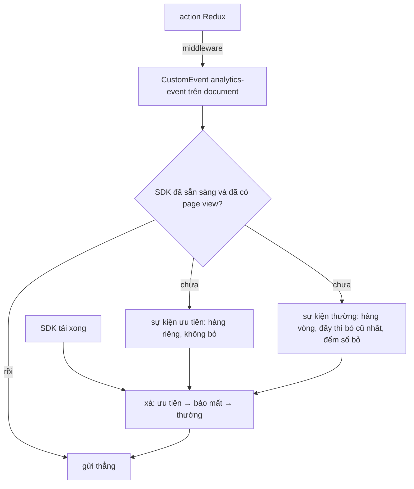

Script analytics (Adobe Launch, Google Tag Manager, Segment…) thường được tải **sau** app, có khi chậm vài giây, có khi không tải được vì bị chặn. Trong lúc đó app đã chạy: trang đã hiện, người dùng đã cuộn, đã bấm. Gọi thẳng SDK lúc này thì SDK chưa có, sự kiện mất. Chờ SDK rồi mới cho app chạy thì trang chậm vì một thứ người dùng không cần.

Cách quen thuộc là một **hàng đợi**: app ghi sự kiện vào hàng đợi, SDK tải xong thì xả hàng đợi ra rồi gửi thẳng từ đó về sau. Best Buy Canada làm đúng như vậy, thêm hai chi tiết: hàng đợi có giới hạn, và sự kiện xem trang (page view) phải được gửi **trước tiên**. Cũng trong repo đó có một hàm nhỏ dò trình chặn quảng cáo bằng **phần tử mồi**.

> [!TIP]
> **Tóm tắt**
> - Mỗi action Redux của Best Buy được phát thành một `CustomEvent` trên `document`; một hàng đợi vòng 50 phần tử giữ chúng tới khi SDK báo đã tải, rồi gửi page view trước, phần còn lại sau.
> - Hàng đợi vòng **chung** cho mọi sự kiện thì page view cũng có thể bị đẩy ra ngoài. Tách sự kiện ưu tiên ra một hàng riêng không bao giờ bị bỏ, và gửi kèm số sự kiện đã mất.
> - Dò adblock: tạo một `div` mang các class quảng cáo quen thuộc, xem nó có bị ẩn không. Đợi một chút trước khi kiểm tra, và nhớ gỡ mồi.
> - Dùng kết quả dò adblock để bố cục cho gọn (không chừa chỗ trống cho quảng cáo), không phải để làm phiền người dùng.

<iframe class="demo-frame" src="/demos/web-patterns/index.html?theme=dark#/analytics-buffer" title="Demo analytics-buffer" loading="lazy" style="height: 980px"></iframe>

<p class="demo-links">▶ <a href="/demos/web-patterns/index.html#/analytics-buffer" target="_blank" rel="noopener">Mở demo toàn màn hình ↗</a> · <a href="https://stackblitz.com/github/hunghg255/blog-hunghg/tree/master/examples/web-patterns?file=src/lib/analyticsBuffer.ts" target="_blank" rel="noopener">Sửa code trên StackBlitz ↗</a> · <a href="https://github.com/hunghg255/blog-hunghg/blob/master/examples/web-patterns/src/lib/analyticsBuffer.ts" target="_blank" rel="noopener">Xem source trên GitHub ↗</a></p>

Bấm lần lượt **Mở trang**, **Bắn 60 sự kiện**, **SDK tải xong**: bản kiểu Best Buy gửi 0 sự kiện vì page view đã bị đẩy khỏi hàng đợi. Ở phần dưới, chọn **Trình chặn ẩn trễ 50ms** rồi kiểm tra: cách kiểm tra ngay lập tức báo "không chặn".

## Best Buy làm thế nào?

### Mỗi action Redux là một sự kiện analytics

[`client/utils/analytics/middleware.ts`](https://github.com/hunghg255/codebase/blob/main/bestbuy.ca/src(1)/client/utils/analytics/middleware.ts) là một Redux middleware vài dòng:

```ts
export default ({getState}) => (next) => (action) => {
    next(action);
    if (typeof window !== "undefined") {
        const event = new CustomEvent("analytics-event", {
            detail: {event: action.type, payload: action.payload, state: getState()},
        });
        document.dispatchEvent(event);
    }
};
```

App không gọi SDK analytics ở đâu cả. Mọi action đều được phát ra `document` kèm loại action, payload và state **sau** action. Việc chọn action nào cần gửi, gửi gì, nằm hết ở phía tag manager. Điểm hay là code app không phụ thuộc vào SDK; điểm cần nhớ là mỗi sự kiện mang theo tham chiếu tới toàn bộ state.

### Hàng đợi trước khi SDK tải xong

[`client/utils/analytics/eventBuffer.ts`](https://github.com/hunghg255/codebase/blob/main/bestbuy.ca/src(1)/client/utils/analytics/eventBuffer.ts) được gọi rất sớm trong `index.tsx`, trước cả lúc tạo store:

```ts
const pageLoadEvents = ["PAGE_LOAD", "ANALYTICS_CART_LOADED"];
const EventBufferMaxSize = 50;
const eventCacheHandler = (event) => {
    if (CachedEvents.length >= EventBufferMaxSize) CachedEvents.shift(); // (viết gọn lại)
    CachedEvents.push(event);
};
document.addEventListener(Events.Analytics, eventCacheHandler);
document.addEventListener(Events.DtmLoaded, dtmLoadedHandler);
```

Khi Adobe Launch báo đã tải (`analytics-dtm-loaded`), hàm `checkCacheForPageload` tìm trong hàng đợi một sự kiện page view (tên action chứa `PAGE_LOAD` hoặc `ANALYTICS_CART_LOADED`):

- **Có:** gửi nó trước, rồi gửi toàn bộ phần còn lại theo thứ tự, rồi đổi listener sang chế độ gửi thẳng (`pushToDataLayer`).
- **Chưa có:** thay listener bằng `firstPageLoadHandler`: tiếp tục giữ mọi sự kiện, tới khi page view đầu tiên xuất hiện thì gửi nó, xả hàng đợi và chuyển sang gửi thẳng.

Đổi hẳn listener (`removeEventListener` cái cũ, `addEventListener` cái mới) thay vì giữ một listener với nhiều nhánh `if`: mỗi giai đoạn có đúng một hàm xử lý.

### Chỗ chưa ổn: page view nằm chung hàng đợi vòng

Hàng đợi vòng 50 phần tử giữ **mọi** sự kiện, kể cả page view. Sự kiện thứ 51 đẩy sự kiện đầu tiên ra ngoài, và sự kiện đầu tiên gần như luôn là page view. Lúc SDK tải xong, `checkCacheForPageload` không tìm thấy page view, chuyển sang chờ page view **tiếp theo**: toàn bộ sự kiện của trang đầu tiên hoặc bị gửi muộn dưới page view của trang sau, hoặc mất dần vì hàng đợi vòng vẫn tiếp tục đẩy ra.

Với một app mà mỗi action Redux là một sự kiện, 50 sự kiện trước khi script analytics tải xong là con số có thể chạm tới (mỗi request API thường sinh 2–3 action). Mình không đo được trên trang thật, nhưng demo tái hiện đúng logic này.

Một chi tiết nhỏ khác: `checkCacheForPageload` dùng `forEach` với `return` bên trong để "dừng" khi tìm thấy page view. `return` trong `forEach` chỉ thoát khỏi lần gọi hiện tại, vòng lặp vẫn chạy tiếp. Code vẫn đúng vì ngay trước đó `pushCachedEvents` đã làm rỗng mảng, nhưng đọc dễ hiểu nhầm; `findIndex` rõ hơn.

### Dò trình chặn quảng cáo

[`client/utils/detectAdBlocker/index.ts`](https://github.com/hunghg255/codebase/blob/main/bestbuy.ca/src(1)/client/utils/detectAdBlocker/index.ts):

```ts
const blockedElement = document.createElement("div");
blockedElement.className =
    "pub_300x250 pub_300x250m pub_728x90 text-ad textAd text_ad text_ads text-ads text-ad-links ad-text adSense adBlock adContent adBanner";
// style: 1×1px, position absolute, left -10000px...
document.body.appendChild(blockedElement);
return (
    window.document.body.getAttribute("abp") != null ||
    blockedElement.offsetParent == null ||
    blockedElement.offsetHeight === 0 ||
    // ... offsetLeft, offsetTop, offsetWidth, clientHeight, clientWidth === 0
);
```

Trình chặn quảng cáo có danh sách bộ lọc ẩn phần tử theo class hay gặp ở quảng cáo. Phần tử mồi mang cả loạt class đó; bị ẩn (`display: none`) thì `offsetParent` thành `null` và mọi kích thước về 0. Thuộc tính `abp` trên `<body>` là dấu hiệu mà một số phiên bản Adblock Plus cũ để lại.

`App` gọi hàm này lúc mount. Kết quả vào Redux state, và `AdLoader`/`AdSlot` không render ô quảng cáo khi có trình chặn, nên trang không có những khoảng trống chờ quảng cáo không bao giờ tới.

Hai chỗ có thể cải thiện: kiểm tra **ngay** sau `appendChild` (trình chặn nào ẩn phần tử bằng script chạy sau sẽ bị bỏ sót), và **không gỡ mồi** sau khi kiểm tra.

## Bên trong trình duyệt



- **`CustomEvent` trên `document`** là một kênh pub/sub có sẵn: bên phát không cần biết bên nghe là ai, bên nghe có thể đăng ký trước hay sau. `dispatchEvent` gọi listener **đồng bộ**, nên listener nặng sẽ làm chậm chính action vừa dispatch.
- **Bộ lọc ẩn phần tử** của trình chặn quảng cáo thường là CSS chèn vào trang (`display: none !important`), có hiệu lực ngay khi phần tử được thêm vào. Bộ lọc nâng cao (vd của uBlock Origin) có thể dùng script và `MutationObserver`, ẩn phần tử muộn hơn một chút. Đó là lý do nên đợi một nhịp trước khi đo.
- **Đọc `offsetParent`/`offsetHeight`** buộc trình duyệt tính lại bố cục (layout) ngay lúc đó. Gọi một lần lúc khởi động thì không sao.

## Viết lại

Hàng đợi tách hai hàng, xả theo thứ tự ưu tiên → báo mất → thường:

```ts title=src/lib/analyticsBuffer.ts
  const flush = () => {
    if (!sink) return;
    if (waitForPriority && priority.length === 0) return; // chưa có page view: giữ tiếp
    const send = sink;
    priority.splice(0).forEach(send);
    if (dropped > 0) {
      send({ name: 'analytics_buffer_overflow', data: { dropped }, at: performance.now() });
      dropped = 0;
    }
    normal.splice(0).forEach(send);
    open = true;
  };
```

Dò adblock có chờ và có dọn mồi:

```ts title=src/lib/analyticsAdblock.ts
export async function detectAdBlocker({ waitMs = 100 }: { waitMs?: number } = {}): Promise<boolean> {
  const bait = document.createElement('div');
  bait.className = BAIT_CLASSES;
  bait.setAttribute('aria-hidden', 'true');
  bait.style.cssText = 'width:1px!important;height:1px!important;position:absolute!important;left:-10000px!important;top:-1000px!important;';
  document.body.appendChild(bait);
  try {
    // Có trình chặn chèn CSS hoặc ẩn phần tử hơi trễ (sau khi trang tải, qua MutationObserver):
    // đợi một chút thay vì kiểm tra ngay sau appendChild.
    await new Promise((resolve) => setTimeout(resolve, waitMs));
    return isHidden(bait) || !bait.isConnected; // có trình chặn xoá hẳn phần tử
  } finally {
    bait.remove(); // dọn mồi, gọi nhiều lần không để rác trong DOM
  }
}
```

::: spoiler Xem toàn bộ src/lib/analyticsBuffer.ts và src/lib/analyticsAdblock.ts

```ts title=src/lib/analyticsBuffer.ts
/**
 * Giữ sự kiện analytics trong hàng đợi tới khi SDK tải xong, rồi xả theo đúng thứ tự cần thiết
 * (ý tưởng từ bestbuy.ca: client/utils/analytics/eventBuffer.ts).
 *
 * - Hàng đợi vòng có giới hạn: đầy thì bỏ sự kiện cũ nhất, không giữ vô hạn.
 * - Sự kiện "ưu tiên" (vd page view) KHÔNG bao giờ bị bỏ và luôn được gửi trước:
 *   công cụ analytics thường cần page view có mặt trước các sự kiện khác của trang đó.
 * - Bỏ sự kiện nào thì đếm lại và gửi một sự kiện báo mất dữ liệu.
 * - SDK đã sẵn sàng nhưng chưa có page view: tiếp tục giữ, xả ngay khi page view tới.
 */

export interface AnalyticsEvent {
  name: string;
  data?: Record<string, unknown>;
  /** performance.now() lúc sự kiện xảy ra, để bên nhận biết thứ tự thật */
  at: number;
}

export interface AnalyticsBufferOptions {
  /** số sự kiện thường giữ tối đa (Best Buy: 50) */
  max?: number;
  /**
   * Sự kiện ưu tiên: không bị bỏ, gửi trước tiên. Có truyền hàm này thì hàng đợi chỉ được xả
   * khi đã có ít nhất một sự kiện ưu tiên (giống Best Buy chờ PAGE_LOAD).
   */
  isPriority?: (event: AnalyticsEvent) => boolean;
}

export function createAnalyticsBuffer({ max = 50, isPriority }: AnalyticsBufferOptions = {}) {
  const waitForPriority = isPriority !== undefined;
  const priority: AnalyticsEvent[] = [];
  const normal: AnalyticsEvent[] = [];
  let dropped = 0;
  let sink: ((event: AnalyticsEvent) => void) | null = null;
  let open = false; // true: gửi thẳng, không qua hàng đợi

  const flush = () => {
    if (!sink) return;
    if (waitForPriority && priority.length === 0) return; // chưa có page view: giữ tiếp
    const send = sink;
    priority.splice(0).forEach(send);
    if (dropped > 0) {
      send({ name: 'analytics_buffer_overflow', data: { dropped }, at: performance.now() });
      dropped = 0;
    }
    normal.splice(0).forEach(send);
    open = true;
  };

  return {
    track(name: string, data?: Record<string, unknown>) {
      const event: AnalyticsEvent = { name, data, at: performance.now() };
      if (open && sink) {
        sink(event);
        return;
      }
      if (isPriority?.(event)) {
        priority.push(event);
        flush();
        return;
      }
      if (normal.length >= max) {
        normal.shift();
        dropped++;
      }
      normal.push(event);
    },
    /** Gọi khi SDK đã tải xong. */
    connect(send: (event: AnalyticsEvent) => void) {
      sink = send;
      flush();
    },
    stats: () => ({ priority: priority.length, normal: normal.length, dropped, open }),
  };
}
```

```ts title=src/lib/analyticsAdblock.ts
/**
 * Phát hiện trình chặn quảng cáo bằng phần tử mồi (ý tưởng từ bestbuy.ca: client/utils/detectAdBlocker/index.ts).
 *
 * Trình chặn quảng cáo có danh sách class CSS hay gặp ở quảng cáo (adBanner, ad-text, pub_300x250…) và ẩn mọi
 * phần tử mang các class đó. Tạo một phần tử mồi mang những class này rồi xem nó có bị ẩn không.
 * Best Buy dùng kết quả để không chừa chỗ trống cho ô quảng cáo sẽ không bao giờ hiện.
 */

export const BAIT_CLASSES =
  'pub_300x250 pub_300x250m pub_728x90 text-ad textAd text_ad text_ads text-ads text-ad-links ad-text adSense adBlock adContent adBanner';

/** Phần tử bị ẩn: display:none làm offsetParent = null và kích thước = 0. */
export function isHidden(el: HTMLElement) {
  return (
    el.offsetParent === null ||
    el.offsetHeight === 0 ||
    el.offsetWidth === 0 ||
    getComputedStyle(el).visibility === 'hidden'
  );
}

export async function detectAdBlocker({ waitMs = 100 }: { waitMs?: number } = {}): Promise<boolean> {
  const bait = document.createElement('div');
  bait.className = BAIT_CLASSES;
  bait.setAttribute('aria-hidden', 'true');
  bait.style.cssText = 'width:1px!important;height:1px!important;position:absolute!important;left:-10000px!important;top:-1000px!important;';
  document.body.appendChild(bait);
  try {
    // Có trình chặn chèn CSS hoặc ẩn phần tử hơi trễ (sau khi trang tải, qua MutationObserver):
    // đợi một chút thay vì kiểm tra ngay sau appendChild.
    await new Promise((resolve) => setTimeout(resolve, waitMs));
    return isHidden(bait) || !bait.isConnected; // có trình chặn xoá hẳn phần tử
  } finally {
    bait.remove(); // dọn mồi, gọi nhiều lần không để rác trong DOM
  }
}
```

:::

## Đi qua code

- **Hai hàng đợi.** Sự kiện ưu tiên (`isPriority`) vào `priority`, không giới hạn và không bao giờ bị bỏ (số page view trước khi SDK tải xong rất nhỏ). Sự kiện thường vào `normal`, đầy thì `shift()` cái cũ nhất và tăng `dropped`.
- **Khi nào xả?** Cần cả hai điều kiện: đã có `sink` (SDK sẵn sàng) và, nếu có truyền `isPriority`, đã có ít nhất một sự kiện ưu tiên. Không truyền `isPriority` thì xả ngay khi `connect`.
- **Báo mất dữ liệu.** Có sự kiện bị bỏ thì gửi thêm `analytics_buffer_overflow` với số lượng, ngay sau page view. Bên phân tích biết phiên nào thiếu dữ liệu thay vì tưởng người dùng không làm gì.
- **Sau khi xả**, `open = true` và mọi sự kiện đi thẳng tới `sink`.
- **`detectAdBlocker`** chờ `waitMs` (mặc định 100ms), coi là bị chặn nếu mồi bị ẩn **hoặc bị xoá khỏi DOM**, và luôn gỡ mồi trong `finally`.

**Khác bản gốc:** hàng ưu tiên riêng và sự kiện báo mất; chỉ nhận tên + dữ liệu cần gửi thay vì cả state; dò adblock bất đồng bộ, có dọn mồi, bỏ kiểm tra thuộc tính `abp` (dấu hiệu của các bản Adblock Plus rất cũ).

## Tại sao không làm cách khác?

**Mảng toàn cục kiểu `window.dataLayer = window.dataLayer || []`?** Đây chính là cách Google Tag Manager làm: app `push` vào mảng, GTM tải xong thì đọc lại toàn bộ và thay `push` bằng hàm của nó. Đơn giản, không cần code riêng, nhưng mảng không có giới hạn và không có thứ tự ưu tiên. Xem thêm [bài #35](/blogs/web-async-coordination-latest-wins) về cách Toptal nâng mảng kiểu này thành hàng đợi lệnh.

**Lưu hàng đợi vào `localStorage`?** Giữ được qua lần tải lại trang, nhưng mỗi sự kiện phải ghi đĩa đồng bộ, và dữ liệu analytics thường đi kèm thông tin không nên để lại trên máy. Chỉ đáng làm cho vài sự kiện rất quan trọng (thanh toán).

**Dò adblock bằng cách tải một file tên `ads.js`?** Cũng là một cách phổ biến (trình chặn chặn request theo tên). Nhưng nó tốn một request, và kết quả phụ thuộc bộ lọc mạng chứ không phải bộ lọc ẩn phần tử, trong khi Best Buy cần biết đúng điều thứ hai: ô quảng cáo có hiện ra hay không.

## Edge case và cạm bẫy

- **SDK không bao giờ tải** (bị chặn, mạng lỗi): hàng đợi giữ mãi. Đặt hạn chót, quá hạn thì bỏ hàng đợi hoặc gửi bằng một đường dự phòng (vd [beacon tới server của mình](/blogs/facebook-batch-logger)).
- **Page view không bao giờ tới** (trang lỗi, app không dispatch): với `isPriority`, hàng đợi không bao giờ xả. Hạn chót ở trên cũng xử lý được việc này.
- **Gửi cả state Redux** như Best Buy: state có thể chứa thông tin cá nhân (địa chỉ, giỏ hàng). Lọc ở phía app trước khi đưa cho bên thứ ba.
- **Trình chặn thêm bộ lọc mới:** danh sách class mồi cần cập nhật theo thời gian. Kết quả âm tính không có nghĩa là chắc chắn không có trình chặn.
- **Không phạt người dùng:** dò adblock để không render khoảng trống thì hợp lý; chặn nội dung hay hiện popup bắt tắt adblock là chuyện khác, và ở một số nơi còn có quy định về việc đọc thông tin trên thiết bị người dùng.

## Dùng trong dự án

```ts
export const analytics = createAnalyticsBuffer({ max: 100, isPriority: (e) => e.name === 'page_view' });

// trong Redux middleware: if (TRACKED.has(action.type)) analytics.track(action.type, pickSafeFields(action.payload))

// khi script analytics tải xong
loadScript('https://cdn.example.com/analytics.js').then(() => analytics.connect((e) => window.vendor.track(e.name, e.data)));

// bố cục
const hasAdBlocker = await detectAdBlocker();
if (hasAdBlocker) document.documentElement.classList.add('no-ads');
```

::: spoiler Ví dụ test (bản phác, không có trong repo)

```ts
import { describe, expect, it } from 'vitest';
import { createAnalyticsBuffer, type AnalyticsEvent } from './analyticsBuffer';
import { detectAdBlocker } from './analyticsAdblock';

const isPageView = (e: AnalyticsEvent) => e.name === 'PAGE_LOAD';

describe('createAnalyticsBuffer', () => {
  it('đầy hàng đợi vẫn giữ page view, gửi trước tiên và báo số sự kiện mất', () => {
    const buffer = createAnalyticsBuffer({ max: 3, isPriority: isPageView });
    buffer.track('PAGE_LOAD');
    for (let i = 0; i < 5; i++) buffer.track(`E${i}`);
    const sent: string[] = [];
    buffer.connect((e) => sent.push(e.name === 'analytics_buffer_overflow' ? `lost:${e.data?.dropped}` : e.name));
    expect(sent).toEqual(['PAGE_LOAD', 'lost:2', 'E2', 'E3', 'E4']);
  });

  it('SDK sẵn sàng mà chưa có page view thì giữ tiếp', () => {
    const buffer = createAnalyticsBuffer({ isPriority: isPageView });
    const sent: string[] = [];
    buffer.track('CLICK');
    buffer.connect((e) => sent.push(e.name));
    expect(sent).toEqual([]);
    buffer.track('PAGE_LOAD');
    buffer.track('SCROLL');
    expect(sent).toEqual(['PAGE_LOAD', 'CLICK', 'SCROLL']);
  });

  it('không truyền isPriority thì xả ngay khi SDK sẵn sàng', () => {
    const buffer = createAnalyticsBuffer();
    buffer.track('A');
    const sent: string[] = [];
    buffer.connect((e) => sent.push(e.name));
    buffer.track('B');
    expect(sent).toEqual(['A', 'B']);
  });
});

describe('detectAdBlocker', () => {
  it('gỡ phần tử mồi sau khi kiểm tra', async () => {
    await detectAdBlocker({ waitMs: 0 });
    expect(document.querySelectorAll('.adBanner')).toHaveLength(0);
  });
});
```

:::

## So với thư viện và chuẩn web

- **Segment analytics.js**, **Google Tag Manager** và các SDK lớn đều có sẵn một dạng hàng đợi trước khi tải xong (stub `analytics.track` ghi vào mảng, hoặc `dataLayer`). Khi dùng chúng, thường không cần tự viết hàng đợi; bài này hữu ích khi app tự điều phối nhiều đích gửi, hoặc cần thứ tự và giới hạn rõ ràng.
- Không có API chuẩn nào để hỏi "người dùng có dùng trình chặn quảng cáo không", và có lẽ sẽ không có. Phần tử mồi vẫn là cách phổ biến nhất.
- Liên quan trong series: [gom log theo lô và sendBeacon](/blogs/facebook-batch-logger), [giới hạn tần suất hiển thị](/blogs/web-frequency-cap-bitmask), [quick-fetch](/blogs/web-quick-fetch-early-requests).

---

Bài này thuộc series **[Học từ mã nguồn các web lớn](/series/web)** (65 bài, đọc theo thứ tự).

::: spoiler Xem nhanh danh sách bài trong series

*Mở đầu*

- [Mở đầu: đọc code production của 28 trang web](/blogs/learn-from-big-web-apps)

*Phần 1: trải nghiệm người dùng*

- [#1 Dark mode không nháy (Gatsby)](/blogs/web-dark-mode-no-flash)
- [#2 useValueByMedia: giá trị theo breakpoint (Toptal)](/blogs/web-use-value-by-media)
- [#3 Đoán ý định: idle, exit-intent, lắc chuột (Toptal, InVision)](/blogs/web-user-intent-idle-exit-wiggle)
- [#4 Validate form thân thiện (Udacity, Pipedrive)](/blogs/web-form-validation-ux)
- [#5 Magic number, EXIF và dán ảnh (Ello)](/blogs/web-file-magic-number-exif-paste)
- [#6 fastSmoothScroll: cuộn xa vẫn nhanh (Telegram)](/blogs/web-telegram-fast-smooth-scroll)
- [#7 Countdown time-travel và tombstone giỏ hàng (Best Buy)](/blogs/web-countdown-time-travel-tombstone)

*Phần 2: hiệu năng và đo lường*

- [#8 Hàng đợi requestAnimationFrame 3ms (Apple)](/blogs/web-raf-queue-3ms)
- [#9 srcset cho artwork và preconnect tự động (Apple)](/blogs/web-responsive-artwork-preconnect)
- [#10 Quick-fetch: gọi API trước khi bundle tải xong (HubSpot)](/blogs/web-quick-fetch-early-requests)
- [#11 Performance span và long task (Postman, Calibre)](/blogs/web-performance-spans-long-tasks)
- [#12 Gọi Web Worker như hàm async (Telegram)](/blogs/web-worker-promise-rpc)
- [#13 Đồng hồ media: đếm giờ xem và sửa lệch (Skillshare, Simplified)](/blogs/web-media-clock-watch-time-drift)

*Phần 3: nhiều tab, phiên đăng nhập, cập nhật*

- [#14 Bầu tab chủ cho thông báo (HubSpot, Telegram)](/blogs/web-leader-tab-notifications)
- [#15 Đồng bộ đăng nhập giữa tab và giới hạn cookie (Elastic, InVision)](/blogs/web-cross-tab-auth-cookie-guard)
- [#16 SPA tự cập nhật: Trello, Zappos, Facebook, Elastic](/blogs/web-spa-self-update-strategies)

*Phần 4: kiến trúc*

- [#17 Reverse portal: di chuyển component không remount (Zappos)](/blogs/web-reverse-portal)
- [#18 Page behaviors: gắn hành vi từ CMS (Intercom)](/blogs/web-page-behaviors-cms)
- [#19 Giới hạn tần suất hiển thị bằng bitmask (Outlook)](/blogs/web-frequency-cap-bitmask)
- [#20 Chuyển REST sang GraphQL dần dần (Coursera)](/blogs/web-rest-to-graphql-hybrid-link)

*Phần 5: soạn thảo và hiển thị nội dung*

- [#21 Autocomplete tại con trỏ trong contenteditable (Ello, Telegram)](/blogs/web-caret-autocomplete-contenteditable)
- [#22 Dark mode cho email HTML bằng CIELAB (Outlook)](/blogs/web-email-dark-mode-cielab)
- [#23 Thu nhỏ bảng rộng cho vừa khung, vá font emoji (Outlook)](/blogs/web-email-wide-content-scale)
- [#24 Cảnh báo quên đính kèm file (Outlook)](/blogs/web-forgotten-attachment-warning)
- [#25 Cắt chữ nhiều dòng chính xác (Pipedrive, Apple, Toptal)](/blogs/web-multiline-truncate-measure-text)
- [#26 Parse ngày giờ gõ tay khoan dung (Outlook, Elastic)](/blogs/web-lenient-date-parser)

*Phần 6: tương tác*

- [#27 menuAim: rê chéo vào submenu không bị đóng (Udemy)](/blogs/web-menu-aim-triangle)
- [#28 Kéo, vuốt chung cho chuột và cảm ứng (Telegram)](/blogs/web-unified-pointer-gestures)
- [#29 Phím tắt theo phạm vi, IME và bàn phím phi Latinh (Trello)](/blogs/web-scoped-keyboard-shortcuts)
- [#30 Nội suy màu: đổi theme và nền theo cuộn (Telegram, Anchor)](/blogs/web-color-interpolation-theme-scroll)
- [#31 Đường gióng hút cạnh và undo/redo trên canvas (Simplified)](/blogs/web-canvas-snap-guides-undo)
- [#32 Giả lập mù màu bằng feColorMatrix (Trello)](/blogs/web-color-vision-simulator)
- [#33 Vạch thước theo mức zoom và cấp phát màu cho biểu đồ (Anchor, Similarweb)](/blogs/web-timeline-ticks-color-stack)

*Phần 7: mạng, dữ liệu và async*

- [#34 Ô tìm kiếm chuẩn production (Similarweb, Udemy, Pipedrive)](/blogs/web-production-search-box)
- [#35 Điều phối async: latest-wins, single-flight (Glitch, Toptal)](/blogs/web-async-coordination-latest-wins)
- [#36 Polling thưa dần và debounce động (Trello)](/blogs/web-decaying-polling-dynamic-debounce)
- [#37 Cache phía client theo version (Similarweb, Telegram, Udemy)](/blogs/web-client-cache-versioned)
- [#38 Upload file lớn theo chunk (Outlook, Tribe)](/blogs/web-chunked-upload-pipeline)
- [#39 Phát video qua Service Worker bằng Range request (Telegram, Outlook)](/blogs/web-service-worker-range-streaming)

*Phần 8: hiệu năng và vận hành*

- [#40 TTI governor: hoãn việc phụ tới sau khi trang dùng được (Outlook)](/blogs/web-tti-governor)
- [#41 Tự đo LCP/CLS/TBT và phục vụ bản nhẹ cho máy yếu (Udemy)](/blogs/web-rum-adaptive-loading)

*Phần 9: thuật toán và dữ liệu phía client*

- [#42 Three-way merge ngay trên trình duyệt (Postman)](/blogs/web-three-way-merge-client)
- [#43 Dọn cache GraphQL bằng đếm tham chiếu (Outlook)](/blogs/web-graphql-cache-refcount-gc)
- [#44 LRU cache theo 3 cách (Apple, Similarweb, Outlook)](/blogs/web-lru-cache-three-ways)
- [#45 Lọc tăng dần trong Web Worker (Similarweb)](/blogs/web-incremental-filter-worker)
- [#46 Xếp hạng gợi ý trên client, so ngầm với server (Outlook)](/blogs/web-client-side-ranking-shadow-test)
- [#47 Nối OT với editor: undo stack và chặn echo (Glitch)](/blogs/web-ot-codemirror-undo)
- [#48 Ngôn ngữ markup riêng dịch hai chiều với HTML (Coursera)](/blogs/web-custom-markup-compiler)

*Phần 10: thời gian, ngôn ngữ, định dạng*

- [#49 Xử lý giờ mùa hè không cần thư viện (Udemy, Pipedrive)](/blogs/web-dst-without-library)
- [#50 Intl thực chiến: Segmenter, số rút gọn, số nhiều, fallback locale (Apple, Outlook)](/blogs/web-intl-in-production)
- [#51 WebVTT và bôi chọn transcript (Udemy, Coursera)](/blogs/web-webvtt-transcript-selection)

*Phần 11: tương tác và giao diện*

- [#52 Kéo-thả trên lịch (Pipedrive)](/blogs/web-calendar-drag-drop)
- [#53 Focus stack cho popup lồng nhau (Outlook)](/blogs/web-focus-stack-nested-popups)
- [#54 Clipboard: copy, dán chữ thuần, dán thông minh (Trello, Anchor, Pipedrive, Tribe)](/blogs/web-clipboard-tricks)
- [#55 Khôi phục vị trí cuộn khi trang còn đang tải (Apple, Zappos)](/blogs/web-scroll-restore-wait-height)
- [#56 Lấy màu từ ảnh: gradient nền, màu chữ (Apple, Telegram, Trello)](/blogs/web-colors-from-images)
- [#57 JS đọc breakpoint từ CSS, phát hiện chế độ PWA (Ello, Apple)](/blogs/web-css-js-breakpoint-bridge)

*Phần 12: media*

- [#58 Tin nhắn thoại: ghi âm, waveform realtime, nén 5-bit (Telegram)](/blogs/web-voice-message-waveform)
- [#59 Chụp frame video thành ảnh, canvas bị taint (Coursera, Outlook)](/blogs/web-video-frame-snapshot)

*Phần 13: đo lường, bảo mật, vận hành*

- [#60 Đo lúc ảnh màn hình đầu tải xong, cả khi chuyển trang SPA (Zappos, Best Buy, Outlook)](/blogs/web-above-the-fold-image-timing)
- **#61 Buffer analytics chờ SDK, phát hiện adblock (Best Buy)** (bài này)
- [#62 Proof-of-work trên client để chặn API ẩn danh (Udemy)](/blogs/web-client-proof-of-work)
- [#63 Prefetch không làm lệch số liệu, nén cài đặt bằng bit (Outlook)](/blogs/web-synthetic-prefetch-bit-flags)
- [#64 Micro-frontend: AngularJS và React chung app, giao tiếp xuyên frame (Similarweb, InVision, HubSpot)](/blogs/web-micro-frontend-bridges)

:::

Code + demo: [`examples/web-patterns`](https://github.com/hunghg255/blog-hunghg/tree/master/examples/web-patterns) · [Mở trên StackBlitz](https://stackblitz.com/github/hunghg255/blog-hunghg/tree/master/examples/web-patterns)
