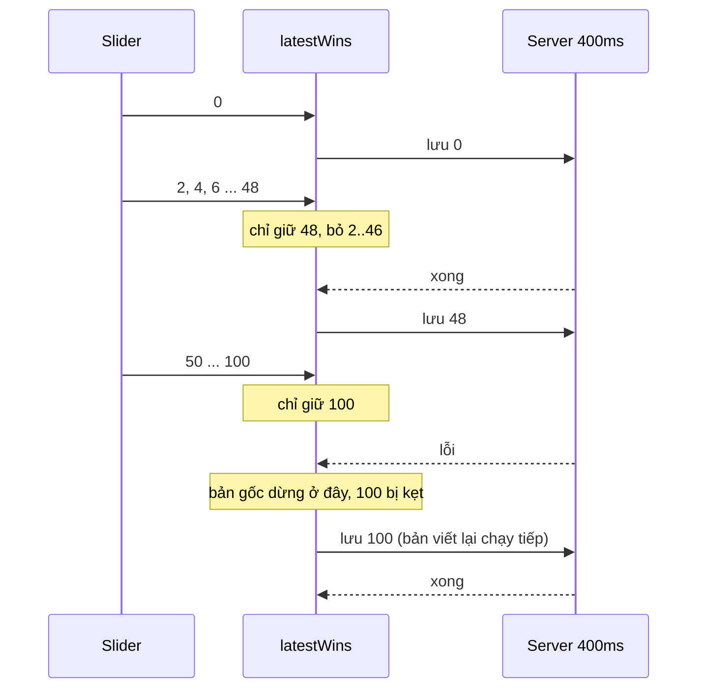

Phần lớn lỗi "lúc được lúc không" trên frontend không nằm trong một hàm async, mà nằm **giữa** các lời gọi async: gọi chồng lên nhau, gọi trùng, chờ một thứ không bao giờ tới, hoặc gọi trước khi bên kia sẵn sàng. Bốn tình huống quen thuộc:

1. **Slider điều khiển server.** Kéo thanh thời gian của trình xem lịch sử: chuột bắn 60 sự kiện mỗi giây, mỗi lần "nhảy tới phiên bản X" mất 400ms. Đợi tuần tự thì sau khi thả chuột màn hình còn chạy thêm 20 giây.
2. **Năm component cùng cần một URL.** Mỗi cái tự `fetch` là năm request giống hệt nhau.
3. **Chờ analytics rồi mới chuyển trang.** Bấm link, gửi sự kiện cho Google Analytics, đợi callback xác nhận rồi mới đổi `location`. Adblock chặn GA thì callback không bao giờ tới, và link "chết".
4. **Script bên thứ ba chạy trước app.** Snippet A/B test muốn gọi GA ngay khi GA sẵn sàng, nhưng nó tải trước bundle của app.

[Glitch](https://glitch.com) giải bài 1 bằng 30 dòng tên `track-serially`. Trang chủ của [Toptal](https://www.toptal.com) giải ba bài còn lại bằng ba file nhỏ trong `lib/`. Cả bốn đều đáng chép, và đều có một chỗ nên sửa.

> [!TIP]
> **Tóm tắt**
> - **latestWins**: chỉ chạy một việc một lúc, và chỉ giữ **một** lệnh chờ (lệnh mới nhất). Lệnh ở giữa bị bỏ, không bao giờ dồn hàng đợi.
> - **singleFlight**: gom các lời gọi cùng key vào **một** promise. Đừng cache lỗi, nếu không lần lỗi đầu tiên sẽ "dính" tới khi tải lại trang.
> - **withTimeout**: callback chạy **đúng một lần**, khi được gọi hoặc khi hết giờ, cái nào tới trước. Luôn có đường thoát khi phụ thuộc vào thứ có thể bị chặn.
> - **Hàng đợi lệnh** kiểu `window.x = window.x || []; x.push(cb)`: app nâng cấp mảng đó thành object có `push` chạy ngay khi đã sẵn sàng.

<iframe class="demo-frame" src="/demos/web-patterns/index.html?theme=dark#/async-coord" title="Demo async-coord" loading="lazy" style="height: 1250px"></iframe>

<p class="demo-links">▶ <a href="/demos/web-patterns/index.html#/async-coord" target="_blank" rel="noopener">Mở demo toàn màn hình ↗</a> · <a href="https://stackblitz.com/github/hunghg255/blog-hunghg/tree/master/examples/web-patterns?file=src/lib/asyncCoord.ts" target="_blank" rel="noopener">Sửa code trên StackBlitz ↗</a> · <a href="https://github.com/hunghg255/blog-hunghg/blob/master/examples/web-patterns/src/lib/asyncCoord.ts" target="_blank" rel="noopener">Xem source trên GitHub ↗</a></p>

Thử thẻ 1 với "Server lỗi ở mỗi lần lưu thứ 3": bấm "Kéo nhanh 0 → 100" ở cả ba chế độ. Hàng đợi tuần tự xếp hàng hàng chục lệnh. `track-serially` gốc dừng ở khoảng 48, không bao giờ lưu giá trị 100. `latestWins` chạy 4 lần (1 lần lỗi) và dừng đúng ở 100.

## Glitch làm thế nào?

[`glitch.com/source/utils/track-serially.js`](https://github.com/hunghg255/codebase/blob/main/glitch.com/source/utils/track-serially.js), dùng trong `source/models/rewind.js` cho tính năng Rewind (kéo thanh thời gian để xem project ở các phiên bản cũ):

```js
module.exports = function trackSerially(f, errorHandler) {
  async function run() {
    try {
      while (answer.pending !== null) {
        const temp = answer.pending;
        answer.pending = null;
        await f(...temp);
      }
    } finally {
      answer.idle = true;
    }
  }

  const answer = Object.assign(
    (...args) => {
      if (answer.idle) {
        answer.pending = args;
        answer.idle = false;
        run().catch(errorHandler);   // fire-and-forget
      } else {
        answer.pending = args;       // ghi đè lệnh đang chờ
      }
    },
    { idle: true, pending: null },
  );
  return answer;
};
```

(Đã bỏ các dòng `eslint-disable`.) Comment đầu file gọi nó là một dạng [Actor](https://en.wikipedia.org/wiki/Actor_model): "nguồn sự kiện nhanh (chuột) điều khiển một server chậm và ngoan (RPC), và ta muốn nghe theo nguồn nhanh hết mức có thể **mà không để hàng đợi lệnh tích tụ**".

Ba trạng thái:

- **Rảnh:** gọi `g(x)` thì chạy `f(x)` ngay.
- **Đang chạy, chưa có lệnh chờ:** gọi `g(y)` thì cất `y` vào `pending`.
- **Đang chạy, đã có lệnh chờ:** gọi `g(z)` thì **ghi đè** `pending = z`, `y` bị bỏ.

Khi `f(x)` xong, vòng `while` lấy `pending` (lúc này là `z`, giá trị mới nhất) chạy tiếp. Kéo slider qua 50 giá trị trong 1 giây chỉ tạo khoảng 3 lần chạy: giá trị đầu, một giá trị ở giữa, và giá trị cuối.

### Lỗi: lệnh cuối cùng bị kẹt

Nếu `f` ném lỗi, `await` ném ra khỏi vòng `while`, `finally` đặt `idle = true`, rồi `run()` reject và `errorHandler` được gọi. Nhưng `answer.pending` **không bị xoá**. Lệnh mới nhất (thường chính là vị trí cuối cùng người dùng thả chuột) nằm đó cho tới khi người dùng thao tác thêm lần nữa. Comment trong file nói "lỗi làm Actor về trạng thái rảnh, nhưng không làm hỏng nó vĩnh viễn"; đúng, nhưng lệnh đang chờ thì bị bỏ quên. Demo ở trên tái hiện được: giá trị đã lưu dừng ở khoảng 48 trong khi UI hiện 100.

## Toptal làm thế nào?

### single-flight: một request cho nhiều component

[`toptal.com-home/lib/fetch-json-cache.js`](https://github.com/hunghg255/codebase/blob/main/toptal.com-home/lib/fetch-json-cache.js):

```js
export const memoizedFetch = memoize((url) => {
  const cachedQuizResultState = new FetchJSONWithCache();
  cachedQuizResultState.fetch(url);
  return cachedQuizResultState;
});

class FetchJSONWithCache {
  subscribe(listener) {
    if (this.status === FetchStatus.SUCCESS || this.status === FetchStatus.ERROR) listener(this.value, this.status);
    else this.listeners.push(listener);
  }
  // fetch(): chỉ chạy khi status là INITIAL; xong thì _broadcast() cho mọi listener rồi xoá danh sách
}
```

`memoize` của lodash giữ một instance cho mỗi URL, mãi mãi. Comment trong file ghi rõ việc còn thiếu: "ToDo: Add retry support (now a failed request will remain in such state)". Request lỗi thì instance nằm ở trạng thái `ERROR` tới khi tải lại trang. Nơi dùng là `lib/hooks/use-quiz-result-state.js`, gọi `subscribe` trong `useEffect` nhưng không có cách huỷ đăng ký: component unmount trước khi request xong vẫn bị gọi `setState`.

### withTimeout: chạy đúng một lần

[`toptal.com-home/lib/with-timeout.js`](https://github.com/hunghg255/codebase/blob/main/toptal.com-home/lib/with-timeout.js):

```js
const withTimeout = (callback, timeout = 1000) => {
  let called = false;
  const fn = () => {
    if (called) return;
    called = true;
    callback();
  };
  setTimeout(fn, timeout);
  return fn;
};
```

Dùng trong `components/PageTemplate/interactive-components.js` cho link có gắn tracking:

```js
trackGAEvent(gaCategory, gaEvent, gaLabel, {
  transport: 'beacon',
  event_callback: shouldPreventDefault && withTimeout(() => (window.location = href)),
});
shouldPreventDefault && e.preventDefault();
```

Chặn chuyển trang mặc định, gửi sự kiện GA, chuyển trang khi GA gọi `event_callback`, **hoặc sau 1 giây** nếu GA không gọi (bị adblock chặn, mạng chậm). Tài liệu analytics.js cũ của Google có hẳn một mục về chuyện này (theo dõi link ra ngoài bằng `hitCallback`, kèm cảnh báo callback có thể không bao giờ chạy). Thiếu phần timeout là lỗi kinh điển làm link "chết" với người dùng có adblock.

### exposeCallbacks: hàng đợi lệnh cho script bên thứ ba

[`toptal.com-home/lib/expose-callbacks.js`](https://github.com/hunghg255/codebase/blob/main/toptal.com-home/lib/expose-callbacks.js):

```js
export default function exposeCallbacks(name) {
  if (!window[name]) window[name] = new CallbacksCollection();
  else if (Array.isArray(window[name])) {
    const callbacks = window[name];
    window[name] = new CallbacksCollection();
    callbacks.forEach((cb) => window[name].push(cb));
  }
  return window[name];
}
```

`CallbacksCollection` có `push(cb)` (đã `trigger` thì gọi `cb` ngay với tham số đã lưu, chưa thì xếp hàng) và `trigger(...args)` (chỉ được gọi một lần). Script bên thứ ba (comment trong file lấy ví dụ snippet Optimizely) viết:

```js
window._runWhenGoogleAnalyticsReady = window._runWhenGoogleAnalyticsReady || [];
window._runWhenGoogleAnalyticsReady.push(() => gtag('config', /* ... */));
```

Chạy trước app thì nó tạo mảng thường và push vào đó. App tải xong gọi `exposeCallbacks('_runWhenGoogleAnalyticsReady')`: mảng được "nâng cấp" thành collection, các callback cũ được chuyển sang. GA sẵn sàng thì `vendors/google-analytics.js` gọi `trigger()`. Callback push sau đó chạy ngay. Đây đúng là cách `dataLayer` của Google Tag Manager và `_paq` của Matomo hoạt động.

Một điểm nhỏ: `trigger` gọi lần lượt các callback trong `forEach` không có `try/catch`. Một callback của bên thứ ba ném lỗi thì các callback sau nó không chạy.

## Bên trong: bốn hình dạng của việc chờ



Bốn công cụ trả lời bốn câu hỏi khác nhau:

| Công cụ | Câu hỏi | Lệnh trùng/thừa thì |
|---|---|---|
| latestWins | Nhiều lệnh khác nhau, chỉ cái cuối quan trọng | bỏ lệnh ở giữa |
| singleFlight | Nhiều lời gọi giống nhau cùng lúc | dùng chung một promise |
| withTimeout | Một việc có thể không bao giờ được xác nhận | tự chạy khi hết giờ |
| Hàng đợi lệnh | Người gọi tới trước khi bên kia sẵn sàng | xếp hàng, phát lại khi sẵn sàng |

## Viết lại

### latestWins

```ts title=src/lib/asyncCoord.ts
  async function loop() {
    running = true;
    while (pending !== null) {
      const args = pending;
      pending = null;
      try {
        await task(...args);
      } catch (error) {
        // Khác Glitch: lỗi chỉ bỏ qua lệnh hiện tại. Bản gốc thoát vòng lặp khi có lỗi,
        // lệnh mới nhất đang chờ nằm im cho tới khi người dùng thao tác thêm lần nữa.
        onError(error);
      }
    }
    running = false;
    idleWaiters.splice(0).forEach((resolve) => resolve());
  }

  const run = ((...args: A) => {
    pending = args; // ghi đè lệnh đang chờ (nếu có)
    if (!running) void loop();
  }) as LatestWins<A>;
```

**Khác bản gốc:** `try/catch` nằm **trong** vòng lặp, nên lỗi chỉ bỏ qua lệnh hiện tại và vòng lặp chạy tiếp với lệnh mới nhất. Có thêm `whenIdle()` để chờ tới khi lệnh cuối chạy xong (ví dụ nút "Lưu và đóng", hoặc trong test).

### singleFlight

```ts title=src/lib/asyncCoord.ts
    get(key: K): Promise<V> {
      const entry = entries.get(key);
      const fresh = entry && (entry.settledAt === undefined || Date.now() - entry.settledAt < ttl);
      if (entry && fresh) return entry.promise;

      const promise = load(key).then(
        (value) => {
          const current = entries.get(key);
          if (current?.promise === promise) current.settledAt = Date.now();
          return value;
        },
        (error) => {
          // lỗi KHÔNG được cache: người gọi tiếp theo sẽ thử lại
          if (entries.get(key)?.promise === promise) entries.delete(key);
          throw error;
        },
      );
      entries.set(key, { promise });
      return promise;
    },
```

**Khác bản gốc:** lỗi không được cache (`entries.delete(key)` trong nhánh lỗi), nên lời gọi sau thử lại. Có `ttl` để kết quả thành công hết hạn, và `invalidate()`. Trả về promise thay vì `subscribe(listener)`: người gọi tự bỏ qua kết quả nếu đã unmount, không cần huỷ đăng ký.

### withTimeout và hàng đợi lệnh

`withTimeout` giống bản của Toptal, thêm `clearTimeout` khi đã chạy. `CallbackQueue` (trong file đầy đủ) giữ API `push` giống `Array#push` (nhận nhiều callback, trả về độ dài), và gọi từng callback trong `try/catch`.

::: spoiler Xem toàn bộ src/lib/asyncCoord.ts

```ts title=src/lib/asyncCoord.ts
/**
 * Bốn công cụ nhỏ để điều phối việc bất đồng bộ, viết lại từ Glitch và Toptal.
 *
 * 1. latestWins (Glitch `utils/track-serially.js`): nguồn sự kiện nhanh (kéo slider) điều
 *    khiển một việc chậm (gọi server). Chỉ chạy 1 việc một lúc, và chỉ giữ LỆNH MỚI NHẤT
 *    đang chờ; lệnh ở giữa bị bỏ, không bao giờ dồn hàng đợi.
 * 2. singleFlight (Toptal `lib/fetch-json-cache.js`): nhiều nơi cùng cần một URL -> chỉ một
 *    request. Bản gốc giữ lỗi mãi mãi; bản này xoá lỗi để lần sau thử lại, và có TTL.
 * 3. withTimeout (Toptal `lib/with-timeout.js`): chạy callback ĐÚNG MỘT LẦN, khi được gọi
 *    hoặc khi hết giờ, cái nào tới trước.
 * 4. exposeCallbacks (Toptal `lib/expose-callbacks.js`): biến mảng `window.x = []` mà script
 *    bên thứ ba push vào thành hàng đợi có replay cho người đến muộn.
 */

// ---------------------------------------------------------------------------
// 1. latestWins
// ---------------------------------------------------------------------------

export interface LatestWins<A extends unknown[]> {
  (...args: A): void;
  /** đang không chạy việc nào */
  readonly idle: boolean;
  /** promise resolve khi đã chạy xong lệnh mới nhất (dùng cho test, hoặc nút "Lưu và đóng") */
  whenIdle(): Promise<void>;
}

export function latestWins<A extends unknown[]>(
  task: (...args: A) => Promise<unknown>,
  onError: (error: unknown) => void = (e) => console.error(e),
): LatestWins<A> {
  let pending: A | null = null;
  let running = false;
  const idleWaiters: Array<() => void> = [];

  async function loop() {
    running = true;
    while (pending !== null) {
      const args = pending;
      pending = null;
      try {
        await task(...args);
      } catch (error) {
        // Khác Glitch: lỗi chỉ bỏ qua lệnh hiện tại. Bản gốc thoát vòng lặp khi có lỗi,
        // lệnh mới nhất đang chờ nằm im cho tới khi người dùng thao tác thêm lần nữa.
        onError(error);
      }
    }
    running = false;
    idleWaiters.splice(0).forEach((resolve) => resolve());
  }

  const run = ((...args: A) => {
    pending = args; // ghi đè lệnh đang chờ (nếu có)
    if (!running) void loop();
  }) as LatestWins<A>;

  Object.defineProperty(run, 'idle', { get: () => !running });
  run.whenIdle = () => (running ? new Promise<void>((resolve) => idleWaiters.push(resolve)) : Promise.resolve());
  return run;
}

// ---------------------------------------------------------------------------
// 2. singleFlight
// ---------------------------------------------------------------------------

export interface SingleFlightOptions {
  /** giữ kết quả thành công bao lâu (ms). Mặc định: mãi mãi như Toptal */
  ttl?: number;
}

export function singleFlight<K, V>(load: (key: K) => Promise<V>, { ttl = Infinity }: SingleFlightOptions = {}) {
  const entries = new Map<K, { promise: Promise<V>; settledAt?: number }>();

  return {
    get(key: K): Promise<V> {
      const entry = entries.get(key);
      const fresh = entry && (entry.settledAt === undefined || Date.now() - entry.settledAt < ttl);
      if (entry && fresh) return entry.promise;

      const promise = load(key).then(
        (value) => {
          const current = entries.get(key);
          if (current?.promise === promise) current.settledAt = Date.now();
          return value;
        },
        (error) => {
          // lỗi KHÔNG được cache: người gọi tiếp theo sẽ thử lại
          if (entries.get(key)?.promise === promise) entries.delete(key);
          throw error;
        },
      );
      entries.set(key, { promise });
      return promise;
    },
    invalidate(key?: K) {
      if (key === undefined) entries.clear();
      else entries.delete(key);
    },
  };
}

// ---------------------------------------------------------------------------
// 3. withTimeout
// ---------------------------------------------------------------------------

export function withTimeout<A extends unknown[]>(callback: (...args: A | []) => void, timeout = 1000) {
  let done = false;
  const fire = (...args: A | []) => {
    if (done) return;
    done = true;
    clearTimeout(timer); // bản gốc để timer chạy tiếp (vô hại nhưng giữ closure thêm 1 giây)
    callback(...args);
  };
  const timer = setTimeout(() => fire(), timeout);
  return fire;
}

// ---------------------------------------------------------------------------
// 4. exposeCallbacks
// ---------------------------------------------------------------------------

type Callback<A extends unknown[]> = (...args: A) => void;

export class CallbackQueue<A extends unknown[]> {
  private triggered = false;
  private args = [] as unknown as A;
  private callbacks: Array<Callback<A>> = [];
  constructor(private onError: (error: unknown) => void = (e) => console.error(e)) {}

  /** Cùng chữ ký với Array#push, nên code `window.x.push(cb)` của bên thứ ba vẫn chạy. */
  push = (...callbacks: Array<Callback<A>>) => {
    for (const cb of callbacks) {
      if (this.triggered) this.safeCall(cb);
      else this.callbacks.push(cb);
    }
    return this.callbacks.length;
  };

  trigger(...args: A) {
    if (this.triggered) throw new Error('Callbacks already triggered');
    this.triggered = true;
    this.args = args;
    this.callbacks.splice(0).forEach((cb) => this.safeCall(cb));
  }

  get isTriggered() {
    return this.triggered;
  }

  // Khác Toptal: một callback của bên thứ ba ném lỗi không được chặn các callback sau nó
  private safeCall(cb: Callback<A>) {
    try {
      cb(...this.args);
    } catch (error) {
      this.onError(error);
    }
  }
}

export function exposeCallbacks<A extends unknown[]>(
  name: string,
  target: Record<string, unknown> = window as never,
  onError?: (error: unknown) => void,
) {
  const existing = target[name];
  if (existing instanceof CallbackQueue) return existing as CallbackQueue<A>;

  const queue = new CallbackQueue<A>(onError);
  // script bên thứ ba chạy TRƯỚC app: `window[name] = window[name] || []; window[name].push(cb)`
  if (Array.isArray(existing)) queue.push(...(existing as Array<Callback<A>>));
  else if (existing !== undefined) console.warn(`exposeCallbacks: window.${name} có kiểu lạ, ghi đè`);
  target[name] = queue;
  return queue;
}
```

:::

## Đi qua code

- **`pending = args` luôn ghi đè.** Không có mảng, không có hàng đợi; bộ nhớ dùng là hằng số dù sự kiện tới nhanh cỡ nào.
- **`if (!running) void loop()`.** Cờ `running` chỉ đổi trong `loop()`, nên không thể có hai vòng lặp chạy song song. `void` để nói rõ là cố ý không chờ promise.
- **So sánh `current?.promise === promise`** trong `singleFlight`. Nếu ai đó gọi `invalidate()` rồi `get()` lại trong lúc request cũ đang bay, request cũ xong sau sẽ không ghi đè hay xoá nhầm entry mới.
- **`clearTimeout(timer)` trong `withTimeout`.** Bản gốc để timer chạy tiếp sau khi đã gọi; vô hại vì có cờ `called`, nhưng closure bị giữ thêm 1 giây.
- **`exposeCallbacks` nhận `target`** (mặc định `window`) để test và demo không phải đụng vào `window` thật.

## Tại sao không làm cách khác?

- **Debounce cho slider?** Debounce chỉ chạy sau khi người dùng **ngừng** kéo, nên trong lúc kéo màn hình đứng yên. latestWins chạy liên tục trong lúc kéo (nhanh nhất mà server cho phép) và luôn kết thúc ở giá trị cuối.
- **Throttle?** Throttle chạy đều theo thời gian, không biết server đã xong hay chưa: server chậm hơn chu kỳ throttle thì các lệnh lại chồng nhau. latestWins tự điều tốc theo tốc độ của server.
- **AbortController huỷ lệnh cũ?** Hợp khi lệnh là request đọc dữ liệu (như bài #34). Với lệnh **ghi** (lưu, chuyển phiên bản), huỷ giữa chừng có thể để server ở trạng thái nửa vời; chờ lệnh hiện tại xong rồi mới chạy lệnh mới an toàn hơn.
- **React Query / SWR cho single-flight?** Cả hai đều gộp request trùng theo key và không cache lỗi theo mặc định. Dùng chúng nếu dự án đã có; `singleFlight` ở đây hợp với code ngoài React (service, script).

## Edge case và cạm bẫy

- **Lệnh phụ thuộc lệnh trước.** latestWins bỏ lệnh ở giữa, nên chỉ dùng khi mỗi lệnh là **trạng thái tuyệt đối** ("nhảy tới phiên bản 48"), không phải **thay đổi tương đối** ("tiến thêm 2 bước").
- **Lỗi lặp lại.** Server lỗi liên tục thì latestWins vẫn chỉ chạy khi có lệnh mới; nó không tự thử lại. Muốn thử lại, gọi lại `run(lastArgs)` trong `onError` sau một khoảng chờ.
- **singleFlight và tham số.** Key phải bao gồm mọi thứ ảnh hưởng tới kết quả (URL, query, người dùng hiện tại). Đổi tài khoản mà không `invalidate()` là trả dữ liệu của người khác.
- **withTimeout quá ngắn.** 1 giây đủ cho GA trên mạng bình thường. Với `transport: 'beacon'` (như Toptal dùng), sự kiện vẫn được gửi kể cả khi trang đã chuyển, nên timeout ngắn không làm mất dữ liệu.
- **Ai đó ghi đè `window.x = []`** sau khi app đã nâng cấp nó (snippet viết `window.x = []` thay vì `window.x = window.x || []`). Callback push vào mảng mới sẽ không bao giờ chạy. Có thể chặn bằng `Object.defineProperty` với setter, nhưng thường chỉ cần hướng dẫn đúng cú pháp cho bên tích hợp.

## Dùng trong dự án

```ts
// kéo timeline video: chỉ seek tới vị trí mới nhất, server/decoder chậm cũng không dồn lệnh
const seek = latestWins((t: number) => player.seekAndRenderFrame(t), reportError);
slider.addEventListener('input', () => seek(+slider.value));

// nhiều widget cùng cần cấu hình người dùng
const settings = singleFlight((userId: string) => api.get(`/users/${userId}/settings`), { ttl: 60_000 });

// link ra ngoài có tracking
link.addEventListener('click', (e) => {
  e.preventDefault();
  const go = withTimeout(() => (location.href = link.href), 1000);
  gtag('event', 'outbound', { transport_type: 'beacon', event_callback: go });
});
```

## Kiểm thử

::: spoiler Ví dụ test (bản phác, không có trong repo)

```ts
import { afterEach, beforeEach, describe, expect, it, vi } from 'vitest';
import { exposeCallbacks, latestWins, singleFlight, withTimeout } from './asyncCoord';

beforeEach(() => vi.useFakeTimers());
afterEach(() => vi.useRealTimers());

const slow = (ms: number) => new Promise((r) => setTimeout(r, ms));

describe('latestWins', () => {
  it('chỉ chạy lệnh đầu và lệnh cuối khi gọi dồn', async () => {
    const seen: number[] = [];
    const run = latestWins(async (x: number) => (seen.push(x), slow(100)));
    for (let i = 0; i <= 10; i++) run(i);
    await vi.advanceTimersByTimeAsync(500);
    expect(seen).toEqual([0, 10]);
  });

  it('lỗi không làm kẹt lệnh mới nhất', async () => {
    const seen: number[] = [];
    const onError = vi.fn();
    const run = latestWins(async (x: number) => {
      await slow(100);
      if (x === 0) throw new Error('boom');
      seen.push(x);
    }, onError);
    run(0);
    run(5);
    await vi.advanceTimersByTimeAsync(500);
    expect(onError).toHaveBeenCalledOnce();
    expect(seen).toEqual([5]);
    await run.whenIdle();
  });
});

describe('singleFlight', () => {
  it('gộp lời gọi trùng và thử lại sau lỗi', async () => {
    let n = 0;
    const flight = singleFlight(async () => {
      n++;
      await slow(10);
      if (n === 1) throw new Error('mạng lỗi');
      return 'ok';
    });
    const first = Promise.allSettled([flight.get('u'), flight.get('u'), flight.get('u')]);
    await vi.advanceTimersByTimeAsync(20);
    expect((await first).every((r) => r.status === 'rejected')).toBe(true);
    expect(n).toBe(1);
    const again = flight.get('u');
    await vi.advanceTimersByTimeAsync(20);
    await expect(again).resolves.toBe('ok');
    expect(n).toBe(2);
  });
});

describe('withTimeout', () => {
  it('chạy đúng một lần dù gọi tay rồi hết giờ', () => {
    const cb = vi.fn();
    const fire = withTimeout(cb, 1000);
    fire();
    vi.advanceTimersByTime(2000);
    fire();
    expect(cb).toHaveBeenCalledOnce();
  });
});

describe('exposeCallbacks', () => {
  it('nâng cấp mảng có sẵn và phát lại cho callback tới muộn', () => {
    const target: Record<string, unknown> = { ready: [] };
    const early = vi.fn();
    (target.ready as Array<() => void>).push(early);
    const queue = exposeCallbacks<[string]>('ready', target);
    queue.trigger('ga');
    const late = vi.fn();
    queue.push(late);
    expect(early).toHaveBeenCalledWith('ga');
    expect(late).toHaveBeenCalledWith('ga');
  });
});
```

:::

## So với thư viện và chuẩn web

- Trong [RxJS](https://rxjs.dev/), latestWins gần với `exhaustMap` cộng thêm "nhớ giá trị cuối"; `switchMap` thì huỷ việc cũ (hợp với đọc, không hợp với ghi); `concatMap` là hàng đợi tuần tự.
- Thư viện Go có package [`singleflight`](https://pkg.go.dev/golang.org/x/sync/singleflight) với đúng ý tưởng này ở phía server; tên `singleFlight` ở trên lấy từ đó.
- [`AbortSignal.timeout(ms)`](https://developer.mozilla.org/en-US/docs/Web/API/AbortSignal/timeout_static) là phiên bản chuẩn của "hết giờ thì thôi" cho `fetch`. withTimeout ở đây ngược lại: hết giờ thì **làm** (chuyển trang), không phải huỷ.
- Hàng đợi lệnh là cách mọi snippet analytics phổ biến hoạt động (`dataLayer.push`, `_paq.push`, `fbq.queue`). Nếu bạn viết SDK nhúng vào trang người khác, cho phép `push` trước khi SDK tải là trải nghiệm tích hợp tốt nhất.

---

Bài này thuộc series **[Học từ mã nguồn các web lớn](/series/web)** (65 bài, đọc theo thứ tự).

::: spoiler Xem nhanh danh sách bài trong series

*Mở đầu*

- [Mở đầu: đọc code production của 28 trang web](/blogs/learn-from-big-web-apps)

*Phần 1: trải nghiệm người dùng*

- [#1 Dark mode không nháy (Gatsby)](/blogs/web-dark-mode-no-flash)
- [#2 useValueByMedia: giá trị theo breakpoint (Toptal)](/blogs/web-use-value-by-media)
- [#3 Đoán ý định: idle, exit-intent, lắc chuột (Toptal, InVision)](/blogs/web-user-intent-idle-exit-wiggle)
- [#4 Validate form thân thiện (Udacity, Pipedrive)](/blogs/web-form-validation-ux)
- [#5 Magic number, EXIF và dán ảnh (Ello)](/blogs/web-file-magic-number-exif-paste)
- [#6 fastSmoothScroll: cuộn xa vẫn nhanh (Telegram)](/blogs/web-telegram-fast-smooth-scroll)
- [#7 Countdown time-travel và tombstone giỏ hàng (Best Buy)](/blogs/web-countdown-time-travel-tombstone)

*Phần 2: hiệu năng và đo lường*

- [#8 Hàng đợi requestAnimationFrame 3ms (Apple)](/blogs/web-raf-queue-3ms)
- [#9 srcset cho artwork và preconnect tự động (Apple)](/blogs/web-responsive-artwork-preconnect)
- [#10 Quick-fetch: gọi API trước khi bundle tải xong (HubSpot)](/blogs/web-quick-fetch-early-requests)
- [#11 Performance span và long task (Postman, Calibre)](/blogs/web-performance-spans-long-tasks)
- [#12 Gọi Web Worker như hàm async (Telegram)](/blogs/web-worker-promise-rpc)
- [#13 Đồng hồ media: đếm giờ xem và sửa lệch (Skillshare, Simplified)](/blogs/web-media-clock-watch-time-drift)

*Phần 3: nhiều tab, phiên đăng nhập, cập nhật*

- [#14 Bầu tab chủ cho thông báo (HubSpot, Telegram)](/blogs/web-leader-tab-notifications)
- [#15 Đồng bộ đăng nhập giữa tab và giới hạn cookie (Elastic, InVision)](/blogs/web-cross-tab-auth-cookie-guard)
- [#16 SPA tự cập nhật: Trello, Zappos, Facebook, Elastic](/blogs/web-spa-self-update-strategies)

*Phần 4: kiến trúc*

- [#17 Reverse portal: di chuyển component không remount (Zappos)](/blogs/web-reverse-portal)
- [#18 Page behaviors: gắn hành vi từ CMS (Intercom)](/blogs/web-page-behaviors-cms)
- [#19 Giới hạn tần suất hiển thị bằng bitmask (Outlook)](/blogs/web-frequency-cap-bitmask)
- [#20 Chuyển REST sang GraphQL dần dần (Coursera)](/blogs/web-rest-to-graphql-hybrid-link)

*Phần 5: soạn thảo và hiển thị nội dung*

- [#21 Autocomplete tại con trỏ trong contenteditable (Ello, Telegram)](/blogs/web-caret-autocomplete-contenteditable)
- [#22 Dark mode cho email HTML bằng CIELAB (Outlook)](/blogs/web-email-dark-mode-cielab)
- [#23 Thu nhỏ bảng rộng cho vừa khung, vá font emoji (Outlook)](/blogs/web-email-wide-content-scale)
- [#24 Cảnh báo quên đính kèm file (Outlook)](/blogs/web-forgotten-attachment-warning)
- [#25 Cắt chữ nhiều dòng chính xác (Pipedrive, Apple, Toptal)](/blogs/web-multiline-truncate-measure-text)
- [#26 Parse ngày giờ gõ tay khoan dung (Outlook, Elastic)](/blogs/web-lenient-date-parser)

*Phần 6: tương tác*

- [#27 menuAim: rê chéo vào submenu không bị đóng (Udemy)](/blogs/web-menu-aim-triangle)
- [#28 Kéo, vuốt chung cho chuột và cảm ứng (Telegram)](/blogs/web-unified-pointer-gestures)
- [#29 Phím tắt theo phạm vi, IME và bàn phím phi Latinh (Trello)](/blogs/web-scoped-keyboard-shortcuts)
- [#30 Nội suy màu: đổi theme và nền theo cuộn (Telegram, Anchor)](/blogs/web-color-interpolation-theme-scroll)
- [#31 Đường gióng hút cạnh và undo/redo trên canvas (Simplified)](/blogs/web-canvas-snap-guides-undo)
- [#32 Giả lập mù màu bằng feColorMatrix (Trello)](/blogs/web-color-vision-simulator)
- [#33 Vạch thước theo mức zoom và cấp phát màu cho biểu đồ (Anchor, Similarweb)](/blogs/web-timeline-ticks-color-stack)

*Phần 7: mạng, dữ liệu và async*

- [#34 Ô tìm kiếm chuẩn production (Similarweb, Udemy, Pipedrive)](/blogs/web-production-search-box)
- **#35 Điều phối async: latest-wins, single-flight (Glitch, Toptal)** (bài này)
- [#36 Polling thưa dần và debounce động (Trello)](/blogs/web-decaying-polling-dynamic-debounce)
- [#37 Cache phía client theo version (Similarweb, Telegram, Udemy)](/blogs/web-client-cache-versioned)
- [#38 Upload file lớn theo chunk (Outlook, Tribe)](/blogs/web-chunked-upload-pipeline)
- [#39 Phát video qua Service Worker bằng Range request (Telegram, Outlook)](/blogs/web-service-worker-range-streaming)

*Phần 8: hiệu năng và vận hành*

- [#40 TTI governor: hoãn việc phụ tới sau khi trang dùng được (Outlook)](/blogs/web-tti-governor)
- [#41 Tự đo LCP/CLS/TBT và phục vụ bản nhẹ cho máy yếu (Udemy)](/blogs/web-rum-adaptive-loading)

*Phần 9: thuật toán và dữ liệu phía client*

- [#42 Three-way merge ngay trên trình duyệt (Postman)](/blogs/web-three-way-merge-client)
- [#43 Dọn cache GraphQL bằng đếm tham chiếu (Outlook)](/blogs/web-graphql-cache-refcount-gc)
- [#44 LRU cache theo 3 cách (Apple, Similarweb, Outlook)](/blogs/web-lru-cache-three-ways)
- [#45 Lọc tăng dần trong Web Worker (Similarweb)](/blogs/web-incremental-filter-worker)
- [#46 Xếp hạng gợi ý trên client, so ngầm với server (Outlook)](/blogs/web-client-side-ranking-shadow-test)
- [#47 Nối OT với editor: undo stack và chặn echo (Glitch)](/blogs/web-ot-codemirror-undo)
- [#48 Ngôn ngữ markup riêng dịch hai chiều với HTML (Coursera)](/blogs/web-custom-markup-compiler)

*Phần 10: thời gian, ngôn ngữ, định dạng*

- [#49 Xử lý giờ mùa hè không cần thư viện (Udemy, Pipedrive)](/blogs/web-dst-without-library)
- [#50 Intl thực chiến: Segmenter, số rút gọn, số nhiều, fallback locale (Apple, Outlook)](/blogs/web-intl-in-production)
- [#51 WebVTT và bôi chọn transcript (Udemy, Coursera)](/blogs/web-webvtt-transcript-selection)

*Phần 11: tương tác và giao diện*

- [#52 Kéo-thả trên lịch (Pipedrive)](/blogs/web-calendar-drag-drop)
- [#53 Focus stack cho popup lồng nhau (Outlook)](/blogs/web-focus-stack-nested-popups)
- [#54 Clipboard: copy, dán chữ thuần, dán thông minh (Trello, Anchor, Pipedrive, Tribe)](/blogs/web-clipboard-tricks)
- [#55 Khôi phục vị trí cuộn khi trang còn đang tải (Apple, Zappos)](/blogs/web-scroll-restore-wait-height)
- [#56 Lấy màu từ ảnh: gradient nền, màu chữ (Apple, Telegram, Trello)](/blogs/web-colors-from-images)
- [#57 JS đọc breakpoint từ CSS, phát hiện chế độ PWA (Ello, Apple)](/blogs/web-css-js-breakpoint-bridge)

*Phần 12: media*

- [#58 Tin nhắn thoại: ghi âm, waveform realtime, nén 5-bit (Telegram)](/blogs/web-voice-message-waveform)
- [#59 Chụp frame video thành ảnh, canvas bị taint (Coursera, Outlook)](/blogs/web-video-frame-snapshot)

*Phần 13: đo lường, bảo mật, vận hành*

- [#60 Đo lúc ảnh màn hình đầu tải xong, cả khi chuyển trang SPA (Zappos, Best Buy, Outlook)](/blogs/web-above-the-fold-image-timing)
- [#61 Buffer analytics chờ SDK, phát hiện adblock (Best Buy)](/blogs/web-analytics-buffer-adblock)
- [#62 Proof-of-work trên client để chặn API ẩn danh (Udemy)](/blogs/web-client-proof-of-work)
- [#63 Prefetch không làm lệch số liệu, nén cài đặt bằng bit (Outlook)](/blogs/web-synthetic-prefetch-bit-flags)
- [#64 Micro-frontend: AngularJS và React chung app, giao tiếp xuyên frame (Similarweb, InVision, HubSpot)](/blogs/web-micro-frontend-bridges)

:::

Code + demo: [`examples/web-patterns`](https://github.com/hunghg255/blog-hunghg/tree/master/examples/web-patterns) · [Mở trên StackBlitz](https://stackblitz.com/github/hunghg255/blog-hunghg/tree/master/examples/web-patterns)
