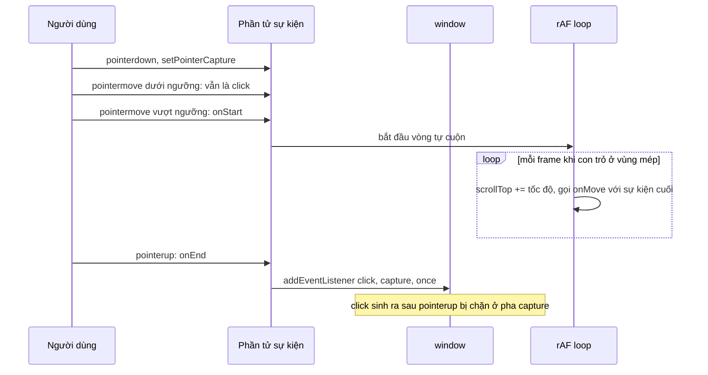

Kéo một cuộc hẹn trong lịch từ 9:00 sang 10:00 là thao tác người dùng làm hàng chục lần mỗi tuần. Để nó "chỉ chạy đúng" thì có cả chục chi tiết:

- Bấm vào cuộc hẹn để mở chi tiết, kéo để dời giờ: cùng một phần tử, hai hành vi.
- Kéo xong nhả chuột, trình duyệt vẫn phát `click`. Nếu không chặn, popup chi tiết bật ra ngay sau khi thả.
- Lịch cao 24 giờ nhưng khung chỉ hiện 8 giờ: kéo xuống mép dưới thì lịch phải tự cuộn.
- Thả ở đâu thì hút về mốc 15 phút gần nhất.
- Đổi vị trí pixel thành giờ. Ngày đổi giờ mùa hè có 23 hoặc 25 tiếng, thả ở ô 10:00 mà lưu thành 9:00 là lỗi kinh điển.

**Pipedrive** (CRM) có màn hình lịch hoạt động tự viết toàn bộ phần kéo-thả, không dùng thư viện. Bài này đọc code đó, chỉ ra vài chỗ dễ vấp, rồi viết lại bằng Pointer Events.

> [!TIP]
> **Tóm tắt**
> - Phân biệt click và kéo bằng **ngưỡng** vài pixel. Sau khi kéo, **nuốt đúng một** sự kiện `click` (listener pha capture, `once: true`).
> - Tự cuộn khi kéo gần mép nên chạy theo **`requestAnimationFrame`**: Pipedrive chỉ cuộn trong `pointermove`, nên giữ chuột yên ở mép thì lịch ngừng cuộn.
> - Tìm vùng thả bằng `document.elementFromPoint` + `closest('[data-…]')`; bản xem trước phải có `pointer-events: none`. `clientX` và `getBoundingClientRect()` cùng hệ toạ độ viewport, đừng cộng thêm `window.scrollY`.
> - Đổi ô lịch thành thời điểm theo **giờ treo tường** của múi giờ, không phải "nửa đêm + N phút". Pipedrive có đoạn bù DST cho đúng việc này.

<iframe class="demo-frame" src="/demos/web-patterns/index.html?theme=dark#/calendar-drag" title="Demo calendar-drag" loading="lazy" style="height: 900px"></iframe>

<p class="demo-links">▶ <a href="/demos/web-patterns/index.html#/calendar-drag" target="_blank" rel="noopener">Mở demo toàn màn hình ↗</a> · <a href="https://stackblitz.com/github/hunghg255/blog-hunghg/tree/master/examples/web-patterns?file=src/lib/calendarDrag.ts" target="_blank" rel="noopener">Sửa code trên StackBlitz ↗</a> · <a href="https://github.com/hunghg255/blog-hunghg/blob/master/examples/web-patterns/src/lib/calendarDrag.ts" target="_blank" rel="noopener">Xem source trên GitHub ↗</a></p>

Ở chế độ **Cộng phút từ nửa đêm**, kéo "Chạy bộ" sang Chủ nhật 25/10 ô 10:00: log ghi "lưu 08:00Z → hiển thị 09:00 (lệch!)" và sự kiện nhảy lên một ô. Chuyển sang **Giờ treo tường** rồi làm lại thì sự kiện nằm đúng ô thả. Kéo một sự kiện tới sát mép dưới khung lịch rồi giữ chuột yên: lịch vẫn tiếp tục cuộn.

## Pipedrive làm thế nào?

Code nằm trong `webpack---/client/entrypoints/calendar-view/`: thư viện kéo nhỏ ở [`utils/dragster.js`](https://github.com/hunghg255/codebase/blob/main/pipedrive.com%28dashboard%29/webpack---/client/entrypoints/calendar-view/utils/dragster.js), phép tính lưới ở [`utils/grid.js`](https://github.com/hunghg255/codebase/blob/main/pipedrive.com%28dashboard%29/webpack---/client/entrypoints/calendar-view/utils/grid.js), và hai nơi dùng là `components/draggable-item.js` (dời cuộc hẹn) và `components/resize-handle.js` (kéo mép dưới để đổi thời lượng).

### Dragster: ~140 dòng thay cho thư viện kéo-thả

```js
pointerMove(event) {
  if (!this.dragging) {
    const isXInRange = this.isInRange(event.screenX - this.initialPress.screenX, this.threshold);
    const isYInRange = this.isInRange(event.screenY - this.initialPress.screenY, this.threshold);
    if (!isXInRange || !isYInRange) {              // vượt ngưỡng theo MỘT trục bất kỳ là kéo
      this.region.addEventListener('click', this.stopPropagation, { once: true });
      this.dragging = true;
      this.onMoveStart(event);
    }
  }
  if (this.dragging) { this.checkScroll(event); this.onMove(event); }
}

stop() {
  // gỡ listener pointermove/pointerup…
  setTimeout(() => {                                // hoãn một tick
    this.dragging = false;
    this.region.removeEventListener('click', this.stopPropagation, { once: true });
  });
}
```

Ba mẹo gói gọn trong đó:

1. **Ngưỡng** (`threshold` = 1/4 chiều cao một giờ, tức 15 phút trên lưới): chuột lệch vài pixel khi bấm vẫn là click.
2. **Nuốt click sau khi kéo.** Khi bắt đầu kéo, gắn listener `click` với `{ once: true }` lên vùng cha để chặn cú click sinh ra lúc nhả chuột. Handler `click` của chính phần tử thì kiểm cờ `dragging`, và cờ này được tắt trong `setTimeout`, tức là **sau** khi sự kiện click đã chạy xong. Nếu tắt cờ ngay trong `pointerup`, lúc `click` tới cờ đã là `false` và chi tiết bị mở.
3. **Tự cuộn ở mép**: vùng đệm 20% chiều cao khung cuộn, chuột lọt vào thì `scrollTop ± threshold`.

`utils/browser.js` thêm một lớp tương thích: dùng `pointerdown/move/up` nếu có `window.PointerEvent`, không thì `mousedown/move/up`.

### Đổi pixel thành ngày giờ

```js
export function snapYAxis(y) {
  const yAxisSnap = HEIGHT_OF_HOUR / 4;            // 15 phút
  return Math.round(y / yAxisSnap) * yAxisSnap;
}

export function calculateDateTimeFromCoordinates(startDate, daysNumber, width, height, coordinates) {
  const day = getDayFromWidth(daysNumber, width, coordinates.x);
  const minutes = Math.floor((coordinates.y / HEIGHT_OF_HOUR) * 60);
  const startOfDay = moment(startDate).add(day, 'days');
  const dueDate = startOfDay.clone().add(minutes, 'minutes');

  const utcOffsetDiff = startOfDay.utcOffset() - dueDate.utcOffset();
  const isTransitioningToDST = !startOfDay.isDST() && dueDate.isDST()
    && dueDate.clone().add(utcOffsetDiff, 'minutes').isDST();
  const isTransitioningFromDST = startOfDay.isDST() && !dueDate.isDST();
  if (isTransitioningToDST || isTransitioningFromDST) dueDate.add(utcOffsetDiff, 'minutes');
  return dueDate;
}
```

`moment().add(600, 'minutes')` cộng **600 phút thời gian trôi thật**. Ngày lùi giờ (25 giờ) thì 600 phút sau nửa đêm là 9:00 trên đồng hồ, không phải 10:00. Pipedrive phát hiện trường hợp này bằng cách so `utcOffset()` của đầu ngày với của thời điểm tính được, rồi cộng bù phần chênh. Đây là lỗi rất nhiều app lịch tự viết mắc phải, và đoạn code này cho thấy nhóm Pipedrive đã gặp nó trong thực tế.

### Tìm vùng thả

```js
export function getDropAreaFromCoordinates(x, y) {
  const dropArea = document.elementFromPoint(x, y)?.closest('[data-calendar-item-drop-area]');
  const dropAreaBounds = dropArea.getBoundingClientRect();
  const windowTop = window.pageYOffset || document.documentElement.scrollTop;
  return {
    name: dropArea.dataset.calendarItemDropArea,   // "grid" hoặc "allday"
    cursor: { y: y - dropAreaBounds.top + dropArea.scrollTop + windowTop, /* x tương tự */ },
  };
}
```

`draggable-item.js` giữ một bảng `{ allday: …, grid: … }` để mỗi loại vùng thả có cách tính riêng, và chỉ cập nhật bản xem trước khi dữ liệu thật sự đổi (`if (isEqual(this.previewData, data)) return null`). Kéo trong cùng một ô 15 phút thì không re-render.

### Những chỗ dễ vấp

- **Cộng thêm `window.pageYOffset`.** `draggable-item.js` truyền `event.clientX/clientY`, tức toạ độ theo **viewport**. `getBoundingClientRect()` cũng theo viewport. Hiệu của hai giá trị đã đúng, cộng thêm độ cuộn của trang là thừa. Lịch Pipedrive có lẽ chiếm trọn màn hình nên trang không bao giờ cuộn, và lỗi không lộ ra. Đặt cùng component vào một trang có cuộn thì vị trí thả lệch đúng bằng quãng đã cuộn.
- **Chỉ cuộn khi chuột di chuyển.** `checkScroll` được gọi trong `pointerMove`. Người dùng kéo tới mép dưới rồi giữ yên chờ lịch cuộn tới 18:00 thì lịch đứng im, phải lắc chuột liên tục.
- **Không có pointer capture.** Listener `pointermove/pointerup` gắn vào `document.body`. Thả chuột bên ngoài cửa sổ trình duyệt thì có thể không nhận được `pointerup`, và trạng thái kéo bị kẹt.
- **Không huỷ được.** Không có phím Esc, không xử lý `pointercancel` (trên cảm ứng, trình duyệt giành cử chỉ cuộn thì phát `pointercancel` thay cho `pointerup`).
- `event.layerX` (dùng để nhớ chỗ nắm cuộc hẹn) là thuộc tính không chuẩn.

## Bên trong trình duyệt



- **Pointer Events** gộp chuột, bút và cảm ứng vào một bộ sự kiện. `setPointerCapture(pointerId)` khiến mọi `pointermove/pointerup` của con trỏ đó gửi về phần tử, kể cả khi con trỏ đã ra ngoài phần tử hay ngoài cửa sổ. Không cần gắn listener lên `document`.
- **`touch-action: none`** trên phần tử kéo được: nếu không, trên cảm ứng trình duyệt sẽ hiểu cử chỉ là cuộn trang và phát `pointercancel` giữa chừng.
- **Thứ tự sự kiện khi nhả chuột:** `pointerup`, rồi `mouseup` (tương thích), rồi `click` nếu `mousedown` và `mouseup` cùng nằm trên một phần tử hoặc cha chung. Listener `click` ở pha capture trên `window` chạy trước mọi listener khác, nên chặn được ở đó.
- **`elementFromPoint(x, y)`** trả về phần tử trên cùng tại điểm đó, có tôn trọng `z-index` và bỏ qua phần tử có `pointer-events: none`.
- **Ngày đổi giờ:** ở Berlin, 25/10/2026 lúc 03:00 giờ mùa hè đồng hồ quay về 02:00, ngày đó dài 25 giờ. 28/3/2027 lúc 02:00 đồng hồ nhảy lên 03:00, ngày dài 23 giờ và không có giờ 02:30.

## Viết lại

`calendarDrag.ts` gồm `makeDraggable` (thay Dragster), `dropTarget`, `snap` và các hàm đổi giờ theo múi giờ. Phần tự cuộn chạy theo frame và nuốt click:

```ts title=src/lib/calendarDrag.ts
  // Cuộn theo frame: Pipedrive chỉ cuộn trong pointermove, nên giữ chuột yên ở mép thì
  // lịch ngừng cuộn. Ở đây tốc độ tăng dần theo độ sâu con trỏ đi vào vùng mép.
  const autoScroll = () => {
    frame = 0;
    const box = container();
    if (!dragging || !box || !lastEvent) return;
    const rect = box.getBoundingClientRect();
    const zone = rect.height * edge;
    const y = lastEvent.clientY;
    let speed = 0;
    if (y < rect.top + zone) speed = -maxSpeed * Math.min(1, (rect.top + zone - y) / zone);
    else if (y > rect.bottom - zone) speed = maxSpeed * Math.min(1, (y - (rect.bottom - zone)) / zone);
    if (speed !== 0) {
      const before = box.scrollTop;
      box.scrollTop += speed;
      // nội dung dưới con trỏ đổi dù chuột đứng yên: báo lại để cập nhật bản xem trước
      if (box.scrollTop !== before) options.onMove?.(lastEvent);
    }
    frame = requestAnimationFrame(autoScroll);
  };

  // Sau khi kéo, nhả chuột vẫn sinh ra một sự kiện click trên phần tử. Nuốt đúng cú click đó
  // (pha capture trên window), rồi gỡ ở tick sau phòng khi trình duyệt không phát click.
  const swallowNextClick = () => {
    const swallow = (e: MouseEvent) => {
      e.stopPropagation();
      e.preventDefault();
    };
    window.addEventListener('click', swallow, { capture: true, once: true });
    setTimeout(() => window.removeEventListener('click', swallow, { capture: true }), 0);
  };
```

Ngưỡng và bắt đầu kéo:

```ts title=src/lib/calendarDrag.ts
  const onPointerMove = (event: PointerEvent) => {
    if (event.pointerId !== pointerId) return;
    lastEvent = event;
    if (!dragging) {
      const dx = Math.abs(event.clientX - origin.x);
      const dy = Math.abs(event.clientY - origin.y);
      if (dx < threshold && dy < threshold) return; // vẫn là click
      dragging = true;
      window.addEventListener('keydown', onKeyDown, true);
      options.onStart?.(event);
      frame = requestAnimationFrame(autoScroll);
    }
    options.onMove?.(event);
  };
```

`dropTarget(clientX, clientY)` giữ nguyên cách của Pipedrive (`elementFromPoint` + `closest('[data-drop-area]')`), chỉ bỏ phần cộng `window.pageYOffset`: toạ độ trong vùng là `clientY - rect.top + area.scrollTop`.

Đổi "ngày + phút trên lưới" thành UTC theo giờ treo tường, dùng `Intl.DateTimeFormat` với `timeZone` thay cho moment:

```ts title=src/lib/calendarDrag.ts
export function wallToUtc(day: CalendarDay, minutes: number, timeZone: string): number {
  const naive = Date.UTC(day.year, day.month - 1, day.day, 0, minutes);
  const before = naive - zoneOffsetMinutes(naive - 12 * 3_600_000, timeZone) * 60000;
  const after = naive - zoneOffsetMinutes(naive + 12 * 3_600_000, timeZone) * 60000;
  const matches = (utc: number) => {
    const w = wallClock(utc, timeZone);
    return Date.UTC(w.year, w.month - 1, w.day, w.hour, w.minute) === naive;
  };
  const valid = [before, after].filter(matches);
  return valid.length > 0 ? Math.min(...valid) : before;
}
```

## Đi qua code

1. **`setPointerCapture` ngay trong `pointerdown`**, listener gắn lên chính phần tử. Nhả chuột ở đâu cũng nhận được `pointerup`, nên không còn trạng thái kẹt.
2. **Ngưỡng tính bằng `clientX/Y`** (Pipedrive dùng `screenX/Y`; hai cách cho cùng kết quả khi chỉ so hiệu số).
3. **`autoScroll` chạy theo `requestAnimationFrame`** suốt thời gian kéo. Tốc độ tăng dần theo độ sâu con trỏ đi vào vùng mép, tối đa `maxSpeed` px mỗi frame. Mỗi lần cuộn được thì gọi lại `onMove(lastEvent)`: chuột đứng yên nhưng ô dưới con trỏ đã đổi, bản xem trước phải đi theo.
4. **Nuốt click ở pha capture trên `window`**, `once: true`, và gỡ ở `setTimeout(0)` phòng khi không có click nào được phát (nhả chuột ở chỗ khác). Không cần cờ `dragging` sống thêm một tick như Pipedrive.
5. **Esc và `pointercancel`** gọi `onCancel`; demo bỏ bản xem trước và giữ nguyên sự kiện.
6. **`wallClock`/`zoneOffsetMinutes`** đọc giờ treo tường và độ lệch của một múi giờ bất kỳ bằng `formatToParts`, không phụ thuộc múi giờ của máy người dùng. Một `Map` giữ sẵn `Intl.DateTimeFormat` cho mỗi múi giờ, vì tạo formatter tốn hơn nhiều so với gọi nó.
7. **`wallToUtc`**: mỗi ngày đổi giờ chỉ có hai độ lệch (trước và sau lúc chuyển). Thử cả hai, giữ ứng viên cho ra đúng giờ treo tường. Giờ lặp lại (02:30 ngày lùi giờ) chọn lần thứ nhất; giờ không tồn tại (02:30 ngày tiến giờ) đẩy thành 03:30.
8. Demo nhớ **chỗ nắm** (`grabOffset` = con trỏ cách mép trên cuộc hẹn bao nhiêu) để cuộc hẹn không nhảy lên đầu con trỏ khi bắt đầu kéo, và chỉ cập nhật bản xem trước khi đổi ô, giống `isEqual` của Pipedrive.

**Khác bản gốc:** Pointer Events + pointer capture thay cho listener trên `document.body`; tự cuộn theo frame; thêm Esc và `pointercancel`; bỏ `window.pageYOffset`; đổi giờ bằng `Intl` thay cho moment. Bản viết lại không có resize-handle, nhưng `makeDraggable` dùng lại được y nguyên cho mép dưới của cuộc hẹn.

::: spoiler Xem toàn bộ src/lib/calendarDrag.ts

```ts title=src/lib/calendarDrag.ts
/**
 * Kéo-thả trên lịch (ý tưởng từ calendar-view của Pipedrive: utils/dragster.js + utils/grid.js).
 *
 * - makeDraggable: phân biệt click và kéo bằng ngưỡng, nuốt cú click sinh ra sau khi kéo,
 *   tự cuộn khi kéo gần mép (chạy theo requestAnimationFrame, không phụ thuộc chuột còn di
 *   chuyển hay không), Esc để huỷ, dùng Pointer Events + pointer capture.
 * - dropTarget: tìm vùng thả dưới con trỏ bằng elementFromPoint + closest, quy đổi toạ độ.
 * - snap: hút về lưới (15 phút).
 * - slotToUtc: đổi "ngày + phút trên lưới" thành thời điểm UTC theo giờ đồng hồ treo tường
 *   của một múi giờ, nên không lệch 1 tiếng trong ngày đổi giờ mùa hè.
 */

export interface DragOptions {
  /** phải đi quá bao nhiêu px (theo trục bất kỳ) mới tính là kéo, mặc định 6 */
  threshold?: number;
  onStart?: (event: PointerEvent) => void;
  /** gọi khi chuột di chuyển VÀ khi vùng cuộn tự cuộn (nội dung dưới con trỏ đã đổi) */
  onMove?: (event: PointerEvent) => void;
  onEnd?: (event: PointerEvent) => void;
  /** Esc, pointercancel (vd trình duyệt giành cử chỉ cuộn trên cảm ứng) */
  onCancel?: () => void;
  /** vùng cuộn để tự cuộn khi kéo gần mép */
  scrollContainer?: HTMLElement | null | (() => HTMLElement | null);
  /** độ dày vùng mép, tính theo phần chiều cao vùng cuộn, mặc định 0.15 */
  edge?: number;
  /** tốc độ cuộn tối đa, px mỗi frame, mặc định 16 */
  maxSpeed?: number;
}

/** Gắn hành vi kéo cho một phần tử. Trả về hàm gỡ. Phần tử nên có CSS `touch-action: none`. */
export function makeDraggable(element: HTMLElement, options: DragOptions = {}): () => void {
  const { threshold = 6, edge = 0.15, maxSpeed = 16 } = options;
  let pointerId: number | null = null;
  let origin = { x: 0, y: 0 };
  let dragging = false;
  let lastEvent: PointerEvent | null = null;
  let frame = 0;

  const container = () =>
    typeof options.scrollContainer === 'function' ? options.scrollContainer() : options.scrollContainer ?? null;

  // Cuộn theo frame: Pipedrive chỉ cuộn trong pointermove, nên giữ chuột yên ở mép thì
  // lịch ngừng cuộn. Ở đây tốc độ tăng dần theo độ sâu con trỏ đi vào vùng mép.
  const autoScroll = () => {
    frame = 0;
    const box = container();
    if (!dragging || !box || !lastEvent) return;
    const rect = box.getBoundingClientRect();
    const zone = rect.height * edge;
    const y = lastEvent.clientY;
    let speed = 0;
    if (y < rect.top + zone) speed = -maxSpeed * Math.min(1, (rect.top + zone - y) / zone);
    else if (y > rect.bottom - zone) speed = maxSpeed * Math.min(1, (y - (rect.bottom - zone)) / zone);
    if (speed !== 0) {
      const before = box.scrollTop;
      box.scrollTop += speed;
      // nội dung dưới con trỏ đổi dù chuột đứng yên: báo lại để cập nhật bản xem trước
      if (box.scrollTop !== before) options.onMove?.(lastEvent);
    }
    frame = requestAnimationFrame(autoScroll);
  };

  // Sau khi kéo, nhả chuột vẫn sinh ra một sự kiện click trên phần tử. Nuốt đúng cú click đó
  // (pha capture trên window), rồi gỡ ở tick sau phòng khi trình duyệt không phát click.
  const swallowNextClick = () => {
    const swallow = (e: MouseEvent) => {
      e.stopPropagation();
      e.preventDefault();
    };
    window.addEventListener('click', swallow, { capture: true, once: true });
    setTimeout(() => window.removeEventListener('click', swallow, { capture: true }), 0);
  };

  const cleanup = () => {
    if (pointerId !== null && element.hasPointerCapture(pointerId)) element.releasePointerCapture(pointerId);
    pointerId = null;
    dragging = false;
    lastEvent = null;
    cancelAnimationFrame(frame);
    frame = 0;
    element.removeEventListener('pointermove', onPointerMove);
    element.removeEventListener('pointerup', onPointerUp);
    element.removeEventListener('pointercancel', onPointerCancel);
    window.removeEventListener('keydown', onKeyDown, true);
  };

  const onPointerDown = (event: PointerEvent) => {
    if (!event.isPrimary || event.button !== 0 || pointerId !== null) return;
    pointerId = event.pointerId;
    origin = { x: event.clientX, y: event.clientY };
    // pointer capture: mọi pointermove/pointerup gửi về phần tử này kể cả khi con trỏ ra
    // ngoài phần tử hay ra ngoài cửa sổ, nên không bao giờ "kẹt" ở trạng thái đang kéo
    element.setPointerCapture(event.pointerId);
    element.addEventListener('pointermove', onPointerMove);
    element.addEventListener('pointerup', onPointerUp);
    element.addEventListener('pointercancel', onPointerCancel);
  };

  const onPointerMove = (event: PointerEvent) => {
    if (event.pointerId !== pointerId) return;
    lastEvent = event;
    if (!dragging) {
      const dx = Math.abs(event.clientX - origin.x);
      const dy = Math.abs(event.clientY - origin.y);
      if (dx < threshold && dy < threshold) return; // vẫn là click
      dragging = true;
      window.addEventListener('keydown', onKeyDown, true);
      options.onStart?.(event);
      frame = requestAnimationFrame(autoScroll);
    }
    options.onMove?.(event);
  };

  const onPointerUp = (event: PointerEvent) => {
    if (event.pointerId !== pointerId) return;
    const wasDragging = dragging;
    cleanup();
    if (wasDragging) {
      swallowNextClick();
      options.onEnd?.(event);
    }
  };

  const onPointerCancel = (event: PointerEvent) => {
    if (event.pointerId !== pointerId) return;
    const wasDragging = dragging;
    cleanup();
    if (wasDragging) options.onCancel?.();
  };

  const onKeyDown = (event: KeyboardEvent) => {
    if (event.key !== 'Escape' || !dragging) return;
    event.preventDefault();
    event.stopPropagation();
    cleanup();
    swallowNextClick();
    options.onCancel?.();
  };

  element.addEventListener('pointerdown', onPointerDown);
  return () => {
    cleanup();
    element.removeEventListener('pointerdown', onPointerDown);
  };
}

// ---------- lưới ----------

export const snap = (value: number, step: number) => Math.round(value / step) * step;

export interface DropTarget {
  name: string;
  element: HTMLElement;
  /** toạ độ con trỏ tính trong NỘI DUNG vùng thả (đã cộng phần đã cuộn của vùng) */
  x: number;
  y: number;
  width: number;
  height: number;
}

/**
 * Vùng thả dưới con trỏ. Bản xem trước đang kéo phải có `pointer-events: none`, nếu không
 * elementFromPoint sẽ trả về chính nó.
 */
export function dropTarget(clientX: number, clientY: number, attr = 'data-drop-area'): DropTarget | null {
  const hit = document.elementFromPoint(clientX, clientY);
  const area = hit?.closest<HTMLElement>(`[${attr}]`);
  if (!area) return null;
  const rect = area.getBoundingClientRect();
  return {
    name: area.getAttribute(attr) ?? '',
    element: area,
    // clientX và rect đều tính theo viewport: KHÔNG cộng thêm window.scrollX/Y
    x: clientX - rect.left + area.scrollLeft,
    y: clientY - rect.top + area.scrollTop,
    width: area.clientWidth,
    height: area.clientHeight,
  };
}

// ---------- giờ theo múi giờ ----------

export interface CalendarDay {
  year: number;
  /** 1-12 */
  month: number;
  day: number;
}

const formatters = new Map<string, Intl.DateTimeFormat>();
function partsFormatter(timeZone: string) {
  let f = formatters.get(timeZone);
  if (!f) {
    f = new Intl.DateTimeFormat('en-US', {
      timeZone,
      hourCycle: 'h23',
      year: 'numeric',
      month: 'numeric',
      day: 'numeric',
      hour: 'numeric',
      minute: 'numeric',
      second: 'numeric',
    });
    formatters.set(timeZone, f);
  }
  return f;
}

/** Giờ đồng hồ treo tường ở múi giờ `timeZone` tại thời điểm `utcMs`. */
export function wallClock(utcMs: number, timeZone: string) {
  const parts: Record<string, number> = {};
  for (const p of partsFormatter(timeZone).formatToParts(utcMs)) if (p.type !== 'literal') parts[p.type] = Number(p.value);
  return { year: parts.year, month: parts.month, day: parts.day, hour: parts.hour, minute: parts.minute, second: parts.second };
}

/** Độ lệch (phút) của múi giờ so với UTC tại thời điểm `utcMs`, vd Berlin mùa hè = +120. */
export function zoneOffsetMinutes(utcMs: number, timeZone: string): number {
  const w = wallClock(utcMs, timeZone);
  const asUtc = Date.UTC(w.year, w.month - 1, w.day, w.hour, w.minute, w.second);
  return Math.round((asUtc - Math.floor(utcMs / 1000) * 1000) / 60000);
}

/**
 * Giờ treo tường -> UTC. Mỗi ngày đổi giờ chỉ có hai độ lệch: trước và sau lúc chuyển. Lấy độ
 * lệch ở 12 tiếng trước và 12 tiếng sau, thử cả hai, giữ ứng viên nào cho ra đúng giờ treo
 * tường đã yêu cầu.
 * - Giờ lặp lại (02:30 ngày lùi giờ): cả hai đều đúng, chọn lần xuất hiện thứ nhất (sớm hơn).
 * - Giờ không tồn tại (02:30 ngày tiến giờ): không ứng viên nào đúng, dùng độ lệch trước lúc
 *   chuyển, tức là đẩy về sau (02:30 thành 03:30), giống chế độ "compatible" của Temporal.
 */
export function wallToUtc(day: CalendarDay, minutes: number, timeZone: string): number {
  const naive = Date.UTC(day.year, day.month - 1, day.day, 0, minutes);
  const before = naive - zoneOffsetMinutes(naive - 12 * 3_600_000, timeZone) * 60000;
  const after = naive - zoneOffsetMinutes(naive + 12 * 3_600_000, timeZone) * 60000;
  const matches = (utc: number) => {
    const w = wallClock(utc, timeZone);
    return Date.UTC(w.year, w.month - 1, w.day, w.hour, w.minute) === naive;
  };
  const valid = [before, after].filter(matches);
  return valid.length > 0 ? Math.min(...valid) : before;
}

/** Cách Pipedrive làm nếu KHÔNG có đoạn bù DST: nửa đêm + số phút (thời gian trôi thật). */
export function slotToUtcNaive(day: CalendarDay, minutes: number, timeZone: string): number {
  return wallToUtc(day, 0, timeZone) + minutes * 60000;
}

/** Ô lịch -> UTC theo giờ treo tường: thả ở ô 10:00 thì sự kiện là 10:00, kể cả ngày đổi giờ. */
export function slotToUtc(day: CalendarDay, minutes: number, timeZone: string): number {
  return wallToUtc(day, minutes, timeZone);
}

/** Số giờ thật của một ngày ở múi giờ đó (23, 24 hoặc 25). */
export function hoursInDay(day: CalendarDay, timeZone: string): number {
  const start = wallToUtc(day, 0, timeZone);
  const next = new Date(Date.UTC(day.year, day.month - 1, day.day + 1));
  const end = wallToUtc({ year: next.getUTCFullYear(), month: next.getUTCMonth() + 1, day: next.getUTCDate() }, 0, timeZone);
  return (end - start) / 3_600_000;
}
```

:::

## Tại sao không làm cách khác?

**HTML Drag and Drop API (`draggable="true"`)?** Không chạy trên cảm ứng ở nhiều trình duyệt, ảnh kéo (drag image) là ảnh chụp mờ khó tuỳ biến, không điều khiển được tự cuộn, và không hút về lưới khi đang kéo. Hợp cho kéo file hoặc kéo giữa các cửa sổ, không hợp cho lưới lịch.

**Thư viện (dnd-kit, react-dnd, FullCalendar)?** dnd-kit có sẵn sensor cho chuột, cảm ứng, bàn phím, có cả tự cuộn, rất đáng dùng nếu đã dùng React. FullCalendar giải quyết trọn bài toán lịch. Pipedrive tự viết ~140 dòng vì nhu cầu hẹp: một lưới, hai vùng thả. Đọc code của họ giúp biết các thư viện kia đang xử lý những gì bên trong.

**Lưu "ngày + số phút" thay vì thời điểm UTC?** Sự kiện lặp lại hoặc sự kiện "cả ngày" đúng là nên lưu theo giờ treo tường (kèm múi giờ). Cuộc hẹn có người ở nhiều múi giờ thì cần một thời điểm tuyệt đối. Dù lưu kiểu nào, phép đổi từ ô lịch sang thời điểm vẫn phải theo giờ treo tường.

## Edge case và cạm bẫy

- **Múi giờ của ai?** Lịch hiển thị theo múi giờ của người dùng trong cài đặt, không phải của máy. Demo cố định `Europe/Berlin` để ai mở cũng thấy ngày đổi giờ; dùng `Intl.DateTimeFormat().resolvedOptions().timeZone` để lấy múi giờ của máy.
- **Ngày 25 giờ có hai giờ 02:xx.** Lưới 24 ô không biểu diễn được cả hai. Google Calendar cũng chỉ vẽ một. Chọn lần thứ nhất là quy ước phổ biến (giống `disambiguation: 'compatible'` của Temporal).
- **Bản xem trước chặn `elementFromPoint`.** Thiếu `pointer-events: none` thì hàm trả về chính bản xem trước và vùng thả không bao giờ đổi.
- **Kéo bằng bàn phím.** Kéo-thả bằng chuột không có cách thay thế thì người dùng bàn phím không dời được cuộc hẹn. Demo vẫn mở chi tiết bằng Enter; trong sản phẩm, ô chọn giờ trong popup chi tiết là đường dự phòng tối thiểu.
- **Cuộn trang trong lúc kéo** (lăn chuột): vòng rAF dùng sự kiện cuối, toạ độ viewport vẫn đúng vì `dropTarget` tính lại `getBoundingClientRect()` mỗi lần.
- **Thả ngoài lịch**: `dropTarget` trả `null`, demo giữ nguyên bản xem trước cuối cùng. Có thể coi đó là huỷ, tuỳ sản phẩm.

## Dùng trong dự án

```ts
const HOUR = 40; // px
let slot: { day: number; minutes: number } | null = null;

const off = makeDraggable(eventEl, {
  scrollContainer: () => gridScrollEl,
  onMove: (e) => {
    const t = dropTarget(e.clientX, e.clientY);
    if (t?.name !== 'grid') return;
    slot = { day: Math.floor(t.x / (t.width / 7)), minutes: (snap(t.y, HOUR / 4) / HOUR) * 60 };
    renderPreview(slot);
  },
  onEnd: () => slot && save(slotToUtc(weekDays[slot.day], slot.minutes, userTimeZone)),
  onCancel: () => renderPreview(null),
});
// CSS của phần tử: touch-action: none; bản xem trước: pointer-events: none
```

::: spoiler Ví dụ test (bản phác, không có trong repo)

```ts
import { describe, expect, it } from 'vitest';
import { hoursInDay, slotToUtc, slotToUtcNaive, snap, wallClock } from './calendarDrag';

const TZ = 'Europe/Berlin';
const iso = (ms: number) => new Date(ms).toISOString().slice(0, 16);

describe('đổi ô lịch thành giờ', () => {
  it('ngày lùi giờ dài 25 tiếng, ngày tiến giờ 23 tiếng', () => {
    expect(hoursInDay({ year: 2026, month: 10, day: 25 }, TZ)).toBe(25);
    expect(hoursInDay({ year: 2027, month: 3, day: 28 }, TZ)).toBe(23);
  });
  it('thả ở 10:00 ngày lùi giờ thì vẫn là 10:00', () => {
    const day = { year: 2026, month: 10, day: 25 };
    expect(iso(slotToUtc(day, 600, TZ))).toBe('2026-10-25T09:00');
    expect(wallClock(slotToUtcNaive(day, 600, TZ), TZ).hour).toBe(9); // cách cộng phút: lệch 1 tiếng
  });
  it('giờ lặp lại chọn lần đầu, giờ không tồn tại bị đẩy về sau', () => {
    expect(iso(slotToUtc({ year: 2026, month: 10, day: 25 }, 150, TZ))).toBe('2026-10-25T00:30'); // 02:30 giờ mùa hè
    expect(wallClock(slotToUtc({ year: 2027, month: 3, day: 28 }, 150, TZ), TZ)).toMatchObject({ hour: 3, minute: 30 });
  });
  it('hút về 15 phút', () => {
    expect(snap(47, 10)).toBe(50);
    expect(snap(44, 10)).toBe(40);
  });
});
```

:::

## So với chuẩn web và thư viện

- **Pointer Events** và `setPointerCapture` có ở mọi trình duyệt hiện đại; nhánh `mouse*` dự phòng của Pipedrive chỉ còn cần cho trình duyệt rất cũ (xem [caniuse](https://caniuse.com/pointer)).
- **Temporal** (`Temporal.ZonedDateTime`, `PlainDateTime.toZonedDateTime(tz, { disambiguation })`) giải đúng bài toán giờ treo tường ↔ thời điểm. Firefox đã có Temporal từ năm 2025; với các trình duyệt khác, xem bảng hỗ trợ trên [MDN](https://developer.mozilla.org/en-US/docs/Web/JavaScript/Reference/Global_Objects/Temporal) hoặc dùng polyfill `@js-temporal/polyfill`.
- Bài [#28](/blogs/web-unified-pointer-gestures) nói kỹ hơn về kéo/vuốt chung cho chuột và cảm ứng (Telegram); bài [#49](/blogs/web-dst-without-library) đi sâu vào xử lý giờ mùa hè không cần thư viện.

---

Bài này thuộc series **[Học từ mã nguồn các web lớn](/series/web)** (65 bài, đọc theo thứ tự).

::: spoiler Xem nhanh danh sách bài trong series

*Mở đầu*

- [Mở đầu: đọc code production của 28 trang web](/blogs/learn-from-big-web-apps)

*Phần 1: trải nghiệm người dùng*

- [#1 Dark mode không nháy (Gatsby)](/blogs/web-dark-mode-no-flash)
- [#2 useValueByMedia: giá trị theo breakpoint (Toptal)](/blogs/web-use-value-by-media)
- [#3 Đoán ý định: idle, exit-intent, lắc chuột (Toptal, InVision)](/blogs/web-user-intent-idle-exit-wiggle)
- [#4 Validate form thân thiện (Udacity, Pipedrive)](/blogs/web-form-validation-ux)
- [#5 Magic number, EXIF và dán ảnh (Ello)](/blogs/web-file-magic-number-exif-paste)
- [#6 fastSmoothScroll: cuộn xa vẫn nhanh (Telegram)](/blogs/web-telegram-fast-smooth-scroll)
- [#7 Countdown time-travel và tombstone giỏ hàng (Best Buy)](/blogs/web-countdown-time-travel-tombstone)

*Phần 2: hiệu năng và đo lường*

- [#8 Hàng đợi requestAnimationFrame 3ms (Apple)](/blogs/web-raf-queue-3ms)
- [#9 srcset cho artwork và preconnect tự động (Apple)](/blogs/web-responsive-artwork-preconnect)
- [#10 Quick-fetch: gọi API trước khi bundle tải xong (HubSpot)](/blogs/web-quick-fetch-early-requests)
- [#11 Performance span và long task (Postman, Calibre)](/blogs/web-performance-spans-long-tasks)
- [#12 Gọi Web Worker như hàm async (Telegram)](/blogs/web-worker-promise-rpc)
- [#13 Đồng hồ media: đếm giờ xem và sửa lệch (Skillshare, Simplified)](/blogs/web-media-clock-watch-time-drift)

*Phần 3: nhiều tab, phiên đăng nhập, cập nhật*

- [#14 Bầu tab chủ cho thông báo (HubSpot, Telegram)](/blogs/web-leader-tab-notifications)
- [#15 Đồng bộ đăng nhập giữa tab và giới hạn cookie (Elastic, InVision)](/blogs/web-cross-tab-auth-cookie-guard)
- [#16 SPA tự cập nhật: Trello, Zappos, Facebook, Elastic](/blogs/web-spa-self-update-strategies)

*Phần 4: kiến trúc*

- [#17 Reverse portal: di chuyển component không remount (Zappos)](/blogs/web-reverse-portal)
- [#18 Page behaviors: gắn hành vi từ CMS (Intercom)](/blogs/web-page-behaviors-cms)
- [#19 Giới hạn tần suất hiển thị bằng bitmask (Outlook)](/blogs/web-frequency-cap-bitmask)
- [#20 Chuyển REST sang GraphQL dần dần (Coursera)](/blogs/web-rest-to-graphql-hybrid-link)

*Phần 5: soạn thảo và hiển thị nội dung*

- [#21 Autocomplete tại con trỏ trong contenteditable (Ello, Telegram)](/blogs/web-caret-autocomplete-contenteditable)
- [#22 Dark mode cho email HTML bằng CIELAB (Outlook)](/blogs/web-email-dark-mode-cielab)
- [#23 Thu nhỏ bảng rộng cho vừa khung, vá font emoji (Outlook)](/blogs/web-email-wide-content-scale)
- [#24 Cảnh báo quên đính kèm file (Outlook)](/blogs/web-forgotten-attachment-warning)
- [#25 Cắt chữ nhiều dòng chính xác (Pipedrive, Apple, Toptal)](/blogs/web-multiline-truncate-measure-text)
- [#26 Parse ngày giờ gõ tay khoan dung (Outlook, Elastic)](/blogs/web-lenient-date-parser)

*Phần 6: tương tác*

- [#27 menuAim: rê chéo vào submenu không bị đóng (Udemy)](/blogs/web-menu-aim-triangle)
- [#28 Kéo, vuốt chung cho chuột và cảm ứng (Telegram)](/blogs/web-unified-pointer-gestures)
- [#29 Phím tắt theo phạm vi, IME và bàn phím phi Latinh (Trello)](/blogs/web-scoped-keyboard-shortcuts)
- [#30 Nội suy màu: đổi theme và nền theo cuộn (Telegram, Anchor)](/blogs/web-color-interpolation-theme-scroll)
- [#31 Đường gióng hút cạnh và undo/redo trên canvas (Simplified)](/blogs/web-canvas-snap-guides-undo)
- [#32 Giả lập mù màu bằng feColorMatrix (Trello)](/blogs/web-color-vision-simulator)
- [#33 Vạch thước theo mức zoom và cấp phát màu cho biểu đồ (Anchor, Similarweb)](/blogs/web-timeline-ticks-color-stack)

*Phần 7: mạng, dữ liệu và async*

- [#34 Ô tìm kiếm chuẩn production (Similarweb, Udemy, Pipedrive)](/blogs/web-production-search-box)
- [#35 Điều phối async: latest-wins, single-flight (Glitch, Toptal)](/blogs/web-async-coordination-latest-wins)
- [#36 Polling thưa dần và debounce động (Trello)](/blogs/web-decaying-polling-dynamic-debounce)
- [#37 Cache phía client theo version (Similarweb, Telegram, Udemy)](/blogs/web-client-cache-versioned)
- [#38 Upload file lớn theo chunk (Outlook, Tribe)](/blogs/web-chunked-upload-pipeline)
- [#39 Phát video qua Service Worker bằng Range request (Telegram, Outlook)](/blogs/web-service-worker-range-streaming)

*Phần 8: hiệu năng và vận hành*

- [#40 TTI governor: hoãn việc phụ tới sau khi trang dùng được (Outlook)](/blogs/web-tti-governor)
- [#41 Tự đo LCP/CLS/TBT và phục vụ bản nhẹ cho máy yếu (Udemy)](/blogs/web-rum-adaptive-loading)

*Phần 9: thuật toán và dữ liệu phía client*

- [#42 Three-way merge ngay trên trình duyệt (Postman)](/blogs/web-three-way-merge-client)
- [#43 Dọn cache GraphQL bằng đếm tham chiếu (Outlook)](/blogs/web-graphql-cache-refcount-gc)
- [#44 LRU cache theo 3 cách (Apple, Similarweb, Outlook)](/blogs/web-lru-cache-three-ways)
- [#45 Lọc tăng dần trong Web Worker (Similarweb)](/blogs/web-incremental-filter-worker)
- [#46 Xếp hạng gợi ý trên client, so ngầm với server (Outlook)](/blogs/web-client-side-ranking-shadow-test)
- [#47 Nối OT với editor: undo stack và chặn echo (Glitch)](/blogs/web-ot-codemirror-undo)
- [#48 Ngôn ngữ markup riêng dịch hai chiều với HTML (Coursera)](/blogs/web-custom-markup-compiler)

*Phần 10: thời gian, ngôn ngữ, định dạng*

- [#49 Xử lý giờ mùa hè không cần thư viện (Udemy, Pipedrive)](/blogs/web-dst-without-library)
- [#50 Intl thực chiến: Segmenter, số rút gọn, số nhiều, fallback locale (Apple, Outlook)](/blogs/web-intl-in-production)
- [#51 WebVTT và bôi chọn transcript (Udemy, Coursera)](/blogs/web-webvtt-transcript-selection)

*Phần 11: tương tác và giao diện*

- **#52 Kéo-thả trên lịch (Pipedrive)** (bài này)
- [#53 Focus stack cho popup lồng nhau (Outlook)](/blogs/web-focus-stack-nested-popups)
- [#54 Clipboard: copy, dán chữ thuần, dán thông minh (Trello, Anchor, Pipedrive, Tribe)](/blogs/web-clipboard-tricks)
- [#55 Khôi phục vị trí cuộn khi trang còn đang tải (Apple, Zappos)](/blogs/web-scroll-restore-wait-height)
- [#56 Lấy màu từ ảnh: gradient nền, màu chữ (Apple, Telegram, Trello)](/blogs/web-colors-from-images)
- [#57 JS đọc breakpoint từ CSS, phát hiện chế độ PWA (Ello, Apple)](/blogs/web-css-js-breakpoint-bridge)

*Phần 12: media*

- [#58 Tin nhắn thoại: ghi âm, waveform realtime, nén 5-bit (Telegram)](/blogs/web-voice-message-waveform)
- [#59 Chụp frame video thành ảnh, canvas bị taint (Coursera, Outlook)](/blogs/web-video-frame-snapshot)

*Phần 13: đo lường, bảo mật, vận hành*

- [#60 Đo lúc ảnh màn hình đầu tải xong, cả khi chuyển trang SPA (Zappos, Best Buy, Outlook)](/blogs/web-above-the-fold-image-timing)
- [#61 Buffer analytics chờ SDK, phát hiện adblock (Best Buy)](/blogs/web-analytics-buffer-adblock)
- [#62 Proof-of-work trên client để chặn API ẩn danh (Udemy)](/blogs/web-client-proof-of-work)
- [#63 Prefetch không làm lệch số liệu, nén cài đặt bằng bit (Outlook)](/blogs/web-synthetic-prefetch-bit-flags)
- [#64 Micro-frontend: AngularJS và React chung app, giao tiếp xuyên frame (Similarweb, InVision, HubSpot)](/blogs/web-micro-frontend-bridges)

:::

Code + demo: [`examples/web-patterns`](https://github.com/hunghg255/blog-hunghg/tree/master/examples/web-patterns) · [Mở trên StackBlitz](https://stackblitz.com/github/hunghg255/blog-hunghg/tree/master/examples/web-patterns)
