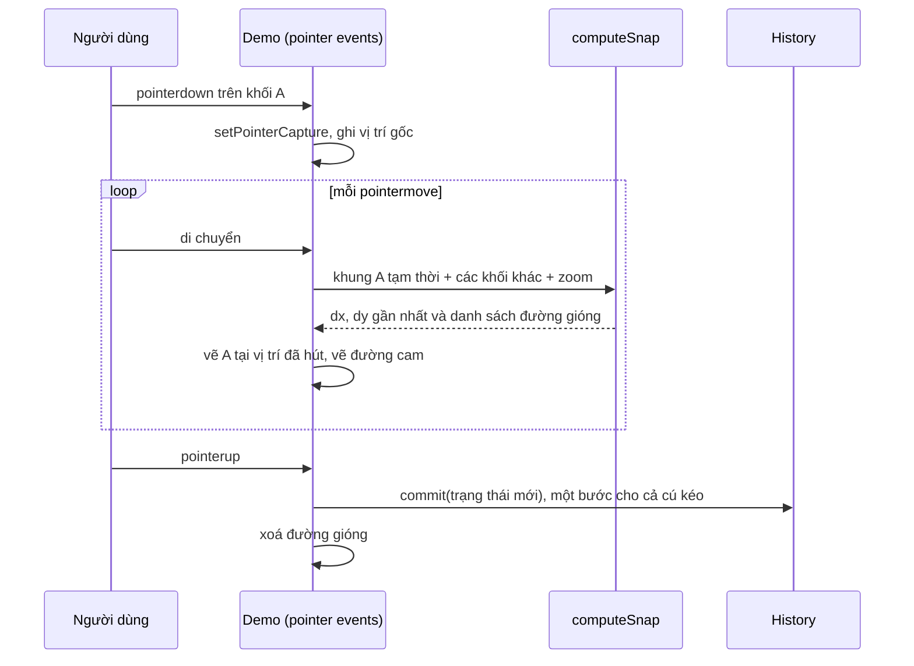

Ai từng dùng Figma, Canva hay Keynote đều quen cảm giác này: kéo một khối lại gần khối khác, khi cạnh trái hai khối gần thẳng hàng thì khối "hút" vào, và một đường màu hiện lên cho biết chúng đã thẳng. Không có tính năng này, người dùng phải zoom lên 400% và nhích từng pixel mới căn được hai khối.

Simplified là một editor thiết kế trên web (làm ảnh mạng xã hội, video ngắn). Canvas của họ dựng trên Fabric.js, với một nhóm "handler" gồm `GuidelineHandler` (đường gióng), `TransactionHandler` (lịch sử), `EventHandler`… Các handler này **phái sinh từ dự án mã nguồn mở [react-design-editor](https://github.com/salgum1114/react-design-editor)** (tác giả salgum1114, tên vẫn còn trong JSDoc `@author`). Bài này đọc phiên bản trong Simplified, chỉ ra hai vấn đề, rồi viết lại thành hàm thuần không phụ thuộc Fabric.

> [!TIP]
> **Tóm tắt**
> - Mỗi khối có 3 mốc trên mỗi trục: cạnh đầu, tâm, cạnh cuối. So 3 mốc của khối đang kéo với 3 mốc của từng khối khác; lệch dưới 4px thì hút.
> - Chọn ứng viên **gần nhất** trên mỗi trục. Bản gốc để khớp xử lý sau cùng thắng, nên có lúc vẽ đường gióng ở chỗ khối không hề thẳng hàng.
> - Ngưỡng hút tính theo **pixel màn hình** (chia cho zoom), nếu không thì zoom nhỏ gần như không hút được.
> - Undo/redo bằng snapshot: lưu trạng thái **trước** mỗi thao tác, và chỉ ghi một bước khi thả chuột, không ghi mỗi `pointermove`.

<iframe class="demo-frame" src="/demos/web-patterns/index.html?theme=dark#/snap-guides" title="Demo snap-guides" loading="lazy" style="height: 820px"></iframe>

<p class="demo-links">▶ <a href="/demos/web-patterns/index.html#/snap-guides" target="_blank" rel="noopener">Mở demo toàn màn hình ↗</a> · <a href="https://stackblitz.com/github/hunghg255/blog-hunghg/tree/master/examples/web-patterns?file=src/lib/snapGuides.ts" target="_blank" rel="noopener">Sửa code trên StackBlitz ↗</a> · <a href="https://github.com/hunghg255/blog-hunghg/blob/master/examples/web-patterns/src/lib/snapGuides.ts" target="_blank" rel="noopener">Xem source trên GitHub ↗</a></p>

Thử kéo khối A sang phải cho cạnh trái của A thẳng với cạnh trái của C: đường cam hiện và A hút vào. Ctrl/⌘+Z để hoàn tác. Bật "Ghi lịch sử mỗi pointermove" rồi kéo một lần để xem ngăn hoàn tác phình ra thế nào.

## Simplified làm thế nào?

### Đường gióng (`GuidelineHandler.js`)

File [`simplified.app/simplified.app/static/js/_components/canvas/handlers/GuidelineHandler.js`](https://github.com/hunghg255/codebase/blob/main/simplified.app/simplified.app/static/js/_components/canvas/handlers/GuidelineHandler.js), 450 dòng. Các hằng số:

```js
this.aligningLineOffset = 5;   // đường gióng dài thêm 5 đơn vị ở hai đầu
this.aligningLineMargin = 4;   // ngưỡng hút
this.aligningLineWidth = 2;
this.aligningLineColor = "rgb(255, 172, 65)";
```

Hàm `movingGuidelines(target)` được gọi ở **mỗi lần di chuột** khi đang kéo. Nó duyệt mọi object trên canvas từ cuối về đầu (bỏ qua chính nó, các "port"/"link" và object không nhận sự kiện), rồi kiểm tra 6 trường hợp: tâm dọc, cạnh trái, cạnh phải, tâm ngang, cạnh trên, cạnh dưới. Đoạn cho cạnh trái:

```js
// snap by the left edge
if (this.isInRange(objectLeft - objectWidth / 2, activeObjectLeft - activeObjectWidth / 2)) {
  verticalInTheRange = true;
  this.verticalLines.push({ x: objectLeft - objectWidth / 2, y1: ..., y2: ... });
  target.setPositionByOrigin(
    new fabric.Point(objectLeft - objectWidth / 2 + activeObjectWidth / 2, activeObjectTop),
    "center", "center"
  );
}
```

Khớp thì đẩy một đoạn thẳng vào `verticalLines` và **dời ngay** object về vị trí thẳng hàng. Comment trong code giải thích vì sao 6 khối `if` gần giống nhau không được gộp thành hàm: "we're not doing it here for perf. reasons -- as this a function that's invoked on every mouse move".

Nếu object kia là khung làm việc (`workarea`), đường gióng kéo dài từ -5000 tới 5000 thay vì chỉ nối hai object.

Phần vẽ khéo ở chỗ **không vẽ lên canvas chính**: Fabric có hai lớp canvas, lớp dưới vẽ object, lớp trên (`getSelectionContext()`) vẽ khung chọn. Handler xoá lớp trên ở `before:render` và vẽ đường gióng ở `after:render`. Object không bị vẽ lại chỉ vì đường gióng đổi.

`isInRange(v1, v2)` làm tròn hai giá trị rồi chạy vòng `for` từ `v1 - 4` tới `v1 + 4` (9 lần) để xem có bằng `v2` không, tức là tương đương `Math.abs(Math.round(v1) - Math.round(v2)) <= 4`.

### Hai vấn đề

**1. Khớp xử lý sau cùng thắng.** Mỗi khớp đều gọi `setPositionByOrigin`, nhưng tất cả phép so đều dùng toạ độ **trước khi hút** (`activeObjectLeft`, tính một lần ở đầu hàm). Nếu cạnh trái của khối đang kéo vừa gần cạnh trái của khối P (lệch 3) vừa gần cạnh trái của khối R (lệch 1), cả hai khớp đều được ghi nhận: đường gióng cho cả hai được vẽ, còn vị trí cuối cùng là của khớp được xử lý sau. Vòng lặp đi từ cuối mảng về đầu, nên khối nằm **đầu** danh sách thắng, bất kể nó xa hay gần. Kết quả trong một ca thử:

| | Khối kéo `left = 103`; P.left = 100 (lệch 3), R.left = 104 (lệch 1) |
|---|---|
| Bản gốc | dời −3 về 100, nhưng vẽ cả đường x = 104 lẫn x = 100 |
| Chọn gần nhất | dời +1 về 104, chỉ vẽ đường x = 104 (và x = 204, vì tâm của R cũng vừa thẳng với cạnh phải) |

Người dùng thấy một đường cam ở x = 104, trong khi khối nằm ở x = 100. Bật "Kiểu bản gốc" trong demo để thử.

**2. Ngưỡng theo đơn vị canvas, không theo màn hình.** `aligningLineMargin = 4` so trực tiếp với toạ độ canvas. `EventHandler` có cập nhật `guidelineHandler.zoom`, nhưng zoom chỉ dùng khi vẽ đường, không dùng khi so. Ở zoom 50%, 4 đơn vị canvas chỉ còn 2 pixel trên màn hình, rất khó "trúng". Ở zoom 300%, khối hút từ xa 12 pixel, cảm giác dính.

Hàm `scalingGuidelines` (đường gióng khi kéo giãn) chỉ có một dòng `// TODO... object scaling guideline`.

### Lịch sử (`TransactionHandler.js`)

[`TransactionHandler.js`](https://github.com/hunghg255/codebase/blob/main/simplified.app/simplified.app/static/js/_components/canvas/handlers/TransactionHandler.js) chỉ còn hàm `save`:

```js
save = (type, canvasJSON) => {
  if (this.state) {
    const json = JSON.stringify(this.state);
    this.redos = [];
    this.undos.push({ type, json });          // đẩy trạng thái TRƯỚC thao tác
  }
  const { objects } = canvasJSON || this.handler.canvas.toJSON(this.handler.propertiesToInclude);
  this.state = objects.filter((obj) => obj.id !== "workarea" && obj.id !== "grid" && obj.superType !== "port");
};
```

Nhịp "lưu cũ trước, ghi mới sau" là điểm đáng học: `state` luôn là hiện tại, `undos` chứa các trạng thái trước đó. Thao tác mới thì `redos` bị xoá, vì nhánh "tương lai" cũ không còn ý nghĩa. Khung làm việc và lưới bị loại khỏi snapshot để không ai "hoàn tác" mất khung nền.

`EventHandler` gọi `save("moved")` và `save("rotated")` ở sự kiện **kết thúc** kéo/xoay của Fabric, không phải mỗi lần di chuột, nên một cú kéo là một bước lịch sử. (Dòng `save("scaled")` đang bị comment.)

Nhưng trong bản dump, `TransactionHandler` **không có** `undo` hay `redo`, và không chỗ nào đọc `undos`. Nút Hoàn tác của Simplified (`StudioNavbar.js`) gọi `wsUndo()`, gửi `{ method: "undo" }` qua WebSocket (`_middleware/middleware.js`): lịch sử thật nằm trên server, có lẽ vì editor của họ có chế độ cộng tác nhiều người. Ngăn `undos` phía client vì thế chỉ phình ra mà không được dùng.

## Bên trong trình duyệt: kéo bằng Pointer Events

Bản viết lại dùng SVG và Pointer Events, không cần Fabric:

- `pointerdown` trên khối: gọi `setPointerCapture(pointerId)`. Từ đó mọi `pointermove`/`pointerup` của ngón tay hay chuột đó đều về phần tử này, kể cả khi con trỏ đã ra khỏi khối hoặc khỏi SVG.
- Đổi toạ độ màn hình sang toạ độ artboard bằng `svg.getScreenCTM().inverse()`. Ma trận này đã gồm zoom, `viewBox` và vị trí cuộn, nên không cần tự tính.
- `touch-action: none` trên SVG để trình duyệt không hiểu cú kéo là cuộn trang.
- Tỉ lệ "1 đơn vị artboard bằng bao nhiêu pixel" lấy từ `getBoundingClientRect().width / viewBoxWidth`, rồi truyền vào `computeSnap` làm `zoom`.



## Viết lại

Lõi của thuật toán (`anchors(box, axis)` trả 3 mốc: cạnh đầu, tâm, cạnh cuối): với mỗi trục, thử mọi cặp (mốc của khối đang kéo, mốc của khối khác), giữ cặp có độ lệch nhỏ nhất. Cặp nào **cùng độ dời** với cặp tốt nhất cũng được giữ, để vẽ được nhiều đường gióng cùng lúc (ví dụ khối vừa thẳng cạnh trái của B vừa thẳng tâm của C):

```ts title=src/lib/snapGuides.ts
function bestOnAxis(moving: Box, others: Box[], axis: 'x' | 'y', limit: number): Match[] {
  const mine = anchors(moving, axis);
  let best: Match[] = [];
  let bestAbs = Infinity;
  for (const other of others) {
    for (const target of anchors(other, axis)) {
      for (const source of mine) {
        const delta = target - source;
        const abs = Math.abs(delta);
        if (abs > limit) continue;
        if (abs < bestAbs - 1e-6) {
          bestAbs = abs;
          best = [{ delta, pos: target, other }];
        } else if (Math.abs(abs - bestAbs) <= 1e-6 && delta === best[0]?.delta) {
          // cùng độ dời: nhiều đường gióng cùng hiện (vd vừa thẳng cạnh trái vừa thẳng tâm của object khác)
          best.push({ delta, pos: target, other });
        }
      }
    }
  }
  return best;
}
```

Hàm chính chia ngưỡng cho zoom, gộp khung làm việc vào danh sách ứng viên, rồi dựng đường gióng **sau khi** đã hút, nên đường luôn nằm đúng chỗ khối đang đứng:

```ts title=src/lib/snapGuides.ts
export function computeSnap(moving: Box, others: Box[], { threshold = 4, zoom = 1, frame, overshoot = 5 }: SnapOptions = {}): SnapResult {
  const limit = threshold / zoom;
  const candidates = frame ? [...others, frame] : others;
  const xs = bestOnAxis(moving, candidates, 'x', limit);
  const ys = bestOnAxis(moving, candidates, 'y', limit);
  const dx = xs[0]?.delta ?? 0;
  const dy = ys[0]?.delta ?? 0;
  const snapped = { ...moving, x: moving.x + dx, y: moving.y + dy };

  const guides: Guide[] = [];
  for (const m of xs) {
    const isFrame = m.other === frame;
    const top = Math.min(snapped.y, m.other.y);
    const bottom = Math.max(snapped.y + snapped.h, m.other.y + m.other.h);
    guides.push({ axis: 'x', pos: m.pos, from: isFrame ? m.other.y : top - overshoot, to: isFrame ? m.other.y + m.other.h : bottom + overshoot });
  }
  for (const m of ys) {
    const isFrame = m.other === frame;
    const left = Math.min(snapped.x, m.other.x);
    const right = Math.max(snapped.x + snapped.w, m.other.x + m.other.w);
    guides.push({ axis: 'y', pos: m.pos, from: isFrame ? m.other.x : left - overshoot, to: isFrame ? m.other.x + m.other.w : right + overshoot });
  }
```

Lịch sử giữ đúng nhịp của `TransactionHandler`, thêm `undo`/`redo`, giới hạn số bước và bỏ qua lần commit không đổi gì:

```ts title=src/lib/snapGuides.ts
    commit(next) {
      if (equals(JSON.parse(present) as T, next)) return false;
      undos.push(present);
      if (undos.length > limit) undos.shift();
      present = JSON.stringify(next);
      redos = [];
      return true;
    },
    undo() {
      const previous = undos.pop();
      if (previous !== undefined) {
        redos.push(present);
        present = previous;
      }
      return JSON.parse(present) as T;
    },
```

::: spoiler Xem toàn bộ src/lib/snapGuides.ts

```ts title=src/lib/snapGuides.ts
/**
 * Đường gióng (smart guides) khi kéo object trên canvas, kiểu Figma/Canva.
 * Ý tưởng từ GuidelineHandler.js của Simplified (phái sinh từ OSS react-design-editor):
 * so tâm và 4 cạnh của object đang kéo với từng object khác, lệch trong ±4px thì hút vào
 * và vẽ một đường cam nối hai object.
 *
 * Khác bản gốc:
 * - Chọn ứng viên GẦN NHẤT trên mỗi trục, thay vì "khớp sau cùng thắng" (bản gốc gọi
 *   setPositionByOrigin cho mọi khớp, khớp nào xử lý sau cùng sẽ quyết định vị trí,
 *   trong khi đường gióng của các khớp trước vẫn được vẽ).
 * - Ngưỡng tính theo pixel MÀN HÌNH (chia cho zoom), zoom nhỏ vẫn hút như nhau.
 * - Hàm thuần: nhận hình chữ nhật, trả về độ dời + danh sách đường gióng. Không phụ thuộc fabric.
 */

export interface Box {
  id: string;
  x: number; // cạnh trái
  y: number; // cạnh trên
  w: number;
  h: number;
}

export interface Guide {
  axis: 'x' | 'y'; // 'x' = đường dọc tại x = pos, 'y' = đường ngang tại y = pos
  pos: number;
  from: number; // đoạn vẽ (theo trục còn lại)
  to: number;
}

export interface SnapResult {
  dx: number;
  dy: number;
  guides: Guide[];
}

export interface SnapOptions {
  /** ngưỡng hút, đơn vị pixel màn hình (bản gốc: 4) */
  threshold?: number;
  zoom?: number;
  /** khung làm việc: khớp với nó thì vẽ đường dài hết khung */
  frame?: Box;
  /** khoảng chừa ở hai đầu đường gióng (bản gốc: 5) */
  overshoot?: number;
}

/** 3 mốc trên một trục: cạnh đầu, tâm, cạnh cuối. */
const anchors = (b: Box, axis: 'x' | 'y') =>
  axis === 'x' ? [b.x, b.x + b.w / 2, b.x + b.w] : [b.y, b.y + b.h / 2, b.y + b.h];

interface Match {
  delta: number; // độ dời cần để khớp
  pos: number; // vị trí đường gióng
  other: Box;
}

function bestOnAxis(moving: Box, others: Box[], axis: 'x' | 'y', limit: number): Match[] {
  const mine = anchors(moving, axis);
  let best: Match[] = [];
  let bestAbs = Infinity;
  for (const other of others) {
    for (const target of anchors(other, axis)) {
      for (const source of mine) {
        const delta = target - source;
        const abs = Math.abs(delta);
        if (abs > limit) continue;
        if (abs < bestAbs - 1e-6) {
          bestAbs = abs;
          best = [{ delta, pos: target, other }];
        } else if (Math.abs(abs - bestAbs) <= 1e-6 && delta === best[0]?.delta) {
          // cùng độ dời: nhiều đường gióng cùng hiện (vd vừa thẳng cạnh trái vừa thẳng tâm của object khác)
          best.push({ delta, pos: target, other });
        }
      }
    }
  }
  return best;
}

export function computeSnap(moving: Box, others: Box[], { threshold = 4, zoom = 1, frame, overshoot = 5 }: SnapOptions = {}): SnapResult {
  const limit = threshold / zoom;
  const candidates = frame ? [...others, frame] : others;
  const xs = bestOnAxis(moving, candidates, 'x', limit);
  const ys = bestOnAxis(moving, candidates, 'y', limit);
  const dx = xs[0]?.delta ?? 0;
  const dy = ys[0]?.delta ?? 0;
  const snapped = { ...moving, x: moving.x + dx, y: moving.y + dy };

  const guides: Guide[] = [];
  for (const m of xs) {
    const isFrame = m.other === frame;
    const top = Math.min(snapped.y, m.other.y);
    const bottom = Math.max(snapped.y + snapped.h, m.other.y + m.other.h);
    guides.push({ axis: 'x', pos: m.pos, from: isFrame ? m.other.y : top - overshoot, to: isFrame ? m.other.y + m.other.h : bottom + overshoot });
  }
  for (const m of ys) {
    const isFrame = m.other === frame;
    const left = Math.min(snapped.x, m.other.x);
    const right = Math.max(snapped.x + snapped.w, m.other.x + m.other.w);
    guides.push({ axis: 'y', pos: m.pos, from: isFrame ? m.other.x : left - overshoot, to: isFrame ? m.other.x + m.other.w : right + overshoot });
  }
  // bỏ đường trùng nhau
  const seen = new Set<string>();
  return {
    dx,
    dy,
    guides: guides.filter((g) => {
      const k = `${g.axis}:${g.pos.toFixed(2)}`;
      if (seen.has(k)) return false;
      seen.add(k);
      return true;
    }),
  };
}

/**
 * Bản mô phỏng logic gốc của Simplified để so sánh trong demo: duyệt object từ cuối về đầu,
 * khớp nào cũng dời object, đường gióng nào cũng được vẽ. Kết quả: khớp xử lý sau cùng thắng.
 */
export function computeSnapLastWins(moving: Box, others: Box[], { threshold = 4, zoom = 1 }: SnapOptions = {}): SnapResult {
  const inRange = (a: number, b: number) => Math.abs(Math.round(a) - Math.round(b)) <= threshold / zoom;
  let { x, y } = moving;
  const guides: Guide[] = [];
  const cx0 = moving.x + moving.w / 2;
  const cy0 = moving.y + moving.h / 2;
  for (let i = others.length; i--; ) {
    const o = others[i];
    const ocx = o.x + o.w / 2;
    const ocy = o.y + o.h / 2;
    // giống bản gốc: các phép so đều dùng toạ độ TRƯỚC khi hút (cx0, cy0)
    const pairsX: Array<[number, number]> = [
      [ocx, cx0],
      [o.x, cx0 - moving.w / 2],
      [o.x + o.w, cx0 + moving.w / 2],
    ];
    for (const [target, source] of pairsX) {
      if (inRange(target, source)) {
        x = moving.x + (target - source);
        guides.push({ axis: 'x', pos: target, from: Math.min(o.y, moving.y) - 5, to: Math.max(o.y + o.h, moving.y + moving.h) + 5 });
      }
    }
    const pairsY: Array<[number, number]> = [
      [ocy, cy0],
      [o.y, cy0 - moving.h / 2],
      [o.y + o.h, cy0 + moving.h / 2],
    ];
    for (const [target, source] of pairsY) {
      if (inRange(target, source)) {
        y = moving.y + (target - source);
        guides.push({ axis: 'y', pos: target, from: Math.min(o.x, moving.x) - 5, to: Math.max(o.x + o.w, moving.x + moving.w) + 5 });
      }
    }
  }
  return { dx: x - moving.x, dy: y - moving.y, guides };
}

// ---- Undo/redo bằng snapshot ----

/**
 * Lịch sử dạng snapshot, theo đúng nhịp của TransactionHandler: mỗi lần commit,
 * đẩy trạng thái TRƯỚC đó vào ngăn undo rồi mới ghi trạng thái mới; commit mới xoá ngăn redo.
 * Thêm so với bản gốc: giới hạn số bước, bỏ commit không đổi gì, và có undo/redo thật
 * (trong bản dump của Simplified, handler này chỉ còn save(); undo đi qua server).
 */
export interface History<T> {
  readonly present: T;
  readonly canUndo: boolean;
  readonly canRedo: boolean;
  readonly size: { undo: number; redo: number };
  commit(next: T): boolean;
  undo(): T;
  redo(): T;
}

export function createHistory<T>(initial: T, { limit = 100, equals = defaultEquals }: { limit?: number; equals?: (a: T, b: T) => boolean } = {}): History<T> {
  // lưu snapshot dạng chuỗi JSON: bất biến, không lo bị sửa ngầm qua tham chiếu
  let present = JSON.stringify(initial);
  const undos: string[] = [];
  let redos: string[] = [];

  return {
    get present() {
      return JSON.parse(present) as T;
    },
    get canUndo() {
      return undos.length > 0;
    },
    get canRedo() {
      return redos.length > 0;
    },
    get size() {
      return { undo: undos.length, redo: redos.length };
    },
    commit(next) {
      if (equals(JSON.parse(present) as T, next)) return false;
      undos.push(present);
      if (undos.length > limit) undos.shift();
      present = JSON.stringify(next);
      redos = [];
      return true;
    },
    undo() {
      const previous = undos.pop();
      if (previous !== undefined) {
        redos.push(present);
        present = previous;
      }
      return JSON.parse(present) as T;
    },
    redo() {
      const next = redos.pop();
      if (next !== undefined) {
        undos.push(present);
        present = next;
      }
      return JSON.parse(present) as T;
    },
  };
}

function defaultEquals<T>(a: T, b: T) {
  return JSON.stringify(a) === JSON.stringify(b);
}
```

:::

## Đi qua code

- **`anchors`** trả 3 mốc theo trục. Với 4 khối khác cộng khung làm việc, mỗi lần di chuột là 5 × 3 × 3 = 45 phép so mỗi trục, rất nhẹ. Với hàng nghìn object thì nên lọc trước các khối nằm trong vùng nhìn thấy.
- **`bestOnAxis`** so bằng `abs < bestAbs - 1e-6` để tránh coi hai số thực "gần bằng nhau" là khác nhau.
- **`computeSnap`** trả về độ dời chứ không trả về vị trí, nên dùng được cho cả kéo, dịch bằng phím mũi tên hay dán.
- Khung làm việc (`frame`) cho đường gióng dài hết khung, giống nhánh `workarea` của bản gốc.
- **`computeSnapLastWins`** mô phỏng logic gốc để demo so sánh; không dùng trong dự án thật.
- **`createHistory`** lưu snapshot dạng **chuỗi JSON**, như bản gốc. Chuỗi là bất biến: không ai sửa nhầm một snapshot cũ qua tham chiếu. `commit` trả `false` nếu trạng thái không đổi (bấm chuột nhưng không kéo).
- Trong demo, `pointerup` mới gọi `commit`, nên một cú kéo là một bước. Bật "Ghi lịch sử mỗi pointermove" để so sánh: một cú kéo ngắn đã thành 8–9 bước.

**Khác bản gốc:**
- Chọn khớp gần nhất trên mỗi trục; bản gốc lấy khớp xử lý sau cùng.
- Ngưỡng theo pixel màn hình.
- Đường gióng tính sau khi hút, không bao giờ lệch khỏi khối.
- Có `undo`/`redo` ngay ở client và giới hạn 100 bước.
- Hàm thuần, không phụ thuộc Fabric hay canvas.

## Tại sao không làm cách khác?

**Hút theo lưới (grid snap)?** Đơn giản hơn nhiều (`Math.round(x / 8) * 8`), và nên có như một lựa chọn. Nhưng lưới không giúp căn hai khối với nhau khi chúng không nằm trên lưới, hoặc khi khối có kích thước lẻ.

**Lưu lịch sử dạng thao tác (command pattern) thay vì snapshot?** Mỗi bước lưu "dời A từ (60, 60) tới (110, 60)" và hàm đảo ngược. Tốn ít bộ nhớ hơn, và là cách đi đúng cho editor lớn hoặc cộng tác thời gian thực. Đổi lại, mọi thao tác phải viết hàm đảo ngược, bỏ sót một cái là lịch sử hỏng. Snapshot thì đúng "miễn phí" cho mọi thao tác, đánh đổi bằng bộ nhớ: 100 bước × kích thước JSON của cả trang. Với vài trăm object thì vẫn ổn.

**Dùng Immer patches?** Immer sinh được patch và patch đảo ngược cho mỗi lần sửa state, một cách giữa snapshot và command: ít bộ nhớ mà không phải tự viết hàm đảo ngược. Đáng cân nhắc nếu state đã dùng Immer.

**Để server giữ lịch sử như Simplified?** Hợp lý khi nhiều người cùng sửa một tài liệu: "hoàn tác" phải là hoàn tác thao tác **của tôi**, server biết rõ hơn. Nhưng mỗi lần bấm Ctrl+Z là một lượt mạng; editor một người dùng thì lịch sử ở client phản hồi nhanh hơn.

## Edge case và cạm bẫy

- **Nhiều khớp ngang bằng nhau**: khối có thể lệch 2px với cạnh của P và lệch 2px (ngược chiều) với tâm của Q. `bestOnAxis` chọn cái gặp trước. Có thể ưu tiên cạnh hơn tâm, hoặc ưu tiên khối gần hơn theo trục còn lại.
- **Khối xoay**: thuật toán dùng hộp bao (bounding box). Với khối xoay 45°, hộp bao to hơn khối thật, đường gióng nhìn "hở".
- **Giữ phím để tắt hút**: các editor thường cho giữ Ctrl/⌘ hoặc Alt để tạm tắt hút khi cần đặt chính xác. Chỉ cần bỏ qua `computeSnap` khi `event.ctrlKey`.
- **Kéo nhiều khối cùng lúc**: dùng hộp bao của cả nhóm làm `moving`, rồi cộng `dx`, `dy` cho từng khối.
- **`pointercancel`**: trình duyệt có thể huỷ con trỏ (ví dụ hệ điều hành chen một cử chỉ vào). Phải kết thúc kéo cả ở `pointercancel`, nếu không đường gióng cứ nằm trên màn hình.
- **Snapshot chứa thứ không phải dữ liệu**: hàm, `Date`, `Map` không qua được `JSON.stringify` nguyên vẹn. Giữ state của editor ở dạng dữ liệu thuần.
- **Undo khi đang kéo**: nếu người dùng bấm Ctrl+Z giữa cú kéo, nên huỷ cú kéo trước (bỏ `drag`) rồi mới hoàn tác, để vị trí không bị ghi đè ở `pointerup`.

## Dùng trong dự án

```ts
const history = createHistory(initialShapes, { limit: 200 });

function onDragMove(id: string, raw: Box, event: PointerEvent) {
  const others = shapes.filter((s) => s.id !== id && isVisible(s));
  const snap = event.altKey ? { dx: 0, dy: 0, guides: [] } : computeSnap(raw, others, { zoom: viewport.zoom, frame: artboard });
  moveShape(id, raw.x + snap.dx, raw.y + snap.dy);
  drawGuides(snap.guides); // vẽ ở lớp overlay riêng, không vẽ lại các shape
}

function onDragEnd() {
  clearGuides();
  history.commit(shapes); // một cú kéo = một bước
}
```

Nếu dùng Fabric.js hay Konva, logic vẫn vậy: lấy hộp bao của object, gọi `computeSnap`, rồi đặt lại vị trí, và vẽ đường gióng ở lớp trên (Fabric: selection context; Konva: một layer riêng).

## Kiểm thử

::: spoiler Ví dụ test (bản phác, không có trong repo)

```ts
import { describe, expect, it } from 'vitest';
import { computeSnap, computeSnapLastWins, createHistory } from './snapGuides';

const box = (id: string, x: number, y: number, w: number, h: number) => ({ id, x, y, w, h });

describe('computeSnap', () => {
  const moving = box('M', 103, 200, 100, 50);
  const others = [box('P', 100, 20, 120, 60), box('R', 104, 320, 200, 40)];

  it('chọn khớp gần nhất, đường gióng nằm đúng chỗ khối', () => {
    const r = computeSnap(moving, others);
    expect(r.dx).toBe(1);
    expect(r.guides.map((g) => g.pos)).toContain(104);
    expect(r.guides.map((g) => g.pos)).not.toContain(100);
  });

  it('bản gốc: khớp xử lý sau thắng và vẽ cả đường không thẳng hàng', () => {
    const r = computeSnapLastWins(moving, others);
    expect(r.dx).toBe(-3);
    expect(r.guides.map((g) => g.pos)).toEqual(expect.arrayContaining([100, 104]));
  });

  it('ngưỡng theo pixel màn hình', () => {
    const far = box('M', 106, 200, 100, 50); // lệch 2 đơn vị so với R.left = 104
    expect(computeSnap(far, others, { zoom: 1 }).dx).toBe(-2);
    expect(computeSnap(far, others, { zoom: 4 }).dx).toBe(0); // 2 đơn vị = 8px màn hình > 4px
  });

  it('khớp với khung làm việc cho đường dài hết khung', () => {
    const frame = box('frame', 0, 0, 600, 400);
    const r = computeSnap(box('M', 2, 100, 50, 50), [], { frame });
    expect(r.dx).toBe(-2);
    expect(r.guides[0]).toMatchObject({ axis: 'x', pos: 0, from: 0, to: 400 });
  });
});

describe('createHistory', () => {
  it('undo/redo và commit mới xoá redo', () => {
    const h = createHistory({ n: 0 });
    h.commit({ n: 1 });
    h.commit({ n: 2 });
    expect(h.undo()).toEqual({ n: 1 });
    expect(h.canRedo).toBe(true);
    h.commit({ n: 9 });
    expect(h.canRedo).toBe(false);
    expect(h.undo()).toEqual({ n: 1 });
  });
  it('bỏ qua commit không đổi gì và giới hạn số bước', () => {
    const h = createHistory({ n: 0 }, { limit: 2 });
    expect(h.commit({ n: 0 })).toBe(false);
    h.commit({ n: 1 });
    h.commit({ n: 2 });
    h.commit({ n: 3 });
    expect(h.size.undo).toBe(2);
  });
});
```

:::

## So với thư viện và chuẩn web

- **Fabric.js** không có đường gióng sẵn; cộng đồng có nhiều bản "aligning guidelines" và `GuidelineHandler` của react-design-editor là một trong số đó. **Konva** cũng không có sẵn, nhưng tài liệu của Konva có ví dụ "Objects Snapping" theo cùng ý tưởng mốc cạnh/tâm.
- **tldraw**, **Excalidraw** là editor mã nguồn mở có snapping và lịch sử hoàn chỉnh, đáng đọc nếu cần làm editor nghiêm túc.
- **Pointer Events** và `setPointerCapture` có trên mọi trình duyệt hiện đại (tính tới 10/2026), thay được cả chuột lẫn cảm ứng bằng một bộ sự kiện.
- Chưa có API trình duyệt nào cho undo/redo của ứng dụng. `beforeinput` với `inputType: "historyUndo"` chỉ áp dụng cho vùng nhập văn bản và `contenteditable`.

---

Bài này thuộc series **[Học từ mã nguồn các web lớn](/series/web)** (65 bài, đọc theo thứ tự).

::: spoiler Xem nhanh danh sách bài trong series

*Mở đầu*

- [Mở đầu: đọc code production của 28 trang web](/blogs/learn-from-big-web-apps)

*Phần 1: trải nghiệm người dùng*

- [#1 Dark mode không nháy (Gatsby)](/blogs/web-dark-mode-no-flash)
- [#2 useValueByMedia: giá trị theo breakpoint (Toptal)](/blogs/web-use-value-by-media)
- [#3 Đoán ý định: idle, exit-intent, lắc chuột (Toptal, InVision)](/blogs/web-user-intent-idle-exit-wiggle)
- [#4 Validate form thân thiện (Udacity, Pipedrive)](/blogs/web-form-validation-ux)
- [#5 Magic number, EXIF và dán ảnh (Ello)](/blogs/web-file-magic-number-exif-paste)
- [#6 fastSmoothScroll: cuộn xa vẫn nhanh (Telegram)](/blogs/web-telegram-fast-smooth-scroll)
- [#7 Countdown time-travel và tombstone giỏ hàng (Best Buy)](/blogs/web-countdown-time-travel-tombstone)

*Phần 2: hiệu năng và đo lường*

- [#8 Hàng đợi requestAnimationFrame 3ms (Apple)](/blogs/web-raf-queue-3ms)
- [#9 srcset cho artwork và preconnect tự động (Apple)](/blogs/web-responsive-artwork-preconnect)
- [#10 Quick-fetch: gọi API trước khi bundle tải xong (HubSpot)](/blogs/web-quick-fetch-early-requests)
- [#11 Performance span và long task (Postman, Calibre)](/blogs/web-performance-spans-long-tasks)
- [#12 Gọi Web Worker như hàm async (Telegram)](/blogs/web-worker-promise-rpc)
- [#13 Đồng hồ media: đếm giờ xem và sửa lệch (Skillshare, Simplified)](/blogs/web-media-clock-watch-time-drift)

*Phần 3: nhiều tab, phiên đăng nhập, cập nhật*

- [#14 Bầu tab chủ cho thông báo (HubSpot, Telegram)](/blogs/web-leader-tab-notifications)
- [#15 Đồng bộ đăng nhập giữa tab và giới hạn cookie (Elastic, InVision)](/blogs/web-cross-tab-auth-cookie-guard)
- [#16 SPA tự cập nhật: Trello, Zappos, Facebook, Elastic](/blogs/web-spa-self-update-strategies)

*Phần 4: kiến trúc*

- [#17 Reverse portal: di chuyển component không remount (Zappos)](/blogs/web-reverse-portal)
- [#18 Page behaviors: gắn hành vi từ CMS (Intercom)](/blogs/web-page-behaviors-cms)
- [#19 Giới hạn tần suất hiển thị bằng bitmask (Outlook)](/blogs/web-frequency-cap-bitmask)
- [#20 Chuyển REST sang GraphQL dần dần (Coursera)](/blogs/web-rest-to-graphql-hybrid-link)

*Phần 5: soạn thảo và hiển thị nội dung*

- [#21 Autocomplete tại con trỏ trong contenteditable (Ello, Telegram)](/blogs/web-caret-autocomplete-contenteditable)
- [#22 Dark mode cho email HTML bằng CIELAB (Outlook)](/blogs/web-email-dark-mode-cielab)
- [#23 Thu nhỏ bảng rộng cho vừa khung, vá font emoji (Outlook)](/blogs/web-email-wide-content-scale)
- [#24 Cảnh báo quên đính kèm file (Outlook)](/blogs/web-forgotten-attachment-warning)
- [#25 Cắt chữ nhiều dòng chính xác (Pipedrive, Apple, Toptal)](/blogs/web-multiline-truncate-measure-text)
- [#26 Parse ngày giờ gõ tay khoan dung (Outlook, Elastic)](/blogs/web-lenient-date-parser)

*Phần 6: tương tác*

- [#27 menuAim: rê chéo vào submenu không bị đóng (Udemy)](/blogs/web-menu-aim-triangle)
- [#28 Kéo, vuốt chung cho chuột và cảm ứng (Telegram)](/blogs/web-unified-pointer-gestures)
- [#29 Phím tắt theo phạm vi, IME và bàn phím phi Latinh (Trello)](/blogs/web-scoped-keyboard-shortcuts)
- [#30 Nội suy màu: đổi theme và nền theo cuộn (Telegram, Anchor)](/blogs/web-color-interpolation-theme-scroll)
- **#31 Đường gióng hút cạnh và undo/redo trên canvas (Simplified)** (bài này)
- [#32 Giả lập mù màu bằng feColorMatrix (Trello)](/blogs/web-color-vision-simulator)
- [#33 Vạch thước theo mức zoom và cấp phát màu cho biểu đồ (Anchor, Similarweb)](/blogs/web-timeline-ticks-color-stack)

*Phần 7: mạng, dữ liệu và async*

- [#34 Ô tìm kiếm chuẩn production (Similarweb, Udemy, Pipedrive)](/blogs/web-production-search-box)
- [#35 Điều phối async: latest-wins, single-flight (Glitch, Toptal)](/blogs/web-async-coordination-latest-wins)
- [#36 Polling thưa dần và debounce động (Trello)](/blogs/web-decaying-polling-dynamic-debounce)
- [#37 Cache phía client theo version (Similarweb, Telegram, Udemy)](/blogs/web-client-cache-versioned)
- [#38 Upload file lớn theo chunk (Outlook, Tribe)](/blogs/web-chunked-upload-pipeline)
- [#39 Phát video qua Service Worker bằng Range request (Telegram, Outlook)](/blogs/web-service-worker-range-streaming)

*Phần 8: hiệu năng và vận hành*

- [#40 TTI governor: hoãn việc phụ tới sau khi trang dùng được (Outlook)](/blogs/web-tti-governor)
- [#41 Tự đo LCP/CLS/TBT và phục vụ bản nhẹ cho máy yếu (Udemy)](/blogs/web-rum-adaptive-loading)

*Phần 9: thuật toán và dữ liệu phía client*

- [#42 Three-way merge ngay trên trình duyệt (Postman)](/blogs/web-three-way-merge-client)
- [#43 Dọn cache GraphQL bằng đếm tham chiếu (Outlook)](/blogs/web-graphql-cache-refcount-gc)
- [#44 LRU cache theo 3 cách (Apple, Similarweb, Outlook)](/blogs/web-lru-cache-three-ways)
- [#45 Lọc tăng dần trong Web Worker (Similarweb)](/blogs/web-incremental-filter-worker)
- [#46 Xếp hạng gợi ý trên client, so ngầm với server (Outlook)](/blogs/web-client-side-ranking-shadow-test)
- [#47 Nối OT với editor: undo stack và chặn echo (Glitch)](/blogs/web-ot-codemirror-undo)
- [#48 Ngôn ngữ markup riêng dịch hai chiều với HTML (Coursera)](/blogs/web-custom-markup-compiler)

*Phần 10: thời gian, ngôn ngữ, định dạng*

- [#49 Xử lý giờ mùa hè không cần thư viện (Udemy, Pipedrive)](/blogs/web-dst-without-library)
- [#50 Intl thực chiến: Segmenter, số rút gọn, số nhiều, fallback locale (Apple, Outlook)](/blogs/web-intl-in-production)
- [#51 WebVTT và bôi chọn transcript (Udemy, Coursera)](/blogs/web-webvtt-transcript-selection)

*Phần 11: tương tác và giao diện*

- [#52 Kéo-thả trên lịch (Pipedrive)](/blogs/web-calendar-drag-drop)
- [#53 Focus stack cho popup lồng nhau (Outlook)](/blogs/web-focus-stack-nested-popups)
- [#54 Clipboard: copy, dán chữ thuần, dán thông minh (Trello, Anchor, Pipedrive, Tribe)](/blogs/web-clipboard-tricks)
- [#55 Khôi phục vị trí cuộn khi trang còn đang tải (Apple, Zappos)](/blogs/web-scroll-restore-wait-height)
- [#56 Lấy màu từ ảnh: gradient nền, màu chữ (Apple, Telegram, Trello)](/blogs/web-colors-from-images)
- [#57 JS đọc breakpoint từ CSS, phát hiện chế độ PWA (Ello, Apple)](/blogs/web-css-js-breakpoint-bridge)

*Phần 12: media*

- [#58 Tin nhắn thoại: ghi âm, waveform realtime, nén 5-bit (Telegram)](/blogs/web-voice-message-waveform)
- [#59 Chụp frame video thành ảnh, canvas bị taint (Coursera, Outlook)](/blogs/web-video-frame-snapshot)

*Phần 13: đo lường, bảo mật, vận hành*

- [#60 Đo lúc ảnh màn hình đầu tải xong, cả khi chuyển trang SPA (Zappos, Best Buy, Outlook)](/blogs/web-above-the-fold-image-timing)
- [#61 Buffer analytics chờ SDK, phát hiện adblock (Best Buy)](/blogs/web-analytics-buffer-adblock)
- [#62 Proof-of-work trên client để chặn API ẩn danh (Udemy)](/blogs/web-client-proof-of-work)
- [#63 Prefetch không làm lệch số liệu, nén cài đặt bằng bit (Outlook)](/blogs/web-synthetic-prefetch-bit-flags)
- [#64 Micro-frontend: AngularJS và React chung app, giao tiếp xuyên frame (Similarweb, InVision, HubSpot)](/blogs/web-micro-frontend-bridges)

:::

Code + demo: [`examples/web-patterns`](https://github.com/hunghg255/blog-hunghg/tree/master/examples/web-patterns) · [Mở trên StackBlitz](https://stackblitz.com/github/hunghg255/blog-hunghg/tree/master/examples/web-patterns)
