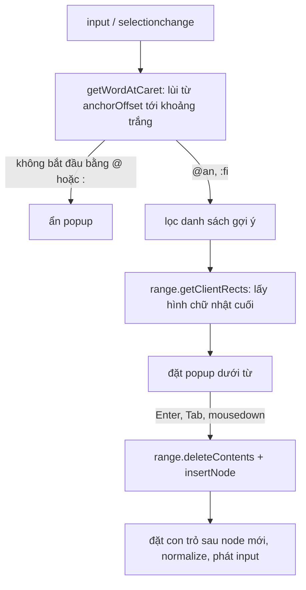

Ô soạn thảo có gợi ý `@tên` và `:emoji:` trông đơn giản cho tới khi bạn tự làm. Với `<textarea>` còn có `selectionStart`, nhưng ô soạn thảo giàu định dạng (rich text) thường là một `div contenteditable`, và ở đó không có "vị trí con trỏ" dạng số. Bạn phải tự trả lời bốn câu hỏi:

1. Người dùng **đang gõ từ gì** ngay tại con trỏ? (không phải từ cuối cùng của cả đoạn)
2. Popup gợi ý **đặt ở toạ độ nào** trên màn hình?
3. Chọn gợi ý thì **thay đúng đoạn** `@an` bằng `@an.nguyen` thế nào, con trỏ nằm đâu sau đó?
4. Bấm nút ⌫ trên bảng emoji thì xoá **một ký tự người dùng nhìn thấy**, không làm vỡ 👨‍👩‍👧 thành `👨‍👩‍�`.

Ello (mạng xã hội cho dân sáng tạo) giải 1–3 bằng một file 175 dòng tên `SelectionUtil.js`. Telegram Web giải câu 4 và cách chèn emoji. Bài này đọc cả hai, chỉ ra vài lỗi, rồi viết lại thành một module TypeScript nhỏ.

> [!TIP]
> **Tóm tắt**
> - Lấy từ đang gõ: đọc `selection.anchorNode` + `anchorOffset`, lùi từng ký tự tới khoảng trắng, rồi dựng một `Range` bao đúng từ đó.
> - Toạ độ popup: `range.getClientRects()` lấy hình chữ nhật **cuối** (từ bị ngắt dòng có hai hình), không dùng `getBoundingClientRect()` của cả từ.
> - Thay thế bằng `range.deleteContents()` + `insertNode()` rồi tự đặt lại con trỏ. Bấm gợi ý bằng `mousedown` + `preventDefault()` để không mất selection.
> - Xoá "một ký tự" theo **grapheme** (`Intl.Segmenter`), không theo `string.length`.

<iframe class="demo-frame" src="/demos/web-patterns/index.html?theme=dark#/caret-autocomplete" title="Demo caret-autocomplete" loading="lazy" style="height: 760px"></iframe>

<p class="demo-links">▶ <a href="/demos/web-patterns/index.html#/caret-autocomplete" target="_blank" rel="noopener">Mở demo toàn màn hình ↗</a> · <a href="https://stackblitz.com/github/hunghg255/blog-hunghg/tree/master/examples/web-patterns?file=src/lib/caretAutocomplete.ts" target="_blank" rel="noopener">Sửa code trên StackBlitz ↗</a> · <a href="https://github.com/hunghg255/blog-hunghg/blob/master/examples/web-patterns/src/lib/caretAutocomplete.ts" target="_blank" rel="noopener">Xem source trên GitHub ↗</a></p>

Thử gõ `@an` ở **giữa** câu (bấm chuột vào giữa rồi gõ), hoặc `:fi`. Ở khung dưới, so sánh nút "⌫ ngây thơ" (`text.slice(0, -1)`) với "⌫ theo grapheme": bản ngây thơ để lại một nửa cặp surrogate và hiện thành `�`.

## Ello làm thế nào?

Code nằm ở [`ello.co/src/components/editor/SelectionUtil.js`](https://github.com/hunghg255/codebase/blob/main/ello.co/src/components/editor/SelectionUtil.js). Hàm quan trọng nhất (rút gọn):

```js
let node = null, startIndex = -1, endIndex = -1 // trạng thái cấp module

export function getWordFromSelection() {
  const selection = document.getSelection()
  node = selection.anchorNode
  if (!node || node.nodeName !== '#text') return ''
  let text = node.textContent
  const wordArr = text.split('')
  endIndex = selection.anchorOffset - 1
  if (endIndex < 0) endIndex = 0
  const letters = []
  let index = endIndex
  while (index > -1) {
    const letter = wordArr[index]
    index -= 1
    if (letter.match(/\s/)) break
    else if (letter.match(/:/)) { letters.unshift(letter); break }
    else letters.unshift(letter)
  }
  startIndex = (endIndex - letters.length) + 1
  return letters.join('')
}
```

Ý tưởng: `anchorNode` là text node chứa con trỏ, `anchorOffset` là vị trí con trỏ trong text node đó. Từ đó lùi ngược từng ký tự cho tới khoảng trắng. Gặp dấu `:` thì giữ lại và dừng luôn, để `abc:sm` cho ra `:sm` (đúng kiểu gõ emoji). Kết quả được ghi vào ba biến **cấp module** `node`, `startIndex`, `endIndex` để hai hàm sau dùng lại:

- `getPositionFromSelection()` dựng `document.createRange()` từ `startIndex` tới `endIndex + 1`, gọi `getBoundingClientRect()` để lấy toạ độ, cộng thêm `window.pageYOffset` riêng cho iOS.
- `replaceWordFromSelection(word)` dựng lại Range đó, `deleteContents()`, `insertNode()` một text node mới, rồi `collapseToEnd()` để con trỏ nằm sau chữ vừa chèn.

Phần quyết định "có hiện gợi ý không" nằm ở [`editor/InputComponent.js`](https://github.com/hunghg255/codebase/blob/main/ello.co/src/components/editor/InputComponent.js): trên mỗi `keyup` (trừ Tab, Enter, Esc, ↑, ↓), lấy từ hiện tại rồi so với hai regex khai báo trong [`completers/Completer.js`](https://github.com/hunghg255/codebase/blob/main/ello.co/src/components/completers/Completer.js):

```js
export const emojiRegex = /\s?:{1}(\w+|\+|-):{0}$/
export const userRegex = /(\s|^)@{1}\w+/
```

`Completer` đặt popup `position: fixed` tại `top: pos.top + 20, left: pos.left`, và tự xử lý ↑ ↓ Tab Enter Esc trong `onKeyDown`. Có một chi tiết đáng chú ý trong `InputComponent.onKeyDown`: Enter bình thường bị chặn và thay bằng `document.execCommand('insertHTML', false, '\n\n')`, **trừ khi** đang có gợi ý active, kèm comment *"adding br tags while completing causes all of the text to disappear"*. Họ đã gặp lỗi mất chữ khi Enter vừa chọn gợi ý vừa chèn xuống dòng.

### Vài chỗ chưa ổn trong bản gốc

- **Con trỏ ở đầu text node**: `anchorOffset = 0` thì `endIndex = 0`, vòng lặp đọc `wordArr[0]`, tức ký tự **sau** con trỏ. Gõ `@` ngay đầu một dòng mới có thể nhận nhầm từ phía sau.
- **`\w` chỉ là ASCII**: `@Đức` hay `:cười` không khớp `userRegex`/`emojiRegex`. Với người dùng tiếng Việt, gợi ý tắt ngay khi gõ chữ có dấu.
- **Trạng thái dùng chung ở cấp module**: `node`, `startIndex`, `endIndex` bị ghi đè bởi bất kỳ lần gọi nào. Hai ô soạn thảo trên cùng trang, hoặc một lần `getPositionFromSelection()` chen giữa, là đủ để `replaceWordFromSelection()` thay nhầm chỗ.
- **Toạ độ khi từ bị ngắt dòng**: `getBoundingClientRect()` của một Range nằm trên hai dòng là khung bao **cả hai** dòng, `left` là mép trái của dòng dưới, popup bị lệch xa con trỏ.

## Telegram làm thế nào?

Telegram Web (bản React-like tự viết, "teact") có hai hàm nhỏ trong `src/util/`:

[`insertHtmlInSelection.ts`](https://github.com/hunghg255/codebase/blob/main/web.telegram.org/src/util/insertHtmlInSelection.ts) chèn emoji hay text đã render vào đúng chỗ con trỏ:

```ts
const range = selection.getRangeAt(0);
range.deleteContents();
const fragment = range.createContextualFragment(html);
const lastInsertedNode = fragment.lastChild;
range.insertNode(fragment);
if (lastInsertedNode) {
  range.setStartAfter(lastInsertedNode);
  range.setEndAfter(lastInsertedNode);
}
```

Chuỗi `html` ở đây đã đi qua `renderText(text, ['escape_html', 'emoji_html', 'br_html'])` trong `Composer.tsx`, tức đã escape trước. Nếu bạn chép riêng hàm này mà quên bước escape, đó là một lỗ XSS.

[`deleteLastCharacterOutsideSelection.ts`](https://github.com/hunghg255/codebase/blob/main/web.telegram.org/src/util/deleteLastCharacterOutsideSelection.ts) xử lý nút ⌫ trên bảng emoji khi con trỏ **không** ở trong ô soạn thảo:

```ts
const tempInput = document.createElement('div');
tempInput.contentEditable = 'true';
tempInput.style.position = 'absolute';
tempInput.style.left = '-10000px';
tempInput.innerHTML = html;
document.body.appendChild(tempInput);
// ...đi xuống node con cuối cùng, sâu nhất, đặt selection ở cuối
document.execCommand('delete', false);
const result = tempInput.innerHTML;
```

Mẹo ở đây: thay vì tự tính "một ký tự" dài bao nhiêu code unit, họ nhờ chính trình duyệt. `execCommand('delete')` xoá giống hệt phím Backspace, nên biết rằng 👨‍👩‍👧 là một khối. Khi con trỏ **ở trong** ô, `Composer.tsx` gọi thẳng `document.execCommand('delete', false)`.

Còn phần gợi ý mention, `useMentionTooltip.ts` dùng regex Unicode:

```ts
RE_USERNAME_SEARCH = new RegExp('(^|\\s)@[-_\\p{L}\\p{M}\\p{N}]*$', 'gui');
// fallback cho Firefox cũ: '(^|\\s)@[-_\\d\\wа-яё]*$'
```

`\p{L}` khớp mọi chữ cái (kể cả tiếng Việt), `\p{M}` khớp dấu tổ hợp. Nhưng regex này chạy trên **toàn bộ HTML** của ô (có `$` ở cuối), và `insertMention` thay từ `html.lastIndexOf('@')`, sau đó đưa con trỏ về cuối ô. Theo code trong bản dump, Telegram chỉ gợi ý mention khi `@` nằm ở cuối nội dung, không phải ở giữa câu như Ello.

## Bên trong trình duyệt: Selection, Range và "ký tự"

Ba khái niệm cần nắm:

- **Selection** (`document.getSelection()`) là vùng chọn hiện tại; khi không bôi đen gì nó "thu gọn" (`isCollapsed`) thành con trỏ. `anchorNode` + `anchorOffset` là điểm bắt đầu. Nếu `anchorNode` là text node thì offset tính theo **UTF-16 code unit**; nếu là element thì offset là **chỉ số node con**.
- **Range** là một đoạn liền mạch trong DOM, từ (node, offset) tới (node, offset). Range có `getClientRects()` (mỗi dòng một hình chữ nhật), `deleteContents()`, `insertNode()`.
- **Grapheme** là "một ký tự" theo mắt người. `'👨‍👩‍👧'.length === 8` (5 code point nối bằng ZWJ U+200D), `'🇻🇳'.length === 4` (2 "regional indicator"). `Intl.Segmenter` với `granularity: 'grapheme'` tách chuỗi đúng theo grapheme.



## Viết lại

Phần lấy từ tại con trỏ:

```ts title=src/lib/caretAutocomplete.ts
/**
 * Tìm "từ" kết thúc ngay tại con trỏ. Chỉ nhận khi:
 * - selection đang thu gọn (không bôi đen) và nằm trong `root`,
 * - từ bắt đầu bằng một trong các `triggers` và ký tự kích hoạt đứng đầu dòng hoặc sau khoảng trắng
 *   (để "a@b.com" không bật gợi ý mention).
 */
export function getWordAtCaret(root: HTMLElement, triggers = ['@', ':']): CaretWord | null {
  const selection = document.getSelection();
  if (!selection || selection.rangeCount === 0 || !selection.isCollapsed) return null;
  const node = selection.anchorNode;
  if (!node || node.nodeType !== Node.TEXT_NODE || !root.contains(node)) return null;

  const text = node.textContent ?? '';
  const end = selection.anchorOffset; // vị trí con trỏ, tính theo UTF-16 code unit
  let start = end;
  // Lùi từng ký tự cho tới khoảng trắng. Ký tự dừng đều là ASCII nên lùi theo code unit vẫn an toàn
  // với emoji (cặp surrogate không bao giờ là khoảng trắng).
  while (start > 0 && !STOP.test(text[start - 1])) start--;

  const word = text.slice(start, end);
  const trigger = word[0];
  if (!trigger || !triggers.includes(trigger)) return null;
  const query = word.slice(1);
  // ":" kiểu emoji thì phải có ít nhất 2 ký tự, kẻo "10:30" hay "Lưu ý:" cũng bật gợi ý
  if (trigger === ':' && query.length < 2) return null;
  if (/[^\p{L}\p{N}_+-]/u.test(query)) return null;

  const range = document.createRange();
  range.setStart(node, start);
  range.setEnd(node, end);
  return { trigger, query, range };
}
```

Thay thế từ (đo vị trí bằng `getWordRect`, xem trong file đầy đủ):

```ts title=src/lib/caretAutocomplete.ts
export function replaceCaretWord(root: HTMLElement, word: CaretWord, replacement: string) {
  const node = document.createTextNode(`${replacement}\u00a0`);
  word.range.deleteContents();
  word.range.insertNode(node);
  placeCaretAfter(node);
  root.normalize(); // gộp các text node liền kề để lần tìm từ sau không bị cắt ngang
  notifyInput(root);
}
```

Xoá theo grapheme:

```ts title=src/lib/caretAutocomplete.ts
export function dropLastGrapheme(text: string): string {
  if (!text) return text;
  if (segmenter) {
    let lastIndex = 0;
    for (const { index } of segmenter.segment(text)) lastIndex = index;
    return text.slice(0, lastIndex);
  }
  const points = Array.from(text);
  points.pop();
  return points.join('');
}
```

::: spoiler Xem toàn bộ src/lib/caretAutocomplete.ts

```ts title=src/lib/caretAutocomplete.ts
/**
 * Autocomplete (@mention, :emoji:) ngay tại con trỏ trong một ô contenteditable.
 * Ý tưởng từ SelectionUtil.js của Ello (lấy "từ đang gõ" quanh con trỏ bằng Selection + Range)
 * và các helper soạn thảo của Telegram Web (chèn vào selection, xoá đúng một ký tự).
 */

export interface CaretWord {
  /** ký tự kích hoạt: '@' hoặc ':' */
  trigger: string;
  /** phần gõ sau ký tự kích hoạt, vd "an" trong "@an" */
  query: string;
  /** Range bao đúng "@an", dùng để đo vị trí và để thay thế */
  range: Range;
}

const STOP = /\s/;

/**
 * Tìm "từ" kết thúc ngay tại con trỏ. Chỉ nhận khi:
 * - selection đang thu gọn (không bôi đen) và nằm trong `root`,
 * - từ bắt đầu bằng một trong các `triggers` và ký tự kích hoạt đứng đầu dòng hoặc sau khoảng trắng
 *   (để "a@b.com" không bật gợi ý mention).
 */
export function getWordAtCaret(root: HTMLElement, triggers = ['@', ':']): CaretWord | null {
  const selection = document.getSelection();
  if (!selection || selection.rangeCount === 0 || !selection.isCollapsed) return null;
  const node = selection.anchorNode;
  if (!node || node.nodeType !== Node.TEXT_NODE || !root.contains(node)) return null;

  const text = node.textContent ?? '';
  const end = selection.anchorOffset; // vị trí con trỏ, tính theo UTF-16 code unit
  let start = end;
  // Lùi từng ký tự cho tới khoảng trắng. Ký tự dừng đều là ASCII nên lùi theo code unit vẫn an toàn
  // với emoji (cặp surrogate không bao giờ là khoảng trắng).
  while (start > 0 && !STOP.test(text[start - 1])) start--;

  const word = text.slice(start, end);
  const trigger = word[0];
  if (!trigger || !triggers.includes(trigger)) return null;
  const query = word.slice(1);
  // ":" kiểu emoji thì phải có ít nhất 2 ký tự, kẻo "10:30" hay "Lưu ý:" cũng bật gợi ý
  if (trigger === ':' && query.length < 2) return null;
  if (/[^\p{L}\p{N}_+-]/u.test(query)) return null;

  const range = document.createRange();
  range.setStart(node, start);
  range.setEnd(node, end);
  return { trigger, query, range };
}

/**
 * Toạ độ để đặt popup: lấy hình chữ nhật CUỐI của từ. Một từ bị ngắt dòng có 2 hình chữ nhật,
 * còn getBoundingClientRect() trả về khung bao cả hai dòng, popup sẽ lệch sang trái.
 */
export function getWordRect(range: Range): DOMRect | null {
  const rects = range.getClientRects();
  if (rects.length > 0) return rects[rects.length - 1];
  const rect = range.getBoundingClientRect();
  return rect.width || rect.height ? rect : null;
}

/** Đặt con trỏ thu gọn ngay sau `node`. */
function placeCaretAfter(node: Node) {
  const selection = document.getSelection();
  if (!selection) return;
  const range = document.createRange();
  range.setStartAfter(node);
  range.collapse(true);
  selection.removeAllRanges();
  selection.addRange(range);
}

/** Báo cho framework (React, form state…) là nội dung đã đổi, vì sửa DOM bằng Range không phát `input`. */
function notifyInput(root: HTMLElement) {
  root.dispatchEvent(new InputEvent('input', { bubbles: true, inputType: 'insertReplacementText' }));
}

/**
 * Thay "@an" bằng `replacement`, thêm một khoảng trắng không ngắt (NBSP) phía sau.
 * NBSP vì khoảng trắng thường ở cuối một contenteditable sẽ bị trình duyệt gộp mất.
 */
export function replaceCaretWord(root: HTMLElement, word: CaretWord, replacement: string) {
  const node = document.createTextNode(`${replacement}\u00a0`);
  word.range.deleteContents();
  word.range.insertNode(node);
  placeCaretAfter(node);
  root.normalize(); // gộp các text node liền kề để lần tìm từ sau không bị cắt ngang
  notifyInput(root);
}

/** Selection hiện tại có nằm trong `root` không (Telegram: isSelectionInsideInput). */
export function isSelectionInside(root: HTMLElement): boolean {
  const selection = document.getSelection();
  if (!selection || selection.rangeCount === 0) return false;
  return root.contains(selection.getRangeAt(0).commonAncestorContainer);
}

/**
 * Chèn chữ tại con trỏ. Nếu con trỏ không ở trong ô soạn thảo (người dùng vừa bấm vào bảng emoji…)
 * thì chèn vào cuối ô. Chỉ chèn TEXT node: chèn chuỗi HTML (như insertHtmlInSelection của Telegram)
 * với dữ liệu người dùng là mở cửa cho XSS.
 */
export function insertTextAtCaret(root: HTMLElement, text: string) {
  const node = document.createTextNode(text);
  if (isSelectionInside(root)) {
    const range = document.getSelection()!.getRangeAt(0);
    range.deleteContents();
    range.insertNode(node);
  } else {
    root.appendChild(node);
  }
  placeCaretAfter(node);
  root.normalize();
  notifyInput(root);
}

// ---- Xoá đúng MỘT ký tự người dùng nhìn thấy (grapheme) ----

const segmenter =
  typeof Intl !== 'undefined' && 'Segmenter' in Intl
    ? new Intl.Segmenter(undefined, { granularity: 'grapheme' })
    : null;

/**
 * Bỏ grapheme cuối của chuỗi: "👨‍👩‍👧" (5 code point, 8 code unit) là MỘT grapheme.
 * Fallback khi không có Intl.Segmenter: bỏ một code point (đúng với emoji đơn, sai với chuỗi ZWJ).
 */
export function dropLastGrapheme(text: string): string {
  if (!text) return text;
  if (segmenter) {
    let lastIndex = 0;
    for (const { index } of segmenter.segment(text)) lastIndex = index;
    return text.slice(0, lastIndex);
  }
  const points = Array.from(text);
  points.pop();
  return points.join('');
}

/** Text node cuối cùng (sâu nhất) trong `root` mà còn chữ. */
function lastTextNode(root: Node): Text | null {
  const walker = document.createTreeWalker(root, NodeFilter.SHOW_TEXT);
  let last: Text | null = null;
  for (let n = walker.nextNode(); n; n = walker.nextNode()) {
    if ((n.textContent ?? '').length > 0) last = n as Text;
  }
  return last;
}

/**
 * Nút ⌫ trên bảng emoji. Con trỏ còn trong ô soạn thảo thì xoá grapheme ngay trước con trỏ;
 * không thì (người dùng đã bấm ra ngoài) xoá grapheme cuối cùng của ô.
 * Telegram làm nhánh thứ hai bằng cách nhét HTML vào một contenteditable ẩn rồi gọi
 * execCommand('delete') để trình duyệt tự lo ranh giới ký tự. Ở đây dùng Intl.Segmenter.
 */
export function deleteGraphemeBeforeCaret(root: HTMLElement) {
  const selection = document.getSelection();
  const anchor = selection?.anchorNode;
  if (selection && selection.isCollapsed && anchor?.nodeType === Node.TEXT_NODE && root.contains(anchor)) {
    const text = anchor.textContent ?? '';
    const offset = selection.anchorOffset;
    if (offset > 0) {
      const before = dropLastGrapheme(text.slice(0, offset));
      anchor.textContent = before + text.slice(offset);
      const range = document.createRange();
      range.setStart(anchor, before.length);
      range.collapse(true);
      selection.removeAllRanges();
      selection.addRange(range);
      notifyInput(root);
      return;
    }
  }
  const node = lastTextNode(root);
  if (!node) return;
  node.textContent = dropLastGrapheme(node.textContent ?? '');
  if (node.textContent === '') node.remove();
  notifyInput(root);
}
```

:::

## Đi qua code

**Không có trạng thái toàn cục.** `getWordAtCaret` trả về `{ trigger, query, range }`. Chính object này được đưa cho `getWordRect` và `replaceCaretWord`, nên không thể có chuyện hàm này đọc "từ" do một lần gọi khác ghi vào.

**Lùi theo code unit vẫn an toàn với emoji.** Vòng `while` chỉ dừng ở khoảng trắng, mà cả hai nửa của cặp surrogate đều không phải khoảng trắng. Vì vậy không cần `Array.from()` hay `split('')`: offset trong Range cũng là code unit, hai bên khớp nhau.

**Ký tự kích hoạt phải đứng đầu từ.** Từ được cắt tới khoảng trắng gần nhất, rồi kiểm tra `word[0]`. Nhờ vậy `a@an.vn` (email) không bật gợi ý mention, và `10:30` không bật gợi ý emoji. Với `:` còn đòi ít nhất 2 ký tự, như Slack và GitHub, để `Lưu ý:` cũng không bật. Ký tự hợp lệ trong query là `\p{L}\p{N}_+-`, nên `@Đức` vẫn chạy.

**Hình chữ nhật cuối.** `getClientRects()` trả về một hình cho mỗi dòng mà Range đi qua. Lấy hình cuối là lấy dòng có con trỏ. Demo đổi toạ độ viewport sang toạ độ trong khung chứa (`rect.bottom - box.top`) để popup dùng `position: absolute` và cuộn theo nội dung, thay vì `position: fixed` như Ello (phải tự cập nhật khi trang cuộn).

**NBSP sau mention.** Một khoảng trắng thường ở cuối contenteditable bị trình duyệt gộp đi (quy tắc white-space của HTML), con trỏ nhảy về sát chữ. Telegram cũng chèn `&nbsp;` sau mention vì lý do này. Demo đặt `white-space: pre-wrap` nên khoảng trắng thường không bị gộp, nhưng giữ NBSP để hàm vẫn đúng trong ô không có CSS đó.

**`normalize()` sau khi chèn.** `insertNode` chia một text node thành ba. Lần gõ tiếp, `getWordAtCaret` chỉ nhìn trong **một** text node, nên nếu không gộp lại, nó có thể dừng giữa chừng ở ranh giới node. Theo đặc tả DOM, `normalize()` tự cập nhật các Range đang sống, nên con trỏ vẫn đúng chỗ.

**Phát sự kiện `input`.** Sửa DOM bằng Range không phát `input`. State của React hay form sẽ lệch với những gì đang hiển thị nếu không tự báo.

**Bấm gợi ý mà không mất con trỏ.** Trong demo, mỗi dòng gợi ý và mỗi nút emoji đều có `onMouseDown={(e) => e.preventDefault()}`. `mousedown` mặc định sẽ chuyển focus sang nút và thu selection; chặn nó thì con trỏ vẫn ở trong ô soạn thảo. Ello làm ngược lại: để mất focus, rồi trong `Completion.onClickCompletion` tìm lại element chứa selection và `focus()` lại, sau đó `requestAnimationFrame` mới thay từ.

**Khác bản gốc:**
- Không dùng biến module dùng chung; sửa trường hợp `anchorOffset = 0`; regex Unicode thay cho `\w`.
- Chỉ chèn text node, không chèn chuỗi HTML.
- Xoá ký tự bằng `Intl.Segmenter` thay vì `execCommand('delete')` trong div ẩn. `execCommand` đã bị đánh dấu lỗi thời (deprecated) trên MDN dù các trình duyệt vẫn hỗ trợ, và cách của Telegram phải tạm gắn một element vào `document.body` rồi đổi selection của trang.

## Tại sao không làm cách khác?

**Đọc `textContent` rồi tìm `@` cuối cùng?** Đó là cách của Telegram: đơn giản, nhưng chỉ đúng khi người dùng gõ ở cuối. Người dùng sửa câu ở giữa rồi gõ `@` sẽ không có gợi ý, hoặc tệ hơn, chọn gợi ý thay nhầm `@` ở cuối.

**Dùng `<textarea>` + một div "gương" để đo vị trí?** Đó là cách phổ biến cho textarea (thư viện kiểu textarea-caret-position): dựng một div sao chép font, padding, nội dung tới con trỏ, rồi đo `span` ở cuối. Dùng được nếu bạn không cần định dạng; với contenteditable thì Range đã cho toạ độ thật, không cần gương.

**Dùng thư viện editor?** Nếu ô soạn thảo đã là ProseMirror/Tiptap hay Lexical, hãy dùng plugin gợi ý của chúng (Tiptap có Suggestion, Lexical có typeahead plugin): chúng làm việc trên mô hình tài liệu của editor, không trên DOM. Module trong bài hợp với contenteditable "tự làm" cỡ vừa, như Ello.

## Edge case và cạm bẫy

- **Bộ gõ (IME)**: khi đang soạn chữ (gõ Telex trên một số bộ gõ, tiếng Nhật, tiếng Trung), Enter dùng để chốt chữ. Demo bỏ qua Enter khi `e.nativeEvent.isComposing`.
- **Con trỏ ở ranh giới element**: sau khi chèn, `anchorNode` có thể là element (offset là chỉ số con). `getWordAtCaret` trả `null` trong trường hợp đó; lần gõ tiếp trình duyệt tạo text node và mọi thứ chạy lại.
- **Từ nằm vắt qua hai node** (ví dụ `@a<b>n</b>`): chỉ nhìn trong một text node nên không nhận ra. Ô soạn thảo cho phép in đậm giữa từ cần duyệt ngược qua nhiều text node bằng TreeWalker.
- **Popup tràn mép phải**: demo giới hạn `max-width`; bản thật nên lật popup sang trái hoặc lên trên khi không đủ chỗ (xem bài [định vị popover của Facebook](/blogs/facebook-popover-tooltip)).
- **Không có `Intl.Segmenter`**: fallback bỏ một code point, đúng với emoji đơn nhưng sai với chuỗi ZWJ và cờ.
- **Trình đọc màn hình**: demo gắn `role="textbox"`, `aria-autocomplete="list"`, `aria-expanded`, popup là `role="listbox"` với `aria-selected`. Bản đầy đủ nên thêm `aria-activedescendant` trỏ tới dòng đang chọn.

## Dùng trong dự án

```tsx
const word = getWordAtCaret(editor, ['@', '#']); // thêm '#' cho hashtag
if (word) {
  const items = await searchUsers(word.query);
  const rect = getWordRect(word.range);
  showPopup(items, rect);
}
// khi chọn:
replaceCaretWord(editor, word, `@${user.username}`);
```

Muốn mention thành "chip" không sửa được (như Telegram chèn `<a contenteditable="false">` cho người không có username), thay `createTextNode` bằng một element có `contenteditable="false"` và một NBSP phía sau, đặt con trỏ sau NBSP.

## Kiểm thử

::: spoiler Ví dụ test (bản phác, không có trong repo)

```ts
// @vitest-environment jsdom
import { describe, expect, it } from 'vitest';
import { dropLastGrapheme, getWordAtCaret, replaceCaretWord } from './caretAutocomplete';

function setup(html: string, nodeIndex: number, offset: number) {
  const root = document.createElement('div');
  root.contentEditable = 'true';
  root.innerHTML = html;
  document.body.append(root);
  const node = root.childNodes[nodeIndex];
  const range = document.createRange();
  range.setStart(node, offset);
  range.collapse(true);
  const sel = document.getSelection()!;
  sel.removeAllRanges();
  sel.addRange(range);
  return root;
}

describe('getWordAtCaret', () => {
  it('lấy từ ở giữa câu', () => {
    const root = setup('nhờ @an xem giúp', 0, 7); // ngay sau "@an"
    expect(getWordAtCaret(root)).toMatchObject({ trigger: '@', query: 'an' });
  });
  it('không bật với email và giờ', () => {
    expect(getWordAtCaret(setup('mail a@an.vn', 0, 12))).toBeNull();
    expect(getWordAtCaret(setup('lúc 10:30', 0, 9))).toBeNull();
  });
  it('nhận chữ tiếng Việt', () => {
    expect(getWordAtCaret(setup('chào @Đức', 0, 9))?.query).toBe('Đức');
  });
  it('thay từ và đặt NBSP phía sau', () => {
    const root = setup('nhờ @an xem', 0, 7);
    replaceCaretWord(root, getWordAtCaret(root)!, '@an.nguyen');
    expect(root.textContent).toBe('nhờ @an.nguyen  xem');
  });
});

describe('dropLastGrapheme', () => {
  it('xoá trọn emoji gia đình và cờ', () => {
    expect(dropLastGrapheme('hi 👨‍👩‍👧')).toBe('hi ');
    expect(dropLastGrapheme('VN🇻🇳')).toBe('VN');
  });
});
```

Lưu ý: jsdom không tính layout, nên `getWordRect` không test được ở đây; phần đó kiểm bằng Playwright trên trình duyệt thật.

:::

## So với thư viện và chuẩn web

- `Intl.Segmenter` có ở Chrome, Edge, Safari và Firefox bản mới (tính tới 10/2026, xem [caniuse](https://caniuse.com/mdn-javascript_builtins_intl_segmenter)). Đây là cách chuẩn để đếm và cắt ký tự cho người dùng.
- `document.execCommand` vẫn chạy ở mọi trình duyệt lớn nhưng MDN ghi là deprecated; Input Events Level 2 (`beforeinput` với `inputType`) là hướng thay thế khi bạn muốn tự xử lý thao tác soạn thảo.
- EditContext API cho phép tách hẳn phần nhận input khỏi DOM, nhưng tính tới 10/2026 mới có ở trình duyệt nhân Chromium, chưa dùng cho sản phẩm đa trình duyệt được.

---

Bài này thuộc series **[Học từ mã nguồn các web lớn](/series/web)** (42 bài, đọc theo thứ tự).

::: spoiler Xem nhanh danh sách bài trong series

*Mở đầu*

- [Mở đầu: đọc code production của 28 trang web](/blogs/learn-from-big-web-apps)

*Phần 1: trải nghiệm người dùng*

- [#1 Dark mode không nháy (Gatsby)](/blogs/web-dark-mode-no-flash)
- [#2 useValueByMedia: giá trị theo breakpoint (Toptal)](/blogs/web-use-value-by-media)
- [#3 Đoán ý định: idle, exit-intent, lắc chuột (Toptal, InVision)](/blogs/web-user-intent-idle-exit-wiggle)
- [#4 Validate form thân thiện (Udacity, Pipedrive)](/blogs/web-form-validation-ux)
- [#5 Magic number, EXIF và dán ảnh (Ello)](/blogs/web-file-magic-number-exif-paste)
- [#6 fastSmoothScroll: cuộn xa vẫn nhanh (Telegram)](/blogs/web-telegram-fast-smooth-scroll)
- [#7 Countdown time-travel và tombstone giỏ hàng (Best Buy)](/blogs/web-countdown-time-travel-tombstone)

*Phần 2: hiệu năng và đo lường*

- [#8 Hàng đợi requestAnimationFrame 3ms (Apple)](/blogs/web-raf-queue-3ms)
- [#9 srcset cho artwork và preconnect tự động (Apple)](/blogs/web-responsive-artwork-preconnect)
- [#10 Quick-fetch: gọi API trước khi bundle tải xong (HubSpot)](/blogs/web-quick-fetch-early-requests)
- [#11 Performance span và long task (Postman, Calibre)](/blogs/web-performance-spans-long-tasks)
- [#12 Gọi Web Worker như hàm async (Telegram)](/blogs/web-worker-promise-rpc)
- [#13 Đồng hồ media: đếm giờ xem và sửa lệch (Skillshare, Simplified)](/blogs/web-media-clock-watch-time-drift)

*Phần 3: nhiều tab, phiên đăng nhập, cập nhật*

- [#14 Bầu tab chủ cho thông báo (HubSpot, Telegram)](/blogs/web-leader-tab-notifications)
- [#15 Đồng bộ đăng nhập giữa tab và giới hạn cookie (Elastic, InVision)](/blogs/web-cross-tab-auth-cookie-guard)
- [#16 SPA tự cập nhật: Trello, Zappos, Facebook, Elastic](/blogs/web-spa-self-update-strategies)

*Phần 4: kiến trúc*

- [#17 Reverse portal: di chuyển component không remount (Zappos)](/blogs/web-reverse-portal)
- [#18 Page behaviors: gắn hành vi từ CMS (Intercom)](/blogs/web-page-behaviors-cms)
- [#19 Giới hạn tần suất hiển thị bằng bitmask (Outlook)](/blogs/web-frequency-cap-bitmask)
- [#20 Chuyển REST sang GraphQL dần dần (Coursera)](/blogs/web-rest-to-graphql-hybrid-link)

*Phần 5: soạn thảo và hiển thị nội dung*

- **#21 Autocomplete tại con trỏ trong contenteditable (Ello, Telegram)** (bài này)
- [#22 Dark mode cho email HTML bằng CIELAB (Outlook)](/blogs/web-email-dark-mode-cielab)
- [#23 Thu nhỏ bảng rộng cho vừa khung, vá font emoji (Outlook)](/blogs/web-email-wide-content-scale)
- [#24 Cảnh báo quên đính kèm file (Outlook)](/blogs/web-forgotten-attachment-warning)
- [#25 Cắt chữ nhiều dòng chính xác (Pipedrive, Apple, Toptal)](/blogs/web-multiline-truncate-measure-text)
- [#26 Parse ngày giờ gõ tay khoan dung (Outlook, Elastic)](/blogs/web-lenient-date-parser)

*Phần 6: tương tác*

- [#27 menuAim: rê chéo vào submenu không bị đóng (Udemy)](/blogs/web-menu-aim-triangle)
- [#28 Kéo, vuốt chung cho chuột và cảm ứng (Telegram)](/blogs/web-unified-pointer-gestures)
- [#29 Phím tắt theo phạm vi, IME và bàn phím phi Latinh (Trello)](/blogs/web-scoped-keyboard-shortcuts)
- [#30 Nội suy màu: đổi theme và nền theo cuộn (Telegram, Anchor)](/blogs/web-color-interpolation-theme-scroll)
- [#31 Đường gióng hút cạnh và undo/redo trên canvas (Simplified)](/blogs/web-canvas-snap-guides-undo)
- [#32 Giả lập mù màu bằng feColorMatrix (Trello)](/blogs/web-color-vision-simulator)
- [#33 Vạch thước theo mức zoom và cấp phát màu cho biểu đồ (Anchor, Similarweb)](/blogs/web-timeline-ticks-color-stack)

*Phần 7: mạng, dữ liệu và async*

- [#34 Ô tìm kiếm chuẩn production (Similarweb, Udemy, Pipedrive)](/blogs/web-production-search-box)
- [#35 Điều phối async: latest-wins, single-flight (Glitch, Toptal)](/blogs/web-async-coordination-latest-wins)
- [#36 Polling thưa dần và debounce động (Trello)](/blogs/web-decaying-polling-dynamic-debounce)
- [#37 Cache phía client theo version (Similarweb, Telegram, Udemy)](/blogs/web-client-cache-versioned)
- [#38 Upload file lớn theo chunk (Outlook, Tribe)](/blogs/web-chunked-upload-pipeline)
- [#39 Phát video qua Service Worker bằng Range request (Telegram, Outlook)](/blogs/web-service-worker-range-streaming)

*Phần 8: hiệu năng và vận hành*

- [#40 TTI governor: hoãn việc phụ tới sau khi trang dùng được (Outlook)](/blogs/web-tti-governor)
- [#41 Tự đo LCP/CLS/TBT và phục vụ bản nhẹ cho máy yếu (Udemy)](/blogs/web-rum-adaptive-loading)

:::

Code + demo: [`examples/web-patterns`](https://github.com/hunghg255/blog-hunghg/tree/master/examples/web-patterns) · [Mở trên StackBlitz](https://stackblitz.com/github/hunghg255/blog-hunghg/tree/master/examples/web-patterns)
