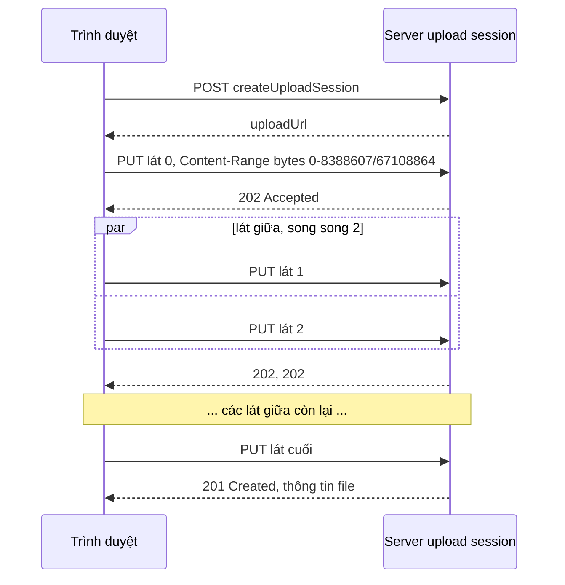

Upload một file 2GB bằng một request duy nhất có ba vấn đề. Mạng chập một giây ở phút thứ năm là phải gửi lại từ byte đầu tiên. Proxy và CDN thường giới hạn kích thước body (Cloudflare chặn body trên 100MB ở gói Free và Pro, tính tới 10/2026). Và bạn không thể gửi song song để tận dụng băng thông.

Vì vậy các dịch vụ lưu trữ đều có kiểu **upload theo lát** (chunked upload): OneDrive và SharePoint có `createUploadSession`, Google Drive có resumable upload, S3 có multipart upload, ngoài ra còn giao thức mở [tus](https://tus.io). Phía server khác nhau, nhưng phía client luôn phải giải cùng một bài: cắt file, gửi từng lát theo thứ tự nào, song song bao nhiêu, lát lỗi thì sao, người dùng bấm huỷ thì sao.

Bài này xem cách Outlook Web giải bài đó trong module `owa-blob-slicer`, rồi thêm một chuyện nhỏ hay gặp từ Tribe: đọc lỗi XML khi upload thẳng lên S3.

> [!TIP]
> **Tóm tắt**
> - Cắt bằng `blob.slice(start, end)` (không sao chép dữ liệu). Header `Content-Range` tính byte cuối **tính cả**: lát `[0, 10)` là `bytes 0-9/total`.
> - Mẹo của Outlook: **lát đầu chạy một mình** (sai quyền, hết hạn session thì dừng ngay), **lát giữa song song**, **lát cuối chạy sau cùng** (thường là lát "chốt" để server ghép file).
> - Server không nhận lát lệch thứ tự (như OneDrive) thì để song song = 1.
> - Huỷ phải huỷ cả request đang chạy (`AbortSignal`) và báo server xoá phần đã nhận. Thử lại theo **từng lát**, chỉ với lỗi tạm thời (5xx, 408, 429, lỗi mạng).

<iframe class="demo-frame" src="/demos/web-patterns/index.html?theme=dark#/chunked-upload" title="Demo chunked-upload" loading="lazy" style="height: 760px"></iframe>

<p class="demo-links">▶ <a href="/demos/web-patterns/index.html#/chunked-upload" target="_blank" rel="noopener">Mở demo toàn màn hình ↗</a> · <a href="https://stackblitz.com/github/hunghg255/blog-hunghg/tree/master/examples/web-patterns?file=src/lib/blobSlicer.ts" target="_blank" rel="noopener">Sửa code trên StackBlitz ↗</a> · <a href="https://github.com/hunghg255/blog-hunghg/blob/master/examples/web-patterns/src/lib/blobSlicer.ts" target="_blank" rel="noopener">Xem source trên GitHub ↗</a></p>

Thử ba thứ trong demo. Đổi "Song song" từ 1 lên 3: thời gian giảm gần một nửa. Bật "Link upload hết hạn": dừng ngay sau lát #0, không lát nào khác bị gửi. Bật "Server chỉ nhận đúng thứ tự" với song song 3: lát đến lệch thứ tự bị từ chối (416), cả upload dừng.

## Bên trong: cắt Blob và Content-Range



- `Blob.slice(start, end)` trả về một Blob mới trỏ vào cùng dữ liệu, **không đọc hay sao chép** file vào bộ nhớ. Cắt file 2GB thành 200 lát vẫn nhẹ. Byte chỉ thực sự được đọc khi `fetch`/`XMLHttpRequest` gửi lát đó.
- `end` của `slice` là vị trí **không tính**, còn byte cuối trong `Content-Range` là **tính cả**. Nhầm hai quy ước này là lỗi lệch một byte kinh điển.
- `fetch` chưa có tiến độ upload (tính tới 10/2026). Muốn thanh tiến độ mượt trong từng lát thì dùng `XMLHttpRequest` với `xhr.upload.onprogress`. Outlook có hàm `fetchWithProgress` riêng cho việc này.

## Outlook làm thế nào?

### `startBlobSlicingTask`: ba giai đoạn

[`outlook.live.com/src/modules/owa-blob-slicer/src/blobSlicer.ts`](https://github.com/hunghg255/codebase/blob/main/outlook.live.com/src/modules/owa-blob-slicer/src/blobSlicer.ts) nhận một Blob và một `sliceAction(slice, sliceNumber, totalSlices)`. Mặc định lát 14MB, song song 2 (`constants.ts`).

```ts
const onCompletePromise = firstSliceAction
    .task()
    .then(skipTaskIfNotCompleted(performActionOnSlicesInParallel.task))
    .then(skipTaskIfNotCompleted(lastSliceAction.task));
```

Ba "task" nối nhau: lát đầu (song song 1), các lát giữa (song song `numberOfSlicesToParallelize`), lát cuối (song song 1). `skipTaskIfNotCompleted` chỉ chạy bước sau nếu bước trước trả `CompletionStatus.Completed`. File chỉ có 1 hoặc 2 lát thì bước giữa/cuối là một task rỗng (`noOpBlobTask`).

Code không giải thích vì sao chọn thứ tự này. Có lẽ vì hai lý do. Lát đầu là lần chạm server đầu tiên: link hết hạn, sai quyền, hết dung lượng đều lộ ra ở đây, trước khi tốn băng thông cho cả file. Lát cuối là lát server dùng để biết "đã đủ byte" và ghép file; gửi nó sau cùng thì lúc server ghép, mọi lát khác chắc chắn đã tới.

### Hàng đợi song song trong `createTaskForBlob`

[`utils/createTaskForBlob.ts`](https://github.com/hunghg255/codebase/blob/main/outlook.live.com/src/modules/owa-blob-slicer/src/utils/createTaskForBlob.ts) là một hàng đợi tự viết: đếm `onGoingSlices`, mỗi lát xong thì `tryStartNextSlice()`.

```ts
const tryStartNextSlice = () => {
    if (isCancelled) {
        // ...resolve immediately with cancel status so that any further slices are not processed
        resolve(CompletionStatus.Cancelled);
    }
    if (onGoingSlices < numberOfSlicesToParallelize && nextSliceIndex < slices.length) {
        initiateSliceAction(nextSliceIndex)
            .then(() => onSliceCompleted(nextSliceIndex))
            .catch(reject);
        nextSliceIndex += 1;
        onGoingSlices += 1;
    }
};
```

Comment nói "so that any further slices are not processed", nhưng sau `resolve(...)` **không có `return`**. Hàm chạy tiếp xuống `if` bên dưới và vẫn bắt đầu lát kế tiếp. Kết quả: huỷ chỉ làm promise kết thúc sớm, còn các lát giữa vẫn lần lượt được gửi ở nền. Request đang chạy cũng không bị huỷ vì `sliceAction` không nhận `AbortSignal`.

### OneDrive: song song 1 và xoá session khi huỷ

Nơi dùng module này là [`owa-fileprovider-services/.../OneDrive/uploadFileToOneDrive.ts`](https://github.com/hunghg255/codebase/blob/main/outlook.live.com/src/modules/owa-fileprovider-services/src/services/OneDrive/uploadFileToOneDrive.ts):

```ts
const { onCompletePromise, cancel } = startBlobSlicingTask(fileBlob, actionForSlice, {
    sliceSize: sliceSize, // DEFAULT_UPLOAD_SLICE_SIZE = 10 * 1024 * 1024
    numberOfSlicesToParallelize: 1, // OneDrive does not support out of order slice upload so it has to be sequential
});
```

- Mỗi lát là một `PUT uploadUrl` với `Content-Range: bytes ${rangeStart}-${rangeEnd}/${totalSize}`, trong đó `rangeEnd = Math.min(rangeStart + sliceSize, totalSize) - 1` (comment giải thích rõ "start and end inclusive").
- Lát trả `201` hoặc `200` là lát cuối: body là thông tin file vừa tạo.
- Tiến độ của cả file = `rangeStart + loaded` của lát hiện tại. Công thức này **chỉ đúng khi gửi tuần tự**, và comment cũng ghi "considering the upload is sequential".
- Hàm `cancel` huỷ task, chờ promise, rồi `cancelUploadSession(uploadUrl)` để server xoá phần đã nhận. Chính bước xoá session này che lỗi thiếu `return` ở trên: session mất rồi thì các lát còn chạy ở nền đều thất bại.
- Lát 10MB không phải con số ngẫu nhiên. Tài liệu Microsoft Graph yêu cầu mỗi đoạn byte là bội của 320 KiB (10MiB = 32 × 320KiB), tối đa 60MiB mỗi request. Mặc định 14MB của `owa-blob-slicer` không phải bội của 320KiB, nhưng OneDrive luôn truyền `sliceSize` riêng.

## Tribe làm thế nào: đọc lỗi XML của S3

Tribe upload ảnh thẳng lên S3 bằng **presigned POST**: server (GraphQL `createImages`) trả về `signedUrl` và một bộ `fields` (policy, chữ ký…), trình duyệt tự POST file. Trong [`tribeplatform.com/hooks/useCreateImages.ts`](https://github.com/hunghg255/codebase/blob/main/tribeplatform.com/hooks/useCreateImages.ts):

```ts
// The order of appended key-value into the formData matters.
Object.entries(parsedFields).forEach(([key, value]) => formData.append(key, String(value)));
formData.append('Content-Type', imageFile.type);
formData.append('file', imageFile);
```

Comment "the order matters" là đúng: S3 bỏ qua mọi field nằm **sau** field `file`, nên `file` phải đứng cuối.

Khi upload lỗi, S3 không trả JSON mà trả XML: `<Error><Code>AccessDenied</Code><Message>Invalid according to Policy: Policy expired.</Message>…</Error>`. Tribe tạo axios với `validateStatus: undefined` để tự xem mọi status, rồi đọc `<Message>` bằng [`utils/xml.utils.ts`](https://github.com/hunghg255/codebase/blob/main/tribeplatform.com/utils/xml.utils.ts):

```ts
const xmlDOM = new DOMParser().parseFromString(xmlString, 'application/xml');
if (xmlDOM?.documentElement?.nodeName === 'Error' && xmlDOM?.querySelector('Message')?.textContent) {
  return xmlDOM?.querySelector('Message')?.textContent;
}
```

Hai điều nhỏ đáng biết. `DOMParser` **không ném lỗi** với XML hỏng mà trả về document có chèn phần tử `<parsererror>`. Trong Chromium, document đó vẫn giữ phần đã parse được: `<Error><Message>cụt` cho ra root là `Error`. Tribe vẫn an toàn nhờ kiểm tra `textContent` khác rỗng, còn `try/catch` quanh đó gần như không bao giờ chạy. Thứ hai, `Message` của S3 viết cho lập trình viên ("Policy expired"), hiện thẳng cho người dùng thì khó hiểu. Ngoài ra, mảng kết quả `resultMedia` được `push` theo thứ tự upload **xong**, không theo thứ tự file người dùng chọn, và ảnh lỗi bị bỏ ra mà không đánh dấu.

## Viết lại

Hai file: `blobSlicer.ts` (cắt và điều phối) và `s3Upload.ts` (lỗi XML, FormData).

### Cắt lát và Content-Range

```ts title=src/lib/blobSlicer.ts
export function createSliceRanges(size: number, sliceSize: number): SliceRange[] {
  if (!(sliceSize > 0)) throw new RangeError('sliceSize phải > 0');
  const ranges: SliceRange[] = [];
  for (let start = 0, index = 0; start < size; start += sliceSize, index++) {
    ranges.push({ index, start, end: Math.min(start + sliceSize, size) });
  }
  return ranges; // file rỗng -> [] (upload session thường không nhận file 0 byte, dùng API upload đơn)
}

/** Header Content-Range của HTTP tính byte cuối TÍNH CẢ: lát [0, 10) là "bytes 0-9/total". */
export const contentRange = (range: SliceRange, total: number) => `bytes ${range.start}-${range.end - 1}/${total}`;
```

### Gửi một lát: thử lại, huỷ, tiến độ

```ts title=src/lib/blobSlicer.ts
  async function runSlice(range: SliceRange) {
    for (let attempt = 0; ; attempt++) {
      signal.throwIfAborted();
      onSliceState?.(range, attempt === 0 ? 'uploading' : 'retrying');
      try {
        await action(blob.slice(range.start, range.end), range, {
          signal,
          attempt,
          totalSlices: ranges.length,
          onProgress: (n) => {
            loaded.set(range.index, Math.min(n, range.end - range.start));
            report();
          },
        });
        loaded.set(range.index, range.end - range.start);
        report();
        onSliceState?.(range, 'done');
        return;
      } catch (error) {
        if (signal.aborted) {
          // bị huỷ (người dùng bấm huỷ, hoặc một lát khác hỏng hẳn): không thử lại
          loaded.set(range.index, 0);
          report();
          onSliceState?.(range, 'aborted');
          throw signal.reason;
        }
        loaded.set(range.index, 0); // lần gửi sau bắt đầu lại từ đầu lát
        report();
        if (attempt >= retries || !isRetryable(error)) {
          onSliceState?.(range, 'failed', error);
          throw error;
        }
        await wait(retryDelay(attempt), signal);
      }
    }
  }
```

### Ba giai đoạn

```ts title=src/lib/blobSlicer.ts
  // Hàng đợi có giới hạn số luồng: mỗi "luồng" lấy lát kế tiếp khi xong lát của mình
  async function runPool(list: SliceRange[], concurrency: number) {
    let next = 0;
    const lane = async () => {
      while (next < list.length && !signal.aborted) await runSlice(list[next++]);
    };
    await Promise.all(Array.from({ length: Math.min(concurrency, list.length) }, lane));
  }

  const done = (async () => {
    if (ranges.length === 0) return 'completed' as const;
    try {
      await runSlice(ranges[0]);
      await runPool(ranges.slice(1, -1), Math.max(1, parallel));
      if (ranges.length > 1) await runSlice(ranges[ranges.length - 1]);
      return 'completed' as const;
    } catch (error) {
      if (cancelled) return 'cancelled' as const;
      // Một lát hỏng hẳn: huỷ các lát song song khác đang chạy, khỏi gửi tiếp vô ích
      controller.abort(error);
      throw error;
    }
  })();
```

::: spoiler Xem toàn bộ src/lib/blobSlicer.ts

```ts title=src/lib/blobSlicer.ts
/**
 * Upload file lớn theo từng lát (slice/chunk), ý tưởng từ owa-blob-slicer của Outlook Web:
 *   lát ĐẦU chạy một mình -> các lát GIỮA chạy song song (giới hạn số luồng) -> lát CUỐI chạy một mình.
 * Lát đầu lỗi (sai quyền, hết hạn session…) thì dừng sớm, không phí băng thông cho cả file.
 * Lát cuối thường là lát "chốt" (server ghép file, trả về 201), nên chỉ gửi khi mọi lát khác đã xong.
 *
 * Thêm so với bản gốc: huỷ được cả request đang chạy (AbortSignal), thử lại từng lát khi lỗi tạm thời,
 * tiến độ tính theo byte cho cả khi chạy song song.
 */

export interface SliceRange {
  index: number;
  /** byte đầu (tính cả) */
  start: number;
  /** byte cuối (KHÔNG tính), dùng thẳng cho blob.slice(start, end) */
  end: number;
}

export function createSliceRanges(size: number, sliceSize: number): SliceRange[] {
  if (!(sliceSize > 0)) throw new RangeError('sliceSize phải > 0');
  const ranges: SliceRange[] = [];
  for (let start = 0, index = 0; start < size; start += sliceSize, index++) {
    ranges.push({ index, start, end: Math.min(start + sliceSize, size) });
  }
  return ranges; // file rỗng -> [] (upload session thường không nhận file 0 byte, dùng API upload đơn)
}

/** Header Content-Range của HTTP tính byte cuối TÍNH CẢ: lát [0, 10) là "bytes 0-9/total". */
export const contentRange = (range: SliceRange, total: number) => `bytes ${range.start}-${range.end - 1}/${total}`;

export class HttpError extends Error {
  constructor(
    public status: number,
    message = `HTTP ${status}`,
  ) {
    super(message);
    this.name = 'HttpError';
  }
}

/** Lỗi mạng, 5xx, 408, 429: thử lại có thể được. 4xx còn lại (sai quyền, sai thứ tự…) thì không. */
export function isRetryable(error: unknown) {
  if (error instanceof HttpError) return error.status >= 500 || error.status === 408 || error.status === 429;
  return !(error instanceof DOMException && error.name === 'AbortError');
}

export interface SliceContext {
  signal: AbortSignal;
  totalSlices: number;
  attempt: number;
  /** báo số byte của lát này đã gửi được (vd từ xhr.upload.onprogress) */
  onProgress: (loaded: number) => void;
}

export type SliceAction = (slice: Blob, range: SliceRange, ctx: SliceContext) => Promise<void>;

export type SliceState = 'uploading' | 'retrying' | 'done' | 'failed' | 'aborted';

export interface SlicedUploadOptions {
  sliceSize?: number;
  /** số lát giữa chạy cùng lúc. Server không nhận lát lệch thứ tự (như OneDrive) thì để 1. */
  parallel?: number;
  /** số lần thử lại cho MỖI lát */
  retries?: number;
  retryDelay?: (attempt: number) => number;
  onProgress?: (uploaded: number, total: number) => void;
  onSliceState?: (range: SliceRange, state: SliceState, error?: unknown) => void;
}

export interface SlicedUpload {
  ranges: SliceRange[];
  /** 'completed' hoặc 'cancelled'; lỗi không thử lại được thì reject */
  done: Promise<'completed' | 'cancelled'>;
  cancel: () => void;
}

function wait(ms: number, signal: AbortSignal) {
  return new Promise<void>((resolve, reject) => {
    if (signal.aborted) return reject(signal.reason);
    const timer = setTimeout(done, ms);
    function done() {
      signal.removeEventListener('abort', onAbort);
      resolve();
    }
    function onAbort() {
      clearTimeout(timer);
      reject(signal.reason);
    }
    signal.addEventListener('abort', onAbort, { once: true });
  });
}

export function startSlicedUpload(blob: Blob, action: SliceAction, options: SlicedUploadOptions = {}): SlicedUpload {
  const {
    sliceSize = 10 * 1024 * 1024,
    parallel = 2,
    retries = 2,
    retryDelay = (attempt) => 500 * 2 ** attempt,
    onProgress,
    onSliceState,
  } = options;

  const ranges = createSliceRanges(blob.size, sliceSize);
  const controller = new AbortController();
  const { signal } = controller;
  let cancelled = false;

  const loaded = new Map<number, number>();
  const report = () => {
    let sum = 0;
    loaded.forEach((n) => (sum += n));
    onProgress?.(sum, blob.size);
  };

  async function runSlice(range: SliceRange) {
    for (let attempt = 0; ; attempt++) {
      signal.throwIfAborted();
      onSliceState?.(range, attempt === 0 ? 'uploading' : 'retrying');
      try {
        await action(blob.slice(range.start, range.end), range, {
          signal,
          attempt,
          totalSlices: ranges.length,
          onProgress: (n) => {
            loaded.set(range.index, Math.min(n, range.end - range.start));
            report();
          },
        });
        loaded.set(range.index, range.end - range.start);
        report();
        onSliceState?.(range, 'done');
        return;
      } catch (error) {
        if (signal.aborted) {
          // bị huỷ (người dùng bấm huỷ, hoặc một lát khác hỏng hẳn): không thử lại
          loaded.set(range.index, 0);
          report();
          onSliceState?.(range, 'aborted');
          throw signal.reason;
        }
        loaded.set(range.index, 0); // lần gửi sau bắt đầu lại từ đầu lát
        report();
        if (attempt >= retries || !isRetryable(error)) {
          onSliceState?.(range, 'failed', error);
          throw error;
        }
        await wait(retryDelay(attempt), signal);
      }
    }
  }

  // Hàng đợi có giới hạn số luồng: mỗi "luồng" lấy lát kế tiếp khi xong lát của mình
  async function runPool(list: SliceRange[], concurrency: number) {
    let next = 0;
    const lane = async () => {
      while (next < list.length && !signal.aborted) await runSlice(list[next++]);
    };
    await Promise.all(Array.from({ length: Math.min(concurrency, list.length) }, lane));
  }

  const done = (async () => {
    if (ranges.length === 0) return 'completed' as const;
    try {
      await runSlice(ranges[0]);
      await runPool(ranges.slice(1, -1), Math.max(1, parallel));
      if (ranges.length > 1) await runSlice(ranges[ranges.length - 1]);
      return 'completed' as const;
    } catch (error) {
      if (cancelled) return 'cancelled' as const;
      // Một lát hỏng hẳn: huỷ các lát song song khác đang chạy, khỏi gửi tiếp vô ích
      controller.abort(error);
      throw error;
    }
  })();

  return {
    ranges,
    done,
    cancel() {
      if (cancelled) return;
      cancelled = true;
      controller.abort(new DOMException('Upload cancelled', 'AbortError'));
    },
  };
}
```

:::

::: spoiler Xem toàn bộ src/lib/s3Upload.ts

```ts title=src/lib/s3Upload.ts
/**
 * Upload thẳng lên S3 bằng presigned POST, và đọc lỗi XML mà S3 trả về.
 * Ý tưởng từ utils/xml.utils.ts + hooks/useCreateImages.ts của Tribe.
 */

export interface S3Error {
  code: string | null;
  message: string | null;
  requestId: string | null;
}

/**
 * S3 trả lỗi dạng XML: <Error><Code>AccessDenied</Code><Message>…</Message>…</Error>.
 * Trả về null nếu body không phải lỗi XML của S3 (vd trang HTML 502 của proxy).
 */
export function parseS3Error(body: unknown): S3Error | null {
  if (typeof body !== 'string' || !body.trimStart().startsWith('<')) return null;
  const doc = new DOMParser().parseFromString(body, 'application/xml');
  // DOMParser KHÔNG ném lỗi khi XML hỏng: nó trả về document có chèn <parsererror>
  // (Chromium còn giữ phần đã parse được, nên root vẫn có thể là <Error> bị cụt).
  if (doc.getElementsByTagName('parsererror').length > 0) return null;
  const root = doc.documentElement;
  if (root.nodeName !== 'Error') return null;
  const text = (tag: string) => root.getElementsByTagName(tag)[0]?.textContent ?? null;
  return { code: text('Code'), message: text('Message'), requestId: text('RequestId') };
}

/** Câu thông báo cho người dùng cuối; `message` gốc của S3 viết cho lập trình viên. */
export function friendlyS3Message(error: S3Error | null, status: number): string {
  switch (error?.code) {
    case 'EntityTooLarge':
      return 'File quá lớn so với giới hạn cho phép.';
    case 'EntityTooSmall':
      return 'File quá nhỏ hoặc rỗng.';
    case 'AccessDenied':
      return 'Link upload đã hết hạn hoặc không hợp lệ. Hãy thử lại.';
    case 'SignatureDoesNotMatch':
      return 'Chữ ký upload không khớp (dữ liệu gửi khác với lúc tạo link).';
    case 'RequestTimeTooSkewed':
      return 'Đồng hồ máy bạn đang lệch nhiều so với giờ thật. Hãy chỉnh lại giờ hệ thống.';
    default:
      if (status === 0) return 'Mất kết nối mạng.';
      return error?.message ?? `Upload thất bại (HTTP ${status}).`;
  }
}

/**
 * FormData cho presigned POST. Thứ tự field CÓ ý nghĩa: S3 bỏ qua mọi field nằm sau `file`,
 * nên các field của policy phải đứng trước và `file` luôn là field cuối cùng.
 */
export function buildPresignedPostForm(fields: Record<string, string>, file: Blob, fileName?: string): FormData {
  const form = new FormData();
  for (const [key, value] of Object.entries(fields)) form.append(key, value);
  if (!('Content-Type' in fields) && file.type) form.append('Content-Type', file.type);
  form.append('file', file, fileName ?? (file instanceof File ? file.name : 'blob'));
  return form;
}
```

:::

## Đi qua code

- **Một `AbortController` cho cả upload.** `signal` được truyền vào `action` của từng lát, nên huỷ là huỷ luôn request đang chạy (`fetch(url, { signal })`). Vòng lặp `runPool` dừng lấy lát mới khi `signal.aborted`.
- **Thử lại theo lát.** Lát lỗi tạm thời (`isRetryable`: lỗi mạng, 5xx, 408, 429) thì chờ `retryDelay(attempt)` (mặc định 500ms, 1s, 2s…) rồi gửi lại riêng lát đó. Lỗi 4xx khác (401 hết hạn, 416 sai thứ tự, 413 quá lớn) thì dừng ngay, thử lại cũng vô ích.
- **Một lát hỏng hẳn thì huỷ các lát khác.** `Promise.all` của `runPool` reject ở lỗi đầu tiên; khối `catch` gọi `controller.abort(error)` để các lát song song đang chạy dừng theo, khỏi gửi tiếp vô ích.
- **Tiến độ theo byte.** Mỗi lát báo số byte đã gửi vào một `Map<index, loaded>`, tổng của Map là tiến độ cả file. Cách này đúng cả khi chạy song song, khác với `rangeStart + loaded` của Outlook. Lát lỗi hoặc bị huỷ thì đặt lại 0.
- **Ba giai đoạn giữ nguyên ý của Outlook**: `runSlice(ranges[0])`, rồi `runPool(lát giữa)`, rồi `runSlice(lát cuối)`.
- **`parseS3Error`** kiểm tra `<parsererror>` và chỉ chấp nhận root `Error`, trả cả `Code` để `friendlyS3Message` dịch sang câu cho người dùng ("Đồng hồ máy bạn đang lệch…" cho `RequestTimeTooSkewed`).
- **`buildPresignedPostForm`** luôn thêm `file` sau cùng.

**Khác bản gốc:** huỷ bằng `AbortSignal` và dừng thật (bản gốc thiếu `return` nên vẫn gửi lát tiếp theo); thử lại từng lát với backoff (bản gốc: một lát lỗi là cả upload lỗi); tiến độ tính đúng cả khi song song; viết bằng `async/await` thay cho chuỗi `then` và `new Promise` lồng nhau.

## Tại sao không làm cách khác?

- **Song song tất cả các lát?** Server phải chấp nhận lát lệch thứ tự (S3 multipart thì được, OneDrive thì không). Và mỗi kết nối song song cũng ăn chung băng thông với chính người dùng: 2–4 luồng thường đủ, nhiều hơn chỉ làm tăng độ trễ cho phần còn lại của trang.
- **Không có lát đầu riêng, cứ song song từ đầu?** Session hết hạn thì cả N lát đầu cùng thất bại, tốn N lần gửi vài MB. Bật "Link upload hết hạn" trong demo để thấy chỉ một lát bị gửi.
- **Lát thật nhỏ (256KB) cho tiến độ mượt?** Mỗi lát là một request, có độ trễ và header riêng. Lát quá nhỏ thì phần lớn thời gian là chờ round-trip. Tiến độ mượt nên lấy từ `xhr.upload.onprogress` trong lát, không phải từ việc chia nhỏ lát.
- **Đọc file vào `ArrayBuffer` rồi cắt?** Tốn bộ nhớ đúng bằng kích thước file. `Blob.slice` không đọc gì cả.

## Edge case và cạm bẫy

- **File 0 byte**: `createSliceRanges` trả mảng rỗng. Upload session của nhiều dịch vụ không nhận file rỗng; dùng API upload đơn cho trường hợp này. (Bản gốc tính `Math.ceil(0 / sliceSize) = 0` lát rồi vẫn truy cập `slices[0]`.)
- **Kích thước lát theo quy định của server**: OneDrive cần bội của 320KiB; S3 multipart cần mỗi phần (trừ phần cuối) tối thiểu 5MiB và tối đa 10.000 phần. File rất lớn thì phải tăng kích thước lát.
- **Thử lại lát đã thực ra thành công**: request tới server rồi nhưng phản hồi mất trên đường về. Server upload session thường chấp nhận gửi lại cùng đoạn byte; nếu server của bạn không vậy, cần endpoint hỏi "đã nhận tới byte nào" để tiếp tục (đây chính là phần "resumable" của tus và Google Drive).
- **Tab bị đóng giữa chừng**: mọi thứ trong bộ nhớ mất. Muốn tiếp tục sau khi mở lại, lưu `uploadUrl` và số byte đã gửi vào IndexedDB, và yêu cầu người dùng chọn lại file (trình duyệt không cho giữ quyền đọc file qua lần tải trang).
- **Huỷ phải dọn phía server**: gọi API xoá session (Outlook: `cancelUploadSession`; S3: `AbortMultipartUpload`), nếu không phần đã nhận nằm lại và tốn dung lượng.
- **XML lỗi đến từ proxy chứ không phải S3**: 502 từ load balancer thường là HTML. `parseS3Error` trả `null`, giao diện dùng thông báo chung theo status.

## Dùng trong dự án

```ts
const { uploadUrl } = await createUploadSession(file.name);
const upload = startSlicedUpload(
  file,
  (slice, range, { signal, onProgress }) =>
    // putWithProgress: XHR + xhr.upload.onprogress, ném HttpError(status) khi !ok
    putWithProgress(uploadUrl, slice, { signal, onProgress, headers: { 'Content-Range': contentRange(range, file.size) } }),
  { sliceSize: 10 * 1024 * 1024, parallel: 1, onProgress: (sent, total) => setPercent(sent / total) },
);
cancelButton.onclick = () => upload.cancel();
if ((await upload.done) === 'cancelled') await fetch(uploadUrl, { method: 'DELETE' }); // server dọn phần đã nhận
```

## Kiểm thử

::: spoiler Ví dụ test (bản phác, không có trong repo)

Chạy bằng Vitest, môi trường `jsdom` (cần `Blob`, `DOMParser`, `FormData`).

```ts
import { describe, expect, it } from 'vitest';
import { HttpError, contentRange, createSliceRanges, startSlicedUpload, type SliceAction } from './blobSlicer';
import { buildPresignedPostForm, parseS3Error } from './s3Upload';

const tick = (ms = 5) => new Promise((r) => setTimeout(r, ms));
const blob = (size: number) => new Blob([new Uint8Array(size)]);

it('chia lát và Content-Range tính byte cuối', () => {
  const ranges = createSliceRanges(25, 10);
  expect(ranges.map((r) => [r.start, r.end])).toEqual([[0, 10], [10, 20], [20, 25]]);
  expect(contentRange(ranges[2], 25)).toBe('bytes 20-24/25');
});

it('lát đầu chạy một mình, lát giữa song song, lát cuối chạy sau cùng', async () => {
  const events: string[] = [];
  let active = 0;
  let maxActive = 0;
  const action: SliceAction = async (_slice, range) => {
    events.push(`start ${range.index}`);
    maxActive = Math.max(maxActive, ++active);
    await tick();
    active--;
    events.push(`end ${range.index}`);
  };
  const upload = startSlicedUpload(blob(100), action, { sliceSize: 10, parallel: 3 });
  expect(await upload.done).toBe('completed');
  expect(events.slice(0, 2)).toEqual(['start 0', 'end 0']);
  expect(events.slice(-2)).toEqual(['start 9', 'end 9']);
  expect(maxActive).toBe(3);
});

it('thử lại lỗi 503, dừng ngay ở lỗi 401', async () => {
  let calls = 0;
  const flaky: SliceAction = async () => {
    if (++calls < 3) throw new HttpError(503);
  };
  expect(await startSlicedUpload(blob(10), flaky, { sliceSize: 10, retryDelay: () => 1 }).done).toBe('completed');
  expect(calls).toBe(3);

  let authCalls = 0;
  const denied: SliceAction = async () => {
    authCalls++;
    throw new HttpError(401);
  };
  await expect(startSlicedUpload(blob(50), denied, { sliceSize: 10 }).done).rejects.toMatchObject({ status: 401 });
  expect(authCalls).toBe(1); // lát đầu hỏng thì không lát nào khác được gửi
});

it('huỷ: request đang chạy nhận abort, không lát mới nào bắt đầu', async () => {
  const started: number[] = [];
  let abortedInFlight = 0;
  const action: SliceAction = (_slice, range, { signal }) =>
    new Promise((resolve, reject) => {
      started.push(range.index);
      const onAbort = () => {
        clearTimeout(timer);
        abortedInFlight++;
        reject(signal.reason);
      };
      const timer = setTimeout(() => {
        signal.removeEventListener('abort', onAbort);
        resolve();
      }, 50);
      signal.addEventListener('abort', onAbort);
    });
  const upload = startSlicedUpload(blob(100), action, { sliceSize: 10, parallel: 2 });
  await tick(70); // lát 0 xong, lát 1 và 2 đang chạy
  upload.cancel();
  expect(await upload.done).toBe('cancelled');
  await tick(100);
  expect(started).toEqual([0, 1, 2]);
  expect(abortedInFlight).toBe(2);
});

it('parseS3Error chỉ nhận XML lỗi của S3', () => {
  expect(parseS3Error('<Error><Code>AccessDenied</Code><Message>Policy expired.</Message></Error>')).toMatchObject({
    code: 'AccessDenied',
    message: 'Policy expired.',
  });
  expect(parseS3Error('<html><body>502</body></html>')).toBeNull();
  expect(parseS3Error('<Error><Code>X</Code><Message>cụt')).toBeNull();
});

it('file luôn là field cuối của presigned POST', () => {
  const form = buildPresignedPostForm({ key: 'a.png', policy: 'p' }, new File(['x'], 'a.png', { type: 'image/png' }));
  expect([...form.keys()]).toEqual(['key', 'policy', 'Content-Type', 'file']);
});
```

:::

## So sánh với thư viện và chuẩn web

- **[tus](https://tus.io)** (client `tus-js-client`, server nhiều ngôn ngữ): giao thức mở cho upload có thể tiếp tục sau khi mất mạng hay đóng tab. Nếu bạn tự làm cả server, dùng tus thay vì tự nghĩ giao thức.
- **Uppy**: giao diện upload hoàn chỉnh, có plugin cho tus, S3 multipart, presigned POST.
- **AWS SDK v3** có `Upload` trong `@aws-sdk/lib-storage` làm multipart upload song song từ trình duyệt (cần thông tin xác thực hoặc presigned URL cho từng phần).
- **Microsoft Graph SDK** có `LargeFileUploadTask` cho OneDrive/SharePoint, làm đúng những gì `uploadFileToOneDrive` của Outlook làm.
- `fetch` với body dạng stream (`duplex: 'half'`) cho phép gửi dữ liệu dần dần trong một request, nhưng chỉ chạy qua HTTP/2 trở lên và chưa có trên mọi trình duyệt (tính tới 10/2026). Nó không thay được việc chia lát khi bạn cần thử lại và tiếp tục.

---

Bài này thuộc series **[Học từ mã nguồn các web lớn](/series/web)** (42 bài, đọc theo thứ tự).

::: spoiler Xem nhanh danh sách bài trong series

*Mở đầu*

- [Mở đầu: đọc code production của 28 trang web](/blogs/learn-from-big-web-apps)

*Phần 1: trải nghiệm người dùng*

- [#1 Dark mode không nháy (Gatsby)](/blogs/web-dark-mode-no-flash)
- [#2 useValueByMedia: giá trị theo breakpoint (Toptal)](/blogs/web-use-value-by-media)
- [#3 Đoán ý định: idle, exit-intent, lắc chuột (Toptal, InVision)](/blogs/web-user-intent-idle-exit-wiggle)
- [#4 Validate form thân thiện (Udacity, Pipedrive)](/blogs/web-form-validation-ux)
- [#5 Magic number, EXIF và dán ảnh (Ello)](/blogs/web-file-magic-number-exif-paste)
- [#6 fastSmoothScroll: cuộn xa vẫn nhanh (Telegram)](/blogs/web-telegram-fast-smooth-scroll)
- [#7 Countdown time-travel và tombstone giỏ hàng (Best Buy)](/blogs/web-countdown-time-travel-tombstone)

*Phần 2: hiệu năng và đo lường*

- [#8 Hàng đợi requestAnimationFrame 3ms (Apple)](/blogs/web-raf-queue-3ms)
- [#9 srcset cho artwork và preconnect tự động (Apple)](/blogs/web-responsive-artwork-preconnect)
- [#10 Quick-fetch: gọi API trước khi bundle tải xong (HubSpot)](/blogs/web-quick-fetch-early-requests)
- [#11 Performance span và long task (Postman, Calibre)](/blogs/web-performance-spans-long-tasks)
- [#12 Gọi Web Worker như hàm async (Telegram)](/blogs/web-worker-promise-rpc)
- [#13 Đồng hồ media: đếm giờ xem và sửa lệch (Skillshare, Simplified)](/blogs/web-media-clock-watch-time-drift)

*Phần 3: nhiều tab, phiên đăng nhập, cập nhật*

- [#14 Bầu tab chủ cho thông báo (HubSpot, Telegram)](/blogs/web-leader-tab-notifications)
- [#15 Đồng bộ đăng nhập giữa tab và giới hạn cookie (Elastic, InVision)](/blogs/web-cross-tab-auth-cookie-guard)
- [#16 SPA tự cập nhật: Trello, Zappos, Facebook, Elastic](/blogs/web-spa-self-update-strategies)

*Phần 4: kiến trúc*

- [#17 Reverse portal: di chuyển component không remount (Zappos)](/blogs/web-reverse-portal)
- [#18 Page behaviors: gắn hành vi từ CMS (Intercom)](/blogs/web-page-behaviors-cms)
- [#19 Giới hạn tần suất hiển thị bằng bitmask (Outlook)](/blogs/web-frequency-cap-bitmask)
- [#20 Chuyển REST sang GraphQL dần dần (Coursera)](/blogs/web-rest-to-graphql-hybrid-link)

*Phần 5: soạn thảo và hiển thị nội dung*

- [#21 Autocomplete tại con trỏ trong contenteditable (Ello, Telegram)](/blogs/web-caret-autocomplete-contenteditable)
- [#22 Dark mode cho email HTML bằng CIELAB (Outlook)](/blogs/web-email-dark-mode-cielab)
- [#23 Thu nhỏ bảng rộng cho vừa khung, vá font emoji (Outlook)](/blogs/web-email-wide-content-scale)
- [#24 Cảnh báo quên đính kèm file (Outlook)](/blogs/web-forgotten-attachment-warning)
- [#25 Cắt chữ nhiều dòng chính xác (Pipedrive, Apple, Toptal)](/blogs/web-multiline-truncate-measure-text)
- [#26 Parse ngày giờ gõ tay khoan dung (Outlook, Elastic)](/blogs/web-lenient-date-parser)

*Phần 6: tương tác*

- [#27 menuAim: rê chéo vào submenu không bị đóng (Udemy)](/blogs/web-menu-aim-triangle)
- [#28 Kéo, vuốt chung cho chuột và cảm ứng (Telegram)](/blogs/web-unified-pointer-gestures)
- [#29 Phím tắt theo phạm vi, IME và bàn phím phi Latinh (Trello)](/blogs/web-scoped-keyboard-shortcuts)
- [#30 Nội suy màu: đổi theme và nền theo cuộn (Telegram, Anchor)](/blogs/web-color-interpolation-theme-scroll)
- [#31 Đường gióng hút cạnh và undo/redo trên canvas (Simplified)](/blogs/web-canvas-snap-guides-undo)
- [#32 Giả lập mù màu bằng feColorMatrix (Trello)](/blogs/web-color-vision-simulator)
- [#33 Vạch thước theo mức zoom và cấp phát màu cho biểu đồ (Anchor, Similarweb)](/blogs/web-timeline-ticks-color-stack)

*Phần 7: mạng, dữ liệu và async*

- [#34 Ô tìm kiếm chuẩn production (Similarweb, Udemy, Pipedrive)](/blogs/web-production-search-box)
- [#35 Điều phối async: latest-wins, single-flight (Glitch, Toptal)](/blogs/web-async-coordination-latest-wins)
- [#36 Polling thưa dần và debounce động (Trello)](/blogs/web-decaying-polling-dynamic-debounce)
- [#37 Cache phía client theo version (Similarweb, Telegram, Udemy)](/blogs/web-client-cache-versioned)
- **#38 Upload file lớn theo chunk (Outlook, Tribe)** (bài này)
- [#39 Phát video qua Service Worker bằng Range request (Telegram, Outlook)](/blogs/web-service-worker-range-streaming)

*Phần 8: hiệu năng và vận hành*

- [#40 TTI governor: hoãn việc phụ tới sau khi trang dùng được (Outlook)](/blogs/web-tti-governor)
- [#41 Tự đo LCP/CLS/TBT và phục vụ bản nhẹ cho máy yếu (Udemy)](/blogs/web-rum-adaptive-loading)

:::

Code + demo: [`examples/web-patterns`](https://github.com/hunghg255/blog-hunghg/tree/master/examples/web-patterns) · [Mở trên StackBlitz](https://stackblitz.com/github/hunghg255/blog-hunghg/tree/master/examples/web-patterns)
