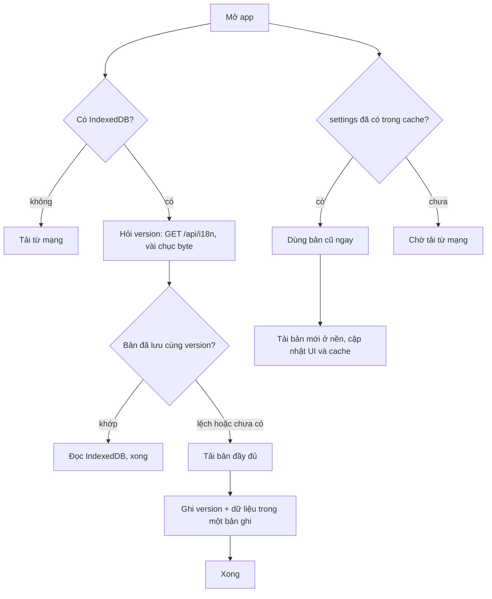

Một ứng dụng dạng dashboard thường phải tải cả loạt dữ liệu "khởi động" trước khi vẽ được màn hình đầu tiên: settings của tài khoản, thông tin user, từ điển dịch vài trăm KB. Mỗi lần mở tab mới lại tải lại từ đầu, dù 99% thời gian dữ liệu không đổi. Cache lại thì nhanh, nhưng câu hỏi khó là **khi nào bỏ cache**: deploy bản dịch mới, đổi gói cước, đổi cấu trúc dữ liệu.

Bài này xem ba cách làm trong code production:

- **Similarweb Pro** cache dữ liệu khởi động trong IndexedDB. Từ điển i18n có "version": mỗi lần mở app chỉ hỏi server version, khớp thì đọc IndexedDB, lệch thì tải lại. Settings và user data thì trả bản cũ ngay, tải bản mới ở nền.
- **Telegram Web** dùng Cache Storage (`caches`) làm kho key-value cho sticker, ảnh nền, gói ngôn ngữ, ngay từ trang chính, không cần service worker.
- **Udemy** bọc localStorage để mỗi mục có hạn dùng và không đè mất dữ liệu khi nhiều tab cùng ghi.

> [!TIP]
> **Tóm tắt**
> - Dữ liệu nặng nên có **version** riêng: hỏi version (vài chục byte) trước, chỉ tải bản đầy đủ khi version đổi. Lưu version và dữ liệu trong cùng một bản ghi.
> - Dữ liệu nhỏ, đổi ít: **stale-while-revalidate**, trả bản cũ ngay rồi cập nhật ở nền.
> - Version của **cấu trúc** cache để trong tên cache / version DB; khởi động thì dọn mọi bản cũ.
> - Cache chỉ là phần phụ: không có IndexedDB, hết quota, tab khác chặn nâng cấp… thì quay về gọi mạng, không bao giờ làm app treo.

<iframe class="demo-frame" src="/demos/web-patterns/index.html?theme=dark#/client-cache" title="Demo client-cache" loading="lazy" style="height: 720px"></iframe>

<p class="demo-links">▶ <a href="/demos/web-patterns/index.html#/client-cache" target="_blank" rel="noopener">Mở demo toàn màn hình ↗</a> · <a href="https://stackblitz.com/github/hunghg255/blog-hunghg/tree/master/examples/web-patterns?file=src/lib/versionedCache.ts" target="_blank" rel="noopener">Sửa code trên StackBlitz ↗</a> · <a href="https://github.com/hunghg255/blog-hunghg/blob/master/examples/web-patterns/src/lib/versionedCache.ts" target="_blank" rel="noopener">Xem source trên GitHub ↗</a></p>

Ở tab đầu tiên, bấm **Mở app** hai lần: lần đầu khoảng 1 giây (tải từ điển), lần hai khoảng 60ms (chỉ hỏi version). Bấm **Server đổi version i18n** rồi mở lại: app tự tải bản mới đúng một lần.

## Bên trong trình duyệt: ba chỗ để cất dữ liệu

| | localStorage | IndexedDB | Cache Storage |
|---|---|---|---|
| API | đồng bộ, chặn main thread | bất đồng bộ, có transaction | bất đồng bộ, theo cặp Request/Response |
| Kiểu dữ liệu | chỉ chuỗi | structured clone (object, Blob, ArrayBuffer…) | Response (văn bản, JSON, Blob) |
| Dung lượng | vài MB mỗi origin | theo quota chung của origin | theo quota chung của origin |
| Dùng trong service worker | không | có | có |
| Hợp với | cờ nhỏ, lịch sử tìm kiếm | dữ liệu có cấu trúc, cần truy vấn | file nhị phân, response HTTP |

Vài điều cần nhớ:

- IndexedDB và Cache Storage dùng **chung quota** của origin. Khi máy thiếu dung lượng, trình duyệt có thể xoá cả kho của một origin (trừ khi đã xin `navigator.storage.persist()`). Safari còn xoá dữ liệu do script ghi (localStorage, IndexedDB, Cache Storage…) của trang mà người dùng không tương tác trong 7 ngày dùng Safari, với trang không được thêm vào màn hình chính (tính tới 10/2026). Nói ngắn gọn: **cache phía client có thể biến mất bất cứ lúc nào**, code phải luôn có đường quay về mạng.
- IndexedDB có version cho **schema** (`indexedDB.open(name, version)`). Khi bản app mới nâng version mà tab cũ vẫn đang mở kết nối, lệnh nâng cấp ở tab mới bị `blocked` cho tới khi tab cũ đóng kết nối. Không xử lý thì tab mới đứng ở màn hình tải.
- localStorage đọc ghi đồng bộ. `JSON.parse` một chuỗi 400KB trên main thread lúc khởi động là thứ bạn đang cố tránh.



## Similarweb làm thế nào?

Code nằm ở [`pro.similarweb.com/app/services/cache/CacheService.ts`](https://github.com/hunghg255/codebase/blob/main/pro.similarweb.com/app/services/cache/CacheService.ts), dùng thư viện [`idb`](https://github.com/jakearchibald/idb) (lớp Promise mỏng bọc IndexedDB). Hàm khởi động `bootstrap()` trong `single-spa/bootstrap.tsx` gọi song song ba loại cache: user data, settings, i18n.

### Từ điển i18n: hỏi version trước

```ts
const versionRes = await fetch("/api/i18n", { credentials: "include" });
const { version, locale } = await versionRes.json();
const i18nKey = `i18n_${locale}`;
const i18nVersionKey = `i18nVersion_${locale}`;
// ...
const versionInfo = await store.get(i18nVersionKey);
if (versionInfo && version === versionInfo.value) {
    const cachedi18n = await store.get(i18nKey);
    return cachedi18n.value;
} else {
    const i18nRes = await fetch(i18nUrl);
    // ...ghi cả i18nKey lẫn i18nVersionKey trong cùng một transaction
}
```

Endpoint `/api/i18n` chỉ trả `{ version, locale, json }` (`json` là đường dẫn tới file từ điển). Mỗi lần mở app tốn một request nhỏ, đổi lại không bao giờ dùng nhầm bản dịch cũ sau khi deploy. Version và từ điển được ghi trong **cùng một transaction**, nên không có cảnh version mới đi với dữ liệu cũ.

### Settings và user data: trả bản cũ, cập nhật ở nền

```ts
if (!isCacheBypass()) {
    const data = await store.get(storeKey);
    // ...to make sure we don't get stuck an any weird edge case with idb locks and multiple tabs
    if (typeof data === "object" && typeof data.value === "object") {
        return setupWorker(data);
    }
}
const resJson = await fetchData(); // chưa có cache: chờ mạng, rồi put vào IndexedDB
```

Settings và user data không có version. Có cache thì `setupWorker(data)` trả ngay `data.value`, đồng thời tạo một Web Worker (`single-spa/UserDataWorker.ts`, nạp `/userData.worker.js`) để tải bản mới. Với settings, khi worker báo về, `bootstrap.tsx` gọi `initWindow(e.data.value)` để thay cấu hình đang chạy. Đây chính là **stale-while-revalidate**: lần mở app này có thể thấy dữ liệu cũ một nhịp, lần sau là mới. File worker không có trong bản dump, nên mình đoán nó tải lại rồi ghi đè IndexedDB (cache không thể tự mới lên nếu không có bước này).

Hai chi tiết khác:

- **Cửa thoát hiểm**: `services/cache/Bypass.ts` cho phép bỏ qua cache bằng cookie `RESET_PRO_CACHE=true` hoặc query `?clear-cache`. Dùng xong, `clearBypassCache()` xoá query khỏi URL bằng `history.replaceState` để F5 lần sau không bỏ qua nữa. Rất tiện khi đội hỗ trợ cần khách "xoá cache" mà không phải hướng dẫn mở DevTools.
- **Version của schema** là hằng `CURRENT_IDB_VERSION = 5`, tách biệt với version của dữ liệu.

### Chỗ nên làm khác

Hàm `updateCache` (dùng khi user sửa dữ liệu và muốn cập nhật cache) bọc logic trong `new Promise(async (resolve, reject) => { ... })`:

```ts
return new Promise(async (resolve, reject) => {
    if (!isIndexedDB() || !isWorker()) reject();   // reject nhưng không return: chạy tiếp
    try { db = await getDb(false); /* ... */ }
    catch (e) { reject(); }                         // lại chạy tiếp, db vẫn là null
    const putTx = db.transaction(["cache"], "readwrite");   // TypeError nếu db null
```

`reject()` không dừng hàm. Khi không mở được DB, code chạy tiếp tới `db.transaction` trên `null` và ném `TypeError` bên trong một async function mà không ai bắt, thành một unhandled rejection. Promise bên ngoài đã reject trước đó nên chức năng vẫn "chạy", nhưng log lỗi bị nhiễu. Cách chữa: `return reject()`, hoặc bỏ hẳn `new Promise` và viết `async function` thường.

## Telegram làm thế nào?

[`web.telegram.org/src/util/cacheApi.ts`](https://github.com/hunghg255/codebase/blob/main/web.telegram.org/src/util/cacheApi.ts) chỉ 88 dòng: ba hàm `fetch`, `save`, `clear` trên `self.caches`. Đây là API mà service worker hay dùng, nhưng **trang chính cũng gọi được**. Telegram cất sticker, ảnh nền tự chọn (`WallpaperTile.tsx`) và từng chuỗi dịch (`langProvider.ts`) ở đây.

```ts
// To avoid the error "Request scheme 'webdocument' is unsupported"
const request = new Request(key.replace(/:/g, '_'));
const cache = await cacheApi.open(cacheName);
const response = await cache.match(request);
// ...
case Type.Blob: {
  const blob = await response.blob();
  // Safari does not return correct Content-Type header for webp images.
  if (key.substr(0, 7) === 'sticker') return new Blob([blob], { type: 'image/webp' });
  // iOS Safari fails to preserve `type` in cache
  if (!blob.type) { /* lấy lại từ header Content-Type */ }
```

- Key của Telegram có dạng `webdocument:...`. Đưa thẳng vào `new Request()` thì phần trước dấu `:` bị hiểu là scheme của URL và Cache API từ chối. Họ thay `:` bằng `_`. Cách này đơn giản nhưng làm `a:b` và `a_b` trùng key.
- Hai bản vá Safari cho thấy đây là code đã chạy thật trên nhiều thiết bị.

Version của **cấu trúc** cache nằm ngay trong tên: `LANG_CACHE_NAME = 'tt-lang-packs-v5'` (trong `config.ts`). Đổi format thì tăng số. Việc dọn bản cũ nằm trong reducer `reset` của `modules/actions/api/initial.ts`: tách tiền tố `tt-lang-packs-v` và số `5`, rồi lặp `cacheApi.clear()` cho `tt-lang-packs-v`, `…v1` tới `…v4`. Reducer này chạy khi đăng xuất, nên các bản `v1`…`v4` nằm lại trên máy cho tới lúc đó. Dọn lúc khởi động (liệt kê bằng `caches.keys()`) sẽ gọn hơn.

## Udemy làm thế nào?

[`udemy.com/webpack---/src/storage/ud-expiring-local-storage.ts`](https://github.com/hunghg255/codebase/blob/main/udemy.com/webpack---/src/storage/ud-expiring-local-storage.ts) tạo một "kho" localStorage theo namespace (`'notices'`, `'header-browse-nav'`…), cả kho hết hạn vào một ngày. Bản `...-with-key-ttls.ts` thêm hạn cho **từng key** (`valid_until`), tối đa 1000 mục mỗi kho, và dọn mục hết hạn 5 giây sau khi tạo.

Đoạn đáng học là cách ghi khi nhiều tab cùng mở. Comment trong code nói thẳng:

```ts
set: action((key: string, value: any) => {
    // state.storedValues is distinct between tabs while localStorage is not, so we merge ...
    state.storedValues.merge(store.get(state.cacheKey) || {});
    state.storedValues.set(key, value);
}),
```

Mỗi tab giữ một bản sao trong bộ nhớ (MobX observable). Nếu ghi thẳng bản sao xuống, tab này sẽ xoá mất mục mà tab kia vừa ghi. Vì vậy **trước khi ghi**, họ trộn lại nội dung mới nhất trong localStorage. Comment ở đầu file cũng thừa nhận phần đọc không làm vậy "because of the performance concerns", tức là đọc có thể ra dữ liệu cũ.

Có một chỗ đáng ngờ trong đoạn dọn dữ liệu hết hạn lúc khởi tạo:

```ts
state.expirations.forEach((dateString, key) => {
    if (new Date(dateString) < now) {
        store.remove(key);
        // ...
        state.expirations.delete(key);
        state.storedValues.clear();
    }
});
```

`state.expirations` là bảng hạn dùng **chung cho mọi kho** (comment ghi rõ "a hash of ALL instances"). Khi một kho **khác** hết hạn, dòng `state.storedValues.clear()` vẫn xoá bản sao trong bộ nhớ của kho **đang tạo**. Dữ liệu trong localStorage còn nguyên, nhưng `get()` trả `undefined` cho tới lần `set()` kế tiếp. Có lẽ ý định là chỉ xoá khi `key === state.cacheKey`.

## Viết lại

Ba file nhỏ, không phụ thuộc thư viện: `versionedCache.ts` (IndexedDB thuần, không dùng `idb`), `cacheStorageKV.ts`, `expiringStorage.ts`.

### Mở IndexedDB mà không bao giờ treo

```ts title=src/lib/versionedCache.ts
    // Tab khác còn giữ kết nối tới schema cũ thì lệnh nâng cấp bị "blocked" và chờ vô hạn.
    // Đừng để app treo ở màn hình tải: hết giờ thì báo lỗi, phía gọi sẽ đi mạng.
    const timer = setTimeout(() => {
      settled = true;
      reject(new Error('IndexedDB đang bị tab khác chặn nâng cấp'));
    }, blockedTimeout);

    open.onerror = () => {
      clearTimeout(timer);
      if (!settled) reject(open.error);
      settled = true;
    };

    open.onsuccess = () => {
      clearTimeout(timer);
      const db = open.result;
      if (settled) {
        db.close(); // đã báo lỗi vì quá giờ, đừng để kết nối mồ côi
        return;
      }
      settled = true;
      // Chiều ngược lại: tab khác (bản app mới hơn) cần nâng schema thì ta nhả kết nối ra.
      db.onversionchange = () => db.close();
```

### Cache theo version

```ts title=src/lib/versionedCache.ts
export async function getVersioned<T>(
  kv: KVStore | null,
  source: VersionedSource<T>,
  { bypass = false } = {},
): Promise<{ value: T; version: string; outcome: VersionedOutcome }> {
  const version = await source.fetchVersion();
  if (!kv) return { value: await source.fetchData(version), version, outcome: 'no-idb' };

  let cached: CacheRecord<T> | undefined;
  if (!bypass) {
    cached = await kv.get<T>(source.key).catch(() => undefined);
    if (isUsable(cached) && cached.version === version) {
      return { value: cached.value, version, outcome: 'hit' };
    }
  }

  const value = await source.fetchData(version);
  // Version và dữ liệu nằm chung MỘT bản ghi: không bao giờ có cảnh version mới đi với dữ liệu cũ.
  // Ghi lỗi (hết quota…) thì bỏ qua: lần tải này vẫn thành công, lần sau tải lại.
  await kv.put<T>({ key: source.key, version, value, savedAt: Date.now() }).catch(() => undefined);
  return { value, version, outcome: bypass ? 'bypass' : cached ? 'stale-version' : 'miss' };
}
```

`staleWhileRevalidate` (cùng file) làm phần còn lại: có bản ghi dùng được thì trả ngay `{ value, fromCache: true }` và gọi `refresh()` ở nền; `refresh` tải, ghi đè cache rồi gọi `onFresh(value)`. Chưa có thì chờ `refresh()`.

### Cache Storage làm key-value

```ts title=src/lib/cacheStorageKV.ts
/**
 * Cache API chỉ nhận Request http(s). Key kiểu "sticker:123" sẽ bị hiểu là URL có scheme "sticker"
 * và bị từ chối. Telegram thay ':' bằng '_' (nên "a:b" và "a_b" đụng nhau); ở đây mã hoá cả key
 * vào một đường dẫn giả cùng origin.
 */
function toRequest(key: string) {
  return new Request(`${self.location.origin}/__kv__/${encodeURIComponent(key)}`);
}
```

`cleanupOldCaches(prefix, current)` lấy `caches.keys()`, xoá mọi tên có cùng tiền tố mà khác tên hiện tại. Gọi một lần lúc khởi động.

### localStorage có TTL, đọc lại trước khi ghi

```ts title=src/lib/expiringStorage.ts
    /** Trả về false nếu không ghi được (hết quota). */
    set(key: string, value: unknown, itemTtl = ttl): boolean {
      const data = prune(read()); // đọc lại NGAY TRƯỚC khi ghi
      if (!(key in data) && Object.keys(data).length >= maxItems) {
        // Udemy ném lỗi khi đầy; ở đây đẩy mục sắp hết hạn nhất ra để chỗ cho mục mới
        const oldest = Object.keys(data).reduce((a, b) => (data[a].exp <= data[b].exp ? a : b));
        delete data[oldest];
      }
      data[key] = { v: value, exp: now() + itemTtl };
      return write(data);
    },
```

`read()` mỗi lần đều `getItem` + `JSON.parse` từ localStorage (JSON hỏng thì coi như rỗng); `write()` nuốt `QuotaExceededError` và trả `false`.

::: spoiler Xem toàn bộ src/lib/versionedCache.ts

```ts title=src/lib/versionedCache.ts
/**
 * Cache dữ liệu khởi động (từ điển i18n, settings, user data…) trong IndexedDB.
 * Ý tưởng từ CacheService của Similarweb Pro:
 * - Dữ liệu nặng có "version" riêng: mỗi lần mở app chỉ hỏi server version (rất nhẹ),
 *   khớp với bản đã lưu thì dùng luôn, lệch thì tải bản mới rồi ghi đè.
 * - Dữ liệu không có version: trả bản cũ ngay, tải bản mới ở nền (stale-while-revalidate).
 * - Không có IndexedDB (một số chế độ riêng tư, webview cũ) thì cứ gọi mạng như bình thường.
 */

export interface CacheRecord<T = unknown> {
  key: string;
  /** null với dữ liệu không có version (stale-while-revalidate) */
  version: string | null;
  value: T;
  savedAt: number;
}

export interface KVStore {
  get<T>(key: string): Promise<CacheRecord<T> | undefined>;
  put<T>(record: CacheRecord<T>): Promise<void>;
  delete(key: string): Promise<void>;
  clear(): Promise<void>;
  keys(): Promise<string[]>;
  close(): void;
}

const STORE = 'cache';

export function hasIndexedDB() {
  try {
    return typeof indexedDB !== 'undefined' && indexedDB !== null;
  } catch {
    // Firefox cũ ném SecurityError khi chặn cookie mà chỉ đọc biến `indexedDB`
    return false;
  }
}

function promisify<T>(req: IDBRequest<T>): Promise<T> {
  return new Promise((resolve, reject) => {
    req.onsuccess = () => resolve(req.result);
    req.onerror = () => reject(req.error);
  });
}

function transactionDone(tx: IDBTransaction): Promise<void> {
  return new Promise((resolve, reject) => {
    tx.oncomplete = () => resolve();
    tx.onerror = () => reject(tx.error);
    tx.onabort = () => reject(tx.error ?? new DOMException('Transaction aborted', 'AbortError'));
  });
}

/**
 * Mở một object store dạng key-value. `dbVersion` là version của SCHEMA (cấu trúc store),
 * khác với version của dữ liệu bên trong từng bản ghi.
 */
export function openKV(dbName: string, dbVersion = 1, blockedTimeout = 3000): Promise<KVStore> {
  return new Promise((resolve, reject) => {
    let settled = false;
    const open = indexedDB.open(dbName, dbVersion);

    open.onupgradeneeded = () => {
      const db = open.result;
      if (!db.objectStoreNames.contains(STORE)) db.createObjectStore(STORE, { keyPath: 'key' });
    };

    // Tab khác còn giữ kết nối tới schema cũ thì lệnh nâng cấp bị "blocked" và chờ vô hạn.
    // Đừng để app treo ở màn hình tải: hết giờ thì báo lỗi, phía gọi sẽ đi mạng.
    const timer = setTimeout(() => {
      settled = true;
      reject(new Error('IndexedDB đang bị tab khác chặn nâng cấp'));
    }, blockedTimeout);

    open.onerror = () => {
      clearTimeout(timer);
      if (!settled) reject(open.error);
      settled = true;
    };

    open.onsuccess = () => {
      clearTimeout(timer);
      const db = open.result;
      if (settled) {
        db.close(); // đã báo lỗi vì quá giờ, đừng để kết nối mồ côi
        return;
      }
      settled = true;
      // Chiều ngược lại: tab khác (bản app mới hơn) cần nâng schema thì ta nhả kết nối ra.
      db.onversionchange = () => db.close();

      const store = (mode: IDBTransactionMode) => db.transaction(STORE, mode).objectStore(STORE);
      const write = async (fn: (s: IDBObjectStore) => void) => {
        const tx = db.transaction(STORE, 'readwrite');
        fn(tx.objectStore(STORE));
        await transactionDone(tx);
      };

      resolve({
        get: <T>(key: string) => promisify(store('readonly').get(key)) as Promise<CacheRecord<T> | undefined>,
        put: (record) => write((s) => s.put(record)),
        delete: (key) => write((s) => s.delete(key)),
        clear: () => write((s) => s.clear()),
        keys: async () => (await promisify(store('readonly').getAllKeys())).map(String),
        close: () => db.close(),
      });
    };
  });
}

/** Bản ghi có đúng hình dạng mong đợi không (Similarweb cũng kiểm tra kỹ trước khi tin cache). */
function isUsable<T>(record: CacheRecord<T> | undefined): record is CacheRecord<T> {
  return typeof record === 'object' && record !== null && 'value' in record && record.value !== undefined;
}

export type VersionedOutcome = 'hit' | 'miss' | 'stale-version' | 'bypass' | 'no-idb';

export interface VersionedSource<T> {
  key: string;
  /** gọi endpoint nhẹ chỉ trả version, vd { version: '2026-10-27.3' } */
  fetchVersion: () => Promise<string>;
  /** tải bản đầy đủ của đúng version đó */
  fetchData: (version: string) => Promise<T>;
}

export async function getVersioned<T>(
  kv: KVStore | null,
  source: VersionedSource<T>,
  { bypass = false } = {},
): Promise<{ value: T; version: string; outcome: VersionedOutcome }> {
  const version = await source.fetchVersion();
  if (!kv) return { value: await source.fetchData(version), version, outcome: 'no-idb' };

  let cached: CacheRecord<T> | undefined;
  if (!bypass) {
    cached = await kv.get<T>(source.key).catch(() => undefined);
    if (isUsable(cached) && cached.version === version) {
      return { value: cached.value, version, outcome: 'hit' };
    }
  }

  const value = await source.fetchData(version);
  // Version và dữ liệu nằm chung MỘT bản ghi: không bao giờ có cảnh version mới đi với dữ liệu cũ.
  // Ghi lỗi (hết quota…) thì bỏ qua: lần tải này vẫn thành công, lần sau tải lại.
  await kv.put<T>({ key: source.key, version, value, savedAt: Date.now() }).catch(() => undefined);
  return { value, version, outcome: bypass ? 'bypass' : cached ? 'stale-version' : 'miss' };
}

/**
 * Trả bản đã lưu ngay lập tức (nếu có), đồng thời tải bản mới ở nền.
 * Bản mới về thì ghi vào cache và gọi `onFresh` để giao diện cập nhật.
 */
export async function staleWhileRevalidate<T>(
  kv: KVStore | null,
  key: string,
  fetchData: () => Promise<T>,
  onFresh: (value: T) => void,
  { bypass = false } = {},
): Promise<{ value: T; fromCache: boolean }> {
  const cached = kv && !bypass ? await kv.get<T>(key).catch(() => undefined) : undefined;

  const refresh = async () => {
    const value = await fetchData();
    await kv?.put<T>({ key, version: null, value, savedAt: Date.now() }).catch(() => undefined);
    return value;
  };

  if (isUsable(cached)) {
    refresh().then(onFresh, () => {
      /* mạng lỗi: vẫn dùng bản cũ, lần mở sau thử lại */
    });
    return { value: cached.value, fromCache: true };
  }
  return { value: await refresh(), fromCache: false };
}

/**
 * Cửa thoát hiểm khi debug/hỗ trợ khách hàng: thêm `?clear-cache` vào URL để bỏ qua cache
 * một lần. Đọc xong thì xoá tham số khỏi URL (giữ nguyên hash) để F5 lần sau không bỏ qua nữa.
 */
export function consumeBypassFlag(param = 'clear-cache'): boolean {
  const params = new URLSearchParams(location.search);
  if (!params.has(param)) return false;
  params.delete(param);
  const search = params.toString();
  history.replaceState(history.state, '', `${location.pathname}${search ? `?${search}` : ''}${location.hash}`);
  return true;
}
```

:::

::: spoiler Xem toàn bộ src/lib/cacheStorageKV.ts

```ts title=src/lib/cacheStorageKV.ts
/**
 * Dùng Cache Storage (`caches`) làm kho key-value ngay từ trang chính, không cần service worker.
 * Ý tưởng từ src/util/cacheApi.ts của Telegram Web: lưu sticker, ảnh nền, gói ngôn ngữ.
 * Hợp với dữ liệu nhị phân lớn (Blob) hơn localStorage (chỉ lưu chuỗi, vài MB, chặn main thread).
 */

export type CacheValueType = 'text' | 'json' | 'blob';

function hasCacheStorage() {
  try {
    return typeof caches !== 'undefined';
  } catch {
    return false;
  }
}

/**
 * Cache API chỉ nhận Request http(s). Key kiểu "sticker:123" sẽ bị hiểu là URL có scheme "sticker"
 * và bị từ chối. Telegram thay ':' bằng '_' (nên "a:b" và "a_b" đụng nhau); ở đây mã hoá cả key
 * vào một đường dẫn giả cùng origin.
 */
function toRequest(key: string) {
  return new Request(`${self.location.origin}/__kv__/${encodeURIComponent(key)}`);
}

export async function cacheGet(cacheName: string, key: string, type: 'text'): Promise<string | undefined>;
export async function cacheGet<T = unknown>(cacheName: string, key: string, type: 'json'): Promise<T | undefined>;
export async function cacheGet(cacheName: string, key: string, type: 'blob'): Promise<Blob | undefined>;
export async function cacheGet(cacheName: string, key: string, type: CacheValueType) {
  if (!hasCacheStorage()) return undefined;
  try {
    const cache = await caches.open(cacheName);
    const response = await cache.match(toRequest(key));
    if (!response) return undefined;
    if (type === 'text') return await response.text();
    if (type === 'json') return await response.json();
    const blob = await response.blob();
    // iOS Safari có lúc trả Blob mất `type`; lấy lại từ header đã lưu (Telegram cũng vá như vậy)
    if (!blob.type) {
      const contentType = response.headers.get('Content-Type');
      if (contentType) return new Blob([blob], { type: contentType });
    }
    return blob;
  } catch (error) {
    console.warn('cacheGet', error);
    return undefined;
  }
}

export async function cacheSet(cacheName: string, key: string, data: string | Blob | object): Promise<boolean> {
  if (!hasCacheStorage()) return false;
  try {
    let response: Response;
    if (data instanceof Blob) {
      // ghi rõ Content-Type, đừng trông vào việc trình duyệt tự suy ra từ blob.type
      response = new Response(data, { headers: { 'Content-Type': data.type || 'application/octet-stream' } });
    } else if (typeof data === 'string') {
      response = new Response(data, { headers: { 'Content-Type': 'text/plain;charset=utf-8' } });
    } else {
      response = new Response(JSON.stringify(data), { headers: { 'Content-Type': 'application/json' } });
    }
    const cache = await caches.open(cacheName);
    await cache.put(toRequest(key), response);
    return true;
  } catch (error) {
    // QuotaExceededError, chế độ riêng tư… cache chỉ là phần phụ, đừng làm hỏng tính năng chính
    console.warn('cacheSet', error);
    return false;
  }
}

export async function cacheDelete(cacheName: string) {
  if (!hasCacheStorage()) return false;
  return caches.delete(cacheName).catch(() => false);
}

/**
 * Đặt version vào TÊN cache ("lang-packs-v5"): đổi format dữ liệu thì đổi tên, rồi xoá mọi cache
 * cùng tiền tố mà không phải tên hiện tại. Gọi lúc khởi động app.
 * (Telegram chỉ dọn các bản cũ khi người dùng đăng xuất, nên bản cũ nằm lại tới lúc đó.)
 */
export async function cleanupOldCaches(prefix: string, current: string): Promise<string[]> {
  if (!hasCacheStorage()) return [];
  const names = await caches.keys();
  const stale = names.filter((name) => name.startsWith(prefix) && name !== current);
  await Promise.all(stale.map((name) => caches.delete(name)));
  return stale;
}
```

:::

::: spoiler Xem toàn bộ src/lib/expiringStorage.ts

```ts title=src/lib/expiringStorage.ts
/**
 * localStorage có hạn dùng (TTL) cho từng key, an toàn khi nhiều tab cùng ghi.
 * Ý tưởng từ ud-expiring-local-storage(-with-key-ttls) của Udemy:
 * - mỗi mục lưu kèm thời điểm hết hạn, đọc thấy hết hạn thì coi như không có;
 * - giới hạn số mục để một namespace không phình mãi;
 * - TRƯỚC khi ghi thì đọc lại bản mới nhất trong localStorage, để không đè mất thứ tab khác vừa ghi.
 */

interface Entry {
  v: unknown;
  /** thời điểm hết hạn, ms */
  exp: number;
}

type Data = Record<string, Entry>;

export interface ExpiringStorageOptions {
  /** TTL mặc định cho mỗi key, ms */
  ttl: number;
  maxItems?: number;
  storage?: Pick<Storage, 'getItem' | 'setItem' | 'removeItem'>;
  now?: () => number;
}

/** localStorage có thể ném lỗi ngay khi truy cập (Safari riêng tư đời cũ, cookie bị chặn…). */
export function safeLocalStorage(): Pick<Storage, 'getItem' | 'setItem' | 'removeItem'> {
  try {
    const probe = '__probe__';
    localStorage.setItem(probe, '1');
    localStorage.removeItem(probe);
    return localStorage;
  } catch {
    const memory = new Map<string, string>();
    return {
      getItem: (k) => memory.get(k) ?? null,
      setItem: (k, v) => void memory.set(k, v),
      removeItem: (k) => void memory.delete(k),
    };
  }
}

export function createExpiringStorage(
  namespace: string,
  { ttl, maxItems = 1000, storage = safeLocalStorage(), now = Date.now }: ExpiringStorageOptions,
) {
  const storageKey = `expiring:${namespace}`;

  // Luôn đọc từ storage, không giữ bản sao trong bộ nhớ: bản sao sẽ cũ đi ngay khi tab khác ghi.
  // Đổi lại mỗi lần đọc là một lần JSON.parse; namespace nhỏ thì không đáng kể.
  const read = (): Data => {
    try {
      const raw = storage.getItem(storageKey);
      const parsed: unknown = raw ? JSON.parse(raw) : {};
      return parsed && typeof parsed === 'object' ? (parsed as Data) : {};
    } catch {
      return {}; // JSON hỏng (ai đó sửa tay, bản app cũ…): bắt đầu lại
    }
  };

  const write = (data: Data) => {
    try {
      if (Object.keys(data).length === 0) storage.removeItem(storageKey);
      else storage.setItem(storageKey, JSON.stringify(data));
      return true;
    } catch {
      return false; // QuotaExceededError: không làm hỏng luồng chính
    }
  };

  const prune = (data: Data) => {
    const t = now();
    for (const key of Object.keys(data)) if (!(data[key]?.exp > t)) delete data[key];
    return data;
  };

  return {
    get<T = unknown>(key: string): T | null {
      const entry = read()[key];
      if (!entry) return null;
      if (entry.exp <= now()) {
        this.delete(key);
        return null;
      }
      return entry.v as T;
    },

    /** Trả về false nếu không ghi được (hết quota). */
    set(key: string, value: unknown, itemTtl = ttl): boolean {
      const data = prune(read()); // đọc lại NGAY TRƯỚC khi ghi
      if (!(key in data) && Object.keys(data).length >= maxItems) {
        // Udemy ném lỗi khi đầy; ở đây đẩy mục sắp hết hạn nhất ra để chỗ cho mục mới
        const oldest = Object.keys(data).reduce((a, b) => (data[a].exp <= data[b].exp ? a : b));
        delete data[oldest];
      }
      data[key] = { v: value, exp: now() + itemTtl };
      return write(data);
    },

    delete(key: string) {
      const data = read();
      if (key in data) {
        delete data[key];
        write(data);
      }
    },

    clear() {
      storage.removeItem(storageKey);
    },

    /** Dọn mục hết hạn, nên gọi một lần sau khi app khởi động xong. */
    sweep() {
      const data = read();
      const before = Object.keys(data).length;
      prune(data);
      if (Object.keys(data).length !== before) write(data);
      return before - Object.keys(data).length;
    },

    /** Dùng cho debug/demo: mọi mục còn hạn kèm số ms còn lại. */
    entries() {
      const t = now();
      return Object.entries(prune(read())).map(([key, e]) => ({ key, value: e.v, remaining: e.exp - t }));
    },
  };
}

export type ExpiringStorage = ReturnType<typeof createExpiringStorage>;
```

:::

## Đi qua code

- **`openKV`** (đoạn trích là phần xử lý mở kết nối) tách hai loại version: `dbVersion` của schema (đổi khi thêm object store, index) và `version` trong từng bản ghi (đổi khi server có dữ liệu mới). Bộ đếm giờ 3 giây chặn trường hợp `blocked`; nếu kết nối mở được sau khi đã báo lỗi thì đóng ngay để khỏi rò. `onversionchange` làm điều ngược lại: tab này tự nhả kết nối khi tab khác cần nâng cấp.
- **`getVersioned`** luôn hỏi version trước. Bản ghi chứa cả `version` lẫn `value`, nên một lần `get` là đủ để quyết định. Ghi vào cache lỗi (hết quota) thì nuốt lỗi: dữ liệu đã có trong tay, lần sau tải lại là xong.
- **`outcome`** (`hit`, `miss`, `stale-version`, `bypass`, `no-idb`) trả về để đo: tỉ lệ hit thấp bất thường sau một bản deploy là dấu hiệu version đang đổi quá thường xuyên.
- **`staleWhileRevalidate`** gọi `onFresh` khi bản mới về. Phía gọi tự quyết định có thay giao diện ngay hay không (đổi gói cước thì nên, đổi màu theme giữa chừng thì có thể chờ lần mở sau).
- **`cacheSet`** ghi rõ header `Content-Type` cho Blob, `cacheGet` vẫn giữ bản vá đọc lại type từ header như Telegram.
- **`expiringStorage`** không giữ bản sao trong bộ nhớ: mọi lần đọc và ghi đều lấy bản mới nhất từ localStorage. Đổi lại là một lần `JSON.parse` mỗi lần đọc, chấp nhận được với kho nhỏ (lịch sử tìm kiếm, cờ "đã xem thông báo").

**Khác bản gốc:** IndexedDB thuần thay cho `idb`; version và dữ liệu chung một bản ghi thay cho hai key; có hạn giờ cho trường hợp `blocked`; key của Cache Storage được mã hoá bằng `encodeURIComponent` thay cho thay `:` bằng `_`; dọn cache cũ lúc khởi động thay vì lúc đăng xuất; kho TTL đầy thì đẩy mục sắp hết hạn nhất ra thay vì ném lỗi.

## Tại sao không làm cách khác?

- **Chỉ dùng HTTP cache (`Cache-Control`, `ETag`)?** Nếu bạn kiểm soát server, đây thường là lựa chọn tốt nhất cho file tĩnh: đặt tên file theo hash nội dung (`i18n.vi.3f2a1c.json`) với `Cache-Control: immutable`, và endpoint "version" chỉ trả tên file mới nhất. Similarweb thực chất cũng làm vậy (`json` trong phản hồi là đường dẫn file). IndexedDB thêm hai thứ HTTP cache không có: đọc được khi offline, và không phụ thuộc việc trình duyệt tự dọn HTTP cache.
- **localStorage cho cả từ điển?** Giới hạn vài MB, đọc đồng bộ, `JSON.parse` chặn main thread lúc khởi động. Hợp với dữ liệu nhỏ hơn nhiều.
- **Service worker + Cache Storage?** Phù hợp khi muốn cả app chạy offline (xem [bài #39](/blogs/web-service-worker-range-streaming)). Chỉ để cache vài JSON lúc khởi động thì nặng nề: thêm vòng đời cài đặt, cập nhật, gỡ lỗi khó hơn.
- **Không cache, tải nhanh hơn là được?** Từ điển 300KB qua mạng 4G chậm vẫn mất cả giây. Một request version 60ms rẻ hơn nhiều.

## Edge case và cạm bẫy

- **Dữ liệu trong cache không đúng hình dạng**: bản app cũ lưu format khác, ai đó sửa tay trong DevTools. Similarweb kiểm tra `typeof data.value === 'object'`; bản viết lại có `isUsable`. Nếu đổi format thì tăng version của schema (hoặc thêm hậu tố vào key), đừng hy vọng code mới đọc được format cũ.
- **Version endpoint lỗi**: `getVersioned` đang để lỗi đó bay lên. Muốn app vẫn mở được khi mạng chập chờn, có thể bắt lỗi và dùng bản trong cache dù chưa xác nhận version (đánh đổi: có thể hiển thị bản dịch cũ).
- **Hai tab cùng ghi một khoá IndexedDB**: không hỏng dữ liệu (mỗi `put` là một transaction), bản ghi sau thắng. Với localStorage, đọc-rồi-ghi vẫn có thể giẫm nhau nếu hai tab ghi trong cùng một khoảnh khắc. Cần tuyệt đối đúng thì dùng transaction của IndexedDB hoặc Web Locks API.
- **Dữ liệu nhạy cảm**: cache phía client nằm trên đĩa, không mã hoá. Đăng xuất thì xoá: `kv.clear()`, `cacheDelete(...)`, `expiring.clear()`. Telegram dọn hết cache trong reducer `reset` khi đăng xuất.
- **Chế độ riêng tư**: IndexedDB có thể không mở được hoặc bị xoá khi đóng cửa sổ. `hasIndexedDB()` và `.catch` trên `openKV` đưa app về đường mạng.

## Dùng trong dự án

```ts
const bypass = consumeBypassFlag(); // ?clear-cache
const kv = hasIndexedDB() ? await openKV('app-cache', 1).catch(() => null) : null;
void cleanupOldCaches('app-media-', 'app-media-v3');

const [i18n, settings] = await Promise.all([
  getVersioned(kv, {
    key: `i18n_${lang}`,
    fetchVersion: () => getJSON('/api/i18n/version').then((j) => j.version),
    fetchData: (v) => getJSON(`/static/i18n/${lang}.${v}.json`),
  }, { bypass }),
  staleWhileRevalidate(kv, 'settings', () => getJSON('/api/settings'), applySettings, { bypass }),
]);
```

Đăng xuất thì nhớ `await kv?.clear()`.

## Kiểm thử

::: spoiler Ví dụ test (bản phác, không có trong repo)

Chạy bằng Vitest với môi trường `jsdom` và gói `fake-indexeddb` (giả lập IndexedDB trong Node).

```ts
import 'fake-indexeddb/auto';
import { describe, expect, it, vi } from 'vitest';
import { getVersioned, openKV, staleWhileRevalidate } from './versionedCache';
import { createExpiringStorage } from './expiringStorage';

describe('getVersioned', () => {
  it('chỉ tải lại dữ liệu khi version đổi', async () => {
    const kv = await openKV('test-versioned');
    let version = 'v1';
    const fetchData = vi.fn(async (v: string) => ({ greeting: `xin chào ${v}` }));
    const source = { key: 'i18n_vi', fetchVersion: async () => version, fetchData };

    expect((await getVersioned(kv, source)).outcome).toBe('miss');
    expect((await getVersioned(kv, source)).outcome).toBe('hit');
    version = 'v2';
    const third = await getVersioned(kv, source);
    expect(third.outcome).toBe('stale-version');
    expect(third.value.greeting).toBe('xin chào v2');
    expect(fetchData).toHaveBeenCalledTimes(2); // lần "hit" không gọi mạng
    kv.close();
  });
});

describe('staleWhileRevalidate', () => {
  it('trả bản cũ ngay, bản mới đến sau qua onFresh và được ghi vào cache', async () => {
    const kv = await openKV('test-swr');
    await kv.put({ key: 'settings', version: null, value: { plan: 'Free' }, savedAt: 0 });
    const onFresh = vi.fn();

    const result = await staleWhileRevalidate(kv, 'settings', async () => ({ plan: 'Pro' }), onFresh);
    expect(result).toEqual({ value: { plan: 'Free' }, fromCache: true });
    await vi.waitFor(() => expect(onFresh).toHaveBeenCalledWith({ plan: 'Pro' }));
    expect((await kv.get('settings'))?.value).toEqual({ plan: 'Pro' });
    kv.close();
  });
});

function memoryStorage() {
  const map = new Map<string, string>();
  return {
    getItem: (k: string) => map.get(k) ?? null,
    setItem: (k: string, v: string) => void map.set(k, v),
    removeItem: (k: string) => void map.delete(k),
  };
}

describe('createExpiringStorage', () => {
  it('hết hạn thì trả null', () => {
    let t = 0;
    const store = createExpiringStorage('ns', { ttl: 1000, storage: memoryStorage(), now: () => t });
    store.set('q', 'react');
    t = 999;
    expect(store.get('q')).toBe('react');
    t = 1000;
    expect(store.get('q')).toBeNull();
  });

  it('hai "tab" cùng ghi một namespace không đè mất của nhau', () => {
    const storage = memoryStorage(); // chung một localStorage
    const tabA = createExpiringStorage('ns', { ttl: 1000, storage });
    const tabB = createExpiringStorage('ns', { ttl: 1000, storage });
    tabA.set('a', 1);
    tabB.set('b', 2);
    tabA.set('c', 3);
    expect(tabB.get('a')).toBe(1);
    expect(tabA.get('b')).toBe(2);
    expect(tabB.get('c')).toBe(3);
  });
});
```

:::

## So sánh với thư viện và chuẩn web

- [`idb`](https://github.com/jakearchibald/idb) (Similarweb dùng) và [`idb-keyval`](https://github.com/jakearchibald/idb-keyval): bọc IndexedDB bằng Promise. Nếu chỉ cần key-value, `idb-keyval` gọn hơn tự viết. Bạn vẫn phải tự lo phần version và fallback như bài này.
- **localForage**: một API kiểu localStorage nhưng bất đồng bộ, tự chọn IndexedDB hoặc localStorage tuỳ trình duyệt.
- **TanStack Query** có `persistQueryClient` để lưu cache query xuống storage, với tuỳ chọn `buster`: đổi chuỗi này (ví dụ theo version build) thì cache cũ bị bỏ. Cùng ý tưởng "version trong tên", áp cho cả kho.
- **Workbox** (service worker) có các chiến lược `StaleWhileRevalidate`, `CacheFirst`… cho request HTTP. Nên dùng khi bạn đã có service worker.
- `navigator.storage.estimate()` cho biết đã dùng bao nhiêu quota, `navigator.storage.persist()` xin trình duyệt đừng tự xoá dữ liệu của origin (trình duyệt có thể từ chối).

---

Bài này thuộc series **[Học từ mã nguồn các web lớn](/series/web)** (65 bài, đọc theo thứ tự).

::: spoiler Xem nhanh danh sách bài trong series

*Mở đầu*

- [Mở đầu: đọc code production của 28 trang web](/blogs/learn-from-big-web-apps)

*Phần 1: trải nghiệm người dùng*

- [#1 Dark mode không nháy (Gatsby)](/blogs/web-dark-mode-no-flash)
- [#2 useValueByMedia: giá trị theo breakpoint (Toptal)](/blogs/web-use-value-by-media)
- [#3 Đoán ý định: idle, exit-intent, lắc chuột (Toptal, InVision)](/blogs/web-user-intent-idle-exit-wiggle)
- [#4 Validate form thân thiện (Udacity, Pipedrive)](/blogs/web-form-validation-ux)
- [#5 Magic number, EXIF và dán ảnh (Ello)](/blogs/web-file-magic-number-exif-paste)
- [#6 fastSmoothScroll: cuộn xa vẫn nhanh (Telegram)](/blogs/web-telegram-fast-smooth-scroll)
- [#7 Countdown time-travel và tombstone giỏ hàng (Best Buy)](/blogs/web-countdown-time-travel-tombstone)

*Phần 2: hiệu năng và đo lường*

- [#8 Hàng đợi requestAnimationFrame 3ms (Apple)](/blogs/web-raf-queue-3ms)
- [#9 srcset cho artwork và preconnect tự động (Apple)](/blogs/web-responsive-artwork-preconnect)
- [#10 Quick-fetch: gọi API trước khi bundle tải xong (HubSpot)](/blogs/web-quick-fetch-early-requests)
- [#11 Performance span và long task (Postman, Calibre)](/blogs/web-performance-spans-long-tasks)
- [#12 Gọi Web Worker như hàm async (Telegram)](/blogs/web-worker-promise-rpc)
- [#13 Đồng hồ media: đếm giờ xem và sửa lệch (Skillshare, Simplified)](/blogs/web-media-clock-watch-time-drift)

*Phần 3: nhiều tab, phiên đăng nhập, cập nhật*

- [#14 Bầu tab chủ cho thông báo (HubSpot, Telegram)](/blogs/web-leader-tab-notifications)
- [#15 Đồng bộ đăng nhập giữa tab và giới hạn cookie (Elastic, InVision)](/blogs/web-cross-tab-auth-cookie-guard)
- [#16 SPA tự cập nhật: Trello, Zappos, Facebook, Elastic](/blogs/web-spa-self-update-strategies)

*Phần 4: kiến trúc*

- [#17 Reverse portal: di chuyển component không remount (Zappos)](/blogs/web-reverse-portal)
- [#18 Page behaviors: gắn hành vi từ CMS (Intercom)](/blogs/web-page-behaviors-cms)
- [#19 Giới hạn tần suất hiển thị bằng bitmask (Outlook)](/blogs/web-frequency-cap-bitmask)
- [#20 Chuyển REST sang GraphQL dần dần (Coursera)](/blogs/web-rest-to-graphql-hybrid-link)

*Phần 5: soạn thảo và hiển thị nội dung*

- [#21 Autocomplete tại con trỏ trong contenteditable (Ello, Telegram)](/blogs/web-caret-autocomplete-contenteditable)
- [#22 Dark mode cho email HTML bằng CIELAB (Outlook)](/blogs/web-email-dark-mode-cielab)
- [#23 Thu nhỏ bảng rộng cho vừa khung, vá font emoji (Outlook)](/blogs/web-email-wide-content-scale)
- [#24 Cảnh báo quên đính kèm file (Outlook)](/blogs/web-forgotten-attachment-warning)
- [#25 Cắt chữ nhiều dòng chính xác (Pipedrive, Apple, Toptal)](/blogs/web-multiline-truncate-measure-text)
- [#26 Parse ngày giờ gõ tay khoan dung (Outlook, Elastic)](/blogs/web-lenient-date-parser)

*Phần 6: tương tác*

- [#27 menuAim: rê chéo vào submenu không bị đóng (Udemy)](/blogs/web-menu-aim-triangle)
- [#28 Kéo, vuốt chung cho chuột và cảm ứng (Telegram)](/blogs/web-unified-pointer-gestures)
- [#29 Phím tắt theo phạm vi, IME và bàn phím phi Latinh (Trello)](/blogs/web-scoped-keyboard-shortcuts)
- [#30 Nội suy màu: đổi theme và nền theo cuộn (Telegram, Anchor)](/blogs/web-color-interpolation-theme-scroll)
- [#31 Đường gióng hút cạnh và undo/redo trên canvas (Simplified)](/blogs/web-canvas-snap-guides-undo)
- [#32 Giả lập mù màu bằng feColorMatrix (Trello)](/blogs/web-color-vision-simulator)
- [#33 Vạch thước theo mức zoom và cấp phát màu cho biểu đồ (Anchor, Similarweb)](/blogs/web-timeline-ticks-color-stack)

*Phần 7: mạng, dữ liệu và async*

- [#34 Ô tìm kiếm chuẩn production (Similarweb, Udemy, Pipedrive)](/blogs/web-production-search-box)
- [#35 Điều phối async: latest-wins, single-flight (Glitch, Toptal)](/blogs/web-async-coordination-latest-wins)
- [#36 Polling thưa dần và debounce động (Trello)](/blogs/web-decaying-polling-dynamic-debounce)
- **#37 Cache phía client theo version (Similarweb, Telegram, Udemy)** (bài này)
- [#38 Upload file lớn theo chunk (Outlook, Tribe)](/blogs/web-chunked-upload-pipeline)
- [#39 Phát video qua Service Worker bằng Range request (Telegram, Outlook)](/blogs/web-service-worker-range-streaming)

*Phần 8: hiệu năng và vận hành*

- [#40 TTI governor: hoãn việc phụ tới sau khi trang dùng được (Outlook)](/blogs/web-tti-governor)
- [#41 Tự đo LCP/CLS/TBT và phục vụ bản nhẹ cho máy yếu (Udemy)](/blogs/web-rum-adaptive-loading)

*Phần 9: thuật toán và dữ liệu phía client*

- [#42 Three-way merge ngay trên trình duyệt (Postman)](/blogs/web-three-way-merge-client)
- [#43 Dọn cache GraphQL bằng đếm tham chiếu (Outlook)](/blogs/web-graphql-cache-refcount-gc)
- [#44 LRU cache theo 3 cách (Apple, Similarweb, Outlook)](/blogs/web-lru-cache-three-ways)
- [#45 Lọc tăng dần trong Web Worker (Similarweb)](/blogs/web-incremental-filter-worker)
- [#46 Xếp hạng gợi ý trên client, so ngầm với server (Outlook)](/blogs/web-client-side-ranking-shadow-test)
- [#47 Nối OT với editor: undo stack và chặn echo (Glitch)](/blogs/web-ot-codemirror-undo)
- [#48 Ngôn ngữ markup riêng dịch hai chiều với HTML (Coursera)](/blogs/web-custom-markup-compiler)

*Phần 10: thời gian, ngôn ngữ, định dạng*

- [#49 Xử lý giờ mùa hè không cần thư viện (Udemy, Pipedrive)](/blogs/web-dst-without-library)
- [#50 Intl thực chiến: Segmenter, số rút gọn, số nhiều, fallback locale (Apple, Outlook)](/blogs/web-intl-in-production)
- [#51 WebVTT và bôi chọn transcript (Udemy, Coursera)](/blogs/web-webvtt-transcript-selection)

*Phần 11: tương tác và giao diện*

- [#52 Kéo-thả trên lịch (Pipedrive)](/blogs/web-calendar-drag-drop)
- [#53 Focus stack cho popup lồng nhau (Outlook)](/blogs/web-focus-stack-nested-popups)
- [#54 Clipboard: copy, dán chữ thuần, dán thông minh (Trello, Anchor, Pipedrive, Tribe)](/blogs/web-clipboard-tricks)
- [#55 Khôi phục vị trí cuộn khi trang còn đang tải (Apple, Zappos)](/blogs/web-scroll-restore-wait-height)
- [#56 Lấy màu từ ảnh: gradient nền, màu chữ (Apple, Telegram, Trello)](/blogs/web-colors-from-images)
- [#57 JS đọc breakpoint từ CSS, phát hiện chế độ PWA (Ello, Apple)](/blogs/web-css-js-breakpoint-bridge)

*Phần 12: media*

- [#58 Tin nhắn thoại: ghi âm, waveform realtime, nén 5-bit (Telegram)](/blogs/web-voice-message-waveform)
- [#59 Chụp frame video thành ảnh, canvas bị taint (Coursera, Outlook)](/blogs/web-video-frame-snapshot)

*Phần 13: đo lường, bảo mật, vận hành*

- [#60 Đo lúc ảnh màn hình đầu tải xong, cả khi chuyển trang SPA (Zappos, Best Buy, Outlook)](/blogs/web-above-the-fold-image-timing)
- [#61 Buffer analytics chờ SDK, phát hiện adblock (Best Buy)](/blogs/web-analytics-buffer-adblock)
- [#62 Proof-of-work trên client để chặn API ẩn danh (Udemy)](/blogs/web-client-proof-of-work)
- [#63 Prefetch không làm lệch số liệu, nén cài đặt bằng bit (Outlook)](/blogs/web-synthetic-prefetch-bit-flags)
- [#64 Micro-frontend: AngularJS và React chung app, giao tiếp xuyên frame (Similarweb, InVision, HubSpot)](/blogs/web-micro-frontend-bridges)

:::

Code + demo: [`examples/web-patterns`](https://github.com/hunghg255/blog-hunghg/tree/master/examples/web-patterns) · [Mở trên StackBlitz](https://stackblitz.com/github/hunghg255/blog-hunghg/tree/master/examples/web-patterns)
