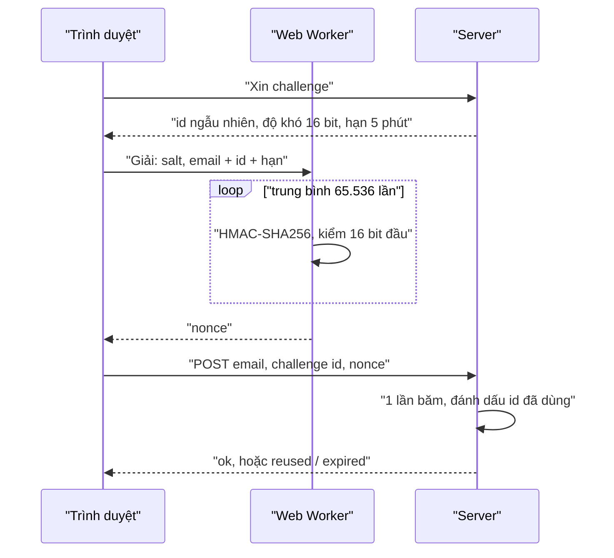

Udemy có nút "Chia sẻ khoá học qua email": nhập vài địa chỉ email, bấm gửi, server gửi thư giới thiệu khoá học tới các địa chỉ đó. Một API như vậy là món ngon cho kẻ spam: gọi nó thì có ngay một máy gửi thư mang tên miền udemy.com, không tốn đồng nào.

Cách thường gặp để chống là CAPTCHA hoặc rate limit theo IP. Udemy thêm một lớp nữa, rẻ và không làm phiền người dùng thật: trước khi gửi, **trình duyệt phải giải một bài toán băm**. Server chỉ cần băm một lần để kiểm, còn client phải thử trung bình 65.536 lần. Người dùng thật không để ý (chưa tới một giây), kẻ gửi hàng triệu request thì phải trả chi phí CPU cho từng request.

Ý tưởng này có tên là **proof-of-work** (bằng chứng đã làm việc, PoW), cùng họ với Hashcash, thứ được đề xuất từ cuối những năm 1990 để chống spam email.

> [!TIP]
> **Tóm tắt**
> - Client tìm chuỗi `nonce` sao cho `HMAC-SHA256(salt, dữ liệu + nonce)` có N bit đầu bằng 0. Trung bình phải thử 2^N lần; server kiểm chỉ cần **một** lần băm.
> - Bản của Udemy không có gì do server cấp: cùng danh sách email thì lời giải cũ **dùng lại được mãi**. Thêm một challenge ngẫu nhiên, dùng một lần, có hạn là chặn được việc gửi lại.
> - Vòng lặp băm 65 nghìn lần làm đứng main thread (bản Udemy chạy đồng bộ). Đưa vào **Web Worker**.
> - PoW không phải bảo mật: nó chỉ **tăng chi phí** cho mỗi request. Kẻ tấn công dùng code native nhanh hơn trình duyệt nhiều lần, nên vẫn cần rate limit, CAPTCHA hay xác thực ở các lớp khác.

<iframe class="demo-frame" src="/demos/web-patterns/index.html?theme=dark#/proof-of-work" title="Demo proof-of-work" loading="lazy" style="height: 900px"></iframe>

<p class="demo-links">▶ <a href="/demos/web-patterns/index.html#/proof-of-work" target="_blank" rel="noopener">Mở demo toàn màn hình ↗</a> · <a href="https://stackblitz.com/github/hunghg255/blog-hunghg/tree/master/examples/web-patterns?file=src/lib/proofOfWork.ts" target="_blank" rel="noopener">Sửa code trên StackBlitz ↗</a> · <a href="https://github.com/hunghg255/blog-hunghg/blob/master/examples/web-patterns/src/lib/proofOfWork.ts" target="_blank" rel="noopener">Xem source trên GitHub ↗</a></p>

Thử ở độ khó 16 bit: bấm **Giải trên main thread** rồi nhìn quả bóng (chạy bằng `requestAnimationFrame`): nó đứng im cho tới khi giải xong. Bấm **Giải trong Worker**: quả bóng chạy đều, khung hình dài nhất khoảng 17ms. Ở phần dưới, chọn "Kiểu Udemy", giải và gửi một lần, rồi bấm **Gửi lại cùng lời giải ×20**: server nhận cả 20. Đổi sang "Có challenge dùng một lần": server từ chối cả 20.

## Udemy làm thế nào?

Toàn bộ nằm trong một file 50 dòng: [`udemy.com/webpack---/src/udemy/js/utils/upow.js`](https://github.com/hunghg255/codebase/blob/main/udemy.com/webpack---/src/udemy/js/utils/upow.js) (tên `upow` có lẽ là "Udemy proof of work").

### Đánh số nonce kiểu tên cột Excel

```js
function intToAlphastring(i) {
    // Convert numbers to cap alpha strings 0 -> A,  26 -> AA, etc
    if (i < 0) {
        return '';
    }
    return intToAlphastring(Math.floor(i / 26) - 1) + String.fromCharCode(65 + (i % 26));
}
```

Lần thử thứ 0 là `A`, thứ 25 là `Z`, thứ 26 là `AA`… giống cách Excel đặt tên cột. Đây là cơ số 26 "song ánh" (bijective): không có chữ số 0, nên không có hai số nào ra cùng một chuỗi và chuỗi luôn ngắn nhất có thể. Chọn chữ in hoa thay vì số thập phân có lẽ chỉ để nonce trông "lạ", không nhầm với dữ liệu khác trong form.

### Kiểm N bit đầu bằng 0

Hàm `leadingBitsZero(numBits, barray)` đi qua mảng byte của mã băm: mỗi byte trọn thì so với 0, phần lẻ cuối cùng (1 đến 7 bit) thì dùng bảng mặt nạ `BIT_MASK = [0x00, 0x80, 0xc0, …, 0xff]` để lấy các bit cao nhất của byte tiếp theo. Với 16 bit, chỉ cần hai byte đầu của mã băm bằng 0.

### Vòng lặp chính

```js
export function generateUpow(salt, email, powdt) {
    return import(/* webpackChunkName: "create-hmac" */ 'create-hmac')
        .then(({default: createHmac}) => {
            let len = 0;
            while (true) {
                const powhash = intToAlphastring(len);
                const thash = createHmac('sha256', salt);
                thash.update(email + powdt + powhash);
                if (leadingBitsZero(16, thash.digest())) {
                    return powhash;
                }
                len += 1;
            }
        })
        .catch(handleImportError);
}
```

Ba điểm đáng chú ý:

- **Tải thư viện lười.** `create-hmac` (bản HMAC viết bằng JavaScript của hệ sinh thái browserify) chỉ được tải bằng `import()` khi người dùng thật sự bấm gửi, không nằm trong bundle chính.
- **Độ khó cứng 16 bit**, viết thẳng trong code, không do server quyết định.
- **Vòng `while (true)` đồng bộ**, chạy trên main thread. Trung bình 65.536 lần băm bằng JavaScript thuần, trong lúc đó trang không vẽ được gì và không phản hồi click.

### Nơi gọi

Chỉ có một chỗ dùng, trong [`share/share-email.mobx-store.js`](https://github.com/hunghg255/codebase/blob/main/udemy.com/webpack---/src/udemy/js/share/share-email.mobx-store.js):

```js
return generateUpow('share-email', this.recipientEmails.join(','), '').then((upow) => {
    return udApi.post(this.emailApiUrl, Object.assign({}, this.formData, {upow}));
});
```

Salt là chuỗi cố định `'share-email'`, dữ liệu là danh sách email nối bằng dấu phẩy, và tham số thứ ba `powdt` là **chuỗi rỗng**. Tên `powdt` gợi ý nó từng được định dùng cho một mốc thời gian ("pow datetime", suy đoán), thứ có thể làm lời giải hết hạn. Nhưng ở nơi gọi duy nhất, nó rỗng.

### Chỗ hở: lời giải dùng lại được

Vì thông điệp được băm chỉ gồm `salt + email + "" + nonce`, mà salt nằm ngay trong code client:

1. **Ai cũng tính được.** HMAC với khoá công khai thì thực chất chỉ là một hàm băm. Không có bí mật nào phía server.
2. **Lời giải không hết hạn.** Cùng danh sách email thì cùng nonce, hôm nay, tuần sau, năm sau đều đúng. Kẻ spam muốn dội thư vào một địa chỉ chỉ cần giải **một lần** rồi gửi lại cùng request bao nhiêu lần cũng được.
3. **Tính trước được.** Danh sách địa chỉ cần spam có sẵn từ trước thì có thể giải hết từ trước, ở máy khác, bằng code native.

Có thể Udemy còn chặn ở server bằng rate limit hoặc chống trùng, phần đó không có trong dump. Nhưng riêng lớp PoW thì chỉ làm tăng chi phí khi danh sách email **thay đổi**.

## Bên trong: vì sao kiểm thì rẻ mà giải thì đắt

SHA-256 là hàm băm mật mã: đổi một ký tự ở đầu vào là mọi bit đầu ra đổi như tung đồng xu, và không có cách nào chọn đầu vào để ra đầu ra mong muốn, ngoài thử. Mỗi bit đầu ra bằng 0 với xác suất 1/2, nên để có N bit đầu bằng 0 phải thử trung bình 2^N lần.

| Độ khó | Số lần thử trung bình | Thời gian ước tính trong Worker, Chromium (khoảng 80–130 nghìn lần băm mỗi giây khi đo) |
|---|---|---|
| 12 bit | 4.096 | vài chục ms |
| 16 bit | 65.536 | khoảng 0,5–1 giây |
| 18 bit | 262.144 | vài giây |
| 20 bit | khoảng 1 triệu | khoảng chục giây |

Đây là **trung bình**: số lần thử theo phân phối hình học, có lần may ra sau vài trăm lần, có lần xui phải gấp ba bốn lần trung bình. Demo cho thấy rõ: cùng 16 bit, một lần mất 797 lần thử, lần khác 182.775 lần. Server thì luôn chỉ băm đúng **một** lần.



### Vì sao main thread đứng hình

Bản Udemy chạy đồng bộ nên đứng hình là đương nhiên. Bản viết lại dùng `crypto.subtle.sign`, là API **bất đồng bộ**, và còn gom 256 lần băm mỗi đợt. Có thể nghĩ là giữa các đợt trình duyệt sẽ kịp vẽ, nhưng đo trong demo (Chromium, 10/2026) thì không: suốt lúc giải, `requestAnimationFrame` **không chạy lần nào**, khung hình dài nhất bằng đúng thời gian giải (1,5 giây với 182 nghìn lần thử). Có lẽ là vì hàng đợi tác vụ luôn đầy kết quả băm trả về, và Chromium ưu tiên chạy các tác vụ đó hơn là vẽ. Dù lý do là gì, kết luận thực tế giống nhau: việc tính toán nặng, kể cả viết bằng API async, nên chạy trong Worker.

## Viết lại

Bản viết lại giữ thuật toán của Udemy (đánh số kiểu Excel, kiểm N bit đầu), nhưng:

- dùng **Web Crypto** (`crypto.subtle`) có sẵn trong trình duyệt thay cho thư viện JavaScript;
- chạy được trong **Worker**, huỷ được, báo tiến độ;
- thêm **challenge do server cấp**: ngẫu nhiên, dùng một lần, có hạn.

Hai hàm nhỏ giống bản gốc:

```ts title=src/lib/proofOfWork.ts
/** 0 → "A", 25 → "Z", 26 → "AA", 27 → "AB"… (giống tên cột Excel, cơ số 26 "song ánh"). */
export function intToAlphaString(i: number): string {
  let out = '';
  for (let n = i; n >= 0; n = Math.floor(n / 26) - 1) {
    out = String.fromCharCode(65 + (n % 26)) + out;
  }
  return out;
}

/** `bits` bit đầu tiên của mảng byte có bằng 0 hết không. */
export function hasLeadingZeroBits(bytes: Uint8Array, bits: number): boolean {
  let i = 0;
  for (; bits >= 8; bits -= 8, i++) {
    if (bytes[i] !== 0) return false;
  }
  // còn lẻ `bits` bit (0–7): mặt nạ lấy `bits` bit cao nhất của byte kế tiếp
  return bits === 0 || (bytes[i] & (0xff << (8 - bits)) & 0xff) === 0;
}
```

Vòng giải:

```ts title=src/lib/proofOfWork.ts
export async function solve({ salt, message, difficulty, signal, onProgress, batch = 256 }: SolveOptions): Promise<Solution> {
  const key = await importHmacKey(salt);
  const started = performance.now();
  for (let base = 0; ; base += batch) {
    signal?.throwIfAborted();
    const nonces = Array.from({ length: batch }, (_, k) => intToAlphaString(base + k));
    const hashes = await Promise.all(nonces.map((nonce) => hmac(key, message + nonce)));
    // lấy nonce NHỎ NHẤT đạt yêu cầu trong đợt, để kết quả giống hệt bản chạy tuần tự
    const hit = hashes.findIndex((h) => hasLeadingZeroBits(h, difficulty));
    if (hit !== -1) {
      return { nonce: nonces[hit], attempts: base + hit + 1, ms: performance.now() - started };
    }
    onProgress?.(base + batch);
  }
}

/** Phía server: chỉ băm đúng một lần. */
export async function verify(salt: string, message: string, nonce: string, difficulty: number): Promise<boolean> {
  return hasLeadingZeroBits(await hmac(await importHmacKey(salt), message + nonce), difficulty);
}
```

Phía server (trong demo nó chạy ngay trong trình duyệt, ở dự án thật thì nằm ở backend), phần kiểm một lời giải:

```ts title=src/lib/proofOfWork.ts
    async redeem(payload: string, challengeId: string, nonce: string): Promise<VerifyResult> {
      if (used.has(challengeId)) return 'reused';
      const challenge = open.get(challengeId);
      if (!challenge) return 'unknown-challenge';
      if (now() > challenge.expiresAt) {
        open.delete(challengeId);
        return 'expired';
      }
      // độ khó lấy từ challenge server đã lưu, không tin con số client gửi lên
      if (!(await verify(salt, challengeMessage(payload, challenge), nonce, challenge.difficulty))) return 'bad-proof';
      open.delete(challengeId);
      used.add(challengeId);
      return 'ok';
    },
```

::: spoiler Xem toàn bộ src/lib/proofOfWork.ts

```ts title=src/lib/proofOfWork.ts
/**
 * Proof-of-work (PoW) phía client: trước khi gọi một API ẩn danh, trình duyệt phải tìm một
 * chuỗi `nonce` sao cho HMAC-SHA256(salt, message + nonce) có N bit đầu bằng 0.
 * Server kiểm tra chỉ tốn MỘT lần băm; client phải thử trung bình 2^N lần.
 *
 * Ý tưởng từ udemy.com (webpack---/src/udemy/js/utils/upow.js), dùng cho form "chia sẻ
 * khoá học qua email". Bản viết lại dùng Web Crypto (crypto.subtle) thay cho thư viện
 * create-hmac, thêm challenge do server cấp (chống tính trước + dùng lại), huỷ được và báo
 * tiến độ.
 */

/** 0 → "A", 25 → "Z", 26 → "AA", 27 → "AB"… (giống tên cột Excel, cơ số 26 "song ánh"). */
export function intToAlphaString(i: number): string {
  let out = '';
  for (let n = i; n >= 0; n = Math.floor(n / 26) - 1) {
    out = String.fromCharCode(65 + (n % 26)) + out;
  }
  return out;
}

/** `bits` bit đầu tiên của mảng byte có bằng 0 hết không. */
export function hasLeadingZeroBits(bytes: Uint8Array, bits: number): boolean {
  let i = 0;
  for (; bits >= 8; bits -= 8, i++) {
    if (bytes[i] !== 0) return false;
  }
  // còn lẻ `bits` bit (0–7): mặt nạ lấy `bits` bit cao nhất của byte kế tiếp
  return bits === 0 || (bytes[i] & (0xff << (8 - bits)) & 0xff) === 0;
}

const encoder = new TextEncoder();

export function importHmacKey(salt: string): Promise<CryptoKey> {
  return crypto.subtle.importKey('raw', encoder.encode(salt), { name: 'HMAC', hash: 'SHA-256' }, false, ['sign']);
}

async function hmac(key: CryptoKey, text: string): Promise<Uint8Array> {
  return new Uint8Array(await crypto.subtle.sign('HMAC', key, encoder.encode(text)));
}

export interface SolveOptions {
  salt: string;
  /** dữ liệu cần "trả phí": email người nhận + challenge server cấp… */
  message: string;
  /** số bit 0 ở đầu; mỗi bit thêm vào làm số lần thử trung bình gấp đôi */
  difficulty: number;
  signal?: AbortSignal;
  onProgress?: (attempts: number) => void;
  /** số lần băm chạy song song mỗi đợt (crypto.subtle là async) */
  batch?: number;
}

export interface Solution {
  nonce: string;
  attempts: number;
  ms: number;
}

export async function solve({ salt, message, difficulty, signal, onProgress, batch = 256 }: SolveOptions): Promise<Solution> {
  const key = await importHmacKey(salt);
  const started = performance.now();
  for (let base = 0; ; base += batch) {
    signal?.throwIfAborted();
    const nonces = Array.from({ length: batch }, (_, k) => intToAlphaString(base + k));
    const hashes = await Promise.all(nonces.map((nonce) => hmac(key, message + nonce)));
    // lấy nonce NHỎ NHẤT đạt yêu cầu trong đợt, để kết quả giống hệt bản chạy tuần tự
    const hit = hashes.findIndex((h) => hasLeadingZeroBits(h, difficulty));
    if (hit !== -1) {
      return { nonce: nonces[hit], attempts: base + hit + 1, ms: performance.now() - started };
    }
    onProgress?.(base + batch);
  }
}

/** Phía server: chỉ băm đúng một lần. */
export async function verify(salt: string, message: string, nonce: string, difficulty: number): Promise<boolean> {
  return hasLeadingZeroBits(await hmac(await importHmacKey(salt), message + nonce), difficulty);
}

// ---- Challenge do server cấp ----

export interface Challenge {
  /** chuỗi ngẫu nhiên, chỉ dùng được một lần */
  id: string;
  difficulty: number;
  /** hết hạn (ms since epoch): lời giải cũ không dùng lại được mãi */
  expiresAt: number;
}

/** Thông điệp được băm: gắn cả dữ liệu lẫn challenge, đổi một trong hai là phải giải lại. */
export const challengeMessage = (payload: string, challenge: Challenge) =>
  `${payload}|${challenge.id}|${challenge.expiresAt}`;

export type VerifyResult = 'ok' | 'bad-proof' | 'unknown-challenge' | 'expired' | 'reused';

/**
 * Phía server (mô phỏng trong trình duyệt cho demo; thật thì nằm ở backend): cấp challenge,
 * kiểm lời giải, và đánh dấu challenge đã dùng để không gửi lại được.
 */
export function createChallengeIssuer({ salt, difficulty, ttlMs = 5 * 60_000, now = Date.now }: {
  salt: string;
  difficulty: number;
  ttlMs?: number;
  now?: () => number;
}) {
  const open = new Map<string, Challenge>();
  const used = new Set<string>();

  return {
    issue(): Challenge {
      const challenge = { id: crypto.randomUUID(), difficulty, expiresAt: now() + ttlMs };
      open.set(challenge.id, challenge);
      return challenge;
    },
    async redeem(payload: string, challengeId: string, nonce: string): Promise<VerifyResult> {
      if (used.has(challengeId)) return 'reused';
      const challenge = open.get(challengeId);
      if (!challenge) return 'unknown-challenge';
      if (now() > challenge.expiresAt) {
        open.delete(challengeId);
        return 'expired';
      }
      // độ khó lấy từ challenge server đã lưu, không tin con số client gửi lên
      if (!(await verify(salt, challengeMessage(payload, challenge), nonce, challenge.difficulty))) return 'bad-proof';
      open.delete(challengeId);
      used.add(challengeId);
      return 'ok';
    },
  };
}
```

:::

::: spoiler Xem src/lib/proofOfWork.worker.ts và proofOfWorkWorkerClient.ts

```ts title=src/lib/proofOfWork.worker.ts
/// <reference lib="webworker" />
/**
 * Giải proof-of-work trong Web Worker để vòng lặp băm không chiếm main thread.
 * Huỷ: trang chính gọi worker.terminate() (xem solveInWorker trong proofOfWorkWorkerClient.ts).
 */
import { solve, type SolveOptions } from './proofOfWork';

export type PowRequest = Pick<SolveOptions, 'salt' | 'message' | 'difficulty'>;
export type PowResponse =
  | { type: 'progress'; attempts: number }
  | { type: 'done'; nonce: string; attempts: number; ms: number }
  | { type: 'error'; message: string };

const post = (msg: PowResponse) => (self as unknown as DedicatedWorkerGlobalScope).postMessage(msg);

self.addEventListener('message', (event: MessageEvent<PowRequest>) => {
  let last = 0;
  solve({
    ...event.data,
    onProgress: (attempts) => {
      // báo tiến độ thưa thôi: mỗi postMessage cũng tốn công sao chép + một task bên trang chính
      if (attempts - last >= 4096) {
        last = attempts;
        post({ type: 'progress', attempts });
      }
    },
  }).then(
    (result) => post({ type: 'done', ...result }),
    (error: Error) => post({ type: 'error', message: error.message }),
  );
});
```

```ts title=src/lib/proofOfWorkWorkerClient.ts
import type { Solution, SolveOptions } from './proofOfWork';
import type { PowRequest, PowResponse } from './proofOfWork.worker';

/** Chạy `solve` trong một worker riêng; abort → terminate worker ngay (không cần vòng lặp hợp tác). */
export function solveInWorker(
  { salt, message, difficulty, signal, onProgress }: Omit<SolveOptions, 'batch'>,
): Promise<Solution> {
  return new Promise((resolve, reject) => {
    if (signal?.aborted) return reject(signal.reason);
    const worker = new Worker(new URL('./proofOfWork.worker.ts', import.meta.url), { type: 'module' });
    const finish = () => {
      worker.terminate();
      signal?.removeEventListener('abort', onAbort);
    };
    const onAbort = () => {
      finish();
      reject(signal!.reason);
    };
    signal?.addEventListener('abort', onAbort, { once: true });
    worker.addEventListener('message', (event: MessageEvent<PowResponse>) => {
      const data = event.data;
      if (data.type === 'progress') onProgress?.(data.attempts);
      else if (data.type === 'done') {
        finish();
        resolve({ nonce: data.nonce, attempts: data.attempts, ms: data.ms });
      } else {
        finish();
        reject(new Error(data.message));
      }
    });
    worker.addEventListener('error', (event) => {
      finish();
      reject(new Error(event.message || 'worker error'));
    });
    worker.postMessage({ salt, message, difficulty } satisfies PowRequest);
  });
}
```

:::

## Đi qua code

**`intToAlphaString`** viết lại bằng vòng lặp thay cho đệ quy, cho cùng kết quả: `0 → A`, `26 → AA`, `701 → ZZ`, `702 → AAA`.

**`hasLeadingZeroBits`** gộp hai nhánh của bản gốc: trừ dần 8 bit cho mỗi byte bằng 0, phần còn lại dùng mặt nạ `0xff << (8 - bits)`. Không cần bảng `BIT_MASK`.

**`solve`** import khoá HMAC **một lần** (`importKey`), rồi mỗi đợt tạo 256 nonce và băm song song bằng `Promise.all`. `crypto.subtle` là async, nên chờ từng lần một sẽ tốn thời gian chờ nhiều hơn thời gian băm. Trong một đợt có thể có nhiều nonce đạt; lấy cái **nhỏ nhất** (`findIndex`) để kết quả giống hệt bản chạy tuần tự: cùng đầu vào thì luôn ra cùng nonce, dễ kiểm thử. `signal.throwIfAborted()` cho phép huỷ giữa chừng.

**`verify`** là việc của server: một lần băm, một lần kiểm bit.

**`challengeMessage`** nối dữ liệu, id challenge và hạn vào thông điệp được băm. Đổi email thì phải giải lại; dùng challenge khác cũng phải giải lại.

**`createChallengeIssuer`** giữ hai tập: challenge đang mở và challenge đã dùng. `redeem` kiểm theo thứ tự: đã dùng chưa, có tồn tại không, còn hạn không, rồi mới băm. Độ khó lấy từ challenge **server đã lưu**, không lấy từ request, vì client có thể khai "tôi giải bài 1 bit".

**`solveInWorker`** tạo một worker riêng cho mỗi lần giải. Huỷ thì `terminate()` luôn worker: không cần vòng lặp trong worker tự kiểm cờ huỷ, vì luồng đó bị dừng ngay. Worker chỉ báo tiến độ mỗi 4.096 lần thử, vì mỗi `postMessage` cũng tốn công sao chép dữ liệu và một tác vụ bên trang chính.

**Khác bản gốc:** Udemy dùng thư viện `create-hmac` chạy đồng bộ trên main thread, độ khó cứng 16 bit, và không có challenge (`powdt` rỗng). Bản viết lại dùng Web Crypto, chạy trong Worker, độ khó và challenge do server quyết định.

## Tại sao không làm cách khác?

**Sao không chỉ dùng rate limit theo IP?** Nên dùng, nhưng IP rẻ: botnet, proxy dân cư, IPv6 cho mỗi máy cả dải địa chỉ. PoW tính chi phí theo **từng request**, bất kể đến từ đâu.

**Sao không dùng CAPTCHA?** CAPTCHA tốn công của **người**, PoW tốn công của **máy**. Với một hành động nhỏ như chia sẻ khoá học, bắt người dùng chọn ảnh đèn giao thông là quá đắt. Hai thứ có thể đi cùng nhau: PoW mặc định, CAPTCHA khi thấy dấu hiệu bất thường.

**Sao không dùng hàm băm "chậm" như scrypt, Argon2?** Các hàm này tốn nhiều bộ nhớ, làm GPU và mạch chuyên dụng khó tăng tốc hơn SHA-256. Nhưng trình duyệt không có sẵn chúng, phải nạp WebAssembly vài chục đến vài trăm KB. Cho một nút chia sẻ thì SHA-256 có sẵn là đủ.

**Sao không để độ khó cố định như Udemy?** Một con số cứng không thích nghi được. Server cấp độ khó trong challenge thì có thể tăng khi đang bị tấn công, hạ cho người dùng đã đăng nhập, hay hạ cho thiết bị yếu nếu cần.

## Edge case và cạm bẫy

- **Thiết bị yếu chịu thiệt nhất.** Điện thoại cũ chậm hơn laptop nhiều lần, trong khi kẻ tấn công chạy code native trên máy chủ nhanh hơn trình duyệt nhiều lần nữa. PoW đánh vào người dùng thật nặng hơn vào kẻ tấn công, nên độ khó phải thấp, và nó không bao giờ là lớp bảo vệ duy nhất.
- **Pin và nhiệt.** 20 bit có thể tốn hơn chục giây CPU trên điện thoại. Hiện tiến độ, cho huỷ, và đừng giải trước "cho chắc" khi người dùng chưa bấm gửi.
- **`crypto.subtle` chỉ có trong secure context** (HTTPS hoặc localhost). Trên HTTP thường, `crypto.subtle` là `undefined`.
- **Bộ nhớ của server.** Tập "challenge đã dùng" phải được dọn theo hạn, nếu không nó phình mãi. Ở nhiều server thì cần kho dùng chung (Redis có TTL chẳng hạn), nếu không một challenge có thể dùng được một lần trên **mỗi** server.
- **Đồng hồ.** Hạn do server đặt và server kiểm, không dựa vào đồng hồ của client.
- **Trộn thứ tự dữ liệu.** Udemy nối email bằng dấu phẩy, nên `[a, b]` và `[b, a]` là hai thông điệp khác nhau. Nếu server chuẩn hoá (sắp xếp) danh sách trước khi kiểm còn client thì không, lời giải đúng sẽ bị từ chối. Hai bên phải dựng thông điệp giống hệt nhau.

## Dùng trong dự án

Phía client, trước khi gọi API cần bảo vệ:

```ts
import { challengeMessage, type Challenge } from './proofOfWork';
import { solveInWorker } from './proofOfWorkWorkerClient';

async function shareByEmail(emails: string[], signal: AbortSignal) {
  const challenge: Challenge = await fetch('/api/pow-challenge?action=share-email').then((r) => r.json());
  const payload = emails.join(',');
  const { nonce } = await solveInWorker({
    salt: 'share-email',
    message: challengeMessage(payload, challenge),
    difficulty: challenge.difficulty,
    signal,
  });
  return fetch('/api/share-email', {
    method: 'POST',
    headers: { 'Content-Type': 'application/json' },
    body: JSON.stringify({ emails, challengeId: challenge.id, nonce }),
    signal,
  });
}
```

Phía server, logic giống hệt `createChallengeIssuer`: Node.js có `crypto.createHmac('sha256', salt)` trong module `node:crypto`. Chỉ cần thay `Map`/`Set` trong bộ nhớ bằng kho có TTL.

Một vài nơi hợp với PoW: form liên hệ, đăng ký nhận bản tin, "gửi lại email xác nhận", tìm kiếm công khai đắt tiền. Không hợp: đăng nhập (dùng rate limit theo tài khoản và CAPTCHA), hay bất cứ thứ gì cần chặn chắc chắn.

## Kiểm thử

::: spoiler Ví dụ test (bản phác, không có trong repo)

```ts
// @vitest-environment node
import { describe, expect, it } from 'vitest';
import { createChallengeIssuer, challengeMessage, hasLeadingZeroBits, intToAlphaString, solve, verify } from './proofOfWork';

describe('intToAlphaString', () => {
  it('đánh số giống tên cột Excel', () => {
    expect([0, 25, 26, 27, 701, 702].map(intToAlphaString)).toEqual(['A', 'Z', 'AA', 'AB', 'ZZ', 'AAA']);
  });
});

describe('hasLeadingZeroBits', () => {
  it('kiểm cả byte nguyên lẫn bit lẻ', () => {
    expect(hasLeadingZeroBits(new Uint8Array([0, 0, 0xff]), 16)).toBe(true);
    expect(hasLeadingZeroBits(new Uint8Array([0, 1]), 16)).toBe(false);
    expect(hasLeadingZeroBits(new Uint8Array([0, 0x1f]), 11)).toBe(true); // 0001 1111: 3 bit đầu = 0
    expect(hasLeadingZeroBits(new Uint8Array([0, 0x20]), 11)).toBe(false);
  });
});

describe('solve + verify', () => {
  it('lời giải đúng thì server kiểm lại được', async () => {
    const { nonce } = await solve({ salt: 's', message: 'a@b.c', difficulty: 8 });
    expect(await verify('s', 'a@b.c', nonce, 8)).toBe(true);
  });

  it('huỷ được bằng AbortSignal', async () => {
    const controller = new AbortController();
    const promise = solve({ salt: 's', message: 'm', difficulty: 30, signal: controller.signal });
    controller.abort();
    await expect(promise).rejects.toThrow();
  });
});

describe('createChallengeIssuer', () => {
  it('challenge chỉ dùng một lần và có hạn', async () => {
    let now = 1_000;
    const issuer = createChallengeIssuer({ salt: 's', difficulty: 8, ttlMs: 100, now: () => now });
    const c = issuer.issue();
    const { nonce } = await solve({ salt: 's', message: challengeMessage('a@b.c', c), difficulty: 8 });
    expect(await issuer.redeem('a@b.c', c.id, nonce)).toBe('ok');
    expect(await issuer.redeem('a@b.c', c.id, nonce)).toBe('reused');

    const late = issuer.issue();
    const solved = await solve({ salt: 's', message: challengeMessage('a@b.c', late), difficulty: 8 });
    now += 101;
    expect(await issuer.redeem('a@b.c', late.id, solved.nonce)).toBe('expired');
  });
});
```

:::

## So với thư viện và dịch vụ có sẵn

- **Hashcash** là mô hình gốc của ý tưởng: người gửi email đính kèm một "con dấu" băm tốn công tạo nhưng rẻ để kiểm.
- **Các CAPTCHA không cần bấm** như ALTCHA hay Friendly Captcha dựa trên PoW chạy trong trình duyệt, có sẵn widget và phần kiểm phía server. Nếu cần PoW nghiêm túc, dùng chúng thay vì tự viết.
- **Web Crypto** (`crypto.subtle.sign` với HMAC, SHA-256) có trong mọi trình duyệt hiện đại, kể cả trong Worker, chỉ cần secure context.

Phần đáng mang về từ Udemy là ý tưởng: một vài chục dòng code, không thêm bước nào cho người dùng, mà mỗi request ẩn danh có giá. Phần nên làm tốt hơn: để server cấp challenge, và đừng chạy vòng băm trên main thread.

---

Bài này thuộc series **[Học từ mã nguồn các web lớn](/series/web)** (65 bài, đọc theo thứ tự).

::: spoiler Xem nhanh danh sách bài trong series

*Mở đầu*

- [Mở đầu: đọc code production của 28 trang web](/blogs/learn-from-big-web-apps)

*Phần 1: trải nghiệm người dùng*

- [#1 Dark mode không nháy (Gatsby)](/blogs/web-dark-mode-no-flash)
- [#2 useValueByMedia: giá trị theo breakpoint (Toptal)](/blogs/web-use-value-by-media)
- [#3 Đoán ý định: idle, exit-intent, lắc chuột (Toptal, InVision)](/blogs/web-user-intent-idle-exit-wiggle)
- [#4 Validate form thân thiện (Udacity, Pipedrive)](/blogs/web-form-validation-ux)
- [#5 Magic number, EXIF và dán ảnh (Ello)](/blogs/web-file-magic-number-exif-paste)
- [#6 fastSmoothScroll: cuộn xa vẫn nhanh (Telegram)](/blogs/web-telegram-fast-smooth-scroll)
- [#7 Countdown time-travel và tombstone giỏ hàng (Best Buy)](/blogs/web-countdown-time-travel-tombstone)

*Phần 2: hiệu năng và đo lường*

- [#8 Hàng đợi requestAnimationFrame 3ms (Apple)](/blogs/web-raf-queue-3ms)
- [#9 srcset cho artwork và preconnect tự động (Apple)](/blogs/web-responsive-artwork-preconnect)
- [#10 Quick-fetch: gọi API trước khi bundle tải xong (HubSpot)](/blogs/web-quick-fetch-early-requests)
- [#11 Performance span và long task (Postman, Calibre)](/blogs/web-performance-spans-long-tasks)
- [#12 Gọi Web Worker như hàm async (Telegram)](/blogs/web-worker-promise-rpc)
- [#13 Đồng hồ media: đếm giờ xem và sửa lệch (Skillshare, Simplified)](/blogs/web-media-clock-watch-time-drift)

*Phần 3: nhiều tab, phiên đăng nhập, cập nhật*

- [#14 Bầu tab chủ cho thông báo (HubSpot, Telegram)](/blogs/web-leader-tab-notifications)
- [#15 Đồng bộ đăng nhập giữa tab và giới hạn cookie (Elastic, InVision)](/blogs/web-cross-tab-auth-cookie-guard)
- [#16 SPA tự cập nhật: Trello, Zappos, Facebook, Elastic](/blogs/web-spa-self-update-strategies)

*Phần 4: kiến trúc*

- [#17 Reverse portal: di chuyển component không remount (Zappos)](/blogs/web-reverse-portal)
- [#18 Page behaviors: gắn hành vi từ CMS (Intercom)](/blogs/web-page-behaviors-cms)
- [#19 Giới hạn tần suất hiển thị bằng bitmask (Outlook)](/blogs/web-frequency-cap-bitmask)
- [#20 Chuyển REST sang GraphQL dần dần (Coursera)](/blogs/web-rest-to-graphql-hybrid-link)

*Phần 5: soạn thảo và hiển thị nội dung*

- [#21 Autocomplete tại con trỏ trong contenteditable (Ello, Telegram)](/blogs/web-caret-autocomplete-contenteditable)
- [#22 Dark mode cho email HTML bằng CIELAB (Outlook)](/blogs/web-email-dark-mode-cielab)
- [#23 Thu nhỏ bảng rộng cho vừa khung, vá font emoji (Outlook)](/blogs/web-email-wide-content-scale)
- [#24 Cảnh báo quên đính kèm file (Outlook)](/blogs/web-forgotten-attachment-warning)
- [#25 Cắt chữ nhiều dòng chính xác (Pipedrive, Apple, Toptal)](/blogs/web-multiline-truncate-measure-text)
- [#26 Parse ngày giờ gõ tay khoan dung (Outlook, Elastic)](/blogs/web-lenient-date-parser)

*Phần 6: tương tác*

- [#27 menuAim: rê chéo vào submenu không bị đóng (Udemy)](/blogs/web-menu-aim-triangle)
- [#28 Kéo, vuốt chung cho chuột và cảm ứng (Telegram)](/blogs/web-unified-pointer-gestures)
- [#29 Phím tắt theo phạm vi, IME và bàn phím phi Latinh (Trello)](/blogs/web-scoped-keyboard-shortcuts)
- [#30 Nội suy màu: đổi theme và nền theo cuộn (Telegram, Anchor)](/blogs/web-color-interpolation-theme-scroll)
- [#31 Đường gióng hút cạnh và undo/redo trên canvas (Simplified)](/blogs/web-canvas-snap-guides-undo)
- [#32 Giả lập mù màu bằng feColorMatrix (Trello)](/blogs/web-color-vision-simulator)
- [#33 Vạch thước theo mức zoom và cấp phát màu cho biểu đồ (Anchor, Similarweb)](/blogs/web-timeline-ticks-color-stack)

*Phần 7: mạng, dữ liệu và async*

- [#34 Ô tìm kiếm chuẩn production (Similarweb, Udemy, Pipedrive)](/blogs/web-production-search-box)
- [#35 Điều phối async: latest-wins, single-flight (Glitch, Toptal)](/blogs/web-async-coordination-latest-wins)
- [#36 Polling thưa dần và debounce động (Trello)](/blogs/web-decaying-polling-dynamic-debounce)
- [#37 Cache phía client theo version (Similarweb, Telegram, Udemy)](/blogs/web-client-cache-versioned)
- [#38 Upload file lớn theo chunk (Outlook, Tribe)](/blogs/web-chunked-upload-pipeline)
- [#39 Phát video qua Service Worker bằng Range request (Telegram, Outlook)](/blogs/web-service-worker-range-streaming)

*Phần 8: hiệu năng và vận hành*

- [#40 TTI governor: hoãn việc phụ tới sau khi trang dùng được (Outlook)](/blogs/web-tti-governor)
- [#41 Tự đo LCP/CLS/TBT và phục vụ bản nhẹ cho máy yếu (Udemy)](/blogs/web-rum-adaptive-loading)

*Phần 9: thuật toán và dữ liệu phía client*

- [#42 Three-way merge ngay trên trình duyệt (Postman)](/blogs/web-three-way-merge-client)
- [#43 Dọn cache GraphQL bằng đếm tham chiếu (Outlook)](/blogs/web-graphql-cache-refcount-gc)
- [#44 LRU cache theo 3 cách (Apple, Similarweb, Outlook)](/blogs/web-lru-cache-three-ways)
- [#45 Lọc tăng dần trong Web Worker (Similarweb)](/blogs/web-incremental-filter-worker)
- [#46 Xếp hạng gợi ý trên client, so ngầm với server (Outlook)](/blogs/web-client-side-ranking-shadow-test)
- [#47 Nối OT với editor: undo stack và chặn echo (Glitch)](/blogs/web-ot-codemirror-undo)
- [#48 Ngôn ngữ markup riêng dịch hai chiều với HTML (Coursera)](/blogs/web-custom-markup-compiler)

*Phần 10: thời gian, ngôn ngữ, định dạng*

- [#49 Xử lý giờ mùa hè không cần thư viện (Udemy, Pipedrive)](/blogs/web-dst-without-library)
- [#50 Intl thực chiến: Segmenter, số rút gọn, số nhiều, fallback locale (Apple, Outlook)](/blogs/web-intl-in-production)
- [#51 WebVTT và bôi chọn transcript (Udemy, Coursera)](/blogs/web-webvtt-transcript-selection)

*Phần 11: tương tác và giao diện*

- [#52 Kéo-thả trên lịch (Pipedrive)](/blogs/web-calendar-drag-drop)
- [#53 Focus stack cho popup lồng nhau (Outlook)](/blogs/web-focus-stack-nested-popups)
- [#54 Clipboard: copy, dán chữ thuần, dán thông minh (Trello, Anchor, Pipedrive, Tribe)](/blogs/web-clipboard-tricks)
- [#55 Khôi phục vị trí cuộn khi trang còn đang tải (Apple, Zappos)](/blogs/web-scroll-restore-wait-height)
- [#56 Lấy màu từ ảnh: gradient nền, màu chữ (Apple, Telegram, Trello)](/blogs/web-colors-from-images)
- [#57 JS đọc breakpoint từ CSS, phát hiện chế độ PWA (Ello, Apple)](/blogs/web-css-js-breakpoint-bridge)

*Phần 12: media*

- [#58 Tin nhắn thoại: ghi âm, waveform realtime, nén 5-bit (Telegram)](/blogs/web-voice-message-waveform)
- [#59 Chụp frame video thành ảnh, canvas bị taint (Coursera, Outlook)](/blogs/web-video-frame-snapshot)

*Phần 13: đo lường, bảo mật, vận hành*

- [#60 Đo lúc ảnh màn hình đầu tải xong, cả khi chuyển trang SPA (Zappos, Best Buy, Outlook)](/blogs/web-above-the-fold-image-timing)
- [#61 Buffer analytics chờ SDK, phát hiện adblock (Best Buy)](/blogs/web-analytics-buffer-adblock)
- **#62 Proof-of-work trên client để chặn API ẩn danh (Udemy)** (bài này)
- [#63 Prefetch không làm lệch số liệu, nén cài đặt bằng bit (Outlook)](/blogs/web-synthetic-prefetch-bit-flags)
- [#64 Micro-frontend: AngularJS và React chung app, giao tiếp xuyên frame (Similarweb, InVision, HubSpot)](/blogs/web-micro-frontend-bridges)

:::

Code + demo: [`examples/web-patterns`](https://github.com/hunghg255/blog-hunghg/tree/master/examples/web-patterns) · [Mở trên StackBlitz](https://stackblitz.com/github/hunghg255/blog-hunghg/tree/master/examples/web-patterns)
