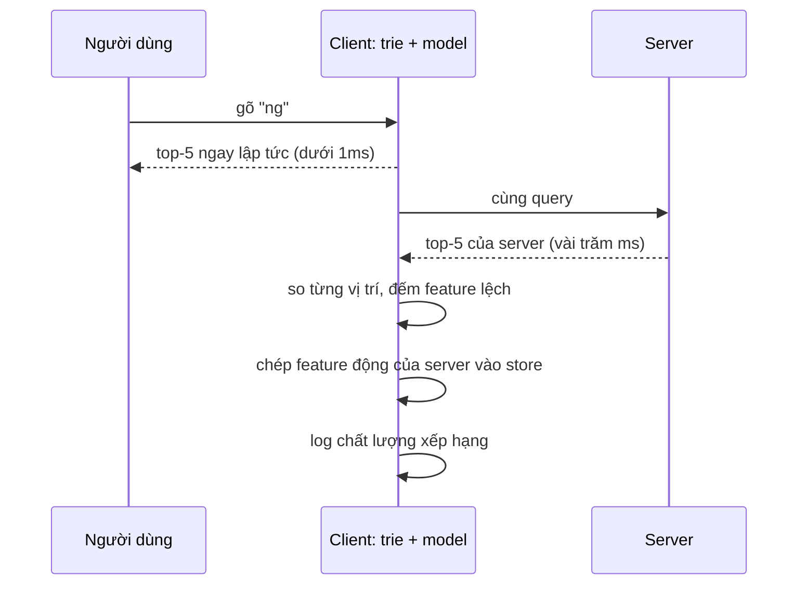

Gõ "ng" vào ô "Tới" của một ứng dụng email. Bạn muốn thấy ngay đồng nghiệp hay mail qua lại nhất, không phải đợi 300ms cho một request. Nhưng thứ tự gợi ý tốt thì cần model xếp hạng (ai mới liên lạc, liên lạc bao nhiêu lần, có cùng nhóm không…), và model đó vốn chạy trên server.

Outlook trên web làm cả hai: **xếp hạng ngay trên client** với danh bạ đã cache, đồng thời vẫn gọi server. Khi kết quả server về, nó **so** hai danh sách (shadow test) để đo xem ranker phía client tốt tới đâu, và **chép feature mới của server** vào client để tab mở cả tuần không bị lệch dần.

> [!TIP]
> **Tóm tắt**
> - Danh bạ cache được dựng thành **prefix trie**: gõ tới đâu tra tới đó, không cần mạng. Mỗi liên hệ có một **vector feature** và model xếp hạng cũng **tải từ server**, nên client và server dùng cùng một công thức.
> - Server vẫn được gọi. Kết quả về thì **so top-5** từng vị trí với client và ghi log: đây là cách đo chất lượng một thuật toán chạy trên máy người dùng mà không cần A/B test riêng.
> - Feature thay đổi theo thời gian (tần suất liên lạc). Mỗi lần so, client **chép đè feature động** của server, giữ nguyên feature tĩnh.
> - Mẫu "chạy song song, so sánh, chưa dùng kết quả mới" (shadow mode) áp dụng được cho mọi thay thế thuật toán: cache mới, parser mới, model mới.

<iframe class="demo-frame" src="/demos/web-patterns/index.html?theme=dark#/local-ranker" title="Demo local-ranker" loading="lazy" style="height: 900px"></iframe>

<p class="demo-links">▶ <a href="/demos/web-patterns/index.html#/local-ranker" target="_blank" rel="noopener">Mở demo toàn màn hình ↗</a> · <a href="https://stackblitz.com/github/hunghg255/blog-hunghg/tree/master/examples/web-patterns?file=src/lib/localRanker.ts" target="_blank" rel="noopener">Sửa code trên StackBlitz ↗</a> · <a href="https://github.com/hunghg255/blog-hunghg/blob/master/examples/web-patterns/src/lib/localRanker.ts" target="_blank" rel="noopener">Xem source trên GitHub ↗</a></p>

Gõ "ng": hai cột khớp 5/5. Kéo "Tab đã mở" lên 10 ngày rồi gõ "nguyen": server đã biết bạn mail với Nguyễn Hoàng Long nhiều hơn, client thì chưa, nên chỉ khớp 2/5. Bật "Tự hiệu chỉnh" và gõ lại "nguyen": lần đầu vẫn lệch (đang so và chép), lần sau khớp 5/5. Tắt tự hiệu chỉnh thì lệch mãi cho tới khi bấm "Tải lại trang".

## Outlook làm thế nào?

Code nằm trong module [`owa-3s-local`](https://github.com/hunghg255/codebase/tree/main/outlook.live.com/src/modules/owa-3s-local/src) ("3S" có lẽ là Substrate Search Service, dịch vụ tìm kiếm của Microsoft 365). Module được tách chunk riêng và nạp lười qua `LazyModule`, nên không làm nặng lần tải đầu.

### Dựng trie và feature store

[`initializeSuggestionTrie.ts`](https://github.com/hunghg255/codebase/blob/main/outlook.live.com/src/modules/owa-3s-local/src/actions/initializeSuggestionTrie.ts) chạy khi danh bạ cache đã có:

```ts
// Get dynamic model from server
let modelResponse = await getPeopleModelFromServer();
// ...
let modelName = setDynamicModel(modelResponse);
setFuzzyCharSwapsData(modelResponse.Mispellings);

createFeatureStore(cacheResults, dynamicFeatureIndexMap);
setRecipientTrie(state.store, cacheResults);
```

Ba thứ được tải về hoặc dựng lên:

- **Model** xếp hạng (`setDynamicModel`), kèm tên phiên bản được log lại.
- **Bảng lỗi gõ** (`Mispellings`): những cặp ký tự hay gõ nhầm, dùng để sửa query khi không có gì khớp.
- **Feature store**: [`createFeatureStore.ts`](https://github.com/hunghg255/codebase/blob/main/outlook.live.com/src/modules/owa-3s-local/src/actions/createFeatureStore.ts) lấy `FeatureData` mà server gửi kèm từng liên hệ, đổi tên feature thành chỉ số (`featureIndexMap.getFeatureIndex`) và lưu thành một object số.

```ts
// Do not refresh FeatureValues for existing candidates
// They are not compatible with the static browse values
if (!suggestionKey || featureStores.has(suggestionKey)) {
    return;
}
```

Trie và hàm chấm điểm nằm trong package `3s-featurisers`, không có trong bản dump. Phần còn lại (dựng, so sánh, log) là code của Outlook.

### Shadow test: so với server

Ô người nhận vẫn gọi server mỗi lần gõ. Trong [`backfillCache.ts`](https://github.com/hunghg255/codebase/blob/main/outlook.live.com/src/modules/owa-readwrite-recipient-well/src/actions/people/backfillCache.ts), khi kết quả server về và trie đang bật:

```ts
if (isTrieCacheEnabled() && cacheResultsAvailable && !serverResultsEmpty) {
    comparisonInfo = await lazyCompareFeatureData
        .import()
        .then(compareFeatureData =>
            compareFeatureData(recipientWell.findResultSet, serverResults)
        );
}
```

[`compareFeatureData.ts`](https://github.com/hunghg255/codebase/blob/main/outlook.live.com/src/modules/owa-3s-local/src/selectors/compareFeatureData.ts) làm ba việc:

1. **Đo chất lượng xếp hạng**: so từng vị trí trong top-5.

   ```ts
   var matchedPositions: number[] = [0, 0, 0, 0, 0];
   for (var i = 0; i < matchedPositions.length; i++) {
       if (!clientSideResults[i] || !serverResultArray[i]) break;
       if (getKeyForSuggestion(clientSideResults[i]) == getKeyForSuggestion(serverResultArray[i])) {
           matchedPositions[i] = 1;
       } else {
           numberOfOrderMismatches += 1;
       }
   }
   logUsage('SuggestionsTrie_RankingQuality_CorrectMatches', matchedPositions);
   ```

2. **Đếm liên hệ thiếu** ở mỗi bên, nhóm theo nguồn (`PeopleSource`): server gợi ý mà client không có thường nghĩa là danh bạ cache chưa đủ.

3. **So từng feature** của mỗi liên hệ và **chép đè** giá trị của server:

   ```ts
   // If client side has a different feature value than server, override the client side values with the server one.
   // This is done to handle the case when browser is kept open for a long time and server side apf features are updated
   // We are only interested in updated L1 or context aware features
   if (l2Features.indexOf(key) == -1) {
       clientSidefeatures[value] = serverSideFeatureValue;
   }
   ```

Chuỗi mô tả chênh lệch (`comparisonInfo`) còn được gắn vào trạng thái phản hồi: khi người dùng bấm "gửi phản hồi" về gợi ý sai, nhóm phát triển có luôn dữ liệu để biết client đang lệch feature nào.

### Vài điểm chưa gọn

- `missingSuggestionsFromClientSource` được khai báo `new Map()` nhưng lại dùng như object (`map[source] = …`). Nó vẫn log đúng vì `JSON.stringify` đọc thuộc tính riêng của object, kể cả khi object đó là `Map`; nhưng `map.size` luôn là 0. Đổi sang `{}` hoặc dùng `get`/`set` cho rõ.
- `orderTrieSuggestions` sắp xếp theo `featureStores.get(key)[index]`. Liên hệ không có khoá (không email, không `PersonaId`) bị `createFeatureStore` bỏ qua, nên nếu lọt vào danh sách thì có lẽ sẽ gây `TypeError` lúc sắp xếp.
- Đếm vị trí dừng ngay khi một bên hết kết quả. Client có 3 kết quả, server có 5 thì hai vị trí cuối không được tính là lệch.

## Bên trong: vì sao trie

Gõ từng ký tự là một lần tra cứu. Với vài nghìn liên hệ, lọc mảng bằng `startsWith` cho mỗi phím vẫn nhanh, nhưng trie cho chi phí tra cứu chỉ phụ thuộc **độ dài query**, không phụ thuộc số liên hệ, và cho phép tra theo **mọi từ** của tên (họ, tên đệm, tên, phần trước `@`).



Điểm quan trọng của mô hình này là **client không tự nghĩ ra công thức**: model và feature đều từ server. Client chỉ là một bản sao chạy gần người dùng. Shadow test là cách kiểm tra bản sao đó còn khớp bản gốc không.

## Viết lại

Trie lưu tập khoá ở **mọi nút** để tra một tiền tố chỉ cần đi xuống theo độ dài query. Tên được bỏ dấu (`Đức` → `duc`) trước khi đưa vào:

```ts title=src/lib/localRanker.ts
export class PrefixTrie {
  private root = newNode();
  private nodes = 1;

  /** Thêm `key` dưới mọi "từ" của nó: phần trước @ của email, từng phần của tên, cả tên liền. */
  add(contact: Contact) {
    const local = contact.key.split('@')[0];
    const parts = normalize(contact.name).split(/\s+/).filter(Boolean);
    const words = new Set([normalize(local), ...parts, parts.join('')]);
    for (const word of words) {
      let node = this.root;
      node.keys.add(contact.key);
      for (const ch of word) {
        let next = node.children.get(ch);
        if (!next) {
          next = newNode();
          node.children.set(ch, next);
          this.nodes++;
        }
        next.keys.add(contact.key);
        node = next;
      }
    }
  }

  find(prefix: string): Set<string> {
    let node: TrieNode | undefined = this.root;
    for (const ch of normalize(prefix)) {
      node = node.children.get(ch);
      if (!node) return new Set();
    }
    return node.keys;
  }

  get size() {
    return this.nodes;
  }
}
```

Ranker dùng model tuyến tính (tổng trọng số × feature) để dễ đọc. Khi không có gì khớp, thử các biến thể sửa lỗi gõ:

```ts title=src/lib/localRanker.ts
    search(query: string, limit = 5): Ranked[] {
      if (!query.trim()) return [];
      let keys = [...trie.find(query)];
      let fuzzy = false;
      if (keys.length === 0) {
        // Không có gì khớp đúng: thử các biến thể gõ nhầm
        const found = new Set<string>();
        for (const variant of fuzzyVariants(query, model.charSwaps)) trie.find(variant).forEach((k) => found.add(k));
        keys = [...found];
        fuzzy = keys.length > 0;
      }
      return keys
        .map((key) => ({ contact: contacts.get(key)!, score: score(key), fuzzy }))
        .sort((a, b) => b.score - a.score || a.contact.name.localeCompare(b.contact.name))
        .slice(0, limit);
    },
```

Shadow test: so vị trí, liệt kê feature lệch, chép đè feature động:

```ts title=src/lib/localRanker.ts
    compareWithServer(
      clientResults: Ranked[],
      server: { key: string; features: Features }[],
      { sync = true, positions = 5 } = {},
    ): ShadowReport {
      const clientKeys = clientResults.map((r) => r.contact.key);
      const serverKeys = server.map((s) => s.key);
      const matchedPositions = Array.from({ length: positions }, (_, i) =>
        clientKeys[i] !== undefined && clientKeys[i] === serverKeys[i] ? 1 : 0,
      );
      // Outlook dừng đếm ở vị trí đầu tiên một bên hết kết quả; ở đây đếm hết `positions`
      const orderMismatches = matchedPositions.filter(
        (m, i) => m === 0 && (clientKeys[i] !== undefined || serverKeys[i] !== undefined),
      ).length;

      const featureDiffs: ShadowReport['featureDiffs'] = [];
      let synced = 0;
      for (const { key, features } of server) {
        const local = featureStores.get(key);
        if (!local) continue;
        for (const name of new Set([...Object.keys(local), ...Object.keys(features)])) {
          const client = local[name] ?? 0;
          const fresh = features[name] ?? 0;
          if (client === fresh) continue;
          if (clientKeys.includes(key)) featureDiffs.push({ key, feature: name, client, server: fresh });
          if (sync && !model.staticFeatures.includes(name)) {
            local[name] = fresh;
            synced++;
          }
        }
      }
```

::: spoiler Xem toàn bộ src/lib/localRanker.ts

```ts title=src/lib/localRanker.ts
/**
 * Xếp hạng gợi ý người nhận ngay trên client + "shadow test" với server.
 *
 * Ý tưởng từ Outlook Web (owa-3s-local):
 * - Danh bạ cache sẵn được dựng thành một prefix trie, gõ tới đâu gợi ý tới đó, không chờ mạng.
 * - Mỗi liên hệ có một vector đặc trưng (feature) lấy từ server; model xếp hạng cũng tải từ server.
 * - Khi kết quả thật của server về, so top-5 của client với server để đo chất lượng ranker
 *   (shadow test), và chép đè feature động của server vào client để tab mở lâu không bị lệch.
 */

export interface Contact {
  /** email, dùng làm khoá như getKeyForSuggestion của Outlook */
  key: string;
  name: string;
}

export type Features = Record<string, number>;

export interface RankerModel {
  version: string;
  /** điểm = Σ weight × feature (Outlook dùng model tải từ server, ở đây là tuyến tính cho dễ đọc) */
  weights: Record<string, number>;
  /**
   * Feature "tĩnh" (Outlook gọi là L2): không chép đè từ server khi so sánh.
   * Các feature còn lại là động: tần suất liên lạc, lần gửi gần nhất…
   */
  staticFeatures: string[];
  /** cặp ký tự hay gõ nhầm (Outlook: Mispellings / setFuzzyCharSwapsData) */
  charSwaps?: [string, string][];
}

export interface Ranked {
  contact: Contact;
  score: number;
  /** khớp nhờ sửa lỗi gõ */
  fuzzy?: boolean;
}

/** Bỏ dấu tiếng Việt + chữ thường: "Đức" → "duc". */
export function normalize(text: string) {
  return text
    .normalize('NFD')
    .replace(/\p{Diacritic}/gu, '')
    .replace(/đ/g, 'd')
    .replace(/Đ/g, 'D')
    .toLowerCase();
}

// ---------------------------------------------------------------------------
// Prefix trie
// ---------------------------------------------------------------------------

interface TrieNode {
  children: Map<string, TrieNode>;
  /** mọi khoá có một từ bắt đầu bằng tiền tố này (lưu ở mọi nút: tra cứu O(độ dài query)) */
  keys: Set<string>;
}

const newNode = (): TrieNode => ({ children: new Map(), keys: new Set() });

export class PrefixTrie {
  private root = newNode();
  private nodes = 1;

  /** Thêm `key` dưới mọi "từ" của nó: phần trước @ của email, từng phần của tên, cả tên liền. */
  add(contact: Contact) {
    const local = contact.key.split('@')[0];
    const parts = normalize(contact.name).split(/\s+/).filter(Boolean);
    const words = new Set([normalize(local), ...parts, parts.join('')]);
    for (const word of words) {
      let node = this.root;
      node.keys.add(contact.key);
      for (const ch of word) {
        let next = node.children.get(ch);
        if (!next) {
          next = newNode();
          node.children.set(ch, next);
          this.nodes++;
        }
        next.keys.add(contact.key);
        node = next;
      }
    }
  }

  find(prefix: string): Set<string> {
    let node: TrieNode | undefined = this.root;
    for (const ch of normalize(prefix)) {
      node = node.children.get(ch);
      if (!node) return new Set();
    }
    return node.keys;
  }

  get size() {
    return this.nodes;
  }
}

/** Các biến thể của query sau khi đổi MỘT cặp ký tự hay gõ nhầm, hoặc đảo hai ký tự liền nhau. */
export function fuzzyVariants(query: string, charSwaps: [string, string][] = []) {
  const q = normalize(query);
  const out = new Set<string>();
  for (let i = 0; i < q.length - 1; i++) {
    out.add(q.slice(0, i) + q[i + 1] + q[i] + q.slice(i + 2)); // "nugyen" → "nguyen"
  }
  for (const [a, b] of charSwaps) {
    for (let i = q.indexOf(a); i !== -1; i = q.indexOf(a, i + 1)) {
      out.add(q.slice(0, i) + b + q.slice(i + a.length));
    }
  }
  out.delete(q);
  return [...out];
}

// ---------------------------------------------------------------------------
// Ranker
// ---------------------------------------------------------------------------

export interface ShadowReport {
  /** 1 nếu client và server trùng nhau ở vị trí đó (top-5) */
  matchedPositions: number[];
  orderMismatches: number;
  /** server gợi ý nhưng client không có trong kết quả */
  missingFromClient: string[];
  /** client gợi ý nhưng server không trả về */
  missingFromServer: string[];
  featureDiffs: { key: string; feature: string; client: number; server: number }[];
  /** số giá trị feature đã chép đè từ server */
  synced: number;
}

export function createLocalRanker(model: RankerModel) {
  const contacts = new Map<string, Contact>();
  const featureStores = new Map<string, Features>();
  const trie = new PrefixTrie();

  const score = (key: string) => {
    const features = featureStores.get(key);
    if (!features) return 0; // bản Outlook không kiểm tra, store thiếu là TypeError
    let total = 0;
    for (const [name, weight] of Object.entries(model.weights)) total += weight * (features[name] ?? 0);
    return total;
  };

  return {
    model,
    /** Nạp danh bạ cache + feature từ server (Outlook: createFeatureStore + constructSuggestionTrie). */
    load(entries: { contact: Contact; features: Features }[]) {
      for (const { contact, features } of entries) {
        contacts.set(contact.key, contact);
        // Outlook không ghi đè feature của liên hệ đã có: giữ giá trị lúc nạp
        if (!featureStores.has(contact.key)) featureStores.set(contact.key, { ...features });
        trie.add(contact);
      }
    },

    search(query: string, limit = 5): Ranked[] {
      if (!query.trim()) return [];
      let keys = [...trie.find(query)];
      let fuzzy = false;
      if (keys.length === 0) {
        // Không có gì khớp đúng: thử các biến thể gõ nhầm
        const found = new Set<string>();
        for (const variant of fuzzyVariants(query, model.charSwaps)) trie.find(variant).forEach((k) => found.add(k));
        keys = [...found];
        fuzzy = keys.length > 0;
      }
      return keys
        .map((key) => ({ contact: contacts.get(key)!, score: score(key), fuzzy }))
        .sort((a, b) => b.score - a.score || a.contact.name.localeCompare(b.contact.name))
        .slice(0, limit);
    },

    /**
     * Shadow test: so kết quả client với server, rồi (tuỳ chọn) chép đè feature động của server.
     * `server` là danh sách server trả về theo thứ tự, kèm feature mới nhất của từng liên hệ.
     */
    compareWithServer(
      clientResults: Ranked[],
      server: { key: string; features: Features }[],
      { sync = true, positions = 5 } = {},
    ): ShadowReport {
      const clientKeys = clientResults.map((r) => r.contact.key);
      const serverKeys = server.map((s) => s.key);
      const matchedPositions = Array.from({ length: positions }, (_, i) =>
        clientKeys[i] !== undefined && clientKeys[i] === serverKeys[i] ? 1 : 0,
      );
      // Outlook dừng đếm ở vị trí đầu tiên một bên hết kết quả; ở đây đếm hết `positions`
      const orderMismatches = matchedPositions.filter(
        (m, i) => m === 0 && (clientKeys[i] !== undefined || serverKeys[i] !== undefined),
      ).length;

      const featureDiffs: ShadowReport['featureDiffs'] = [];
      let synced = 0;
      for (const { key, features } of server) {
        const local = featureStores.get(key);
        if (!local) continue;
        for (const name of new Set([...Object.keys(local), ...Object.keys(features)])) {
          const client = local[name] ?? 0;
          const fresh = features[name] ?? 0;
          if (client === fresh) continue;
          if (clientKeys.includes(key)) featureDiffs.push({ key, feature: name, client, server: fresh });
          if (sync && !model.staticFeatures.includes(name)) {
            local[name] = fresh;
            synced++;
          }
        }
      }

      return {
        matchedPositions,
        orderMismatches,
        missingFromClient: serverKeys.filter((k) => !clientKeys.includes(k)),
        missingFromServer: clientKeys.filter((k) => !serverKeys.includes(k)),
        featureDiffs,
        synced,
      };
    },

    features(key: string) {
      return featureStores.get(key);
    },

    stats() {
      return { contacts: contacts.size, trieNodes: trie.size };
    },
  };
}

export type LocalRanker = ReturnType<typeof createLocalRanker>;
```

:::

## Đi qua code

- **`normalize`** tách dấu bằng `normalize('NFD')` rồi bỏ ký tự thuộc lớp `\p{Diacritic}`. Riêng `đ`/`Đ` không tách được theo NFD nên phải thay tay.
- **`PrefixTrie.add`** thêm mỗi liên hệ dưới nhiều "từ": phần trước `@`, từng phần của tên và cả tên viết liền (`nguyenvanan`). Gõ "an" hay "nguyenv" đều ra.
- **`fuzzyVariants`** sinh các biến thể đảo hai ký tự liền nhau ("nugyen" → "nguyen") và thay theo bảng lỗi gõ của model. Chỉ thử khi không có kết quả đúng, để không làm loãng kết quả bình thường.
- **`load`** giữ nguyên feature của liên hệ đã có, giống Outlook: feature trong tab chỉ thay đổi qua shadow test hoặc khi tải lại trang.
- **`compareWithServer`** trả về báo cáo (vị trí khớp, liên hệ thiếu mỗi bên, feature lệch) và chép đè những feature không nằm trong `staticFeatures`. Feature tĩnh (yêu thích, cùng nhóm) không bị ghi đè vì giá trị lúc nạp mới là giá trị đúng cho cách duyệt danh bạ hiện tại.

**Khác bản gốc:** model thật của Outlook có lẽ phức tạp hơn tổng tuyến tính và nằm trong `3s-featurisers`. Bản viết lại đếm đủ 5 vị trí (không dừng khi một bên hết), dùng `Map`/object đúng kiểu, bỏ qua liên hệ thiếu feature thay vì để lỗi.

## Tại sao không làm cách khác?

- **Chỉ dùng server?** Mỗi phím là một round-trip. Trên mạng di động, 200–500ms mỗi phím là đủ để người dùng thấy ô gợi ý "đuổi theo" chữ đang gõ.
- **Chỉ dùng client?** Danh bạ cache không đủ (người mới, danh bạ công ty), và không có cách biết ranker client có tệ đi theo thời gian không.
- **A/B test riêng cho ranker client?** Tốn traffic và thời gian; shadow test cho số liệu trên **mọi** lượt gõ mà người dùng không bị ảnh hưởng, vì UI vẫn hợp nhất kết quả server như cũ.
- **Gửi lại toàn bộ feature mỗi ngày?** Tốn băng thông cho phần lớn liên hệ không đổi. Chép theo những liên hệ vừa xuất hiện trong kết quả server là cập nhật "đúng chỗ cần".

## Edge case và cạm bẫy

- **Log có thể chứa dữ liệu cá nhân.** Chuỗi chênh lệch có email và giá trị feature. Outlook gắn nó vào phản hồi do người dùng chủ động gửi; nếu log tự động thì nên băm khoá hoặc chỉ gửi số đếm.
- **Server cũng có thể sai.** Shadow test đo *độ khớp*, không đo *độ đúng*. Nên kết hợp với chỉ số thực tế: người dùng chọn gợi ý thứ mấy.
- **Feature phụ thuộc ngữ cảnh** (gợi ý khi trả lời một email cụ thể) không nên chép đè vào store dùng chung. Outlook gọi đây là "context aware features"; bản viết lại không có loại này.
- **Bộ nhớ của trie.** Lưu tập khoá ở mọi nút làm tốn bộ nhớ theo tổng độ dài các từ. Vài nghìn liên hệ thì không sao; danh bạ cỡ trăm nghìn nên lưu khoá chỉ ở nút cuối rồi duyệt cây con, hoặc giới hạn số khoá mỗi nút.
- **Đừng chặn UI chờ server.** Client hiện kết quả ngay; kết quả server về sau chỉ được nối thêm hoặc dùng để so, không làm danh sách nhảy dưới con trỏ chuột.

## Dùng trong dự án

```ts
const ranker = createLocalRanker(await fetchModel());
ranker.load(cachedContacts); // [{ contact, features }]

input.addEventListener('input', async () => {
  const local = ranker.search(input.value);
  render(local); // ngay lập tức

  const remote = await api.suggest(input.value); // [{ key, features }]
  const report = ranker.compareWithServer(local, remote);
  analytics.log('ranker_shadow', {
    matched: report.matchedPositions,
    missingFromClient: report.missingFromClient.length,
  });
  render(merge(local, remote));
});
```

::: spoiler Ví dụ test (bản phác, không có trong repo)

```ts
import { describe, expect, it } from 'vitest';
import { createLocalRanker, fuzzyVariants, normalize } from './localRanker';

const model = { version: 't', weights: { emails: 1, favorite: 10 }, staticFeatures: ['favorite'] };
const people = [
  { contact: { key: 'an@x.vn', name: 'Nguyễn Văn An' }, features: { emails: 5, favorite: 0 } },
  { contact: { key: 'duc@x.vn', name: 'Lê Minh Đức' }, features: { emails: 1, favorite: 1 } },
  { contact: { key: 'long@x.vn', name: 'Nguyễn Hoàng Long' }, features: { emails: 2, favorite: 0 } },
];

describe('localRanker', () => {
  it('bỏ dấu và tìm theo mọi từ của tên', () => {
    expect(normalize('Đức')).toBe('duc');
    const r = createLocalRanker(model);
    r.load(people);
    expect(r.search('duc').map((x) => x.contact.key)).toEqual(['duc@x.vn']);
    expect(r.search('nguyen').map((x) => x.contact.key)).toEqual(['an@x.vn', 'long@x.vn']);
  });

  it('sửa lỗi gõ khi không có kết quả', () => {
    expect(fuzzyVariants('nugyen')).toContain('nguyen');
    const r = createLocalRanker(model);
    r.load(people);
    expect(r.search('nugyen')[0].fuzzy).toBe(true);
  });

  it('shadow test: đo lệch rồi chép feature động, giữ feature tĩnh', () => {
    const r = createLocalRanker(model);
    r.load(people);
    const local = r.search('nguyen');
    const server = [
      { key: 'long@x.vn', features: { emails: 9, favorite: 1 } },
      { key: 'an@x.vn', features: { emails: 5, favorite: 0 } },
    ];
    const report = r.compareWithServer(local, server);
    expect(report.matchedPositions.slice(0, 2)).toEqual([0, 0]);
    expect(r.features('long@x.vn')).toEqual({ emails: 9, favorite: 0 }); // favorite là tĩnh
    expect(r.search('nguyen').map((x) => x.contact.key)).toEqual(['long@x.vn', 'an@x.vn']);
  });
});
```

:::

## So với cách làm phổ biến

- **Thư viện tìm kiếm phía client** (Fuse.js, FlexSearch, MiniSearch) giải phần "tìm" và chấm điểm theo độ khớp chữ. Phần "xếp theo hành vi" (ai hay liên lạc) vẫn cần feature từ server như Outlook.
- **Shadow mode / dark launch** là mẫu quen thuộc ở backend: chạy hệ thống mới song song với hệ thống cũ, so kết quả, chưa trả cho người dùng. Outlook áp dụng đúng mẫu đó cho một thuật toán chạy trong trình duyệt.

---

Bài này thuộc series **[Học từ mã nguồn các web lớn](/series/web)** (65 bài, đọc theo thứ tự).

::: spoiler Xem nhanh danh sách bài trong series

*Mở đầu*

- [Mở đầu: đọc code production của 28 trang web](/blogs/learn-from-big-web-apps)

*Phần 1: trải nghiệm người dùng*

- [#1 Dark mode không nháy (Gatsby)](/blogs/web-dark-mode-no-flash)
- [#2 useValueByMedia: giá trị theo breakpoint (Toptal)](/blogs/web-use-value-by-media)
- [#3 Đoán ý định: idle, exit-intent, lắc chuột (Toptal, InVision)](/blogs/web-user-intent-idle-exit-wiggle)
- [#4 Validate form thân thiện (Udacity, Pipedrive)](/blogs/web-form-validation-ux)
- [#5 Magic number, EXIF và dán ảnh (Ello)](/blogs/web-file-magic-number-exif-paste)
- [#6 fastSmoothScroll: cuộn xa vẫn nhanh (Telegram)](/blogs/web-telegram-fast-smooth-scroll)
- [#7 Countdown time-travel và tombstone giỏ hàng (Best Buy)](/blogs/web-countdown-time-travel-tombstone)

*Phần 2: hiệu năng và đo lường*

- [#8 Hàng đợi requestAnimationFrame 3ms (Apple)](/blogs/web-raf-queue-3ms)
- [#9 srcset cho artwork và preconnect tự động (Apple)](/blogs/web-responsive-artwork-preconnect)
- [#10 Quick-fetch: gọi API trước khi bundle tải xong (HubSpot)](/blogs/web-quick-fetch-early-requests)
- [#11 Performance span và long task (Postman, Calibre)](/blogs/web-performance-spans-long-tasks)
- [#12 Gọi Web Worker như hàm async (Telegram)](/blogs/web-worker-promise-rpc)
- [#13 Đồng hồ media: đếm giờ xem và sửa lệch (Skillshare, Simplified)](/blogs/web-media-clock-watch-time-drift)

*Phần 3: nhiều tab, phiên đăng nhập, cập nhật*

- [#14 Bầu tab chủ cho thông báo (HubSpot, Telegram)](/blogs/web-leader-tab-notifications)
- [#15 Đồng bộ đăng nhập giữa tab và giới hạn cookie (Elastic, InVision)](/blogs/web-cross-tab-auth-cookie-guard)
- [#16 SPA tự cập nhật: Trello, Zappos, Facebook, Elastic](/blogs/web-spa-self-update-strategies)

*Phần 4: kiến trúc*

- [#17 Reverse portal: di chuyển component không remount (Zappos)](/blogs/web-reverse-portal)
- [#18 Page behaviors: gắn hành vi từ CMS (Intercom)](/blogs/web-page-behaviors-cms)
- [#19 Giới hạn tần suất hiển thị bằng bitmask (Outlook)](/blogs/web-frequency-cap-bitmask)
- [#20 Chuyển REST sang GraphQL dần dần (Coursera)](/blogs/web-rest-to-graphql-hybrid-link)

*Phần 5: soạn thảo và hiển thị nội dung*

- [#21 Autocomplete tại con trỏ trong contenteditable (Ello, Telegram)](/blogs/web-caret-autocomplete-contenteditable)
- [#22 Dark mode cho email HTML bằng CIELAB (Outlook)](/blogs/web-email-dark-mode-cielab)
- [#23 Thu nhỏ bảng rộng cho vừa khung, vá font emoji (Outlook)](/blogs/web-email-wide-content-scale)
- [#24 Cảnh báo quên đính kèm file (Outlook)](/blogs/web-forgotten-attachment-warning)
- [#25 Cắt chữ nhiều dòng chính xác (Pipedrive, Apple, Toptal)](/blogs/web-multiline-truncate-measure-text)
- [#26 Parse ngày giờ gõ tay khoan dung (Outlook, Elastic)](/blogs/web-lenient-date-parser)

*Phần 6: tương tác*

- [#27 menuAim: rê chéo vào submenu không bị đóng (Udemy)](/blogs/web-menu-aim-triangle)
- [#28 Kéo, vuốt chung cho chuột và cảm ứng (Telegram)](/blogs/web-unified-pointer-gestures)
- [#29 Phím tắt theo phạm vi, IME và bàn phím phi Latinh (Trello)](/blogs/web-scoped-keyboard-shortcuts)
- [#30 Nội suy màu: đổi theme và nền theo cuộn (Telegram, Anchor)](/blogs/web-color-interpolation-theme-scroll)
- [#31 Đường gióng hút cạnh và undo/redo trên canvas (Simplified)](/blogs/web-canvas-snap-guides-undo)
- [#32 Giả lập mù màu bằng feColorMatrix (Trello)](/blogs/web-color-vision-simulator)
- [#33 Vạch thước theo mức zoom và cấp phát màu cho biểu đồ (Anchor, Similarweb)](/blogs/web-timeline-ticks-color-stack)

*Phần 7: mạng, dữ liệu và async*

- [#34 Ô tìm kiếm chuẩn production (Similarweb, Udemy, Pipedrive)](/blogs/web-production-search-box)
- [#35 Điều phối async: latest-wins, single-flight (Glitch, Toptal)](/blogs/web-async-coordination-latest-wins)
- [#36 Polling thưa dần và debounce động (Trello)](/blogs/web-decaying-polling-dynamic-debounce)
- [#37 Cache phía client theo version (Similarweb, Telegram, Udemy)](/blogs/web-client-cache-versioned)
- [#38 Upload file lớn theo chunk (Outlook, Tribe)](/blogs/web-chunked-upload-pipeline)
- [#39 Phát video qua Service Worker bằng Range request (Telegram, Outlook)](/blogs/web-service-worker-range-streaming)

*Phần 8: hiệu năng và vận hành*

- [#40 TTI governor: hoãn việc phụ tới sau khi trang dùng được (Outlook)](/blogs/web-tti-governor)
- [#41 Tự đo LCP/CLS/TBT và phục vụ bản nhẹ cho máy yếu (Udemy)](/blogs/web-rum-adaptive-loading)

*Phần 9: thuật toán và dữ liệu phía client*

- [#42 Three-way merge ngay trên trình duyệt (Postman)](/blogs/web-three-way-merge-client)
- [#43 Dọn cache GraphQL bằng đếm tham chiếu (Outlook)](/blogs/web-graphql-cache-refcount-gc)
- [#44 LRU cache theo 3 cách (Apple, Similarweb, Outlook)](/blogs/web-lru-cache-three-ways)
- [#45 Lọc tăng dần trong Web Worker (Similarweb)](/blogs/web-incremental-filter-worker)
- **#46 Xếp hạng gợi ý trên client, so ngầm với server (Outlook)** (bài này)
- [#47 Nối OT với editor: undo stack và chặn echo (Glitch)](/blogs/web-ot-codemirror-undo)
- [#48 Ngôn ngữ markup riêng dịch hai chiều với HTML (Coursera)](/blogs/web-custom-markup-compiler)

*Phần 10: thời gian, ngôn ngữ, định dạng*

- [#49 Xử lý giờ mùa hè không cần thư viện (Udemy, Pipedrive)](/blogs/web-dst-without-library)
- [#50 Intl thực chiến: Segmenter, số rút gọn, số nhiều, fallback locale (Apple, Outlook)](/blogs/web-intl-in-production)
- [#51 WebVTT và bôi chọn transcript (Udemy, Coursera)](/blogs/web-webvtt-transcript-selection)

*Phần 11: tương tác và giao diện*

- [#52 Kéo-thả trên lịch (Pipedrive)](/blogs/web-calendar-drag-drop)
- [#53 Focus stack cho popup lồng nhau (Outlook)](/blogs/web-focus-stack-nested-popups)
- [#54 Clipboard: copy, dán chữ thuần, dán thông minh (Trello, Anchor, Pipedrive, Tribe)](/blogs/web-clipboard-tricks)
- [#55 Khôi phục vị trí cuộn khi trang còn đang tải (Apple, Zappos)](/blogs/web-scroll-restore-wait-height)
- [#56 Lấy màu từ ảnh: gradient nền, màu chữ (Apple, Telegram, Trello)](/blogs/web-colors-from-images)
- [#57 JS đọc breakpoint từ CSS, phát hiện chế độ PWA (Ello, Apple)](/blogs/web-css-js-breakpoint-bridge)

*Phần 12: media*

- [#58 Tin nhắn thoại: ghi âm, waveform realtime, nén 5-bit (Telegram)](/blogs/web-voice-message-waveform)
- [#59 Chụp frame video thành ảnh, canvas bị taint (Coursera, Outlook)](/blogs/web-video-frame-snapshot)

*Phần 13: đo lường, bảo mật, vận hành*

- [#60 Đo lúc ảnh màn hình đầu tải xong, cả khi chuyển trang SPA (Zappos, Best Buy, Outlook)](/blogs/web-above-the-fold-image-timing)
- [#61 Buffer analytics chờ SDK, phát hiện adblock (Best Buy)](/blogs/web-analytics-buffer-adblock)
- [#62 Proof-of-work trên client để chặn API ẩn danh (Udemy)](/blogs/web-client-proof-of-work)
- [#63 Prefetch không làm lệch số liệu, nén cài đặt bằng bit (Outlook)](/blogs/web-synthetic-prefetch-bit-flags)
- [#64 Micro-frontend: AngularJS và React chung app, giao tiếp xuyên frame (Similarweb, InVision, HubSpot)](/blogs/web-micro-frontend-bridges)

:::

Code + demo: [`examples/web-patterns`](https://github.com/hunghg255/blog-hunghg/tree/master/examples/web-patterns) · [Mở trên StackBlitz](https://stackblitz.com/github/hunghg255/blog-hunghg/tree/master/examples/web-patterns)
