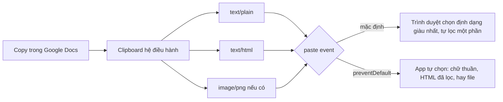

Clipboard là chỗ mà "chạy được trên máy mình" rất dễ lừa người viết. Nút "Copy link" chạy tốt trên Chrome máy bàn, nhưng trên iPhone không copy gì cả. Ô tiêu đề một dòng nhận một đoạn dán từ Google Docs và biến thành ba đoạn văn có chữ đậm. Editor không có nút "chèn ảnh" mà người dùng vẫn dán được ảnh vào, kèm theo một request tới máy chủ lạ.

Bốn đội gặp bốn phiên bản của cùng vấn đề và mỗi đội để lại một mẹo đáng học:

1. **Anchor**: copy chữ cho chắc trên mọi trình duyệt, kể cả iOS cũ.
2. **Trello**: bấm Ctrl+C khi đang chọn một thẻ là copy được thẻ đó, không cần bôi đen chữ nào. Ctrl+X rồi dán sang cột khác là **chuyển** thẻ.
3. **Pipedrive**: ô sửa nhanh một dòng chỉ nhận chữ thuần, mà Ctrl+Z vẫn hoàn tác được.
4. **Tribe**: editor chỉ giữ lại những định dạng mà thanh công cụ của nó hiển thị được.

> [!TIP]
> **Tóm tắt**
> - Copy: dùng `navigator.clipboard.writeText`, rơi về textarea ẩn + `execCommand('copy')`. Textarea phải có `font-size: 16px` để iOS không tự zoom, và phải chọn chữ bằng `Range` + `setSelectionRange`.
> - Trello "đánh lừa" phím tắt hệ điều hành: lúc bạn vừa nhấn Ctrl, nó tạo một `contenteditable` ẩn chứa URL của thẻ, focus và bôi đen sẵn. Phím C tới sau rơi đúng vào đó. Vùng ẩn trở nên rỗng nghĩa là vừa có Ctrl+X.
> - Dán chữ thuần: chặn `paste`, lấy `text/plain`, chèn bằng `execCommand('insertText')` để thao tác vẫn nằm trong lịch sử undo.
> - Dán HTML: dựng allowlist từ chính các nút trên thanh công cụ, rồi lọc. Đừng tin trình duyệt tự làm sạch: Chromium bỏ `onerror` nhưng vẫn giữ `` tải URL lạ.

<iframe class="demo-frame" src="/demos/web-patterns/index.html?theme=dark#/clipboard" title="Demo clipboard" loading="lazy" style="height: 1500px"></iframe>

<p class="demo-links">▶ <a href="/demos/web-patterns/index.html#/clipboard" target="_blank" rel="noopener">Mở demo toàn màn hình ↗</a> · <a href="https://stackblitz.com/github/hunghg255/blog-hunghg/tree/master/examples/web-patterns?file=src/lib/clipboardKit.ts" target="_blank" rel="noopener">Sửa code trên StackBlitz ↗</a> · <a href="https://github.com/hunghg255/blog-hunghg/blob/master/examples/web-patterns/src/lib/clipboardKit.ts" target="_blank" rel="noopener">Xem source trên GitHub ↗</a></p>

Thử trong demo: chọn thẻ "Thiết kế trang giá", nhấn <kbd>Ctrl</kbd>/<kbd>⌘</kbd>+<kbd>C</kbd>, bấm tiêu đề cột "Đang làm" rồi +<kbd>V</kbd>: thẻ được nhân bản. Làm lại với <kbd>X</kbd> thay cho <kbd>C</kbd>: thẻ được chuyển cột. Ở phần 3, bấm "Copy một đoạn HTML mẫu" rồi dán vào hai ô để thấy khác biệt.

## Anchor làm thế nào?

Trong [`anchor.fm/client/modules/Browser/index.ts`](https://github.com/hunghg255/codebase/blob/main/anchor.fm/client/modules/Browser/index.ts) có hàm `copyTextToClipboard` (đã gắn `@deprecated`, nhưng vẫn là ví dụ tốt về cách làm cũ):

```ts
const textArea = document.createElement('textarea');
textArea.style.position = 'fixed';
textArea.style.top = '0';
textArea.style.fontSize = '16px'; // prevent iOS zooming
// … width/height 2em, không viền, nền trong suốt
textArea.value = text;
document.body.appendChild(textArea);
if (ServerRenderingUtils.isIOS()) {
  range.selectNodeContents(textArea);
  s = window.getSelection();
}
if (s) {
  s.removeAllRanges();
  s.addRange(range);
  textArea.setSelectionRange(0, 999999);
} else {
  textArea.select();
}
document.execCommand('copy');
document.body.removeChild(textArea);
```

Ba chi tiết đáng giữ:

- **`position: fixed` ở góc trên trái**: phần tử nằm trong khung nhìn, focus vào nó không làm trang cuộn nhảy đi đâu.
- **`font-size: 16px`**: Safari trên iOS tự phóng to trang khi focus vào ô nhập có cỡ chữ nhỏ hơn 16px. Với một textarea chỉ tồn tại vài mili giây, cú zoom đó là lỗi giao diện thấy rõ.
- **Nhánh iOS**: trên iOS cũ, `textarea.select()` không chọn được chữ. Phải tạo `Range` bao nội dung, gắn vào `Selection`, rồi gọi `setSelectionRange(0, 999999)`.

Bản mới hơn nằm ở [`anchor.fm/client/utils.js`](https://github.com/hunghg255/codebase/blob/main/anchor.fm/client/utils.js) và chỉ còn một dòng: `await navigator.clipboard.writeText(text)`. Không có nhánh dự phòng nào. Trên trang http, hoặc khi trình duyệt từ chối quyền, lời gọi đó ném lỗi và nút copy im lặng không làm gì.

## Trello làm thế nào?

Trong Trello, bạn rê chuột hoặc dùng phím mũi tên để chọn một thẻ, nhấn Ctrl+C, rồi dán vào một cột khác: Trello tạo một bản sao của thẻ. Nhấn Ctrl+X rồi dán thì thẻ được **chuyển** đi. Không có chữ nào được bôi đen, và cũng không có menu chuột phải nào.

Mã nằm ở [`trello.com/app/scripts/lib/trello-clipboard.js`](https://github.com/hunghg255/codebase/blob/main/trello.com/app/scripts/lib/trello-clipboard.js), một file CoffeeScript đã chuyển sang JS bằng `bulk-decaffeinate`. Khi bạn chọn một thẻ, `board-state.js` gọi `trelloClipboard.set(card.getFullUrl())`, nghĩa là giá trị sẽ vào clipboard là **URL của thẻ**. Phần còn lại là cách để phím tắt của hệ điều hành copy đúng chuỗi đó:

```js
$(document).on('keydown', (e) => {
  // chỉ khi có gì để copy và người dùng đang bắt đầu một phím tắt
  if (!this.value || !(e.ctrlKey || e.metaKey)) return;
  if ($(e.target).is('#clipboard')) {
    if (key === Key.c) { this.clearCut(); showClipboardAlert('copy'); }
    return;
  }
  if ($(e.target).is('input:visible,textarea:visible')) return;
  // đang bôi đen chữ (có lẽ muốn copy một đoạn mô tả): để yên
  if (window.getSelection()?.toString()) return;

  return _.defer(() => {
    $('#clipboard-container').empty().show();
    $('<div id="clipboard" contenteditable="true"></div>')
      .text(this.value).appendTo('#clipboard-container').focus().select();
    selectElementContents(document.getElementById('clipboard'));
  });
});
```

Mẹo nằm ở **thời điểm**. Sự kiện `keydown` này chạy khi bạn vừa nhấn **Ctrl** (hoặc ⌘), lúc phím C chưa được nhấn. Trello tạo ngay một `div contenteditable` chứa URL của thẻ, focus vào nó và bôi đen toàn bộ. Khi phím C tới, focus đã ở trong vùng đó và có sẵn vùng chọn, nên trình duyệt làm lệnh copy **thật** của nó. Trello không cần gọi API clipboard nào, cũng không cần quyền gì.

Cut được nhận ra theo cách ngược lại:

```js
$(document).on('keyup', (e) => {
  if (this.isClipboard(e.target)) {
    if ($('#clipboard').text() === '') {
      // They must have used the cut shortcut
      this.setCut(this.value);
      showClipboardAlert('move');
    }
  }
  return this.checkForPastedImage();
});
```

Ctrl+X xoá phần chữ đang chọn trong `contenteditable`, nên vùng ẩn trở thành rỗng. `setCut` ghi URL vào `TrelloStorage` (bọc `localStorage`). Khi bạn dán một URL thẻ vào một cột, `list-view.js` hỏi `trelloClipboard.isCut(url)`: đúng thì chuyển thẻ, sai thì tạo bản sao. Dấu "cut" nằm trong `localStorage` nên dán ở **tab khác** vẫn được tính là chuyển. Sau sự kiện `paste` 1 giây, dấu đó bị xoá.

`checkForPastedImage` xử lý chiều còn lại. Nếu bạn nhấn Ctrl+V trong lúc vùng ẩn đang được focus, ảnh trong clipboard sẽ được dán vào `contenteditable` đó. Trello đợi 1ms, tìm `` trong vùng ẩn, và nếu `src` là `data:` URI thì đổi ra Blob để upload. Comment trong code ghi rõ chỉ Firefox cho `data:` URI; Safari lúc đó dùng giao thức `webkit-fake-url` không đọc được.

**Hai điểm đáng chú ý trong bản gốc:**

- **Mất focus.** Mỗi lần `keyup`, `checkForPastedImage` gọi `clear()` và xoá vùng ẩn. Phần tử đang được focus bị gỡ khỏi DOM nên focus rơi về `<body>`. Với người dùng bàn phím, vị trí đang đứng trên bảng bị mất sau mỗi lần nhấn Ctrl.
- **Mọi lần nhấn Ctrl đều kích hoạt.** Ctrl+F, Ctrl+L, Ctrl+cuộn để zoom đều tạo vùng ẩn và chuyển focus. Phần lớn trường hợp vô hại, nhưng có thể làm trình đọc màn hình đọc lên nội dung lạ (bản viết lại thêm `aria-hidden`).

## Pipedrive làm thế nào?

Pipedrive có một ô sửa nhanh một dòng (inline editor) dựng trên thư viện editor riêng `@pipedrive/pd-wysiwyg`. Plugin trong [`pipedrive.com(dashboard)/webpack---/client/shared/inline-editor/index.js`](<https://github.com/hunghg255/codebase/blob/main/pipedrive.com(dashboard)/webpack---/client/shared/inline-editor/index.js>) chỉ có vài dòng:

```js
onPaste(ev) {
  ev.stopPropagation();
  ev.preventDefault();
  document.execCommand('insertText', false, this.removeEmptySpaces(ev.clipboardData.getData('Text')));
  return false;
}

removeEmptySpaces(text) {
  const re = new RegExp(String.fromCharCode(160), 'g');
  return text.replace(/\r?\n|\r/g, ' ').replace(re, ' ');
}
```

- `getData('Text')` lấy bản chữ thuần. Clipboard thường chứa cùng nội dung ở nhiều định dạng (`text/html`, `text/plain`, có khi cả `image/png`), và mặc định trình duyệt chọn định dạng giàu nhất.
- Xuống dòng thành dấu cách, vì ô này chỉ có một dòng. Ký tự 160 (non-breaking space, NBSP) cũng thành dấu cách thường. Copy từ trang web hay Word rất hay mang theo NBSP, và chữ có NBSP thì không xuống dòng ở đó, tìm kiếm cũng không khớp.
- **`execCommand('insertText')`** thay vì tự sửa DOM. Lệnh này đã bị đánh dấu deprecated nhưng vẫn là cách duy nhất để thao tác chèn đi vào **lịch sử undo** của trình duyệt: dán xong, Ctrl+Z vẫn hoàn tác được. Tự gọi `range.insertNode()` thì Ctrl+Z không biết gì về lần dán đó.

Cùng file còn có `setContentDirection`: nếu nội dung chứa ký tự trong khoảng `֑-߿` (Hebrew, Ả Rập…) thì đặt `dir="rtl"`. Đây là một mẹo nhỏ đáng giữ cho ô nhập đa ngôn ngữ.

## Tribe làm thế nào?

Composer của Tribe dùng Quill. Module dán nằm ở [`tribeplatform.com/containers/Composer/modules/quill-clipboard/index.ts`](https://github.com/hunghg255/codebase/blob/main/tribeplatform.com/containers/Composer/modules/quill-clipboard/index.ts). Dòng đầu file ghi "Inlining npm library file": đây là thư viện npm (nhiều khả năng là `quill-paste-smart`) được chép vào repo, không phải code Tribe tự viết. Ý tưởng của nó vẫn đáng học:

```ts
// getAllowed(): không cấu hình sẵn thì suy ra từ thanh công cụ (rút gọn)
tidy.ALLOWED_TAGS = ['p', 'br', 'span']
this.quill.getModule('toolbar')?.controls?.forEach(control => {
  switch (control[0]) {
    case 'bold': tidy.ALLOWED_TAGS.push('b', 'strong'); break
    case 'link': tidy.ALLOWED_TAGS.push('a'); tidy.ALLOWED_ATTR.push('href', 'target', 'rel'); break
    case 'image': tidy.ALLOWED_TAGS.push('img'); tidy.ALLOWED_ATTR.push('src', 'title', 'alt'); break
    // italic, underline, header (đúng các mức có trong dropdown), list, code-block…
  }
})
```

**Allowlist được suy ra từ chính thanh công cụ.** Editor không có nút "chèn ảnh" thì `` không được giữ khi dán. Dropdown heading chỉ có H2 và H3 thì dán `<h1>` vào cũng không còn là `<h1>`. Nội dung sau khi dán luôn nằm trong tập định dạng mà người dùng tự tạo ra được bằng giao diện, và sửa lại được bằng chính giao diện đó.

Phần còn lại của `onPaste`:

- Nếu chữ trong clipboard là một URL và đang có chữ được bôi đen: biến đoạn chữ đó thành link (`delta.insert(selectedText, { link: text })`).
- Nếu là URL trần: bắn `CustomEvent(EmbedCreateEvent)` để module embed đề nghị nhúng video hoặc thẻ xem trước.
- Còn lại: `DOMPurify.sanitize(html, allowed)` rồi đổi sang Delta của Quill.

## Bên trong trình duyệt: clipboard có mấy "định dạng"?



Một lần copy đặt **nhiều** bản của cùng nội dung vào clipboard. Trong sự kiện `paste`, `event.clipboardData` cho phép đọc từng bản bằng `getData('text/plain')`, `getData('text/html')`, hoặc lấy file qua `clipboardData.files`. Nếu không `preventDefault()`, trình duyệt tự chọn định dạng giàu nhất mà phần tử đích chấp nhận được.

Trình duyệt **có** lọc một phần HTML khi dán vào `contenteditable`. Mình thử trên Chromium (tính tới 10/2026) với đoạn HTML mẫu trong demo:

- Bị bỏ: `<script>`, các thuộc tính `onclick`/`onerror`, `href="javascript:…"`.
- Vẫn giữ: các `style` inline, `` (đã đổi thành URL tuyệt đối và **tải ngay**), cùng toàn bộ cấu trúc `<p>`, `<ul>`.

Nghĩa là không có XSS, nhưng vẫn có request tới máy chủ lạ (một kiểu tracking pixel), và định dạng nằm ngoài kiểm soát của editor. Phần "Mặc định" ở mục 3 của demo hiển thị đúng HTML mà Chromium đã chèn.

Copy theo chiều ngược lại cũng có hai đường:

| | `navigator.clipboard.writeText` | `execCommand('copy')` |
|---|---|---|
| Điều kiện | Secure context (https, localhost); trong iframe cần permissions policy `clipboard-write` | Phải đang có vùng chọn; gần như luôn cần chạy trong một thao tác của người dùng |
| Kết quả | Promise, ném lỗi khi bị chặn | Trả `true`/`false` |
| Trạng thái | Chuẩn hiện tại | Deprecated nhưng mọi trình duyệt vẫn hỗ trợ |

## Viết lại

Cả bốn mẹo nằm trong một file `src/lib/clipboardKit.ts`. Hai phần đáng xem kỹ nhất là clipboard cho "đối tượng" kiểu Trello. Đây là đoạn `keydown`, chạy ngay khi nhấn Ctrl/⌘:

```ts title=src/lib/clipboardKit.ts
  const onKeyDown = (event: KeyboardEvent) => {
    if (!(event.ctrlKey || event.metaKey)) return;
    if (holder && event.target === holder) {
      if (event.key.toLowerCase() === 'c') onCopy?.(value);
      return;
    }
    if (holder) return;
    if (isTypingTarget(event.target)) return;
    // đang bôi đen một đoạn chữ: để người dùng copy đoạn đó như bình thường
    if (document.getSelection()?.toString()) return;
    const next = getValue();
    if (!next) return;

    value = next;
    cutReported = false;
    returnFocusTo = document.activeElement as HTMLElement | null;
    holder = document.createElement('div');
    holder.contentEditable = 'true';
    holder.setAttribute('aria-hidden', 'true');
    holder.dataset.objectClipboard = '';
    Object.assign(holder.style, { position: 'fixed', left: '-9999px', top: '0', opacity: '0' });
    holder.textContent = value;
    root.appendChild(holder);
    holder.focus({ preventScroll: true });
    const range = document.createRange();
    range.selectNodeContents(holder);
    const selection = document.getSelection();
    selection?.removeAllRanges();
    selection?.addRange(range);
  };
```

Và phần lọc HTML theo allowlist (đoạn duyệt cây):

```ts title=src/lib/clipboardKit.ts
export function sanitizeHtml(html: string, allow: Allowlist): string {
  const doc = new DOMParser().parseFromString(`<body>${html}</body>`, 'text/html');
  const out = document.createElement('div');

  const walk = (from: Node, to: Node) => {
    from.childNodes.forEach((child) => {
      if (child.nodeType === Node.TEXT_NODE) {
        to.appendChild(document.createTextNode(child.textContent ?? ''));
        return;
      }
      if (!(child instanceof Element)) return; // comment, processing instruction…
      let tag = child.tagName.toLowerCase();
      if (DROP_WITH_CONTENT.has(tag)) return;
      tag = styledTag(child, tag, allow);
      if (!allow.tags.has(tag)) {
        // thẻ lạ (span, div, font…): bỏ thẻ, giữ chữ bên trong
        walk(child, to);
        if (/^(div|p|li|h\d|tr)$/.test(tag)) to.appendChild(document.createElement('br'));
        return;
      }
      const clean = document.createElement(tag);
      for (const attr of Array.from(child.attributes)) {
        const name = attr.name.toLowerCase();
        if (!allow.attributes.has(name)) continue;
        if ((name === 'href' || name === 'src') && !SAFE_URL.test(attr.value.trim())) continue;
        clean.setAttribute(name, attr.value);
      }
      if (tag === 'a') {
        // href bị loại (javascript:…) thì thẻ <a> không còn ý nghĩa: giữ chữ, bỏ thẻ
        if (!clean.hasAttribute('href')) {
          walk(child, to);
          return;
        }
        clean.setAttribute('rel', 'noopener noreferrer');
      }
      walk(child, clean);
      to.appendChild(clean);
    });
  };

  walk(doc.body, out);
  return out.innerHTML;
}
```

`legacyCopy`/`copyText`, đoạn `keyup` nhận ra cut, và `pastePlainText` theo sát bản gốc của Anchor, Trello và Pipedrive; xem trong file đầy đủ.

::: spoiler Xem toàn bộ src/lib/clipboardKit.ts

```ts title=src/lib/clipboardKit.ts
/**
 * Bộ mẹo clipboard gom từ Trello, Anchor, Pipedrive và Tribe:
 * - copyText: Async Clipboard API, rơi về textarea ẩn + execCommand (kiểu Anchor, có xử lý iOS).
 * - installObjectClipboard: Ctrl/Cmd+C/X trên một "đối tượng" (thẻ, dòng…) mà không cần bôi đen chữ (kiểu Trello).
 * - pastePlainText: dán chữ thuần vào contenteditable mà vẫn giữ undo (kiểu Pipedrive).
 * - allowlistFromToolbar + sanitizeHtml: chỉ giữ thẻ mà editor hiển thị được (ý tưởng của Tribe / quill-paste-smart).
 */

// ---------- 1. Copy chữ ----------

export type CopyMethod = 'async-api' | 'exec-command' | 'failed';

/**
 * Copy bằng textarea tạm. Dùng khi không có navigator.clipboard (trang http, WebView cũ)
 * hoặc khi lời gọi không còn nằm trong "user activation" (Safari khắt khe chuyện này).
 */
export function legacyCopy(text: string): boolean {
  const previousFocus = document.activeElement as HTMLElement | null;
  const selection = document.getSelection();
  const previousRange = selection && selection.rangeCount > 0 ? selection.getRangeAt(0) : null;

  const textarea = document.createElement('textarea');
  textarea.value = text;
  // readonly: không bật bàn phím ảo trên mobile
  textarea.setAttribute('readonly', '');
  Object.assign(textarea.style, {
    position: 'fixed',
    top: '0',
    left: '0',
    width: '2em',
    height: '2em',
    padding: '0',
    border: 'none',
    outline: 'none',
    boxShadow: 'none',
    background: 'transparent',
    opacity: '0',
    // < 16px thì iOS Safari tự zoom khi focus vào ô nhập
    fontSize: '16px',
  });
  document.body.appendChild(textarea);

  // iOS cũ: select() không chọn được chữ trong textarea, phải tạo Range rồi setSelectionRange
  const range = document.createRange();
  range.selectNodeContents(textarea);
  selection?.removeAllRanges();
  selection?.addRange(range);
  textarea.select();
  textarea.setSelectionRange(0, text.length);

  let ok = false;
  try {
    ok = document.execCommand('copy');
  } catch {
    ok = false;
  }
  textarea.remove();

  // trả lại vùng chọn và focus cũ (bản của Anchor bỏ qua bước này)
  selection?.removeAllRanges();
  if (previousRange) selection?.addRange(previousRange);
  previousFocus?.focus?.({ preventScroll: true });
  return ok;
}

export async function copyText(text: string, { preferLegacy = false } = {}): Promise<CopyMethod> {
  if (!preferLegacy && navigator.clipboard?.writeText && window.isSecureContext) {
    try {
      await navigator.clipboard.writeText(text);
      return 'async-api';
    } catch {
      // bị chặn (thiếu quyền, iframe không có allow="clipboard-write"…): thử cách cũ
    }
  }
  return legacyCopy(text) ? 'exec-command' : 'failed';
}

// ---------- 2. Clipboard cho "đối tượng" (Trello) ----------

export interface ObjectClipboardOptions {
  /** chuỗi sẽ vào clipboard khi bấm Ctrl/Cmd+C, vd URL của thẻ đang chọn; null = không có gì để copy */
  getValue: () => string | null;
  onCopy?: (value: string) => void;
  onCut?: (value: string) => void;
  /** người dùng dán ảnh trong lúc đang giữ phím tắt (Ctrl+V vào vùng ẩn) */
  onPasteImage?: (file: File) => void;
  /** nơi gắn vùng ẩn, mặc định document.body */
  root?: HTMLElement;
}

const isTypingTarget = (el: EventTarget | null) =>
  el instanceof HTMLElement &&
  (el.isContentEditable || ['INPUT', 'TEXTAREA', 'SELECT'].includes(el.tagName));

/**
 * Ý tưởng của Trello: ngay khi người dùng nhấn Ctrl/Cmd (chưa kịp nhấn C), tạo một
 * contenteditable ẩn chứa giá trị, focus và bôi đen nó. Phím C tới sau rơi vào vùng đó,
 * trình duyệt tự làm phần copy thật. Ctrl+X làm vùng đó rỗng: đó là "cut".
 */
export function installObjectClipboard(options: ObjectClipboardOptions) {
  const { getValue, onCopy, onCut, onPasteImage, root = document.body } = options;
  let holder: HTMLDivElement | null = null;
  let value = '';
  let cutReported = false;
  let returnFocusTo: HTMLElement | null = null;

  const teardown = () => {
    if (!holder) return;
    const hadFocus = holder.contains(document.activeElement);
    holder.remove();
    holder = null;
    // Trello để focus rơi về <body>; trả về chỗ cũ để người dùng bàn phím không mất vị trí
    if (hadFocus) returnFocusTo?.focus({ preventScroll: true });
  };

  const onKeyDown = (event: KeyboardEvent) => {
    if (!(event.ctrlKey || event.metaKey)) return;
    if (holder && event.target === holder) {
      if (event.key.toLowerCase() === 'c') onCopy?.(value);
      return;
    }
    if (holder) return;
    if (isTypingTarget(event.target)) return;
    // đang bôi đen một đoạn chữ: để người dùng copy đoạn đó như bình thường
    if (document.getSelection()?.toString()) return;
    const next = getValue();
    if (!next) return;

    value = next;
    cutReported = false;
    returnFocusTo = document.activeElement as HTMLElement | null;
    holder = document.createElement('div');
    holder.contentEditable = 'true';
    holder.setAttribute('aria-hidden', 'true');
    holder.dataset.objectClipboard = '';
    Object.assign(holder.style, { position: 'fixed', left: '-9999px', top: '0', opacity: '0' });
    holder.textContent = value;
    root.appendChild(holder);
    holder.focus({ preventScroll: true });
    const range = document.createRange();
    range.selectNodeContents(holder);
    const selection = document.getSelection();
    selection?.removeAllRanges();
    selection?.addRange(range);
  };

  const onKeyUp = (event: KeyboardEvent) => {
    if (!holder) return;
    // Ctrl+X đã xoá chữ trong vùng ẩn. Chỉ báo một lần: nhả X rồi nhả Ctrl là hai lần keyup.
    if (holder.textContent === '' && !cutReported) {
      cutReported = true;
      onCut?.(value);
    }
    // nhả hết phím bổ trợ thì dọn; còn giữ Ctrl thì để người dùng bấm tiếp (Ctrl+C rồi Ctrl+V)
    if (!event.ctrlKey && !event.metaKey) teardown();
  };

  const onPaste = (event: ClipboardEvent) => {
    if (!holder || event.target !== holder) return;
    // Trello đợi ảnh hiện ra trong vùng ẩn rồi đọc data: URI (Firefox cũ). Ngày nay clipboardData.files là đủ.
    const file = Array.from(event.clipboardData?.files ?? []).find((f) => f.type.startsWith('image/'));
    event.preventDefault();
    if (file) onPasteImage?.(file);
  };

  const onBlur = () => teardown();

  document.addEventListener('keydown', onKeyDown, true);
  document.addEventListener('keyup', onKeyUp, true);
  document.addEventListener('paste', onPaste, true);
  window.addEventListener('blur', onBlur);
  return () => {
    teardown();
    document.removeEventListener('keydown', onKeyDown, true);
    document.removeEventListener('keyup', onKeyUp, true);
    document.removeEventListener('paste', onPaste, true);
    window.removeEventListener('blur', onBlur);
  };
}

/**
 * Trello lưu "đang cut cái gì" vào localStorage: dán ở tab khác cũng biết là chuyển (move) chứ không phải nhân bản.
 * Sau khi dán 1 giây thì xoá dấu cut.
 */
export const cutMarker = {
  key: 'object-clipboard:cut',
  set(value: string) {
    try {
      localStorage.setItem(this.key, value);
    } catch {
      /* chế độ riêng tư / storage đầy: coi như copy */
    }
  },
  isCut(value: string) {
    try {
      return localStorage.getItem(this.key) === value;
    } catch {
      return false;
    }
  },
  clear() {
    try {
      localStorage.removeItem(this.key);
    } catch {
      /* bỏ qua */
    }
  },
};

// ---------- 3. Dán chữ thuần (Pipedrive) ----------

/** Ô một dòng: xuống dòng thành dấu cách, NBSP (U+00A0) thành dấu cách thường. */
export function normalizeSingleLine(text: string): string {
  return text.replace(/\r\n?|\n/g, ' ').replace(/\u00a0/g, ' ');
}

/**
 * Gắn vào onPaste của một contenteditable. execCommand('insertText') đã bị đánh dấu deprecated
 * nhưng vẫn là cách duy nhất để thao tác dán nằm trong lịch sử undo (Ctrl+Z) của trình duyệt.
 */
export function pastePlainText(event: ClipboardEvent, transform: (text: string) => string = (t) => t): string {
  event.preventDefault();
  const text = transform(event.clipboardData?.getData('text/plain') ?? '');
  const inserted = document.queryCommandSupported?.('insertText') && document.execCommand('insertText', false, text);
  if (!inserted) {
    const selection = document.getSelection();
    if (selection && selection.rangeCount > 0) {
      const range = selection.getRangeAt(0);
      range.deleteContents();
      const node = document.createTextNode(text);
      range.insertNode(node);
      range.setStartAfter(node);
      range.collapse(true);
      selection.removeAllRanges();
      selection.addRange(range);
    }
  }
  return text;
}

// ---------- 4. Dán HTML có kiểm soát (Tribe) ----------

export type ToolbarFeature = 'bold' | 'italic' | 'underline' | 'strike' | 'link' | 'list' | 'header' | 'blockquote' | 'code-block' | 'image';

export interface Allowlist {
  tags: Set<string>;
  attributes: Set<string>;
}

const FEATURE_TAGS: Record<ToolbarFeature, { tags: string[]; attributes?: string[] }> = {
  bold: { tags: ['b', 'strong'] },
  italic: { tags: ['i', 'em'] },
  underline: { tags: ['u'] },
  strike: { tags: ['s'] },
  link: { tags: ['a'], attributes: ['href'] },
  list: { tags: ['ul', 'ol', 'li'] },
  header: { tags: ['h2', 'h3'] },
  blockquote: { tags: ['blockquote'] },
  'code-block': { tags: ['pre'] },
  image: { tags: ['img'], attributes: ['src', 'alt'] },
};

/** Thanh công cụ có nút nào thì mới cho thẻ tương ứng đi qua. Không có nút "link" thì dán vào cũng không có link. */
export function allowlistFromToolbar(features: ToolbarFeature[]): Allowlist {
  const tags = new Set(['p', 'br']);
  const attributes = new Set<string>();
  for (const feature of features) {
    FEATURE_TAGS[feature].tags.forEach((t) => tags.add(t));
    FEATURE_TAGS[feature].attributes?.forEach((a) => attributes.add(a));
  }
  return { tags, attributes };
}

// bỏ cả nội dung bên trong, không chỉ thẻ
const DROP_WITH_CONTENT = new Set(['script', 'style', 'template', 'noscript', 'iframe', 'object', 'embed', 'svg', 'math', 'head', 'title', 'meta', 'link']);
const SAFE_URL = /^(https?:|mailto:|tel:|#|\/(?!\/))/i;

/**
 * Google Docs, Word… không dùng <b>/<i> mà dùng <span style="font-weight:700">. Docs còn bọc cả
 * đoạn dán trong <b style="font-weight:normal">: lọc theo tên thẻ thì cả đoạn thành chữ đậm.
 * Đổi tên thẻ theo style thật trước khi so với allowlist.
 */
function styledTag(el: Element, tag: string, allow: Allowlist): string {
  const style = (el as HTMLElement).style;
  if (!style) return tag;
  const keyword: Record<string, number> = { normal: 400, bold: 700, bolder: 700, lighter: 300 };
  const weight = keyword[style.fontWeight] ?? Number(style.fontWeight || NaN);
  if ((tag === 'b' || tag === 'strong') && weight < 600) return 'span';
  if (tag !== 'span') return tag;
  if (weight >= 600 && allow.tags.has('strong')) return 'strong';
  if (style.fontStyle === 'italic' && allow.tags.has('em')) return 'em';
  if (style.textDecorationLine?.includes('underline') && allow.tags.has('u')) return 'u';
  return tag;
}

/**
 * Bộ lọc theo allowlist, dựng bằng DOMParser (tài liệu "trơ": script không chạy, ảnh không tải).
 * Đủ cho demo; production nên dùng DOMPurify hoặc Sanitizer API (`setHTML`) khi trình duyệt hỗ trợ.
 */
export function sanitizeHtml(html: string, allow: Allowlist): string {
  const doc = new DOMParser().parseFromString(`<body>${html}</body>`, 'text/html');
  const out = document.createElement('div');

  const walk = (from: Node, to: Node) => {
    from.childNodes.forEach((child) => {
      if (child.nodeType === Node.TEXT_NODE) {
        to.appendChild(document.createTextNode(child.textContent ?? ''));
        return;
      }
      if (!(child instanceof Element)) return; // comment, processing instruction…
      let tag = child.tagName.toLowerCase();
      if (DROP_WITH_CONTENT.has(tag)) return;
      tag = styledTag(child, tag, allow);
      if (!allow.tags.has(tag)) {
        // thẻ lạ (span, div, font…): bỏ thẻ, giữ chữ bên trong
        walk(child, to);
        if (/^(div|p|li|h\d|tr)$/.test(tag)) to.appendChild(document.createElement('br'));
        return;
      }
      const clean = document.createElement(tag);
      for (const attr of Array.from(child.attributes)) {
        const name = attr.name.toLowerCase();
        if (!allow.attributes.has(name)) continue;
        if ((name === 'href' || name === 'src') && !SAFE_URL.test(attr.value.trim())) continue;
        clean.setAttribute(name, attr.value);
      }
      if (tag === 'a') {
        // href bị loại (javascript:…) thì thẻ <a> không còn ý nghĩa: giữ chữ, bỏ thẻ
        if (!clean.hasAttribute('href')) {
          walk(child, to);
          return;
        }
        clean.setAttribute('rel', 'noopener noreferrer');
      }
      walk(child, clean);
      to.appendChild(clean);
    });
  };

  walk(doc.body, out);
  return out.innerHTML;
}

/** Chỉ nhận URL tuyệt đối http(s) không có khoảng trắng: đủ để quyết định "dán link". */
export function isHttpUrl(text: string): boolean {
  if (/\s/.test(text.trim())) return false;
  try {
    const url = new URL(text.trim());
    return url.protocol === 'http:' || url.protocol === 'https:';
  } catch {
    return false;
  }
}

export type SmartPasteResult =
  | { kind: 'link-on-selection'; url: string; text: string }
  | { kind: 'embed'; url: string }
  | { kind: 'html'; html: string }
  | { kind: 'text'; text: string };

/**
 * Quyết định dán thế nào (logic của Tribe, tách khỏi Quill):
 * dán URL khi đang bôi đen chữ -> biến chữ đó thành link; dán URL trần -> đề nghị embed;
 * có HTML -> lọc theo allowlist; còn lại -> chữ thuần.
 */
export function decideSmartPaste(data: { text: string; html: string }, selectedText: string, allow: Allowlist): SmartPasteResult {
  const text = data.text.trim();
  if (allow.tags.has('a') && isHttpUrl(text)) {
    return selectedText ? { kind: 'link-on-selection', url: text, text: selectedText } : { kind: 'embed', url: text };
  }
  if (data.html) return { kind: 'html', html: sanitizeHtml(data.html, allow) };
  return { kind: 'text', text: data.text };
}
```

:::

**Khác bản gốc:**

- `legacyCopy` trả lại vùng chọn và focus cũ sau khi copy. Bản của Anchor để focus nằm trên một textarea đã bị xoá.
- `installObjectClipboard` chỉ dọn vùng ẩn khi đã nhả hết phím bổ trợ, rồi trả focus về đúng phần tử trước đó. Trello xoá vùng ẩn sau mỗi lần `keyup`.
- Ảnh dán vào được lấy qua `clipboardData.files`, thay cho cách đợi `` có `data:` URI xuất hiện trong vùng ẩn.
- Bản viết lại không dùng DOMPurify (để demo không cần cài thêm gói). `sanitizeHtml` dựng bằng `DOMParser` và đủ cho demo; với production, mình vẫn khuyên dùng DOMPurify.
- Thêm bước `styledTag`: đổi `<span style="font-weight:700">` thành `<strong>`, và gỡ lớp `<b style="font-weight:normal">` mà Google Docs bọc quanh đoạn dán. Thiếu bước này, lọc theo tên thẻ sẽ biến cả đoạn thành chữ đậm khi editor cho phép `<b>`, hoặc làm mất hết chữ đậm khi không cho phép `<span>`.

## Đi qua code

**`legacyCopy`:**

- Ghi lại `document.activeElement` và `Range` hiện tại trước khi làm gì.
- Tạo textarea `readonly` (không bật bàn phím ảo), `opacity: 0`, `font-size: 16px`.
- Chọn chữ bằng cả ba cách: `Range` (iOS cũ), `select()`, và `setSelectionRange(0, text.length)` (dùng đúng độ dài chuỗi thay cho số ma thuật 999999).
- Gọi `execCommand('copy')` trong `try`, vì một số trình duyệt ném lỗi thay vì trả `false`.
- Gỡ textarea, rồi khôi phục vùng chọn và focus cũ.

**`copyText`** chỉ thử API mới khi `window.isSecureContext`. Nếu Promise bị từ chối (thiếu quyền, iframe không cho phép) thì vẫn còn đường dự phòng, thay vì im lặng như bản mới của Anchor.

**`installObjectClipboard`:**

- Lắng nghe ở **capture phase** để chạy trước các handler khác của app.
- Ba điều kiện giữ nguyên từ Trello:
  - không can thiệp khi đang gõ trong ô nhập;
  - không can thiệp khi đang có chữ được bôi đen;
  - không làm gì khi `getValue()` trả `null`.
- `cutReported` tồn tại vì trình tự Ctrl+X sinh **hai** lần `keyup` (nhả X, rồi nhả Ctrl), và vùng ẩn rỗng ở cả hai lần.
- Trên macOS, khi đang giữ ⌘ thì `keyup` của phím thường thường không được gửi; lần `keyup` của chính ⌘ vẫn tới, nên logic vẫn đúng.

**`cutMarker`** bọc `localStorage` trong `try/catch`: chế độ riêng tư của một số trình duyệt, hoặc storage đầy, sẽ ném lỗi khi ghi. Khi đó ta coi như copy.

**`pastePlainText`** nhận thêm một hàm `transform`. Ô một dòng truyền `normalizeSingleLine`, textarea nhiều dòng có thể bỏ qua. Nếu `insertText` không khả dụng, hàm rơi về `Range.insertNode` (mất undo, nhưng vẫn dán được).

**`sanitizeHtml`:**

- Duyệt cây do `DOMParser` tạo ra. Tài liệu này "trơ": script không chạy, ảnh không tải.
- Thẻ không nằm trong allowlist thì bị gỡ nhưng giữ lại chữ bên trong. Riêng các thẻ khối thì chèn thêm `<br>` để các dòng không dính vào nhau.
- `script`, `style`, `iframe`, `svg` thì bị bỏ cả nội dung.
- Thuộc tính `href`/`src` chỉ được giữ khi bắt đầu bằng `http(s):`, `mailto:`, `tel:`, `#` hoặc `/`. `<a>` mất `href` thì bị gỡ thẻ, chỉ giữ chữ.

## Tại sao không làm cách khác?

**Tại sao Trello không gọi `navigator.clipboard.writeText` trong `keydown` của Ctrl+C?** Có thể làm vậy: bắt `keydown` khi `key === 'c'`, gọi `preventDefault()` rồi tự ghi vào clipboard. Nhưng code này viết từ thời Async Clipboard API chưa có. Ngoài ra, cách của Trello để chính trình duyệt làm lệnh copy, nên:

- không cần quyền hay secure context;
- Ctrl+X tự động hoạt động, vì trình duyệt "xoá" phần chữ đã cut trong vùng ẩn;
- Ctrl+V vào vùng ẩn cho phép dán ảnh, ngay cả ở những trình duyệt chưa có `clipboardData.files`.

Ngày nay bạn có thể dùng sự kiện `copy`/`cut` trên `document` và ghi bằng `event.clipboardData.setData('text/plain', url)`. Cách đó gọn hơn và không phải chuyển focus. Điều kiện là phải có phần tử đang được focus mà trình duyệt chịu bắn sự kiện `copy` lên nó; trên trình duyệt hiện đại, `document.body` là đủ.

**Tại sao không dùng `contenteditable="plaintext-only"` cho ô một dòng?** Thuộc tính này làm trình duyệt tự dán chữ thuần, không cần JS. Nhưng nó không đổi xuống dòng thành dấu cách và không xử lý NBSP. Mức hỗ trợ cũng đến muộn ở một số trình duyệt, nên hãy xem [caniuse](https://caniuse.com/?search=plaintext-only) trước khi dùng.

**Tại sao không chỉ dựa vào việc trình duyệt tự lọc khi dán?** Như đã đo ở trên, Chromium bỏ phần nguy hiểm nhất nhưng vẫn giữ `` (tải ngay khi dán) và style inline. Mức lọc cũng khác nhau giữa các trình duyệt và không có đặc tả nào ràng buộc nó.

**Tại sao không lấy allowlist cố định?** Một allowlist chung kiểu "cho phép mọi định dạng cơ bản" vẫn để lọt `<h1>` vào một editor không có H1, hay `` vào ô bình luận không cho chèn ảnh. Suy ra allowlist từ thanh công cụ thì hai thứ luôn khớp nhau, và khi bạn thêm một nút mới, đoạn dán tự được phép dùng định dạng đó.

## Edge case và cạm bẫy

- **iframe:** `navigator.clipboard.writeText` trong một iframe khác origin cần iframe được khai báo `allow="clipboard-write"`. Iframe cùng origin (như demo trong bài này) mặc định được phép.
- **Mất "user activation":** Safari và Firefox chỉ cho ghi clipboard trong thời gian ngắn sau một thao tác của người dùng. Có `await fetch(...)` dài chen giữa cú click và `writeText` thì lời gọi có thể bị từ chối. Hãy chuẩn bị dữ liệu trước, hoặc truyền một `Promise<Blob>` vào `ClipboardItem` ngay trong cú click.
- **Ctrl hay ⌘:** kiểm tra cả `ctrlKey` lẫn `metaKey` như Trello. Trên macOS, Ctrl+C trong trình duyệt không phải lệnh copy, nhưng một số người dùng vẫn bấm nhầm, và cũng không sao.
- **Trình đọc màn hình:** vùng ẩn nhận focus nên có thể bị đọc lên. Hãy thêm `aria-hidden="true"` và trả focus về chỗ cũ ngay khi xong.
- **Dán URL có khoảng trắng hay xuống dòng:** `isHttpUrl` loại các chuỗi có khoảng trắng. Một đoạn văn có chứa link không bị coi là "dán link".
- **Google Docs:** ngoài lớp `<b style="font-weight:normal">`, Docs còn để `id="docs-internal-guid-…"` và rất nhiều `<span style>`. Allowlist không có `span` thì các thẻ này bị gỡ, chỉ giữ chữ.
- **`insertText` và React:** sửa nội dung `contenteditable` bằng `execCommand` không đi qua state của React. Hãy coi DOM là nguồn dữ liệu, rồi đọc lại trong `onInput`, như demo làm.

## Dùng trong dự án

```tsx
// 1. nút copy
<button onClick={async () => toast((await copyText(shareUrl)) === 'failed' ? 'Không copy được' : 'Đã copy')}>
  Copy link
</button>;

// 2. Ctrl+C/X trên một danh sách có phần tử đang chọn
useEffect(
  () =>
    installObjectClipboard({
      getValue: () => (selectedId ? itemUrl(selectedId) : null),
      onCut: (url) => cutMarker.set(url),
      onPasteImage: uploadImage,
    }),
  [selectedId],
);

// 3. ô một dòng
<div contentEditable onPaste={(e) => pastePlainText(e.nativeEvent, normalizeSingleLine)} />;

// 4. editor có thanh công cụ
const allow = allowlistFromToolbar(['bold', 'italic', 'link', 'list']);
editor.addEventListener('paste', (e) => {
  e.preventDefault();
  const result = decideSmartPaste({ text: e.clipboardData!.getData('text/plain'), html: e.clipboardData!.getData('text/html') }, getSelectedText(), allow);
  // chèn theo result.kind
});
```

Khi dùng thật, hãy thay `sanitizeHtml` bằng DOMPurify với `ALLOWED_TAGS`/`ALLOWED_ATTR` lấy từ `allowlistFromToolbar`, hoặc dùng Sanitizer API (`element.setHTML(html, { sanitizer })`) khi trình duyệt bạn nhắm tới đã hỗ trợ.

## Kiểm thử

::: spoiler Ví dụ test (bản phác, không có trong repo)

```ts
import { describe, expect, it } from 'vitest';
import { allowlistFromToolbar, decideSmartPaste, normalizeSingleLine, sanitizeHtml } from './clipboardKit';

describe('normalizeSingleLine', () => {
  it('đổi xuống dòng và NBSP thành dấu cách', () => {
    expect(normalizeSingleLine('a\r\nb\nc d')).toBe('a b c d');
  });
});

describe('sanitizeHtml', () => {
  const allow = allowlistFromToolbar(['bold', 'link']);

  it('bỏ script, handler và href javascript:', () => {
    const out = sanitizeHtml('<p onclick="x()">Hi<script>alert(1)</script> <a href="javascript:alert(1)">bad</a></p>', allow);
    expect(out).toBe('<p>Hi bad</p>');
  });

  it('không cho ảnh khi thanh công cụ không có nút ảnh', () => {
    expect(sanitizeHtml('ok', allow)).toBe('ok');
  });

  it('đổi span đậm của Google Docs thành strong, gỡ lớp <b style=normal>', () => {
    const html = '<b style="font-weight:normal"><span style="font-weight:700">Đậm</span> thường</b>';
    expect(sanitizeHtml(html, allow)).toBe('<strong>Đậm</strong> thường');
  });

  it('giữ link an toàn và thêm rel', () => {
    expect(sanitizeHtml('<a href="https://a.b" target="_blank">x</a>', allow)).toBe('<a href="https://a.b" rel="noopener noreferrer">x</a>');
  });
});

describe('decideSmartPaste', () => {
  const allow = allowlistFromToolbar(['link']);
  it('URL + có chữ đang chọn -> link', () => {
    expect(decideSmartPaste({ text: 'https://a.b', html: '' }, 'đây', allow)).toEqual({ kind: 'link-on-selection', url: 'https://a.b', text: 'đây' });
  });
  it('URL trần -> embed', () => {
    expect(decideSmartPaste({ text: 'https://a.b', html: '' }, '', allow).kind).toBe('embed');
  });
  it('editor không có nút link thì URL chỉ là chữ', () => {
    expect(decideSmartPaste({ text: 'https://a.b', html: '' }, '', allowlistFromToolbar([])).kind).toBe('text');
  });
});
```

`installObjectClipboard` khó test trong jsdom, vì jsdom không làm lệnh copy thật. Phần đó nên kiểm bằng Playwright: cấp quyền `clipboard-read`, nhấn `Control+C` và đọc lại `navigator.clipboard.readText()`. Demo trong bài đã được kiểm theo đúng cách này.

:::

## So với thư viện và chuẩn web

- **clipboard.js** (thư viện phổ biến cho nút copy) dùng đúng kỹ thuật textarea ẩn + `execCommand`, cũng đặt cỡ chữ `12pt` (= 16px) để iOS không zoom.
- **Async Clipboard API** (`navigator.clipboard.write` với `ClipboardItem`) ghi được cả `text/html` lẫn `image/png`. Đây là cách đúng cho mọi trường hợp mới; `execCommand` chỉ còn là đường dự phòng.
- **DOMPurify** là lựa chọn mặc định để lọc HTML phía client; Tribe dùng nó. **Sanitizer API** (`setHTML`) là chuẩn web đang được các trình duyệt đưa vào; hãy kiểm tra [caniuse](https://caniuse.com/?search=setHTML) trước khi bỏ thư viện.
- Các editor như Tiptap/ProseMirror, Lexical và Quill đều có tầng "paste rules" riêng. Ý tưởng "allowlist suy ra từ schema" chính là cách ProseMirror vận hành: nội dung dán được parse theo schema của editor, thứ gì schema không có thì bị bỏ.

---

Bài này thuộc series **[Học từ mã nguồn các web lớn](/series/web)** (65 bài, đọc theo thứ tự).

::: spoiler Xem nhanh danh sách bài trong series

*Mở đầu*

- [Mở đầu: đọc code production của 28 trang web](/blogs/learn-from-big-web-apps)

*Phần 1: trải nghiệm người dùng*

- [#1 Dark mode không nháy (Gatsby)](/blogs/web-dark-mode-no-flash)
- [#2 useValueByMedia: giá trị theo breakpoint (Toptal)](/blogs/web-use-value-by-media)
- [#3 Đoán ý định: idle, exit-intent, lắc chuột (Toptal, InVision)](/blogs/web-user-intent-idle-exit-wiggle)
- [#4 Validate form thân thiện (Udacity, Pipedrive)](/blogs/web-form-validation-ux)
- [#5 Magic number, EXIF và dán ảnh (Ello)](/blogs/web-file-magic-number-exif-paste)
- [#6 fastSmoothScroll: cuộn xa vẫn nhanh (Telegram)](/blogs/web-telegram-fast-smooth-scroll)
- [#7 Countdown time-travel và tombstone giỏ hàng (Best Buy)](/blogs/web-countdown-time-travel-tombstone)

*Phần 2: hiệu năng và đo lường*

- [#8 Hàng đợi requestAnimationFrame 3ms (Apple)](/blogs/web-raf-queue-3ms)
- [#9 srcset cho artwork và preconnect tự động (Apple)](/blogs/web-responsive-artwork-preconnect)
- [#10 Quick-fetch: gọi API trước khi bundle tải xong (HubSpot)](/blogs/web-quick-fetch-early-requests)
- [#11 Performance span và long task (Postman, Calibre)](/blogs/web-performance-spans-long-tasks)
- [#12 Gọi Web Worker như hàm async (Telegram)](/blogs/web-worker-promise-rpc)
- [#13 Đồng hồ media: đếm giờ xem và sửa lệch (Skillshare, Simplified)](/blogs/web-media-clock-watch-time-drift)

*Phần 3: nhiều tab, phiên đăng nhập, cập nhật*

- [#14 Bầu tab chủ cho thông báo (HubSpot, Telegram)](/blogs/web-leader-tab-notifications)
- [#15 Đồng bộ đăng nhập giữa tab và giới hạn cookie (Elastic, InVision)](/blogs/web-cross-tab-auth-cookie-guard)
- [#16 SPA tự cập nhật: Trello, Zappos, Facebook, Elastic](/blogs/web-spa-self-update-strategies)

*Phần 4: kiến trúc*

- [#17 Reverse portal: di chuyển component không remount (Zappos)](/blogs/web-reverse-portal)
- [#18 Page behaviors: gắn hành vi từ CMS (Intercom)](/blogs/web-page-behaviors-cms)
- [#19 Giới hạn tần suất hiển thị bằng bitmask (Outlook)](/blogs/web-frequency-cap-bitmask)
- [#20 Chuyển REST sang GraphQL dần dần (Coursera)](/blogs/web-rest-to-graphql-hybrid-link)

*Phần 5: soạn thảo và hiển thị nội dung*

- [#21 Autocomplete tại con trỏ trong contenteditable (Ello, Telegram)](/blogs/web-caret-autocomplete-contenteditable)
- [#22 Dark mode cho email HTML bằng CIELAB (Outlook)](/blogs/web-email-dark-mode-cielab)
- [#23 Thu nhỏ bảng rộng cho vừa khung, vá font emoji (Outlook)](/blogs/web-email-wide-content-scale)
- [#24 Cảnh báo quên đính kèm file (Outlook)](/blogs/web-forgotten-attachment-warning)
- [#25 Cắt chữ nhiều dòng chính xác (Pipedrive, Apple, Toptal)](/blogs/web-multiline-truncate-measure-text)
- [#26 Parse ngày giờ gõ tay khoan dung (Outlook, Elastic)](/blogs/web-lenient-date-parser)

*Phần 6: tương tác*

- [#27 menuAim: rê chéo vào submenu không bị đóng (Udemy)](/blogs/web-menu-aim-triangle)
- [#28 Kéo, vuốt chung cho chuột và cảm ứng (Telegram)](/blogs/web-unified-pointer-gestures)
- [#29 Phím tắt theo phạm vi, IME và bàn phím phi Latinh (Trello)](/blogs/web-scoped-keyboard-shortcuts)
- [#30 Nội suy màu: đổi theme và nền theo cuộn (Telegram, Anchor)](/blogs/web-color-interpolation-theme-scroll)
- [#31 Đường gióng hút cạnh và undo/redo trên canvas (Simplified)](/blogs/web-canvas-snap-guides-undo)
- [#32 Giả lập mù màu bằng feColorMatrix (Trello)](/blogs/web-color-vision-simulator)
- [#33 Vạch thước theo mức zoom và cấp phát màu cho biểu đồ (Anchor, Similarweb)](/blogs/web-timeline-ticks-color-stack)

*Phần 7: mạng, dữ liệu và async*

- [#34 Ô tìm kiếm chuẩn production (Similarweb, Udemy, Pipedrive)](/blogs/web-production-search-box)
- [#35 Điều phối async: latest-wins, single-flight (Glitch, Toptal)](/blogs/web-async-coordination-latest-wins)
- [#36 Polling thưa dần và debounce động (Trello)](/blogs/web-decaying-polling-dynamic-debounce)
- [#37 Cache phía client theo version (Similarweb, Telegram, Udemy)](/blogs/web-client-cache-versioned)
- [#38 Upload file lớn theo chunk (Outlook, Tribe)](/blogs/web-chunked-upload-pipeline)
- [#39 Phát video qua Service Worker bằng Range request (Telegram, Outlook)](/blogs/web-service-worker-range-streaming)

*Phần 8: hiệu năng và vận hành*

- [#40 TTI governor: hoãn việc phụ tới sau khi trang dùng được (Outlook)](/blogs/web-tti-governor)
- [#41 Tự đo LCP/CLS/TBT và phục vụ bản nhẹ cho máy yếu (Udemy)](/blogs/web-rum-adaptive-loading)

*Phần 9: thuật toán và dữ liệu phía client*

- [#42 Three-way merge ngay trên trình duyệt (Postman)](/blogs/web-three-way-merge-client)
- [#43 Dọn cache GraphQL bằng đếm tham chiếu (Outlook)](/blogs/web-graphql-cache-refcount-gc)
- [#44 LRU cache theo 3 cách (Apple, Similarweb, Outlook)](/blogs/web-lru-cache-three-ways)
- [#45 Lọc tăng dần trong Web Worker (Similarweb)](/blogs/web-incremental-filter-worker)
- [#46 Xếp hạng gợi ý trên client, so ngầm với server (Outlook)](/blogs/web-client-side-ranking-shadow-test)
- [#47 Nối OT với editor: undo stack và chặn echo (Glitch)](/blogs/web-ot-codemirror-undo)
- [#48 Ngôn ngữ markup riêng dịch hai chiều với HTML (Coursera)](/blogs/web-custom-markup-compiler)

*Phần 10: thời gian, ngôn ngữ, định dạng*

- [#49 Xử lý giờ mùa hè không cần thư viện (Udemy, Pipedrive)](/blogs/web-dst-without-library)
- [#50 Intl thực chiến: Segmenter, số rút gọn, số nhiều, fallback locale (Apple, Outlook)](/blogs/web-intl-in-production)
- [#51 WebVTT và bôi chọn transcript (Udemy, Coursera)](/blogs/web-webvtt-transcript-selection)

*Phần 11: tương tác và giao diện*

- [#52 Kéo-thả trên lịch (Pipedrive)](/blogs/web-calendar-drag-drop)
- [#53 Focus stack cho popup lồng nhau (Outlook)](/blogs/web-focus-stack-nested-popups)
- **#54 Clipboard: copy, dán chữ thuần, dán thông minh (Trello, Anchor, Pipedrive, Tribe)** (bài này)
- [#55 Khôi phục vị trí cuộn khi trang còn đang tải (Apple, Zappos)](/blogs/web-scroll-restore-wait-height)
- [#56 Lấy màu từ ảnh: gradient nền, màu chữ (Apple, Telegram, Trello)](/blogs/web-colors-from-images)
- [#57 JS đọc breakpoint từ CSS, phát hiện chế độ PWA (Ello, Apple)](/blogs/web-css-js-breakpoint-bridge)

*Phần 12: media*

- [#58 Tin nhắn thoại: ghi âm, waveform realtime, nén 5-bit (Telegram)](/blogs/web-voice-message-waveform)
- [#59 Chụp frame video thành ảnh, canvas bị taint (Coursera, Outlook)](/blogs/web-video-frame-snapshot)

*Phần 13: đo lường, bảo mật, vận hành*

- [#60 Đo lúc ảnh màn hình đầu tải xong, cả khi chuyển trang SPA (Zappos, Best Buy, Outlook)](/blogs/web-above-the-fold-image-timing)
- [#61 Buffer analytics chờ SDK, phát hiện adblock (Best Buy)](/blogs/web-analytics-buffer-adblock)
- [#62 Proof-of-work trên client để chặn API ẩn danh (Udemy)](/blogs/web-client-proof-of-work)
- [#63 Prefetch không làm lệch số liệu, nén cài đặt bằng bit (Outlook)](/blogs/web-synthetic-prefetch-bit-flags)
- [#64 Micro-frontend: AngularJS và React chung app, giao tiếp xuyên frame (Similarweb, InVision, HubSpot)](/blogs/web-micro-frontend-bridges)

:::

Code + demo: [`examples/web-patterns`](https://github.com/hunghg255/blog-hunghg/tree/master/examples/web-patterns) · [Mở trên StackBlitz](https://stackblitz.com/github/hunghg255/blog-hunghg/tree/master/examples/web-patterns)
