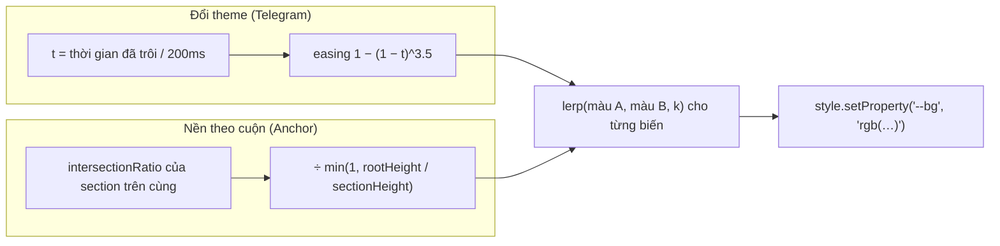

Hai hiệu ứng nhìn thì khác nhau, nhưng có chung một phép tính:

- **Đổi theme sáng/tối mượt.** Telegram Web không "nháy" từ trắng sang đen, mà cả giao diện chuyển màu dần trong 200ms. Theme được viết bằng biến CSS (`--color-background`, `--color-text`…), mà biến CSS thường **không transition được**: trình duyệt không biết `--color-background` là một màu, nên chỉ đổi giá trị một lần.
- **Nền trang đổi màu khi cuộn.** Trang giới thiệu của Anchor có mỗi section một màu nền. Khi cuộn từ section này sang section kế tiếp, nền chuyển dần từ màu này sang màu kia theo vị trí cuộn, không theo thời gian.

Cả hai đều là **nội suy tuyến tính** (lerp): `màu = a + (b − a) × t`. Khác nhau ở chỗ `t` lấy từ đâu: từ đồng hồ (theme) hay từ vị trí cuộn (nền).

> [!TIP]
> **Tóm tắt**
> - Biến CSS chưa đăng ký thì không transition được. Telegram tự lerp từng biến màu trong `requestAnimationFrame` (200ms, easing `1 − (1 − t)^3.5`) và tạm tắt mọi `transition` khác trong 500ms.
> - Anchor dùng IntersectionObserver với 101 ngưỡng (0; 0,01; … 1) và trộn màu section hiện tại với section kế tiếp theo `intersectionRatio`.
> - Section cao hơn khung nhìn không bao giờ đạt `intersectionRatio = 1`. Phải chia cho mức tối đa `rootHeight / sectionHeight`.
> - Ngày nay có cách khai báo hơn: `@property` để transition chính biến màu, `color-mix()` để trộn màu bằng CSS.

<iframe class="demo-frame" src="/demos/web-patterns/index.html?theme=dark#/color-lerp" title="Demo color-lerp" loading="lazy" style="height: 1180px"></iframe>

<p class="demo-links">▶ <a href="/demos/web-patterns/index.html#/color-lerp" target="_blank" rel="noopener">Mở demo toàn màn hình ↗</a> · <a href="https://stackblitz.com/github/hunghg255/blog-hunghg/tree/master/examples/web-patterns?file=src/lib/colorLerp.ts" target="_blank" rel="noopener">Sửa code trên StackBlitz ↗</a> · <a href="https://github.com/hunghg255/blog-hunghg/blob/master/examples/web-patterns/src/lib/colorLerp.ts" target="_blank" rel="noopener">Xem source trên GitHub ↗</a></p>

## Telegram làm thế nào?

File [`web.telegram.org/src/util/switchTheme.ts`](https://github.com/hunghg255/codebase/blob/main/web.telegram.org/src/util/switchTheme.ts), khoảng 100 dòng. Bảng màu nằm trong `themes.json` (không có trong bản dump): mỗi biến CSS là một cặp `[màu sáng, màu tối]` dạng hex. Khi module được nạp, mọi màu được đổi sẵn sang `{ r, g, b, a }`:

```ts
const colors = Object.keys(themeColors).map((property) => ({
  property,
  colors: [hexToRgb(themeColors[property][0]), hexToRgb(themeColors[property][1])],
}));
```

Hàm đổi theme làm bốn việc:

```ts
document.documentElement.classList.remove(`theme-${isDarkTheme ? 'light' : 'dark'}`);
if (isInitialized) document.documentElement.classList.add('no-animations');
document.documentElement.classList.add(`theme-${theme}`);
themeColorTag?.setAttribute('content', isDarkTheme ? '#212121' : '#fff');
setTimeout(() => document.documentElement.classList.remove('no-animations'), ENABLE_ANIMATION_DELAY_MS); // 500

if (shouldAnimate) {
  animateSingle(() => {
    const t = Math.min((Date.now() - startAt) / DURATION_MS, 1); // 200ms
    applyColorAnimationStep(startIndex, endIndex, transition(t));  // 1 - (1 - t) ** 3.5
    return t < 1;
  });
}
```

1. Đổi class `theme-light` / `theme-dark` trên `<html>` (cho những chỗ CSS phân nhánh theo theme).
2. Thêm class `no-animations` trong 500ms. CSS tương ứng là `.no-animations #root * { transition: none !important }`: mọi transition đang có trong app bị tắt, để nút, ô nhập… không tự chuyển màu với tốc độ riêng, lệch nhịp với animation chính.
3. Cập nhật `<meta name="theme-color">` để thanh địa chỉ trên mobile đổi màu theo.
4. Chạy animation: mỗi frame tính `t`, qua easing, rồi `applyColorAnimationStep` lerp **từng kênh** r, g, b (và a nếu có) của **từng biến**, gọi `document.documentElement.style.setProperty(property, 'rgb(...)')`.

`animateSingle` (trong `util/animation.ts`) là vòng rAF có chống chồng: gọi lần mới thì lần cũ bị đánh dấu `isCancelled`. Animation chỉ chạy khi người dùng để mức animation cao nhất (`animationLevel === ANIMATION_LEVEL_MAX`), các mức khác đổi màu ngay.

### Hai điểm chưa ổn

- **Bị ngắt giữa chừng thì nhảy màu.** Màu xuất phát luôn là `colors[startIndex]`, tức nguyên palette của theme cũ, không phải màu đang hiện trên màn hình. Bấm đổi theme hai lần liên tiếp trong 200ms: animation thứ hai bắt đầu lại từ màu "tối hoàn toàn", dù màn hình mới chuyển được nửa đường. Demo đo được bước nhảy lớn nhất giữa 2 frame là khoảng 300 (tổng chênh lệch r+g+b), so với khoảng 165 khi nối tiếp từ màu đang hiện.
- **Alpha có thể ra NaN.** `a` chỉ được lerp khi màu xuất phát có alpha; nếu màu đầu là `#rrggbbaa` mà màu cuối chỉ là `#rrggbb` thì `lerp(a, undefined)` ra `NaN`. Trong bảng màu thật của Telegram chắc các cặp luôn cùng định dạng, nên lỗi này có lẽ không xảy ra; nhưng bản viết lại vẫn mặc định alpha bằng 255.

## Anchor làm thế nào?

Hai component trong `anchor.fm/client/components/`:

- [`SectionPositionTracker/index.tsx`](https://github.com/hunghg255/codebase/blob/main/anchor.fm/client/components/SectionPositionTracker/index.tsx): bọc mỗi section bằng `<InView>` (thư viện `react-intersection-observer`) với `threshold = createRange(0, 1, 0.01)`, tức **101 ngưỡng**. Mỗi lần tỉ lệ hiện của section vượt qua một mốc 1%, callback được gọi.
- [`ColorShiftContainer/utils/getMixedColor.ts`](https://github.com/hunghg255/codebase/blob/main/anchor.fm/client/components/ColorShiftContainer/utils/getMixedColor.ts): lấy section **trên cùng** còn hiện, trộn màu của nó với màu section kế tiếp.

```ts
// For tall screens where the element doesn't fit and will never reach an intersection of 1
const maxIntersectionRatio = normalizeRatio(rootBounds!.height / boundingClientRect.height);
// ...
const ratio = normalizeRatio(intersectionRatio / maxIntersectionRatio);
const color = mixRbg(currentColor, nextColor, ratio); // ratio = tỉ lệ của currentColor
```

Dòng comment ở trên là chi tiết đáng học nhất. `intersectionRatio` là phần diện tích **của section** đang nằm trong khung nhìn. Section cao 620px trong khung 300px thì tối đa chỉ hiện được 300/620 ≈ 0,48. Không chuẩn hoá thì nền **không bao giờ** đạt đúng màu của section đó, luôn lẫn khoảng một nửa màu của section sau. Bật/tắt "Chuẩn hoá" trong demo để thấy.

Thêm hai mẹo nhỏ:

- `intersectionsToString()` biến danh sách giao cắt thành chuỗi `"0" + ratio + …` và chỉ `setState` khi chuỗi đổi. Lý do được ghi trong comment: entry có trường `time` luôn khác nhau, so object thì lần nào cũng "khác".
- `rootMargin="-96px 0px 0px 0px"`: trừ chiều cao header dính ở trên, để "hiện" nghĩa là hiện **dưới** header.

Có một điểm dễ vấp: `registerIntersection` tạo state mới từ biến `intersections` của **lần render trước**. Nếu hai section đổi trạng thái trong cùng một lượt callback (section 1 ra, section 2 vào) và React gộp hai lần `setState` (mặc định từ React 18), lần cập nhật sau có thể ghi đè lần trước. Bản viết lại không dùng state cho việc này, mà giữ entry mới nhất của từng section trong một `Map`.

## Bên trong trình duyệt

**Vì sao biến CSS không transition được?** Với trình duyệt, một biến chưa đăng ký chỉ là một chuỗi token. Đổi `--bg` từ `#fff` sang `#181818` là đổi chuỗi; trình duyệt không biết nội suy giữa hai chuỗi, nên chỉ đổi một lần. Những thuộc tính **dùng** biến (như `background-color: var(--bg)`) thì transition được, vì giá trị tính ra là một màu thật. Nhưng muốn vậy, **từng phần tử** phải khai báo `transition` cho **từng thuộc tính** dùng màu. Phần tử nào quên khai báo (viền, `fill` của SVG, gradient) sẽ đổi màu ngay. Gradient thì khó hơn nữa: `background-image` không transition giữa hai gradient khác màu.

Lerp bằng JS thì khác: ta đổi **chính biến** 60 lần mỗi giây, mọi thứ dùng biến đổi theo cùng một nhịp. Cái giá là mỗi frame thay đổi style của `<html>`, buộc trình duyệt tính lại style cho cả cây DOM. Với 200ms (khoảng 12 frame) thì chấp nhận được; vì thế Telegram giữ animation rất ngắn và chỉ bật ở mức animation cao nhất.

**Trộn trong không gian màu nào?** Lerp từng kênh r, g, b (sRGB) là cách đơn giản nhất, nhưng điểm giữa của hai màu bão hoà thường bị xám đục. OKLab là không gian màu "đều mắt": khoảng cách bằng nhau trong OKLab trông khác nhau bằng nhau. Demo có tuỳ chọn trộn bằng OKLab cho cả hai phần.



## Viết lại

Bộ chuyển theme (`createThemeAnimator`) giữ một `Map` tên `current` chứa màu đang hiện của từng biến, cập nhật mỗi frame qua hàm `apply`. Hàm `switchTo` lấy màu xuất phát từ đó, nên bị ngắt giữa chừng vẫn nối tiếp mượt:

```ts title=src/lib/colorLerp.ts
    switchTo(palette, { duration = 200, animate = true } = {}) {
      cancelAnimationFrame(frame);
      const plan = Object.entries(palette).map(([name, hex]) => ({
        name,
        from: current.get(name) ?? parseHex(hex),
        to: parseHex(hex),
      }));

      if (!animate || duration <= 0) {
        plan.forEach(({ name, to }) => apply(name, to));
        onFrame?.();
        return;
      }

      const start = performance.now();
      const step = (now: number) => {
        const t = Math.min(Math.max((now - start) / duration, 0), 1);
        const k = easing(t);
        plan.forEach(({ name, from, to }) => apply(name, mix(from, to, k)));
        onFrame?.();
        if (t < 1) frame = requestAnimationFrame(step);
      };
      frame = requestAnimationFrame(step);
    },
```

Phần nền theo cuộn: một observer cho mọi section, `Map` giữ entry mới nhất của từng section:

```ts title=src/lib/colorLerp.ts
export function visibleRatio(entry: Pick<IntersectionObserverEntry, 'intersectionRatio' | 'boundingClientRect' | 'rootBounds'>, normalize = true) {
  if (!normalize || !entry.rootBounds) return entry.intersectionRatio;
  const max = Math.min(1, entry.rootBounds.height / entry.boundingClientRect.height);
  return Math.max(0, Math.min(1, entry.intersectionRatio / max));
}
```

```ts title=src/lib/colorLerp.ts
  const parsed = colors.map(parseHex);
  const latest = new Map<number, IntersectionObserverEntry>();

  const observer = new IntersectionObserver(
    (entries) => {
      for (const entry of entries) {
        const index = sections.indexOf(entry.target);
        if (entry.isIntersecting) latest.set(index, entry);
        else latest.delete(index);
      }
      if (latest.size === 0) return;
      const index = Math.min(...latest.keys()); // section trên cùng còn hiện
      const ratio = visibleRatio(latest.get(index)!, normalize);
      const next = parsed[index + 1];
      // ratio = 1: section hiện trọn → đúng màu của nó; ratio giảm dần khi cuộn qua → nghiêng về màu kế tiếp
      const color = next ? mix(next, parsed[index], ratio) : parsed[index];
      onColor(color, { index, ratio });
    },
    { root, rootMargin, threshold: fineThresholds() },
  );

  sections.forEach((section) => observer.observe(section));
  return () => observer.disconnect();
}
```

::: spoiler Xem toàn bộ src/lib/colorLerp.ts

```ts title=src/lib/colorLerp.ts
/**
 * Nội suy màu bằng JS cho hai việc CSS transition làm không tốt:
 * 1. Đổi theme: mỗi màu là một biến CSS (--bg, --text…). Biến CSS thường không transition được,
 *    nên Telegram Web tự lerp từng biến trong requestAnimationFrame (src/util/switchTheme.ts).
 * 2. Nền đổi màu theo vị trí cuộn: Anchor trộn màu section hiện tại với section kế tiếp theo
 *    tỉ lệ đang hiện của section (ColorShiftContainer + SectionPositionTracker).
 */

export type Rgba = { r: number; g: number; b: number; a: number };

const HEX = /^#?([a-f\d]{2})([a-f\d]{2})([a-f\d]{2})([a-f\d]{2})?$/i;

export function parseHex(hex: string): Rgba {
  const m = HEX.exec(hex.trim());
  if (!m) throw new Error(`Không phải màu hex 6/8 ký tự: ${hex}`);
  return {
    r: parseInt(m[1], 16),
    g: parseInt(m[2], 16),
    b: parseInt(m[3], 16),
    // Telegram để alpha undefined khi không có; ở đây luôn có (255) để lerp giữa
    // "#rrggbb" và "#rrggbbaa" không ra NaN
    a: m[4] === undefined ? 255 : parseInt(m[4], 16),
  };
}

export const toCss = ({ r, g, b, a }: Rgba) =>
  a >= 255 ? `rgb(${Math.round(r)} ${Math.round(g)} ${Math.round(b)})` : `rgb(${Math.round(r)} ${Math.round(g)} ${Math.round(b)} / ${(a / 255).toFixed(3)})`;

export const lerp = (from: number, to: number, t: number) => from + (to - from) * t;

/** Trộn trong không gian sRGB, giống Telegram và Anchor. t = 0 → from, t = 1 → to. */
export function mixSrgb(from: Rgba, to: Rgba, t: number): Rgba {
  return { r: lerp(from.r, to.r, t), g: lerp(from.g, to.g, t), b: lerp(from.b, to.b, t), a: lerp(from.a, to.a, t) };
}

// ---- OKLab: trộn "đều mắt" hơn, ít bị xám đục ở giữa ----

const toLinear = (c: number) => {
  const v = c / 255;
  return v <= 0.04045 ? v / 12.92 : ((v + 0.055) / 1.055) ** 2.4;
};
const fromLinear = (v: number) => {
  const c = v <= 0.0031308 ? v * 12.92 : 1.055 * v ** (1 / 2.4) - 0.055;
  return Math.max(0, Math.min(255, c * 255));
};

function rgbToOklab({ r, g, b }: Rgba) {
  const [lr, lg, lb] = [toLinear(r), toLinear(g), toLinear(b)];
  const l = Math.cbrt(0.4122214708 * lr + 0.5363325363 * lg + 0.0514459929 * lb);
  const m = Math.cbrt(0.2119034982 * lr + 0.6806995451 * lg + 0.1073969566 * lb);
  const s = Math.cbrt(0.0883024619 * lr + 0.2817188376 * lg + 0.6299787005 * lb);
  return {
    L: 0.2104542553 * l + 0.793617785 * m - 0.0040720468 * s,
    A: 1.9779984951 * l - 2.428592205 * m + 0.4505937099 * s,
    B: 0.0259040371 * l + 0.7827717662 * m - 0.808675766 * s,
  };
}

function oklabToRgb(L: number, A: number, B: number) {
  const l = (L + 0.3963377774 * A + 0.2158037573 * B) ** 3;
  const m = (L - 0.1055613458 * A - 0.0638541728 * B) ** 3;
  const s = (L - 0.0894841775 * A - 1.291485548 * B) ** 3;
  return {
    r: fromLinear(4.0767416621 * l - 3.3077115913 * m + 0.2309699292 * s),
    g: fromLinear(-1.2684380046 * l + 2.6097574011 * m - 0.3413193965 * s),
    b: fromLinear(-0.0041960863 * l - 0.7034186147 * m + 1.707614701 * s),
  };
}

export function mixOklab(from: Rgba, to: Rgba, t: number): Rgba {
  const a = rgbToOklab(from);
  const b = rgbToOklab(to);
  const rgb = oklabToRgb(lerp(a.L, b.L, t), lerp(a.A, b.A, t), lerp(a.B, b.B, t));
  return { ...rgb, a: lerp(from.a, to.a, t) };
}

export type MixFn = typeof mixSrgb;

// ---- 1. Chuyển theme bằng cách lerp biến CSS ----

export type Palette = Record<string, string>; // { '--bg': '#ffffff', … }

/** Easing của Telegram: 1 − (1 − t)^3.5, nhanh lúc đầu rồi chậm dần. */
export const easeOut = (t: number) => 1 - (1 - t) ** 3.5;

export interface ThemeAnimator {
  /** Chuyển sang palette mới. Đang chạy dở thì xuất phát từ màu ĐANG HIỆN, không nhảy về đầu. */
  switchTo(palette: Palette, options?: { duration?: number; animate?: boolean }): void;
  cancel(): void;
}

export function createThemeAnimator(
  target: HTMLElement,
  initial: Palette,
  { mix = mixSrgb, easing = easeOut, onFrame }: { mix?: MixFn; easing?: (t: number) => number; onFrame?: () => void } = {},
): ThemeAnimator {
  // Màu đang hiện của từng biến (cập nhật mỗi frame) → bị ngắt giữa chừng vẫn nối tiếp mượt
  const current = new Map<string, Rgba>(Object.entries(initial).map(([name, hex]) => [name, parseHex(hex)]));
  let frame = 0;

  const apply = (name: string, color: Rgba) => {
    current.set(name, color);
    target.style.setProperty(name, toCss(color));
  };
  current.forEach((color, name) => apply(name, color));

  return {
    switchTo(palette, { duration = 200, animate = true } = {}) {
      cancelAnimationFrame(frame);
      const plan = Object.entries(palette).map(([name, hex]) => ({
        name,
        from: current.get(name) ?? parseHex(hex),
        to: parseHex(hex),
      }));

      if (!animate || duration <= 0) {
        plan.forEach(({ name, to }) => apply(name, to));
        onFrame?.();
        return;
      }

      const start = performance.now();
      const step = (now: number) => {
        const t = Math.min(Math.max((now - start) / duration, 0), 1);
        const k = easing(t);
        plan.forEach(({ name, from, to }) => apply(name, mix(from, to, k)));
        onFrame?.();
        if (t < 1) frame = requestAnimationFrame(step);
      };
      frame = requestAnimationFrame(step);
    },
    cancel() {
      cancelAnimationFrame(frame);
    },
  };
}

// ---- 2. Nền đổi màu theo vị trí cuộn ----

/**
 * Tỉ lệ "đã hiện" của một section, chuẩn hoá về [0, 1].
 * Section cao hơn vùng nhìn thấy không bao giờ đạt intersectionRatio = 1
 * (tối đa chỉ là rootHeight / sectionHeight), nên phải chia cho mức tối đa đó.
 */
export function visibleRatio(entry: Pick<IntersectionObserverEntry, 'intersectionRatio' | 'boundingClientRect' | 'rootBounds'>, normalize = true) {
  if (!normalize || !entry.rootBounds) return entry.intersectionRatio;
  const max = Math.min(1, entry.rootBounds.height / entry.boundingClientRect.height);
  return Math.max(0, Math.min(1, entry.intersectionRatio / max));
}

/** Mảng ngưỡng 0, 0.01, …, 1 để IntersectionObserver báo đủ dày khi cuộn. */
export const fineThresholds = (step = 0.01) => Array.from({ length: Math.round(1 / step) + 1 }, (_, i) => +(i * step).toFixed(4));

export interface ScrollColorOptions {
  root?: Element | null;
  /** chừa phần header dính phía trên, vd "-56px 0px 0px 0px" */
  rootMargin?: string;
  mix?: MixFn;
  /** false = bỏ bước chuẩn hoá (để thấy lỗi của section cao) */
  normalize?: boolean;
}

/**
 * Theo dõi danh sách section, gọi onColor với màu trộn giữa section trên cùng đang hiện và section kế tiếp.
 * Dùng MỘT observer cho mọi section và lưu entry mới nhất của từng section trong Map:
 * không phụ thuộc closure của lần render trước như bản React của Anchor.
 */
export function trackScrollColor(
  sections: Element[],
  colors: string[],
  onColor: (color: Rgba, info: { index: number; ratio: number }) => void,
  { root = null, rootMargin = '0px', mix = mixSrgb, normalize = true }: ScrollColorOptions = {},
) {
  const parsed = colors.map(parseHex);
  const latest = new Map<number, IntersectionObserverEntry>();

  const observer = new IntersectionObserver(
    (entries) => {
      for (const entry of entries) {
        const index = sections.indexOf(entry.target);
        if (entry.isIntersecting) latest.set(index, entry);
        else latest.delete(index);
      }
      if (latest.size === 0) return;
      const index = Math.min(...latest.keys()); // section trên cùng còn hiện
      const ratio = visibleRatio(latest.get(index)!, normalize);
      const next = parsed[index + 1];
      // ratio = 1: section hiện trọn → đúng màu của nó; ratio giảm dần khi cuộn qua → nghiêng về màu kế tiếp
      const color = next ? mix(next, parsed[index], ratio) : parsed[index];
      onColor(color, { index, ratio });
    },
    { root, rootMargin, threshold: fineThresholds() },
  );

  sections.forEach((section) => observer.observe(section));
  return () => observer.disconnect();
}
```

:::

## Đi qua code

- **`parseHex`** luôn trả alpha (mặc định 255), nên lerp giữa màu có và không có alpha không ra `NaN`.
- **`createThemeAnimator`** nhận phần tử đích. Telegram dùng `document.documentElement`; demo dùng một khung chat để không đổi màu cả trang.
- **`switchTo`** huỷ frame đang chờ, rồi lập "kế hoạch": với mỗi biến, `from` là màu đang hiện, `to` là màu đích. Không có trong `current` (biến mới) thì đổi ngay.
- Thời gian lấy từ tham số `now` của rAF thay vì `Date.now()`. Mọi animation trong cùng frame dùng chung một mốc thời gian, và đồng hồ không bị ảnh hưởng khi người dùng chỉnh giờ hệ thống.
- **`visibleRatio`** là phép chuẩn hoá của Anchor. Có tham số `normalize` để demo tắt đi.
- **`trackScrollColor`**: `Math.min(...latest.keys())` chọn section có chỉ số nhỏ nhất còn hiện, tức section trên cùng. `mix(next, current, ratio)`: `ratio = 1` cho đúng màu section hiện tại, giảm dần về 0 thì nghiêng hẳn về màu section sau.

**Khác bản gốc:** bị ngắt thì nối tiếp từ màu đang hiện (Telegram bắt đầu lại từ palette cũ); có thêm trộn OKLab; không dùng React state cho danh sách giao cắt (Anchor có thể bị ghi đè khi hai section đổi cùng lúc); hàm thuần không phụ thuộc React, gọi được từ bất kỳ đâu.

## Tại sao không làm cách khác?

**Transition `background-color`, `color` trên từng phần tử?** Đó là lựa chọn "CSS transition từng thuộc tính" trong demo. Được, nhưng phải khai báo ở mọi nơi dùng màu, và những thứ không khai báo hoặc không transition được (gradient của bong bóng tin nhắn, viền, icon SVG) vẫn nhảy. Mỗi phần tử còn transition độc lập, nên phần tử vừa mount trong lúc chuyển sẽ bắt đầu animation muộn hơn.

**`@property` rồi transition chính biến?** Đây là cách hiện đại nhất: đăng ký `--c-bg` là `<color>`, trình duyệt sẽ nội suy được biến, và một dòng `transition: --c-bg .2s` trên phần tử gốc là đủ. Demo có lựa chọn này. Lưu ý: mỗi biến phải được đăng ký riêng (Telegram có hàng chục biến màu), và trộn theo cách của trình duyệt, không tự chọn easing hay không gian màu cho từng biến được. `@property` có trên Chrome, Edge, Safari và Firefox bản mới (tính tới 10/2026); xem [caniuse](https://caniuse.com/mdn-css_at-rules_property) nếu cần hỗ trợ bản cũ.

**View Transitions API?** `document.startViewTransition(() => đổiTheme())` chụp ảnh trang cũ, đổi theme, rồi crossfade (hoặc hiệu ứng vòng tròn lan ra mà nhiều trang dùng). Đẹp và ít code, nhưng là hiệu ứng trên **ảnh chụp**: trong lúc chuyển, trang thật nằm dưới lớp ảnh chụp nên không nhận click, và đó là crossfade giữa hai ảnh chứ không phải từng màu chuyển dần. Xem [caniuse](https://caniuse.com/view-transitions) cho mức hỗ trợ.

**Nền theo cuộn bằng sự kiện `scroll`?** Được, nhưng phải tự gọi `getBoundingClientRect()` cho từng section mỗi lần cuộn. IntersectionObserver để trình duyệt tự tính giao cắt trong bước render, chỉ gọi callback khi vượt một ngưỡng, và ta không phải đọc layout (vốn có thể buộc trình duyệt tính lại layout) trong mỗi sự kiện cuộn.

**Scroll-driven animations (`animation-timeline: view()`)?** Hoàn toàn bằng CSS, chạy trên compositor. Đây là hướng đi tương lai cho hiệu ứng kiểu này, nhưng chưa có ở mọi trình duyệt (tính tới 10/2026, xem [caniuse](https://caniuse.com/css-scroll-timeline)). Hướng JS ở trên là bản dự phòng chạy ở mọi nơi.

## Edge case và cạm bẫy

- **`prefers-reduced-motion`**: người dùng bật giảm chuyển động thì nên đổi theme ngay (`animate: false`). Telegram có cài đặt mức animation riêng; trang thường thì đọc media query.
- **Phần tử có transition sẵn**: một nút có `transition: background .3s` sẽ chuyển màu chậm hơn phần còn lại. Telegram tắt bằng `.no-animations`; nếu tự làm, nhớ bỏ class sau khi xong (Telegram dùng 500ms, dài hơn 200ms animation để chắc chắn).
- **Biến màu dạng kênh RGB**: Telegram có biến như `--color-primary-rgb: 80, 162, 233` để dùng trong `rgba(var(--x), 0.5)`. Lerp kiểu trên không áp được cho dạng này nếu không parse riêng.
- **Section rất ngắn**: section thấp hơn khoảng cách giữa hai ngưỡng có thể "nhảy" qua vài mốc trong một frame cuộn nhanh. Màu vẫn đúng ở callback kế tiếp, chỉ kém mượt.
- **`rootBounds` có thể là `null`**: với observer không có `root` (dùng viewport) trong iframe khác origin, `rootBounds` là `null`. `visibleRatio` khi đó trả nguyên `intersectionRatio`.
- **Chi phí tính lại style**: đổi biến trên `<html>` làm mọi phần tử tính lại style. Với cây DOM rất lớn, có thể chỉ đổi biến trên vùng cần thiết, hoặc giữ thời gian animation ngắn.

## Dùng trong dự án

```ts
const animator = createThemeAnimator(document.documentElement, themes.light, { mix: mixOklab });
const reduce = matchMedia('(prefers-reduced-motion: reduce)');

function setTheme(name: 'light' | 'dark') {
  document.documentElement.dataset.theme = name; // cho các selector CSS khác
  animator.switchTo(themes[name], { animate: !reduce.matches });
}

// Nền trang landing đổi màu theo section, trừ header dính 64px
const sections = [...document.querySelectorAll<HTMLElement>('[data-bg]')];
trackScrollColor(sections, sections.map((s) => s.dataset.bg!),
  (c) => (document.body.style.backgroundColor = toCss(c)), { rootMargin: '-64px 0px 0px 0px' });
```

Nếu chỉ cần hỗ trợ trình duyệt mới và không cần kiểm soát từng frame, hãy thử `@property` trước: ít code hơn, không tốn JS mỗi frame.

## Kiểm thử

::: spoiler Ví dụ test (bản phác, không có trong repo)

```ts
import { describe, expect, it, vi } from 'vitest';
import { createThemeAnimator, mixOklab, mixSrgb, parseHex, visibleRatio } from './colorLerp';

describe('mix', () => {
  it('t = 0 và t = 1 trả về đúng hai đầu', () => {
    const a = parseHex('#ff0000');
    const b = parseHex('#0000ff');
    expect(mixSrgb(a, b, 0)).toEqual(a);
    expect(mixSrgb(a, b, 1)).toEqual(b);
    const m = mixOklab(a, b, 1);
    expect(Math.round(m.b)).toBe(255);
  });
  it('alpha mặc định 255, không ra NaN', () => {
    expect(mixSrgb(parseHex('#00000080'), parseHex('#ffffff'), 0.5).a).toBeCloseTo((128 + 255) / 2);
  });
});

describe('visibleRatio', () => {
  const entry = (ratio: number, rootH: number, h: number) => ({
    intersectionRatio: ratio,
    rootBounds: { height: rootH } as DOMRectReadOnly,
    boundingClientRect: { height: h } as DOMRectReadOnly,
  });
  it('section cao gấp đôi khung: 0.5 được coi là hiện trọn', () => {
    expect(visibleRatio(entry(0.5, 300, 600))).toBe(1);
    expect(visibleRatio(entry(0.5, 300, 600), false)).toBe(0.5);
  });
  it('section thấp hơn khung: giữ nguyên', () => {
    expect(visibleRatio(entry(0.3, 300, 200))).toBeCloseTo(0.3);
  });
});

describe('createThemeAnimator', () => {
  it('bị ngắt thì nối tiếp từ màu đang hiện', () => {
    let now = 0;
    const frames: FrameRequestCallback[] = [];
    vi.stubGlobal('requestAnimationFrame', (cb: FrameRequestCallback) => frames.push(cb));
    vi.stubGlobal('cancelAnimationFrame', () => frames.splice(0));
    vi.spyOn(performance, 'now').mockImplementation(() => now);
    const tick = (t: number) => { now = t; frames.splice(0).forEach((cb) => cb(t)); };

    const el = document.createElement('div');
    const anim = createThemeAnimator(el, { '--bg': '#000000' }, { easing: (t) => t });
    anim.switchTo({ '--bg': '#ffffff' }, { duration: 100 });
    tick(50); // đi được nửa đường
    expect(el.style.getPropertyValue('--bg')).toBe('rgb(128 128 128)');
    anim.switchTo({ '--bg': '#000000' }, { duration: 100 });
    tick(50); // frame đầu của animation mới: chưa nhảy về trắng hay đen
    expect(el.style.getPropertyValue('--bg')).toBe('rgb(128 128 128)');
    tick(100);
    expect(el.style.getPropertyValue('--bg')).toBe('rgb(64 64 64)');
  });
});
```

:::

## So với thư viện và chuẩn web

- **`color-mix(in oklab, a 30%, b)`** trộn màu ngay trong CSS và có trên mọi trình duyệt hiện đại (tính tới 10/2026). Có thể đẩy tỉ lệ cuộn vào một biến số (`--p: 0.3`) rồi để CSS trộn: `background: color-mix(in oklab, var(--next) calc(var(--p) * 100%), var(--current))`. Biến số đổi thì JS vẫn phải cập nhật, nhưng phần tính màu nằm trong CSS.
- **`@property`** (CSS Properties and Values API): đăng ký kiểu cho biến để transition/animation được chính biến đó.
- **Thư viện animation** như Motion (Framer Motion), GSAP đều tween được biến CSS và màu; bản tự viết ở trên chỉ khoảng 50 dòng cho đúng một việc.
- **IntersectionObserver** với mảng ngưỡng dày là cách phổ biến để có "tỉ lệ cuộn" của từng phần tử mà không cần sự kiện `scroll`.

---

Bài này thuộc series **[Học từ mã nguồn các web lớn](/series/web)** (65 bài, đọc theo thứ tự).

::: spoiler Xem nhanh danh sách bài trong series

*Mở đầu*

- [Mở đầu: đọc code production của 28 trang web](/blogs/learn-from-big-web-apps)

*Phần 1: trải nghiệm người dùng*

- [#1 Dark mode không nháy (Gatsby)](/blogs/web-dark-mode-no-flash)
- [#2 useValueByMedia: giá trị theo breakpoint (Toptal)](/blogs/web-use-value-by-media)
- [#3 Đoán ý định: idle, exit-intent, lắc chuột (Toptal, InVision)](/blogs/web-user-intent-idle-exit-wiggle)
- [#4 Validate form thân thiện (Udacity, Pipedrive)](/blogs/web-form-validation-ux)
- [#5 Magic number, EXIF và dán ảnh (Ello)](/blogs/web-file-magic-number-exif-paste)
- [#6 fastSmoothScroll: cuộn xa vẫn nhanh (Telegram)](/blogs/web-telegram-fast-smooth-scroll)
- [#7 Countdown time-travel và tombstone giỏ hàng (Best Buy)](/blogs/web-countdown-time-travel-tombstone)

*Phần 2: hiệu năng và đo lường*

- [#8 Hàng đợi requestAnimationFrame 3ms (Apple)](/blogs/web-raf-queue-3ms)
- [#9 srcset cho artwork và preconnect tự động (Apple)](/blogs/web-responsive-artwork-preconnect)
- [#10 Quick-fetch: gọi API trước khi bundle tải xong (HubSpot)](/blogs/web-quick-fetch-early-requests)
- [#11 Performance span và long task (Postman, Calibre)](/blogs/web-performance-spans-long-tasks)
- [#12 Gọi Web Worker như hàm async (Telegram)](/blogs/web-worker-promise-rpc)
- [#13 Đồng hồ media: đếm giờ xem và sửa lệch (Skillshare, Simplified)](/blogs/web-media-clock-watch-time-drift)

*Phần 3: nhiều tab, phiên đăng nhập, cập nhật*

- [#14 Bầu tab chủ cho thông báo (HubSpot, Telegram)](/blogs/web-leader-tab-notifications)
- [#15 Đồng bộ đăng nhập giữa tab và giới hạn cookie (Elastic, InVision)](/blogs/web-cross-tab-auth-cookie-guard)
- [#16 SPA tự cập nhật: Trello, Zappos, Facebook, Elastic](/blogs/web-spa-self-update-strategies)

*Phần 4: kiến trúc*

- [#17 Reverse portal: di chuyển component không remount (Zappos)](/blogs/web-reverse-portal)
- [#18 Page behaviors: gắn hành vi từ CMS (Intercom)](/blogs/web-page-behaviors-cms)
- [#19 Giới hạn tần suất hiển thị bằng bitmask (Outlook)](/blogs/web-frequency-cap-bitmask)
- [#20 Chuyển REST sang GraphQL dần dần (Coursera)](/blogs/web-rest-to-graphql-hybrid-link)

*Phần 5: soạn thảo và hiển thị nội dung*

- [#21 Autocomplete tại con trỏ trong contenteditable (Ello, Telegram)](/blogs/web-caret-autocomplete-contenteditable)
- [#22 Dark mode cho email HTML bằng CIELAB (Outlook)](/blogs/web-email-dark-mode-cielab)
- [#23 Thu nhỏ bảng rộng cho vừa khung, vá font emoji (Outlook)](/blogs/web-email-wide-content-scale)
- [#24 Cảnh báo quên đính kèm file (Outlook)](/blogs/web-forgotten-attachment-warning)
- [#25 Cắt chữ nhiều dòng chính xác (Pipedrive, Apple, Toptal)](/blogs/web-multiline-truncate-measure-text)
- [#26 Parse ngày giờ gõ tay khoan dung (Outlook, Elastic)](/blogs/web-lenient-date-parser)

*Phần 6: tương tác*

- [#27 menuAim: rê chéo vào submenu không bị đóng (Udemy)](/blogs/web-menu-aim-triangle)
- [#28 Kéo, vuốt chung cho chuột và cảm ứng (Telegram)](/blogs/web-unified-pointer-gestures)
- [#29 Phím tắt theo phạm vi, IME và bàn phím phi Latinh (Trello)](/blogs/web-scoped-keyboard-shortcuts)
- **#30 Nội suy màu: đổi theme và nền theo cuộn (Telegram, Anchor)** (bài này)
- [#31 Đường gióng hút cạnh và undo/redo trên canvas (Simplified)](/blogs/web-canvas-snap-guides-undo)
- [#32 Giả lập mù màu bằng feColorMatrix (Trello)](/blogs/web-color-vision-simulator)
- [#33 Vạch thước theo mức zoom và cấp phát màu cho biểu đồ (Anchor, Similarweb)](/blogs/web-timeline-ticks-color-stack)

*Phần 7: mạng, dữ liệu và async*

- [#34 Ô tìm kiếm chuẩn production (Similarweb, Udemy, Pipedrive)](/blogs/web-production-search-box)
- [#35 Điều phối async: latest-wins, single-flight (Glitch, Toptal)](/blogs/web-async-coordination-latest-wins)
- [#36 Polling thưa dần và debounce động (Trello)](/blogs/web-decaying-polling-dynamic-debounce)
- [#37 Cache phía client theo version (Similarweb, Telegram, Udemy)](/blogs/web-client-cache-versioned)
- [#38 Upload file lớn theo chunk (Outlook, Tribe)](/blogs/web-chunked-upload-pipeline)
- [#39 Phát video qua Service Worker bằng Range request (Telegram, Outlook)](/blogs/web-service-worker-range-streaming)

*Phần 8: hiệu năng và vận hành*

- [#40 TTI governor: hoãn việc phụ tới sau khi trang dùng được (Outlook)](/blogs/web-tti-governor)
- [#41 Tự đo LCP/CLS/TBT và phục vụ bản nhẹ cho máy yếu (Udemy)](/blogs/web-rum-adaptive-loading)

*Phần 9: thuật toán và dữ liệu phía client*

- [#42 Three-way merge ngay trên trình duyệt (Postman)](/blogs/web-three-way-merge-client)
- [#43 Dọn cache GraphQL bằng đếm tham chiếu (Outlook)](/blogs/web-graphql-cache-refcount-gc)
- [#44 LRU cache theo 3 cách (Apple, Similarweb, Outlook)](/blogs/web-lru-cache-three-ways)
- [#45 Lọc tăng dần trong Web Worker (Similarweb)](/blogs/web-incremental-filter-worker)
- [#46 Xếp hạng gợi ý trên client, so ngầm với server (Outlook)](/blogs/web-client-side-ranking-shadow-test)
- [#47 Nối OT với editor: undo stack và chặn echo (Glitch)](/blogs/web-ot-codemirror-undo)
- [#48 Ngôn ngữ markup riêng dịch hai chiều với HTML (Coursera)](/blogs/web-custom-markup-compiler)

*Phần 10: thời gian, ngôn ngữ, định dạng*

- [#49 Xử lý giờ mùa hè không cần thư viện (Udemy, Pipedrive)](/blogs/web-dst-without-library)
- [#50 Intl thực chiến: Segmenter, số rút gọn, số nhiều, fallback locale (Apple, Outlook)](/blogs/web-intl-in-production)
- [#51 WebVTT và bôi chọn transcript (Udemy, Coursera)](/blogs/web-webvtt-transcript-selection)

*Phần 11: tương tác và giao diện*

- [#52 Kéo-thả trên lịch (Pipedrive)](/blogs/web-calendar-drag-drop)
- [#53 Focus stack cho popup lồng nhau (Outlook)](/blogs/web-focus-stack-nested-popups)
- [#54 Clipboard: copy, dán chữ thuần, dán thông minh (Trello, Anchor, Pipedrive, Tribe)](/blogs/web-clipboard-tricks)
- [#55 Khôi phục vị trí cuộn khi trang còn đang tải (Apple, Zappos)](/blogs/web-scroll-restore-wait-height)
- [#56 Lấy màu từ ảnh: gradient nền, màu chữ (Apple, Telegram, Trello)](/blogs/web-colors-from-images)
- [#57 JS đọc breakpoint từ CSS, phát hiện chế độ PWA (Ello, Apple)](/blogs/web-css-js-breakpoint-bridge)

*Phần 12: media*

- [#58 Tin nhắn thoại: ghi âm, waveform realtime, nén 5-bit (Telegram)](/blogs/web-voice-message-waveform)
- [#59 Chụp frame video thành ảnh, canvas bị taint (Coursera, Outlook)](/blogs/web-video-frame-snapshot)

*Phần 13: đo lường, bảo mật, vận hành*

- [#60 Đo lúc ảnh màn hình đầu tải xong, cả khi chuyển trang SPA (Zappos, Best Buy, Outlook)](/blogs/web-above-the-fold-image-timing)
- [#61 Buffer analytics chờ SDK, phát hiện adblock (Best Buy)](/blogs/web-analytics-buffer-adblock)
- [#62 Proof-of-work trên client để chặn API ẩn danh (Udemy)](/blogs/web-client-proof-of-work)
- [#63 Prefetch không làm lệch số liệu, nén cài đặt bằng bit (Outlook)](/blogs/web-synthetic-prefetch-bit-flags)
- [#64 Micro-frontend: AngularJS và React chung app, giao tiếp xuyên frame (Similarweb, InVision, HubSpot)](/blogs/web-micro-frontend-bridges)

:::

Code + demo: [`examples/web-patterns`](https://github.com/hunghg255/blog-hunghg/tree/master/examples/web-patterns) · [Mở trên StackBlitz](https://stackblitz.com/github/hunghg255/blog-hunghg/tree/master/examples/web-patterns)
