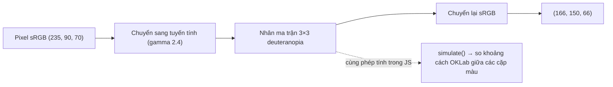

Khoảng 8% nam giới và 0,5% nữ giới gốc Bắc Âu có một dạng khiếm thị màu đỏ–lục. Trello dùng **nhãn màu** để phân loại thẻ: xanh lá, vàng, cam, đỏ, tím, xanh dương. Với người mù màu xanh lá (deuteranopia), nhãn "đỏ" và "xanh lá" gần như cùng một màu vàng đất. Nếu nhãn đỏ nghĩa là "khẩn cấp", họ sẽ không thấy được thông tin đó.

Cách để đội phát triển **thấy** vấn đề là xem chính giao diện của mình dưới mắt người khiếm thị màu. Chrome DevTools có sẵn chức năng này (Rendering → Emulate vision deficiencies), nhưng phải mở DevTools và tìm đúng tab. Trello làm một menu nhỏ ngay trong app, bật bằng một checkbox.

> [!TIP]
> **Tóm tắt**
> - Giả lập khiếm thị màu = nhân mỗi pixel với một ma trận 3×3. SVG có sẵn `<feColorMatrix>` làm việc này, và CSS `filter: url(#id)` áp nó lên cả cây DOM.
> - Trello lấy ma trận từ mã nguồn Chromium (cũng là thứ DevTools dùng), nhét cả thẻ `<svg><filter>` vào CSS dưới dạng data URI.
> - Cùng ma trận đó tính được trong JS, để **tự động** tìm các cặp màu bị lẫn trong palette, không cần nhìn bằng mắt.
> - Cạm bẫy: `filter` trên phần tử gốc biến nó thành khối chứa (containing block) cho mọi phần tử `position: fixed` bên trong.

<iframe class="demo-frame" src="/demos/web-patterns/index.html?theme=dark#/color-vision" title="Demo color-vision" loading="lazy" style="height: 980px"></iframe>

<p class="demo-links">▶ <a href="/demos/web-patterns/index.html#/color-vision" target="_blank" rel="noopener">Mở demo toàn màn hình ↗</a> · <a href="https://stackblitz.com/github/hunghg255/blog-hunghg/tree/master/examples/web-patterns?file=src/lib/colorVision.ts" target="_blank" rel="noopener">Sửa code trên StackBlitz ↗</a> · <a href="https://github.com/hunghg255/blog-hunghg/blob/master/examples/web-patterns/src/lib/colorVision.ts" target="_blank" rel="noopener">Xem source trên GitHub ↗</a></p>

Chọn "Deuteranopia": nhãn đỏ ("Sửa lỗi thanh toán") và xanh lá ("Đăng nhập Google") gần như cùng màu, biểu đồ build pass/fail thành một màu. Phần "Kiểm tra palette bằng JS" bên dưới liệt kê đúng các cặp đó, kèm khoảng cách màu trước và sau.

## Trello làm thế nào?

File [`trello.com/packages/a11y/src/AccessibilityMenu/ToggleColorVision.tsx`](https://github.com/hunghg255/codebase/blob/main/trello.com/packages/a11y/src/AccessibilityMenu/ToggleColorVision.tsx). Menu này (`AccessibilityMenu`) nằm trong popover chuyển "channel" ở header, cùng chỗ với danh sách feature flag. Nút đó chỉ hiện khi `shouldShowChannelPicker(hostname, channels.allowed)` cho phép, nên có lẽ đây là công cụ cho nhân viên, không phải tính năng cho người dùng.

Đầu file ghi rõ nguồn:

```ts
// Based on https://developers.google.com/web/updates/2020/11/cvd
// Based on https://source.chromium.org/chromium/chromium/src/+/master:third_party/blink/renderer/core/css/vision_deficiency.cc
```

Năm chế độ, mỗi chế độ là một filter primitive:

```ts
const filters = new Map([
  [VisionMode.BlurredVision, '<feGaussianBlur stdDeviation="2" />'],
  [VisionMode.Deuteranopia, `<feColorMatrix values="
       0.367  0.861 -0.228  0.000  0.000
       0.280  0.673  0.047  0.000  0.000
      -0.012  0.043  0.969  0.000  0.000
       0.000  0.000  0.000  1.000  0.000" />`],
  // Achromatopsia, Protanopia, Tritanopia: cùng dạng, khác hệ số
]);
```

Phần áp filter là một component render thẳng một thẻ `<style>`:

```tsx
const svgFilter = filters.get(colorVisionMode)?.replace(/(\n|^\s|\s$)/g, '');
const id = uuid();
return isColorVisionEnabled && svgFilter ? (
  <style>{`#trello-root {
    filter: url('data:image/svg+xml,<svg xmlns="http://www.w3.org/2000/svg"><filter id="${id}">${svgFilter}</filter></svg>#${id}');
  }`}</style>
) : null;
```

Mẹo ở đây là **filter không cần nằm trong trang**. `filter: url(...)` nhận một URL trỏ tới phần tử `<filter>`, và URL đó có thể là một data URI chứa nguyên tài liệu SVG, cộng `#id` ở cuối. Cả app được áp filter bằng một quy tắc CSS duy nhất, không phải chèn gì vào DOM. Regex xoá các ký tự xuống dòng để nhét vừa một dòng CSS (chỉ xoá `\n`, các khoảng trắng thừa giữa số vẫn còn, `feColorMatrix` không quan tâm).

Mình đã thử nguyên chuỗi kiểu Trello (không encode) trên Chromium: filter được áp, pixel đỏ `#eb5a46` thành `rgb(166, 150, 66)`, trùng với kết quả của bản viết lại.

Hai điểm nhỏ:

- `uuid()` được gọi **mỗi lần render**, nên id và URL của filter đổi mỗi lần component render lại, trình duyệt phải parse lại filter. Không sai, nhưng thừa.
- Data URI không encode các ký tự `<`, `>`, `"`, `#`. Chromium chấp nhận như thử ở trên, nhưng trình duyệt khác có thể khắt khe hơn với `#` nằm trong data URI (nó bị hiểu là bắt đầu fragment). Encode bằng `encodeURIComponent` là cách an toàn.

## Bên trong trình duyệt: `feColorMatrix` làm gì?

`<feColorMatrix type="matrix">` nhận 20 số, xếp thành ma trận 4×5. Với mỗi pixel `(R, G, B, A)`:

```text
R' = m00·R + m01·G + m02·B + m03·A + m04
G' = m10·R + m11·G + m12·B + m13·A + m14
B' = m20·R + m21·G + m22·B + m23·A + m24
A' = m30·R + m31·G + m32·B + m33·A + m34
```

Các ma trận giả lập chỉ dùng phần 3×3 trên cùng bên trái; cột alpha và cột cộng thêm đều bằng 0, hàng alpha giữ nguyên `A' = A`.

- **Achromatopsia** (không thấy màu): mọi kênh bằng `0.213R + 0.715G + 0.072B`, đó là công thức độ sáng (Rec. 709). Kết quả là ảnh xám.
- **Deuteranopia, protanopia, tritanopia**: thiếu một trong ba loại tế bào nón (lục, đỏ, lam). Ma trận "gập" màu về mặt phẳng mà mắt đó còn phân biệt được. Theo bài viết của Chrome mà Trello dẫn link, các ma trận này dựa trên mô hình của Machado và cộng sự (2009).

Một chi tiết quan trọng: theo spec, filter SVG mặc định tính trong không gian **linearRGB** (`color-interpolation-filters="linearRGB"`), không phải sRGB. Trình duyệt đổi màu sang dạng tuyến tính, nhân ma trận, rồi đổi lại. Muốn tính lại đúng kết quả đó trong JS thì cũng phải làm trong linearRGB.



**`filter` tạo khối chứa mới.** Theo spec Filter Effects, một phần tử có `filter` khác `none` trở thành khối chứa (containing block) cho các con cháu `position: absolute` và `position: fixed` (giống `transform`), trừ khi đó là phần tử gốc của tài liệu. Trello áp filter lên `#trello-root`, tức gần như cả app: mọi toast, menu, dialog dùng `position: fixed` bên trong sẽ định vị theo `#trello-root` thay vì theo khung nhìn. Nếu `#trello-root` cao hơn màn hình và trang cuộn, toast "dính đáy màn hình" sẽ trôi theo. Demo có nút "Hiện toast" để thấy: khi bật filter, toast nằm ở góc dưới của board chứ không phải góc dưới màn hình. Với một công cụ nội bộ để xem màu thì chấp nhận được, nhưng cần biết để không báo nhầm lỗi layout.

## Viết lại

Chèn một `<svg>` ẩn chứa đủ năm filter vào trang **một lần**, rồi áp bằng `filter: url(#id)`:

```ts title=src/lib/colorVision.ts
/** Chèn (một lần) một <svg> ẩn chứa đủ 5 filter vào cuối <body>. */
export function ensureFilters(doc: Document = document) {
  if (doc.getElementById(DEFS_ID)) return;
  const svg = doc.createElementNS(SVG_NS, 'svg');
  svg.id = DEFS_ID;
  svg.setAttribute('aria-hidden', 'true');
  // width/height 0 + absolute: không chiếm chỗ. Không dùng display:none: tài nguyên SVG
  // (filter, gradient) nằm trong cây bị display:none có thể không được áp.
  svg.setAttribute('style', 'position:absolute;width:0;height:0;overflow:hidden');
  svg.innerHTML = (Object.keys(VISION_LABELS) as VisionMode[])
    .map((mode) => `<filter id="${filterId(mode)}" color-interpolation-filters="linearRGB">${filterPrimitive(mode)}</filter>`)
    .join('');
  doc.body.appendChild(svg);
}

/** Áp (hoặc bỏ, khi mode = null) giả lập lên một phần tử. */
export function applyColorVision(target: HTMLElement, mode: VisionMode | null) {
  if (!mode) {
    target.style.removeProperty('filter');
    return;
  }
  ensureFilters(target.ownerDocument);
  target.style.filter = `url(#${filterId(mode)})`;
}
```

Cùng ma trận, tính trong JS. Đây là phần Trello không có: thay vì nhìn bằng mắt, tính trước xem cặp màu nào trong palette sẽ bị lẫn:

```ts title=src/lib/colorVision.ts
export function simulate(rgb: Rgb, mode: Exclude<VisionMode, 'blurred'>): Rgb {
  const m = MATRICES[mode];
  const [r, g, b] = rgb.map(toLinear);
  return [
    fromLinear(m[0] * r + m[1] * g + m[2] * b),
    fromLinear(m[3] * r + m[4] * g + m[5] * b),
    fromLinear(m[6] * r + m[7] * g + m[8] * b),
  ];
}
```

`findCollisions(palette, mode, threshold)` chạy `simulate` cho từng màu rồi so mọi cặp bằng khoảng cách trong OKLab, trả về các cặp dưới ngưỡng (xem toàn bộ file bên dưới).

::: spoiler Xem toàn bộ src/lib/colorVision.ts

```ts title=src/lib/colorVision.ts
/**
 * Giả lập cách người khiếm thị màu nhìn giao diện, ý tưởng từ menu a11y nội bộ của Trello
 * (packages/a11y/src/AccessibilityMenu/ToggleColorVision.tsx). Ma trận màu Trello lấy từ
 * mã nguồn Chromium (vision_deficiency.cc), cũng là thứ DevTools dùng cho
 * "Rendering → Emulate vision deficiencies".
 *
 * Trello nhét cả thẻ <svg><filter> vào CSS dưới dạng data URI:
 *   #trello-root { filter: url('data:image/svg+xml,<svg …><filter id="x">…</filter></svg>#x') }
 * Bản này chèn một <svg> ẩn vào trang rồi dùng filter: url(#id), cách tham chiếu filter
 * cùng tài liệu mà mọi trình duyệt đều hỗ trợ, và tạo filter một lần thay vì mỗi lần render.
 */

export type VisionMode = 'achromatopsia' | 'blurred' | 'deuteranopia' | 'protanopia' | 'tritanopia';

/** Ma trận 3×3 (phần RGB của feColorMatrix 4×5; cột alpha và offset đều là 0). */
export const MATRICES: Record<Exclude<VisionMode, 'blurred'>, number[]> = {
  // không thấy màu: chỉ còn độ sáng (hệ số Rec. 709)
  achromatopsia: [0.213, 0.715, 0.072, 0.213, 0.715, 0.072, 0.213, 0.715, 0.072],
  // thiếu tế bào nón xanh lá (phổ biến nhất)
  deuteranopia: [0.367, 0.861, -0.228, 0.28, 0.673, 0.047, -0.012, 0.043, 0.969],
  // thiếu tế bào nón đỏ
  protanopia: [0.152, 1.053, -0.205, 0.115, 0.786, 0.099, -0.004, -0.048, 1.052],
  // thiếu tế bào nón xanh dương (hiếm)
  tritanopia: [1.256, -0.077, -0.179, -0.078, 0.931, 0.148, 0.005, 0.691, 0.304],
};

export const VISION_LABELS: Record<VisionMode, string> = {
  achromatopsia: 'Achromatopsia (không thấy màu)',
  blurred: 'Nhìn mờ',
  deuteranopia: 'Deuteranopia (mù màu xanh lá)',
  protanopia: 'Protanopia (mù màu đỏ)',
  tritanopia: 'Tritanopia (mù màu xanh dương)',
};

/** Phần tử bên trong <filter> cho từng chế độ. */
export function filterPrimitive(mode: VisionMode): string {
  if (mode === 'blurred') return '<feGaussianBlur stdDeviation="2" />';
  const m = MATRICES[mode];
  const values = [...m.slice(0, 3), 0, 0, ...m.slice(3, 6), 0, 0, ...m.slice(6, 9), 0, 0, 0, 0, 0, 1, 0];
  return `<feColorMatrix type="matrix" values="${values.join(' ')}" />`;
}

const SVG_NS = 'http://www.w3.org/2000/svg';
const DEFS_ID = 'color-vision-filters';
export const filterId = (mode: VisionMode) => `cv-${mode}`;

/** Chèn (một lần) một <svg> ẩn chứa đủ 5 filter vào cuối <body>. */
export function ensureFilters(doc: Document = document) {
  if (doc.getElementById(DEFS_ID)) return;
  const svg = doc.createElementNS(SVG_NS, 'svg');
  svg.id = DEFS_ID;
  svg.setAttribute('aria-hidden', 'true');
  // width/height 0 + absolute: không chiếm chỗ. Không dùng display:none: tài nguyên SVG
  // (filter, gradient) nằm trong cây bị display:none có thể không được áp.
  svg.setAttribute('style', 'position:absolute;width:0;height:0;overflow:hidden');
  svg.innerHTML = (Object.keys(VISION_LABELS) as VisionMode[])
    .map((mode) => `<filter id="${filterId(mode)}" color-interpolation-filters="linearRGB">${filterPrimitive(mode)}</filter>`)
    .join('');
  doc.body.appendChild(svg);
}

/** Áp (hoặc bỏ, khi mode = null) giả lập lên một phần tử. */
export function applyColorVision(target: HTMLElement, mode: VisionMode | null) {
  if (!mode) {
    target.style.removeProperty('filter');
    return;
  }
  ensureFilters(target.ownerDocument);
  target.style.filter = `url(#${filterId(mode)})`;
}

/** Cách của Trello: filter nằm trong data URI. Giữ lại để so sánh trong demo. */
export function dataUriFilter(mode: VisionMode, id = 'f') {
  const svg = `<svg xmlns="${SVG_NS}"><filter id="${id}" color-interpolation-filters="linearRGB">${filterPrimitive(mode)}</filter></svg>`;
  // encode để không vướng ký tự # < > " trong URL
  return `url("data:image/svg+xml,${encodeURIComponent(svg)}#${id}")`;
}

// ---- Tính trước trong JS: màu nào sẽ "đụng" nhau? ----

export type Rgb = [number, number, number];

const toLinear = (c: number) => {
  const v = c / 255;
  return v <= 0.04045 ? v / 12.92 : ((v + 0.055) / 1.055) ** 2.4;
};
const fromLinear = (v: number) => {
  const x = Math.max(0, Math.min(1, v));
  return Math.round((x <= 0.0031308 ? x * 12.92 : 1.055 * x ** (1 / 2.4) - 0.055) * 255);
};

export function hexToRgb(hex: string): Rgb {
  const n = parseInt(hex.replace('#', ''), 16);
  return [(n >> 16) & 255, (n >> 8) & 255, n & 255];
}

/**
 * Áp ma trận lên một màu, làm trong không gian tuyến tính (linearRGB): đúng như filter SVG ở trên
 * (color-interpolation-filters="linearRGB", cũng là giá trị mặc định theo spec).
 */
export function simulate(rgb: Rgb, mode: Exclude<VisionMode, 'blurred'>): Rgb {
  const m = MATRICES[mode];
  const [r, g, b] = rgb.map(toLinear);
  return [
    fromLinear(m[0] * r + m[1] * g + m[2] * b),
    fromLinear(m[3] * r + m[4] * g + m[5] * b),
    fromLinear(m[6] * r + m[7] * g + m[8] * b),
  ];
}

/** Khoảng cách màu trong OKLab (≈ khác biệt cảm nhận). Ngưỡng "khó phân biệt" là tự chọn, không phải chuẩn. */
export function oklabDistance(a: Rgb, b: Rgb) {
  const lab = (rgb: Rgb) => {
    const [r, g, bl] = rgb.map(toLinear);
    const l = Math.cbrt(0.4122214708 * r + 0.5363325363 * g + 0.0514459929 * bl);
    const m = Math.cbrt(0.2119034982 * r + 0.6806995451 * g + 0.1073969566 * bl);
    const s = Math.cbrt(0.0883024619 * r + 0.2817188376 * g + 0.6299787005 * bl);
    return [
      0.2104542553 * l + 0.793617785 * m - 0.0040720468 * s,
      1.9779984951 * l - 2.428592205 * m + 0.4505937099 * s,
      0.0259040371 * l + 0.7827717662 * m - 0.808675766 * s,
    ];
  };
  const [L1, A1, B1] = lab(a);
  const [L2, A2, B2] = lab(b);
  return Math.hypot(L1 - L2, A1 - A2, B1 - B2);
}

export interface Collision {
  a: string;
  b: string;
  before: number;
  after: number;
}

/** Các cặp màu trong palette trở nên khó phân biệt dưới một chế độ khiếm thị. */
export function findCollisions(
  palette: Record<string, string>,
  mode: Exclude<VisionMode, 'blurred'>,
  threshold = 0.08,
): Collision[] {
  const names = Object.keys(palette);
  const result: Collision[] = [];
  for (let i = 0; i < names.length; i++) {
    for (let j = i + 1; j < names.length; j++) {
      const a = hexToRgb(palette[names[i]]);
      const b = hexToRgb(palette[names[j]]);
      const after = oklabDistance(simulate(a, mode), simulate(b, mode));
      if (after < threshold) result.push({ a: names[i], b: names[j], before: oklabDistance(a, b), after });
    }
  }
  return result.sort((x, y) => x.after - y.after);
}
```

:::

## Đi qua code

- **`MATRICES`** chỉ lưu phần 3×3; `filterPrimitive` dựng lại đủ 20 số cho `feColorMatrix`.
- **`ensureFilters`** kiểm tra id trước khi chèn, gọi bao nhiêu lần cũng chỉ có một `<svg>`. SVG được ẩn bằng kích thước 0 thay vì `display: none`, vì tài nguyên SVG nằm trong cây bị `display: none` có thể không được áp.
- **`color-interpolation-filters="linearRGB"`** ghi rõ dù là giá trị mặc định, để người đọc code biết JS phải tính trong không gian nào.
- **`applyColorVision(el, null)`** gỡ filter. Áp lên phần tử nào cũng được: cả `<html>` như Trello, hoặc chỉ một vùng như demo (để phần điều khiển giữ màu thật).
- **`simulate`** làm đúng các bước của trình duyệt: sRGB → tuyến tính → nhân ma trận → sRGB. Kết quả khớp tới từng đơn vị với pixel mà Chromium vẽ (`#eb5a46` → `166, 150, 66` cả hai bên).
- **`findCollisions`** so mọi cặp màu sau khi giả lập bằng khoảng cách trong OKLab. Ngưỡng 0,08–0,1 là con số **tự chọn** cho demo, không phải chuẩn; với chữ và nền thì dùng tỉ lệ tương phản WCAG thay vì ngưỡng này.

**Khác bản gốc:** filter nằm trong DOM (một lần) thay vì data URI tạo lại mỗi render; có hàm `simulate` và `findCollisions` để kiểm tra palette tự động; có hàm `dataUriFilter` (đã encode) cho ai muốn dùng cách của Trello.

## Tại sao không làm cách khác?

**Dùng DevTools?** Rendering → Emulate vision deficiencies trong Chrome/Edge làm đúng việc này, và nên là lựa chọn đầu tiên khi tự kiểm tra. Menu trong app hữu ích khi muốn designer, PM, QA cùng xem mà không cần mở DevTools, hoặc khi chụp màn hình để so sánh.

**Đổi palette sang "bảng màu an toàn" là xong?** Palette tốt giảm vấn đề, nhưng không giải quyết hết: một tính năng mới vẫn có thể dùng màu làm tín hiệu duy nhất. Giả lập giúp phát hiện điều đó. Cách bền vững là **không dựa vào màu một mình**: thêm chữ, icon hoặc hoa văn. Chính Trello làm vậy: `packages/trello-canonical-components/src/card-front/CardLabel.tsx` có bảng `labelColorToColorBlindPattern` gán cho mỗi màu nhãn một hoa văn (đỏ → `DotsChecker`, xanh lá → `StripeDiagonal`, vàng → `WaveSquare`…), dùng khi người dùng bật chế độ thân thiện với người mù màu.

**Giả lập bằng `canvas`?** Chụp trang thành ảnh rồi xử lý từng pixel thì chậm, không tương tác được. `filter` để GPU làm việc đó trên trang đang chạy.

## Edge case và cạm bẫy

- **`position: fixed` bị "nhốt"** như đã nói ở trên. Spec Filter Effects có ngoại lệ cho **phần tử gốc** của tài liệu: `filter` trên `<html>` không tạo khối chứa mới. Vậy nếu muốn áp lên cả trang mà không phá layout, áp lên `document.documentElement` thay vì một `div` gốc như `#trello-root`.
- **Hiệu năng**: filter trên cả trang buộc trình duyệt vẽ lại qua filter mỗi khi có gì thay đổi. Chỉ là công cụ kiểm tra, đừng để bật mặc định.
- **Nội dung trong iframe**, kể cả khác origin, vẫn bị áp filter, vì filter áp lên kết quả vẽ của phần tử chứa nó.
- **Ảnh và video** cũng bị đổi màu, đúng như mắt người dùng thấy. Đừng nhầm đó là lỗi.
- **Mô hình chỉ là xấp xỉ**: mỗi người có mức độ khiếm thị khác nhau (deuteranomaly nhẹ thì phổ biến hơn deuteranopia hoàn toàn). Ma trận ở đây mô phỏng trường hợp nặng nhất.

## Dùng trong dự án

```ts
// Công cụ dev: bật bằng ?cvd=deuteranopia hoặc một menu ẩn
const mode = new URLSearchParams(location.search).get('cvd') as VisionMode | null;
if (import.meta.env.DEV && mode) applyColorVision(document.documentElement, mode);

// Test tự động: palette nhãn không được có cặp màu bị lẫn dưới deuteranopia/protanopia
for (const m of ['deuteranopia', 'protanopia'] as const) {
  const bad = findCollisions(LABEL_COLORS, m, 0.08);
  if (bad.length) console.warn(`Palette có cặp dễ lẫn (${m}):`, bad);
}
```

Đưa `findCollisions` vào test của design system là cách rẻ nhất để không vô tình thêm một màu nhãn mới "đụng" màu cũ.

## Kiểm thử

::: spoiler Ví dụ test (bản phác, không có trong repo)

```ts
import { describe, expect, it } from 'vitest';
import { filterPrimitive, findCollisions, hexToRgb, simulate } from './colorVision';

describe('simulate', () => {
  it('khớp với pixel Chromium vẽ qua feColorMatrix', () => {
    expect(simulate(hexToRgb('#eb5a46'), 'deuteranopia')).toEqual([166, 150, 66]);
    expect(simulate(hexToRgb('#61bd4f'), 'deuteranopia')).toEqual([181, 166, 87]);
  });
  it('achromatopsia cho ra màu xám', () => {
    const [r, g, b] = simulate(hexToRgb('#0079bf'), 'achromatopsia');
    expect(r).toBe(g);
    expect(g).toBe(b);
  });
  it('trắng và đen giữ nguyên', () => {
    expect(simulate([255, 255, 255], 'protanopia')).toEqual([255, 255, 255]);
    expect(simulate([0, 0, 0], 'tritanopia')).toEqual([0, 0, 0]);
  });
});

describe('findCollisions', () => {
  it('đỏ và xanh lá kiểu Trello bị lẫn dưới deuteranopia', () => {
    const pairs = findCollisions({ red: '#eb5a46', green: '#61bd4f', blue: '#0079bf' }, 'deuteranopia', 0.08);
    expect(pairs.map((p) => [p.a, p.b])).toEqual([['red', 'green']]);
  });
});

it('filterPrimitive tạo đủ 20 số', () => {
  const values = /values="([^"]+)"/.exec(filterPrimitive('protanopia'))![1].split(' ');
  expect(values).toHaveLength(20);
  expect(values.slice(15)).toEqual(['0', '0', '0', '1', '0']);
});
```

:::

## So với thư viện và chuẩn web

- **Chrome/Edge DevTools**: Rendering → Emulate vision deficiencies (blurred vision, reduced contrast, achromatopsia, deuteranopia, protanopia, tritanopia). Firefox có mục tương tự trong Accessibility Inspector ("Simulate"). Tính tới 10/2026; tên mục có thể đổi theo phiên bản.
- **`feColorMatrix`** và CSS `filter: url()` có trên mọi trình duyệt hiện đại.
- **Thư viện**: gói `color-blind` trên npm và các plugin Figma (ví dụ Stark) làm cùng việc giả lập; công cụ tương phản như axe kiểm tra tỉ lệ tương phản chữ/nền, không kiểm tra "hai màu nhãn có bị lẫn không". Hàm `findCollisions` lấp đúng chỗ trống đó.

---

Bài này thuộc series **[Học từ mã nguồn các web lớn](/series/web)** (65 bài, đọc theo thứ tự).

::: spoiler Xem nhanh danh sách bài trong series

*Mở đầu*

- [Mở đầu: đọc code production của 28 trang web](/blogs/learn-from-big-web-apps)

*Phần 1: trải nghiệm người dùng*

- [#1 Dark mode không nháy (Gatsby)](/blogs/web-dark-mode-no-flash)
- [#2 useValueByMedia: giá trị theo breakpoint (Toptal)](/blogs/web-use-value-by-media)
- [#3 Đoán ý định: idle, exit-intent, lắc chuột (Toptal, InVision)](/blogs/web-user-intent-idle-exit-wiggle)
- [#4 Validate form thân thiện (Udacity, Pipedrive)](/blogs/web-form-validation-ux)
- [#5 Magic number, EXIF và dán ảnh (Ello)](/blogs/web-file-magic-number-exif-paste)
- [#6 fastSmoothScroll: cuộn xa vẫn nhanh (Telegram)](/blogs/web-telegram-fast-smooth-scroll)
- [#7 Countdown time-travel và tombstone giỏ hàng (Best Buy)](/blogs/web-countdown-time-travel-tombstone)

*Phần 2: hiệu năng và đo lường*

- [#8 Hàng đợi requestAnimationFrame 3ms (Apple)](/blogs/web-raf-queue-3ms)
- [#9 srcset cho artwork và preconnect tự động (Apple)](/blogs/web-responsive-artwork-preconnect)
- [#10 Quick-fetch: gọi API trước khi bundle tải xong (HubSpot)](/blogs/web-quick-fetch-early-requests)
- [#11 Performance span và long task (Postman, Calibre)](/blogs/web-performance-spans-long-tasks)
- [#12 Gọi Web Worker như hàm async (Telegram)](/blogs/web-worker-promise-rpc)
- [#13 Đồng hồ media: đếm giờ xem và sửa lệch (Skillshare, Simplified)](/blogs/web-media-clock-watch-time-drift)

*Phần 3: nhiều tab, phiên đăng nhập, cập nhật*

- [#14 Bầu tab chủ cho thông báo (HubSpot, Telegram)](/blogs/web-leader-tab-notifications)
- [#15 Đồng bộ đăng nhập giữa tab và giới hạn cookie (Elastic, InVision)](/blogs/web-cross-tab-auth-cookie-guard)
- [#16 SPA tự cập nhật: Trello, Zappos, Facebook, Elastic](/blogs/web-spa-self-update-strategies)

*Phần 4: kiến trúc*

- [#17 Reverse portal: di chuyển component không remount (Zappos)](/blogs/web-reverse-portal)
- [#18 Page behaviors: gắn hành vi từ CMS (Intercom)](/blogs/web-page-behaviors-cms)
- [#19 Giới hạn tần suất hiển thị bằng bitmask (Outlook)](/blogs/web-frequency-cap-bitmask)
- [#20 Chuyển REST sang GraphQL dần dần (Coursera)](/blogs/web-rest-to-graphql-hybrid-link)

*Phần 5: soạn thảo và hiển thị nội dung*

- [#21 Autocomplete tại con trỏ trong contenteditable (Ello, Telegram)](/blogs/web-caret-autocomplete-contenteditable)
- [#22 Dark mode cho email HTML bằng CIELAB (Outlook)](/blogs/web-email-dark-mode-cielab)
- [#23 Thu nhỏ bảng rộng cho vừa khung, vá font emoji (Outlook)](/blogs/web-email-wide-content-scale)
- [#24 Cảnh báo quên đính kèm file (Outlook)](/blogs/web-forgotten-attachment-warning)
- [#25 Cắt chữ nhiều dòng chính xác (Pipedrive, Apple, Toptal)](/blogs/web-multiline-truncate-measure-text)
- [#26 Parse ngày giờ gõ tay khoan dung (Outlook, Elastic)](/blogs/web-lenient-date-parser)

*Phần 6: tương tác*

- [#27 menuAim: rê chéo vào submenu không bị đóng (Udemy)](/blogs/web-menu-aim-triangle)
- [#28 Kéo, vuốt chung cho chuột và cảm ứng (Telegram)](/blogs/web-unified-pointer-gestures)
- [#29 Phím tắt theo phạm vi, IME và bàn phím phi Latinh (Trello)](/blogs/web-scoped-keyboard-shortcuts)
- [#30 Nội suy màu: đổi theme và nền theo cuộn (Telegram, Anchor)](/blogs/web-color-interpolation-theme-scroll)
- [#31 Đường gióng hút cạnh và undo/redo trên canvas (Simplified)](/blogs/web-canvas-snap-guides-undo)
- **#32 Giả lập mù màu bằng feColorMatrix (Trello)** (bài này)
- [#33 Vạch thước theo mức zoom và cấp phát màu cho biểu đồ (Anchor, Similarweb)](/blogs/web-timeline-ticks-color-stack)

*Phần 7: mạng, dữ liệu và async*

- [#34 Ô tìm kiếm chuẩn production (Similarweb, Udemy, Pipedrive)](/blogs/web-production-search-box)
- [#35 Điều phối async: latest-wins, single-flight (Glitch, Toptal)](/blogs/web-async-coordination-latest-wins)
- [#36 Polling thưa dần và debounce động (Trello)](/blogs/web-decaying-polling-dynamic-debounce)
- [#37 Cache phía client theo version (Similarweb, Telegram, Udemy)](/blogs/web-client-cache-versioned)
- [#38 Upload file lớn theo chunk (Outlook, Tribe)](/blogs/web-chunked-upload-pipeline)
- [#39 Phát video qua Service Worker bằng Range request (Telegram, Outlook)](/blogs/web-service-worker-range-streaming)

*Phần 8: hiệu năng và vận hành*

- [#40 TTI governor: hoãn việc phụ tới sau khi trang dùng được (Outlook)](/blogs/web-tti-governor)
- [#41 Tự đo LCP/CLS/TBT và phục vụ bản nhẹ cho máy yếu (Udemy)](/blogs/web-rum-adaptive-loading)

*Phần 9: thuật toán và dữ liệu phía client*

- [#42 Three-way merge ngay trên trình duyệt (Postman)](/blogs/web-three-way-merge-client)
- [#43 Dọn cache GraphQL bằng đếm tham chiếu (Outlook)](/blogs/web-graphql-cache-refcount-gc)
- [#44 LRU cache theo 3 cách (Apple, Similarweb, Outlook)](/blogs/web-lru-cache-three-ways)
- [#45 Lọc tăng dần trong Web Worker (Similarweb)](/blogs/web-incremental-filter-worker)
- [#46 Xếp hạng gợi ý trên client, so ngầm với server (Outlook)](/blogs/web-client-side-ranking-shadow-test)
- [#47 Nối OT với editor: undo stack và chặn echo (Glitch)](/blogs/web-ot-codemirror-undo)
- [#48 Ngôn ngữ markup riêng dịch hai chiều với HTML (Coursera)](/blogs/web-custom-markup-compiler)

*Phần 10: thời gian, ngôn ngữ, định dạng*

- [#49 Xử lý giờ mùa hè không cần thư viện (Udemy, Pipedrive)](/blogs/web-dst-without-library)
- [#50 Intl thực chiến: Segmenter, số rút gọn, số nhiều, fallback locale (Apple, Outlook)](/blogs/web-intl-in-production)
- [#51 WebVTT và bôi chọn transcript (Udemy, Coursera)](/blogs/web-webvtt-transcript-selection)

*Phần 11: tương tác và giao diện*

- [#52 Kéo-thả trên lịch (Pipedrive)](/blogs/web-calendar-drag-drop)
- [#53 Focus stack cho popup lồng nhau (Outlook)](/blogs/web-focus-stack-nested-popups)
- [#54 Clipboard: copy, dán chữ thuần, dán thông minh (Trello, Anchor, Pipedrive, Tribe)](/blogs/web-clipboard-tricks)
- [#55 Khôi phục vị trí cuộn khi trang còn đang tải (Apple, Zappos)](/blogs/web-scroll-restore-wait-height)
- [#56 Lấy màu từ ảnh: gradient nền, màu chữ (Apple, Telegram, Trello)](/blogs/web-colors-from-images)
- [#57 JS đọc breakpoint từ CSS, phát hiện chế độ PWA (Ello, Apple)](/blogs/web-css-js-breakpoint-bridge)

*Phần 12: media*

- [#58 Tin nhắn thoại: ghi âm, waveform realtime, nén 5-bit (Telegram)](/blogs/web-voice-message-waveform)
- [#59 Chụp frame video thành ảnh, canvas bị taint (Coursera, Outlook)](/blogs/web-video-frame-snapshot)

*Phần 13: đo lường, bảo mật, vận hành*

- [#60 Đo lúc ảnh màn hình đầu tải xong, cả khi chuyển trang SPA (Zappos, Best Buy, Outlook)](/blogs/web-above-the-fold-image-timing)
- [#61 Buffer analytics chờ SDK, phát hiện adblock (Best Buy)](/blogs/web-analytics-buffer-adblock)
- [#62 Proof-of-work trên client để chặn API ẩn danh (Udemy)](/blogs/web-client-proof-of-work)
- [#63 Prefetch không làm lệch số liệu, nén cài đặt bằng bit (Outlook)](/blogs/web-synthetic-prefetch-bit-flags)
- [#64 Micro-frontend: AngularJS và React chung app, giao tiếp xuyên frame (Similarweb, InVision, HubSpot)](/blogs/web-micro-frontend-bridges)

:::

Code + demo: [`examples/web-patterns`](https://github.com/hunghg255/blog-hunghg/tree/master/examples/web-patterns) · [Mở trên StackBlitz](https://stackblitz.com/github/hunghg255/blog-hunghg/tree/master/examples/web-patterns)
