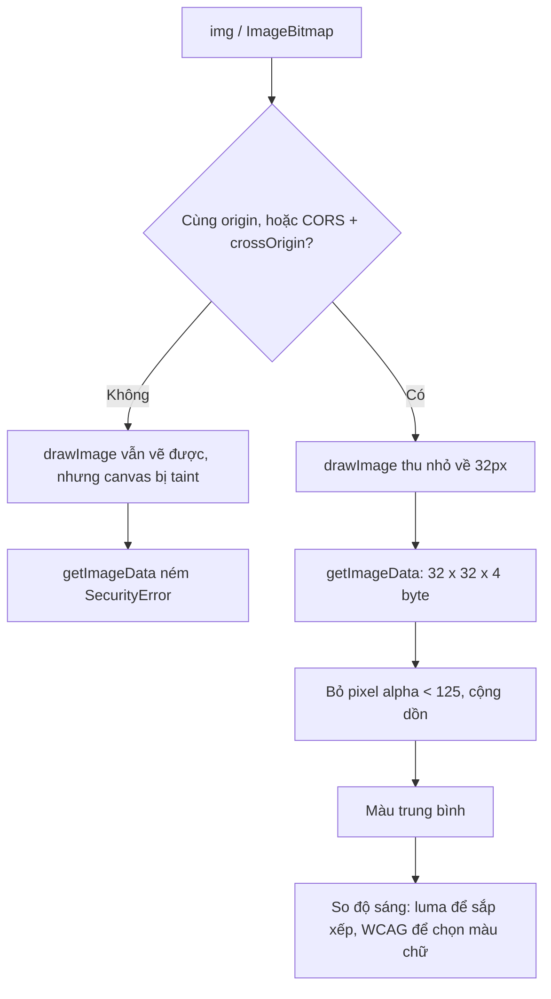

Giao diện "ăn theo" nội dung thì trông có hồn hơn hẳn: thanh ngày tháng trong khung chat hợp màu với hình nền, thẻ ứng dụng có nền gradient lấy từ màu các icon, nhãn màu tự chọn chữ trắng hay chữ đen cho dễ đọc. Cả ba việc đều quy về hai bài toán nhỏ: **lấy một màu đại diện từ ảnh**, và **so độ sáng của màu**.

Bài này đọc cách Telegram Web, App Store bản web và Trello làm, rồi viết lại thành một file nhỏ. Mình tìm thấy hai chỗ đáng sửa trong code gốc: Telegram tính màu trong không gian HSV nhưng in ra bằng `hsla()` (tức HSL), và Trello so ngưỡng trên giá trị sRGB chưa tuyến tính hoá.

> [!TIP]
> **Tóm tắt**
> - Màu trung bình: vẽ ảnh lên canvas **đã thu nhỏ** (32px) rồi mới đọc pixel. Telegram vẽ ở kích thước gốc và lấy 1 trong 5 pixel; cách đó chỉ ổn vì nó luôn được gọi với thumbnail vài chục pixel.
> - Bỏ pixel trong suốt khi tính trung bình. Không bỏ thì ảnh PNG nửa trong suốt màu đỏ ra màu đỏ sẫm.
> - Ảnh khác origin làm canvas bị "taint": `getImageData` ném `SecurityError`. Cần `crossOrigin="anonymous"` cùng header CORS từ server.
> - Chọn chữ trắng hay đen: tính tỉ lệ tương phản WCAG với cả hai rồi chọn số lớn hơn. Ngưỡng luma 0.4623 của Trello đúng với màu xám nhưng chọn khác WCAG ở khoảng 1/8 số màu bão hoà.

<iframe class="demo-frame" src="/demos/web-patterns/index.html?theme=dark#/image-colors" title="Demo image-colors" loading="lazy" style="height: 1460px"></iframe>

<p class="demo-links">▶ <a href="/demos/web-patterns/index.html#/image-colors" target="_blank" rel="noopener">Mở demo toàn màn hình ↗</a> · <a href="https://stackblitz.com/github/hunghg255/blog-hunghg/tree/master/examples/web-patterns?file=src/lib/imageColors.ts" target="_blank" rel="noopener">Sửa code trên StackBlitz ↗</a> · <a href="https://github.com/hunghg255/blog-hunghg/blob/master/examples/web-patterns/src/lib/imageColors.ts" target="_blank" rel="noopener">Xem source trên GitHub ↗</a></p>

Chọn lần lượt các hình nền ở mục 1: hai "pill" ngày tháng đổi màu theo hình. Tải lên một ảnh PNG có nền trong suốt để thấy màu trung bình kiểu Telegram bị kéo về phía đen. Ở mục 3, các ô viền nét đứt là những màu mà ngưỡng của Trello và WCAG chọn màu chữ khác nhau.

## Telegram làm thế nào?

Trong Telegram Web, bạn chọn một hình nền cho khung chat. Các "pill" ngày tháng ("Hôm nay", "12 tháng 3"), tin nhắn hệ thống và nút inline (inline button) của bot có nền bán trong suốt **cùng tông** với hình nền đó. Màu này không được thiết kế sẵn cho từng hình, mà được tính lúc bạn chọn.

[`web.telegram.org/src/components/left/settings/SettingsGeneralBackground.tsx`](https://github.com/hunghg255/codebase/blob/main/web.telegram.org/src/components/left/settings/SettingsGeneralBackground.tsx):

```ts
getAverageColor(currentWallpaper.document.thumbnail.dataUri).then((color) => {
  const patternColor = getPatternColor(color);
  const rgbColor = `#${rgb2hex(color)}`;
  setThemeSettings({ theme: themeRef.current, backgroundColor: rgbColor, patternColor });
});
```

Chi tiết quan trọng: hàm được gọi với **`thumbnail.dataUri`**, ảnh xem trước rất nhỏ đi kèm dữ liệu của hình nền, không phải ảnh gốc. Vì là `data:` URI nên không có vấn đề CORS, và vì nhỏ nên việc đọc toàn bộ pixel rất rẻ. `patternColor` được đưa vào biến CSS `--pattern-color`; các file SCSS của `MessageList`, `InlineButtons`, `NoMessages` dùng nó làm nền cho pill, với chữ màu trắng.

Hai hàm nằm ở [`web.telegram.org/src/util/colors.ts`](https://github.com/hunghg255/codebase/blob/main/web.telegram.org/src/util/colors.ts):

```ts
export async function getAverageColor(url: string): Promise<[number, number, number]> {
  // Only visit every 5 pixels
  const blockSize = 5;
  // …
  const image = await preloadImage(url);
  height = image.naturalHeight || image.offsetHeight || image.height;
  width = image.naturalWidth || image.offsetWidth || image.width;
  canvas.height = height;
  canvas.width = width;
  context.drawImage(image, 0, 0);
  try {
    data = context.getImageData(0, 0, width, height);
  } catch (e) {
    return defaultRGB; // [0, 0, 0]
  }
  while ((i += blockSize * 4) < length) {
    ++count;
    rgb[0] += data.data[i]; // … tương tự cho G, B
  }
  // chia cho count, làm tròn xuống
}

// Function was adapted from https://github.com/telegramdesktop/tdesktop/…/data_wall_paper.cpp#L518
export function getPatternColor(rgbColor: [number, number, number]) {
  let [hue, saturation, value] = rgb2hsb(rgbColor);
  saturation = Math.min(1, saturation + 0.05 + 0.1 * (1 - saturation));
  value = value > 0.5 ? Math.max(0, value * 0.65) : Math.max(0, Math.min(1, 1 - value * 0.65));
  return `hsla(${hue * 360}, ${saturation * 100}%, ${value * 100}%, .4)`;
}
```

`getPatternColor` tăng độ bão hoà lên một chút. Nếu nền sáng (value > 0.5) thì giảm độ sáng còn 65%; nếu nền tối thì đảo lại để màu sáng lên. Kết quả có alpha 0,4, đủ để nhìn thấy hình nền phía sau.

**Ba điểm đáng chú ý:**

- **"Every 5 pixels" là 1 trong 5 pixel theo hàng**, không phải lưới 5×5: chỉ số tăng `5 × 4` byte mỗi lần. Với thumbnail thì vô hại. Gọi với một ảnh 4000×4000px, hàm sẽ cấp phát canvas và `ImageData` khoảng 64MB để rồi chỉ đọc 1/5 số pixel.
- **Pixel trong suốt được tính như màu đen.** Hàm không xem kênh alpha. Trong demo, một ảnh nửa đỏ nửa trong suốt cho ra `#700e24` (đỏ sẫm) thay vì `#e11d48`.
- **HSV bị đọc thành HSL.** Hàm tính và chỉnh màu trong HSV (Telegram gọi là HSB), rồi in ra bằng `hsla()`. Nhưng `hsla()` là HSL: tham số thứ ba là *lightness*, không phải *value*. Bản desktop mà comment dẫn nguồn (tdesktop, không có trong bản dump) có lẽ dựng màu thẳng từ HSV, đúng như tên biến `value` và hàm `rgb2hsb` gợi ý. Đọc thành HSL thì pill ra **sáng hơn** ý định của công thức, và chữ trắng trên đó khó đọc hơn. Với hình nền "Đồng cỏ" trong demo, tỉ lệ tương phản của chữ trắng là khoảng 1,8:1 với bản Web và khoảng 2,1:1 với bản đổi HSV → RGB đúng nghĩa.

## App Store làm thế nào?

Trang "Today" của App Store bản web có những thẻ (card) chứa một dải icon ứng dụng, đặt trên nền gradient pha từ màu các icon. [`apps.apple.com/src/utils/color.ts`](https://github.com/hunghg255/codebase/blob/main/apps.apple.com/src/utils/color.ts):

```ts
export const getBackgroundGradientCSSVarsFromArtworks = (artworks, { variableNames, sortFn, shouldRemoveGreys }) =>
  artworks
    .map(({ backgroundColor }) => backgroundColor)
    .filter(isSome)
    .filter(isRGBColor)
    .map(({ red, green, blue }) => [Math.floor(255 * red), Math.floor(255 * green), Math.floor(255 * blue)])
    .filter((rgb) => !isRGBDarkerThanThreshold(rgb, 33))
    .filter((rgb) => (shouldRemoveGreys ? !isKindOfGrey(rgb, 10) : true))
    .sort(sortFn)
    .slice(0, variableNames.length)
    .map(([red, green, blue], index) => `--${variableNames[index]}: rgb(${red}, ${green}, ${blue})`)
    .join('; ');
// mặc định: variableNames = ['bottom-left', 'top-right', 'bottom-right', 'top-left']
```

- **Màu không được đọc từ pixel.** Mỗi `Artwork` trong dữ liệu API đã có sẵn `backgroundColor`. Đọc pixel phía server một lần thì rẻ hơn nhiều so với mỗi trình duyệt tự làm, và không dính CORS.
- **Bỏ màu gần đen** (cả ba kênh ≤ 33) và, tuỳ chọn, **bỏ màu xám** (ba kênh lệch nhau ≤ 10). Pha một góc đen hay xám vào gradient làm cả thẻ trông bẩn.
- **Sắp xếp theo độ sáng** ở nơi gọi (`TodayCardMediaRiver.svelte`, `Hero.svelte`): `sortFn: (a, b) => getLuminanceForRGB(a) - getLuminanceForRGB(b)`, comment "sorts from darkest to lightest". Màu tối nhất vào `--bottom-left`, góc mà chữ tiêu đề thường nằm.
- Kết quả là một **chuỗi CSS custom property**, gắn thẳng vào `style=` của thẻ. CSS bốn lớp `radial-gradient(…, var(--top-left, #000) …)` lo phần còn lại, mỗi biến có giá trị mặc định `#000` khi không đủ màu.

`getLuminanceForRGB` có comment dẫn tới bài "Relative luminance" trên Wikipedia, nhưng công thức là `0.2126 * r + 0.7152 * g + 0.0722 * b` trên giá trị 0..255 **chưa tuyến tính hoá**, tức là **luma**. Để sắp xếp từ tối tới sáng thì luma là đủ dùng.

## Trello làm thế nào?

Nhãn (label) của Trello có màu do người dùng chọn, và chữ trên nhãn phải đọc được. [`trello.com/packages/colors/src/contrast.ts`](https://github.com/hunghg255/codebase/blob/main/trello.com/packages/colors/src/contrast.ts):

```ts
// https://stackoverflow.com/a/1855903
export const useLightText = (color: string): boolean => {
  const rgbValues = makeRGB(color);
  if (!rgbValues) return false;
  // https://en.wikipedia.org/wiki/Relative_luminance
  const [r, g, b] = rgbValues;
  const luminance = (0.2126 * r + 0.7152 * g + 0.0722 * b) / 255;
  return luminance <= 0.4623475;
};
```

Ngưỡng `0.4623475` trông như một con số lấy ra từ hư không, nhưng có lẽ có nguồn gốc. Với màu **xám**, điểm mà chữ trắng và chữ đen cho tỉ lệ tương phản WCAG bằng nhau là relative luminance ≈ 0,179, tương ứng giá trị sRGB ≈ 117/255 = 0,460. Ngưỡng của Trello nằm sát con số đó. Vấn đề là phép so sánh lại làm trên luma (chưa tuyến tính hoá). Với màu xám hai cách cho cùng kết quả, nhưng với màu bão hoà thì không: mình đếm trên một lưới 5.832 màu sRGB, có 573 màu (khoảng 10%) mà hai cách chọn màu chữ khác nhau. Ví dụ `#0078ff`: Trello chọn chữ trắng (4,09:1), trong khi chữ đen cho 5,13:1.

Tên `useLightText` bắt đầu bằng `use` nhưng không phải React hook; nó là một hàm thuần.

## Bên trong trình duyệt: canvas, taint và ánh sáng tuyến tính



**Taint.** Canvas cho phép **vẽ** ảnh từ bất kỳ đâu, nhưng nếu ảnh đến từ origin khác mà không có CORS, canvas bị đánh dấu "tainted" và mọi lệnh **đọc** pixel (`getImageData`, `toDataURL`, `toBlob`) đều ném `SecurityError`. Đây là cơ chế bảo mật: không có nó, một trang có thể vẽ ảnh từ hệ thống nội bộ của bạn lên canvas rồi đọc nội dung ảnh ra. Muốn đọc được, `` cần `crossOrigin="anonymous"` (hoặc `fetch` với `mode: 'cors'` rồi `createImageBitmap`), và server phải trả `Access-Control-Allow-Origin`. Telegram tránh được vấn đề này nhờ dùng `data:` URI.

**Thu nhỏ trước khi đọc.** `drawImage(image, 0, 0, 32, 20)` để trình duyệt thu ảnh về vài trăm pixel. Bộ thu nhỏ của trình duyệt đã trộn các pixel nguồn lại, và đặt `imageSmoothingQuality = 'high'` để nó trộn đủ, không lấy mẫu thưa. Sau đó chỉ cần cộng 32×20 pixel thay vì hàng triệu. Trong demo, với ảnh 1600×1000px: cách của Telegram mất khoảng 12–18ms, thu về 32px mất dưới 1ms, và hai cách cho cùng màu (lệch nhiều nhất 1 đơn vị ở một kênh).

**Tuyến tính hay không.** Giá trị 0..255 trong ảnh là sRGB đã mã hoá gamma: 128 không có nghĩa là "nửa ánh sáng" (thực tế khoảng 21%). Tỉ lệ tương phản WCAG chỉ có nghĩa khi tính trên giá trị đã tuyến tính hoá:

```ts
const toLinear = (c) => (c / 255 <= 0.04045 ? c / 255 / 12.92 : ((c / 255 + 0.055) / 1.055) ** 2.4);
const L = 0.2126 * toLinear(r) + 0.7152 * toLinear(g) + 0.0722 * toLinear(b);
const contrast = (L1 + 0.05) / (L2 + 0.05); // L1 sáng hơn
```

## Viết lại

Màu trung bình, có bỏ pixel trong suốt và trả `null` khi canvas bị taint:

```ts title=src/lib/imageColors.ts
export function averageColor(image: ImageInput, { size = 32, minAlpha = 125, linear = false }: AverageOptions = {}): RGB | null {
  const { w, h } = sizeOf(image);
  if (!w || !h) return null;
  // giữ tỉ lệ khung, cạnh dài = size
  const scale = Math.min(1, size / Math.max(w, h));
  const cw = Math.max(1, Math.round(w * scale));
  const ch = Math.max(1, Math.round(h * scale));
  const canvas = document.createElement('canvas');
  canvas.width = cw;
  canvas.height = ch;
  const ctx = canvas.getContext('2d', { willReadFrequently: true });
  if (!ctx) return null;
  // thu nhỏ với chất lượng cao: trình duyệt trộn nhiều pixel nguồn thay vì lấy mẫu thưa
  ctx.imageSmoothingQuality = 'high';
  ctx.drawImage(image, 0, 0, cw, ch);

  let data: Uint8ClampedArray;
  try {
    data = ctx.getImageData(0, 0, cw, ch).data;
  } catch {
    return null;
  }

  const sum = [0, 0, 0];
  let count = 0;
  for (let i = 0; i < data.length; i += 4) {
    if (data[i + 3] < minAlpha) continue;
    for (let c = 0; c < 3; c++) sum[c] += linear ? toLinear(data[i + c]) : data[i + c];
    count++;
  }
  if (count === 0) return null;
  const fromLinear = (v: number) => 255 * (v <= 0.0031308 ? 12.92 * v : 1.055 * v ** (1 / 2.4) - 0.055);
  return sum.map((v) => Math.round(linear ? fromLinear(v / count) : v / count)) as RGB;
}
```

Màu cho pill: giữ nguyên các bước chỉnh của Telegram, nhưng dựng màu bằng HSV → RGB:

```ts title=src/lib/imageColors.ts
/** Bước chỉnh của Telegram: tăng độ bão hoà một chút, nền sáng thì tối đi, nền tối thì sáng lên. */
function patternHsv(rgb: RGB): [number, number, number] {
  const [h, s0, v0] = rgbToHsv(rgb);
  const s = Math.min(1, s0 + 0.05 + 0.1 * (1 - s0));
  const v = v0 > 0.5 ? Math.max(0, v0 * 0.65) : Math.max(0, Math.min(1, 1 - v0 * 0.65));
  return [h, s, v];
}

/**
 * Đúng như Telegram Web in ra: tính trong HSV nhưng ghi vào hsla(), mà hsla() là HSL.
 * "Value" của HSV bị đọc thành "lightness" của HSL, nên màu ra sáng hơn ý định của công thức.
 */
export function patternColorTelegram(rgb: RGB): string {
  const [h, s, v] = patternHsv(rgb);
  return `hsla(${h * 360}, ${s * 100}%, ${v * 100}%, .4)`;
}

/** Cùng công thức nhưng dựng màu bằng HSV -> RGB, đúng với không gian màu mà các bước chỉnh dùng. */
export function patternColor(rgb: RGB, alpha = 0.4): string {
  const [r, g, b] = hsvToRgb(patternHsv(rgb));
  return `rgba(${r}, ${g}, ${b}, ${alpha})`;
}
```

`gradientVars` (kiểu App Store, trả về object để gắn thẳng vào `style` của React) và `prefersLightText` (so tỉ lệ WCAG với trắng và đen, dùng đúng hàm `toLinear` ở trên) xem trong file đầy đủ.

::: spoiler Xem toàn bộ src/lib/imageColors.ts

```ts title=src/lib/imageColors.ts
/**
 * Lấy màu từ ảnh và chọn màu chữ:
 * - averageColor: màu trung bình của ảnh (Telegram dùng để tô nền + "pill" ngày tháng theo hình nền).
 * - patternColor: từ màu nền sinh màu cho các mảng phủ (Telegram, chuyển từ bản desktop).
 * - gradientVars: gradient 4 góc từ màu của nhiều icon (App Store web).
 * - prefersLightText: chữ trắng hay chữ đen trên một màu nền (Trello, và bản theo WCAG).
 */

export type RGB = [number, number, number];

// ---------- độ sáng và tương phản ----------

const toLinear = (channel: number) => {
  const c = channel / 255;
  return c <= 0.04045 ? c / 12.92 : ((c + 0.055) / 1.055) ** 2.4;
};

/** Relative luminance theo WCAG 2: phải đổi về ánh sáng tuyến tính trước khi cộng trọng số. Kết quả 0..1. */
export function relativeLuminance([r, g, b]: RGB): number {
  return 0.2126 * toLinear(r) + 0.7152 * toLinear(g) + 0.0722 * toLinear(b);
}

export function contrastRatio(a: RGB, b: RGB): number {
  const la = relativeLuminance(a);
  const lb = relativeLuminance(b);
  return (Math.max(la, lb) + 0.05) / (Math.min(la, lb) + 0.05);
}

/**
 * Cùng trọng số nhưng cộng thẳng trên giá trị sRGB 0..255 (chưa tuyến tính hoá). Apple và Trello đều dùng
 * công thức này và gọi là "relative luminance", thật ra là luma: đủ để SẮP XẾP màu sáng/tối, kém chính xác khi so ngưỡng.
 */
export function luma([r, g, b]: RGB): number {
  return 0.2126 * r + 0.7152 * g + 0.0722 * b;
}

const WHITE: RGB = [255, 255, 255];
const BLACK: RGB = [0, 0, 0];

/** Trello: luma/255 <= 0.4623475 thì dùng chữ sáng. */
export function prefersLightTextTrello(rgb: RGB): boolean {
  return luma(rgb) / 255 <= 0.4623475;
}

/**
 * Theo WCAG: chọn màu chữ cho tỉ lệ tương phản cao hơn. Hai cách cho cùng kết quả với màu xám
 * (ngưỡng của Trello gần đúng điểm xám ~117/255 nơi hai tỉ lệ bằng nhau) nhưng lệch với màu bão hoà.
 */
export function prefersLightText(rgb: RGB): boolean {
  return contrastRatio(rgb, WHITE) >= contrastRatio(rgb, BLACK);
}

// ---------- màu trung bình của ảnh ----------

export type ImageInput = HTMLImageElement | HTMLCanvasElement | ImageBitmap;

const sizeOf = (image: ImageInput) =>
  image instanceof HTMLImageElement ? { w: image.naturalWidth, h: image.naturalHeight } : { w: image.width, h: image.height };

export interface AverageOptions {
  /** thu ảnh về size × size trước khi đọc pixel; trình duyệt tự trộn khi thu nhỏ */
  size?: number;
  /** bỏ pixel gần như trong suốt (PNG có nền trong suốt sẽ không bị kéo về màu đen) */
  minAlpha?: number;
  /** trung bình trong ánh sáng tuyến tính rồi đổi lại sRGB: màu "sáng" đúng hơn khi ảnh tương phản mạnh */
  linear?: boolean;
}

/**
 * Trả về null khi canvas bị "taint": ảnh khác origin mà server không trả Access-Control-Allow-Origin,
 * hoặc  thiếu crossOrigin="anonymous". getImageData lúc đó ném SecurityError.
 */
export function averageColor(image: ImageInput, { size = 32, minAlpha = 125, linear = false }: AverageOptions = {}): RGB | null {
  const { w, h } = sizeOf(image);
  if (!w || !h) return null;
  // giữ tỉ lệ khung, cạnh dài = size
  const scale = Math.min(1, size / Math.max(w, h));
  const cw = Math.max(1, Math.round(w * scale));
  const ch = Math.max(1, Math.round(h * scale));
  const canvas = document.createElement('canvas');
  canvas.width = cw;
  canvas.height = ch;
  const ctx = canvas.getContext('2d', { willReadFrequently: true });
  if (!ctx) return null;
  // thu nhỏ với chất lượng cao: trình duyệt trộn nhiều pixel nguồn thay vì lấy mẫu thưa
  ctx.imageSmoothingQuality = 'high';
  ctx.drawImage(image, 0, 0, cw, ch);

  let data: Uint8ClampedArray;
  try {
    data = ctx.getImageData(0, 0, cw, ch).data;
  } catch {
    return null;
  }

  const sum = [0, 0, 0];
  let count = 0;
  for (let i = 0; i < data.length; i += 4) {
    if (data[i + 3] < minAlpha) continue;
    for (let c = 0; c < 3; c++) sum[c] += linear ? toLinear(data[i + c]) : data[i + c];
    count++;
  }
  if (count === 0) return null;
  const fromLinear = (v: number) => 255 * (v <= 0.0031308 ? 12.92 * v : 1.055 * v ** (1 / 2.4) - 0.055);
  return sum.map((v) => Math.round(linear ? fromLinear(v / count) : v / count)) as RGB;
}

/**
 * Bản chuyển nguyên từ Telegram (util/colors.ts) để so sánh: vẽ ảnh ở kích thước GỐC rồi lấy 1 trong 5 pixel.
 * Telegram chỉ gọi hàm này với thumbnail data URI rất nhỏ của hình nền, nên không sao; gọi với ảnh 4000px thì tốn ~64MB.
 */
export function averageColorTelegram(image: ImageInput): RGB | null {
  const { w, h } = sizeOf(image);
  const canvas = document.createElement('canvas');
  canvas.width = w;
  canvas.height = h;
  const ctx = canvas.getContext('2d');
  if (!ctx) return null;
  ctx.drawImage(image, 0, 0);
  let data: Uint8ClampedArray;
  try {
    data = ctx.getImageData(0, 0, w, h).data;
  } catch {
    return [0, 0, 0];
  }
  const blockSize = 5;
  const rgb = [0, 0, 0];
  let count = 0;
  for (let i = -4; (i += blockSize * 4) < data.length; ) {
    count++;
    rgb[0] += data[i];
    rgb[1] += data[i + 1];
    rgb[2] += data[i + 2];
  }
  return rgb.map((v) => Math.floor(v / count)) as RGB;
}

// ---------- màu cho mảng phủ trên hình nền (Telegram) ----------

/** HSV (Telegram gọi là HSB), h, s, v trong 0..1 */
export function rgbToHsv([r, g, b]: RGB): [number, number, number] {
  const rn = r / 255;
  const gn = g / 255;
  const bn = b / 255;
  const max = Math.max(rn, gn, bn);
  const min = Math.min(rn, gn, bn);
  const d = max - min;
  let h = 0;
  if (d !== 0) {
    if (max === rn) h = (gn - bn) / d + (gn < bn ? 6 : 0);
    else if (max === gn) h = (bn - rn) / d + 2;
    else h = (rn - gn) / d + 4;
    h /= 6;
  }
  return [h, max === 0 ? 0 : d / max, max];
}

export function hsvToRgb([h, s, v]: [number, number, number]): RGB {
  const i = Math.floor(h * 6);
  const f = h * 6 - i;
  const p = v * (1 - s);
  const q = v * (1 - f * s);
  const t = v * (1 - (1 - f) * s);
  const [r, g, b] = [
    [v, t, p],
    [q, v, p],
    [p, v, t],
    [p, q, v],
    [t, p, v],
    [v, p, q],
  ][((i % 6) + 6) % 6];
  return [Math.round(r * 255), Math.round(g * 255), Math.round(b * 255)];
}

/** Bước chỉnh của Telegram: tăng độ bão hoà một chút, nền sáng thì tối đi, nền tối thì sáng lên. */
function patternHsv(rgb: RGB): [number, number, number] {
  const [h, s0, v0] = rgbToHsv(rgb);
  const s = Math.min(1, s0 + 0.05 + 0.1 * (1 - s0));
  const v = v0 > 0.5 ? Math.max(0, v0 * 0.65) : Math.max(0, Math.min(1, 1 - v0 * 0.65));
  return [h, s, v];
}

/**
 * Đúng như Telegram Web in ra: tính trong HSV nhưng ghi vào hsla(), mà hsla() là HSL.
 * "Value" của HSV bị đọc thành "lightness" của HSL, nên màu ra sáng hơn ý định của công thức.
 */
export function patternColorTelegram(rgb: RGB): string {
  const [h, s, v] = patternHsv(rgb);
  return `hsla(${h * 360}, ${s * 100}%, ${v * 100}%, .4)`;
}

/** Cùng công thức nhưng dựng màu bằng HSV -> RGB, đúng với không gian màu mà các bước chỉnh dùng. */
export function patternColor(rgb: RGB, alpha = 0.4): string {
  const [r, g, b] = hsvToRgb(patternHsv(rgb));
  return `rgba(${r}, ${g}, ${b}, ${alpha})`;
}

/** Màu "pill" sau khi phủ (alpha) lên nền, để tính tương phản với chữ trắng. */
export function blendOver(top: RGB, alpha: number, bottom: RGB): RGB {
  return top.map((c, i) => Math.round(c * alpha + bottom[i] * (1 - alpha))) as RGB;
}

export function parseCssColor(css: string): { rgb: RGB; alpha: number } | null {
  const probe = document.createElement('span');
  probe.style.color = css;
  if (!probe.style.color) return null;
  document.body.appendChild(probe);
  const computed = getComputedStyle(probe).color; // trình duyệt đổi hsla()/tên màu ra rgb(a)
  probe.remove();
  const m = computed.match(/[\d.]+/g);
  if (!m) return null;
  return { rgb: [Number(m[0]), Number(m[1]), Number(m[2])], alpha: m[3] === undefined ? 1 : Number(m[3]) };
}

// ---------- gradient từ nhiều màu (App Store) ----------

/** Ba kênh lệch nhau không quá threshold: xám, hoặc gần xám. */
export function isGreyish([r, g, b]: RGB, threshold = 10): boolean {
  return Math.abs(r - g) <= threshold && Math.abs(r - b) <= threshold && Math.abs(g - b) <= threshold;
}

export interface GradientOptions {
  names?: string[];
  /** bỏ màu có cả ba kênh <= ngưỡng này (gần đen), App Store dùng 33 */
  darkThreshold?: number;
  removeGreys?: boolean;
  /** App Store sắp từ tối tới sáng bằng luma: góc đầu tiên trong danh sách nhận màu tối nhất */
  sort?: 'none' | 'dark-to-light';
}

export function gradientVars(
  colors: RGB[],
  { names = ['bottom-left', 'top-right', 'bottom-right', 'top-left'], darkThreshold = 33, removeGreys = false, sort = 'dark-to-light' }: GradientOptions = {},
): Record<string, string> {
  const usable = colors
    .filter(([r, g, b]) => !(r <= darkThreshold && g <= darkThreshold && b <= darkThreshold))
    .filter((rgb) => !removeGreys || !isGreyish(rgb))
    .sort((a, b) => (sort === 'dark-to-light' ? luma(a) - luma(b) : 0))
    .slice(0, names.length);
  const vars: Record<string, string> = {};
  usable.forEach(([r, g, b], i) => {
    vars[`--${names[i]}`] = `rgb(${r}, ${g}, ${b})`;
  });
  return vars;
}

export const toHex = ([r, g, b]: RGB) => `#${[r, g, b].map((c) => c.toString(16).padStart(2, '0')).join('')}`;
```

:::

**Khác bản gốc:**

- Canvas thu nhỏ (mặc định 32px) thay cho canvas kích thước gốc.
- Bỏ pixel có alpha < 125.
- Tuỳ chọn trung bình trong ánh sáng tuyến tính.
- Taint thì trả `null`, thay vì trả màu đen như thể đó là kết quả thật.
- `patternColor` dựng màu bằng HSV → RGB. `patternColorTelegram` vẫn được giữ để demo so sánh.
- `prefersLightText` dùng tỉ lệ tương phản WCAG; `prefersLightTextTrello` giữ nguyên ngưỡng để so sánh.

## Đi qua code

**`averageColor`:**

- Giữ tỉ lệ khung ảnh: cạnh dài nhất bằng `size`, và không phóng to ảnh vốn đã nhỏ hơn `size`.
- `getContext('2d', { willReadFrequently: true })` báo trước cho trình duyệt rằng ta sẽ đọc pixel. Với cờ này, Chrome giữ canvas trên CPU, không dùng GPU, nên `getImageData` không phải chép dữ liệu ngược từ GPU về.
- Vòng lặp chỉ cộng các pixel đủ đục. Nếu không còn pixel nào (ảnh trong suốt hoàn toàn) thì trả `null`.

**`patternHsv`** là các bước chỉnh nguyên bản: độ bão hoà tăng `0.05 + 0.1 × (1 − s)` (màu càng nhạt càng được tăng nhiều), độ sáng nhân 0,65 hoặc đảo lại. **`patternColor`** gọi `hsvToRgb` rồi in `rgba()`, nên không còn chỗ nào bị nhầm giữa hai không gian màu.

**`blendOver`** và **`parseCssColor`** chỉ phục vụ demo: phủ màu pill (alpha 0,4) lên màu nền để ra màu thật mà mắt nhìn thấy, rồi đo tương phản với chữ trắng. `parseCssColor` nhờ trình duyệt đổi `hsla(...)` ra `rgba(...)` qua `getComputedStyle`.

**`gradientVars`** lọc theo đúng thứ tự của App Store: bỏ màu gần đen, bỏ màu xám (tuỳ chọn), sắp xếp, cắt theo số góc. Kết quả là object `{'--bottom-left': 'rgb(…)'}`, dùng được cho cả `style={vars}` trong React lẫn `Object.entries` để dựng chuỗi.

## Tại sao không làm cách khác?

**Tại sao không dùng "màu chủ đạo" (dominant color, ví dụ k-means) thay cho màu trung bình?** Màu trung bình của một ảnh nhiều màu thường ra một màu xám đục. Thuật toán gom cụm (Color Thief, `node-vibrant`) cho ra màu nổi bật hơn, nhưng tốn hơn nhiều. Với hình nền gần đơn sắc, như các hình nền có hoạ tiết của Telegram, màu trung bình là đủ và gần như miễn phí. App Store thì tính sẵn phía server, nên muốn dùng thuật toán nào cũng được.

**Tại sao không tính màu phía server như Apple?** Nếu ảnh là của bạn thì nên làm vậy: lưu màu đại diện cùng metadata của ảnh lúc upload. Chỉ tính trên client khi ảnh do người dùng tự chọn từ máy, hoặc không có backend để chạy bước đó.

**Tại sao không để CSS chọn màu chữ?** Đặc tả CSS Color 5 có hàm `contrast-color(var(--bg))` trả về trắng hoặc đen, nhưng mức hỗ trợ giữa các trình duyệt chưa đồng đều (xem [caniuse](https://caniuse.com/?search=contrast-color) trước khi dùng). Một cách thuần CSS khác đang được dùng: `color: lch(from var(--bg) calc((49.44 - l) * infinity) 0 0)`, tức là đặt chữ trắng hoặc đen theo độ sáng L của màu nền. Cách đó cũng là một ngưỡng, giống Trello, và cần trình duyệt hỗ trợ relative color syntax.

**Tại sao không dùng APCA thay cho WCAG 2?** APCA (thuật toán tương phản trong bản nháp WCAG 3) mô phỏng cảm nhận tốt hơn, và với các màu xanh dương bão hoà thì nó thường nghiêng về chữ trắng, giống Trello. Nhưng tiêu chuẩn mà các bài kiểm tra truy cập hiện nay dùng vẫn là WCAG 2.x. Nếu sản phẩm của bạn cần đạt AA, hãy chọn theo tỉ lệ WCAG; nếu ưu tiên cảm nhận, hãy xem APCA.

## Edge case và cạm bẫy

- **`crossOrigin` đặt sau `src`**: phải gán `img.crossOrigin = 'anonymous'` **trước** `img.src`. Ảnh đã được cache từ một request không có CORS cũng có thể làm canvas bị taint. Trường hợp đó có thể thêm một query string để buộc tải lại.
- **Ảnh chưa tải xong**: `naturalWidth = 0` thì `averageColor` trả `null`. Hãy `await img.decode()` trước.
- **Ảnh có viền trắng** (ảnh sản phẩm, logo) kéo màu trung bình về xám nhạt. Có thể cắt bỏ viền, hoặc bỏ thêm các pixel gần trắng giống cách App Store bỏ màu gần đen.
- **Dark mode**: pill của Telegram có alpha 0,4, nên trên hình nền tối nó tự sáng lên (nhánh `1 - v × 0.65`). Nếu tự làm, hãy kiểm tra cả hai chế độ.
- **Màu do người dùng chọn**: nhập `#fff` cho nhãn thì chữ đen. Đừng quên viền hoặc bóng nếu nhãn trắng nằm trên nền trắng.
- **`getImageData` trên Safari** với canvas lớn có thể chậm hơn đáng kể. Thu nhỏ trước khi đọc giúp tránh việc này trên mọi trình duyệt.

## Dùng trong dự án

```tsx
// Ảnh bìa podcast -> màu nền header + màu chữ
const img = new Image();
img.crossOrigin = 'anonymous';
img.src = cover.url; // server ảnh phải trả Access-Control-Allow-Origin
await img.decode();
const bg = averageColor(img, { size: 24 }) ?? [40, 40, 48];
header.style.background = toHex(bg);
header.style.color = prefersLightText(bg) ? '#fff' : '#111';

// Thẻ bộ sưu tập: màu đã có sẵn trong dữ liệu (lưu lúc upload)
<div className='card' style={gradientVars(apps.map((a) => a.color), { removeGreys: true }) as React.CSSProperties} />;
```

## Kiểm thử

::: spoiler Ví dụ test (bản phác, không có trong repo)

```ts
import { describe, expect, it } from 'vitest';
import { contrastRatio, gradientVars, hsvToRgb, patternColor, prefersLightText, prefersLightTextTrello, rgbToHsv } from './imageColors';

describe('độ tương phản', () => {
  it('trắng/đen là 21:1', () => {
    expect(contrastRatio([255, 255, 255], [0, 0, 0])).toBeCloseTo(21, 5);
  });
  it('màu xám: hai cách cùng kết quả', () => {
    for (const v of [60, 100, 140, 200]) expect(prefersLightTextTrello([v, v, v])).toBe(prefersLightText([v, v, v]));
  });
  it('#0078ff: Trello chọn trắng, WCAG chọn đen', () => {
    expect(prefersLightTextTrello([0, 120, 255])).toBe(true);
    expect(prefersLightText([0, 120, 255])).toBe(false);
  });
});

describe('HSV', () => {
  it('đổi qua lại không mất màu', () => {
    for (const rgb of [[200, 220, 180], [40, 60, 90], [255, 0, 128]] as const) {
      expect(hsvToRgb(rgbToHsv([...rgb]))).toEqual([...rgb]);
    }
  });
  it('patternColor tối đi trên nền sáng, sáng lên trên nền tối', () => {
    const light = patternColor([200, 220, 180]).match(/\d+/g)!.slice(0, 3).map(Number);
    const dark = patternColor([40, 60, 90]).match(/\d+/g)!.slice(0, 3).map(Number);
    expect(Math.max(...light)).toBeLessThan(200);
    expect(Math.max(...dark)).toBeGreaterThan(150);
  });
});

describe('gradientVars', () => {
  it('bỏ màu gần đen và màu xám, sắp từ tối tới sáng', () => {
    const vars = gradientVars(
      [
        [252, 211, 77],
        [20, 20, 22],
        [142, 142, 147],
        [244, 63, 94],
      ],
      { removeGreys: true },
    );
    expect(vars).toEqual({ '--bottom-left': 'rgb(244, 63, 94)', '--top-right': 'rgb(252, 211, 77)' });
  });
});
```

`averageColor` cần canvas thật (jsdom không vẽ được). Phần đó được kiểm trong demo bằng Playwright: ảnh 1600×1000px, kết quả của cách Telegram và cách thu nhỏ khớp nhau tới ±1 mỗi kênh, còn ảnh nửa trong suốt ra `#700e24` so với `#e11d48`.

:::

## So với thư viện và chuẩn web

- **Color Thief** và **node-vibrant** lấy palette hoặc màu nổi bật bằng thuật toán gom cụm (quantization); chúng cũng phải xử lý đúng các vấn đề taint và thu nhỏ ảnh ở trên.
- **`<meta name="theme-color">`** cùng `theme_color` trong manifest là nơi tự nhiên để dùng màu lấy từ ảnh, nếu bạn muốn thanh địa chỉ của trình duyệt trên mobile đổi màu theo nội dung.
- **CSS relative color syntax** (`rgb(from var(--bg) r g b / 40%)`, `oklch(from …)`) cho phép chỉnh độ sáng và độ bão hoà ngay trong CSS. Bước "tối đi 35%" của Telegram có thể viết thành `hsl(from var(--bg) h calc(s + 10%) calc(l * 0.65) / 0.4)`. Khi đó cần nhớ nó tính trong HSL, không phải HSV, đúng loại nhầm lẫn mà bản gốc gặp phải.
- **WCAG 2.x** là chuẩn để kiểm tra tương phản hiện nay; **APCA** là ứng viên cho WCAG 3. Bài về [OKLCH](/blogs/oklch-color-space-css) trên blog này giải thích vì sao các không gian màu "theo cảm nhận" giúp chỉnh độ sáng dễ đoán hơn HSL/HSV.

---

Bài này thuộc series **[Học từ mã nguồn các web lớn](/series/web)** (65 bài, đọc theo thứ tự).

::: spoiler Xem nhanh danh sách bài trong series

*Mở đầu*

- [Mở đầu: đọc code production của 28 trang web](/blogs/learn-from-big-web-apps)

*Phần 1: trải nghiệm người dùng*

- [#1 Dark mode không nháy (Gatsby)](/blogs/web-dark-mode-no-flash)
- [#2 useValueByMedia: giá trị theo breakpoint (Toptal)](/blogs/web-use-value-by-media)
- [#3 Đoán ý định: idle, exit-intent, lắc chuột (Toptal, InVision)](/blogs/web-user-intent-idle-exit-wiggle)
- [#4 Validate form thân thiện (Udacity, Pipedrive)](/blogs/web-form-validation-ux)
- [#5 Magic number, EXIF và dán ảnh (Ello)](/blogs/web-file-magic-number-exif-paste)
- [#6 fastSmoothScroll: cuộn xa vẫn nhanh (Telegram)](/blogs/web-telegram-fast-smooth-scroll)
- [#7 Countdown time-travel và tombstone giỏ hàng (Best Buy)](/blogs/web-countdown-time-travel-tombstone)

*Phần 2: hiệu năng và đo lường*

- [#8 Hàng đợi requestAnimationFrame 3ms (Apple)](/blogs/web-raf-queue-3ms)
- [#9 srcset cho artwork và preconnect tự động (Apple)](/blogs/web-responsive-artwork-preconnect)
- [#10 Quick-fetch: gọi API trước khi bundle tải xong (HubSpot)](/blogs/web-quick-fetch-early-requests)
- [#11 Performance span và long task (Postman, Calibre)](/blogs/web-performance-spans-long-tasks)
- [#12 Gọi Web Worker như hàm async (Telegram)](/blogs/web-worker-promise-rpc)
- [#13 Đồng hồ media: đếm giờ xem và sửa lệch (Skillshare, Simplified)](/blogs/web-media-clock-watch-time-drift)

*Phần 3: nhiều tab, phiên đăng nhập, cập nhật*

- [#14 Bầu tab chủ cho thông báo (HubSpot, Telegram)](/blogs/web-leader-tab-notifications)
- [#15 Đồng bộ đăng nhập giữa tab và giới hạn cookie (Elastic, InVision)](/blogs/web-cross-tab-auth-cookie-guard)
- [#16 SPA tự cập nhật: Trello, Zappos, Facebook, Elastic](/blogs/web-spa-self-update-strategies)

*Phần 4: kiến trúc*

- [#17 Reverse portal: di chuyển component không remount (Zappos)](/blogs/web-reverse-portal)
- [#18 Page behaviors: gắn hành vi từ CMS (Intercom)](/blogs/web-page-behaviors-cms)
- [#19 Giới hạn tần suất hiển thị bằng bitmask (Outlook)](/blogs/web-frequency-cap-bitmask)
- [#20 Chuyển REST sang GraphQL dần dần (Coursera)](/blogs/web-rest-to-graphql-hybrid-link)

*Phần 5: soạn thảo và hiển thị nội dung*

- [#21 Autocomplete tại con trỏ trong contenteditable (Ello, Telegram)](/blogs/web-caret-autocomplete-contenteditable)
- [#22 Dark mode cho email HTML bằng CIELAB (Outlook)](/blogs/web-email-dark-mode-cielab)
- [#23 Thu nhỏ bảng rộng cho vừa khung, vá font emoji (Outlook)](/blogs/web-email-wide-content-scale)
- [#24 Cảnh báo quên đính kèm file (Outlook)](/blogs/web-forgotten-attachment-warning)
- [#25 Cắt chữ nhiều dòng chính xác (Pipedrive, Apple, Toptal)](/blogs/web-multiline-truncate-measure-text)
- [#26 Parse ngày giờ gõ tay khoan dung (Outlook, Elastic)](/blogs/web-lenient-date-parser)

*Phần 6: tương tác*

- [#27 menuAim: rê chéo vào submenu không bị đóng (Udemy)](/blogs/web-menu-aim-triangle)
- [#28 Kéo, vuốt chung cho chuột và cảm ứng (Telegram)](/blogs/web-unified-pointer-gestures)
- [#29 Phím tắt theo phạm vi, IME và bàn phím phi Latinh (Trello)](/blogs/web-scoped-keyboard-shortcuts)
- [#30 Nội suy màu: đổi theme và nền theo cuộn (Telegram, Anchor)](/blogs/web-color-interpolation-theme-scroll)
- [#31 Đường gióng hút cạnh và undo/redo trên canvas (Simplified)](/blogs/web-canvas-snap-guides-undo)
- [#32 Giả lập mù màu bằng feColorMatrix (Trello)](/blogs/web-color-vision-simulator)
- [#33 Vạch thước theo mức zoom và cấp phát màu cho biểu đồ (Anchor, Similarweb)](/blogs/web-timeline-ticks-color-stack)

*Phần 7: mạng, dữ liệu và async*

- [#34 Ô tìm kiếm chuẩn production (Similarweb, Udemy, Pipedrive)](/blogs/web-production-search-box)
- [#35 Điều phối async: latest-wins, single-flight (Glitch, Toptal)](/blogs/web-async-coordination-latest-wins)
- [#36 Polling thưa dần và debounce động (Trello)](/blogs/web-decaying-polling-dynamic-debounce)
- [#37 Cache phía client theo version (Similarweb, Telegram, Udemy)](/blogs/web-client-cache-versioned)
- [#38 Upload file lớn theo chunk (Outlook, Tribe)](/blogs/web-chunked-upload-pipeline)
- [#39 Phát video qua Service Worker bằng Range request (Telegram, Outlook)](/blogs/web-service-worker-range-streaming)

*Phần 8: hiệu năng và vận hành*

- [#40 TTI governor: hoãn việc phụ tới sau khi trang dùng được (Outlook)](/blogs/web-tti-governor)
- [#41 Tự đo LCP/CLS/TBT và phục vụ bản nhẹ cho máy yếu (Udemy)](/blogs/web-rum-adaptive-loading)

*Phần 9: thuật toán và dữ liệu phía client*

- [#42 Three-way merge ngay trên trình duyệt (Postman)](/blogs/web-three-way-merge-client)
- [#43 Dọn cache GraphQL bằng đếm tham chiếu (Outlook)](/blogs/web-graphql-cache-refcount-gc)
- [#44 LRU cache theo 3 cách (Apple, Similarweb, Outlook)](/blogs/web-lru-cache-three-ways)
- [#45 Lọc tăng dần trong Web Worker (Similarweb)](/blogs/web-incremental-filter-worker)
- [#46 Xếp hạng gợi ý trên client, so ngầm với server (Outlook)](/blogs/web-client-side-ranking-shadow-test)
- [#47 Nối OT với editor: undo stack và chặn echo (Glitch)](/blogs/web-ot-codemirror-undo)
- [#48 Ngôn ngữ markup riêng dịch hai chiều với HTML (Coursera)](/blogs/web-custom-markup-compiler)

*Phần 10: thời gian, ngôn ngữ, định dạng*

- [#49 Xử lý giờ mùa hè không cần thư viện (Udemy, Pipedrive)](/blogs/web-dst-without-library)
- [#50 Intl thực chiến: Segmenter, số rút gọn, số nhiều, fallback locale (Apple, Outlook)](/blogs/web-intl-in-production)
- [#51 WebVTT và bôi chọn transcript (Udemy, Coursera)](/blogs/web-webvtt-transcript-selection)

*Phần 11: tương tác và giao diện*

- [#52 Kéo-thả trên lịch (Pipedrive)](/blogs/web-calendar-drag-drop)
- [#53 Focus stack cho popup lồng nhau (Outlook)](/blogs/web-focus-stack-nested-popups)
- [#54 Clipboard: copy, dán chữ thuần, dán thông minh (Trello, Anchor, Pipedrive, Tribe)](/blogs/web-clipboard-tricks)
- [#55 Khôi phục vị trí cuộn khi trang còn đang tải (Apple, Zappos)](/blogs/web-scroll-restore-wait-height)
- **#56 Lấy màu từ ảnh: gradient nền, màu chữ (Apple, Telegram, Trello)** (bài này)
- [#57 JS đọc breakpoint từ CSS, phát hiện chế độ PWA (Ello, Apple)](/blogs/web-css-js-breakpoint-bridge)

*Phần 12: media*

- [#58 Tin nhắn thoại: ghi âm, waveform realtime, nén 5-bit (Telegram)](/blogs/web-voice-message-waveform)
- [#59 Chụp frame video thành ảnh, canvas bị taint (Coursera, Outlook)](/blogs/web-video-frame-snapshot)

*Phần 13: đo lường, bảo mật, vận hành*

- [#60 Đo lúc ảnh màn hình đầu tải xong, cả khi chuyển trang SPA (Zappos, Best Buy, Outlook)](/blogs/web-above-the-fold-image-timing)
- [#61 Buffer analytics chờ SDK, phát hiện adblock (Best Buy)](/blogs/web-analytics-buffer-adblock)
- [#62 Proof-of-work trên client để chặn API ẩn danh (Udemy)](/blogs/web-client-proof-of-work)
- [#63 Prefetch không làm lệch số liệu, nén cài đặt bằng bit (Outlook)](/blogs/web-synthetic-prefetch-bit-flags)
- [#64 Micro-frontend: AngularJS và React chung app, giao tiếp xuyên frame (Similarweb, InVision, HubSpot)](/blogs/web-micro-frontend-bridges)

:::

Code + demo: [`examples/web-patterns`](https://github.com/hunghg255/blog-hunghg/tree/master/examples/web-patterns) · [Mở trên StackBlitz](https://stackblitz.com/github/hunghg255/blog-hunghg/tree/master/examples/web-patterns)
