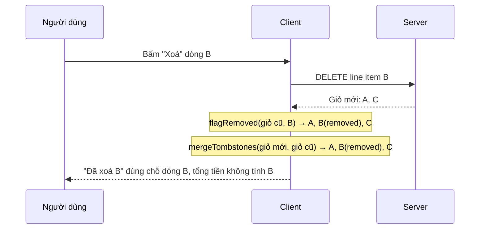

Trang thương mại điện tử có hai việc nghe rất bình thường nhưng hay làm khổ cả dev lẫn QA:

1. **Banner chạy theo lịch.** "Black Friday bắt đầu sau 2 ngày 03:12:45", tới giờ thì đổi sang "Đang sale, kết thúc sau…", hết giờ thì ẩn. Làm sao QA kiểm tra được trạng thái lúc 0 giờ ngày thứ Sáu khi hôm nay mới thứ Ba? Đổi giờ máy tính thì phá luôn HTTPS, cookie, token đăng nhập.
2. **Xoá một món khỏi giỏ.** Server trả về giỏ mới, món đó biến mất, mọi dòng bên dưới **nhảy lên**. Người dùng mất dấu: "mình vừa xoá đúng cái nào?", và nút "Xoá" của dòng tiếp theo trượt đúng vào chỗ con trỏ đang đứng.

Best Buy Canada (bestbuy.ca) có lời giải gọn cho cả hai. Bài này đọc code của họ, chỉ ra vài chỗ nên làm khác, rồi viết lại bằng React + TypeScript.

> [!TIP]
> **Tóm tắt**
> - Mọi chỗ cần "bây giờ" (countdown, banner theo lịch) đọc qua **một đồng hồ chung có offset**. QA đổi offset là cả trang "du hành" tới thời điểm đó.
> - Bật công cụ đó bằng một cờ trên URL (Best Buy: `?contentProofing=true`), và nhớ rằng nó chỉ để xem trước, không phải bảo mật.
> - Countdown: làm tròn lên tới giây, hẹn giờ theo ranh giới giây, có trạng thái "đã hết".
> - Xoá khỏi giỏ: chèn lại dòng đã xoá dưới dạng **tombstone** (dòng giữ chỗ) đúng vị trí cũ, hiện "Đã xoá X".

<iframe class="demo-frame" src="/demos/web-patterns/index.html?theme=dark#/countdown-tombstone" title="Demo countdown-tombstone" loading="lazy" style="height: 760px"></iframe>

<p class="demo-links">▶ <a href="/demos/web-patterns/index.html#/countdown-tombstone" target="_blank" rel="noopener">Mở demo toàn màn hình ↗</a> · <a href="https://stackblitz.com/github/hunghg255/blog-hunghg/tree/master/examples/web-patterns?file=src/lib/countdown.ts" target="_blank" rel="noopener">Sửa code trên StackBlitz ↗</a> · <a href="https://github.com/hunghg255/blog-hunghg/blob/master/examples/web-patterns/src/lib/countdown.ts" target="_blank" rel="noopener">Xem source trên GitHub ↗</a></p>

## Best Buy làm thế nào?

### 1. Một offset thời gian cho cả trang

Hook đếm ngược nằm ở [`client/components/banners/components/Countdown/hooks/countdownHook.ts`](https://github.com/hunghg255/codebase/blob/main/bestbuy.ca/src%281%29/client/components/banners/components/Countdown/hooks/countdownHook.ts) (thư mục gốc của dump tên là `src(1)`):

```ts
const getRemainingTime = (toDate: Date) => {
    const globalOffset = (typeof window !== "undefined" && window.globalDateOffset) || 0;
    return toDate.getTime() - new Date().getTime() + globalOffset;
};

const countdownHook = (toDate: Date): TimeFormat => {
    const [timer, setTimerState] = React.useState(formatTime(getRemainingTime(toDate)));
    let interval: number = 0;
    // …
    React.useEffect(() => {
        const remainingTime = getRemainingTime(toDate);
        if (remainingTime >= 0) {
            setTimer(remainingTime);
            interval = window.setInterval(() => setTimer(getRemainingTime(toDate)), SECOND);
        }
        return () => window.clearInterval(interval);
    }, []);
    return timer;
};
```

Biến toàn cục `window.globalDateOffset` mặc định là 0. Hook chọn giai đoạn của banner timeline (`Timeline/hooks/syncActiveStage.ts`) cũng đọc **đúng biến đó**:

```ts
const now = new Date().getTime() - globalOffset;
return stages.findIndex((stage) => now >= stage.onsetTime && (now <= stage.offsetTime || !stage.offsetTime));
```

Ai gán biến này? Một widget QA tên `DateOverride` (`components/banners/components/DateOverride/index.tsx`): một form nhỏ cho nhập "MM/DD/YYYY - HH:MM:SS" kèm AM/PM, submit thì:

```ts
setTime(new Date().getTime() - formattedDate.getTime());   // offset = giờ thật - giờ muốn xem
const setTime = (offset: number) => {
    window.globalDateOffset = offset;
    setCurrentTime(new Date().getTime() - offset);           // hiện "Currently Viewing: …"
};
```

Và widget chỉ hiện khi URL có cờ, trong `components/App/index.tsx`:

```tsx
const ContentProofing: React.FC = () => {
    if (typeof window !== "undefined" && window.location.search.toLowerCase().indexOf("contentproofing=true") >= 0) {
        return <DateOverride />;
    }
    return null;
};
```

Tên `ContentProofing` nói rõ mục đích: đội nội dung **duyệt trước** (proofing) banner, timeline, countdown của một chiến dịch ở đúng ngày giờ nó sẽ chạy, ngay trên môi trường thật, không cần dev đổi code hay đổi giờ server.

Nhìn kỹ thì có vài chỗ nên làm khác:

- **Dấu của offset ngược và lặp lại ở nhiều nơi.** `offset = giờ thật - giờ giả`, nên countdown phải **cộng** offset, còn timeline phải **trừ**. Hai file, hai dấu khác nhau cho cùng một ý "bây giờ". Gom vào một hàm `now()` thì không ai phải nhớ dấu.
- **Đổi offset không làm component render lại.** Countdown chỉ cập nhật ở tick `setInterval` kế tiếp; timeline thì ở tick kế tiếp của chu kỳ `checkInt` riêng của nó. Với QA, một giây trễ không sao, nhưng đây là dấu hiệu "offset không phải state".
- **`useEffect(..., [])`**: đổi `toDate` (ví dụ CMS trả lịch mới) thì hook vẫn đếm tới ngày cũ.
- **Hết giờ không có trạng thái riêng.** `setTimer` bỏ qua giá trị âm, interval vẫn chạy mãi (chỉ được dọn khi unmount) và màn hình đứng ở `0:00:00`. Việc chuyển banner sang "đã kết thúc" phụ thuộc hoàn toàn vào hook timeline.
- **`Math.floor` theo giây** làm countdown hiện `00:00:00` trong suốt giây cuối cùng, khi sale **chưa** bắt đầu.

### 2. Tombstone khi xoá khỏi giỏ

[`business-rules/use-cases/CartRemover.ts`](https://github.com/hunghg255/codebase/blob/main/bestbuy.ca/src%281%29/business-rules/use-cases/CartRemover.ts) (dù đuôi `.ts`, nội dung là JavaScript đã biên dịch, có cả `__awaiter`):

```js
this.removeItem = (lineItemId, prevCart, regionCode, postalCode, locale) =>
  this.apiBasketProviderFactory.make(regionCode, postalCode, locale)
    .removeCartItem(cartId, lineItemId)
    .then((res) => {
      const prevShipments = this.flagRemovedLineItem(prevCart.shipments, lineItemId);
      res.shipments = mergePrevShipment(res.shipments, prevShipments);
      resolve(res);
    });

this.flagRemovedLineItem = (shipments, lineItemId) => shipments.map((shipment) => {
  shipment.lineItems = shipment.lineItems.map((lineItem) =>
    lineItem.id === lineItemId ? { ...lineItem, removed: true } : lineItem);
  return shipment;
});
```

(đã rút gọn). Giỏ hàng chia theo **shipment**, mỗi shipment là một người bán (Best Buy hoặc người bán trên marketplace). Sau khi API xoá trả về giỏ **mới** (không còn dòng đó), `CartRemover` lấy giỏ **cũ**, đánh dấu dòng vừa xoá `removed: true`, rồi `mergePrevShipment` trong `cartMerger.ts` chèn nó trở lại:

```js
export const mergePrevShipment = (newShipments, oldShipments) => {
  if (!newShipments || !newShipments.length) return oldShipments;   // giỏ rỗng: giữ giỏ cũ
  let returnShipments = [...newShipments];
  oldShipments.forEach((oldShipment, shipmentIndex) => {
    oldShipment.lineItems.forEach((lineItem, lineItemIndex) => {
      if (lineItem.removed) {
        const i = _.findIndex(returnShipments, { seller: { id: oldShipment.seller.id } });
        returnShipments = i > -1
          ? insertLineItemIntoShipment({ lineItem, lineItemIndex, matchingShipmentIndex: i, returnShipments })
          : insertLineItemAndShipment({ lineItem, oldShipments, returnShipments, shipmentIndex });
      }
    });
  });
  return returnShipments;
};
```

Ở UI, `LineItem.tsx` thấy `removed` thì thêm class `removedItem` vào khung dòng. CSS (`LineItem/styles.css`) chạy một animation "quét" 1 giây trên dòng (`swipeDeletedItem`), thu phần nội dung về `max-height: 0`, và cho hiện khối `RemovedItemMessaging` vốn được render sẵn nhưng ẩn (`height: 0; opacity: 0`): "{tên sản phẩm} was removed from your cart", kèm thông báo riêng nếu món đó có gói bảo hành hoặc quà tặng kèm cũng bị xoá theo. Trang giỏ rỗng (`EmptyCart`) cũng render danh sách thông báo này, nên xoá món cuối cùng vẫn thấy được mình vừa xoá gì.

Vì giỏ cũ ở lần xoá sau **đã chứa** các tombstone trước, các thông báo cứ thế tích luỹ đúng chỗ qua nhiều lần xoá liên tiếp. Các chỗ đếm số dòng ở trang giỏ (`CartPage.tsx`, `selectors`) lọc `!li.removed` trước khi đếm.

Hai điểm nhỏ: `flagRemovedLineItem` **gán đè** `shipment.lineItems` trên object của giỏ cũ (mutation), và Best Buy không có nút "Hoàn tác".

## Bên trong trình duyệt: hẹn giờ và layout shift

**`setInterval(fn, 1000)` không chạy đúng mỗi 1000ms.** Mỗi lần gọi có thể trễ vài ms (main thread bận), tab nền bị giới hạn tối đa 1 lần/giây hoặc thưa hơn, và trên một số trình duyệt tab nền lâu bị "đóng băng". Nếu bạn **cộng dồn** ("mỗi tick trừ 1 giây") thì countdown trôi dần. Best Buy đã làm đúng phần quan trọng: mỗi tick **tính lại** từ `toDate - now`. Phần còn lại là thời điểm tick: interval bắt đầu ở mili giây ngẫu nhiên, nên số giây trên màn hình đổi lệch với đồng hồ hệ thống tới gần một giây, và thỉnh thoảng nhảy 2 giây một lúc. Hẹn `setTimeout` tới đúng **ranh giới giây kế tiếp** giải quyết cả hai.

**Layout shift khi xoá.** Dòng biến mất làm mọi thứ bên dưới dịch lên. Với Core Web Vitals, dịch chuyển xảy ra trong 500ms sau một thao tác của người dùng không bị tính vào CLS, nên đây không phải chuyện điểm số. Nó là chuyện **thao tác nhầm**: tay đang ở vị trí nút "Xoá", nút của dòng kế tiếp trượt vào đúng chỗ đó. Tombstone giữ chiều cao gần như cũ, nên không có gì trượt.



## Viết lại

### Một đồng hồ có offset

```ts title=src/lib/countdown.ts
export interface Clock {
  /** thời điểm "hiện tại" theo đồng hồ này (ms) = giờ thật + offset */
  now(): number;
  /** độ lệch so với giờ thật (ms); dương = đang ở tương lai */
  getOffset(): number;
  /** QA: xem trang như thể đang ở thời điểm `date` */
  travelTo(date: Date | number): void;
  travelBy(ms: number): void;
  reset(): void;
  subscribe(listener: Listener): () => void;
}

export function createClock(initialOffset = 0): Clock {
  let offset = initialOffset;
  const listeners = new Set<Listener>();
  const emit = () => listeners.forEach((l) => l());
  return {
    now: () => Date.now() + offset,
    getOffset: () => offset,
    travelTo(date) {
      offset = +date - Date.now();
      emit();
    },
    travelBy(ms) {
      offset += ms;
      emit();
    },
    reset() {
      offset = 0;
      emit();
    },
    subscribe(listener) {
      listeners.add(listener);
      return () => listeners.delete(listener);
    },
  };
}

/**
 * Đọc offset từ URL, CHỈ khi có cờ QA: ?qaNow=2026-11-28T09:00. Không có cờ thì offset = 0.
 * Đây là công cụ xem trước nội dung, không phải bảo mật: server vẫn phải tự kiểm tra giờ.
 */
export function offsetFromUrl(search = typeof location === 'undefined' ? '' : location.search): number {
  const value = new URLSearchParams(search).get('qaNow');
  if (!value) return 0;
  const target = Date.parse(value);
  return Number.isNaN(target) ? 0 : target - Date.now();
}

export const clock = createClock(offsetFromUrl());
```

- `now()` là **cửa duy nhất** để lấy thời gian. Offset lưu theo nghĩa tự nhiên: `giờ giả - giờ thật` (dương là tương lai), nên ở đâu cũng là phép cộng.
- `travelTo` / `travelBy` / `reset` báo cho listener, nên mọi component dùng đồng hồ render lại ngay.
- `offsetFromUrl` đọc `?qaNow=2026-11-28T09:00`. Gửi link đó cho người duyệt nội dung là họ thấy trang đúng lúc 9 giờ sáng hôm đó.

### Tính toán thuần

```ts title=src/lib/countdown.ts
export function remaining(target: number, now: number): Remaining {
  // làm tròn LÊN tới giây: còn 0,4 giây thì vẫn hiện "1 giây", không hiện 0 khi chưa hết
  const total = Math.max(0, Math.ceil((target - now) / SECOND) * SECOND);
  return {
    days: Math.floor(total / DAY),
    hours: Math.floor((total % DAY) / HOUR),
    minutes: Math.floor((total % HOUR) / MINUTE),
    seconds: Math.floor((total % MINUTE) / SECOND),
    total,
    done: total === 0,
  };
}

export interface Stage<T = unknown> {
  start: number;
  /** không có end = kéo dài mãi */
  end?: number;
  data: T;
}

/** Stage đang hiệu lực tại `now` (Best Buy: syncActiveStage), -1 nếu không có. */
export function activeStageIndex(stages: Stage[], now: number) {
  return stages.findIndex((s) => now >= s.start && (s.end === undefined || now < s.end));
}
```

`remaining` làm tròn **lên** tới giây: còn 0,4 giây thì hiện "1 giây", và chỉ hiện 0 khi đã thật sự hết, kèm `done: true`. `activeStageIndex` tương đương `syncActiveStage` của Best Buy nhưng là hàm thuần, nhận `now` từ ngoài vào nên test được không cần giả lập đồng hồ.

### Hook React

```ts title=src/lib/countdown.ts
export function useNow(c: Clock = clock, step = SECOND): number {
  // offset là external store: QA đổi giờ thì component render lại ngay, không đợi tick
  const offset = useSyncExternalStore(c.subscribe, c.getOffset, () => 0);
  const [now, setNow] = useState(() => c.now());
  useEffect(() => {
    let timer: ReturnType<typeof setTimeout>;
    const update = () => {
      setNow(c.now());
      // hẹn lần sau đúng ranh giới giây tiếp theo (+5ms cho chắc đã qua)
      timer = setTimeout(update, step - (c.now() % step) + 5);
    };
    update();
    return () => clearTimeout(timer);
  }, [c, step, offset]);
  return now;
}

export function useCountdown(target: number, c: Clock = clock): Remaining {
  return remaining(target, useNow(c));
}
```

- `useSyncExternalStore(c.subscribe, c.getOffset)` biến offset thành dữ liệu React biết theo dõi. Đổi offset → component render lại → effect chạy lại với `offset` mới trong deps → hẹn giờ lại từ đầu.
- `setTimeout(update, step - (now % step) + 5)` hẹn đúng ranh giới giây kế tiếp. Lần nào cũng tính lại, nên dù một tick trễ 200ms thì tick sau vẫn rơi đúng ranh giới.
- Component nào cần "giờ hiện tại" (banner timeline) dùng `useNow`; component đếm ngược dùng `useCountdown`. Cả hai cùng một đồng hồ.

**Khác bản gốc:** offset là state có thông báo thay vì biến `window` toàn cục; hết giờ có `done`; làm tròn lên thay vì xuống; tick căn theo ranh giới giây; đổi `target` thì hook tự tính lại (nó chỉ là tham số của một hàm thuần). Widget QA trong demo là nút bấm thay cho form nhập ngày.

### Tombstone

```ts title=src/lib/cartTombstone.ts
export function flagRemoved(shipments: Shipment[], lineItemId: string): Shipment[] {
  return shipments.map((shipment) =>
    shipment.lineItems.some((li) => li.id === lineItemId)
      ? {
          ...shipment,
          lineItems: shipment.lineItems.map((li) => (li.id === lineItemId ? { ...li, removed: true } : li)),
        }
      : shipment,
  );
}

/**
 * Ghép các tombstone từ giỏ cũ vào giỏ mới mà server trả về.
 * - Seller còn trong giỏ mới: chèn dòng đã xoá vào đúng chỉ số cũ trong shipment đó.
 * - Seller không còn (dòng cuối cùng của seller vừa bị xoá): chèn lại cả shipment, chỉ chứa
 *   tombstone, ở đúng vị trí cũ.
 * - Giỏ mới rỗng: giữ nguyên giỏ cũ (chỉ còn tombstone), để vẫn hiện được thông báo.
 */
export function mergeTombstones(next: Shipment[], prev: Shipment[]): Shipment[] {
  if (next.length === 0) return prev.map((s) => ({ ...s, lineItems: s.lineItems.filter((li) => li.removed) }));

  let result = next.map((s) => ({ ...s, lineItems: [...s.lineItems] }));
  prev.forEach((oldShipment, shipmentIndex) => {
    oldShipment.lineItems.forEach((item, itemIndex) => {
      if (!item.removed) return;
      const target = result.find((s) => s.sellerId === oldShipment.sellerId);
      if (target) {
        // không chèn trùng nếu server (hoặc lần ghép trước) đã có dòng này
        if (target.lineItems.some((li) => li.id === item.id)) return;
        target.lineItems.splice(Math.min(itemIndex, target.lineItems.length), 0, { ...item });
      } else {
        const ghost: Shipment = { ...oldShipment, lineItems: [{ ...item }] };
        result = [...result.slice(0, shipmentIndex), ghost, ...result.slice(shipmentIndex)];
      }
    });
  });
  return result;
}
```

- `flagRemoved` trả về mảng **mới**, không sửa giỏ cũ (khác bản gốc). Với React, sửa trực tiếp state cũ là nguồn gốc của các lỗi "UI không cập nhật".
- `mergeTombstones` giữ đúng hành vi của Best Buy: seller còn thì chèn vào **đúng chỉ số cũ** trong shipment; seller đã biến mất (dòng cuối của người bán đó vừa bị xoá) thì chèn lại cả shipment chỉ chứa tombstone; giỏ mới rỗng thì giữ giỏ cũ.
- Thêm một kiểm tra **không chèn trùng**: nếu vì lý do nào đó server vẫn trả về dòng đó (xoá thất bại một phần, hoặc ghép hai lần), không có hai dòng cùng `id`.
- `cartTotal` bỏ qua tombstone; `dropTombstones` dọn sạch khi rời trang giỏ hoặc tải lại.

::: spoiler Xem toàn bộ src/lib/countdown.ts

```ts title=src/lib/countdown.ts
import { useEffect, useState, useSyncExternalStore } from 'react';

/**
 * Đồng hồ dùng chung cho mọi countdown/banner theo lịch, có "du hành thời gian" cho QA.
 * Ý tưởng từ Best Buy Canada: countdownHook + window.globalDateOffset + widget DateOverride
 * (bật bằng ?contentProofing=true). Mọi chỗ cần "bây giờ" đều đi qua MỘT offset.
 */

type Listener = () => void;

export interface Clock {
  /** thời điểm "hiện tại" theo đồng hồ này (ms) = giờ thật + offset */
  now(): number;
  /** độ lệch so với giờ thật (ms); dương = đang ở tương lai */
  getOffset(): number;
  /** QA: xem trang như thể đang ở thời điểm `date` */
  travelTo(date: Date | number): void;
  travelBy(ms: number): void;
  reset(): void;
  subscribe(listener: Listener): () => void;
}

export function createClock(initialOffset = 0): Clock {
  let offset = initialOffset;
  const listeners = new Set<Listener>();
  const emit = () => listeners.forEach((l) => l());
  return {
    now: () => Date.now() + offset,
    getOffset: () => offset,
    travelTo(date) {
      offset = +date - Date.now();
      emit();
    },
    travelBy(ms) {
      offset += ms;
      emit();
    },
    reset() {
      offset = 0;
      emit();
    },
    subscribe(listener) {
      listeners.add(listener);
      return () => listeners.delete(listener);
    },
  };
}

/**
 * Đọc offset từ URL, CHỈ khi có cờ QA: ?qaNow=2026-11-28T09:00. Không có cờ thì offset = 0.
 * Đây là công cụ xem trước nội dung, không phải bảo mật: server vẫn phải tự kiểm tra giờ.
 */
export function offsetFromUrl(search = typeof location === 'undefined' ? '' : location.search): number {
  const value = new URLSearchParams(search).get('qaNow');
  if (!value) return 0;
  const target = Date.parse(value);
  return Number.isNaN(target) ? 0 : target - Date.now();
}

export const clock = createClock(offsetFromUrl());

// ---- tính toán thuần, dễ test ----

export interface Remaining {
  days: number;
  hours: number;
  minutes: number;
  seconds: number;
  /** tổng ms còn lại, 0 khi đã hết */
  total: number;
  done: boolean;
}

const SECOND = 1000;
const MINUTE = 60 * SECOND;
const HOUR = 60 * MINUTE;
const DAY = 24 * HOUR;

export function remaining(target: number, now: number): Remaining {
  // làm tròn LÊN tới giây: còn 0,4 giây thì vẫn hiện "1 giây", không hiện 0 khi chưa hết
  const total = Math.max(0, Math.ceil((target - now) / SECOND) * SECOND);
  return {
    days: Math.floor(total / DAY),
    hours: Math.floor((total % DAY) / HOUR),
    minutes: Math.floor((total % HOUR) / MINUTE),
    seconds: Math.floor((total % MINUTE) / SECOND),
    total,
    done: total === 0,
  };
}

export interface Stage<T = unknown> {
  start: number;
  /** không có end = kéo dài mãi */
  end?: number;
  data: T;
}

/** Stage đang hiệu lực tại `now` (Best Buy: syncActiveStage), -1 nếu không có. */
export function activeStageIndex(stages: Stage[], now: number) {
  return stages.findIndex((s) => now >= s.start && (s.end === undefined || now < s.end));
}

// ---- hook React ----

/**
 * "Bây giờ" theo `clock`, cập nhật đúng lúc sang giây mới (căn theo ranh giới giây thay vì
 * setInterval(1000) trôi dần), và cập nhật NGAY khi QA đổi offset.
 */
export function useNow(c: Clock = clock, step = SECOND): number {
  // offset là external store: QA đổi giờ thì component render lại ngay, không đợi tick
  const offset = useSyncExternalStore(c.subscribe, c.getOffset, () => 0);
  const [now, setNow] = useState(() => c.now());
  useEffect(() => {
    let timer: ReturnType<typeof setTimeout>;
    const update = () => {
      setNow(c.now());
      // hẹn lần sau đúng ranh giới giây tiếp theo (+5ms cho chắc đã qua)
      timer = setTimeout(update, step - (c.now() % step) + 5);
    };
    update();
    return () => clearTimeout(timer);
  }, [c, step, offset]);
  return now;
}

export function useCountdown(target: number, c: Clock = clock): Remaining {
  return remaining(target, useNow(c));
}
```

:::

::: spoiler Xem toàn bộ src/lib/cartTombstone.ts

```ts title=src/lib/cartTombstone.ts
/**
 * "Bia mộ" (tombstone) cho dòng sản phẩm vừa xoá khỏi giỏ hàng.
 * Ý tưởng từ Best Buy Canada (business-rules/use-cases/CartRemover.ts + cartMerger.ts):
 * server trả về giỏ hàng MỚI không còn dòng đã xoá; client chèn lại dòng đó, đánh dấu
 * `removed: true`, ĐÚNG vị trí cũ. UI hiện "Đã xoá X khỏi giỏ" thay cho dòng đó, nên các dòng
 * bên dưới không bị nhảy lên và người dùng biết chắc mình vừa xoá cái gì.
 */

export interface LineItem {
  id: string;
  name: string;
  price: number;
  quantity: number;
  removed?: boolean;
}

export interface Shipment {
  sellerId: string;
  sellerName: string;
  lineItems: LineItem[];
}

/** Đánh dấu dòng `lineItemId` là đã xoá, trả về mảng MỚI (Best Buy sửa trực tiếp object cũ). */
export function flagRemoved(shipments: Shipment[], lineItemId: string): Shipment[] {
  return shipments.map((shipment) =>
    shipment.lineItems.some((li) => li.id === lineItemId)
      ? {
          ...shipment,
          lineItems: shipment.lineItems.map((li) => (li.id === lineItemId ? { ...li, removed: true } : li)),
        }
      : shipment,
  );
}

/**
 * Ghép các tombstone từ giỏ cũ vào giỏ mới mà server trả về.
 * - Seller còn trong giỏ mới: chèn dòng đã xoá vào đúng chỉ số cũ trong shipment đó.
 * - Seller không còn (dòng cuối cùng của seller vừa bị xoá): chèn lại cả shipment, chỉ chứa
 *   tombstone, ở đúng vị trí cũ.
 * - Giỏ mới rỗng: giữ nguyên giỏ cũ (chỉ còn tombstone), để vẫn hiện được thông báo.
 */
export function mergeTombstones(next: Shipment[], prev: Shipment[]): Shipment[] {
  if (next.length === 0) return prev.map((s) => ({ ...s, lineItems: s.lineItems.filter((li) => li.removed) }));

  let result = next.map((s) => ({ ...s, lineItems: [...s.lineItems] }));
  prev.forEach((oldShipment, shipmentIndex) => {
    oldShipment.lineItems.forEach((item, itemIndex) => {
      if (!item.removed) return;
      const target = result.find((s) => s.sellerId === oldShipment.sellerId);
      if (target) {
        // không chèn trùng nếu server (hoặc lần ghép trước) đã có dòng này
        if (target.lineItems.some((li) => li.id === item.id)) return;
        target.lineItems.splice(Math.min(itemIndex, target.lineItems.length), 0, { ...item });
      } else {
        const ghost: Shipment = { ...oldShipment, lineItems: [{ ...item }] };
        result = [...result.slice(0, shipmentIndex), ghost, ...result.slice(shipmentIndex)];
      }
    });
  });
  return result;
}

/** Bỏ hết tombstone, ví dụ khi người dùng rời trang giỏ hàng hoặc tải lại giỏ. */
export const dropTombstones = (shipments: Shipment[]) =>
  shipments
    .map((s) => ({ ...s, lineItems: s.lineItems.filter((li) => !li.removed) }))
    .filter((s) => s.lineItems.length > 0);

/** Tổng tiền: tombstone không được tính. */
export const cartTotal = (shipments: Shipment[]) =>
  shipments.reduce(
    (sum, s) => sum + s.lineItems.reduce((acc, li) => acc + (li.removed ? 0 : li.price * li.quantity), 0),
    0,
  );
```

:::

## Tại sao không làm cách khác?

**Mock thời gian bằng thư viện (`sinon.useFakeTimers`, `vi.setSystemTime`)?** Tuyệt vời cho unit test, nhưng chỉ chạy trong môi trường test. Thứ Best Buy cần là cho **người không viết code** xem trước trang thật trên production.

**Đổi giờ hệ điều hành?** Làm hỏng chứng chỉ HTTPS ("ngày không hợp lệ"), cookie hết hạn, token đăng nhập. Và chỉ đổi được giờ của một máy.

**Offset phía server?** Nếu banner được render ở server (SSR/CMS), bạn cần cả hai: server cũng phải nhận tham số thời gian giả lập. Offset ở client chỉ đổi phần JavaScript tính toán.

**Xoá ngay ở client, gọi API sau (optimistic UI)?** Nhanh hơn, nhưng vẫn để dòng biến mất và các dòng khác nhảy lên. Tombstone kết hợp được với optimistic UI: hiện tombstone ngay khi bấm, nếu API lỗi thì khôi phục dòng.

**Animation thu nhỏ dòng rồi mới xoá?** Đẹp hơn cách nhảy đột ngột, nhưng người dùng vẫn không có xác nhận "đã xoá X". Hai cách có thể dùng cùng nhau: tombstone ở lại cho tới khi rời trang.

## Edge case và cạm bẫy

- **Đây không phải bảo mật.** Ai cũng gõ được `?qaNow=` hay `?contentProofing=true`. Giá sale, mã giảm giá, quyền mua phải do **server** kiểm tra theo giờ server. Offset ở client chỉ đổi những gì người dùng *nhìn thấy*.
- **Nên tắt hẳn trên production nếu không cần**, hoặc chỉ bật cho người dùng nội bộ. Một banner "Đang sale" hiện sai cho khách (vì link QA bị chia sẻ) có thể gây khiếu nại.
- **Giờ của máy người dùng sai.** `Date.now()` là đồng hồ máy khách, có thể lệch vài phút. Với sale quan trọng, lấy giờ server (header `Date` hoặc một API) để tính thêm một offset "đồng bộ đồng hồ", tách biệt với offset QA.
- **SSR và hydration.** Countdown render ở server với giờ server, tới client đã khác vài giây, React báo lệch nội dung khi hydrate. Hiện placeholder ở server và chỉ tính số ở client, hoặc thêm `suppressHydrationWarning` cho phần số.
- **Múi giờ.** `Date.parse('2026-11-28T09:00')` không có múi giờ được hiểu là giờ **địa phương** của máy. Lịch sale nên lưu dạng UTC hoặc có offset rõ ràng.
- **Tombstone và `key`.** Dòng tombstone phải giữ `key={li.id}` như dòng gốc, để React không unmount/mount lại mọi dòng phía sau.
- **Tombstone với screen reader:** đặt `role="status"` để thông báo "Đã xoá…" được đọc lên.

## Dùng trong dự án

```tsx
import { activeStageIndex, clock, useCountdown, useNow } from './lib/countdown';

function SaleBanner({ start, end }: { start: number; end: number }) {
  const now = useNow();
  const stage = activeStageIndex([{ start: 0, end: start, data: 0 }, { start, end, data: 1 }], now);
  const left = useCountdown(stage === 0 ? start : end);
  if (stage === -1) return null; // đã kết thúc
  return <div>{stage === 0 ? 'Bắt đầu sau' : 'Kết thúc sau'} {left.days}n {left.hours}:{left.minutes}:{left.seconds}</div>;
}

// Công cụ QA chỉ có trong bản build nội bộ:
if (import.meta.env.VITE_QA_TOOLS) Object.assign(window, { qaClock: clock });
```

```ts
// Giỏ hàng (Redux/Zustand/useReducer đều được)
async function removeItem(id: string) {
  const next = await api.removeLineItem(cartId, id);
  set((state) => ({ shipments: mergeTombstones(next.shipments, flagRemoved(state.shipments, id)) }));
}
```

## Kiểm thử

::: spoiler Ví dụ test (bản phác, không có trong repo)

```ts
import { describe, expect, it } from 'vitest';
import { activeStageIndex, createClock, remaining } from './countdown';
import { flagRemoved, mergeTombstones, type Shipment } from './cartTombstone';

describe('countdown', () => {
  it('làm tròn lên tới giây và có done', () => {
    expect(remaining(10_400, 10_000)).toMatchObject({ seconds: 1, done: false });
    expect(remaining(10_000, 10_000)).toMatchObject({ seconds: 0, done: true });
    expect(remaining(0, 10_000).total).toBe(0);
  });
  it('travelTo đổi now() và báo listener', () => {
    const c = createClock();
    let calls = 0;
    c.subscribe(() => calls++);
    c.travelTo(Date.now() + 86_400_000);
    expect(c.now() - Date.now()).toBeGreaterThan(86_399_000);
    expect(calls).toBe(1);
  });
  it('chọn đúng stage', () => {
    const stages = [{ start: 0, end: 100, data: 'a' }, { start: 100, data: 'b' }];
    expect(activeStageIndex(stages, 99)).toBe(0);
    expect(activeStageIndex(stages, 100)).toBe(1);
  });
});

describe('tombstone', () => {
  const item = (id: string) => ({ id, name: id, price: 1, quantity: 1 });
  const prev: Shipment[] = [
    { sellerId: 's1', sellerName: 'S1', lineItems: [item('a'), item('b'), item('c')] },
    { sellerId: 's2', sellerName: 'S2', lineItems: [item('d')] },
  ];
  it('chèn lại đúng vị trí cũ', () => {
    const next = [{ ...prev[0], lineItems: [item('a'), item('c')] }, prev[1]];
    const merged = mergeTombstones(next, flagRemoved(prev, 'b'));
    expect(merged[0].lineItems.map((li) => `${li.id}${li.removed ? '†' : ''}`)).toEqual(['a', 'b†', 'c']);
  });
  it('seller biến mất thì giữ lại shipment chỉ có tombstone', () => {
    const merged = mergeTombstones([prev[0]], flagRemoved(prev, 'd'));
    expect(merged[1]).toMatchObject({ sellerId: 's2', lineItems: [{ id: 'd', removed: true }] });
  });
  it('không sửa giỏ cũ', () => {
    flagRemoved(prev, 'a');
    expect(prev[0].lineItems[0].removed).toBeUndefined();
  });
});
```

Với hook, dùng `vi.useFakeTimers()` + `vi.setSystemTime()` và `@testing-library/react` để kiểm tra số giây đổi đúng sau `vi.advanceTimersByTime(1000)`.

:::

## So với thư viện và chuẩn web

- Không có API web chuẩn nào để "giả lập giờ" cho cả trang. Một đồng hồ có offset trong code vẫn là cách đơn giản nhất, và chạy được cho cả người không dùng DevTools.
- Các thư viện ngày giờ (date-fns, Day.js, Temporal khi có) chỉ lo phần tính toán; nguồn "bây giờ" vẫn nên là một hàm duy nhất mà bạn kiểm soát.
- Mẫu tombstone xuất hiện ở nhiều nơi khác: Gmail "Đã chuyển cuộc trò chuyện vào thùng rác. Hoàn tác", danh sách file của Google Drive. Ý chung: **xác nhận đúng chỗ** thay vì để nội dung biến mất.

---

Bài này thuộc series **[Học từ mã nguồn các web lớn](/series/web)** (21 bài, đọc theo thứ tự).

::: spoiler Xem nhanh danh sách bài trong series

*Mở đầu*

- [Mở đầu: đọc code production của 28 trang web](/blogs/learn-from-big-web-apps)

*Phần 1: trải nghiệm người dùng*

- [#1 Dark mode không nháy (Gatsby)](/blogs/web-dark-mode-no-flash)
- [#2 useValueByMedia: giá trị theo breakpoint (Toptal)](/blogs/web-use-value-by-media)
- [#3 Đoán ý định: idle, exit-intent, lắc chuột (Toptal, InVision)](/blogs/web-user-intent-idle-exit-wiggle)
- [#4 Validate form thân thiện (Udacity, Pipedrive)](/blogs/web-form-validation-ux)
- [#5 Magic number, EXIF và dán ảnh (Ello)](/blogs/web-file-magic-number-exif-paste)
- [#6 fastSmoothScroll: cuộn xa vẫn nhanh (Telegram)](/blogs/web-telegram-fast-smooth-scroll)
- **#7 Countdown time-travel và tombstone giỏ hàng (Best Buy)** (bài này)

*Phần 2: hiệu năng và đo lường*

- [#8 Hàng đợi requestAnimationFrame 3ms (Apple)](/blogs/web-raf-queue-3ms)
- [#9 srcset cho artwork và preconnect tự động (Apple)](/blogs/web-responsive-artwork-preconnect)
- [#10 Quick-fetch: gọi API trước khi bundle tải xong (HubSpot)](/blogs/web-quick-fetch-early-requests)
- [#11 Performance span và long task (Postman, Calibre)](/blogs/web-performance-spans-long-tasks)
- [#12 Gọi Web Worker như hàm async (Telegram)](/blogs/web-worker-promise-rpc)
- [#13 Đồng hồ media: đếm giờ xem và sửa lệch (Skillshare, Simplified)](/blogs/web-media-clock-watch-time-drift)

*Phần 3: nhiều tab, phiên đăng nhập, cập nhật*

- [#14 Bầu tab chủ cho thông báo (HubSpot, Telegram)](/blogs/web-leader-tab-notifications)
- [#15 Đồng bộ đăng nhập giữa tab và giới hạn cookie (Elastic, InVision)](/blogs/web-cross-tab-auth-cookie-guard)
- [#16 SPA tự cập nhật: Trello, Zappos, Facebook](/blogs/web-spa-self-update-strategies)

*Phần 4: kiến trúc*

- [#17 Reverse portal: di chuyển component không remount (Zappos)](/blogs/web-reverse-portal)
- [#18 Page behaviors: gắn hành vi từ CMS (Intercom)](/blogs/web-page-behaviors-cms)
- [#19 Giới hạn tần suất hiển thị bằng bitmask (Outlook)](/blogs/web-frequency-cap-bitmask)
- [#20 Chuyển REST sang GraphQL dần dần (Coursera)](/blogs/web-rest-to-graphql-hybrid-link)

:::

Code + demo: [`examples/web-patterns`](https://github.com/hunghg255/blog-hunghg/tree/master/examples/web-patterns) · [Mở trên StackBlitz](https://stackblitz.com/github/hunghg255/blog-hunghg/tree/master/examples/web-patterns)
