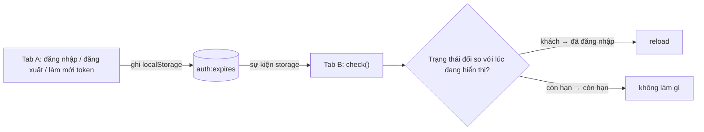

Hai lỗi về phiên đăng nhập mà người dùng gặp thường xuyên nhưng ít khi báo lại:

1. **Đăng xuất ở tab này, tab kia vẫn "đăng nhập".** Người dùng mở hai tab Elastic Cloud, đăng xuất ở tab A rồi quay sang tab B. Tab B vẫn hiện dữ liệu cũ, bấm gì cũng lỗi 401 vì token đã bị xoá. Ngược lại cũng vậy: đăng nhập ở tab A, tab B vẫn đứng ở màn hình đăng nhập.
2. **App tự nhiên hỏng, xoá cookie thì hết.** Các script analytics (Amplitude, Mixpanel…) ghi cookie vào domain của bạn, mỗi cookie vài KB, càng dùng càng nhiều. Tới một ngày, tổng header `Cookie` vượt giới hạn của proxy/CDN và **mọi request** đều bị trả lỗi 400 hoặc 431. Với người dùng, app "chết hẳn" mà không có thông báo gì dễ hiểu.

Elastic Cloud và InVision mỗi bên có một đoạn code nhỏ cho đúng một trong hai lỗi trên.

> [!TIP]
> **Tóm tắt**
> - Lưu **thời điểm hết hạn** của token vào localStorage (không lưu token). Các tab khác nghe sự kiện `storage` và chỉ reload khi **trạng thái** đổi: khách ↔ đã đăng nhập, có/không quyền sudo. Làm mới token (hạn mới, vẫn hợp lệ) thì không làm gì.
> - So sánh với trạng thái **tab đang hiển thị**, không so `oldValue`/`newValue` của sự kiện: an toàn cả khi trình duyệt bắn sự kiện nhầm vào chính tab vừa ghi.
> - Đo tổng kích thước `document.cookie`; vượt ngưỡng an toàn (InVision: 13KB, dưới mức 16KB của Cloudflare) thì xoá các cookie "dọn được" như cookie analytics.
> - Xoá cookie bằng `Max-Age=0` (hoặc một ngày hợp lệ trong quá khứ) và **đúng domain/path** đã dùng khi ghi. `expires=<một con số>` không xoá được cookie.

<iframe class="demo-frame" src="/demos/web-patterns/index.html?theme=dark#/cross-tab-auth" title="Demo cross-tab-auth" loading="lazy" style="height: 1140px"></iframe>

<p class="demo-links">▶ <a href="/demos/web-patterns/index.html#/cross-tab-auth" target="_blank" rel="noopener">Mở demo toàn màn hình ↗</a> · <a href="https://stackblitz.com/github/hunghg255/blog-hunghg/tree/master/examples/web-patterns?file=src/lib/crossTabAuth.ts" target="_blank" rel="noopener">Sửa code trên StackBlitz ↗</a> · <a href="https://github.com/hunghg255/blog-hunghg/blob/master/examples/web-patterns/src/lib/crossTabAuth.ts" target="_blank" rel="noopener">Xem source trên GitHub ↗</a></p>

## Elastic Cloud làm thế nào?

Component `cloud.elastic.co/components/CrossTabAuthReplication/index.ts` ([xem trên GitHub](https://github.com/hunghg255/codebase/blob/main/cloud.elastic.co/components/CrossTabAuthReplication/index.ts)) là một React component render `null`, được gắn một lần ở gốc app (trong `AppRootSharedSideEffects`).

### Chỉ lưu thời điểm hết hạn

Hàm `SAD_updateAuthTokenBits` trong `lib/auth.ts` giải mã JWT và ghi hai khoá vào localStorage:

```ts
localStorage.setItem('CLOUD_AUTH_EXPIRES', JSON.stringify(decoded.exp ? decoded.exp * 1000 : null));
localStorage.setItem('CLOUD_AUTH_EXPIRES_SUDO', JSON.stringify(decoded.sudo ? decoded.sudo * 1000 : null));
```

Token thật không nằm ở đây. localStorage chỉ giữ hai con số: token hết hạn lúc nào, quyền sudo (quyền quản trị tạm thời, phải nhập lại mật khẩu) hết hạn lúc nào. Đăng xuất thì `removeItem` cả hai. (Tiền tố `SAD_` là của chính Elastic: comment ghi rằng họ muốn bỏ các hàm phải tự đoán trạng thái từ JWT, thay bằng hỏi API.)

### Chỉ reload khi trạng thái đổi

Component nghe hai khoá đó bằng thư viện `local-storage` (npm, bọc sự kiện `storage` và trả về giá trị mới/cũ đã `JSON.parse`). Comment đầu file liệt kê năm tình huống làm hai khoá thay đổi: đăng nhập, đăng xuất, lấy sudo, bỏ sudo, và token được làm mới tự động (`RefreshApiToken`). Bốn tình huống đầu cần reload; tình huống cuối thì không:

```ts
hasExpirationStateChange(nextExpiration, prevExpiration) {
  if (nextExpiration === prevExpiration) return false;
  const nextDate = nextExpiration ? new Date(nextExpiration) : null;
  const prevDate = prevExpiration ? new Date(prevExpiration) : null;
  // Token was expired and now is not, or token was unexpired and now is not
  return expiresInTheFuture(nextDate) !== expiresInTheFuture(prevDate);
}
```

Điểm mấu chốt: so **trạng thái** (`expiresInTheFuture`: còn hạn hay không), không so **giá trị**. Token được làm mới thì hạn đổi từ 10:00 sang 11:00, nhưng cả hai đều "còn hạn", nên không reload. Comment giải thích: reload lúc đó chỉ làm phiền người dùng.

Khi cần reload, hàm `fullPageReload()` tải lại trang, với một trường hợp đặc biệt: đang ở `/login?fromURI=...` (đăng nhập qua Okta) thì chuyển thẳng tới `fromURI` thay vì reload, vì reload trang login với tham số đó sẽ kích hoạt đăng xuất.

### Tắt hẳn trên Safari

```ts
const featureDetectedSafari = /^((?!chrome|android).)*safari/i.test(navigator.userAgent);

componentDidMount() {
  // Safari fires storage events in the same tab where changes originate, causing issues
  // https://bugs.webkit.org/show_bug.cgi?id=210512
  if (featureDetectedSafari) return;
  ...
}
```

Theo comment, Safari bắn sự kiện `storage` ở **chính tab vừa ghi**, trái với chuẩn (chuẩn chỉ bắn ở các document khác). Với logic "nhận sự kiện là reload", tab vừa đăng nhập sẽ tự reload chính nó. Elastic chọn tắt hẳn tính năng trên Safari bằng cách dò user agent. Regex này khớp mọi chuỗi có "safari" mà không có "chrome" hay "android", tức là cả Chrome và Firefox trên iOS (vì UA của chúng là "CriOS", "FxiOS"), điều này hợp lý vì mọi trình duyệt trên iOS đều chạy WebKit.

Bản viết lại bên dưới không cần dò Safari: nó so với trạng thái mà tab đang hiển thị, và tab vừa ghi đã cập nhật trạng thái đó trước, nên một sự kiện bắn nhầm không gây reload.

## InVision làm thế nào?

File `invisionapp.com(dashboard)/utils/cookieSizeHelper.js` ([xem trên GitHub](https://github.com/hunghg255/codebase/blob/main/invisionapp.com%28dashboard%29/utils/cookieSizeHelper.js)) mở đầu bằng một comment rất rõ: bảo vệ trước việc các thư viện phía client làm cookie phình to tới mức server lỗi, vì vượt cấu hình [`large_client_header_buffers`](http://nginx.org/en/docs/http/ngx_http_core_module.html#large_client_header_buffers) của nginx. Hàm bên trong tên là `cookieMonster`:

```js
// We have updated our header allowance to 24k but
// cloudflare enforces the cookie limit at 16k.
const maxBytes = 1024 * 13 // 13k
const currentBytes = encodeURI(document.cookie).split(/%..|./).length - 1
const disposableCookieNameIncludes = ['amplitude', 'mp_']
```

- **Ngưỡng 13KB**: họ đã nâng giới hạn header của nginx lên 24KB, nhưng theo comment, Cloudflare (đứng trước nginx) giới hạn cookie ở 16KB. 13KB chừa khoảng trống cho các cookie được ghi thêm giữa hai lần kiểm tra ("để không có sự cố trong các lời gọi bất đồng bộ").
- **Đếm byte bằng `encodeURI`**: `encodeURI` biến mỗi ký tự ngoài ASCII thành các cụm `%XX`, mỗi cụm là một byte UTF-8. Regex `/%..|./` khớp từng cụm `%XX` hoặc từng ký tự thường, nên số mảnh sau `split` trừ 1 chính là số byte. Một mẹo cũ trước khi có `TextEncoder`.
- **Chỉ xoá cái biết chắc là dọn được**: cookie có tên chứa `amplitude` hoặc `mp_` (Mixpanel). Xoá nhầm cookie phiên đăng nhập là đăng xuất người dùng.
- **Chạy lúc rảnh**: gọi qua `requestIdleCallback`, không có thì `setTimeout(…, 7000)`, sau khi phần "home" của app shell mount xong.

Hàm xoá cookie có một lỗi nhỏ:

```js
document.cookie = `${name}=;expires=${+new Date()};domain=.invisionapp.com;path=/`
```

`+new Date()` là một con số (vd `1761550000000`), không phải ngày theo định dạng cookie. Theo [RFC 6265](https://httpwg.org/specs/rfc6265.html#sane-set-cookie), thuộc tính `Expires` không đọc được thì bị **bỏ qua**, nên dòng trên thực chất ghi đè cookie thành giá trị rỗng, không có hạn (cookie phiên), chứ không xoá nó. Mình đã thử trên Chromium: `document.cookie` vẫn còn `amplitude_x=` sau dòng đó. Kích thước vẫn giảm (giá trị đã rỗng) nên mục đích chính vẫn đạt, nhưng tên cookie còn đó cho tới khi đóng trình duyệt. Bật "Xoá kiểu bản gốc" trong demo để thấy các cookie rỗng còn lại.

## Bên trong trình duyệt

**Sự kiện `storage`** bắn ở mọi document **khác** cùng origin khi localStorage thay đổi: tab khác, iframe khác. Document vừa ghi không nhận sự kiện. Sự kiện có `key`, `oldValue`, `newValue`, `storageArea`; `localStorage.clear()` thì `key === null`.

**Header `Cookie`** chứa mọi cookie khớp domain và path của request, nối bằng `; `. Mỗi cookie bị trình duyệt giới hạn khoảng 4KB, nhưng không có giới hạn chung nào cho tổng số byte gửi đi: 20 cookie analytics 1KB là 20KB trong **mỗi** request, kể cả request tải ảnh. Server và proxy thì có giới hạn: nginx mặc định 8KB cho một dòng header (trả lỗi 400 "Request Header Or Cookie Too Large"), mã lỗi chuẩn cho trường hợp này là 431.

**`document.cookie` không thấy cookie `HttpOnly`.** Cookie phiên đăng nhập thường là `HttpOnly`, nên con số đo được luôn **nhỏ hơn** header thật. Ngưỡng 13KB phải chừa chỗ cho những cookie không thấy được này.



## Viết lại

### `crossTabAuth.ts`

[`src/lib/crossTabAuth.ts`](https://github.com/hunghg255/blog-hunghg/blob/master/examples/web-patterns/src/lib/crossTabAuth.ts) giữ ý tưởng của Elastic (chỉ lưu thời điểm hết hạn, so theo trạng thái) và đổi cách so sánh:

```ts title=src/lib/crossTabAuth.ts
export function watchAuthState({ onStateChange, storage = localStorage, now = Date.now }: WatchAuthOptions) {
  // Trạng thái mà TAB NÀY đang hiển thị. So sánh với nó, không so oldValue/newValue của sự kiện:
  // sự kiện có bắn nhầm vào chính tab vừa ghi (Elastic ghi nhận lỗi này trên Safari) thì
  // `known` đã được cập nhật trong write(), nên không có gì đổi và không reload.
  let known = toAuthState(readAuth(storage), now());

  function check() {
    const next = toAuthState(readAuth(storage), now());
    if (sameState(next, known)) return;
    const prev = known;
    known = next;
    onStateChange(next, prev);
  }

  const onStorage = (event: StorageEvent) => {
    if (event.storageArea !== storage) return;
    // key === null: localStorage.clear() ở tab khác
    if (event.key === null || event.key === AUTH_KEYS.expires || event.key === AUTH_KEYS.sudoExpires) {
      check();
    }
  };
  window.addEventListener('storage', onStorage);

  return {
    /** tab này đăng nhập / đăng xuất / làm mới token: ghi và cập nhật trạng thái đã biết */
    write(snapshot: AuthSnapshot) {
      writeKey(storage, AUTH_KEYS.expires, snapshot.expiresAt);
      writeKey(storage, AUTH_KEYS.sudoExpires, snapshot.sudoExpiresAt);
      known = toAuthState(snapshot, now());
    },
    getState: () => known,
    /** kiểm tra lại bằng tay, vd khi tab được hiện lại */
    check,
    stop: () => window.removeEventListener('storage', onStorage),
  };
}
```

Dùng trong app:

```ts
const auth = watchAuthState({ onStateChange: () => location.reload() });

async function login(credentials) {
  const { token } = await api.login(credentials); // token nằm trong cookie HttpOnly
  const { exp } = decodeJwt(token);
  auth.write({ expiresAt: exp * 1000, sudoExpiresAt: null });
}
```

::: spoiler Xem toàn bộ src/lib/crossTabAuth.ts

```ts title=src/lib/crossTabAuth.ts
/**
 * Đồng bộ trạng thái đăng nhập giữa các tab (ý tưởng từ CrossTabAuthReplication của Elastic Cloud).
 *
 * - localStorage chỉ giữ THỜI ĐIỂM HẾT HẠN của token (và của quyền sudo), không giữ token.
 * - Tab khác ghi vào localStorage -> sự kiện `storage` bắn ở tab này.
 * - Chỉ phản ứng (thường là reload) khi TRẠNG THÁI đổi: khách <-> đã đăng nhập, có/không sudo.
 *   Token được làm mới (hạn mới, vẫn còn hiệu lực) thì không làm gì: reload lúc đó chỉ làm phiền.
 */

export const AUTH_KEYS = {
  expires: 'auth:expires',
  sudoExpires: 'auth:sudo-expires',
} as const;

export interface AuthSnapshot {
  /** epoch ms, null = chưa đăng nhập */
  expiresAt: number | null;
  sudoExpiresAt: number | null;
}

export interface AuthState {
  loggedIn: boolean;
  sudo: boolean;
}

const inFuture = (time: number | null, now: number) => time !== null && time > now;

export function toAuthState(snapshot: AuthSnapshot, now = Date.now()): AuthState {
  return {
    loggedIn: inFuture(snapshot.expiresAt, now),
    sudo: inFuture(snapshot.sudoExpiresAt, now),
  };
}

function readNumber(storage: Storage, key: string): number | null {
  try {
    const value = JSON.parse(storage.getItem(key) ?? 'null');
    return typeof value === 'number' ? value : null;
  } catch {
    return null; // giá trị hỏng coi như không có
  }
}

export function readAuth(storage: Storage = localStorage): AuthSnapshot {
  return {
    expiresAt: readNumber(storage, AUTH_KEYS.expires),
    sudoExpiresAt: readNumber(storage, AUTH_KEYS.sudoExpires),
  };
}

function writeKey(storage: Storage, key: string, value: number | null) {
  if (value === null) storage.removeItem(key);
  else storage.setItem(key, JSON.stringify(value));
}

const sameState = (a: AuthState, b: AuthState) => a.loggedIn === b.loggedIn && a.sudo === b.sudo;

export interface WatchAuthOptions {
  /** trạng thái đổi do tab KHÁC: thường gọi location.reload() */
  onStateChange: (next: AuthState, prev: AuthState) => void;
  storage?: Storage;
  now?: () => number;
}

export function watchAuthState({ onStateChange, storage = localStorage, now = Date.now }: WatchAuthOptions) {
  // Trạng thái mà TAB NÀY đang hiển thị. So sánh với nó, không so oldValue/newValue của sự kiện:
  // sự kiện có bắn nhầm vào chính tab vừa ghi (Elastic ghi nhận lỗi này trên Safari) thì
  // `known` đã được cập nhật trong write(), nên không có gì đổi và không reload.
  let known = toAuthState(readAuth(storage), now());

  function check() {
    const next = toAuthState(readAuth(storage), now());
    if (sameState(next, known)) return;
    const prev = known;
    known = next;
    onStateChange(next, prev);
  }

  const onStorage = (event: StorageEvent) => {
    if (event.storageArea !== storage) return;
    // key === null: localStorage.clear() ở tab khác
    if (event.key === null || event.key === AUTH_KEYS.expires || event.key === AUTH_KEYS.sudoExpires) {
      check();
    }
  };
  window.addEventListener('storage', onStorage);

  return {
    /** tab này đăng nhập / đăng xuất / làm mới token: ghi và cập nhật trạng thái đã biết */
    write(snapshot: AuthSnapshot) {
      writeKey(storage, AUTH_KEYS.expires, snapshot.expiresAt);
      writeKey(storage, AUTH_KEYS.sudoExpires, snapshot.sudoExpiresAt);
      known = toAuthState(snapshot, now());
    },
    getState: () => known,
    /** kiểm tra lại bằng tay, vd khi tab được hiện lại */
    check,
    stop: () => window.removeEventListener('storage', onStorage),
  };
}
```

:::

### `cookieGuard.ts`

[`src/lib/cookieGuard.ts`](https://github.com/hunghg255/blog-hunghg/blob/master/examples/web-patterns/src/lib/cookieGuard.ts):

```ts title=src/lib/cookieGuard.ts
export function guardCookieSize({
  maxBytes = 13 * 1024,
  disposable = ['amplitude', 'mp_'],
  domain,
  path = '/',
  jar = documentJar,
}: GuardOptions = {}): GuardReport {
  const before = byteLength(jar.read());
  const report: GuardReport = { before, after: before, removed: [] };
  if (before <= maxBytes) return report;

  // Xoá cookie to nhất trước, dừng khi đã xuống dưới ngưỡng.
  const candidates = listCookies(jar.read())
    .filter((c) => disposable.some((part) => c.name.includes(part)))
    .sort((a, b) => b.bytes - a.bytes);

  for (const cookie of candidates) {
    // Max-Age=0 là cách xoá chắc chắn. Muốn dùng expires thì phải là chuỗi ngày hợp lệ
    // (vd 'Thu, 01 Jan 1970 00:00:00 GMT'); một con số như `expires=1700000000000` bị trình
    // duyệt bỏ qua, cookie chỉ bị đặt lại thành rỗng chứ không mất.
    jar.write(`${cookie.name}=; Max-Age=0; path=${path}`);
    // cookie có thể được ghi kèm domain (dùng chung cho subdomain): phải xoá đúng domain đó
    if (domain) jar.write(`${cookie.name}=; Max-Age=0; path=${path}; domain=${domain}`);
    report.removed.push(cookie.name);
    if (byteLength(jar.read()) <= maxBytes) break;
  }

  report.after = byteLength(jar.read());
  return report;
}
```

Gọi một lần sau khi app tải xong: `scheduleCookieGuard({ domain: '.example.com' })`. Hàm này chạy guard bằng `requestIdleCallback` (có `timeout` 10s để chắc chắn chạy), không có thì `setTimeout` 5s.

::: spoiler Xem toàn bộ src/lib/cookieGuard.ts

```ts title=src/lib/cookieGuard.ts
/**
 * Chặn cookie phình to tới mức server/CDN từ chối request (ý tưởng từ cookieSizeHelper của InVision).
 *
 * Mọi cookie của domain đi kèm MỌI request trong header `Cookie`. Script bên thứ ba (analytics,
 * A/B test…) có thể ghi cookie ngày càng lớn; vượt giới hạn header của proxy/CDN thì request
 * bị trả 4xx (thường là 400 hoặc 431, tuỳ server), người dùng thấy app hỏng mà không hiểu vì sao.
 * InVision đo `document.cookie`, vượt 13KB (dưới mức 16KB của Cloudflare) thì xoá các cookie
 * "dọn được" (amplitude*, mp_*).
 */

/** Số byte UTF-8 của chuỗi (InVision dùng mẹo encodeURI(s).split(/%..|./).length - 1). */
export const byteLength = (text: string) => new TextEncoder().encode(text).length;

/** Nơi đọc/ghi cookie; mặc định là document.cookie, demo/test thay bằng bản giả. */
export interface CookieJar {
  read(): string;
  write(cookie: string): void;
}

export const documentJar: CookieJar = {
  read: () => document.cookie,
  write: (cookie) => {
    document.cookie = cookie;
  },
};

export interface CookieInfo {
  name: string;
  bytes: number;
}

export function listCookies(header: string): CookieInfo[] {
  return header
    .split(';')
    .map((part) => part.trim())
    .filter(Boolean)
    .map((part) => ({ name: part.split('=')[0], bytes: byteLength(part) }));
}

export interface GuardOptions {
  /** ngưỡng bắt đầu dọn, mặc định 13KB như InVision */
  maxBytes?: number;
  /** tên cookie chứa chuỗi này thì được phép xoá */
  disposable?: string[];
  /** domain đã dùng khi script kia ghi cookie, vd '.example.com' */
  domain?: string;
  path?: string;
  jar?: CookieJar;
}

export interface GuardReport {
  before: number;
  after: number;
  removed: string[];
}

export function guardCookieSize({
  maxBytes = 13 * 1024,
  disposable = ['amplitude', 'mp_'],
  domain,
  path = '/',
  jar = documentJar,
}: GuardOptions = {}): GuardReport {
  const before = byteLength(jar.read());
  const report: GuardReport = { before, after: before, removed: [] };
  if (before <= maxBytes) return report;

  // Xoá cookie to nhất trước, dừng khi đã xuống dưới ngưỡng.
  const candidates = listCookies(jar.read())
    .filter((c) => disposable.some((part) => c.name.includes(part)))
    .sort((a, b) => b.bytes - a.bytes);

  for (const cookie of candidates) {
    // Max-Age=0 là cách xoá chắc chắn. Muốn dùng expires thì phải là chuỗi ngày hợp lệ
    // (vd 'Thu, 01 Jan 1970 00:00:00 GMT'); một con số như `expires=1700000000000` bị trình
    // duyệt bỏ qua, cookie chỉ bị đặt lại thành rỗng chứ không mất.
    jar.write(`${cookie.name}=; Max-Age=0; path=${path}`);
    // cookie có thể được ghi kèm domain (dùng chung cho subdomain): phải xoá đúng domain đó
    if (domain) jar.write(`${cookie.name}=; Max-Age=0; path=${path}; domain=${domain}`);
    report.removed.push(cookie.name);
    if (byteLength(jar.read()) <= maxBytes) break;
  }

  report.after = byteLength(jar.read());
  return report;
}

/** Chạy guard lúc trình duyệt rảnh, không tranh CPU với lúc tải trang. */
export function scheduleCookieGuard(options?: GuardOptions, onReport?: (report: GuardReport) => void) {
  const run = () => {
    const report = guardCookieSize(options);
    if (report.removed.length) onReport?.(report);
  };
  if ('requestIdleCallback' in window) {
    const id = requestIdleCallback(run, { timeout: 10_000 });
    return () => cancelIdleCallback(id);
  }
  const id = setTimeout(run, 5000);
  return () => clearTimeout(id);
}
```

:::

## Đi qua code

**`known` là trạng thái tab đang hiển thị.** Mỗi lần có sự kiện, `check()` đọc lại cả hai khoá, tính trạng thái mới và so với `known`. Nhờ vậy:
- Hai khoá được ghi liên tiếp (hết hạn, rồi sudo) tạo ra hai sự kiện; sự kiện thứ hai thấy trạng thái đã khớp, không gọi `onStateChange` lần nữa.
- Tab tự ghi qua `write()` thì cập nhật `known` ngay, nên nếu trình duyệt bắn nhầm sự kiện vào chính tab đó, `check()` thấy không có gì đổi.

**`event.key === null`** là trường hợp `localStorage.clear()` ở tab khác (vd đăng xuất bằng cách xoá sạch). Bản của Elastic đăng ký callback theo từng tên khoá, nên sự kiện của `clear()` (không có tên khoá) có lẽ không tới được callback.

**`readNumber` chịu được giá trị hỏng.** Ai đó (extension, code cũ) ghi một chuỗi không phải JSON thì coi như "chưa đăng nhập", không để `JSON.parse` ném lỗi trong listener.

**Guard xoá từ cookie to nhất** và dừng ngay khi đã xuống dưới ngưỡng, thay vì xoá mọi cookie khớp mẫu. Cookie analytics nhỏ được giữ lại, số liệu của đội marketing ít bị ảnh hưởng hơn.

**Ghi xoá hai lần khi có `domain`.** Cookie `a` ghi với `domain=.example.com` và cookie `a` không có domain (host-only) là hai cookie khác nhau. Không biết script kia ghi kiểu nào thì xoá cả hai.

**Khác bản gốc:**
- Elastic: so với trạng thái tab đang hiển thị thay vì so giá trị cũ/mới của sự kiện, nên không phải tắt tính năng trên Safari; xử lý thêm `localStorage.clear()`; dùng sự kiện `storage` trực tiếp, không cần thư viện. Không có trường hợp đặc biệt `/login?fromURI` (phụ thuộc luồng Okta của Elastic).
- InVision: xoá bằng `Max-Age=0`; xoá từ to tới nhỏ và dừng khi đủ; đếm byte bằng `TextEncoder`; nhận `jar` từ ngoài để demo/test không đụng cookie thật.

## Tại sao không làm cách khác?

**BroadcastChannel thay cho sự kiện `storage`?** Hoàn toàn được, và rõ ràng hơn: tab đăng nhập gửi `{ type: 'auth-changed' }`, các tab khác nhận và kiểm tra. Nhưng vẫn cần localStorage (hoặc cookie) để tab **mới mở** biết trạng thái hiện tại; khi đã ghi localStorage thì sự kiện `storage` có sẵn, không cần thêm kênh.

**Reload mọi tab mỗi khi token đổi?** Đó là "cách ngây thơ" trong demo. Token được làm mới tự động mỗi vài phút thì mọi tab khác reload mỗi vài phút, mất form đang nhập dở.

**Không reload, chỉ cập nhật state?** Về lý thuyết đẹp hơn: đổi người dùng trong store, refetch dữ liệu. Nhưng dữ liệu cũ nằm rải rác khắp nơi (cache của data layer, state cục bộ của component, URL). Comment của Elastic nói thẳng: reload toàn trang để tránh trạng thái UI "không chắc chắn" với dữ liệu đã tải bằng quyền cũ. Đăng nhập/đăng xuất đủ hiếm để một lần reload là chấp nhận được.

**Server tự từ chối cookie analytics?** Server không xoá được cookie mà trình duyệt chưa gửi tới được (request bị proxy chặn trước khi tới app). Và một khi header đã quá to, mọi request đều lỗi, server không có cơ hội trả về `Set-Cookie` để dọn. Phải dọn từ phía client, **trước khi** chạm ngưỡng.

## Edge case và cạm bẫy

- **Token hết hạn khi không có ai ghi gì**: không có sự kiện `storage`, tab vẫn hiển thị như đang đăng nhập. Gọi `watcher.check()` khi tab được hiện lại (`visibilitychange`) hoặc hẹn giờ đúng lúc hết hạn; lúc đó `onStateChange` nên chuyển về trang đăng nhập thay vì reload.
- **Form đang nhập dở**: reload vì đăng xuất ở tab khác sẽ làm mất dữ liệu. Có thể hỏi trước (giống unload hook trong [bài router của series Facebook](/blogs/facebook-spa-router-resilient-loading)) hoặc lưu nháp trước khi reload.
- **Đồng hồ máy người dùng sai**: trạng thái "còn hạn" tính bằng `Date.now()` của máy. Máy chạy sai giờ vài tiếng thì tab có thể nghĩ token đã hết hạn. Nên tính lệch giờ với server (header `Date` của response) nếu cần chính xác.
- **Cookie guard không thấy cookie `HttpOnly`** và không thấy cookie của path khác: con số đo được là cận dưới. Đặt ngưỡng thấp hơn giới hạn thật một khoảng rộng.
- **Script analytics ghi lại ngay**: xoá cookie Amplitude xong, lần sau SDK chạy nó lại tạo cookie mới (nhỏ, vì là phiên mới). Nếu cookie phình nhanh, nên cấu hình SDK lưu vào localStorage thay vì cookie (nhiều SDK có tuỳ chọn này).
- **Phải xoá đúng domain**: cookie ghi ở `.example.com` mà xoá ở `app.example.com` (không ghi domain) thì không mất. InVision ghi cứng `domain=.invisionapp.com` vì biết các script kia ghi ở đó.

## Dùng trong dự án

- Mọi app có đăng nhập mà người dùng hay mở nhiều tab: dashboard, admin, app SaaS. Chỉ cần `watchAuthState` ở gốc app và gọi `write()` ở chỗ đăng nhập/đăng xuất/làm mới token.
- Quyền tạm thời (sudo, "xác nhận lại mật khẩu trong 10 phút"): thêm một khoá hết hạn, so trạng thái giống hệt.
- Site có nhiều script bên thứ ba ghi cookie trên domain chính: `scheduleCookieGuard` với danh sách tên cookie bạn biết chắc là dọn được, và gửi log mỗi lần guard phải dọn để biết script nào đang phình.

::: spoiler Ví dụ test (bản phác, không có trong repo)

```ts
import { describe, expect, it, vi } from 'vitest';
import { AUTH_KEYS, watchAuthState } from './crossTabAuth';
import { guardCookieSize, type CookieJar } from './cookieGuard';

const fire = (key: string | null) =>
  window.dispatchEvent(new StorageEvent('storage', { key, storageArea: localStorage }));

describe('watchAuthState', () => {
  it('chỉ báo khi trạng thái đổi', () => {
    localStorage.clear();
    const now = 1_000;
    const onStateChange = vi.fn();
    const w = watchAuthState({ onStateChange, now: () => now });

    localStorage.setItem(AUTH_KEYS.expires, JSON.stringify(now + 3600_000)); // tab khác đăng nhập
    fire(AUTH_KEYS.expires);
    expect(onStateChange).toHaveBeenCalledTimes(1);

    localStorage.setItem(AUTH_KEYS.expires, JSON.stringify(now + 7200_000)); // làm mới token
    fire(AUTH_KEYS.expires);
    expect(onStateChange).toHaveBeenCalledTimes(1);

    localStorage.clear(); // tab khác xoá sạch
    fire(null);
    expect(onStateChange).toHaveBeenLastCalledWith(
      { loggedIn: false, sudo: false },
      { loggedIn: true, sudo: false },
    );
    w.stop();
  });

  it('sự kiện bắn nhầm vào tab vừa ghi không gây reload', () => {
    localStorage.clear();
    const onStateChange = vi.fn();
    const w = watchAuthState({ onStateChange });
    w.write({ expiresAt: Date.now() + 3600_000, sudoExpiresAt: null });
    fire(AUTH_KEYS.expires);
    expect(onStateChange).not.toHaveBeenCalled();
  });
});

describe('guardCookieSize', () => {
  it('xoá cookie analytics to nhất tới khi dưới ngưỡng', () => {
    const store = new Map([['session', 'x'.repeat(100)], ['mp_a', 'x'.repeat(600)], ['amplitude_b', 'x'.repeat(300)]]);
    const jar: CookieJar = {
      read: () => [...store].map(([k, v]) => `${k}=${v}`).join('; '),
      write: (c) => { if (/max-age=0/i.test(c)) store.delete(c.split('=')[0]); },
    };
    const report = guardCookieSize({ jar, maxBytes: 600 });
    expect(report.removed).toEqual(['mp_a']);
    expect(store.has('amplitude_b')).toBe(true);
  });
});
```

:::

## So với thư viện và chuẩn web

- **Cookie Store API** (`cookieStore.getAll()`, sự kiện `change`) đọc/ghi cookie bất đồng bộ, có kích thước và thuộc tính rõ ràng, không phải parse chuỗi. Chrome/Edge đã có từ lâu; các trình duyệt khác mới bổ sung hoặc chưa đầy đủ, kiểm tra [caniuse](https://caniuse.com/cookie-store-api) (tính tới 10/2026) trước khi bỏ hẳn `document.cookie`.
- **BroadcastChannel** là kênh nhắn tin giữa các tab cùng origin, dùng khi cần gửi nhiều hơn một tín hiệu "đã đổi".
- Các thư viện auth (Auth0 SPA SDK, NextAuth/Auth.js…) có cơ chế đồng bộ phiên giữa tab riêng, thường cũng dựa trên localStorage/BroadcastChannel; đọc tài liệu của thư viện trước khi tự thêm một lớp nữa.
- Phía server: nếu kiểm soát được proxy, nâng giới hạn header là cách chữa triệu chứng; dọn cookie từ client (và cấu hình SDK analytics không dùng cookie) là chữa gốc.

---

Bài này thuộc series **[Học từ mã nguồn các web lớn](/series/web)** (21 bài, đọc theo thứ tự).

::: spoiler Xem nhanh danh sách bài trong series

*Mở đầu*

- [Mở đầu: đọc code production của 28 trang web](/blogs/learn-from-big-web-apps)

*Phần 1: trải nghiệm người dùng*

- [#1 Dark mode không nháy (Gatsby)](/blogs/web-dark-mode-no-flash)
- [#2 useValueByMedia: giá trị theo breakpoint (Toptal)](/blogs/web-use-value-by-media)
- [#3 Đoán ý định: idle, exit-intent, lắc chuột (Toptal, InVision)](/blogs/web-user-intent-idle-exit-wiggle)
- [#4 Validate form thân thiện (Udacity, Pipedrive)](/blogs/web-form-validation-ux)
- [#5 Magic number, EXIF và dán ảnh (Ello)](/blogs/web-file-magic-number-exif-paste)
- [#6 fastSmoothScroll: cuộn xa vẫn nhanh (Telegram)](/blogs/web-telegram-fast-smooth-scroll)
- [#7 Countdown time-travel và tombstone giỏ hàng (Best Buy)](/blogs/web-countdown-time-travel-tombstone)

*Phần 2: hiệu năng và đo lường*

- [#8 Hàng đợi requestAnimationFrame 3ms (Apple)](/blogs/web-raf-queue-3ms)
- [#9 srcset cho artwork và preconnect tự động (Apple)](/blogs/web-responsive-artwork-preconnect)
- [#10 Quick-fetch: gọi API trước khi bundle tải xong (HubSpot)](/blogs/web-quick-fetch-early-requests)
- [#11 Performance span và long task (Postman, Calibre)](/blogs/web-performance-spans-long-tasks)
- [#12 Gọi Web Worker như hàm async (Telegram)](/blogs/web-worker-promise-rpc)
- [#13 Đồng hồ media: đếm giờ xem và sửa lệch (Skillshare, Simplified)](/blogs/web-media-clock-watch-time-drift)

*Phần 3: nhiều tab, phiên đăng nhập, cập nhật*

- [#14 Bầu tab chủ cho thông báo (HubSpot, Telegram)](/blogs/web-leader-tab-notifications)
- **#15 Đồng bộ đăng nhập giữa tab và giới hạn cookie (Elastic, InVision)** (bài này)
- [#16 SPA tự cập nhật: Trello, Zappos, Facebook](/blogs/web-spa-self-update-strategies)

*Phần 4: kiến trúc*

- [#17 Reverse portal: di chuyển component không remount (Zappos)](/blogs/web-reverse-portal)
- [#18 Page behaviors: gắn hành vi từ CMS (Intercom)](/blogs/web-page-behaviors-cms)
- [#19 Giới hạn tần suất hiển thị bằng bitmask (Outlook)](/blogs/web-frequency-cap-bitmask)
- [#20 Chuyển REST sang GraphQL dần dần (Coursera)](/blogs/web-rest-to-graphql-hybrid-link)

:::

Code + demo: [`examples/web-patterns`](https://github.com/hunghg255/blog-hunghg/tree/master/examples/web-patterns) · [Mở trên StackBlitz](https://stackblitz.com/github/hunghg255/blog-hunghg/tree/master/examples/web-patterns)
