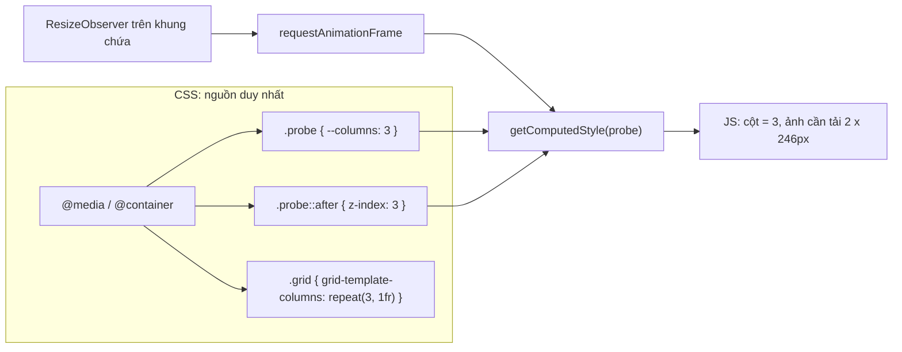

Một lưới ảnh kiểu Pinterest có 2 cột trên điện thoại, 3 cột trên tablet, 4 cột trên màn hình lớn. CSS lo phần bố cục. Nhưng JS cũng cần biết số cột: để chọn kích thước ảnh cần tải, để chia bài viết vào từng cột, để biết virtual list phải render bao nhiêu phần tử mỗi hàng. Cách thường thấy là viết breakpoint **hai lần**: một lần trong `@media (min-width: 768px)`, một lần trong `if (window.innerWidth >= 768)`. Rồi một ngày ai đó sửa bên CSS mà quên bên JS.

Ello (mạng xã hội cho nghệ sĩ) có một mẹo cũ mà vẫn đáng học: CSS ghi số cột vào **`z-index` của `#root::after`**, và JS đọc lại bằng `getComputedStyle`. Breakpoint chỉ còn nằm ở một nơi. Bài này viết lại mẹo đó bằng công cụ hiện đại (custom property, container query, `ResizeObserver`), và thêm một "kênh" khác mà JS hay cần hỏi CSS: trang đang chạy trong tab trình duyệt hay đã được cài như ứng dụng (PWA). App Store bản web dùng thông tin này cho analytics.

> [!TIP]
> **Tóm tắt**
> - Để CSS làm nguồn duy nhất của breakpoint. JS đọc lại kết quả **đã tính** qua `getComputedStyle`, không tự so sánh `innerWidth`.
> - Ello dùng `z-index` của pseudo-element `::after` vì nó là một số nguyên không ảnh hưởng gì tới giao diện. Ngày nay hãy dùng custom property (`--columns: 3`): đọc được cả chuỗi, không cần pseudo-element.
> - Nghe `ResizeObserver` trên **phần tử chứa** thay cho `window.resize`. Cột phụ thuộc vào khung chứa (sidebar thu/mở, container query) chứ không chỉ vào cửa sổ.
> - PWA: `matchMedia('(display-mode: standalone)')` cùng các chế độ khác, `navigator.standalone` trên iOS, và referrer `android-app://` cho Trusted Web Activity.

<iframe class="demo-frame" src="/demos/web-patterns/index.html?theme=dark#/css-bridge" title="Demo css-bridge" loading="lazy" style="height: 1100px"></iframe>

<p class="demo-links">▶ <a href="/demos/web-patterns/index.html#/css-bridge" target="_blank" rel="noopener">Mở demo toàn màn hình ↗</a> · <a href="https://stackblitz.com/github/hunghg255/blog-hunghg/tree/master/examples/web-patterns?file=src/lib/cssBridge.ts" target="_blank" rel="noopener">Sửa code trên StackBlitz ↗</a> · <a href="https://github.com/hunghg255/blog-hunghg/blob/master/examples/web-patterns/src/lib/cssBridge.ts" target="_blank" rel="noopener">Xem source trên GitHub ↗</a></p>

Bấm 320px, 560px, 820px (hoặc kéo góc phải dưới của khung): số cột đọc được qua `z-index` và qua `--columns` đổi theo ngay. Ô "chỉ nghe window.resize" đứng yên, vì cửa sổ không đổi kích thước. Đó là giới hạn của cách nghe sự kiện mà Ello dùng.

## Ello làm thế nào?

[`ello.co/src/components/viewport/ResizeComponent.js`](https://github.com/hunghg255/codebase/blob/main/ello.co/src/components/viewport/ResizeComponent.js):

```js
function getProbeElement() {
  if (typeof memoizedProbe !== 'undefined') { return memoizedProbe }
  memoizedProbe = document.getElementById('root')
  return memoizedProbe
}

function getProbeProperties() {
  const probeElement = getProbeElement()
  const styles = window.getComputedStyle(probeElement, ':after')
  // htc one returns 'auto' for the z-index
  let zIndex = styles.getPropertyValue('z-index')
  if (isNaN(zIndex)) { zIndex = 2 }
  const columnCount = parseInt(zIndex, 10)
  return { columnCount }
}
```

Phần CSS tương ứng (đặt `z-index` cho `#root::after` trong các media query) không có trong bản dump, có lẽ nằm trong một stylesheet toàn cục được tải riêng. Phía JS chỉ cần biết: **`z-index` của `#root::after` là số cột**.

Phần còn lại là một bộ "phát sóng" kích thước cửa sổ:

```js
function windowWasResized() {
  if (!ticking) {
    requestAnimationFrame(() => { resized(); ticking = false })
    ticking = true
  }
}
const resizeFunc = debounce(windowWasResized, 100)

export function addResizeObject(obj) {
  if (resizeObjects.indexOf(obj) === -1) { resizeObjects.push(obj); windowWasResized() }
  if (resizeObjects.length === 1 && !hasListeners) {
    hasListeners = true
    window.addEventListener('resize', resizeFunc)
  }
}
```

- Chỉ **một** listener `resize` cho cả app. Mọi component quan tâm đăng ký qua `addResizeObject`; listener được gắn khi có subscriber đầu tiên và gỡ khi không còn ai.
- Debounce 100ms, rồi chờ thêm một `requestAnimationFrame` mới đọc `getComputedStyle`.
- `ViewportContainer` nhận `{ columnCount, innerWidth, innerHeight }` và đẩy vào Redux (`setViewportSizeAttributes`). Selector trong `src/selectors/gui.js` tính độ rộng cột: `Math.round((innerWidth - (columnCount + 1) * padding) / columnCount)`, với padding 20px hoặc 40px khi từ 4 cột trở lên.

**Vì sao lại là `z-index`?** Có lẽ vì ba lý do. Đây là thuộc tính nhận số nguyên, nên đọc ra là dùng được ngay. Đặt trên `::after` (không có `content`, hoặc không được định vị) thì nó không ảnh hưởng gì tới hiển thị. Và trước khi có custom property, CSS gần như không có chỗ nào khác để "gửi" một con số cho JS. Comment về máy HTC One trả `'auto'` cho thấy cách này phụ thuộc vào việc trình duyệt trả về giá trị đã khai báo của `z-index`, kể cả khi phần tử không được định vị.

**Giới hạn:**

- **Chỉ nghe `window.resize`.** Nếu bố cục có sidebar thu gọn được, hay lưới nằm trong một panel có thể kéo rộng, số cột trong CSS đổi mà JS không biết.
- **`memoizedProbe` được nhớ vĩnh viễn.** Nếu `#root` bị thay (ví dụ ứng dụng mount lại), JS vẫn đọc phần tử cũ đã rời khỏi DOM.
- **Hai lớp trễ chồng lên nhau**: debounce 100ms cộng thêm một frame. Bản thân `ticking` cùng rAF đã đủ gộp nhiều sự kiện vào một frame; debounce chủ yếu làm giá trị cập nhật chậm hơn.

## App Store làm thế nào?

[`apps.apple.com/shared/utils/src/get-pwa-display-mode.ts`](https://github.com/hunghg255/codebase/blob/main/apps.apple.com/shared/utils/src/get-pwa-display-mode.ts):

```ts
/**
 * For PWA, reads the "display" value from the manifest.json and returns the proper value if it matches.
 * Inspired by the sample snippet here: https://web.dev/learn/pwa/detection
 */
export const getPWADisplayMode = (): PWADisplayMode => {
  switch (true) {
    case document.referrer.startsWith('android-app://'):
      return PWADisplayMode.TWA;
    case window.matchMedia('(display-mode: browser)').matches:
      return PWADisplayMode.BROWSER;
    case window.matchMedia('(display-mode: standalone)').matches:
      return PWADisplayMode.STANDALONE;
    // minimal-ui, fullscreen, window-controls-overlay
    default:
      return PWADisplayMode.UNKNOWN;
  }
};
```

Đây cũng là CSS "nói" cho JS: `display-mode` là một **media feature**. Trình duyệt biết trang đang chạy ở chế độ hiển thị nào (theo `display` trong manifest khi được cài, hoặc `browser` khi trong tab), và JS hỏi qua `matchMedia`. Mẹo `switch (true)` cho phép viết một chuỗi điều kiện như `if/else if`, mỗi `case` là một biểu thức boolean.

Hàm được dùng trong [`apps.apple.com/shared/metrics-8/src/index.ts`](https://github.com/hunghg255/codebase/blob/main/apps.apple.com/shared/metrics-8/src/index.ts), lúc gửi sự kiện analytics `enter` đầu tiên. Chỉ khi chế độ là `standalone` hoặc `twa` thì sự kiện có thêm trường `buildFlavor`, để phân biệt người dùng mở App Store từ PWA hay từ ứng dụng Android bọc PWA.

**Một chỗ có vẻ không khớp.** `getPWADisplayMode()` chỉ được gọi khi `type === 'launch'`, mà `type` được chọn bằng `document.referrer?.length > 0 ? 'link' : 'launch'`. Với Trusted Web Activity, referrer lại chính là `android-app://…`, tức là không rỗng, nên `type` thành `'link'` và nhánh gọi hàm không bao giờ chạy. Đọc từ code thì `buildFlavor: 'twa'` có vẻ không bao giờ được gửi. Mình chỉ đọc được code, chưa kiểm tra được trên một TWA thật.

## Bên trong trình duyệt: JS đọc được gì từ CSS?



`getComputedStyle(el)` trả về giá trị **đã tính** của mọi thuộc tính, sau khi đã áp media query, container query và cascade. Hai điều cần biết:

- **Chi phí.** Đọc computed style buộc trình duyệt tính lại style nếu style đang "bẩn" (style recalc), nhưng **không** buộc tính layout như khi đọc `offsetWidth`. Gom lại thành một lần đọc mỗi frame, như `observeCssValue` làm, là đủ rẻ.
- **Custom property** (`--columns`) được trả về đúng chuỗi đã khai báo (đã cắt khoảng trắng). Vì thế ta có thể truyền cả tên breakpoint (`--bp: tablet`) hay một danh sách, không chỉ một số nguyên như `z-index`.

Khi kiểm tra trên Chromium (tính tới 10/2026), `getComputedStyle(probe, '::after').zIndex` trả về đúng giá trị khai báo (`'2'`), dù `::after` không được định vị. Đây chính là hành vi mà mẹo của Ello dựa vào; comment về HTC One cho thấy có trình duyệt cũ trả `'auto'` trong trường hợp này.

**`ResizeObserver` hay `window.resize`?** Với container query, số cột phụ thuộc vào bề rộng của **phần tử chứa**, không phải cửa sổ. `ResizeObserver` báo đúng khi phần tử đó đổi kích thước, vì bất kỳ lý do nào: sidebar mở, panel bên cạnh co lại, font tải xong làm thanh cuộn xuất hiện.

## Viết lại

Hai cách đọc, cách của Ello và cách dùng custom property:

```ts title=src/lib/cssBridge.ts
/** Ello: z-index của pseudo-element là một số nguyên "vô hại", dùng làm kênh truyền dữ liệu CSS -> JS. */
export function readZIndexProbe(el: Element, pseudo = '::after', fallback = 2): number {
  const value = getComputedStyle(el, pseudo).getPropertyValue('z-index');
  // Bản gốc ghi chú: máy HTC One trả 'auto'. Không phải số thì dùng giá trị mặc định.
  const n = parseInt(value, 10);
  return Number.isNaN(n) ? fallback : n;
}

/** Cách hiện đại: CSS khai báo --columns: 3; JS đọc lại. Đọc được cả chuỗi, không chỉ số nguyên. */
export function readCssVar(el: Element, name: string): string {
  return getComputedStyle(el).getPropertyValue(name).trim();
}

export function readCssNumber(el: Element, name: string, fallback: number): number {
  const n = parseFloat(readCssVar(el, name));
  return Number.isNaN(n) ? fallback : n;
}
```

Theo dõi bằng `ResizeObserver`, gộp mỗi frame một lần đọc, chỉ báo khi giá trị đổi:

```ts title=src/lib/cssBridge.ts
/**
 * Theo dõi một giá trị đọc từ CSS. ResizeObserver trên đúng phần tử chứa (không phải window),
 * nên container query hay sidebar thu/mở cũng được tính. Gộp về một lần đọc mỗi frame và
 * chỉ gọi onChange khi giá trị đổi thật.
 */
export function observeCssValue<T>(container: Element, read: () => T, onChange: (value: T) => void): () => void {
  let last: T | undefined;
  let frame = 0;
  const check = () => {
    frame = 0;
    const value = read();
    if (!Object.is(value, last)) {
      last = value;
      onChange(value);
    }
  };
  const observer = new ResizeObserver(() => {
    if (!frame) frame = requestAnimationFrame(check);
  });
  observer.observe(container);
  check();
  return () => {
    observer.disconnect();
    cancelAnimationFrame(frame);
  };
}
```

CSS của demo: breakpoint nằm trong container query, ghi ra cả ba nơi (`--columns`, `z-index`, và `grid-template-columns`):

```css
.cbr-box { container-type: inline-size; resize: horizontal; overflow: auto; }
.cbr-grid { display: grid; grid-template-columns: 1fr; gap: 12px; }
.cbr-probe { --columns: 1; height: 0; overflow: hidden; }
.cbr-probe::after { content: ''; z-index: 1; }

@container (min-width: 420px) {
  .cbr-probe { --columns: 2; }
  .cbr-probe::after { z-index: 2; }
  .cbr-grid { grid-template-columns: repeat(2, minmax(0, 1fr)); }
}
/* 640px -> 3 cột, 900px -> 4 cột */
```

Phần phát hiện chế độ hiển thị (`getDisplayMode`, `watchDisplayMode`) nằm cuối file.

::: spoiler Xem toàn bộ src/lib/cssBridge.ts

```ts title=src/lib/cssBridge.ts
/**
 * Để CSS là nơi duy nhất định nghĩa breakpoint, JS chỉ việc đọc lại:
 * - mẹo của Ello: đặt z-index của #root::after theo media query, JS đọc z-index đó = số cột.
 * - cách hiện đại: custom property (--columns), kèm container query.
 * Và phát hiện app đang chạy như PWA hay trong tab trình duyệt (ý tưởng từ App Store web).
 */

/** Ello: z-index của pseudo-element là một số nguyên "vô hại", dùng làm kênh truyền dữ liệu CSS -> JS. */
export function readZIndexProbe(el: Element, pseudo = '::after', fallback = 2): number {
  const value = getComputedStyle(el, pseudo).getPropertyValue('z-index');
  // Bản gốc ghi chú: máy HTC One trả 'auto'. Không phải số thì dùng giá trị mặc định.
  const n = parseInt(value, 10);
  return Number.isNaN(n) ? fallback : n;
}

/** Cách hiện đại: CSS khai báo --columns: 3; JS đọc lại. Đọc được cả chuỗi, không chỉ số nguyên. */
export function readCssVar(el: Element, name: string): string {
  return getComputedStyle(el).getPropertyValue(name).trim();
}

export function readCssNumber(el: Element, name: string, fallback: number): number {
  const n = parseFloat(readCssVar(el, name));
  return Number.isNaN(n) ? fallback : n;
}

/**
 * Theo dõi một giá trị đọc từ CSS. ResizeObserver trên đúng phần tử chứa (không phải window),
 * nên container query hay sidebar thu/mở cũng được tính. Gộp về một lần đọc mỗi frame và
 * chỉ gọi onChange khi giá trị đổi thật.
 */
export function observeCssValue<T>(container: Element, read: () => T, onChange: (value: T) => void): () => void {
  let last: T | undefined;
  let frame = 0;
  const check = () => {
    frame = 0;
    const value = read();
    if (!Object.is(value, last)) {
      last = value;
      onChange(value);
    }
  };
  const observer = new ResizeObserver(() => {
    if (!frame) frame = requestAnimationFrame(check);
  });
  observer.observe(container);
  check();
  return () => {
    observer.disconnect();
    cancelAnimationFrame(frame);
  };
}

/**
 * Cách của Ello để so sánh: nghe window.resize, debounce 100ms rồi đợi thêm một frame.
 * Không biết gì khi chỉ phần tử chứa đổi kích thước (kéo sidebar, mở panel).
 */
export function watchWindowResize<T>(read: () => T, onChange: (value: T) => void, delay = 100): () => void {
  let timer: ReturnType<typeof setTimeout> | undefined;
  let ticking = false;
  const run = () => {
    if (ticking) return;
    ticking = true;
    requestAnimationFrame(() => {
      ticking = false;
      onChange(read());
    });
  };
  const onResize = () => {
    clearTimeout(timer);
    timer = setTimeout(run, delay);
  };
  window.addEventListener('resize', onResize);
  run();
  return () => {
    clearTimeout(timer);
    window.removeEventListener('resize', onResize);
  };
}

/** Ello tính độ rộng cột từ số cột đọc được (selectors/gui.js): chừa padding ở hai mép và giữa các cột. */
export function columnWidth(containerWidth: number, columns: number, gap: number): number {
  return Math.round((containerWidth - (columns + 1) * gap) / columns);
}

// ---------- PWA display mode ----------

export type DisplayMode = 'twa' | 'browser' | 'standalone' | 'minimal-ui' | 'fullscreen' | 'window-controls-overlay' | 'unknown';

const MODES: Exclude<DisplayMode, 'twa' | 'unknown'>[] = ['window-controls-overlay', 'fullscreen', 'standalone', 'minimal-ui', 'browser'];

/**
 * App Store web gọi một lần lúc khởi động để gắn vào sự kiện analytics "enter".
 * Bản này thêm navigator.standalone (thuộc tính riêng của Safari iOS cho web app thêm vào màn hình chính).
 */
export function getDisplayMode(win: Window = window): DisplayMode {
  // Trusted Web Activity (app Android bọc PWA): lần mở đầu có referrer android-app://<package>
  if (win.document.referrer.startsWith('android-app://')) return 'twa';
  if ((win.navigator as Navigator & { standalone?: boolean }).standalone === true) return 'standalone';
  for (const mode of MODES) {
    if (win.matchMedia(`(display-mode: ${mode})`).matches) return mode;
  }
  return 'unknown';
}

/** display-mode có thể đổi khi đang chạy, ví dụ PWA trên desktop bật/tắt thanh tiêu đề tuỳ biến (window-controls-overlay). */
export function watchDisplayMode(onChange: (mode: DisplayMode) => void): () => void {
  const lists = MODES.map((mode) => matchMedia(`(display-mode: ${mode})`));
  const handler = () => onChange(getDisplayMode());
  lists.forEach((list) => list.addEventListener('change', handler));
  return () => lists.forEach((list) => list.removeEventListener('change', handler));
}
```

:::

**Khác bản gốc:**

- `ResizeObserver` trên phần tử chứa thay cho `window.resize` + debounce 100ms.
- Không nhớ phần tử "probe" vĩnh viễn: nơi gọi truyền phần tử vào.
- Ngoài `z-index` còn đọc được custom property.
- `getDisplayMode` thêm `navigator.standalone` (Safari iOS). Bản gốc chỉ được gọi một lần lúc khởi động; bản viết lại có thêm `watchDisplayMode` để theo dõi khi chế độ đổi lúc đang chạy.

## Đi qua code

**`readZIndexProbe`** đọc `getComputedStyle(el, '::after')`. Ello truyền `':after'` (cú pháp một dấu hai chấm cũ); trình duyệt chấp nhận cả hai. `parseInt('auto')` là `NaN`, khi đó trả về giá trị mặc định, giống ý của comment về HTC One.

**`readCssVar`** dùng `getPropertyValue('--columns')`. Lưu ý phải dùng `getPropertyValue`: custom property không có trên `CSSStyleDeclaration` dưới dạng thuộc tính camelCase như `style.zIndex`.

**`observeCssValue`:**

- `ResizeObserver` có thể gọi callback nhiều lần trong một frame khi kéo. `frame` đảm bảo chỉ có một lần đọc trong `requestAnimationFrame` kế tiếp.
- `Object.is(value, last)` để chỉ báo khi giá trị đổi thật. Kéo khung từ 650px tới 880px không làm React render lại lần nào, vì vẫn là 3 cột.
- Gọi `check()` ngay khi bắt đầu, để có giá trị đầu tiên mà không phải chờ lần resize đầu.

Trong demo, `read` trả về một chuỗi `"z|v|width"` để so sánh nhanh. Ở dự án thật, chỉ nên đọc thứ bạn cần (ví dụ chỉ số cột), để không render lại mỗi lần bề rộng đổi 1px.

**`watchWindowResize`** là cách của Ello, giữ lại để demo so sánh.

**`getDisplayMode`** đặt `twa` lên đầu (referrer `android-app://` chỉ có ở lần mở đầu tiên; nếu cần dùng lâu dài, hãy lưu lại vào `sessionStorage`), rồi `navigator.standalone`, rồi duyệt các chế độ qua `matchMedia`.

## Tại sao không làm cách khác?

**Tại sao không đọc bề rộng rồi so với các con số trong file JS dùng chung với CSS** (ví dụ export breakpoint từ file `tokens.ts` cho cả CSS-in-JS lẫn logic)? Cách đó cũng giữ được một nguồn duy nhất, và là lựa chọn tốt nếu toàn bộ CSS sinh từ JS. Nhưng khi đã dùng container query, số cột phụ thuộc vào bề rộng của **khung chứa**, kèm cả padding và gap. Đọc kết quả mà trình duyệt đã tính thì không phải lặp lại phép tính đó trong JS.

**Tại sao không dùng `matchMedia` cho từng breakpoint?** `matchMedia('(min-width: 768px)')` rất tốt khi breakpoint theo **cửa sổ**: không cần nghe `resize`, chỉ báo khi điều kiện đổi. Nhưng các chuỗi điều kiện vẫn phải viết lại trong JS, và `matchMedia` không biết gì về container query.

**Tại sao không đọc `grid-template-columns` của chính lưới?** Được: `getComputedStyle(grid).gridTemplateColumns.split(' ').length` ra số cột thực tế. Nhưng giá trị trả về là danh sách độ dài đã tính (`"246px 246px 246px"`), và với `auto-fill` thì số cột là kết quả của layout, nên phải đọc **sau** layout. Một custom property đặt sẵn trong cùng media query thì rõ nghĩa hơn, và không phụ thuộc vào cách lưới được dựng.

**Tại sao không dùng ResizeObserver rồi tự so bề rộng với 420/640/900 trong JS?** Làm vậy là lại có hai bản breakpoint. Mục tiêu của cả bài là JS không biết các con số đó.

## Edge case và cạm bẫy

- **Probe phải nằm bên trong container**, vì container query áp cho phần tử con chứ không áp cho chính container. Đặt `.probe` là con của khung có `container-type: inline-size`.
- **Phần tử bị `display: none`**: `getComputedStyle` vẫn trả về giá trị đã tính, nhưng container query của khung bị ẩn thì không còn khung để đo. Đừng đặt probe trong một tab đang ẩn.
- **Trong `@container`, `resize: horizontal` cần `overflow` khác `visible`**, nếu không tay nắm kéo không hiện.
- **Custom property có khoảng trắng**: `--columns: 3 ;` trả về `"3 "` ở một số trình duyệt cũ. Luôn `.trim()`.
- **Demo nhúng trong bài** chạy trong tab trình duyệt nên sẽ báo `browser`. Muốn thấy giá trị khác, hãy cài một trang có manifest thành app rồi gọi `getDisplayMode()` trong đó.
- **TWA chỉ có referrer ở lần tải đầu**: chuyển trang trong SPA vẫn giữ `document.referrer`, nhưng reload thì mất. Lưu kết quả lần đầu vào `sessionStorage` nếu cần.

## Dùng trong dự án

```tsx
function useCssColumns(containerRef: React.RefObject<HTMLElement>, probeRef: React.RefObject<HTMLElement>) {
  const [columns, setColumns] = useState(1);
  useEffect(
    () => observeCssValue(containerRef.current!, () => readCssNumber(probeRef.current!, '--columns', 1), setColumns),
    [containerRef, probeRef],
  );
  return columns;
}

// chọn kích thước ảnh theo số cột thật
const columns = useCssColumns(gridRef, probeRef);
const width = columnWidth(gridWidth, columns, 12);
;

// analytics
analytics.track('app_open', { displayMode: getDisplayMode() });
```

Nếu chỉ cần ảnh đúng kích thước thì không cần JS: `` với `sizes` khớp breakpoint là đủ (xem bài #9 về [srcset cho artwork](/blogs/web-responsive-artwork-preconnect)). Cách đọc CSS ở bài này dành cho các trường hợp JS thật sự phải biết bố cục: chia phần tử vào từng cột (masonry), virtual list, hoặc gửi số cột lên server.

## Kiểm thử

::: spoiler Ví dụ test (bản phác, không có trong repo)

```ts
import { afterEach, describe, expect, it, vi } from 'vitest';
import { columnWidth, getDisplayMode, observeCssValue, readCssNumber, readZIndexProbe } from './cssBridge';

describe('đọc giá trị từ CSS', () => {
  it('đọc custom property', () => {
    const el = document.createElement('div');
    el.style.setProperty('--columns', ' 3 ');
    document.body.append(el);
    expect(readCssNumber(el, '--columns', 1)).toBe(3);
    expect(readCssNumber(el, '--khong-co', 1)).toBe(1);
  });

  it('z-index không phải số thì dùng giá trị mặc định', () => {
    const el = document.createElement('div');
    vi.spyOn(window, 'getComputedStyle').mockReturnValue({ getPropertyValue: () => 'auto' } as unknown as CSSStyleDeclaration);
    expect(readZIndexProbe(el)).toBe(2);
    vi.restoreAllMocks();
  });

  it('độ rộng cột kiểu Ello', () => {
    expect(columnWidth(800, 3, 12)).toBe(251); // (800 - 4 * 12) / 3 = 250,67
  });
});

describe('observeCssValue', () => {
  afterEach(() => vi.unstubAllGlobals());

  it('chỉ báo khi giá trị đổi, mỗi frame một lần', () => {
    let resize!: () => void;
    vi.stubGlobal('ResizeObserver', class { constructor(cb: () => void) { resize = cb; } observe() {} disconnect() {} });
    const queue: FrameRequestCallback[] = [];
    vi.stubGlobal('requestAnimationFrame', (cb: FrameRequestCallback) => queue.push(cb));
    const flush = () => queue.splice(0).forEach((cb) => cb(0));
    let value = 2;
    const seen: number[] = [];
    observeCssValue(document.body, () => value, (v) => seen.push(v));
    resize();
    resize();
    expect(queue).toHaveLength(1); // hai lần resize trong cùng frame: một lần đọc
    flush();
    value = 3;
    resize();
    flush();
    expect(seen).toEqual([2, 3]);
  });
});

describe('getDisplayMode', () => {
  it('ưu tiên referrer android-app://', () => {
    const fake = { document: { referrer: 'android-app://com.example' }, navigator: {}, matchMedia: () => ({ matches: false }) } as unknown as Window;
    expect(getDisplayMode(fake)).toBe('twa');
  });
  it('rơi về browser', () => {
    const fake = { document: { referrer: '' }, navigator: {}, matchMedia: (q: string) => ({ matches: q.includes('browser') }) } as unknown as Window;
    expect(getDisplayMode(fake)).toBe('browser');
  });
});
```

jsdom không hỗ trợ media query hay container query, nên việc "CSS đổi số cột theo bề rộng" chỉ kiểm được trên trình duyệt thật. Demo trong bài đã được kiểm bằng Playwright: ở 320, 560 và 820px, cả `z-index` lẫn `--columns` đọc ra 1, 2, 3 cột, khớp với `grid-template-columns`; ô "chỉ nghe window.resize" chỉ đổi khi cửa sổ đổi kích thước.

:::

## So với thư viện và chuẩn web

- **`matchMedia` + sự kiện `change`** là cách chuẩn cho breakpoint theo cửa sổ; các hook kiểu `useMediaQuery` đều bọc nó.
- **Container query** (`@container`) được mọi trình duyệt lớn hỗ trợ từ 2023. Đây là lý do việc nghe `window.resize` không còn đủ nữa.
- Thư viện masonry như **Masonry.js** tự đo DOM để chia cột. **CSS masonry** đang được chuẩn hoá (cú pháp vẫn còn thay đổi); khi trình duyệt hỗ trợ rộng rãi, phần chia cột bằng JS sẽ không còn cần thiết. Hãy xem [caniuse](https://caniuse.com/?search=masonry) cho tình trạng hiện tại.
- **PWA**: `display-mode` có trong mọi trình duyệt hỗ trợ cài PWA; `navigator.standalone` là thuộc tính riêng của Safari iOS. Bài [Learn PWA: Detection](https://web.dev/learn/pwa/detection) trên web.dev (mà comment của App Store dẫn nguồn) liệt kê đủ các cách phát hiện.

---

Bài này thuộc series **[Học từ mã nguồn các web lớn](/series/web)** (65 bài, đọc theo thứ tự).

::: spoiler Xem nhanh danh sách bài trong series

*Mở đầu*

- [Mở đầu: đọc code production của 28 trang web](/blogs/learn-from-big-web-apps)

*Phần 1: trải nghiệm người dùng*

- [#1 Dark mode không nháy (Gatsby)](/blogs/web-dark-mode-no-flash)
- [#2 useValueByMedia: giá trị theo breakpoint (Toptal)](/blogs/web-use-value-by-media)
- [#3 Đoán ý định: idle, exit-intent, lắc chuột (Toptal, InVision)](/blogs/web-user-intent-idle-exit-wiggle)
- [#4 Validate form thân thiện (Udacity, Pipedrive)](/blogs/web-form-validation-ux)
- [#5 Magic number, EXIF và dán ảnh (Ello)](/blogs/web-file-magic-number-exif-paste)
- [#6 fastSmoothScroll: cuộn xa vẫn nhanh (Telegram)](/blogs/web-telegram-fast-smooth-scroll)
- [#7 Countdown time-travel và tombstone giỏ hàng (Best Buy)](/blogs/web-countdown-time-travel-tombstone)

*Phần 2: hiệu năng và đo lường*

- [#8 Hàng đợi requestAnimationFrame 3ms (Apple)](/blogs/web-raf-queue-3ms)
- [#9 srcset cho artwork và preconnect tự động (Apple)](/blogs/web-responsive-artwork-preconnect)
- [#10 Quick-fetch: gọi API trước khi bundle tải xong (HubSpot)](/blogs/web-quick-fetch-early-requests)
- [#11 Performance span và long task (Postman, Calibre)](/blogs/web-performance-spans-long-tasks)
- [#12 Gọi Web Worker như hàm async (Telegram)](/blogs/web-worker-promise-rpc)
- [#13 Đồng hồ media: đếm giờ xem và sửa lệch (Skillshare, Simplified)](/blogs/web-media-clock-watch-time-drift)

*Phần 3: nhiều tab, phiên đăng nhập, cập nhật*

- [#14 Bầu tab chủ cho thông báo (HubSpot, Telegram)](/blogs/web-leader-tab-notifications)
- [#15 Đồng bộ đăng nhập giữa tab và giới hạn cookie (Elastic, InVision)](/blogs/web-cross-tab-auth-cookie-guard)
- [#16 SPA tự cập nhật: Trello, Zappos, Facebook, Elastic](/blogs/web-spa-self-update-strategies)

*Phần 4: kiến trúc*

- [#17 Reverse portal: di chuyển component không remount (Zappos)](/blogs/web-reverse-portal)
- [#18 Page behaviors: gắn hành vi từ CMS (Intercom)](/blogs/web-page-behaviors-cms)
- [#19 Giới hạn tần suất hiển thị bằng bitmask (Outlook)](/blogs/web-frequency-cap-bitmask)
- [#20 Chuyển REST sang GraphQL dần dần (Coursera)](/blogs/web-rest-to-graphql-hybrid-link)

*Phần 5: soạn thảo và hiển thị nội dung*

- [#21 Autocomplete tại con trỏ trong contenteditable (Ello, Telegram)](/blogs/web-caret-autocomplete-contenteditable)
- [#22 Dark mode cho email HTML bằng CIELAB (Outlook)](/blogs/web-email-dark-mode-cielab)
- [#23 Thu nhỏ bảng rộng cho vừa khung, vá font emoji (Outlook)](/blogs/web-email-wide-content-scale)
- [#24 Cảnh báo quên đính kèm file (Outlook)](/blogs/web-forgotten-attachment-warning)
- [#25 Cắt chữ nhiều dòng chính xác (Pipedrive, Apple, Toptal)](/blogs/web-multiline-truncate-measure-text)
- [#26 Parse ngày giờ gõ tay khoan dung (Outlook, Elastic)](/blogs/web-lenient-date-parser)

*Phần 6: tương tác*

- [#27 menuAim: rê chéo vào submenu không bị đóng (Udemy)](/blogs/web-menu-aim-triangle)
- [#28 Kéo, vuốt chung cho chuột và cảm ứng (Telegram)](/blogs/web-unified-pointer-gestures)
- [#29 Phím tắt theo phạm vi, IME và bàn phím phi Latinh (Trello)](/blogs/web-scoped-keyboard-shortcuts)
- [#30 Nội suy màu: đổi theme và nền theo cuộn (Telegram, Anchor)](/blogs/web-color-interpolation-theme-scroll)
- [#31 Đường gióng hút cạnh và undo/redo trên canvas (Simplified)](/blogs/web-canvas-snap-guides-undo)
- [#32 Giả lập mù màu bằng feColorMatrix (Trello)](/blogs/web-color-vision-simulator)
- [#33 Vạch thước theo mức zoom và cấp phát màu cho biểu đồ (Anchor, Similarweb)](/blogs/web-timeline-ticks-color-stack)

*Phần 7: mạng, dữ liệu và async*

- [#34 Ô tìm kiếm chuẩn production (Similarweb, Udemy, Pipedrive)](/blogs/web-production-search-box)
- [#35 Điều phối async: latest-wins, single-flight (Glitch, Toptal)](/blogs/web-async-coordination-latest-wins)
- [#36 Polling thưa dần và debounce động (Trello)](/blogs/web-decaying-polling-dynamic-debounce)
- [#37 Cache phía client theo version (Similarweb, Telegram, Udemy)](/blogs/web-client-cache-versioned)
- [#38 Upload file lớn theo chunk (Outlook, Tribe)](/blogs/web-chunked-upload-pipeline)
- [#39 Phát video qua Service Worker bằng Range request (Telegram, Outlook)](/blogs/web-service-worker-range-streaming)

*Phần 8: hiệu năng và vận hành*

- [#40 TTI governor: hoãn việc phụ tới sau khi trang dùng được (Outlook)](/blogs/web-tti-governor)
- [#41 Tự đo LCP/CLS/TBT và phục vụ bản nhẹ cho máy yếu (Udemy)](/blogs/web-rum-adaptive-loading)

*Phần 9: thuật toán và dữ liệu phía client*

- [#42 Three-way merge ngay trên trình duyệt (Postman)](/blogs/web-three-way-merge-client)
- [#43 Dọn cache GraphQL bằng đếm tham chiếu (Outlook)](/blogs/web-graphql-cache-refcount-gc)
- [#44 LRU cache theo 3 cách (Apple, Similarweb, Outlook)](/blogs/web-lru-cache-three-ways)
- [#45 Lọc tăng dần trong Web Worker (Similarweb)](/blogs/web-incremental-filter-worker)
- [#46 Xếp hạng gợi ý trên client, so ngầm với server (Outlook)](/blogs/web-client-side-ranking-shadow-test)
- [#47 Nối OT với editor: undo stack và chặn echo (Glitch)](/blogs/web-ot-codemirror-undo)
- [#48 Ngôn ngữ markup riêng dịch hai chiều với HTML (Coursera)](/blogs/web-custom-markup-compiler)

*Phần 10: thời gian, ngôn ngữ, định dạng*

- [#49 Xử lý giờ mùa hè không cần thư viện (Udemy, Pipedrive)](/blogs/web-dst-without-library)
- [#50 Intl thực chiến: Segmenter, số rút gọn, số nhiều, fallback locale (Apple, Outlook)](/blogs/web-intl-in-production)
- [#51 WebVTT và bôi chọn transcript (Udemy, Coursera)](/blogs/web-webvtt-transcript-selection)

*Phần 11: tương tác và giao diện*

- [#52 Kéo-thả trên lịch (Pipedrive)](/blogs/web-calendar-drag-drop)
- [#53 Focus stack cho popup lồng nhau (Outlook)](/blogs/web-focus-stack-nested-popups)
- [#54 Clipboard: copy, dán chữ thuần, dán thông minh (Trello, Anchor, Pipedrive, Tribe)](/blogs/web-clipboard-tricks)
- [#55 Khôi phục vị trí cuộn khi trang còn đang tải (Apple, Zappos)](/blogs/web-scroll-restore-wait-height)
- [#56 Lấy màu từ ảnh: gradient nền, màu chữ (Apple, Telegram, Trello)](/blogs/web-colors-from-images)
- **#57 JS đọc breakpoint từ CSS, phát hiện chế độ PWA (Ello, Apple)** (bài này)

*Phần 12: media*

- [#58 Tin nhắn thoại: ghi âm, waveform realtime, nén 5-bit (Telegram)](/blogs/web-voice-message-waveform)
- [#59 Chụp frame video thành ảnh, canvas bị taint (Coursera, Outlook)](/blogs/web-video-frame-snapshot)

*Phần 13: đo lường, bảo mật, vận hành*

- [#60 Đo lúc ảnh màn hình đầu tải xong, cả khi chuyển trang SPA (Zappos, Best Buy, Outlook)](/blogs/web-above-the-fold-image-timing)
- [#61 Buffer analytics chờ SDK, phát hiện adblock (Best Buy)](/blogs/web-analytics-buffer-adblock)
- [#62 Proof-of-work trên client để chặn API ẩn danh (Udemy)](/blogs/web-client-proof-of-work)
- [#63 Prefetch không làm lệch số liệu, nén cài đặt bằng bit (Outlook)](/blogs/web-synthetic-prefetch-bit-flags)
- [#64 Micro-frontend: AngularJS và React chung app, giao tiếp xuyên frame (Similarweb, InVision, HubSpot)](/blogs/web-micro-frontend-bridges)

:::

Code + demo: [`examples/web-patterns`](https://github.com/hunghg255/blog-hunghg/tree/master/examples/web-patterns) · [Mở trên StackBlitz](https://stackblitz.com/github/hunghg255/blog-hunghg/tree/master/examples/web-patterns)
