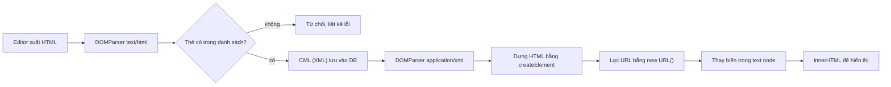

Một trang có editor nội dung (bài học, bài viết, mô tả sản phẩm) sớm muộn phải trả lời câu hỏi: **lưu cái gì vào database?** Lưu thẳng HTML của editor là dễ nhất, nhưng HTML cho phép mọi thứ: `<script>`, `style` lạ, `<div>` lồng mười tầng, thuộc tính `onerror`. Mỗi lần hiển thị lại phải lọc.

Coursera chọn cách khác: nội dung khoá học được lưu bằng **CML** (Coursera Markup Language), một XML nhỏ chỉ có vài loại block (`text`, `heading`, `code`, `list`, `table`, `img`, `asset`…) và vài thẻ inline (`strong`, `em`, `a`…). Editor xuất HTML, một bộ chuyển đổi dịch sang CML để lưu; lúc hiển thị, bộ chuyển ngược dịch CML ra HTML, kèm thay biến, render công thức toán và làm sạch link.

> [!TIP]
> **Tóm tắt**
> - Lưu nội dung bằng một **định dạng riêng, hẹp**: chỉ những block và thẻ được liệt kê mới tồn tại. Thẻ lạ bị **từ chối lúc lưu**, không phải lọc lúc hiển thị.
> - Chuyển ngược ra HTML bằng **API DOM** (`createElement`, `textContent`) thay vì nối chuỗi: trình duyệt tự escape, không quên chỗ nào.
> - Kiểm tra URL bằng **parser URL của trình duyệt** (`new URL`) thay vì regex: nó cắt khoảng trắng giống hệt lúc trình duyệt đọc `href`, và tự đổi tên miền Unicode sang punycode.
> - Ngày nay ProseMirror, Lexical, Slate, Portable Text đều lưu JSON theo schema: cùng ý tưởng "định dạng riêng có schema", chỉ khác cú pháp.

<iframe class="demo-frame" src="/demos/web-patterns/index.html?theme=dark#/markup-compiler" title="Demo markup-compiler" loading="lazy" style="height: 980px"></iframe>

<p class="demo-links">▶ <a href="/demos/web-patterns/index.html#/markup-compiler" target="_blank" rel="noopener">Mở demo toàn màn hình ↗</a> · <a href="https://stackblitz.com/github/hunghg255/blog-hunghg/tree/master/examples/web-patterns?file=src/lib/markupCompiler.ts" target="_blank" rel="noopener">Sửa code trên StackBlitz ↗</a> · <a href="https://github.com/hunghg255/blog-hunghg/blob/master/examples/web-patterns/src/lib/markupCompiler.ts" target="_blank" rel="noopener">Xem source trên GitHub ↗</a></p>

Bấm "javascript: có khoảng trắng": bản viết lại bỏ link (chỉ giữ chữ), còn cột "nối chuỗi kiểu bản gốc" vẫn tạo một link `javascript:` bấm vào là chạy. Bấm "Biến chứa HTML": bản viết lại hiện tên như chữ thường, bản nối chuỗi tạo ra thẻ ``. Bấm "&copy; và <br>": parser XML của bản gốc báo `parsererror`, bản viết lại báo đúng chỗ chữ nằm ngoài block và sửa được khi bật repair.

## Coursera làm thế nào?

Code nằm trong [`static/bundles/cml/models`](https://github.com/hunghg255/codebase/tree/main/coursera.org/static/bundles/cml/models). Một đoạn CML trông như sau:

```xml
<co-content>
  <heading level="2">Bài 3</heading>
  <text hasMath="true">Tìm w sao cho \(J(w)\) nhỏ nhất, xem <a href="/learn/ml">tuần 1</a>.</text>
  <code language="python">w = w - alpha * grad</code>
</co-content>
```

### Parser: XML của trình duyệt

[`CMLParser.ts`](https://github.com/hunghg255/codebase/blob/main/coursera.org/static/bundles/cml/models/CMLParser.ts) không tự viết parser. Nó dùng `DOMParser` với `'application/xml'`, rồi xoá các text node chỉ chứa khoảng trắng nằm giữa các block, để mọi code phía sau có thể giả định "con của gốc đều là block":

```ts
export const SUPPORTED_INLINE_BLOCKS = ['strong', 'em', 'u', 'a', 'sup', 'sub', 'strike', 'ul', 'li', 'br', 'q', 'var'];
export const MATH_REGEX = /\\\((.*?[^\\])\\\)|\\\[(.*?[^\\])\\\]|\$\$(.*?[^\\])\$\$/g;
```

`MATH_REGEX` nhận ba cách viết công thức: `\( … \)`, `\[ … \]`, `$$ … $$`. Block có công thức được đánh dấu `hasMath="true"` ngay lúc lưu, nên lúc hiển thị không phải quét lại mọi block.

### HTML → CML: mỗi loại block một class

[`HTMLToCMLConverter/index.ts`](https://github.com/hunghg255/codebase/blob/main/coursera.org/static/bundles/cml/models/HTMLToCMLConverter/index.ts) duyệt các node con của `<body>` và chọn class theo tên thẻ: `p` → `Text`, `h1`–`h3` → `Heading`, `pre` → `Code`, `ol`/`ul` → `List`, `figure` → `Image`, `table` → `Table`, `div.cml-asset` → `Asset`. Mọi thẻ khác: **ném lỗi**.

```ts
default:
  throw new Error(`Unsupported HTML element "${node}, ${tagName}"`);
```

`InlineElement` cũng chỉ chấp nhận thẻ trong danh sách, cấm lồng cùng loại (`<strong>` trong `<strong>`), và bắt buộc `<a>` có `href`. Đây là điểm mấu chốt của cả thiết kế: **nội dung không hợp lệ không bao giờ được lưu**. Không cần nhớ lọc lúc hiển thị, vì DB không thể chứa `<script>`.

Vì parse bằng XML, HTML từ editor phải được "vá" trước bằng regex trong `sanitizeHTML`:

```ts
.replace(/&nbsp;/gi, ' ')
// close  tags
.replace(/(])*)>/g, '$1/>')
// remove <br/> tags
.replace(/<br[/]*>/g, '')
```

XML không biết `&nbsp;`, không chấp nhận `` không đóng. Nhưng thực thể HTML khác như `&copy;` hay `&eacute;` vẫn làm parser XML báo lỗi; demo có mẫu cho trường hợp này.

### CML → HTML: nối chuỗi bằng template

[`CMLToHTMLConverter.ts`](https://github.com/hunghg255/codebase/blob/main/coursera.org/static/bundles/cml/models/CMLToHTMLConverter.ts) dựng HTML bằng `_.template('<<%= openingTag %>><%= content %></<%= closingTag %>>')`, escape chữ bằng `_.escape`, render công thức bằng katex, và làm vài việc tinh tế cho người đọc:

- Ảnh có mô tả dài thì bọc `<figure>` với `<figcaption class="sr-only">` để trình đọc màn hình đọc thêm.
- Ô tiêu đề bảng có `scope="row"` hoặc `scope="col"` tuỳ nằm ở `thead` hay ở thân bảng.
- Khối code luôn `dir="ltr"`, kể cả khi trang là tiếng Ả Rập.
- Link ngoài Coursera có thêm `rel="nofollow"`; chữ của link trông như URL được đổi tên miền sang **punycode** để lộ tên miền giả (`аpple.com` với chữ `а` Cyrillic thành `xn--pple-43d.com`).

HTML cuối được gắn vào trang qua `dangerouslySetInnerHTML` trong `components/CML.tsx`, không qua thư viện lọc nào khác. Vì vậy mọi chỗ escape trong converter đều quan trọng.

### Những chỗ hở khi đọc kỹ

Mình chép logic (rút gọn) vào demo và cho trình duyệt đọc kết quả, chứ chưa thử trên coursera.org:

- **Chặn `javascript:` bằng regex.** `sanitizeURL` kiểm tra `/^javascript:/i`. Trình duyệt bỏ khoảng trắng và ký tự điều khiển ở đầu `href` trước khi đọc giao thức, nên `" javascript:alert(1)"` lọt qua regex mà vẫn là link `javascript:`. Người viết CML là giảng viên, nên đây có lẽ là rủi ro thấp, nhưng regex kiểu này là lỗi kinh điển.
- **Thay biến trên HTML cuối.** `substituteVariables` thay `%name%` trên chuỗi HTML đã dựng xong, không escape. Biến `NAME` là tên đầy đủ của chính người đang đọc (`ReadingItem.tsx`), nên tệ nhất là self-XSS; nhưng thêm một biến lấy từ nguồn khác là thành lỗ hổng thật.
- **`getAudioHTML` nối `src` thẳng vào chuỗi:** `'<source src="' + src + '">'`, không escape. Một `src` chứa dấu `"` sẽ thoát khỏi thuộc tính.
- **Bảng có caption mà không có thead:** `bodyIndex = hasHeader ? headIndex + 1 : 0` cho ra 0, nên caption bị đưa vào phần thân và `convert()` gặp thẻ `caption` thì ném `Unknown CML tag`. Có lẽ editor luôn sinh `thead` nên chưa ai gặp.

## Bên trong: hai chiều của bộ chuyển đổi



Hai quyết định đáng giá nhất ở đây:

- **Từ chối thay vì lọc.** Bộ lọc HTML (sanitizer) cố gắng giữ lại "phần tốt" của đầu vào bất kỳ; bộ chuyển đổi sang định dạng hẹp chỉ cần biết "phần tốt" là gì. Danh sách cho phép ngắn thì dễ kiểm tra hơn nhiều so với danh sách cấm.
- **Dựng bằng DOM thay vì nối chuỗi.** `textContent = x` và `setAttribute('href', x)` không bao giờ tạo ra thẻ mới, dù `x` chứa gì. Nối chuỗi thì mỗi chỗ ghép là một chỗ có thể quên escape.

## Viết lại

HTML → CML: parse bằng `'text/html'` (chịu được `<br>`, `&copy;`, thẻ không đóng) rồi kiểm tra cấu trúc thật chặt. Phần kiểm tra thẻ inline, lỗi được **gom lại hết** kèm đường dẫn thay vì ném ở lỗi đầu tiên:

```ts title=src/lib/markupCompiler.ts
      if (!(INLINE_TAGS as readonly string[]).includes(tag)) {
        errors.push({ path: here, message: `thẻ inline không được phép <${el.localName}>` });
        continue;
      }
      if (tag === parentTag) {
        errors.push({ path: here, message: `không lồng <${tag}> trong <${tag}>` });
        continue;
      }
      const child = out.createElement(tag);
      if (tag === 'a') {
        const href = el.getAttribute('href');
        if (!href) {
          errors.push({ path: here, message: '<a> thiếu href' });
          continue;
        }
        child.setAttribute('href', href);
        const title = el.getAttribute('title');
        if (title) child.setAttribute('title', title);
      }
      inline(el, child, here, tag);
      target.appendChild(child);
```

Làm sạch URL bằng chính parser URL của trình duyệt:

```ts title=src/lib/markupCompiler.ts
const SAFE_PROTOCOLS = ['http:', 'https:', 'mailto:'];

/**
 * URL an toàn để đặt vào href/src, hoặc null.
 * Dùng chính parser URL của trình duyệt: nó cắt khoảng trắng/tab/xuống dòng giống hệt lúc
 * trình duyệt đọc href, và tự đổi tên miền Unicode sang punycode (xn--…).
 */
export function safeUrl(raw: string, base = 'https://example.invalid/'): string | null {
  try {
    const url = new URL(raw, base);
    if (!SAFE_PROTOCOLS.includes(url.protocol)) return null;
    // Link tương đối ("/courses/x"): giữ tương đối, đừng gắn host giả của `base`
    if (url.origin === new URL(base).origin) return url.pathname + url.search + url.hash;
    return url.href;
  } catch {
    return null;
  }
}
```

CML → HTML: chữ đi qua `createTextNode` (biến được thay trong chữ, nên giá trị biến luôn là chữ). Phần dựng link:

```ts title=src/lib/markupCompiler.ts
      if (el.localName === 'a') {
        const href = safeUrl(sub(el.getAttribute('href') ?? ''));
        if (!href) {
          // link nguy hiểm: giữ chữ, bỏ link
          const span = document.createElement('span');
          span.className = 'cml-unsafe-link';
          inline(el, span);
          target.appendChild(span);
          continue;
        }
        const a = document.createElement('a');
        a.href = href;
        a.target = '_blank';
        const relative = href.startsWith('/');
        const host = relative ? '' : new URL(href).hostname;
        a.rel = relative || internalHosts.includes(host) ? 'noopener' : 'noopener nofollow';
        const title = el.getAttribute('title');
        if (title) a.title = title.slice(0, 125);
        inline(el, a);
        // Chữ của link trông như URL: hiện dạng punycode để lộ tên miền giả (аpple.com với chữ а Cyrillic)
        const shown = a.textContent ?? '';
        if (/^https?:\/\//i.test(shown) && a.childNodes.length === 1) a.textContent = safeUrl(shown) ?? shown;
        target.appendChild(a);
        continue;
      }
```

::: spoiler Xem toàn bộ src/lib/markupCompiler.ts

```ts title=src/lib/markupCompiler.ts
/**
 * Một ngôn ngữ markup riêng cho nội dung bài học, dịch hai chiều với HTML.
 *
 * Ý tưởng từ Coursera (static/bundles/cml/models): nội dung khoá học không lưu HTML mà lưu
 * "CML", một XML nhỏ chỉ có vài loại block (text, heading, code, list, img…) và vài thẻ inline.
 * - Editor xuất HTML → HTMLToCMLConverter → CML (lưu vào DB). Thẻ lạ bị từ chối, không lọt qua.
 * - Khi hiển thị: CMLToHTMLConverter → HTML, có thay biến %tên%, render công thức, làm sạch URL.
 *
 * Bản viết lại nhỏ hơn, dùng DOM để dựng HTML thay vì nối chuỗi, và sửa vài chỗ hở của bản gốc
 * (xem bài viết).
 */

export const INLINE_TAGS = ['strong', 'em', 'u', 'a', 'sup', 'sub', 'code', 'br'] as const;
const INLINE_ALIASES: Record<string, string> = { b: 'strong', i: 'em' };

/** Công thức toán: \( … \), \[ … \] hoặc $$ … $$ (giống MATH_REGEX của Coursera). */
export const MATH_REGEX = /\\\((.*?[^\\])\\\)|\\\[(.*?[^\\])\\\]|\$\$(.*?[^\\])\$\$/gs;

/** Cặp dấu mở/đóng của công thức, để dịch ngược span.math về TeX */
const DELIMITERS: Record<string, [string, string]> = { '()': ['\\(', '\\)'], '[]': ['\\[', '\\]'], $$: ['$$', '$$'] };

export interface Diagnostic {
  path: string;
  message: string;
}

export class CMLError extends Error {
  constructor(public diagnostics: Diagnostic[]) {
    super(diagnostics.map((d) => `${d.path}: ${d.message}`).join('\n'));
  }
}

// ---------------------------------------------------------------------------
// HTML → CML
// ---------------------------------------------------------------------------

export interface ToCMLOptions {
  /** bọc chữ/thẻ inline nằm trần ở cấp ngoài cùng vào <text> thay vì báo lỗi */
  repair?: boolean;
}

export function htmlToCML(html: string, { repair = false }: ToCMLOptions = {}): string {
  // Parser HTML của trình duyệt chịu được <br>, &copy;, thẻ không đóng… (Coursera dùng
  // 'application/xml' nên phải vá HTML bằng regex trước khi parse)
  const body = new DOMParser().parseFromString(html, 'text/html').body;
  const out = document.implementation.createDocument(null, 'co-content', null);
  const root = out.documentElement;
  const errors: Diagnostic[] = [];
  let pendingText: Element | null = null;

  const inline = (source: Node, target: Element, path: string, parentTag = '') => {
    for (const node of Array.from(source.childNodes)) {
      if (node.nodeType === Node.TEXT_NODE) {
        target.appendChild(out.createTextNode(node.textContent ?? ''));
        continue;
      }
      if (node.nodeType !== Node.ELEMENT_NODE) continue; // bỏ comment
      const el = node as Element;
      const tag = INLINE_ALIASES[el.localName] ?? el.localName;
      const here = `${path} > ${el.localName}`;
      // HTML do chính cmlToHTML sinh ra: công thức đã bọc span → trả lại cú pháp TeX
      if (tag === 'span' && el.classList.contains('math')) {
        const [open, close] = DELIMITERS[(el as HTMLElement).dataset.delim ?? '()'] ?? DELIMITERS['()'];
        target.appendChild(out.createTextNode(open + ((el as HTMLElement).dataset.tex ?? el.textContent) + close));
        continue;
      }
      if (tag === 'span' && el.classList.contains('cml-unsafe-link')) {
        inline(el, target, here, parentTag);
        continue;
      }
      if (!(INLINE_TAGS as readonly string[]).includes(tag)) {
        errors.push({ path: here, message: `thẻ inline không được phép <${el.localName}>` });
        continue;
      }
      if (tag === parentTag) {
        errors.push({ path: here, message: `không lồng <${tag}> trong <${tag}>` });
        continue;
      }
      const child = out.createElement(tag);
      if (tag === 'a') {
        const href = el.getAttribute('href');
        if (!href) {
          errors.push({ path: here, message: '<a> thiếu href' });
          continue;
        }
        child.setAttribute('href', href);
        const title = el.getAttribute('title');
        if (title) child.setAttribute('title', title);
      }
      inline(el, child, here, tag);
      target.appendChild(child);
    }
  };

  const textBlock = (source: Node, path: string, tag = 'text') => {
    const block = out.createElement(tag);
    inline(source, block, path);
    if (hasMath(block.textContent ?? '')) block.setAttribute('hasMath', 'true');
    return block;
  };

  const flushPending = () => {
    if (pendingText) {
      if (hasMath(pendingText.textContent ?? '')) pendingText.setAttribute('hasMath', 'true');
      root.appendChild(pendingText);
    }
    pendingText = null;
  };

  Array.from(body.childNodes).forEach((node, index) => {
    const path = `body[${index}]`;
    if (node.nodeType === Node.TEXT_NODE && !node.textContent?.trim()) return;
    if (node.nodeType === Node.COMMENT_NODE) return;
    const el = node as Element;
    const tag = node.nodeType === Node.ELEMENT_NODE ? el.localName : '#text';

    if (tag === '#text' || (INLINE_TAGS as readonly string[]).includes(INLINE_ALIASES[tag] ?? tag)) {
      if (!repair) {
        errors.push({ path, message: `${tag === '#text' ? 'chữ' : `<${tag}>`} nằm ngoài block (bật repair để tự bọc)` });
        return;
      }
      pendingText ??= out.createElement('text');
      const holder = document.createElement('div');
      holder.appendChild(node.cloneNode(true));
      inline(holder, pendingText, path);
      return;
    }
    flushPending();

    switch (tag) {
      case 'p':
        root.appendChild(textBlock(el, path));
        break;
      case 'h1':
      case 'h2':
      case 'h3': {
        const heading = textBlock(el, path, 'heading');
        heading.setAttribute('level', tag[1]);
        root.appendChild(heading);
        break;
      }
      case 'pre': {
        const code = out.createElement('code');
        const lang = el.getAttribute('data-language');
        if (lang) code.setAttribute('language', lang);
        if (el.children.length > 0 && !(el.children.length === 1 && el.firstElementChild!.localName === 'code')) {
          errors.push({ path, message: '<pre> chỉ được chứa chữ' });
        }
        code.textContent = el.textContent ?? '';
        root.appendChild(code);
        break;
      }
      case 'ul':
      case 'ol': {
        const list = out.createElement('list');
        list.setAttribute('bulletType', tag === 'ul' ? 'bullets' : 'numbers');
        Array.from(el.children).forEach((li, i) => {
          if (li.localName !== 'li') {
            errors.push({ path: `${path} > ${li.localName}`, message: 'list chỉ chứa <li>' });
            return;
          }
          const item = out.createElement('li');
          item.appendChild(textBlock(li, `${path} > li[${i}]`));
          list.appendChild(item);
        });
        root.appendChild(list);
        break;
      }
      case 'figure':
      case 'img': {
        const img = tag === 'img' ? el : el.querySelector('img');
        if (!img?.getAttribute('src')) {
          errors.push({ path, message: 'ảnh thiếu src' });
          break;
        }
        const block = out.createElement('img');
        block.setAttribute('src', img.getAttribute('src')!);
        block.setAttribute('alt', img.getAttribute('alt') ?? '');
        root.appendChild(block);
        break;
      }
      default:
        errors.push({ path, message: `block không được phép <${tag}>` });
    }
  });
  flushPending();

  if (errors.length) throw new CMLError(errors);
  return new XMLSerializer().serializeToString(out);
}

export function hasMath(text: string) {
  MATH_REGEX.lastIndex = 0; // regex có cờ g giữ lastIndex giữa các lần test
  return MATH_REGEX.test(text);
}

// ---------------------------------------------------------------------------
// CML → HTML
// ---------------------------------------------------------------------------

const SAFE_PROTOCOLS = ['http:', 'https:', 'mailto:'];

/**
 * URL an toàn để đặt vào href/src, hoặc null.
 * Dùng chính parser URL của trình duyệt: nó cắt khoảng trắng/tab/xuống dòng giống hệt lúc
 * trình duyệt đọc href, và tự đổi tên miền Unicode sang punycode (xn--…).
 */
export function safeUrl(raw: string, base = 'https://example.invalid/'): string | null {
  try {
    const url = new URL(raw, base);
    if (!SAFE_PROTOCOLS.includes(url.protocol)) return null;
    // Link tương đối ("/courses/x"): giữ tương đối, đừng gắn host giả của `base`
    if (url.origin === new URL(base).origin) return url.pathname + url.search + url.hash;
    return url.href;
  } catch {
    return null;
  }
}

export interface ToHTMLOptions {
  /** %key% → value, chỉ thay trong chữ và trong href (giá trị được coi là chữ, không phải HTML) */
  variables?: Record<string, string>;
  /** host được coi là nội bộ: link tới đó không thêm rel="nofollow" */
  internalHosts?: string[];
}

export function cmlToHTML(cml: string, { variables = {}, internalHosts = [] }: ToHTMLOptions = {}): string {
  const doc = new DOMParser().parseFromString(cml, 'application/xml');
  const parseError = doc.getElementsByTagName('parsererror')[0];
  if (parseError) throw new CMLError([{ path: 'cml', message: `XML lỗi: ${parseError.textContent?.trim().split('\n')[0]}` }]);

  const out = document.createElement('div');
  const errors: Diagnostic[] = [];
  const keys = Object.keys(variables);
  const varRegex = keys.length ? new RegExp(`%(${keys.map((k) => k.replace(/[.*+?^${}()|[\]\\]/g, '\\$&')).join('|')})%`, 'g') : null;
  const sub = (text: string) => (varRegex ? text.replace(varRegex, (_, k: string) => variables[k]) : text);

  const inline = (source: Element, target: HTMLElement) => {
    for (const node of Array.from(source.childNodes)) {
      if (node.nodeType === Node.TEXT_NODE) {
        target.appendChild(document.createTextNode(sub(node.textContent ?? '')));
        continue;
      }
      if (node.nodeType !== Node.ELEMENT_NODE) continue;
      const el = node as Element;
      if (!(INLINE_TAGS as readonly string[]).includes(el.localName)) {
        errors.push({ path: el.localName, message: 'thẻ inline lạ' });
        continue;
      }
      if (el.localName === 'a') {
        const href = safeUrl(sub(el.getAttribute('href') ?? ''));
        if (!href) {
          // link nguy hiểm: giữ chữ, bỏ link
          const span = document.createElement('span');
          span.className = 'cml-unsafe-link';
          inline(el, span);
          target.appendChild(span);
          continue;
        }
        const a = document.createElement('a');
        a.href = href;
        a.target = '_blank';
        const relative = href.startsWith('/');
        const host = relative ? '' : new URL(href).hostname;
        a.rel = relative || internalHosts.includes(host) ? 'noopener' : 'noopener nofollow';
        const title = el.getAttribute('title');
        if (title) a.title = title.slice(0, 125);
        inline(el, a);
        // Chữ của link trông như URL: hiện dạng punycode để lộ tên miền giả (аpple.com với chữ а Cyrillic)
        const shown = a.textContent ?? '';
        if (/^https?:\/\//i.test(shown) && a.childNodes.length === 1) a.textContent = safeUrl(shown) ?? shown;
        target.appendChild(a);
        continue;
      }
      const child = document.createElement(el.localName);
      inline(el, child);
      target.appendChild(child);
    }
  };

  const withMath = (block: Element, target: HTMLElement) => {
    inline(block, target);
    if (block.getAttribute('hasMath') !== 'true') return;
    // Bọc công thức vào <span class="math"> (Coursera gọi katex ở đây)
    const walker = document.createTreeWalker(target, NodeFilter.SHOW_TEXT);
    const texts: Text[] = [];
    while (walker.nextNode()) texts.push(walker.currentNode as Text);
    for (const textNode of texts) {
      const value = textNode.data;
      MATH_REGEX.lastIndex = 0;
      if (!MATH_REGEX.test(value)) continue;
      const frag = document.createDocumentFragment();
      let last = 0;
      value.replace(MATH_REGEX, (match, a, b, c, offset: number) => {
        frag.append(value.slice(last, offset));
        const span = document.createElement('span');
        span.className = 'math';
        span.dataset.delim = a !== undefined ? '()' : b !== undefined ? '[]' : '$$';
        span.dataset.tex = a ?? b ?? c;
        span.textContent = a ?? b ?? c;
        frag.append(span);
        last = offset + match.length;
        return match;
      });
      frag.append(value.slice(last));
      textNode.replaceWith(frag);
    }
  };

  for (const block of Array.from(doc.documentElement.children)) {
    switch (block.localName) {
      case 'text': {
        const p = document.createElement('p');
        withMath(block, p);
        out.appendChild(p);
        break;
      }
      case 'heading': {
        const level = Math.min(3, Math.max(1, Number(block.getAttribute('level')) || 1));
        const h = document.createElement(`h${level}`);
        withMath(block, h);
        out.appendChild(h);
        break;
      }
      case 'code': {
        const pre = document.createElement('pre');
        pre.dir = 'ltr'; // code luôn trái sang phải, kể cả khi trang là tiếng Ả Rập
        const lang = block.getAttribute('language');
        if (lang) pre.dataset.language = lang;
        pre.textContent = block.textContent;
        out.appendChild(pre);
        break;
      }
      case 'list': {
        const list = document.createElement(block.getAttribute('bulletType') === 'numbers' ? 'ol' : 'ul');
        for (const li of Array.from(block.children)) {
          const item = document.createElement('li');
          const text = li.firstElementChild;
          if (text) withMath(text, item);
          list.appendChild(item);
        }
        out.appendChild(list);
        break;
      }
      case 'img': {
        const src = safeUrl(block.getAttribute('src') ?? '');
        if (!src) {
          errors.push({ path: 'img', message: 'src không an toàn' });
          break;
        }
        const img = document.createElement('img');
        img.src = src;
        img.alt = block.getAttribute('alt') ?? '';
        out.appendChild(img);
        break;
      }
      default:
        errors.push({ path: block.localName, message: 'block lạ' });
    }
  }

  if (errors.length) throw new CMLError(errors);
  return out.innerHTML;
}
```

:::

## Đi qua code

- **`htmlToCML`** tạo tài liệu XML bằng `document.implementation.createDocument(null, 'co-content')` và chỉ `appendChild` những node đã kiểm tra. `XMLSerializer` ở cuối đảm bảo đầu ra luôn là XML hợp lệ.
- **`repair`** bọc chữ và thẻ inline nằm trần ở cấp ngoài cùng vào một `<text>`, giống tuỳ chọn `shouldRepair` của Coursera (nhưng chỉ làm đúng việc đó).
- **`b` → `strong`, `i` → `em`**: editor và trình duyệt hay sinh `b`/`i`; đổi tên thay vì từ chối.
- **`hasMath`** đặt `lastIndex = 0` trước khi `test`. Regex có cờ `g` nhớ vị trí tìm lần trước; gọi `test` hai lần liên tiếp trên hai chuỗi có thể cho kết quả sai. Đây là lỗi dễ gặp khi dùng chung một regex toàn cục.
- **`safeUrl`** chỉ cho `http:`, `https:`, `mailto:`; link tương đối được giữ tương đối. `new URL(' javascript:…')` ra giao thức `javascript:`, đúng như trình duyệt hiểu, nên bị chặn.
- **`cmlToHTML`** kiểm tra `parsererror` sau khi parse XML (DOMParser không ném lỗi mà trả về tài liệu chứa phần tử `parsererror`). Link không an toàn được giữ chữ, bỏ link. Công thức được bọc `<span class="math" data-tex data-delim>` để chuyển ngược về đúng cú pháp TeX ban đầu.
- **Đi hai chiều ổn định**: test kiểm tra `htmlToCML(cmlToHTML(cml)) === cml`, để nội dung không bị biến dạng dần sau mỗi lần mở editor rồi lưu lại.

**Khác bản gốc:** bản viết lại không có bảng, audio, asset và katex; parse đầu vào bằng `'text/html'` thay vì vá HTML bằng regex rồi parse XML; báo mọi lỗi cùng lúc; `MATH_REGEX` có thêm cờ `s` để công thức được viết trên nhiều dòng.

## Tại sao không làm cách khác?

- **Lưu HTML rồi lọc bằng DOMPurify lúc hiển thị?** Dùng được, và DOMPurify rất tốt. Nhưng DB vẫn chứa mọi thứ editor (hoặc API) gửi lên; mọi chỗ hiển thị khác (email, app mobile, xuất PDF) đều phải nhớ lọc. Định dạng hẹp đẩy việc kiểm tra về **một chỗ**: lúc lưu.
- **Markdown?** Dễ viết bằng tay, nhưng Markdown cho phép HTML nhúng (tuỳ parser), và các bản Markdown khác nhau hiểu cú pháp khác nhau. Một XML có schema thì không có chỗ mơ hồ.
- **Tự viết parser?** Không cần: `DOMParser` có sẵn ở trình duyệt, và ở server có thư viện DOM tương đương. Coursera cũng import `DOMParser` từ một module `js/lib/dom`, có lẽ để chạy được cả lúc render phía server.

## Edge case và cạm bẫy

- **Chữ giữa các block.** HTML từ editor có xuống dòng giữa các `<p>`. Phải bỏ text node chỉ có khoảng trắng (Coursera làm ở cả hai chiều), nhưng **không** được bỏ khoảng trắng trong `<pre>`.
- **`<br>` trong `<pre>`.** Một số editor chèn `<br>` trong khối code; Coursera đổi thành `\n` trước khi xoá `<br>` ở chỗ khác. Bản viết lại lấy `textContent` của `<pre>` nên `<br>` mất. Nếu editor của bạn sinh `<br>` trong code thì cần xử lý thêm.
- **Thực thể HTML trong XML.** Parse XML gặp `&copy;`, `&mdash;` là lỗi. Hoặc parse HTML như bản viết lại, hoặc khai báo DTD, hoặc chỉ lưu ký tự thật (UTF-8).
- **Lọc URL ở mọi chỗ có URL**: `href`, `src` của ảnh, `src` của audio, link trong asset. Bỏ sót một chỗ là đủ.
- **Đổi tên miền sang punycode** chỉ giúp khi người đọc nhìn thấy URL. Link có chữ "Bấm vào đây" thì cần thêm cảnh báo khi rời trang.

## Dùng trong dự án

```ts
import { CMLError, cmlToHTML, htmlToCML } from './markupCompiler';

// Lưu: editor → định dạng riêng. Lỗi thì trả về cho editor hiển thị, không lưu.
try {
  await api.saveLesson(id, htmlToCML(editor.getHTML(), { repair: true }));
} catch (e) {
  if (e instanceof CMLError) editor.showErrors(e.diagnostics);
  else throw e;
}

// Hiển thị: định dạng riêng → HTML an toàn
container.innerHTML = cmlToHTML(lesson.cml, {
  variables: { name: user.fullName },
  internalHosts: ['www.example.edu'],
});
```

::: spoiler Ví dụ test (bản phác, không có trong repo)

```ts
import { describe, expect, it } from 'vitest';
import { CMLError, cmlToHTML, hasMath, htmlToCML, safeUrl } from './markupCompiler';

describe('markupCompiler', () => {
  it('HTML → CML giữ block, đổi b thành strong, đánh dấu công thức', () => {
    expect(htmlToCML('<h2>Bài 1</h2><p>Chữ <b>đậm</b> và \\(x^2\\)</p>')).toBe(
      '<co-content><heading level="2">Bài 1</heading><text hasMath="true">Chữ <strong>đậm</strong> và \\(x^2\\)</text></co-content>',
    );
  });

  it('thẻ lạ bị từ chối, báo đủ mọi lỗi', () => {
    try {
      htmlToCML('<p>ok <script>alert(1)</script></p><div>x</div><p><a>no href</a></p>');
      throw new Error('không ném');
    } catch (e) {
      expect((e as CMLError).diagnostics.map((d) => d.message)).toEqual([
        'thẻ inline không được phép <script>',
        'block không được phép <div>',
        '<a> thiếu href',
      ]);
    }
  });

  it('javascript: có khoảng trắng và biến chứa HTML đều vô hại', () => {
    expect(safeUrl(' javascript:alert(1)')).toBeNull();
    expect(cmlToHTML('<co-content><text><a href=" javascript:alert(1)">bấm</a></text></co-content>')).toBe(
      '<p><span class="cml-unsafe-link">bấm</span></p>',
    );
    expect(cmlToHTML('<co-content><text>Chào %name%</text></co-content>', { variables: { name: '' } })).toBe(
      '<p>Chào &lt;img src=x onerror=alert(1)&gt;</p>',
    );
  });

  it('tên miền Unicode hiện thành punycode', () => {
    const html = cmlToHTML('<co-content><text><a href="https://аpple.com">https://аpple.com</a></text></co-content>');
    expect(html).toContain('>https://xn--pple-43d.com/<');
  });

  it('đi hai chiều ổn định', () => {
    const cml = htmlToCML('<h1>T</h1><p>a <a href="https://x.org/y">link</a> $$\\sum$$</p><pre data-language="js">if (a &lt; b) {}</pre>');
    expect(htmlToCML(cmlToHTML(cml))).toBe(cml);
  });

  it('regex cờ g không làm hasMath sai lần thứ hai', () => {
    expect(hasMath('\\(a\\)')).toBe(true);
    expect(hasMath('\\(a\\)')).toBe(true);
  });
});
```

:::

## So với cách làm hiện đại

- **ProseMirror / Tiptap, Lexical, Slate** lưu tài liệu dạng JSON theo một **schema** khai báo trước: node nào được chứa node nào, mark nào được phép. Đó chính là CML, chỉ là JSON thay vì XML. Tiptap có `generateHTML`/`generateJSON` để đi hai chiều với HTML.
- **Portable Text** (Sanity) là một chuẩn mở cho cùng ý tưởng: nội dung là mảng block có kiểu, render ra HTML, React hay bất cứ thứ gì.
- **Sanitizer API** (`Element.setHTML`) là API trình duyệt để chèn HTML đã lọc theo cấu hình. Mức hỗ trợ khác nhau giữa các trình duyệt, kiểm tra [caniuse](https://caniuse.com/mdn-api_element_sethtml) trước khi dùng (tính tới 10/2026). Nó giải bài toán "hiển thị HTML không tin được", không thay được việc có một định dạng lưu trữ hẹp.

---

Bài này thuộc series **[Học từ mã nguồn các web lớn](/series/web)** (65 bài, đọc theo thứ tự).

::: spoiler Xem nhanh danh sách bài trong series

*Mở đầu*

- [Mở đầu: đọc code production của 28 trang web](/blogs/learn-from-big-web-apps)

*Phần 1: trải nghiệm người dùng*

- [#1 Dark mode không nháy (Gatsby)](/blogs/web-dark-mode-no-flash)
- [#2 useValueByMedia: giá trị theo breakpoint (Toptal)](/blogs/web-use-value-by-media)
- [#3 Đoán ý định: idle, exit-intent, lắc chuột (Toptal, InVision)](/blogs/web-user-intent-idle-exit-wiggle)
- [#4 Validate form thân thiện (Udacity, Pipedrive)](/blogs/web-form-validation-ux)
- [#5 Magic number, EXIF và dán ảnh (Ello)](/blogs/web-file-magic-number-exif-paste)
- [#6 fastSmoothScroll: cuộn xa vẫn nhanh (Telegram)](/blogs/web-telegram-fast-smooth-scroll)
- [#7 Countdown time-travel và tombstone giỏ hàng (Best Buy)](/blogs/web-countdown-time-travel-tombstone)

*Phần 2: hiệu năng và đo lường*

- [#8 Hàng đợi requestAnimationFrame 3ms (Apple)](/blogs/web-raf-queue-3ms)
- [#9 srcset cho artwork và preconnect tự động (Apple)](/blogs/web-responsive-artwork-preconnect)
- [#10 Quick-fetch: gọi API trước khi bundle tải xong (HubSpot)](/blogs/web-quick-fetch-early-requests)
- [#11 Performance span và long task (Postman, Calibre)](/blogs/web-performance-spans-long-tasks)
- [#12 Gọi Web Worker như hàm async (Telegram)](/blogs/web-worker-promise-rpc)
- [#13 Đồng hồ media: đếm giờ xem và sửa lệch (Skillshare, Simplified)](/blogs/web-media-clock-watch-time-drift)

*Phần 3: nhiều tab, phiên đăng nhập, cập nhật*

- [#14 Bầu tab chủ cho thông báo (HubSpot, Telegram)](/blogs/web-leader-tab-notifications)
- [#15 Đồng bộ đăng nhập giữa tab và giới hạn cookie (Elastic, InVision)](/blogs/web-cross-tab-auth-cookie-guard)
- [#16 SPA tự cập nhật: Trello, Zappos, Facebook, Elastic](/blogs/web-spa-self-update-strategies)

*Phần 4: kiến trúc*

- [#17 Reverse portal: di chuyển component không remount (Zappos)](/blogs/web-reverse-portal)
- [#18 Page behaviors: gắn hành vi từ CMS (Intercom)](/blogs/web-page-behaviors-cms)
- [#19 Giới hạn tần suất hiển thị bằng bitmask (Outlook)](/blogs/web-frequency-cap-bitmask)
- [#20 Chuyển REST sang GraphQL dần dần (Coursera)](/blogs/web-rest-to-graphql-hybrid-link)

*Phần 5: soạn thảo và hiển thị nội dung*

- [#21 Autocomplete tại con trỏ trong contenteditable (Ello, Telegram)](/blogs/web-caret-autocomplete-contenteditable)
- [#22 Dark mode cho email HTML bằng CIELAB (Outlook)](/blogs/web-email-dark-mode-cielab)
- [#23 Thu nhỏ bảng rộng cho vừa khung, vá font emoji (Outlook)](/blogs/web-email-wide-content-scale)
- [#24 Cảnh báo quên đính kèm file (Outlook)](/blogs/web-forgotten-attachment-warning)
- [#25 Cắt chữ nhiều dòng chính xác (Pipedrive, Apple, Toptal)](/blogs/web-multiline-truncate-measure-text)
- [#26 Parse ngày giờ gõ tay khoan dung (Outlook, Elastic)](/blogs/web-lenient-date-parser)

*Phần 6: tương tác*

- [#27 menuAim: rê chéo vào submenu không bị đóng (Udemy)](/blogs/web-menu-aim-triangle)
- [#28 Kéo, vuốt chung cho chuột và cảm ứng (Telegram)](/blogs/web-unified-pointer-gestures)
- [#29 Phím tắt theo phạm vi, IME và bàn phím phi Latinh (Trello)](/blogs/web-scoped-keyboard-shortcuts)
- [#30 Nội suy màu: đổi theme và nền theo cuộn (Telegram, Anchor)](/blogs/web-color-interpolation-theme-scroll)
- [#31 Đường gióng hút cạnh và undo/redo trên canvas (Simplified)](/blogs/web-canvas-snap-guides-undo)
- [#32 Giả lập mù màu bằng feColorMatrix (Trello)](/blogs/web-color-vision-simulator)
- [#33 Vạch thước theo mức zoom và cấp phát màu cho biểu đồ (Anchor, Similarweb)](/blogs/web-timeline-ticks-color-stack)

*Phần 7: mạng, dữ liệu và async*

- [#34 Ô tìm kiếm chuẩn production (Similarweb, Udemy, Pipedrive)](/blogs/web-production-search-box)
- [#35 Điều phối async: latest-wins, single-flight (Glitch, Toptal)](/blogs/web-async-coordination-latest-wins)
- [#36 Polling thưa dần và debounce động (Trello)](/blogs/web-decaying-polling-dynamic-debounce)
- [#37 Cache phía client theo version (Similarweb, Telegram, Udemy)](/blogs/web-client-cache-versioned)
- [#38 Upload file lớn theo chunk (Outlook, Tribe)](/blogs/web-chunked-upload-pipeline)
- [#39 Phát video qua Service Worker bằng Range request (Telegram, Outlook)](/blogs/web-service-worker-range-streaming)

*Phần 8: hiệu năng và vận hành*

- [#40 TTI governor: hoãn việc phụ tới sau khi trang dùng được (Outlook)](/blogs/web-tti-governor)
- [#41 Tự đo LCP/CLS/TBT và phục vụ bản nhẹ cho máy yếu (Udemy)](/blogs/web-rum-adaptive-loading)

*Phần 9: thuật toán và dữ liệu phía client*

- [#42 Three-way merge ngay trên trình duyệt (Postman)](/blogs/web-three-way-merge-client)
- [#43 Dọn cache GraphQL bằng đếm tham chiếu (Outlook)](/blogs/web-graphql-cache-refcount-gc)
- [#44 LRU cache theo 3 cách (Apple, Similarweb, Outlook)](/blogs/web-lru-cache-three-ways)
- [#45 Lọc tăng dần trong Web Worker (Similarweb)](/blogs/web-incremental-filter-worker)
- [#46 Xếp hạng gợi ý trên client, so ngầm với server (Outlook)](/blogs/web-client-side-ranking-shadow-test)
- [#47 Nối OT với editor: undo stack và chặn echo (Glitch)](/blogs/web-ot-codemirror-undo)
- **#48 Ngôn ngữ markup riêng dịch hai chiều với HTML (Coursera)** (bài này)

*Phần 10: thời gian, ngôn ngữ, định dạng*

- [#49 Xử lý giờ mùa hè không cần thư viện (Udemy, Pipedrive)](/blogs/web-dst-without-library)
- [#50 Intl thực chiến: Segmenter, số rút gọn, số nhiều, fallback locale (Apple, Outlook)](/blogs/web-intl-in-production)
- [#51 WebVTT và bôi chọn transcript (Udemy, Coursera)](/blogs/web-webvtt-transcript-selection)

*Phần 11: tương tác và giao diện*

- [#52 Kéo-thả trên lịch (Pipedrive)](/blogs/web-calendar-drag-drop)
- [#53 Focus stack cho popup lồng nhau (Outlook)](/blogs/web-focus-stack-nested-popups)
- [#54 Clipboard: copy, dán chữ thuần, dán thông minh (Trello, Anchor, Pipedrive, Tribe)](/blogs/web-clipboard-tricks)
- [#55 Khôi phục vị trí cuộn khi trang còn đang tải (Apple, Zappos)](/blogs/web-scroll-restore-wait-height)
- [#56 Lấy màu từ ảnh: gradient nền, màu chữ (Apple, Telegram, Trello)](/blogs/web-colors-from-images)
- [#57 JS đọc breakpoint từ CSS, phát hiện chế độ PWA (Ello, Apple)](/blogs/web-css-js-breakpoint-bridge)

*Phần 12: media*

- [#58 Tin nhắn thoại: ghi âm, waveform realtime, nén 5-bit (Telegram)](/blogs/web-voice-message-waveform)
- [#59 Chụp frame video thành ảnh, canvas bị taint (Coursera, Outlook)](/blogs/web-video-frame-snapshot)

*Phần 13: đo lường, bảo mật, vận hành*

- [#60 Đo lúc ảnh màn hình đầu tải xong, cả khi chuyển trang SPA (Zappos, Best Buy, Outlook)](/blogs/web-above-the-fold-image-timing)
- [#61 Buffer analytics chờ SDK, phát hiện adblock (Best Buy)](/blogs/web-analytics-buffer-adblock)
- [#62 Proof-of-work trên client để chặn API ẩn danh (Udemy)](/blogs/web-client-proof-of-work)
- [#63 Prefetch không làm lệch số liệu, nén cài đặt bằng bit (Outlook)](/blogs/web-synthetic-prefetch-bit-flags)
- [#64 Micro-frontend: AngularJS và React chung app, giao tiếp xuyên frame (Similarweb, InVision, HubSpot)](/blogs/web-micro-frontend-bridges)

:::

Code + demo: [`examples/web-patterns`](https://github.com/hunghg255/blog-hunghg/tree/master/examples/web-patterns) · [Mở trên StackBlitz](https://stackblitz.com/github/hunghg255/blog-hunghg/tree/master/examples/web-patterns)
