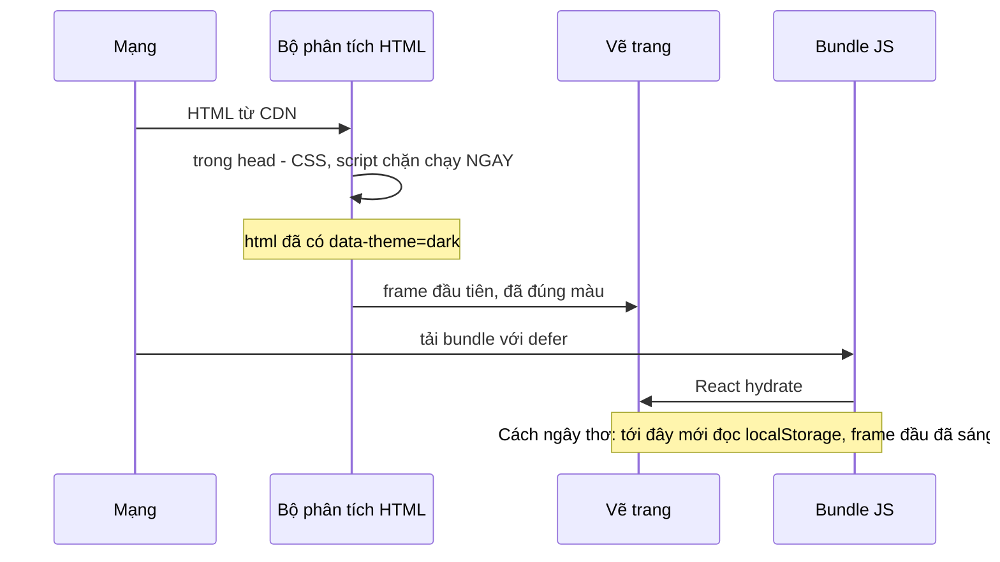

Bạn bật dark mode trên một trang web, tắt tab, mở lại. Trong khoảng một phần mười giây, trang hiện **nền trắng** rồi mới chuyển sang tối. Trên màn hình OLED lúc nửa đêm, cú nháy đó rất chói. Lỗi này có tên riêng: **FOUC theme** (flash of unstyled content), hay "flash of incorrect theme".

Nguyên nhân gần như luôn giống nhau: lựa chọn theme nằm trong `localStorage`, mà code đọc nó lại nằm trong bundle JavaScript. Trình duyệt vẽ HTML trước, bundle tải xong và chạy sau. Giữa hai thời điểm đó, trang hiện theme mặc định.

> [!TIP]
> **Tóm tắt**
> - Theme phải được áp **trước frame đầu tiên**, tức là trong một `<script>` inline chạy đồng bộ, không phải trong React.
> - gatsbyjs.com (qua thư viện theme-ui) chèn đoạn script 6 dòng đọc `localStorage` và gắn class lên `<body>` trước khi phần còn lại của trang được vẽ.
> - Bản viết lại đặt `data-theme` + `color-scheme` lên `<html>`, theo hệ điều hành khi người dùng chưa chọn, và đồng bộ giữa các tab.
> - Nếu không cần nút chuyển theme, chỉ dùng CSS `prefers-color-scheme` hoặc `light-dark()` là đủ và không bao giờ nháy.

Demo dưới đây giả lập hai trang: trang trái đợi 800ms (thời gian tải bundle) mới áp theme, trang phải có script chặn trong `<head>`. Chọn **Tối** rồi bấm **Tải lại 2 trang**.

<iframe class="demo-frame" src="/demos/web-patterns/index.html?theme=dark#/dark-mode" title="Demo dark-mode" loading="lazy" style="height: 520px"></iframe>

<p class="demo-links">▶ <a href="/demos/web-patterns/index.html#/dark-mode" target="_blank" rel="noopener">Mở demo toàn màn hình ↗</a> · <a href="https://stackblitz.com/github/hunghg255/blog-hunghg/tree/master/examples/web-patterns?file=src/lib/themeScript.ts" target="_blank" rel="noopener">Sửa code trên StackBlitz ↗</a> · <a href="https://github.com/hunghg255/blog-hunghg/blob/master/examples/web-patterns/src/lib/themeScript.ts" target="_blank" rel="noopener">Xem source trên GitHub ↗</a></p>

## Gatsby làm thế nào?

Trong mã nguồn gatsbyjs.com, phần màu sắc nằm ở `gatsbyjs.com/src/color-modes.js` và `src/custom-properties.js`. Hai file này thực chất là mã của thư viện [theme-ui](https://theme-ui.com) được bundle cùng trang (bản dump gộp cả thư viện vào `src/`, cạnh đó còn có các file của Sentry như `hub.ts`, `scope.ts`). Vì vậy kỹ thuật dưới đây là của theme-ui, và gatsbyjs.com là nơi dùng nó.

### Bước 1: mọi màu đều là biến CSS

`createColorStyles` trong `custom-properties.js` biến object theme thành biến CSS gắn lên `body`, và với mỗi chế độ màu thì tạo thêm một selector `&.theme-ui-<mode>`:

```js
// custom-properties.js (rút gọn)
const toVarName = key => `--theme-ui-${key}`
// ...
Object.keys(modes).forEach(mode => {
  const key = `&.theme-ui-${mode}`
  styles[key] = objectToVars('colors', modes[mode])
})
```

Kết quả là CSS kiểu `body { --theme-ui-colors-background: #fff } body.theme-ui-dark { --theme-ui-colors-background: #000 }`. Mọi component dùng `var(--theme-ui-colors-background, #fff)`. Đổi theme chỉ cần **đổi một class**, không cần React render lại cả cây.

### Bước 2: script chặn (blocking script) gắn class trước khi vẽ

Component `InitializeColorMode` chỉ render một thẻ `<script>`:

```js
// color-modes.js
export const InitializeColorMode = () => (
  <script
    key="theme-ui-no-flash"
    dangerouslySetInnerHTML={{
      __html: `(function() { try {
        var mode = localStorage.getItem('theme-ui-color-mode');
        if (!mode) return
        document.body.classList.add('theme-ui-' + mode);
      } catch (e) {} })();`,
    }}
  />
)
```

Script này được render thành HTML tĩnh lúc build. Nó dùng `document.body`, nên phải nằm ở **đầu `<body>`**: có lẽ plugin theme-ui cho Gatsby chèn nó vào vị trí đó (file `gatsby-ssr` của plugin không có trong bản dump). Trình duyệt gặp thẻ `<script>` không có `async`/`defer` thì **dừng phân tích HTML** để chạy nó ngay. Khi trình duyệt vẽ frame đầu tiên, `body` đã có class `theme-ui-dark`.

Để ý ba chi tiết:

- **`try { } catch (e) {}`**: `localStorage` có thể ném lỗi (trình duyệt chặn cookie/storage, iframe sandbox). Script chặn mà ném lỗi thì không sao, nhưng nuốt lỗi giúp console sạch.
- **IIFE `(function(){ ... })()`**: không rò biến `mode` ra global.
- **Chỉ 6 dòng, không phụ thuộc gì**: script chặn làm chậm việc vẽ trang, nên càng ngắn càng tốt.

### Bước 3: React tiếp quản

Sau khi app hydrate, hook `useColorState` đọc lại `localStorage`, **gỡ class** khỏi `body` (từ đây style toàn cục do React/Emotion quản lý theo state) và lưu lại lựa chọn mỗi khi state đổi:

```js
useEffect(() => {
  const stored = storage.get()
  document.body.classList.remove('theme-ui-' + stored)
  const dark = getMediaQuery()
  if (!stored && dark && theme.useColorSchemeMediaQuery) return setMode('dark')
  if (!stored || stored === mode) return
  setMode(stored)
}, [])
```

Thứ tự ưu tiên: **lựa chọn đã lưu** → **theme hệ điều hành** (chỉ khi bật `useColorSchemeMediaQuery`) → **mặc định**. Trong `src/layouts/index.js`, gatsbyjs.com tắt hẳn việc theo hệ điều hành:

```js
<ThemeProvider theme={baseTheme => ({ ...baseTheme, useColorSchemeMediaQuery: false })}>
```

Đây là một lựa chọn hợp lý vì có một khe hở: script chặn **không xét `prefers-color-scheme`**. Nếu bật theo hệ điều hành, người dùng chưa từng chọn theme mà máy đang ở chế độ tối sẽ thấy trang sáng trước, rồi mới tối khi React chạy, tức là đúng cái nháy ta muốn tránh. Tắt nó đi thì trang luôn sáng cho tới khi người dùng tự chọn, nhất quán và không nháy.

## Bên trong trình duyệt: frame đầu tiên được vẽ khi nào?



Trình duyệt không chờ JavaScript của bạn để vẽ. Với HTML render sẵn (SSR/SSG), nó vẽ ngay khi có HTML + CSS chặn render (render-blocking CSS). Bundle thường có `defer` hoặc `type="module"` nên chạy **sau** khi HTML đã phân tích xong, tức là sau frame đầu. Chỉ có script inline không `async`/`defer` là chạy **trước** những gì đứng sau nó trong HTML.

Một điểm hay bị bỏ qua là `color-scheme`. Thuộc tính CSS này (hoặc `<meta name="color-scheme">`) báo cho trình duyệt rằng trang hỗ trợ nền tối, để **thanh cuộn, ô input, checkbox, nền mặc định của canvas** cũng vẽ màu tối. Thiếu nó thì trang tối nhưng thanh cuộn vẫn trắng.

## Viết lại

Bản viết lại giữ ý tưởng "script chặn + biến CSS" nhưng sửa khe hở nói trên và đặt trạng thái lên `<html>` thay vì `<body>`. Như vậy script chạy được trong `<head>`, trước cả khi `<body>` tồn tại.

```ts title=src/lib/themeScript.ts
function applyInitialTheme(storageKey: string, attribute: string) {
  var root = document.documentElement;
  var theme = 'light';
  try {
    var stored = localStorage.getItem(storageKey);
    if (stored === 'light' || stored === 'dark') {
      theme = stored;
    } else if (window.matchMedia && window.matchMedia('(prefers-color-scheme: dark)').matches) {
      theme = 'dark';
    }
  } catch (e) {
    // localStorage bị chặn (cookie bị tắt, sandbox iframe…): vẫn theo hệ điều hành được
    if (window.matchMedia && window.matchMedia('(prefers-color-scheme: dark)').matches) theme = 'dark';
  }
  root.setAttribute(attribute, theme);
  // color-scheme: thanh cuộn, ô input, nền mặc định của trình duyệt cũng đổi màu theo
  root.style.colorScheme = theme;
}

/** Chuỗi JS để đặt trong <script> ở <head>, trước mọi stylesheet/script khác. */
export function themeInitScript({ storageKey = 'theme', attribute = 'data-theme' }: ThemeScriptOptions = {}) {
  return `(${applyInitialTheme.toString()})(${JSON.stringify(storageKey)}, ${JSON.stringify(attribute)})`;
}
```

**Khác bản gốc:**

- Gắn `data-theme` lên `<html>` (luôn có sẵn khi `<head>` chạy), không phải class trên `<body>`.
- Khi chưa có lựa chọn đã lưu thì theo `prefers-color-scheme`, kể cả khi `localStorage` ném lỗi.
- Đặt `color-scheme` để các thành phần gốc của trình duyệt đổi màu theo.
- Ba trạng thái `light | dark | system`: chọn "theo hệ thống" thì **xoá** khoá khỏi storage, thay vì lưu `'default'` như theme-ui (theme-ui lưu `mode` ngay lần đầu nên sau lần truy cập đầu tiên mọi người dùng đều "đã chọn").

Phần chạy sau khi app tải xong là một store nhỏ, đọc/ghi lựa chọn và nghe hai nguồn thay đổi bên ngoài:

```ts title=src/lib/themeStore.ts
  function apply() {
    const theme = resolve(preference);
    const root = doc.documentElement;
    if (root.getAttribute(attribute) !== theme) {
      // Tắt transition trong lúc đổi màu: nếu không, mọi phần tử có `transition: background`
      // sẽ chuyển màu lệch nhịp nhau trông như trang bị "lag".
      const style = doc.createElement('style');
      style.textContent = '*,*::before,*::after{transition:none!important}';
      doc.head.appendChild(style);
      root.setAttribute(attribute, theme);
      root.style.colorScheme = theme;
      void win.getComputedStyle(doc.body).opacity; // ép trình duyệt tính lại style ngay, trước khi gỡ <style>
      style.remove();
    }
    listeners.forEach((listener) => listener());
  }

  // Hệ điều hành đổi sáng/tối: chỉ có tác dụng khi đang ở chế độ 'system'
  const onSystemChange = () => {
    if (preference === 'system') apply();
  };
  // Tab khác đổi theme: sự kiện `storage` chỉ bắn ở các tab KHÁC tab vừa ghi
  const onStorage = (event: StorageEvent) => {
    if (event.key !== storageKey && event.key !== null) return;
    preference = readPreference();
    apply();
  };
  media.addEventListener('change', onSystemChange);
  win.addEventListener('storage', onStorage);
```

::: spoiler Xem toàn bộ src/lib/themeScript.ts

```ts title=src/lib/themeScript.ts
/**
 * Dark mode không nháy (ý tưởng từ InitializeColorMode của theme-ui trên gatsbyjs.com).
 *
 * Một đoạn script nhỏ được inline vào <head>, chạy ĐỒNG BỘ trước khi trình duyệt vẽ frame đầu:
 * đọc lựa chọn đã lưu, nếu chưa chọn thì theo hệ điều hành, rồi đặt `data-theme` + `color-scheme`
 * lên <html>. CSS chỉ cần đọc `[data-theme='dark']`, nên trang hiện đúng màu ngay từ pixel đầu tiên.
 */

export type ThemePreference = 'light' | 'dark' | 'system';
export type ResolvedTheme = 'light' | 'dark';

export interface ThemeScriptOptions {
  /** khoá localStorage, mặc định 'theme' */
  storageKey?: string;
  /** attribute đặt lên <html>, mặc định 'data-theme' */
  attribute?: string;
}

/**
 * Hàm này được chuyển thành chuỗi bằng `toString()` rồi inline vào HTML, nên phải TỰ ĐỦ:
 * không import, không gọi hàm khác trong module, chỉ dùng cú pháp mọi trình duyệt hiểu.
 */
function applyInitialTheme(storageKey: string, attribute: string) {
  var root = document.documentElement;
  var theme = 'light';
  try {
    var stored = localStorage.getItem(storageKey);
    if (stored === 'light' || stored === 'dark') {
      theme = stored;
    } else if (window.matchMedia && window.matchMedia('(prefers-color-scheme: dark)').matches) {
      theme = 'dark';
    }
  } catch (e) {
    // localStorage bị chặn (cookie bị tắt, sandbox iframe…): vẫn theo hệ điều hành được
    if (window.matchMedia && window.matchMedia('(prefers-color-scheme: dark)').matches) theme = 'dark';
  }
  root.setAttribute(attribute, theme);
  // color-scheme: thanh cuộn, ô input, nền mặc định của trình duyệt cũng đổi màu theo
  root.style.colorScheme = theme;
}

/** Chuỗi JS để đặt trong <script> ở <head>, trước mọi stylesheet/script khác. */
export function themeInitScript({ storageKey = 'theme', attribute = 'data-theme' }: ThemeScriptOptions = {}) {
  return `(${applyInitialTheme.toString()})(${JSON.stringify(storageKey)}, ${JSON.stringify(attribute)})`;
}
```

:::

::: spoiler Xem toàn bộ src/lib/themeStore.ts

```ts title=src/lib/themeStore.ts
import { useSyncExternalStore } from 'react';
import type { ResolvedTheme, ThemePreference } from './themeScript';

/**
 * Phần chạy sau khi app đã tải: đọc/đổi theme, theo dõi hệ điều hành và các tab khác.
 * Trạng thái thật nằm trên <html> + localStorage (script ở <head> đã đặt sẵn), store chỉ đồng bộ theo.
 */

const DARK_QUERY = '(prefers-color-scheme: dark)';

export function createThemeStore(storageKey = 'theme', attribute = 'data-theme', doc: Document = document) {
  const win = doc.defaultView!;
  const media = win.matchMedia(DARK_QUERY);
  const listeners = new Set<() => void>();

  const readPreference = (): ThemePreference => {
    try {
      const stored = win.localStorage.getItem(storageKey);
      return stored === 'light' || stored === 'dark' ? stored : 'system';
    } catch {
      return 'system';
    }
  };

  let preference = readPreference();
  const resolve = (pref: ThemePreference): ResolvedTheme =>
    pref === 'system' ? (media.matches ? 'dark' : 'light') : pref;

  function apply() {
    const theme = resolve(preference);
    const root = doc.documentElement;
    if (root.getAttribute(attribute) !== theme) {
      // Tắt transition trong lúc đổi màu: nếu không, mọi phần tử có `transition: background`
      // sẽ chuyển màu lệch nhịp nhau trông như trang bị "lag".
      const style = doc.createElement('style');
      style.textContent = '*,*::before,*::after{transition:none!important}';
      doc.head.appendChild(style);
      root.setAttribute(attribute, theme);
      root.style.colorScheme = theme;
      void win.getComputedStyle(doc.body).opacity; // ép trình duyệt tính lại style ngay, trước khi gỡ <style>
      style.remove();
    }
    listeners.forEach((listener) => listener());
  }

  // Hệ điều hành đổi sáng/tối: chỉ có tác dụng khi đang ở chế độ 'system'
  const onSystemChange = () => {
    if (preference === 'system') apply();
  };
  // Tab khác đổi theme: sự kiện `storage` chỉ bắn ở các tab KHÁC tab vừa ghi
  const onStorage = (event: StorageEvent) => {
    if (event.key !== storageKey && event.key !== null) return;
    preference = readPreference();
    apply();
  };
  media.addEventListener('change', onSystemChange);
  win.addEventListener('storage', onStorage);

  return {
    getPreference: () => preference,
    getResolved: () => resolve(preference),
    setPreference(next: ThemePreference) {
      preference = next;
      try {
        if (next === 'system') win.localStorage.removeItem(storageKey);
        else win.localStorage.setItem(storageKey, next);
      } catch {
        // không lưu được thì chỉ đổi cho phiên này
      }
      apply();
    },
    subscribe(listener: () => void) {
      listeners.add(listener);
      return () => {
        listeners.delete(listener);
      };
    },
    destroy() {
      media.removeEventListener('change', onSystemChange);
      win.removeEventListener('storage', onStorage);
    },
  };
}

export type ThemeStore = ReturnType<typeof createThemeStore>;

/** Hook React đọc theme từ store. Server không biết theme, nên trả 'system' / undefined. */
export function useTheme(store: ThemeStore) {
  const preference = useSyncExternalStore(store.subscribe, store.getPreference, () => 'system' as const);
  const resolved = useSyncExternalStore(store.subscribe, store.getResolved, () => undefined);
  return { preference, resolved, setPreference: store.setPreference };
}
```

:::

## Đi qua code

**`applyInitialTheme` được chuyển thành chuỗi.** `themeInitScript()` gọi `applyInitialTheme.toString()` rồi bọc thành IIFE kèm tham số đã `JSON.stringify`. Viết hàm thật thay vì một chuỗi dài có ba cái lợi: TypeScript kiểm tra được, editor tô màu được, và test gọi trực tiếp được. Cái giá là hàm phải **tự đủ**: không import, không gọi hàm khác trong module, vì khi thành chuỗi nó mất hết ngữ cảnh. Đó cũng là lý do hàm dùng `var` và cú pháp đơn giản.

**`JSON.stringify(storageKey)`** thay vì nối chuỗi trực tiếp: nếu khoá có dấu nháy, chuỗi vẫn là JavaScript hợp lệ.

**Store không giữ trạng thái riêng.** Nguồn sự thật là `<html data-theme>` + `localStorage`. Store chỉ đọc lại và thông báo cho React qua `useSyncExternalStore`. Nhờ vậy React, script chặn và các tab khác không bao giờ "cãi nhau" về theme hiện tại.

**Hai nguồn thay đổi bên ngoài:**

- `matchMedia('(prefers-color-scheme: dark)')` bắn `change` khi người dùng đổi theme hệ điều hành (hoặc máy tự chuyển tối lúc hoàng hôn). Chỉ áp dụng khi đang ở chế độ `system`.
- Sự kiện `storage` bắn ở **các tab khác** (và các iframe cùng origin) khi một tab ghi `localStorage`. Đổi theme ở tab A thì tab B đổi theo ngay. Demo dùng đúng cơ chế này: bấm Sáng/Tối, trang phải đổi màu không cần tải lại, trang trái thì không.

**Tắt transition khi đổi theme.** Nếu nhiều phần tử có `transition: background-color 0.3s`, lúc đổi theme chúng chuyển màu lệch nhịp, trông như trang bị giật. Mẹo: chèn tạm một `<style>` tắt mọi transition, đổi attribute, đọc `getComputedStyle` để buộc trình duyệt tính lại style **ngay lúc đó**, rồi gỡ `<style>`. Không có bước đọc style, trình duyệt có thể gộp "thêm style, đổi màu, gỡ style" vào một lần tính và transition vẫn chạy.

**`useTheme` trả `undefined` ở server.** `getServerSnapshot` trả `'system'` / `undefined` vì server không biết người dùng chọn gì. Component vẽ icon mặt trời/mặt trăng nên render một placeholder khi `resolved === undefined`, để HTML từ server và lần render đầu ở client khớp nhau (tránh lỗi hydration mismatch).

## Tại sao không làm cách khác?

**Đọc theme trong `useEffect` / `useLayoutEffect`.** Chạy sau khi bundle tải xong, tức là sau frame đầu. `useLayoutEffect` chạy trước khi *React* vẽ lần cập nhật, nhưng không thể chạy trước frame đầu tiên của HTML render sẵn.

**Lưu theme trong cookie để server render đúng.** Làm được, và không cần script chặn khi người dùng đã chọn. Nhưng trang tĩnh trên CDN phải cache theo cookie (mất nhiều lợi ích của cache), và server vẫn không biết theme hệ điều hành khi người dùng chưa chọn. Header Client Hint `Sec-CH-Prefers-Color-Scheme` giải quyết được phần đó nhưng hiện chỉ trình duyệt nhân Chromium hỗ trợ (tính tới 10/2026). Thường người ta kết hợp: cookie cho SSR + script chặn làm lưới an toàn.

**Chỉ dùng CSS `@media (prefers-color-scheme: dark)`.** Không bao giờ nháy, không cần JavaScript, nhưng người dùng không thể chọn khác hệ điều hành. Nếu sản phẩm của bạn không cần nút chuyển theme, đây là lựa chọn tốt nhất. Hàm CSS `light-dark(#fff, #111)` (kết hợp với `color-scheme`) giúp viết gọn hơn nữa; xem hỗ trợ trình duyệt trên [MDN](https://developer.mozilla.org/en-US/docs/Web/CSS/color_value/light-dark).

**Ẩn cả trang (`visibility: hidden`) cho tới khi JavaScript chạy.** Không nháy màu, nhưng người dùng nhìn trang trắng/trống lâu hơn, và JavaScript lỗi thì trang không bao giờ hiện.

## Edge case và cạm bẫy

- **Content Security Policy.** Trang có CSP chặn inline script (`script-src 'self'`) sẽ chặn luôn script này. Thêm `nonce` cho thẻ `<script>`, hoặc thêm mã băm `'sha256-…'` của đúng nội dung script vào CSP. Vì nội dung script cố định, mã băm cũng cố định, chỉ cần tính một lần mỗi khi build.
- **Minify và `toString()`.** Bundler có thể đổi tên biến trong `applyInitialTheme`, không sao vì hàm tự đủ. Nhưng nếu bundler chèn helper (ví dụ khi biên dịch xuống ES5 cho trình duyệt cũ), chuỗi sẽ tham chiếu tới helper không tồn tại. Giữ hàm ở cú pháp đơn giản, hoặc kiểm tra chuỗi sinh ra trong test.
- **React cảnh báo attribute không khớp trên `<html>`.** Nếu app render cả thẻ `<html>` (Next.js App Router), script đã thêm `data-theme` trước khi React hydrate. Thêm `suppressHydrationWarning` vào `<html>`; nó chỉ có tác dụng với attribute của chính thẻ đó.
- **Script phải đứng trước nội dung.** Đặt trong `<head>` là chắc nhất. Đặt cuối `<body>` thì mất tác dụng, vì trình duyệt có thể đã vẽ phần trên.
- **Trang chỉ dùng storage trong iframe sandbox / chế độ riêng tư.** `localStorage.getItem` có thể ném lỗi `SecurityError`. Bản viết lại vẫn theo theme hệ điều hành trong trường hợp đó, và `setPreference` không lưu được thì chỉ đổi cho phiên hiện tại.
- **Ảnh và logo.** Biến CSS không đổi được ``. Dùng `<picture><source media="(prefers-color-scheme: dark)">` chỉ đúng khi theo hệ điều hành; với lựa chọn thủ công thì dùng SVG `currentColor`, hoặc hai ảnh và ẩn/hiện bằng `[data-theme='dark'] .logo-light { display: none }`.

## Dùng trong dự án

**Vite / SPA thuần:** dán thẳng chuỗi đã sinh vào `index.html`, hoặc sinh lúc build bằng hook `transformIndexHtml` của plugin Vite:

```ts
// vite.config.ts
import { themeInitScript } from './src/lib/themeScript';

export default defineConfig({
  plugins: [
    {
      name: 'theme-init',
      transformIndexHtml: (html) => html.replace('<head>', `<head><script>${themeInitScript()}</script>`),
    },
  ],
});
```

**Next.js App Router:**

```tsx
// app/layout.tsx
export default function RootLayout({ children }: { children: React.ReactNode }) {
  return (
    <html lang='vi' suppressHydrationWarning>
      <head>
        <script dangerouslySetInnerHTML={{ __html: themeInitScript() }} />
      </head>
      <body>{children}</body>
    </html>
  );
}
```

CSS chỉ cần một bộ biến cho mỗi theme:

```css
:root { --bg: #fff; --text: #17171c; }
:root[data-theme='dark'] { --bg: #0f0f13; --text: #ececf1; }
body { background: var(--bg); color: var(--text); }
```

Thư viện [next-themes](https://github.com/pacocoursey/next-themes) làm đúng các bước này (script chặn, `system`, đồng bộ tab, tắt transition) và là lựa chọn hợp lý nếu bạn dùng Next.js.

## Kiểm thử

::: spoiler Ví dụ test (bản phác, không có trong repo)

```ts
// themeScript.test.ts — Vitest + jsdom
import { beforeEach, expect, test, vi } from 'vitest';
import { themeInitScript } from './themeScript';

function mockSystemDark(dark: boolean) {
  window.matchMedia = vi.fn().mockImplementation((query: string) => ({
    matches: dark && query === '(prefers-color-scheme: dark)',
    media: query,
    addEventListener: vi.fn(),
    removeEventListener: vi.fn(),
  }));
}

const run = () => new Function(themeInitScript())();

beforeEach(() => {
  localStorage.clear();
  document.documentElement.removeAttribute('data-theme');
});

test('lựa chọn đã lưu thắng theme hệ điều hành', () => {
  mockSystemDark(true);
  localStorage.setItem('theme', 'light');
  run();
  expect(document.documentElement.dataset.theme).toBe('light');
});

test('chưa chọn thì theo hệ điều hành', () => {
  mockSystemDark(true);
  run();
  expect(document.documentElement.dataset.theme).toBe('dark');
  expect(document.documentElement.style.colorScheme).toBe('dark');
});

test('giá trị rác trong storage bị bỏ qua', () => {
  mockSystemDark(false);
  localStorage.setItem('theme', '"><script>');
  run();
  expect(document.documentElement.dataset.theme).toBe('light');
});
```

Kiểm tra "không nháy" thật sự cần trình duyệt. Với Playwright, đặt `localStorage` trước khi trang tải rồi đọc màu nền ngay ở frame đầu:

```ts
test('frame đầu đã tối', async ({ page }) => {
  await page.addInitScript(() => localStorage.setItem('theme', 'dark'));
  await page.addInitScript(() =>
    requestAnimationFrame(() => {
      (window as any).firstBg = getComputedStyle(document.body).backgroundColor;
    }),
  );
  await page.goto('/');
  expect(await page.evaluate(() => (window as any).firstBg)).toBe('rgb(15, 15, 19)');
});
```

:::

---

Bài này thuộc series **[Học từ mã nguồn các web lớn](/series/web)** (65 bài, đọc theo thứ tự).

::: spoiler Xem nhanh danh sách bài trong series

*Mở đầu*

- [Mở đầu: đọc code production của 28 trang web](/blogs/learn-from-big-web-apps)

*Phần 1: trải nghiệm người dùng*

- **#1 Dark mode không nháy (Gatsby)** (bài này)
- [#2 useValueByMedia: giá trị theo breakpoint (Toptal)](/blogs/web-use-value-by-media)
- [#3 Đoán ý định: idle, exit-intent, lắc chuột (Toptal, InVision)](/blogs/web-user-intent-idle-exit-wiggle)
- [#4 Validate form thân thiện (Udacity, Pipedrive)](/blogs/web-form-validation-ux)
- [#5 Magic number, EXIF và dán ảnh (Ello)](/blogs/web-file-magic-number-exif-paste)
- [#6 fastSmoothScroll: cuộn xa vẫn nhanh (Telegram)](/blogs/web-telegram-fast-smooth-scroll)
- [#7 Countdown time-travel và tombstone giỏ hàng (Best Buy)](/blogs/web-countdown-time-travel-tombstone)

*Phần 2: hiệu năng và đo lường*

- [#8 Hàng đợi requestAnimationFrame 3ms (Apple)](/blogs/web-raf-queue-3ms)
- [#9 srcset cho artwork và preconnect tự động (Apple)](/blogs/web-responsive-artwork-preconnect)
- [#10 Quick-fetch: gọi API trước khi bundle tải xong (HubSpot)](/blogs/web-quick-fetch-early-requests)
- [#11 Performance span và long task (Postman, Calibre)](/blogs/web-performance-spans-long-tasks)
- [#12 Gọi Web Worker như hàm async (Telegram)](/blogs/web-worker-promise-rpc)
- [#13 Đồng hồ media: đếm giờ xem và sửa lệch (Skillshare, Simplified)](/blogs/web-media-clock-watch-time-drift)

*Phần 3: nhiều tab, phiên đăng nhập, cập nhật*

- [#14 Bầu tab chủ cho thông báo (HubSpot, Telegram)](/blogs/web-leader-tab-notifications)
- [#15 Đồng bộ đăng nhập giữa tab và giới hạn cookie (Elastic, InVision)](/blogs/web-cross-tab-auth-cookie-guard)
- [#16 SPA tự cập nhật: Trello, Zappos, Facebook, Elastic](/blogs/web-spa-self-update-strategies)

*Phần 4: kiến trúc*

- [#17 Reverse portal: di chuyển component không remount (Zappos)](/blogs/web-reverse-portal)
- [#18 Page behaviors: gắn hành vi từ CMS (Intercom)](/blogs/web-page-behaviors-cms)
- [#19 Giới hạn tần suất hiển thị bằng bitmask (Outlook)](/blogs/web-frequency-cap-bitmask)
- [#20 Chuyển REST sang GraphQL dần dần (Coursera)](/blogs/web-rest-to-graphql-hybrid-link)

*Phần 5: soạn thảo và hiển thị nội dung*

- [#21 Autocomplete tại con trỏ trong contenteditable (Ello, Telegram)](/blogs/web-caret-autocomplete-contenteditable)
- [#22 Dark mode cho email HTML bằng CIELAB (Outlook)](/blogs/web-email-dark-mode-cielab)
- [#23 Thu nhỏ bảng rộng cho vừa khung, vá font emoji (Outlook)](/blogs/web-email-wide-content-scale)
- [#24 Cảnh báo quên đính kèm file (Outlook)](/blogs/web-forgotten-attachment-warning)
- [#25 Cắt chữ nhiều dòng chính xác (Pipedrive, Apple, Toptal)](/blogs/web-multiline-truncate-measure-text)
- [#26 Parse ngày giờ gõ tay khoan dung (Outlook, Elastic)](/blogs/web-lenient-date-parser)

*Phần 6: tương tác*

- [#27 menuAim: rê chéo vào submenu không bị đóng (Udemy)](/blogs/web-menu-aim-triangle)
- [#28 Kéo, vuốt chung cho chuột và cảm ứng (Telegram)](/blogs/web-unified-pointer-gestures)
- [#29 Phím tắt theo phạm vi, IME và bàn phím phi Latinh (Trello)](/blogs/web-scoped-keyboard-shortcuts)
- [#30 Nội suy màu: đổi theme và nền theo cuộn (Telegram, Anchor)](/blogs/web-color-interpolation-theme-scroll)
- [#31 Đường gióng hút cạnh và undo/redo trên canvas (Simplified)](/blogs/web-canvas-snap-guides-undo)
- [#32 Giả lập mù màu bằng feColorMatrix (Trello)](/blogs/web-color-vision-simulator)
- [#33 Vạch thước theo mức zoom và cấp phát màu cho biểu đồ (Anchor, Similarweb)](/blogs/web-timeline-ticks-color-stack)

*Phần 7: mạng, dữ liệu và async*

- [#34 Ô tìm kiếm chuẩn production (Similarweb, Udemy, Pipedrive)](/blogs/web-production-search-box)
- [#35 Điều phối async: latest-wins, single-flight (Glitch, Toptal)](/blogs/web-async-coordination-latest-wins)
- [#36 Polling thưa dần và debounce động (Trello)](/blogs/web-decaying-polling-dynamic-debounce)
- [#37 Cache phía client theo version (Similarweb, Telegram, Udemy)](/blogs/web-client-cache-versioned)
- [#38 Upload file lớn theo chunk (Outlook, Tribe)](/blogs/web-chunked-upload-pipeline)
- [#39 Phát video qua Service Worker bằng Range request (Telegram, Outlook)](/blogs/web-service-worker-range-streaming)

*Phần 8: hiệu năng và vận hành*

- [#40 TTI governor: hoãn việc phụ tới sau khi trang dùng được (Outlook)](/blogs/web-tti-governor)
- [#41 Tự đo LCP/CLS/TBT và phục vụ bản nhẹ cho máy yếu (Udemy)](/blogs/web-rum-adaptive-loading)

*Phần 9: thuật toán và dữ liệu phía client*

- [#42 Three-way merge ngay trên trình duyệt (Postman)](/blogs/web-three-way-merge-client)
- [#43 Dọn cache GraphQL bằng đếm tham chiếu (Outlook)](/blogs/web-graphql-cache-refcount-gc)
- [#44 LRU cache theo 3 cách (Apple, Similarweb, Outlook)](/blogs/web-lru-cache-three-ways)
- [#45 Lọc tăng dần trong Web Worker (Similarweb)](/blogs/web-incremental-filter-worker)
- [#46 Xếp hạng gợi ý trên client, so ngầm với server (Outlook)](/blogs/web-client-side-ranking-shadow-test)
- [#47 Nối OT với editor: undo stack và chặn echo (Glitch)](/blogs/web-ot-codemirror-undo)
- [#48 Ngôn ngữ markup riêng dịch hai chiều với HTML (Coursera)](/blogs/web-custom-markup-compiler)

*Phần 10: thời gian, ngôn ngữ, định dạng*

- [#49 Xử lý giờ mùa hè không cần thư viện (Udemy, Pipedrive)](/blogs/web-dst-without-library)
- [#50 Intl thực chiến: Segmenter, số rút gọn, số nhiều, fallback locale (Apple, Outlook)](/blogs/web-intl-in-production)
- [#51 WebVTT và bôi chọn transcript (Udemy, Coursera)](/blogs/web-webvtt-transcript-selection)

*Phần 11: tương tác và giao diện*

- [#52 Kéo-thả trên lịch (Pipedrive)](/blogs/web-calendar-drag-drop)
- [#53 Focus stack cho popup lồng nhau (Outlook)](/blogs/web-focus-stack-nested-popups)
- [#54 Clipboard: copy, dán chữ thuần, dán thông minh (Trello, Anchor, Pipedrive, Tribe)](/blogs/web-clipboard-tricks)
- [#55 Khôi phục vị trí cuộn khi trang còn đang tải (Apple, Zappos)](/blogs/web-scroll-restore-wait-height)
- [#56 Lấy màu từ ảnh: gradient nền, màu chữ (Apple, Telegram, Trello)](/blogs/web-colors-from-images)
- [#57 JS đọc breakpoint từ CSS, phát hiện chế độ PWA (Ello, Apple)](/blogs/web-css-js-breakpoint-bridge)

*Phần 12: media*

- [#58 Tin nhắn thoại: ghi âm, waveform realtime, nén 5-bit (Telegram)](/blogs/web-voice-message-waveform)
- [#59 Chụp frame video thành ảnh, canvas bị taint (Coursera, Outlook)](/blogs/web-video-frame-snapshot)

*Phần 13: đo lường, bảo mật, vận hành*

- [#60 Đo lúc ảnh màn hình đầu tải xong, cả khi chuyển trang SPA (Zappos, Best Buy, Outlook)](/blogs/web-above-the-fold-image-timing)
- [#61 Buffer analytics chờ SDK, phát hiện adblock (Best Buy)](/blogs/web-analytics-buffer-adblock)
- [#62 Proof-of-work trên client để chặn API ẩn danh (Udemy)](/blogs/web-client-proof-of-work)
- [#63 Prefetch không làm lệch số liệu, nén cài đặt bằng bit (Outlook)](/blogs/web-synthetic-prefetch-bit-flags)
- [#64 Micro-frontend: AngularJS và React chung app, giao tiếp xuyên frame (Similarweb, InVision, HubSpot)](/blogs/web-micro-frontend-bridges)

:::

Code + demo: [`examples/web-patterns`](https://github.com/hunghg255/blog-hunghg/tree/master/examples/web-patterns) · [Mở trên StackBlitz](https://stackblitz.com/github/hunghg255/blog-hunghg/tree/master/examples/web-patterns)
