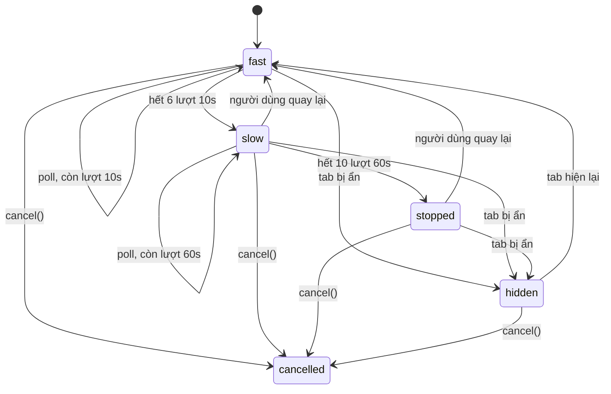

Màn hình chính của Trello có mục "Up next" (các thẻ sắp tới hạn) và "Highlights" (hoạt động mới trên board của bạn). Thẻ đính kèm link Trello trong một thẻ khác cũng tự cập nhật nội dung. Những thứ này không đi qua kênh realtime (WebSocket) mà được **poll**: cứ vài giây hỏi server một lần.

Poll đều đặn bằng `setInterval(fetch, 10_000)` thì có hai vấn đề:

- Tab mở cả ngày mà người dùng đã đi ăn trưa: 360 request mỗi giờ cho một màn hình không ai nhìn.
- Nhân với vài triệu tab đang mở, đó là một lượng tải đáng kể cho server, chỉ để trả về "không có gì mới".

Trello dùng một hàm tên `decayingInterval`: **6 lần cách 10 giây, rồi 10 lần cách 1 phút, rồi dừng**. Đang chậm hoặc đã dừng mà người dùng rê chuột, lịch quay về nhịp nhanh. Cùng package `@trello/time` còn có `dynamicDebounce`: debounce mà thời gian chờ là một hàm của tham số.

> [!TIP]
> **Tóm tắt**
> - Poll theo **lịch thưa dần** (nhanh khi người dùng vừa thao tác, chậm dần, rồi dừng), và **đánh thức** khi người dùng quay lại: rê chuột, gõ phím, chạm, tab hiện lại.
> - Tab bị ẩn thì **tạm dừng hẳn** (`visibilitychange`), hiện lại thì poll ngay vì dữ liệu có thể đã cũ.
> - Hàm hủy phải hủy được **mọi** thứ đang chờ. Bản gốc gọi `requestAnimationFrame` mà không giữ id, nên hủy đúng lúc đó thì polling vẫn chạy tiếp.
> - Debounce động: query ngắn (≤ 3 ký tự) hoặc đang xoá lùi thì chờ 1000ms, còn lại 500ms. Bản gốc có lỗi khi bật `immediate`: lần gọi cuối chạy với tham số rỗng.

<iframe class="demo-frame" src="/demos/web-patterns/index.html?theme=dark#/decaying-poll" title="Demo decaying-poll" loading="lazy" style="height: 900px"></iframe>

<p class="demo-links">▶ <a href="/demos/web-patterns/index.html#/decaying-poll" target="_blank" rel="noopener">Mở demo toàn màn hình ↗</a> · <a href="https://stackblitz.com/github/hunghg255/blog-hunghg/tree/master/examples/web-patterns?file=src/lib/decayingInterval.ts" target="_blank" rel="noopener">Sửa code trên StackBlitz ↗</a> · <a href="https://github.com/hunghg255/blog-hunghg/blob/master/examples/web-patterns/src/lib/decayingInterval.ts" target="_blank" rel="noopener">Xem source trên GitHub ↗</a></p>

Demo tua nhanh 10 lần (10 giây thật = 1 giây trong demo). Ngồi yên: thanh "thưa dần" có 6 vạch dày rồi thưa ra, trong khi `setInterval` đều đặn mãi. Rê chuột vào khi đang thưa: một vạch vàng (đánh thức) và nhịp nhanh trở lại. Hai nút "Huỷ trong lúc poll" tái hiện lỗi hủy của bản gốc.

## Trello làm thế nào?

Có hai bản của cùng một hàm:

- [`trello.com/packages/time/src/decayingInterval.ts`](https://github.com/hunghg255/codebase/blob/main/trello.com/packages/time/src/decayingInterval.ts): bản TypeScript trong package `@trello/time`.
- [`trello.com/app/scripts/lib/util/decaying-interval.js`](https://github.com/hunghg255/codebase/blob/main/trello.com/app/scripts/lib/util/decaying-interval.js): bản cũ, đầu file ghi "This file was created by bulk-decaffeinate" (chuyển tự động từ CoffeeScript). Các nơi gọi trong dump (`home-main-content-container.tsx` cho Up next và Highlights, `trello-card-attachment.js`, `trello-board-attachment.js`, `MirrorCard.tsx`, `BoardCard.tsx`) đều import bản này.

Logic hai bản giống nhau. Bản TypeScript:

```ts
const defaultOptions: OptionsType = {
  intervals: [
    { iterations: 6, timeout: getMilliseconds({ seconds: 10 }) },
    { iterations: 10, timeout: getMilliseconds({ minutes: 1 }) },
  ],
  resetAfterMouseMove: true,
};

const nextStep = () => {
  if (intervals.length) {
    const nextInterval = intervals.shift();
    idTimeout = window.setTimeout(() => {
      fn();
      requestAnimationFrame(nextStep);
    }, nextInterval);
    if (nextInterval && nextInterval > options.intervals[0].timeout) watchMouse();
  } else {
    watchMouse();
  }
};
```

(Đã rút gọn.) `start()` trải `intervals` thành một mảng phẳng `[10s ×6, 60s ×10]`, rồi `nextStep()` lấy dần từng phần tử. Khi khoảng chờ lớn hơn khoảng đầu tiên (đã sang nhịp chậm) hoặc hết lượt, `watchMouse()` gắn `mousemove` lên `document` với handler là chính `start`. Rê chuột một cái: `start()` gọi `cancel()` (gỡ listener, xoá timeout) rồi trải lại lịch từ đầu.

Chi tiết đáng chú ý: sau `fn()`, lần kế tiếp được hẹn qua **`requestAnimationFrame(nextStep)`** chứ không gọi thẳng `nextStep()`. rAF không chạy khi tab bị ẩn (và bị hoãn trong iframe ngoài màn hình), nên polling tự dừng khi tab ở nền và chạy tiếp khi tab hiện lại. Có lẽ đây là cách rẻ nhất để có "tạm dừng khi ẩn" mà không cần nghe `visibilitychange`.

Ở `home-main-content-container.tsx`, `fn` của Up next còn có một mẹo: nếu người dùng vừa thao tác lạc quan (optimistic update, ví dụ bấm ẩn một thẻ) trong chu kỳ vừa rồi, bỏ qua kết quả poll một lần, để dữ liệu cũ từ server không đè lên thay đổi trên client trước khi request của người dùng kịp xong.

### Hai khe hở

**Hủy không trọn.** `cancel()` chỉ `clearTimeout(idTimeout)`. Nếu hủy xảy ra **sau** khi `fn()` đã chạy nhưng **trước** khi callback rAF chạy (ví dụ chính `fn()` làm component unmount, và component gọi `cancel()` khi unmount), thì `nextStep` vẫn chạy ở frame sau, hẹn một timeout mới, và polling sống tiếp sau khi đã bị hủy. Trong demo, bấm "Huỷ trong lúc poll: bản gốc": hủy ở lần poll đầu tiên, nhưng còn 8 lần poll nữa trong 2,5 giây.

**Chỉ có chuột.** `resetAfterMouseMove` chỉ nghe `mousemove`. Người dùng bàn phím, hay trên điện thoại (chạm, cuộn), sẽ không bao giờ đánh thức lịch poll; sau khoảng 11 phút họ nhìn dữ liệu cũ mà không biết.

## dynamicDebounce

[`trello.com/packages/time/src/dynamicDebounce.ts`](https://github.com/hunghg255/codebase/blob/main/trello.com/packages/time/src/dynamicDebounce.ts) là một debounce kiểu Underscore, nhưng `wait` có thể là `number` hoặc hàm `(...args) => number`, với kiểu suy ra từ tham số của hàm gốc:

```ts
type DynamicWait<T> = T extends (...args: infer A) => any ? (...args: A) => number : unknown;
```

Nơi dùng là ô tìm board, [`app/gamma/src/components/boards-menu/boards-search.tsx`](https://github.com/hunghg255/codebase/blob/main/trello.com/app/gamma/src/components/boards-menu/boards-search.tsx):

```ts
private debouncedSearch = dynamicDebounce(this.searchBoards, (query) => {
  if (this.props.pastQueries.some((entry) => entry.query.startsWith(query))) {
    // They're very likely hitting backspace, we don't need to be as quick to search
    return 1000;
  } else {
    return query.length <= 3 ? 1000 : 500;
  }
});
```

Query ngắn thì kết quả nhiều và ít giá trị, nên chờ lâu. Query hiện tại là tiền tố của một query đã tìm thì có lẽ người dùng đang xoá lùi, cũng chờ lâu. Gõ thêm chữ vào một query dài thì 500ms.

**Lỗi với `immediate: true`:**

```ts
const later = () => {
  timeout = null;
  result = func.apply(context, args);
  context = args = null;
};
// trong debouncedFunc:
timeout = window.setTimeout(later, delay);
if (callNow) {
  result = func.apply(context, args);
  context = args = null;
}
```

Bật `immediate`, lần gọi đầu chạy `func` ngay rồi xoá `args`. Nhưng `later` vẫn được hẹn và vẫn gọi `func.apply(context, args)` với `args = null`, tức là `func()` không có tham số. Underscore (bản mà code này có lẽ dựa vào) có điều kiện `if (!immediate)` trong `later`; bản của Trello bỏ mất. Hai nơi gọi trong dump (`boards-search.tsx` và `search/form.tsx`) đều không bật `immediate`, nên lỗi chưa lộ ra.

## Bên trong: lịch poll như một máy trạng thái



"Người dùng quay lại" chỉ được nghe ở `slow` và `stopped`. Ở `fast`, reset lịch chẳng thay đổi gì nên không cần trả phí cho một listener `mousemove` chạy liên tục.

## Viết lại

```ts title=src/lib/decayingInterval.ts
  function schedule() {
    clearTimer(timer);
    timer = undefined;
    current = queue.shift();
    if (current === undefined) {
      state = 'stopped';
      listen(true); // hết lượt: chỉ dậy khi người dùng quay lại
      return;
    }
    state = current > fastest ? 'slow' : 'fast';
    // đang ở nhịp chậm thì mới cần nghe chuột (nhịp nhanh rồi thì reset cũng vô nghĩa)
    listen(state === 'slow');
    timer = setTimer(async () => {
      timer = undefined;
      inFlight = true;
      try {
        await fn();
      } finally {
        inFlight = false;
        if (!cancelled && state !== 'hidden') schedule();
      }
    }, current);
  }

  function restart() {
    queue = steps.flatMap(({ iterations, every }) => Array<number>(iterations).fill(every));
    // fn đang chạy thì chỉ nạp lại lịch; `finally` ở trên sẽ hẹn lần kế tiếp khi fn xong
    if (!inFlight) schedule();
  }

  function onWake() {
    if (cancelled || state === 'fast' || state === 'hidden') return;
    if (runOnWake) void fn();
    restart();
  }
```

Tab ẩn và hiện lại:

```ts title=src/lib/decayingInterval.ts
  const onVisibility = () => {
    if (cancelled) return;
    if (document.visibilityState === 'hidden') {
      clearTimer(timer);
      timer = undefined;
      state = 'hidden';
      listen(false);
    } else if (state === 'hidden') {
      // vừa quay lại tab: dữ liệu có thể đã cũ, coi như người dùng vừa thức dậy
      state = 'stopped';
      onWake();
    }
  };
```

## Đi qua code

- **`await fn()` rồi mới hẹn lần sau.** `fn` chậm (mạng yếu, 15 giây) thì lần poll kế tiếp tính từ lúc nó xong, không bao giờ có hai request chồng nhau. Cờ `inFlight` lo trường hợp người dùng đánh thức đúng lúc `fn` đang chạy: chỉ nạp lại lịch, để `finally` hẹn lần tiếp theo.
- **`cancelled` được kiểm tra trong `finally`.** Hủy lúc `fn` đang chạy thì `fn` xong cũng không hẹn gì nữa. Đây là chỗ sửa khe hở rAF của bản gốc.
- **Nghe nhiều loại sự kiện "quay lại"** (`mousemove`, `keydown`, `pointerdown`, `focusin`) ở pha capture, `passive: true`. Listener chỉ gắn ở `slow`/`stopped`, và gỡ ngay khi đánh thức.
- **`visibilitychange` thay cho rAF.** Ẩn tab: xoá timer, chuyển sang `hidden`. Hiện lại: coi như người dùng vừa quay lại. Rõ ràng hơn việc dựa vào hành vi rAF không chạy ở nền, và hoạt động cả khi hàm được dùng trong Web Worker hay môi trường không có rAF (với `setTimer` tự truyền vào).
- **`setTimer`/`clearTimer` truyền vào được** để tua nhanh trong demo và để test không cần chờ thật.

**Khác bản gốc:** hủy trọn vẹn; chờ `fn` async; đánh thức bằng nhiều loại sự kiện; tạm dừng bằng `visibilitychange`; có `runOnWake` để poll ngay khi đánh thức (Trello chỉ reset lịch, lần poll tiếp theo vẫn đợi 10 giây).

::: spoiler Xem toàn bộ src/lib/decayingInterval.ts

```ts title=src/lib/decayingInterval.ts
/**
 * Polling thưa dần (decaying interval), viết lại từ Trello (`packages/time/src/decayingInterval.ts`,
 * và bản cũ `app/scripts/lib/util/decaying-interval.js`).
 *
 * Mặc định của Trello: 6 lần mỗi 10 giây, rồi 10 lần mỗi 1 phút, rồi DỪNG. Khi đã sang nhịp
 * chậm, chỉ cần người dùng rê chuột là bắt đầu lại từ nhịp nhanh. Người đang nhìn màn hình
 * thì thấy dữ liệu mới; tab bỏ quên thì gần như không tốn request nào.
 *
 * Bản này giữ ý tưởng, sửa và thêm:
 * - huỷ được cả lúc đang chờ requestAnimationFrame (bản gốc không giữ id của rAF);
 * - chờ `fn` (async) xong mới hẹn lần sau, không bao giờ chồng request;
 * - "người dùng quay lại" tính cả bàn phím, chạm, focus, và tab hiện lại (không chỉ mousemove);
 * - tab bị ẩn thì tạm dừng hẳn bằng visibilitychange (bản gốc dựa vào việc rAF không chạy khi tab ẩn).
 */

export interface DecayStep {
  iterations: number;
  /** ms giữa 2 lần gọi */
  every: number;
}

export interface DecayingIntervalOptions {
  steps?: DecayStep[];
  /** sự kiện coi là "người dùng quay lại", reset về nhịp nhanh */
  wakeEvents?: Array<keyof DocumentEventMap>;
  /** gọi fn ngay khi được đánh thức (thay vì chờ hết khoảng đầu tiên) */
  runOnWake?: boolean;
  /** để demo/test tua nhanh */
  setTimer?: (fn: () => void, ms: number) => unknown;
  clearTimer?: (id: unknown) => void;
}

export const TRELLO_STEPS: DecayStep[] = [
  { iterations: 6, every: 10_000 },
  { iterations: 10, every: 60_000 },
];

export type DecayPhase = 'fast' | 'slow' | 'stopped' | 'hidden' | 'cancelled';

export interface DecayingInterval {
  cancel(): void;
  /** về lại nhịp nhanh, như khi người dùng vừa rê chuột */
  wake(): void;
  phase(): DecayPhase;
  /** ms tới lần gọi kế tiếp (undefined nếu đang dừng) */
  nextDelay(): number | undefined;
}

export function decayingInterval(
  fn: () => unknown,
  {
    steps = TRELLO_STEPS,
    wakeEvents = ['mousemove', 'keydown', 'pointerdown', 'focusin'],
    runOnWake = false,
    setTimer = (f, ms) => window.setTimeout(f, ms),
    clearTimer = (id) => window.clearTimeout(id as number),
  }: DecayingIntervalOptions = {},
): DecayingInterval {
  const fastest = Math.min(...steps.map((s) => s.every));
  let queue: number[] = [];
  let timer: unknown;
  let cancelled = false;
  let listening = false;
  let current: number | undefined;
  let state: DecayPhase = 'fast';
  let inFlight = false; // fn đang chạy (async): không hẹn lần mới chồng lên

  const listen = (on: boolean) => {
    if (on === listening) return;
    listening = on;
    for (const type of wakeEvents) {
      if (on) document.addEventListener(type, onWake, { passive: true, capture: true });
      else document.removeEventListener(type, onWake, { capture: true });
    }
  };

  function schedule() {
    clearTimer(timer);
    timer = undefined;
    current = queue.shift();
    if (current === undefined) {
      state = 'stopped';
      listen(true); // hết lượt: chỉ dậy khi người dùng quay lại
      return;
    }
    state = current > fastest ? 'slow' : 'fast';
    // đang ở nhịp chậm thì mới cần nghe chuột (nhịp nhanh rồi thì reset cũng vô nghĩa)
    listen(state === 'slow');
    timer = setTimer(async () => {
      timer = undefined;
      inFlight = true;
      try {
        await fn();
      } finally {
        inFlight = false;
        if (!cancelled && state !== 'hidden') schedule();
      }
    }, current);
  }

  function restart() {
    queue = steps.flatMap(({ iterations, every }) => Array<number>(iterations).fill(every));
    // fn đang chạy thì chỉ nạp lại lịch; `finally` ở trên sẽ hẹn lần kế tiếp khi fn xong
    if (!inFlight) schedule();
  }

  function onWake() {
    if (cancelled || state === 'fast' || state === 'hidden') return;
    if (runOnWake) void fn();
    restart();
  }

  const onVisibility = () => {
    if (cancelled) return;
    if (document.visibilityState === 'hidden') {
      clearTimer(timer);
      timer = undefined;
      state = 'hidden';
      listen(false);
    } else if (state === 'hidden') {
      // vừa quay lại tab: dữ liệu có thể đã cũ, coi như người dùng vừa thức dậy
      state = 'stopped';
      onWake();
    }
  };
  document.addEventListener('visibilitychange', onVisibility);

  restart();

  return {
    cancel() {
      cancelled = true;
      state = 'cancelled';
      clearTimer(timer);
      listen(false);
      document.removeEventListener('visibilitychange', onVisibility);
    },
    wake: () => {
      if (state === 'fast') restart();
      else onWake();
    },
    phase: () => state,
    nextDelay: () => (state === 'fast' || state === 'slow' ? current : undefined),
  };
}
```

:::

### dynamicDebounce viết lại

```ts title=src/lib/dynamicDebounce.ts
  const debounced = ((...args: A) => {
    const delay = typeof wait === 'function' ? wait(...args) : wait;
    const isFirst = timer === undefined;
    clearTimeout(timer);
    if (leading && isFirst) {
      fn(...args); // chạy ngay, KHÔNG giữ lại args cho trailing
    } else {
      lastArgs = args;
    }
    timer = setTimeout(run, delay);
  }) as Debounced<A>;
```

`leading` chạy ngay lần đầu và **không** giữ `args` cho lần trailing; lần trailing chỉ chạy nếu có thêm lời gọi trong lúc chờ (khi đó `lastArgs` có giá trị).

::: spoiler Xem toàn bộ src/lib/dynamicDebounce.ts

```ts title=src/lib/dynamicDebounce.ts
/**
 * Debounce mà thời gian chờ là HÀM của tham số, viết lại từ Trello
 * (`packages/time/src/dynamicDebounce.ts`).
 *
 * Trello dùng ở ô tìm board: query ≤ 3 ký tự hoặc người dùng đang xoá lùi (query mới là
 * tiền tố của query cũ) thì chờ 1000ms, còn lại 500ms.
 *
 * Sửa so với bản gốc: với `leading: true`, bản gốc vẫn hẹn lần gọi cuối (trailing) nhưng đã
 * xoá `args`, nên lần gọi đó chạy với tham số `null`. Ở đây trailing chỉ chạy khi có ít nhất
 * một lần gọi nữa trong lúc chờ, và luôn chạy với tham số của lần gọi cuối cùng.
 */
export type WaitFn<A extends unknown[]> = (...args: A) => number;

export interface Debounced<A extends unknown[]> {
  (...args: A): void;
  cancel(): void;
  /** chạy ngay lần đang chờ (nếu có) */
  flush(): void;
  pending(): boolean;
}

export function dynamicDebounce<A extends unknown[]>(
  fn: (...args: A) => void,
  wait: number | WaitFn<A>,
  { leading = false }: { leading?: boolean } = {},
): Debounced<A> {
  let timer: ReturnType<typeof setTimeout> | undefined;
  let lastArgs: A | undefined;

  const run = () => {
    timer = undefined;
    if (lastArgs) {
      const args = lastArgs;
      lastArgs = undefined;
      fn(...args);
    }
  };

  const debounced = ((...args: A) => {
    const delay = typeof wait === 'function' ? wait(...args) : wait;
    const isFirst = timer === undefined;
    clearTimeout(timer);
    if (leading && isFirst) {
      fn(...args); // chạy ngay, KHÔNG giữ lại args cho trailing
    } else {
      lastArgs = args;
    }
    timer = setTimeout(run, delay);
  }) as Debounced<A>;

  debounced.cancel = () => {
    clearTimeout(timer);
    timer = undefined;
    lastArgs = undefined;
  };
  debounced.flush = () => {
    if (timer === undefined) return;
    clearTimeout(timer);
    run();
  };
  debounced.pending = () => timer !== undefined && lastArgs !== undefined;
  return debounced;
}

/** Quy tắc chờ của ô tìm board trên Trello, nhận thêm danh sách query đã gõ trước đó. */
export function trelloSearchWait(pastQueries: string[]) {
  return (query: string) => {
    if (pastQueries.some((past) => past.startsWith(query))) return 1000; // có lẽ đang xoá lùi
    return query.length <= 3 ? 1000 : 500;
  };
}
```

:::

## Tại sao không làm cách khác?

- **WebSocket / Server-Sent Events?** Tốt hơn polling khi cập nhật thường xuyên và cần tức thì. Nhưng mỗi kết nối mở là tài nguyên trên server, và với dữ liệu "thỉnh thoảng mới đổi" như Up next, poll thưa dần có lẽ rẻ hơn. Trello có kết nối WebSocket riêng (`app/scripts/network/socket.ts`) cho cập nhật realtime; decaying interval được dùng cho các mục phụ như Up next, Highlights, thẻ đính kèm.
- **Exponential backoff (1s, 2s, 4s, 8s…)?** Backoff dành cho **lỗi**: server đang có vấn đề thì giãn ra. Decaying interval dành cho **sự chú ý của người dùng**: họ càng lâu không thao tác thì dữ liệu mới càng ít giá trị. Hai thứ có thể kết hợp: lỗi thì nhân khoảng chờ hiện tại lên.
- **Dừng hẳn khi tab ẩn và poll khi `focus`?** Đó chính là một phần của bản viết lại. Chỉ dùng mỗi cách đó thì tab đang hiện nhưng người dùng đã rời máy vẫn poll mãi.
- **Debounce cố định 300ms?** Đơn giản và đủ dùng cho đa số ô tìm kiếm. Debounce động đáng thêm khi server đắt (full-text search trên nhiều board) và có tín hiệu rõ để phân loại query.

## Edge case và cạm bẫy

- **iframe nhúng.** `visibilitychange` trong iframe phản ánh trạng thái của tab chứa nó, không phản ánh việc iframe có nằm trong khung nhìn hay không. Widget nhúng ở cuối trang dài nên kết hợp thêm IntersectionObserver.
- **Đồng bộ nhiều tab.** Năm tab Trello cùng mở là năm lịch poll riêng. Kết hợp với "tab chủ" (bài #14) để chỉ một tab poll và chia sẻ kết quả qua BroadcastChannel.
- **Debounce và unmount.** Component unmount khi còn lần trailing đang chờ thì phải gọi `cancel()`, nếu không `fn` chạy trên component đã bị huỷ.
- **`pastQueries` tăng mãi.** Danh sách query đã tìm dùng để đoán "đang xoá lùi" nên được giới hạn (vài chục mục gần nhất).

## Dùng trong dự án

```ts
import { decayingInterval } from './lib/decayingInterval';

// trong React
useEffect(() => {
  const poll = decayingInterval(() => refetchNotifications(), {
    steps: [
      { iterations: 6, every: 10_000 },
      { iterations: 10, every: 60_000 },
    ],
    runOnWake: true,
  });
  return () => poll.cancel();
}, []);
```

```ts
const search = dynamicDebounce(searchBoards, trelloSearchWait(pastQueries));
input.addEventListener('input', () => search(input.value.trim()));
```

## Kiểm thử

::: spoiler Ví dụ test (bản phác, không có trong repo)

```ts
import { afterEach, beforeEach, describe, expect, it, vi } from 'vitest';
import { decayingInterval } from './decayingInterval';
import { dynamicDebounce } from './dynamicDebounce';

beforeEach(() => vi.useFakeTimers());
afterEach(() => vi.useRealTimers());

const steps = [
  { iterations: 2, every: 1000 },
  { iterations: 2, every: 5000 },
];

describe('decayingInterval', () => {
  it('chạy theo lịch thưa dần rồi dừng', async () => {
    const fn = vi.fn();
    decayingInterval(fn, { steps });
    await vi.advanceTimersByTimeAsync(2000);
    expect(fn).toHaveBeenCalledTimes(2);
    await vi.advanceTimersByTimeAsync(10_000);
    expect(fn).toHaveBeenCalledTimes(4);
    await vi.advanceTimersByTimeAsync(60_000);
    expect(fn).toHaveBeenCalledTimes(4); // đã dừng
  });

  it('rê chuột khi đã dừng thì chạy lại nhịp nhanh', async () => {
    const fn = vi.fn();
    const poll = decayingInterval(fn, { steps });
    await vi.advanceTimersByTimeAsync(20_000);
    expect(poll.phase()).toBe('stopped');
    document.dispatchEvent(new MouseEvent('mousemove'));
    expect(poll.phase()).toBe('fast');
    await vi.advanceTimersByTimeAsync(1000);
    expect(fn).toHaveBeenCalledTimes(5);
  });

  it('huỷ ngay trong fn thì không poll thêm', async () => {
    let poll: ReturnType<typeof decayingInterval>;
    const fn = vi.fn(() => poll.cancel());
    poll = decayingInterval(fn, { steps });
    await vi.advanceTimersByTimeAsync(30_000);
    expect(fn).toHaveBeenCalledTimes(1);
  });

  it('không chồng request khi fn chậm hơn khoảng poll', async () => {
    let running = 0;
    let maxRunning = 0;
    const fn = vi.fn(async () => {
      maxRunning = Math.max(maxRunning, ++running);
      await new Promise((r) => setTimeout(r, 3000));
      running--;
    });
    decayingInterval(fn, { steps });
    await vi.advanceTimersByTimeAsync(20_000);
    expect(maxRunning).toBe(1);
  });
});

describe('dynamicDebounce', () => {
  it('leading không gọi lần cuối với tham số rỗng', () => {
    const fn = vi.fn();
    const d = dynamicDebounce(fn, 300, { leading: true });
    d('a');
    vi.advanceTimersByTime(500);
    expect(fn.mock.calls).toEqual([['a']]);
  });

  it('thời gian chờ theo tham số', () => {
    const fn = vi.fn();
    const d = dynamicDebounce(fn, (q: string) => (q.length <= 3 ? 1000 : 500));
    d('react');
    vi.advanceTimersByTime(500);
    expect(fn).toHaveBeenCalledWith('react');
    d('re');
    vi.advanceTimersByTime(500);
    expect(fn).toHaveBeenCalledTimes(1);
    vi.advanceTimersByTime(500);
    expect(fn).toHaveBeenCalledWith('re');
  });
});
```

:::

## So với thư viện và chuẩn web

- TanStack Query có `refetchInterval` (nhận cả hàm, nên tự làm lịch thưa dần được) và `refetchIntervalInBackground: false` (mặc định dừng khi tab ẩn), cộng `refetchOnWindowFocus`. Thiếu phần "chậm dần khi người dùng không thao tác".
- [Idle Detection API](https://developer.mozilla.org/en-US/docs/Web/API/Idle_Detection_API) cho biết người dùng có đang dùng **máy** hay không (kể cả ứng dụng khác), nhưng cần quyền và chỉ có trên Chromium (tính tới 10/2026). Lắng nghe sự kiện trên trang như Trello đơn giản hơn và đủ cho mục đích này.
- Trình duyệt tự giới hạn timer ở tab nền (Chrome có "intensive throttling": tab ẩn lâu thì các timer nối tiếp nhau bị gom về mỗi phút một lần), nên `setInterval` ở nền vốn đã chậm lại. Nhưng chậm lại không phải dừng: vẫn có request vô ích.
- lodash `debounce` có `leading`/`trailing`/`maxWait` nhưng `wait` cố định. Muốn thời gian chờ động với lodash phải tạo nhiều instance; hàm 40 dòng ở trên đơn giản hơn.

---

Bài này thuộc series **[Học từ mã nguồn các web lớn](/series/web)** (42 bài, đọc theo thứ tự).

::: spoiler Xem nhanh danh sách bài trong series

*Mở đầu*

- [Mở đầu: đọc code production của 28 trang web](/blogs/learn-from-big-web-apps)

*Phần 1: trải nghiệm người dùng*

- [#1 Dark mode không nháy (Gatsby)](/blogs/web-dark-mode-no-flash)
- [#2 useValueByMedia: giá trị theo breakpoint (Toptal)](/blogs/web-use-value-by-media)
- [#3 Đoán ý định: idle, exit-intent, lắc chuột (Toptal, InVision)](/blogs/web-user-intent-idle-exit-wiggle)
- [#4 Validate form thân thiện (Udacity, Pipedrive)](/blogs/web-form-validation-ux)
- [#5 Magic number, EXIF và dán ảnh (Ello)](/blogs/web-file-magic-number-exif-paste)
- [#6 fastSmoothScroll: cuộn xa vẫn nhanh (Telegram)](/blogs/web-telegram-fast-smooth-scroll)
- [#7 Countdown time-travel và tombstone giỏ hàng (Best Buy)](/blogs/web-countdown-time-travel-tombstone)

*Phần 2: hiệu năng và đo lường*

- [#8 Hàng đợi requestAnimationFrame 3ms (Apple)](/blogs/web-raf-queue-3ms)
- [#9 srcset cho artwork và preconnect tự động (Apple)](/blogs/web-responsive-artwork-preconnect)
- [#10 Quick-fetch: gọi API trước khi bundle tải xong (HubSpot)](/blogs/web-quick-fetch-early-requests)
- [#11 Performance span và long task (Postman, Calibre)](/blogs/web-performance-spans-long-tasks)
- [#12 Gọi Web Worker như hàm async (Telegram)](/blogs/web-worker-promise-rpc)
- [#13 Đồng hồ media: đếm giờ xem và sửa lệch (Skillshare, Simplified)](/blogs/web-media-clock-watch-time-drift)

*Phần 3: nhiều tab, phiên đăng nhập, cập nhật*

- [#14 Bầu tab chủ cho thông báo (HubSpot, Telegram)](/blogs/web-leader-tab-notifications)
- [#15 Đồng bộ đăng nhập giữa tab và giới hạn cookie (Elastic, InVision)](/blogs/web-cross-tab-auth-cookie-guard)
- [#16 SPA tự cập nhật: Trello, Zappos, Facebook, Elastic](/blogs/web-spa-self-update-strategies)

*Phần 4: kiến trúc*

- [#17 Reverse portal: di chuyển component không remount (Zappos)](/blogs/web-reverse-portal)
- [#18 Page behaviors: gắn hành vi từ CMS (Intercom)](/blogs/web-page-behaviors-cms)
- [#19 Giới hạn tần suất hiển thị bằng bitmask (Outlook)](/blogs/web-frequency-cap-bitmask)
- [#20 Chuyển REST sang GraphQL dần dần (Coursera)](/blogs/web-rest-to-graphql-hybrid-link)

*Phần 5: soạn thảo và hiển thị nội dung*

- [#21 Autocomplete tại con trỏ trong contenteditable (Ello, Telegram)](/blogs/web-caret-autocomplete-contenteditable)
- [#22 Dark mode cho email HTML bằng CIELAB (Outlook)](/blogs/web-email-dark-mode-cielab)
- [#23 Thu nhỏ bảng rộng cho vừa khung, vá font emoji (Outlook)](/blogs/web-email-wide-content-scale)
- [#24 Cảnh báo quên đính kèm file (Outlook)](/blogs/web-forgotten-attachment-warning)
- [#25 Cắt chữ nhiều dòng chính xác (Pipedrive, Apple, Toptal)](/blogs/web-multiline-truncate-measure-text)
- [#26 Parse ngày giờ gõ tay khoan dung (Outlook, Elastic)](/blogs/web-lenient-date-parser)

*Phần 6: tương tác*

- [#27 menuAim: rê chéo vào submenu không bị đóng (Udemy)](/blogs/web-menu-aim-triangle)
- [#28 Kéo, vuốt chung cho chuột và cảm ứng (Telegram)](/blogs/web-unified-pointer-gestures)
- [#29 Phím tắt theo phạm vi, IME và bàn phím phi Latinh (Trello)](/blogs/web-scoped-keyboard-shortcuts)
- [#30 Nội suy màu: đổi theme và nền theo cuộn (Telegram, Anchor)](/blogs/web-color-interpolation-theme-scroll)
- [#31 Đường gióng hút cạnh và undo/redo trên canvas (Simplified)](/blogs/web-canvas-snap-guides-undo)
- [#32 Giả lập mù màu bằng feColorMatrix (Trello)](/blogs/web-color-vision-simulator)
- [#33 Vạch thước theo mức zoom và cấp phát màu cho biểu đồ (Anchor, Similarweb)](/blogs/web-timeline-ticks-color-stack)

*Phần 7: mạng, dữ liệu và async*

- [#34 Ô tìm kiếm chuẩn production (Similarweb, Udemy, Pipedrive)](/blogs/web-production-search-box)
- [#35 Điều phối async: latest-wins, single-flight (Glitch, Toptal)](/blogs/web-async-coordination-latest-wins)
- **#36 Polling thưa dần và debounce động (Trello)** (bài này)
- [#37 Cache phía client theo version (Similarweb, Telegram, Udemy)](/blogs/web-client-cache-versioned)
- [#38 Upload file lớn theo chunk (Outlook, Tribe)](/blogs/web-chunked-upload-pipeline)
- [#39 Phát video qua Service Worker bằng Range request (Telegram, Outlook)](/blogs/web-service-worker-range-streaming)

*Phần 8: hiệu năng và vận hành*

- [#40 TTI governor: hoãn việc phụ tới sau khi trang dùng được (Outlook)](/blogs/web-tti-governor)
- [#41 Tự đo LCP/CLS/TBT và phục vụ bản nhẹ cho máy yếu (Udemy)](/blogs/web-rum-adaptive-loading)

:::

Code + demo: [`examples/web-patterns`](https://github.com/hunghg255/blog-hunghg/tree/master/examples/web-patterns) · [Mở trên StackBlitz](https://stackblitz.com/github/hunghg255/blog-hunghg/tree/master/examples/web-patterns)
