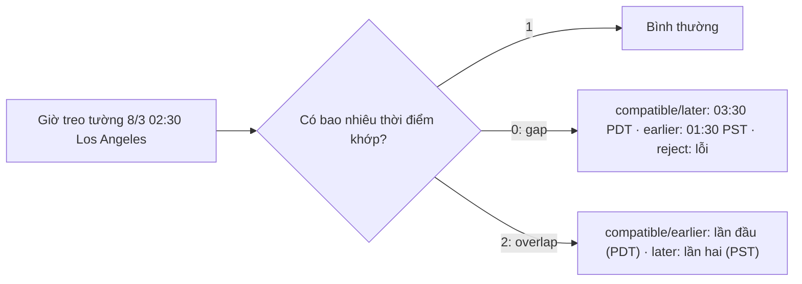

Giờ mùa hè (Daylight Saving Time, DST) gây ra hai loại lỗi rất khó thấy khi test, vì chúng chỉ xuất hiện hai ngày mỗi năm:

- **Ngày tiến đồng hồ**: 1:59 nhảy thẳng lên 3:00. Ngày đó chỉ có 23 giờ, và giờ 2:xx **không tồn tại**.
- **Ngày lùi đồng hồ**: 1:59 quay về 1:00. Ngày đó có 25 giờ, và giờ 1:xx **xảy ra hai lần**.

Hai trang web trong bộ mã nguồn mình đọc gặp đúng hai loại lỗi này và tự xử lý, không dùng thư viện múi giờ nào:

- **Udemy** cho giảng viên tạo coupon theo giờ Pacific (giờ California). Họ tự tính hai mốc đổi giờ mỗi năm, và có một tham số riêng để chọn giờ 1:xx "lần thứ nhất hay lần thứ hai".
- **Pipedrive** có lịch tuần kéo-thả. Khi thả một hoạt động vào ô ở toạ độ `y`, họ đổi `y` ra giờ rồi **bù chênh lệch offset** nếu ngày đó đổi giờ, để sự kiện không bị lệch một tiếng.

Bài này đọc cả hai, chỉ ra những chỗ vẫn còn hở, rồi viết lại bằng `Intl.DateTimeFormat` để dùng được cho mọi múi giờ.

> [!TIP]
> **Tóm tắt**
> - Một ô trên lịch hay một "ngày coupon" là **giờ treo tường** (wall time: 3:00 chiều thứ Hai), không phải "nửa đêm + N phút". Cộng phút qua mốc đổi giờ là lệch một tiếng.
> - Udemy tự viết luật DST cho Pacific; Pipedrive cộng phút rồi bù offset. Cả hai đều chạy đúng ngày thường, và cả hai có trường hợp biên (năm trước 2007, múi giờ đổi lúc 00:00, máy người dùng ở múi giờ khác).
> - `Intl.DateTimeFormat` với `timeZone` cho phép đọc offset của **bất kỳ** múi giờ IANA nào. Từ đó đổi giờ treo tường ↔ thời điểm, chọn rõ cách xử lý giờ không tồn tại và giờ có hai lần.
> - `Temporal.ZonedDateTime` làm sẵn tất cả những việc này với cùng tuỳ chọn `disambiguation`; lúc viết bài nó đã có trong Chromium 153 dùng để chạy demo.

<iframe class="demo-frame" src="/demos/web-patterns/index.html?theme=dark#/dst" title="Demo dst" loading="lazy" style="height: 1500px"></iframe>

<p class="demo-links">▶ <a href="/demos/web-patterns/index.html#/dst" target="_blank" rel="noopener">Mở demo toàn màn hình ↗</a> · <a href="https://stackblitz.com/github/hunghg255/blog-hunghg/tree/master/examples/web-patterns?file=src/lib/dst.ts" target="_blank" rel="noopener">Sửa code trên StackBlitz ↗</a> · <a href="https://github.com/hunghg255/blog-hunghg/blob/master/examples/web-patterns/src/lib/dst.ts" target="_blank" rel="noopener">Xem source trên GitHub ↗</a></p>

Chọn "Los Angeles", bấm "Tiến đồng hồ": cột "Cộng phút" sai 21 trên 24 ô (mọi ô từ 03:00 trở đi bị đẩy thêm một tiếng). Cột Pipedrive và cột giờ treo tường đều đúng. Chuyển sang "Santiago" rồi bấm "Tiến đồng hồ": Chile đổi giờ đúng lúc nửa đêm, và lúc này cột Pipedrive sai 23 ô, chỉ cách đặt giờ treo tường còn đúng.

## Udemy làm thế nào?

File [`utils/pacific-timezone.ts`](https://github.com/hunghg255/codebase/blob/main/udemy.com/webpack---/src/udemy/js/utils/pacific-timezone.ts) mở đầu bằng một câu nói thẳng giới hạn của `Date`:

```ts
/**
 * A Date that returns PT values when passed to `toLocalTimezoneISOString`.
 * This is the closest we can get to representing a Date in a specific timezone.
 * Dates are always UTC internally. They cannot be set to use another timezone.
 */
```

### Hai mốc đổi giờ, tính bằng tay

Luật của Mỹ (từ 2007): DST bắt đầu **Chủ nhật thứ hai của tháng 3** lúc 2:00 sáng và kết thúc **Chủ nhật đầu tiên của tháng 11** lúc 2:00 sáng. Udemy viết đúng như vậy:

```ts
const dstStartDate = range(14)
    .map((i) => new Date(Date.UTC(year, 2, i + 1, 10)))
    .filter(isSunday)[1];
const dstEndDate = range(7)
    .map((i) => new Date(Date.UTC(year, 10, i + 1, 9)))
    .filter(isSunday)[0];
```

Hai con số `10` và `9` là chỗ tinh ý: 2:00 sáng theo PST (UTC−8) là 10:00 UTC, còn 2:00 sáng theo PDT (UTC−7) là 9:00 UTC. Mốc được tính thẳng ra thời điểm UTC, không phụ thuộc múi giờ máy người dùng. Từ đó `getPacificTimezoneOffset` chỉ cần so sánh: nằm giữa hai mốc thì 420 (UTC−7), ngoài ra thì 480 (UTC−8). Dấu ở đây theo kiểu `getTimezoneOffset()`: dương nghĩa là chậm hơn UTC.

### Đếm số ngày của coupon

[`coupons.mobx-model.js`](https://github.com/hunghg255/codebase/blob/main/udemy.com/webpack---/src/udemy/js/course-manage-price-and-coupons/coupons/coupons.mobx-model.js) hiện "coupon còn N ngày". Chia hiệu hai thời điểm cho 86 400 000 là sai đúng vào tháng có ngày đổi giờ, nên họ bù:

```js
// This accounts for DST switch between startTime and endTime.
const dstMins = getPacificTimezoneOffset(endTime) - getPacificTimezoneOffset(startTime);
const dstMillis = dstMins * 60 * 1000;
const diffDays = (endTime - startTime - dstMillis) / (24 * 3600 * 1000);
```

Coupon từ 00:00 ngày 1/3 tới 00:00 ngày 31/3 giờ Pacific chỉ dài 29 ngày 23 giờ (mất một tiếng ngày 8/3). Không bù thì `Math.floor` cho ra 29; có bù thì ra 30. Demo có ô "Coupon kéo dài mấy ngày" để thử.

### Giờ 1:xx lặp lại: tham số `dstEndHint`

Màn hình tạo coupon cho chọn ngày và giờ. Giảng viên chọn 1:30 sáng ngày 1/11: đó là 1:30 PDT hay 1:30 PST? `attachPacificTimezoneOffset` nhận thêm một "gợi ý" là ngày đang chọn trước đó:

```ts
if (ymdhString === `${dstEndYMDString}T01`) {
    if (dstEndHint) {
        const dstEndHintYMDHString = toLocalTimezoneISOString(dstEndHint).slice(0, 13);
        if (dstEndHintYMDHString > ymdhString) {
            pacificTimezoneOffset = 480;
        } else if (dstEndHintYMDHString < ymdhString) {
            pacificTimezoneOffset = 420;
        } else {
            pacificTimezoneOffset = dstEndHint.pacificTimezoneOffset;
        }
    } else {
        pacificTimezoneOffset = 420;
    }
}
```

Nếu người dùng đi lùi từ một giờ muộn hơn tới 1:xx thì đó là lần thứ hai (PST); đi tới từ một giờ sớm hơn thì là lần thứ nhất (PDT). Đây chính là khái niệm `disambiguation: 'earlier' | 'later'` của Temporal, chỉ là được suy ra từ hướng thao tác. Chuỗi ISO cũng được so sánh trực tiếp bằng `>`/`<`: vì có định dạng cố định `YYYY-MM-DDTHH`, so chuỗi cũng là so thời gian.

### Hai chỗ còn hở

Mình chép logic của file này ra Node và chạy với nhiều giá trị `TZ`:

1. **Chỉ có luật từ 2007.** Năm 2005 Mỹ còn dùng luật cũ (Chủ nhật đầu tháng 4 → Chủ nhật cuối tháng 10). Với `2005-03-20T12:00Z`, giờ Pacific thật là 4:00 PST, hàm của Udemy trả 5:00 vì tưởng đã sang DST. Với coupon thì không sao (không ai tạo coupon cho năm 2005), nhưng nếu tái dùng hàm cho dữ liệu lịch sử thì lệch.
2. **"Date dịch chỗ" phụ thuộc múi giờ máy.** `applyPacificTimezoneOffset` không đổi được múi giờ của `Date`, nên nó **dịch thời điểm** đi một khoảng để các hàm `getHours()`… (đọc theo giờ máy) trả về giờ Pacific. Khi máy ở Berlin, thời điểm `2026-03-29T09:30Z` (2:30 sáng giờ Pacific) bị dịch tới 2:30 sáng giờ Berlin, đúng giờ không tồn tại ở Berlin ngày hôm đó (Berlin tiến đồng hồ cùng ngày). `Date` tự đẩy thành 3:30 và Udemy hiện **3:30** thay vì 2:30. Chạy cùng đoạn code với `TZ=UTC` hoặc `TZ=America/Los_Angeles` thì đúng.

Cả hai đều là giới hạn tự nhiên của việc tự viết luật bằng `Date`. Bản viết lại bên dưới tránh cả hai bằng cách không bao giờ dựa vào múi giờ của máy.

## Pipedrive làm thế nào?

Lịch tuần của Pipedrive là một lưới: mỗi cột một ngày, mỗi giờ cao `HEIGHT_OF_HOUR` pixel. Khi thả một hoạt động, [`calendar-view/utils/grid.js`](https://github.com/hunghg255/codebase/blob/main/pipedrive.com%28dashboard%29/webpack---/client/entrypoints/calendar-view/utils/grid.js) đổi toạ độ ra ngày giờ:

```js
	// trong calculateDateTimeFromCoordinates(startDate, daysNumber, width, height, coordinates)
	const day = getDayFromWidth(daysNumber, width, coordinates.x);
	const minutes = Math.floor((coordinates.y / HEIGHT_OF_HOUR) * 60);

	const startOfDay = moment(startDate).add(day, 'days');
	const dueDate = startOfDay.clone().add(minutes, 'minutes');

	const utcOffsetDiff = startOfDay.utcOffset() - dueDate.utcOffset();

	const isTransitioningToDST =
		!startOfDay.isDST() &&
		dueDate.isDST() &&
		dueDate.clone().add(utcOffsetDiff, 'minutes').isDST();
	const isTransitioningFromDST = startOfDay.isDST() && !dueDate.isDST();

	if (isTransitioningToDST || isTransitioningFromDST) {
		dueDate.add(utcOffsetDiff, 'minutes');
	}
```

`moment().add(minutes, 'minutes')` cộng **thời gian thật**. Ngày tiến đồng hồ, ô 03:00 (y = 3 giờ) thành "nửa đêm + 180 phút" = 04:00, vì giờ 2:xx không tồn tại. Pipedrive so offset lúc đầu ngày với offset lúc kết quả: khác nhau thì cộng phần chênh (−60 phút) để về 03:00.

Điều kiện thứ ba của `isTransitioningToDST` xử lý ô 02:00: nửa đêm + 120 phút = 03:00 PDT, bù −60 phút thì rơi về 01:00 PST, tức là ngược lại trước mốc đổi giờ. Lúc đó `dueDate.clone().add(...).isDST()` là `false` nên không bù, ô 02:00 giữ kết quả 03:00. Đây là xử lý đúng cho một giờ không tồn tại.

**Chỗ hở:** cách này giả định đầu ngày (`startOfDay`) nằm **trước** mốc đổi giờ. Vài múi giờ đổi giờ đúng lúc 00:00, ví dụ Chile (America/Santiago) tiến từ 00:00 lên 01:00. Nửa đêm không tồn tại, nên `startOfDay` đã là 01:00 và đã ở sau mốc. Offset đầu ngày và offset kết quả bằng nhau, Pipedrive không bù gì, và mọi ô bị lệch một tiếng (demo: 23 trên 24 ô). Lỗi này phải đúng người dùng ở Chile, đúng ngày đó mới thấy.

## Bên trong trình duyệt: giờ treo tường và thời điểm

`Date` của JavaScript chỉ lưu **một con số**: số mili giây kể từ 1970-01-01T00:00Z. Nó không có múi giờ. Các hàm `getHours()`, `setHours()`… đọc và ghi theo múi giờ **của máy đang chạy**. Muốn làm việc với múi giờ khác thì phải tự đổi giữa hai khái niệm:

- **Thời điểm** (instant): một điểm trên trục thời gian, như `1772965800000`.
- **Giờ treo tường** (wall time) ở một múi giờ: ngày, giờ, phút mà đồng hồ ở đó đang chỉ.

Đi từ thời điểm sang giờ treo tường luôn ra đúng một kết quả. Chiều ngược lại thì có ba trường hợp:



Trình duyệt có sẵn cơ sở dữ liệu múi giờ IANA (cùng dữ liệu với `moment-timezone` hay `date-fns-tz`), lộ ra qua `Intl.DateTimeFormat` với tuỳ chọn `timeZone`. `formatToParts` trả từng phần năm, tháng, ngày, giờ, phút của một thời điểm ở múi giờ bất kỳ. Ghép lại thành `Date.UTC(...)` rồi trừ cho thời điểm gốc là ra offset. Không cần tự viết luật, không cần tải thêm 30–200KB dữ liệu múi giờ.

## Viết lại

Phần cốt lõi là đọc giờ treo tường của một thời điểm bằng `Intl`, rồi suy ra offset (formatter được cache theo múi giờ vì tạo `Intl.DateTimeFormat` khá tốn):

```ts title=src/lib/dst.ts
export function toWallTime(instant: Date | number, timeZone: string): WallTime & { second: number } {
  const parts: Record<string, number> = {};
  for (const part of formatterFor(timeZone).formatToParts(new Date(instant))) {
    if (part.type !== 'literal') parts[part.type] = Number(part.value);
  }
  return {
    year: parts.year,
    month: parts.month,
    day: parts.day,
    hour: parts.hour,
    minute: parts.minute,
    second: parts.second,
  };
}

/** Offset (phút, dương = trước UTC) của `timeZone` tại thời điểm `instant`. */
export function getOffset(timeZone: string, instant: Date | number): number {
  const ms = new Date(instant).getTime();
  const wall = toWallTime(ms, timeZone);
  const asUTC = Date.UTC(wall.year, wall.month - 1, wall.day, wall.hour, wall.minute, wall.second);
  // Intl chỉ trả tới giây: bỏ phần mili giây của instant trước khi trừ
  return Math.round((asUTC - (ms - (((ms % 1000) + 1000) % 1000))) / MINUTE);
}
```

Rồi đổi giờ treo tường ra thời điểm: lấy offset ở trước và sau mọi mốc đổi giờ có thể có (cách 1 ngày về hai phía), thử cả hai, giữ những thời điểm mà đổi ngược lại khớp đúng giờ treo tường:

```ts title=src/lib/dst.ts
export function resolveWallTime(wall: WallTime, timeZone: string) {
  const utcGuess = Date.UTC(wall.year, wall.month - 1, wall.day, wall.hour, wall.minute);
  // Offset trước và sau mọi lần đổi giờ quanh đó: lấy cách 1 ngày về hai phía
  const offsetBefore = getOffset(timeZone, utcGuess - DAY);
  const offsetAfter = getOffset(timeZone, utcGuess + DAY);
  const candidates = [...new Set([offsetBefore, offsetAfter])]
    .map((offset) => utcGuess - offset * MINUTE)
    .filter((instant) => sameWall(toWallTime(instant, timeZone), wall))
    .sort((a, b) => a - b);

  if (candidates.length === 2) return { kind: 'overlap' as WallKind, instants: candidates, offsetBefore, offsetAfter };
  if (candidates.length === 1) return { kind: 'normal' as WallKind, instants: candidates, offsetBefore, offsetAfter };
  return { kind: 'gap' as WallKind, instants: [] as number[], offsetBefore, offsetAfter };
}
```

`fromWallTime` chỉ còn việc chọn theo `disambiguation`: overlap thì lấy phần tử đầu hoặc sau; gap thì dùng offset trước mốc (ra 03:30) hoặc sau mốc (ra 01:30).

Và cách đổi một ô lịch ra thời điểm. Hàm nhận cả ba chiến lược để demo so sánh; phần dưới đây là cách của Pipedrive và cách đặt giờ treo tường:

```ts title=src/lib/dst.ts
  // Đầu ngày cũng phải đi qua fromWallTime: vài múi giờ đổi giờ đúng lúc 00:00
  const startOfDay = fromWallTime({ ...day, hour: 0, minute: 0 }, timeZone);
  if (strategy === 'wallclock') {
    return fromWallTime({ ...day, hour: Math.floor(minutes / 60), minute: minutes % 60 }, timeZone);
  }
  const due = startOfDay + minutes * MINUTE;
  if (strategy === 'duration') return due;
  // Pipedrive: offset lúc đầu ngày khác offset lúc `due` → ngày này đổi giờ, bù phần chênh
  const startOffset = getOffset(timeZone, startOfDay);
  const dueOffset = getOffset(timeZone, due);
  if (startOffset === dueOffset) return due;
  const candidate = due + (startOffset - dueOffset) * MINUTE;
  // Ngày tiến đồng hồ: chỉ bù nếu kết quả vẫn ở sau mốc đổi (isTransitioningToDST); ô rơi vào
  // giờ không tồn tại thì giữ nguyên
  if (dueOffset > startOffset && getOffset(timeZone, candidate) !== dueOffset) return due;
  return candidate;
}
```

::: spoiler Xem toàn bộ src/lib/dst.ts

```ts title=src/lib/dst.ts
/**
 * Giờ mùa hè (DST) không cần thư viện.
 *
 * Hai ý tưởng từ code thật:
 * - Udemy (utils/pacific-timezone.ts): tự tính hai mốc đổi giờ của Pacific Time theo luật Mỹ,
 *   và chọn offset cho giờ 1am bị lặp lại khi lùi đồng hồ bằng một "gợi ý".
 * - Pipedrive (calendar-view/utils/grid.js): đổi toạ độ pixel trên lịch thành giờ, có bù
 *   chênh lệch offset khi ngày đó đổi giờ.
 *
 * Bản viết lại dùng thêm Intl.DateTimeFormat (có sẵn cơ sở dữ liệu múi giờ IANA của trình
 * duyệt) để làm việc với BẤT KỲ múi giờ nào, không riêng Pacific.
 *
 * Quy ước dấu: offset tính bằng phút, DƯƠNG nếu múi giờ đi trước UTC (giống "+07:00").
 * Ngược dấu với Date.prototype.getTimezoneOffset() và với số 420/480 của Udemy.
 */

export interface WallTime {
  year: number;
  /** 1–12 */
  month: number;
  day: number;
  hour: number;
  minute: number;
}

const MINUTE = 60_000;
const HOUR = 60 * MINUTE;
const DAY = 24 * HOUR;

// ---------------------------------------------------------------------------
// 1. Luật cố định kiểu Udemy: Pacific Time
// ---------------------------------------------------------------------------

/** Ngày thứ `n` (1 = đầu tiên) là `weekday` (0 = Chủ nhật) trong tháng, lúc `hourUTC` giờ UTC. */
function nthWeekdayUTC(year: number, monthIndex: number, weekday: number, n: number, hourUTC: number) {
  const first = new Date(Date.UTC(year, monthIndex, 1, hourUTC));
  const shift = (weekday - first.getUTCDay() + 7) % 7;
  return new Date(Date.UTC(year, monthIndex, 1 + shift + (n - 1) * 7, hourUTC));
}

/** Chủ nhật cuối cùng của tháng, lúc `hourUTC` giờ UTC. */
function lastSundayUTC(year: number, monthIndex: number, hourUTC: number) {
  const last = new Date(Date.UTC(year, monthIndex + 1, 0, hourUTC));
  return new Date(Date.UTC(year, monthIndex, last.getUTCDate() - last.getUTCDay(), hourUTC));
}

/**
 * Hai thời điểm Pacific Time đổi giờ trong năm: [bắt đầu DST, kết thúc DST].
 * Đổi giờ lúc 2:00 sáng giờ địa phương: 2:00 PST = 10:00 UTC, 2:00 PDT = 9:00 UTC.
 *
 * Từ 2007 (Energy Policy Act 2005): Chủ nhật thứ 2 tháng 3 → Chủ nhật đầu tháng 11.
 * 1987–2006: Chủ nhật đầu tháng 4 → Chủ nhật cuối tháng 10. Bản của Udemy chỉ có luật mới.
 */
export function getPacificDSTRange(year: number): [Date, Date] {
  if (year >= 2007) {
    return [nthWeekdayUTC(year, 2, 0, 2, 10), nthWeekdayUTC(year, 10, 0, 1, 9)];
  }
  return [nthWeekdayUTC(year, 3, 0, 1, 10), lastSundayUTC(year, 9, 9)];
}

/** Offset của Pacific Time tại một thời điểm: -420 (PDT, UTC−7) hoặc -480 (PST, UTC−8). */
export function getPacificOffset(instant: Date | number): number {
  const date = new Date(instant);
  const [start, end] = getPacificDSTRange(date.getUTCFullYear());
  return date >= start && date < end ? -420 : -480;
}

// ---------------------------------------------------------------------------
// 2. Bất kỳ múi giờ nào, dùng Intl
// ---------------------------------------------------------------------------

const formatters = new Map<string, Intl.DateTimeFormat>();

function formatterFor(timeZone: string) {
  let formatter = formatters.get(timeZone);
  if (!formatter) {
    // Tạo Intl.DateTimeFormat khá tốn: cache theo múi giờ.
    // hourCycle 'h23': tránh giờ "24" mà hour12:false trả về ở một số engine cũ.
    formatter = new Intl.DateTimeFormat('en-US', {
      timeZone,
      hourCycle: 'h23',
      year: 'numeric',
      month: 'numeric',
      day: 'numeric',
      hour: 'numeric',
      minute: 'numeric',
      second: 'numeric',
    });
    formatters.set(timeZone, formatter);
  }
  return formatter;
}

/** Giờ đồng hồ treo tường (wall time) tại `timeZone` ở thời điểm `instant`. */
export function toWallTime(instant: Date | number, timeZone: string): WallTime & { second: number } {
  const parts: Record<string, number> = {};
  for (const part of formatterFor(timeZone).formatToParts(new Date(instant))) {
    if (part.type !== 'literal') parts[part.type] = Number(part.value);
  }
  return {
    year: parts.year,
    month: parts.month,
    day: parts.day,
    hour: parts.hour,
    minute: parts.minute,
    second: parts.second,
  };
}

/** Offset (phút, dương = trước UTC) của `timeZone` tại thời điểm `instant`. */
export function getOffset(timeZone: string, instant: Date | number): number {
  const ms = new Date(instant).getTime();
  const wall = toWallTime(ms, timeZone);
  const asUTC = Date.UTC(wall.year, wall.month - 1, wall.day, wall.hour, wall.minute, wall.second);
  // Intl chỉ trả tới giây: bỏ phần mili giây của instant trước khi trừ
  return Math.round((asUTC - (ms - (((ms % 1000) + 1000) % 1000))) / MINUTE);
}

const sameWall = (a: WallTime, b: WallTime) =>
  a.year === b.year && a.month === b.month && a.day === b.day && a.hour === b.hour && a.minute === b.minute;

/**
 * Cách chọn khi giờ treo tường không tồn tại (gap, lúc tiến đồng hồ) hoặc có hai lần (overlap,
 * lúc lùi đồng hồ). Cùng tên với tuỳ chọn `disambiguation` của Temporal.
 * - compatible: gap → đẩy về sau (giống new Date(y, m, d, h)), overlap → lần đầu
 * - earlier / later: chọn thời điểm sớm hơn / muộn hơn
 * - reject: ném lỗi
 */
export type Disambiguation = 'compatible' | 'earlier' | 'later' | 'reject';

export type WallKind = 'normal' | 'gap' | 'overlap';

/** Mọi thời điểm (epoch ms) có giờ treo tường đúng bằng `wall`, kèm loại (bình thường/gap/overlap). */
export function resolveWallTime(wall: WallTime, timeZone: string) {
  const utcGuess = Date.UTC(wall.year, wall.month - 1, wall.day, wall.hour, wall.minute);
  // Offset trước và sau mọi lần đổi giờ quanh đó: lấy cách 1 ngày về hai phía
  const offsetBefore = getOffset(timeZone, utcGuess - DAY);
  const offsetAfter = getOffset(timeZone, utcGuess + DAY);
  const candidates = [...new Set([offsetBefore, offsetAfter])]
    .map((offset) => utcGuess - offset * MINUTE)
    .filter((instant) => sameWall(toWallTime(instant, timeZone), wall))
    .sort((a, b) => a - b);

  if (candidates.length === 2) return { kind: 'overlap' as WallKind, instants: candidates, offsetBefore, offsetAfter };
  if (candidates.length === 1) return { kind: 'normal' as WallKind, instants: candidates, offsetBefore, offsetAfter };
  return { kind: 'gap' as WallKind, instants: [] as number[], offsetBefore, offsetAfter };
}

export class NonexistentTimeError extends Error {}

/** Giờ treo tường tại `timeZone` → thời điểm (epoch ms). */
export function fromWallTime(wall: WallTime, timeZone: string, disambiguation: Disambiguation = 'compatible'): number {
  const { kind, instants, offsetBefore, offsetAfter } = resolveWallTime(wall, timeZone);
  if (kind === 'normal') return instants[0];
  if (disambiguation === 'reject') {
    throw new NonexistentTimeError(kind === 'gap' ? 'Giờ này không tồn tại (gap)' : 'Giờ này xảy ra hai lần (overlap)');
  }
  if (kind === 'overlap') return disambiguation === 'later' ? instants[1] : instants[0];

  // Gap: dùng offset TRƯỚC khi đổi giờ → rơi vào sau mốc đổi (vd 2:30 → 3:30).
  // Dùng offset SAU → rơi vào trước mốc đổi (vd 2:30 → 1:30).
  const utcGuess = Date.UTC(wall.year, wall.month - 1, wall.day, wall.hour, wall.minute);
  return disambiguation === 'earlier' ? utcGuess - offsetAfter * MINUTE : utcGuess - offsetBefore * MINUTE;
}

export interface Transition {
  instant: number;
  offsetBefore: number;
  offsetAfter: number;
}

/** Các lần đổi offset của `timeZone` trong năm (thường 0 hoặc 2 lần). */
export function findTransitions(timeZone: string, year: number): Transition[] {
  const result: Transition[] = [];
  const end = Date.UTC(year + 1, 0, 1);
  let prev = Date.UTC(year, 0, 1);
  let prevOffset = getOffset(timeZone, prev);
  // Bước 1 ngày: đủ nhỏ vì hai lần đổi giờ không bao giờ cách nhau dưới 1 ngày
  for (let t = prev + DAY; t <= end; t += DAY) {
    const offset = getOffset(timeZone, t);
    if (offset !== prevOffset) {
      // Chia đôi tới mức 1 phút
      let lo = prev;
      let hi = t;
      while (hi - lo > MINUTE) {
        const mid = lo + Math.floor((hi - lo) / 2 / MINUTE) * MINUTE;
        if (getOffset(timeZone, mid) === prevOffset) lo = mid;
        else hi = mid;
      }
      result.push({ instant: hi, offsetBefore: prevOffset, offsetAfter: offset });
    }
    prev = t;
    prevOffset = offset;
  }
  return result;
}

// ---------------------------------------------------------------------------
// 3. Đếm ngày và đổi pixel → giờ
// ---------------------------------------------------------------------------

/** Số ngày lịch giữa hai ngày treo tường: không phụ thuộc DST vì tính trên Date.UTC. */
export function calendarDaysBetween(a: Pick<WallTime, 'year' | 'month' | 'day'>, b: Pick<WallTime, 'year' | 'month' | 'day'>) {
  return Math.round((Date.UTC(b.year, b.month - 1, b.day) - Date.UTC(a.year, a.month - 1, a.day)) / DAY);
}

export type SlotStrategy = 'duration' | 'compensate' | 'wallclock';

/**
 * Ô thứ `minutes` phút tính từ đầu ngày trên lịch (y = minutes / 60 * chiều cao một giờ) → thời điểm.
 * - duration: đầu ngày + minutes phút thời gian thật (moment.add) — lệch 1 giờ sau mốc đổi giờ
 * - compensate: như Pipedrive — cộng minutes rồi bù chênh lệch offset giữa đầu ngày và kết quả
 * - wallclock: đặt thẳng giờ treo tường hh:mm rồi đổi ra thời điểm (fromWallTime)
 */
export function slotToInstant(
  day: Pick<WallTime, 'year' | 'month' | 'day'>,
  minutes: number,
  timeZone: string,
  strategy: SlotStrategy,
): number {
  // Đầu ngày cũng phải đi qua fromWallTime: vài múi giờ đổi giờ đúng lúc 00:00
  const startOfDay = fromWallTime({ ...day, hour: 0, minute: 0 }, timeZone);
  if (strategy === 'wallclock') {
    return fromWallTime({ ...day, hour: Math.floor(minutes / 60), minute: minutes % 60 }, timeZone);
  }
  const due = startOfDay + minutes * MINUTE;
  if (strategy === 'duration') return due;
  // Pipedrive: offset lúc đầu ngày khác offset lúc `due` → ngày này đổi giờ, bù phần chênh
  const startOffset = getOffset(timeZone, startOfDay);
  const dueOffset = getOffset(timeZone, due);
  if (startOffset === dueOffset) return due;
  const candidate = due + (startOffset - dueOffset) * MINUTE;
  // Ngày tiến đồng hồ: chỉ bù nếu kết quả vẫn ở sau mốc đổi (isTransitioningToDST); ô rơi vào
  // giờ không tồn tại thì giữ nguyên
  if (dueOffset > startOffset && getOffset(timeZone, candidate) !== dueOffset) return due;
  return candidate;
}

// ---------------------------------------------------------------------------
// 4. Hiển thị
// ---------------------------------------------------------------------------

const pad = (n: number) => String(n).padStart(2, '0');

export function formatOffset(offset: number) {
  const sign = offset >= 0 ? '+' : '−';
  const abs = Math.abs(offset);
  return `UTC${sign}${pad(Math.floor(abs / 60))}:${pad(abs % 60)}`;
}

export function formatWall(instant: number, timeZone: string, withDate = false) {
  const w = toWallTime(instant, timeZone);
  const time = `${pad(w.hour)}:${pad(w.minute)}`;
  return withDate ? `${pad(w.day)}/${pad(w.month)} ${time}` : time;
}
```

:::

## Đi qua code

- **`toWallTime` dùng `hourCycle: 'h23'`.** Với `hour12: false`, vài engine cũ trả giờ nửa đêm là `"24"`. `h23` buộc giờ chạy từ 0 tới 23.
- **`getOffset` bỏ phần mili giây.** `Intl` chỉ trả tới giây, nên phải làm tròn thời điểm xuống giây trước khi trừ, nếu không offset bị lệch một phần nghìn phút.
- **`resolveWallTime` không cần biết mốc đổi giờ ở đâu.** Offset "1 ngày trước" và "1 ngày sau" là hai offset có thể áp cho giờ treo tường này (không có múi giờ nào đổi giờ hai lần trong một ngày). Thử cả hai: khớp 1 là bình thường, khớp 2 là overlap, không khớp là gap.
- **`fromWallTime` với gap.** Dùng offset *trước* mốc cho 02:30 thì ra 03:30 (đồng hồ "đi tiếp"); dùng offset *sau* mốc thì ra 01:30. Đây đúng là cách `new Date(y, m, d, 2, 30)` và Temporal (`'compatible'`) xử lý ở chiều tiến.
- **`findTransitions`** quét từng ngày, gặp offset đổi thì chia đôi tới mức một phút. Demo dùng nó để tìm ngày đổi giờ của múi giờ đang chọn thay vì viết cứng.
- **`calendarDaysBetween`** đếm ngày lịch bằng `Date.UTC` của hai ngày: UTC không có DST, nên hiệu luôn là bội số chẵn của 24 giờ. Đây là cách đếm "coupon dài mấy ngày" mà không cần bù.
- **`slotToInstant('wallclock')`** đặt thẳng giờ treo tường `hh:mm` của ô rồi đổi ra thời điểm. Không cộng phút, nên không có gì để bù, kể cả khi nửa đêm không tồn tại.

**Khác bản gốc:** Udemy chỉ phục vụ Pacific và có luật viết tay (bản viết lại vẫn giữ `getPacificDSTRange` cho ai cần chạy không có `Intl`, có thêm luật trước 2007). Pipedrive dùng moment; bản viết lại giữ cách "cộng phút + bù offset" như một lựa chọn để so sánh, còn khuyến nghị dùng cách đặt giờ treo tường. Offset trong bản viết lại theo dấu ISO (dương = trước UTC, như `+07:00`), ngược dấu với 420/480 của Udemy.

## Tại sao không làm cách khác?

- **Lưu mọi thứ bằng UTC rồi để client tự hiển thị?** Đúng cho *thời điểm* (log, tin nhắn). Sai cho *ý định* của người dùng: "coupon hết hạn nửa đêm giờ California" hay "họp 9 giờ sáng mỗi thứ Hai" là giờ treo tường ở một múi giờ. Lưu UTC của lần đầu thì tới mùa hè cuộc họp thành 10 giờ. Phải lưu cả múi giờ.
- **Dùng `setHours` của `Date`?** `new Date(2026, 2, 8, 3, 0)` đặt giờ treo tường đúng như ý, nhưng theo múi giờ **của máy**. Lịch của Pipedrive hiển thị theo múi giờ người dùng nên cách này dùng được, còn coupon theo giờ Pacific thì không.
- **Thư viện (Luxon, date-fns-tz, moment-timezone)?** Hoàn toàn hợp lý nếu đã có trong dự án. Luxon và date-fns-tz cũng dùng `Intl` ở bên dưới; moment-timezone mang theo dữ liệu múi giờ riêng. Bài này cho thấy phần cốt lõi chỉ cần vài chục dòng.

## Edge case và cạm bẫy

- **Đổi giờ lúc nửa đêm.** Chile, Paraguay và vài nơi khác đổi giờ lúc 00:00. "Đầu ngày" không phải lúc nào cũng là 00:00; `slotToInstant` cũng phải đi qua `fromWallTime` để lấy đầu ngày.
- **Đổi 30 phút.** Lord Howe (Úc) chỉ đổi 30 phút. Code không giả định chênh lệch là 60 phút: mọi phép tính dùng `offsetAfter − offsetBefore`.
- **Luật thay đổi.** Quốc gia đổi luật DST khá thường xuyên. Tự viết luật như Udemy thì phải sửa code. Dùng `Intl` thì cập nhật theo trình duyệt (dữ liệu IANA đi kèm bản cập nhật trình duyệt và hệ điều hành).
- **Server và client phải cùng hiểu.** Nếu client gửi `"2026-11-01T01:30"` không kèm offset, server không biết đó là lần thứ nhất hay thứ hai. Gửi thời điểm UTC kèm tên múi giờ, hoặc ISO có offset (`-07:00`).
- **Ô lịch trong giờ không tồn tại.** Phải quyết định một chính sách (đẩy lên 03:00, hay chặn thả vào ô đó) và hiển thị cho người dùng biết.

## Dùng trong dự án

```ts
import { fromWallTime, toWallTime, calendarDaysBetween } from './dst';

// Coupon hết hạn 23:59 ngày 31/3 giờ California, lưu thời điểm UTC kèm múi giờ
const expiresAt = fromWallTime({ year: 2026, month: 3, day: 31, hour: 23, minute: 59 }, 'America/Los_Angeles');
save({ expiresAt, timeZone: 'America/Los_Angeles' });

// Hiển thị cho người dùng ở Việt Nam
const local = toWallTime(expiresAt, 'Asia/Ho_Chi_Minh'); // 1/4 13:59

// Lịch tuần: thả vào ô (ngày, giờ, phút) theo múi giờ của người dùng
const dueAt = fromWallTime({ ...day, hour: 9, minute: 30 }, userTimeZone, 'compatible');
```

::: spoiler Ví dụ test (bản phác, không có trong repo)

```ts
import { describe, expect, it } from 'vitest';
import { findTransitions, formatWall, fromWallTime, getOffset, getPacificDSTRange, getPacificOffset, resolveWallTime, slotToInstant } from './dst';

const LA = 'America/Los_Angeles';

describe('dst', () => {
  it('luật Pacific khớp Intl cho mọi giờ 2024–2027', () => {
    for (let t = Date.UTC(2024, 0, 1); t < Date.UTC(2028, 0, 1); t += 3_600_000) {
      expect(getPacificOffset(t)).toBe(getOffset(LA, t));
    }
  });

  it('luật cũ trước 2007', () => {
    const [start, end] = getPacificDSTRange(2005);
    expect(start.toISOString()).toBe('2005-04-03T10:00:00.000Z');
    expect(end.toISOString()).toBe('2005-10-30T09:00:00.000Z');
  });

  it('gap và overlap', () => {
    const gap = { year: 2026, month: 3, day: 8, hour: 2, minute: 30 };
    expect(resolveWallTime(gap, LA).kind).toBe('gap');
    expect(formatWall(fromWallTime(gap, LA), LA)).toBe('03:30');
    expect(formatWall(fromWallTime(gap, LA, 'earlier'), LA)).toBe('01:30');

    const twice = { year: 2026, month: 11, day: 1, hour: 1, minute: 30 };
    expect(getOffset(LA, fromWallTime(twice, LA))).toBe(-420);
    expect(getOffset(LA, fromWallTime(twice, LA, 'later'))).toBe(-480);
  });

  it('Berlin đổi giờ lúc 01:00 UTC', () => {
    expect(findTransitions('Europe/Berlin', 2026).map((t) => new Date(t.instant).toISOString())).toEqual([
      '2026-03-29T01:00:00.000Z',
      '2026-10-25T01:00:00.000Z',
    ]);
  });

  it('Santiago đổi giờ lúc 00:00: chỉ cách đặt giờ treo tường đúng', () => {
    const day = { year: 2026, month: 9, day: 6 };
    expect(formatWall(slotToInstant(day, 600, 'America/Santiago', 'compensate'), 'America/Santiago')).toBe('11:00');
    expect(formatWall(slotToInstant(day, 600, 'America/Santiago', 'wallclock'), 'America/Santiago')).toBe('10:00');
  });
});
```

Các test trên đã chạy với vitest dưới `TZ=UTC`, `Europe/Berlin`, `Asia/Ho_Chi_Minh` và `America/New_York`: kết quả giống nhau, vì code không đọc múi giờ của máy.

:::

## So với Temporal và thư viện

- **`Temporal.ZonedDateTime`** (đề xuất TC39) làm đúng những việc trên: `Temporal.ZonedDateTime.from({ timeZone, year, month, day, hour, minute }, { disambiguation })` với bốn giá trị `'compatible' | 'earlier' | 'later' | 'reject'`. Phần "Giờ không tồn tại và giờ có hai lần" trong demo gọi cả `dst.ts` lẫn Temporal khi trình duyệt có Temporal: với Chromium 153 dùng để chạy demo lúc viết bài, hai kết quả trùng nhau ở cả bốn chế độ. Các trình duyệt khác thì kiểm tra trên [caniuse](https://caniuse.com/temporal) trước khi dùng (tính tới 10/2026).
- **`Intl.DateTimeFormat` với `timeZone`** có ở mọi trình duyệt hiện đại từ lâu; đây là nền của bản viết lại và của Luxon.
- **Luxon / date-fns-tz / moment-timezone** có đủ các thao tác này, kèm format, parse, tính khoảng. Nếu dự án cần nhiều thao tác ngày giờ, dùng thư viện vẫn hợp lý hơn tự viết; hiểu gap/overlap thì dùng thư viện cũng ít bị bất ngờ hơn.

---

Bài này thuộc series **[Học từ mã nguồn các web lớn](/series/web)** (65 bài, đọc theo thứ tự).

::: spoiler Xem nhanh danh sách bài trong series

*Mở đầu*

- [Mở đầu: đọc code production của 28 trang web](/blogs/learn-from-big-web-apps)

*Phần 1: trải nghiệm người dùng*

- [#1 Dark mode không nháy (Gatsby)](/blogs/web-dark-mode-no-flash)
- [#2 useValueByMedia: giá trị theo breakpoint (Toptal)](/blogs/web-use-value-by-media)
- [#3 Đoán ý định: idle, exit-intent, lắc chuột (Toptal, InVision)](/blogs/web-user-intent-idle-exit-wiggle)
- [#4 Validate form thân thiện (Udacity, Pipedrive)](/blogs/web-form-validation-ux)
- [#5 Magic number, EXIF và dán ảnh (Ello)](/blogs/web-file-magic-number-exif-paste)
- [#6 fastSmoothScroll: cuộn xa vẫn nhanh (Telegram)](/blogs/web-telegram-fast-smooth-scroll)
- [#7 Countdown time-travel và tombstone giỏ hàng (Best Buy)](/blogs/web-countdown-time-travel-tombstone)

*Phần 2: hiệu năng và đo lường*

- [#8 Hàng đợi requestAnimationFrame 3ms (Apple)](/blogs/web-raf-queue-3ms)
- [#9 srcset cho artwork và preconnect tự động (Apple)](/blogs/web-responsive-artwork-preconnect)
- [#10 Quick-fetch: gọi API trước khi bundle tải xong (HubSpot)](/blogs/web-quick-fetch-early-requests)
- [#11 Performance span và long task (Postman, Calibre)](/blogs/web-performance-spans-long-tasks)
- [#12 Gọi Web Worker như hàm async (Telegram)](/blogs/web-worker-promise-rpc)
- [#13 Đồng hồ media: đếm giờ xem và sửa lệch (Skillshare, Simplified)](/blogs/web-media-clock-watch-time-drift)

*Phần 3: nhiều tab, phiên đăng nhập, cập nhật*

- [#14 Bầu tab chủ cho thông báo (HubSpot, Telegram)](/blogs/web-leader-tab-notifications)
- [#15 Đồng bộ đăng nhập giữa tab và giới hạn cookie (Elastic, InVision)](/blogs/web-cross-tab-auth-cookie-guard)
- [#16 SPA tự cập nhật: Trello, Zappos, Facebook, Elastic](/blogs/web-spa-self-update-strategies)

*Phần 4: kiến trúc*

- [#17 Reverse portal: di chuyển component không remount (Zappos)](/blogs/web-reverse-portal)
- [#18 Page behaviors: gắn hành vi từ CMS (Intercom)](/blogs/web-page-behaviors-cms)
- [#19 Giới hạn tần suất hiển thị bằng bitmask (Outlook)](/blogs/web-frequency-cap-bitmask)
- [#20 Chuyển REST sang GraphQL dần dần (Coursera)](/blogs/web-rest-to-graphql-hybrid-link)

*Phần 5: soạn thảo và hiển thị nội dung*

- [#21 Autocomplete tại con trỏ trong contenteditable (Ello, Telegram)](/blogs/web-caret-autocomplete-contenteditable)
- [#22 Dark mode cho email HTML bằng CIELAB (Outlook)](/blogs/web-email-dark-mode-cielab)
- [#23 Thu nhỏ bảng rộng cho vừa khung, vá font emoji (Outlook)](/blogs/web-email-wide-content-scale)
- [#24 Cảnh báo quên đính kèm file (Outlook)](/blogs/web-forgotten-attachment-warning)
- [#25 Cắt chữ nhiều dòng chính xác (Pipedrive, Apple, Toptal)](/blogs/web-multiline-truncate-measure-text)
- [#26 Parse ngày giờ gõ tay khoan dung (Outlook, Elastic)](/blogs/web-lenient-date-parser)

*Phần 6: tương tác*

- [#27 menuAim: rê chéo vào submenu không bị đóng (Udemy)](/blogs/web-menu-aim-triangle)
- [#28 Kéo, vuốt chung cho chuột và cảm ứng (Telegram)](/blogs/web-unified-pointer-gestures)
- [#29 Phím tắt theo phạm vi, IME và bàn phím phi Latinh (Trello)](/blogs/web-scoped-keyboard-shortcuts)
- [#30 Nội suy màu: đổi theme và nền theo cuộn (Telegram, Anchor)](/blogs/web-color-interpolation-theme-scroll)
- [#31 Đường gióng hút cạnh và undo/redo trên canvas (Simplified)](/blogs/web-canvas-snap-guides-undo)
- [#32 Giả lập mù màu bằng feColorMatrix (Trello)](/blogs/web-color-vision-simulator)
- [#33 Vạch thước theo mức zoom và cấp phát màu cho biểu đồ (Anchor, Similarweb)](/blogs/web-timeline-ticks-color-stack)

*Phần 7: mạng, dữ liệu và async*

- [#34 Ô tìm kiếm chuẩn production (Similarweb, Udemy, Pipedrive)](/blogs/web-production-search-box)
- [#35 Điều phối async: latest-wins, single-flight (Glitch, Toptal)](/blogs/web-async-coordination-latest-wins)
- [#36 Polling thưa dần và debounce động (Trello)](/blogs/web-decaying-polling-dynamic-debounce)
- [#37 Cache phía client theo version (Similarweb, Telegram, Udemy)](/blogs/web-client-cache-versioned)
- [#38 Upload file lớn theo chunk (Outlook, Tribe)](/blogs/web-chunked-upload-pipeline)
- [#39 Phát video qua Service Worker bằng Range request (Telegram, Outlook)](/blogs/web-service-worker-range-streaming)

*Phần 8: hiệu năng và vận hành*

- [#40 TTI governor: hoãn việc phụ tới sau khi trang dùng được (Outlook)](/blogs/web-tti-governor)
- [#41 Tự đo LCP/CLS/TBT và phục vụ bản nhẹ cho máy yếu (Udemy)](/blogs/web-rum-adaptive-loading)

*Phần 9: thuật toán và dữ liệu phía client*

- [#42 Three-way merge ngay trên trình duyệt (Postman)](/blogs/web-three-way-merge-client)
- [#43 Dọn cache GraphQL bằng đếm tham chiếu (Outlook)](/blogs/web-graphql-cache-refcount-gc)
- [#44 LRU cache theo 3 cách (Apple, Similarweb, Outlook)](/blogs/web-lru-cache-three-ways)
- [#45 Lọc tăng dần trong Web Worker (Similarweb)](/blogs/web-incremental-filter-worker)
- [#46 Xếp hạng gợi ý trên client, so ngầm với server (Outlook)](/blogs/web-client-side-ranking-shadow-test)
- [#47 Nối OT với editor: undo stack và chặn echo (Glitch)](/blogs/web-ot-codemirror-undo)
- [#48 Ngôn ngữ markup riêng dịch hai chiều với HTML (Coursera)](/blogs/web-custom-markup-compiler)

*Phần 10: thời gian, ngôn ngữ, định dạng*

- **#49 Xử lý giờ mùa hè không cần thư viện (Udemy, Pipedrive)** (bài này)
- [#50 Intl thực chiến: Segmenter, số rút gọn, số nhiều, fallback locale (Apple, Outlook)](/blogs/web-intl-in-production)
- [#51 WebVTT và bôi chọn transcript (Udemy, Coursera)](/blogs/web-webvtt-transcript-selection)

*Phần 11: tương tác và giao diện*

- [#52 Kéo-thả trên lịch (Pipedrive)](/blogs/web-calendar-drag-drop)
- [#53 Focus stack cho popup lồng nhau (Outlook)](/blogs/web-focus-stack-nested-popups)
- [#54 Clipboard: copy, dán chữ thuần, dán thông minh (Trello, Anchor, Pipedrive, Tribe)](/blogs/web-clipboard-tricks)
- [#55 Khôi phục vị trí cuộn khi trang còn đang tải (Apple, Zappos)](/blogs/web-scroll-restore-wait-height)
- [#56 Lấy màu từ ảnh: gradient nền, màu chữ (Apple, Telegram, Trello)](/blogs/web-colors-from-images)
- [#57 JS đọc breakpoint từ CSS, phát hiện chế độ PWA (Ello, Apple)](/blogs/web-css-js-breakpoint-bridge)

*Phần 12: media*

- [#58 Tin nhắn thoại: ghi âm, waveform realtime, nén 5-bit (Telegram)](/blogs/web-voice-message-waveform)
- [#59 Chụp frame video thành ảnh, canvas bị taint (Coursera, Outlook)](/blogs/web-video-frame-snapshot)

*Phần 13: đo lường, bảo mật, vận hành*

- [#60 Đo lúc ảnh màn hình đầu tải xong, cả khi chuyển trang SPA (Zappos, Best Buy, Outlook)](/blogs/web-above-the-fold-image-timing)
- [#61 Buffer analytics chờ SDK, phát hiện adblock (Best Buy)](/blogs/web-analytics-buffer-adblock)
- [#62 Proof-of-work trên client để chặn API ẩn danh (Udemy)](/blogs/web-client-proof-of-work)
- [#63 Prefetch không làm lệch số liệu, nén cài đặt bằng bit (Outlook)](/blogs/web-synthetic-prefetch-bit-flags)
- [#64 Micro-frontend: AngularJS và React chung app, giao tiếp xuyên frame (Similarweb, InVision, HubSpot)](/blogs/web-micro-frontend-bridges)

:::

Code + demo: [`examples/web-patterns`](https://github.com/hunghg255/blog-hunghg/tree/master/examples/web-patterns) · [Mở trên StackBlitz](https://stackblitz.com/github/hunghg255/blog-hunghg/tree/master/examples/web-patterns)
