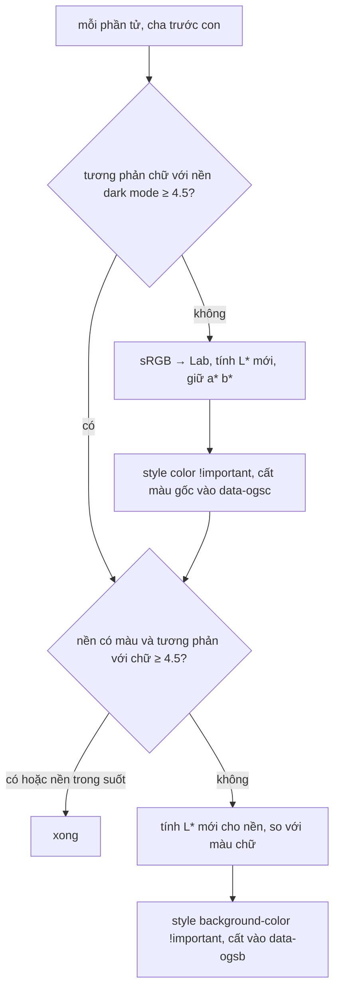

Làm dark mode cho giao diện của mình thì dễ: bạn kiểm soát mọi biến CSS. Làm dark mode cho **HTML của người khác** thì khác hẳn. Một email marketing có bảng lồng bảng, `style="color:#333333"` khắp nơi, `<td bgcolor="#ffffff">`, `<font color="red">` từ thời Outlook 2003, logo và ảnh sản phẩm. Bạn không thể viết lại CSS cho nó, chỉ có thể sửa màu từng phần tử sau khi nó đã render.

Gặp bài toán này ở đâu? Client email, khung xem trước bài viết dán từ Word/Google Docs, nội dung CMS do nhiều người soạn, widget nhúng bên thứ ba.

Cách nhanh nhất là `filter: invert(1) hue-rotate(180deg)` cho cả khung. Nó đảo được nền trắng thành đen, nhưng đảo luôn **ảnh** (bầu trời xanh thành nâu đất) và làm màu thương hiệu lệch hẳn. Outlook Web làm khác: duyệt từng phần tử, **chỉ sửa màu nào không đủ tương phản**, và sửa trong không gian màu **CIELAB** để giữ nguyên sắc độ.

> [!TIP]
> **Tóm tắt**
> - Với mỗi phần tử: màu chữ có đủ tương phản 4.5:1 với nền dark mode không? Màu nền có đủ tương phản với màu chữ không? Đủ thì để nguyên.
> - Không đủ thì đổi sang CIELAB, **giữ a\* và b\*** (sắc độ), chỉ tính lại độ sáng L\*. Xanh thương hiệu vẫn là xanh thương hiệu, chỉ sáng hơn.
> - Cất màu gốc vào `data-og-*` để hoàn tác, và để khi người dùng **copy** thì tạm trả màu gốc cho clipboard rồi đặt lại ở frame sau.
> - Ảnh không bị đụng tới, vì chỉ `color` và `background-color` bị sửa.

<iframe class="demo-frame" src="/demos/web-patterns/index.html?theme=dark#/email-dark-mode" title="Demo email-dark-mode" loading="lazy" style="height: 1180px"></iframe>

<p class="demo-links">▶ <a href="/demos/web-patterns/index.html#/email-dark-mode" target="_blank" rel="noopener">Mở demo toàn màn hình ↗</a> · <a href="https://stackblitz.com/github/hunghg255/blog-hunghg/tree/master/examples/web-patterns?file=src/lib/emailDarkMode.ts" target="_blank" rel="noopener">Sửa code trên StackBlitz ↗</a> · <a href="https://github.com/hunghg255/blog-hunghg/blob/master/examples/web-patterns/src/lib/emailDarkMode.ts" target="_blank" rel="noopener">Xem source trên GitHub ↗</a></p>

Ba khung là cùng một email. Khung giữa đảo màu bằng `filter`: nhìn ảnh và nút "Xem đơn hàng". Khung phải là cách của Outlook, bảng bên dưới liệt kê đúng 9 màu bị sửa với tỉ lệ tương phản trước và sau. Bôi đen một đoạn ở khung phải, copy rồi dán vào ô cuối: màu dán ra là màu gốc.

## Outlook làm thế nào?

Có ba module liên quan, đều là code của OWA (Outlook Web App):

- [`owa-dark-mode-utilities/src/utils/transformElementForDarkMode.ts`](https://github.com/hunghg255/codebase/blob/main/outlook.live.com/src/modules/owa-dark-mode-utilities/src/utils/transformElementForDarkMode.ts): logic đổi màu một phần tử.
- [`owa-controls-content-handler-dark-mode/src/handler/darkModeHandler.ts`](https://github.com/hunghg255/codebase/blob/main/outlook.live.com/src/modules/owa-controls-content-handler-dark-mode/src/handler/darkModeHandler.ts): một "content handler" chạy hàm trên cho mọi phần tử (`cssSelector = '*'`) và nhớ danh sách để hoàn tác.
- [`owa-content-colors/src/handleOnCopy.ts`](https://github.com/hunghg255/codebase/blob/main/outlook.live.com/src/modules/owa-content-colors/src/handleOnCopy.ts): xử lý copy.

Màu nền dark mode được truyền vào từ `MailMessageBody.tsx` là `getPaletteAsRawColors().white`. Nghe lạ, nhưng comment trong code giải thích: *"The color mapped to 'white' is always used for the background in the reading pane. The actual color will be flipped to a dark value when darkMode is enabled."* Theme tối của Fluent UI đảo các ô màu trung tính, ô tên `white` thành màu nền tối.

### Bước 1: kiểm tra tương phản

```ts
const VALID_CONTRAST_VALUE = 4.5;

let textColor = Color(computedStyles.color || undefined);
if (useSimpleMethod ? styleColor || attrColor : !isValidContrast(textColor, baseBGColor)) {
  textColor = fixContrast(textColor, baseBGColor, !!useSimpleMethod, baseColor);
  element.style.setProperty('color', textColor.rgb().string(), 'important');
  element.setAttribute(DATA_OG_STYLE_COLOR, styleColor ? styleColor : EMPTY_STRING);
  // Word seems to prioritize color over CSS color so copy/paste has issues without this
  if (attrColor) { element.setAttribute(ATTR_COLOR, textColor.rgb().string()); ... }
}
```

4.5 là ngưỡng AA của WCAG cho chữ cỡ thường. Màu được đọc từ `getComputedStyle`, tức màu **thật sự đang hiển thị** (kể cả màu thừa hưởng từ cha), chứ không chỉ inline style. Màu mới đặt với `!important` để thắng mọi CSS trong email. Thuộc tính `color` kiểu cũ cũng được sửa, vì theo comment, Word ưu tiên thuộc tính đó hơn CSS khi dán.

Sau đó làm tương tự với **màu nền**, nhưng so với **màu chữ vừa sửa** (không phải với nền dark mode).

### Bước 2: sửa độ sáng trong CIELAB

```ts
const baseLValue = baseBGColor.lab().array()[0];
const colorLab = color.lab().array();
const comparisonLValue = comparisonColor.lab().array()[0];

const ceilingDarkLValue = 50; // values above this can't contrast against 100
const floorLightLValue = 50 + baseLValue; // values below this can't contrast against baseLValue
const midpointLValue = (floorLightLValue + ceilingDarkLValue) / 2;

newLValue = colorLab[0] * ((100 - baseLValue) / 100) + baseLValue;
if (comparisonLValue > midpointLValue) { /* lật về phía tối */ } else { /* lật về phía sáng */ }

return Color.lab(newLValue, colorLab[1], colorLab[2]).rgb().alpha(color.alpha());
```

Dòng cuối là mấu chốt: `Color.lab(newL, a, b)`. Hai kênh `a` (xanh lá ↔ đỏ) và `b` (xanh dương ↔ vàng) được giữ nguyên, chỉ L\* đổi.

### Bước 3: hoàn tác và copy

Màu gốc được cất vào bốn thuộc tính `data-ogsc`, `data-ogac`, `data-ogsb`, `data-ogab` (original style color, attribute color, style background, attribute bgcolor). `undoHandler` trả lại và xoá chúng. `handleOnCopy`:

```ts
if (isDark) { tgt.style.backgroundColor = 'white'; tgt.style.color = 'black'; }
for (let i = 0; i < elems.length; i++) {
  const originalColors = getElementOgColors(element);
  elementModifiedColors.push(getElementColors(element));
  setElementColors(element, originalColors);
}
window.requestAnimationFrame(() => { /* đặt lại màu dark mode */ });
```

Trình duyệt chụp nội dung clipboard ngay sau khi handler `copy` chạy xong, **trước** khi vẽ frame tiếp theo. Đổi màu trong handler, đổi lại trong `requestAnimationFrame`: clipboard có màu gốc, người dùng không kịp thấy khung nhấp nháy.

### Một chi tiết với nền trong suốt

Phần tử không có nền có `getComputedStyle().backgroundColor` là `rgba(0, 0, 0, 0)`. Comment của Outlook nói ý định là *"default to dark mode background to pass contrast checks"*. Thực tế thư viện `color` tính độ chói (luminance) mà **bỏ qua kênh alpha** (xem `luminosity()` trong mã nguồn `color`), nên nền trong suốt bị coi là đen. Đen gần với nền tối nên kết quả vẫn ổn, nhưng là nhờ trùng hợp. Bản viết lại bỏ qua hẳn nền có alpha bằng 0.

## Bên trong: tại sao lại là CIELAB?

sRGB (cái bạn viết trong `#rrggbb`) mô tả **lượng ánh sáng phát ra** của ba đèn đỏ, lục, lam. Nó không đều theo cảm nhận: tăng kênh G thêm 20 làm màu sáng lên rõ hơn nhiều so với tăng kênh B thêm 20. Muốn "giữ màu, chỉ đổi độ sáng" trong RGB thì không có trục nào làm đúng việc đó.

CIELAB (thường viết L\*a\*b\*) được thiết kế để **khoảng cách số gần với khoảng cách cảm nhận**:

- **L\*** từ 0 (đen) tới 100 (trắng): độ sáng cảm nhận.
- **a\***: âm là xanh lá, dương là đỏ. **b\***: âm là xanh dương, dương là vàng.

Đổi L\* và giữ a\*, b\* gần đúng với "cùng màu đó, sáng hơn/tối hơn". Chuyển đổi đi qua hệ XYZ: sRGB → tuyến tính hoá (bỏ gamma) → XYZ bằng ma trận 3×3 → L\*a\*b\* theo điểm trắng D65.

Công thức sửa L\* có hai bước:

1. **Nén** L\* từ [0, 100] vào [baseL, 100], với baseL là độ sáng của nền dark mode (nền `#1f1f1f` có L\* ≈ 12). Không màu nào được tối hơn chính cái nền.
2. **Lật**: nếu màu cần tương phản (nền tối khi sửa chữ, chữ sáng khi sửa nền) sáng hơn "điểm giữa" thì màu này phải tối, ngược lại phải sáng. Lật quanh điểm giữa rồi kéo giãn ra hai phía, để không màu nào rơi vào "vùng chết" quanh giữa, nơi không đủ tương phản với cả hai đầu.



Thứ tự "cha trước con" quan trọng: `querySelectorAll('*')` trả về theo thứ tự tài liệu. Một `<span>` không tự đặt màu sẽ thừa hưởng màu chữ **đã sửa** của `<p>` cha, nên khi tới lượt nó, tương phản đã đạt và nó được để nguyên. Nhờ vậy số phần tử bị sửa ít hơn nhiều so với tổng số phần tử.

## Viết lại

Không dùng thư viện: chuyển đổi sRGB ⇄ Lab chỉ khoảng 30 dòng. Phần công thức L\*:

```ts title=src/lib/emailDarkMode.ts
export function fixLightness(L: number, againstL: number, baseL: number): number {
  const ceilingDark = 50; // tối hơn mức này mới tương phản nổi với trắng (L = 100)
  const floorLight = 50 + baseL; // sáng hơn mức này mới tương phản nổi với nền (L = baseL)
  const mid = (floorLight + ceilingDark) / 2;

  let next = L * ((100 - baseL) / 100) + baseL;
  if (againstL > mid) {
    next = Math.min(next, 2 * mid - next);
    next = ((next - baseL) * (ceilingDark - baseL)) / (mid - baseL) + baseL;
  } else {
    next = Math.max(next, 2 * mid - next);
    next = 100 - ((100 - next) * (100 - floorLight)) / (100 - mid);
  }
  return Math.min(100, Math.max(0, next));
}

/** Giữ a*, b* (sắc độ), chỉ thay L*. Đây là lý do màu thương hiệu vẫn "ra màu thương hiệu". */
export function fixContrast(color: Rgba, against: Rgba, base: Rgba): Rgba {
  const [L, A, B] = rgbToLab(color);
  const baseL = rgbToLab(base)[0];
  const againstL = rgbToLab(against)[0];
  return labToRgb([fixLightness(L, againstL, baseL), A, B], color.a);
}
```

Phần áp lên một phần tử (nửa xử lý màu chữ; nửa màu nền làm tương tự, so với màu chữ đã sửa):

```ts title=src/lib/emailDarkMode.ts
export function transformElement(element: HTMLElement, base: Rgba): ChangedElement[] {
  const changes: ChangedElement[] = [];
  const cs = getComputedStyle(element);
  let text = parseColor(cs.color);
  if (!text) return changes;

  // 1. Màu chữ so với nền dark mode
  const contrastText = contrast(text, base);
  if (contrastText < MIN_CONTRAST) {
    const fixed = fixContrast(text, base, base);
    if (!element.hasAttribute(OG_STYLE_COLOR)) element.setAttribute(OG_STYLE_COLOR, element.style.color);
    element.style.setProperty('color', toCss(fixed), 'important');
    const attr = element.getAttribute('color'); // <font color="…"> kiểu cũ
    if (attr !== null) {
      if (!element.hasAttribute(OG_ATTR_COLOR)) element.setAttribute(OG_ATTR_COLOR, attr);
      // Word khi dán ưu tiên thuộc tính color hơn CSS, nên sửa cả thuộc tính
      element.setAttribute('color', toCss(fixed));
    }
    changes.push({ element, property: 'color', before: toCss(text), after: toCss(fixed), contrastBefore: contrastText, contrastAfter: contrast(fixed, base) });
    text = fixed;
  }
```

::: spoiler Xem toàn bộ src/lib/emailDarkMode.ts

```ts title=src/lib/emailDarkMode.ts
/**
 * Dark mode cho HTML không do mình viết (email, nội dung CMS, bài dán từ Word…).
 * Ý tưởng từ owa-dark-mode-utilities của Outlook Web: chỉ sửa phần tử nào thiếu tương phản,
 * đổi màu trong không gian CIELAB, GIỮ NGUYÊN sắc độ (a*, b*) và chỉ đổi độ sáng L*.
 */

export interface Rgba {
  r: number;
  g: number;
  b: number;
  a: number;
}

// ---- Đọc màu ----

/**
 * Parse màu từ getComputedStyle (luôn ra "rgb(…)" / "rgba(…)") hoặc dạng hex "#rgb", "#rrggbb".
 * Trả về null với giá trị lạ, thay vì ném lỗi như thư viện `color` mà Outlook phải bọc try/catch.
 */
export function parseColor(input: string): Rgba | null {
  const s = input.trim().toLowerCase();
  const hex = /^#([0-9a-f]{3}|[0-9a-f]{6})$/.exec(s);
  if (hex) {
    const h = hex[1].length === 3 ? [...hex[1]].map((c) => c + c).join('') : hex[1];
    return { r: parseInt(h.slice(0, 2), 16), g: parseInt(h.slice(2, 4), 16), b: parseInt(h.slice(4, 6), 16), a: 1 };
  }
  const fn = /^rgba?\(([^)]+)\)$/.exec(s);
  if (!fn) return null;
  const parts = fn[1].split(/[\s,/]+/).filter(Boolean).map(Number);
  if (parts.length < 3 || parts.some(Number.isNaN)) return null;
  return { r: parts[0], g: parts[1], b: parts[2], a: parts[3] ?? 1 };
}

export const toCss = ({ r, g, b, a }: Rgba) =>
  a >= 1 ? `rgb(${Math.round(r)}, ${Math.round(g)}, ${Math.round(b)})` : `rgba(${Math.round(r)}, ${Math.round(g)}, ${Math.round(b)}, ${a})`;

// ---- sRGB ⇄ CIELAB (D65) ----

const toLinear = (c: number) => {
  const v = c / 255;
  return v <= 0.04045 ? v / 12.92 : ((v + 0.055) / 1.055) ** 2.4;
};
const fromLinear = (v: number) => {
  const c = v <= 0.0031308 ? 12.92 * v : 1.055 * v ** (1 / 2.4) - 0.055;
  return Math.min(255, Math.max(0, c * 255));
};

// điểm trắng D65
const XN = 0.95047;
const YN = 1;
const ZN = 1.08883;
const EPS = 216 / 24389;
const KAPPA = 24389 / 27;

export function rgbToLab({ r, g, b }: Rgba): [number, number, number] {
  const R = toLinear(r);
  const G = toLinear(g);
  const B = toLinear(b);
  const x = (R * 0.4124564 + G * 0.3575761 + B * 0.1804375) / XN;
  const y = (R * 0.2126729 + G * 0.7151522 + B * 0.072175) / YN;
  const z = (R * 0.0193339 + G * 0.119192 + B * 0.9503041) / ZN;
  const f = (t: number) => (t > EPS ? Math.cbrt(t) : (KAPPA * t + 16) / 116);
  const fx = f(x);
  const fy = f(y);
  const fz = f(z);
  return [116 * fy - 16, 500 * (fx - fy), 200 * (fy - fz)];
}

export function labToRgb([L, A, Bv]: [number, number, number], alpha = 1): Rgba {
  const fy = (L + 16) / 116;
  const fx = fy + A / 500;
  const fz = fy - Bv / 200;
  const inv = (t: number) => (t ** 3 > EPS ? t ** 3 : (116 * t - 16) / KAPPA);
  const x = inv(fx) * XN;
  const y = (L > KAPPA * EPS ? fy ** 3 : L / KAPPA) * YN;
  const z = inv(fz) * ZN;
  const R = x * 3.2404542 - y * 1.5371385 - z * 0.4985314;
  const G = -x * 0.969266 + y * 1.8760108 + z * 0.041556;
  const B = x * 0.0556434 - y * 0.2040259 + z * 1.0572252;
  return { r: fromLinear(R), g: fromLinear(G), b: fromLinear(B), a: alpha };
}

// ---- Tương phản WCAG 2 ----

export function luminance({ r, g, b }: Rgba): number {
  return 0.2126 * toLinear(r) + 0.7152 * toLinear(g) + 0.0722 * toLinear(b);
}

export function contrast(c1: Rgba, c2: Rgba): number {
  const l1 = luminance(c1);
  const l2 = luminance(c2);
  return (Math.max(l1, l2) + 0.05) / (Math.min(l1, l2) + 0.05);
}

/** Ngưỡng AA cho chữ thường. Outlook dùng đúng con số này (VALID_CONTRAST_VALUE = 4.5). */
export const MIN_CONTRAST = 4.5;

/**
 * Tính lại độ sáng L* cho `color` để tương phản được với `against`, trên nền tối có độ sáng `baseL`.
 * Công thức theo fixContrast() của Outlook:
 * 1. Nén L* từ [0, 100] vào [baseL, 100]: không màu nào tối hơn chính nền dark mode.
 * 2. Màu cần so sánh mà sáng thì lật màu này về phía tối, ngược lại lật về phía sáng,
 *    rồi kéo giãn để tránh "vùng chết" quanh giữa (do baseL không bằng 0).
 */
export function fixLightness(L: number, againstL: number, baseL: number): number {
  const ceilingDark = 50; // tối hơn mức này mới tương phản nổi với trắng (L = 100)
  const floorLight = 50 + baseL; // sáng hơn mức này mới tương phản nổi với nền (L = baseL)
  const mid = (floorLight + ceilingDark) / 2;

  let next = L * ((100 - baseL) / 100) + baseL;
  if (againstL > mid) {
    next = Math.min(next, 2 * mid - next);
    next = ((next - baseL) * (ceilingDark - baseL)) / (mid - baseL) + baseL;
  } else {
    next = Math.max(next, 2 * mid - next);
    next = 100 - ((100 - next) * (100 - floorLight)) / (100 - mid);
  }
  return Math.min(100, Math.max(0, next));
}

/** Giữ a*, b* (sắc độ), chỉ thay L*. Đây là lý do màu thương hiệu vẫn "ra màu thương hiệu". */
export function fixContrast(color: Rgba, against: Rgba, base: Rgba): Rgba {
  const [L, A, B] = rgbToLab(color);
  const baseL = rgbToLab(base)[0];
  const againstL = rgbToLab(against)[0];
  return labToRgb([fixLightness(L, againstL, baseL), A, B], color.a);
}

// ---- Áp lên DOM, nhớ màu gốc để hoàn tác và để copy ----

// Cùng tên thuộc tính với Outlook (owa-content-colors-constants)
const OG_STYLE_COLOR = 'data-ogsc';
const OG_ATTR_COLOR = 'data-ogac';
const OG_STYLE_BG = 'data-ogsb';
const OG_ATTR_BG = 'data-ogab';

export interface ChangedElement {
  element: HTMLElement;
  property: 'color' | 'background-color';
  before: string;
  after: string;
  contrastBefore: number;
  contrastAfter: number;
}

/**
 * Sửa một phần tử. Phải gọi theo thứ tự cha trước con (thứ tự của querySelectorAll):
 * con không tự đặt màu sẽ thừa hưởng màu đã sửa của cha, nên không cần sửa lại.
 */
export function transformElement(element: HTMLElement, base: Rgba): ChangedElement[] {
  const changes: ChangedElement[] = [];
  const cs = getComputedStyle(element);
  let text = parseColor(cs.color);
  if (!text) return changes;

  // 1. Màu chữ so với nền dark mode
  const contrastText = contrast(text, base);
  if (contrastText < MIN_CONTRAST) {
    const fixed = fixContrast(text, base, base);
    if (!element.hasAttribute(OG_STYLE_COLOR)) element.setAttribute(OG_STYLE_COLOR, element.style.color);
    element.style.setProperty('color', toCss(fixed), 'important');
    const attr = element.getAttribute('color'); // <font color="…"> kiểu cũ
    if (attr !== null) {
      if (!element.hasAttribute(OG_ATTR_COLOR)) element.setAttribute(OG_ATTR_COLOR, attr);
      // Word khi dán ưu tiên thuộc tính color hơn CSS, nên sửa cả thuộc tính
      element.setAttribute('color', toCss(fixed));
    }
    changes.push({ element, property: 'color', before: toCss(text), after: toCss(fixed), contrastBefore: contrastText, contrastAfter: contrast(fixed, base) });
    text = fixed;
  }

  // 2. Màu nền so với màu chữ (đã sửa). Nền trong suốt thì bỏ qua: nó để lộ nền dark mode.
  //    (Bản gốc không bỏ qua mà để thư viện `color` coi rgba(0,0,0,0) là đen, kết quả tình cờ đúng.)
  const bg = parseColor(cs.backgroundColor);
  if (bg && bg.a > 0) {
    const contrastBg = contrast(bg, text);
    if (contrastBg < MIN_CONTRAST) {
      const fixed = fixContrast(bg, text, base);
      if (!element.hasAttribute(OG_STYLE_BG)) element.setAttribute(OG_STYLE_BG, element.style.backgroundColor);
      element.style.setProperty('background-color', toCss(fixed), 'important');
      const attr = element.getAttribute('bgcolor'); // <td bgcolor="…">
      if (attr !== null) {
        if (!element.hasAttribute(OG_ATTR_BG)) element.setAttribute(OG_ATTR_BG, attr);
        element.setAttribute('bgcolor', toCss(fixed));
      }
      changes.push({ element, property: 'background-color', before: toCss(bg), after: toCss(fixed), contrastBefore: contrastBg, contrastAfter: contrast(fixed, text) });
    }
  }
  return changes;
}

/** Áp dark mode cho cả cây. `root` phải đang hiển thị trên nền `baseColor` (màu nền dark mode). */
export function applyDarkMode(root: HTMLElement, baseColor: string): ChangedElement[] {
  const base = parseColor(baseColor);
  if (!base) throw new Error(`Màu nền không hợp lệ: ${baseColor}`);
  const all = [root, ...root.querySelectorAll<HTMLElement>('*')];
  return all.flatMap((el) => transformElement(el, base));
}

interface SavedColors {
  styleColor: string;
  styleBg: string;
  attrColor: string | null;
  attrBg: string | null;
}

const readColors = (el: HTMLElement): SavedColors => ({
  styleColor: el.style.getPropertyValue('color'),
  styleBg: el.style.getPropertyValue('background-color'),
  attrColor: el.getAttribute('color'),
  attrBg: el.getAttribute('bgcolor'),
});

function writeColors(el: HTMLElement, c: Partial<SavedColors>, important = false) {
  const prio = important ? 'important' : '';
  if (c.styleColor !== undefined) el.style.setProperty('color', c.styleColor, prio);
  if (c.styleBg !== undefined) el.style.setProperty('background-color', c.styleBg, prio);
  if (c.attrColor !== undefined) c.attrColor === null ? el.removeAttribute('color') : el.setAttribute('color', c.attrColor);
  if (c.attrBg !== undefined) c.attrBg === null ? el.removeAttribute('bgcolor') : el.setAttribute('bgcolor', c.attrBg);
}

/** Màu gốc đã cất trong data-og-*, chỉ những gì đã bị sửa. */
function originalColors(el: HTMLElement): Partial<SavedColors> {
  const out: Partial<SavedColors> = {};
  if (el.hasAttribute(OG_STYLE_COLOR)) out.styleColor = el.getAttribute(OG_STYLE_COLOR)!;
  if (el.hasAttribute(OG_STYLE_BG)) out.styleBg = el.getAttribute(OG_STYLE_BG)!;
  if (el.hasAttribute(OG_ATTR_COLOR)) out.attrColor = el.getAttribute(OG_ATTR_COLOR);
  if (el.hasAttribute(OG_ATTR_BG)) out.attrBg = el.getAttribute(OG_ATTR_BG);
  return out;
}

/** Hoàn tác toàn bộ: trả màu gốc và dọn các thuộc tính data-og-*. */
export function undoDarkMode(root: HTMLElement) {
  for (const el of [root, ...root.querySelectorAll<HTMLElement>('*')]) {
    const og = originalColors(el);
    if (Object.keys(og).length === 0) continue;
    writeColors(el, og);
    [OG_STYLE_COLOR, OG_STYLE_BG, OG_ATTR_COLOR, OG_ATTR_BG].forEach((a) => el.removeAttribute(a));
  }
}

/**
 * Gắn vào sự kiện `copy` của khung email. Clipboard được chụp ĐỒNG BỘ ngay sau handler, nên:
 * trả màu gốc ngay trong handler → trình duyệt chép màu gốc → frame sau đặt lại màu dark mode.
 * Người dùng dán sang Word/Gmail sẽ không bị "chữ trắng trên nền trắng".
 */
export function copyWithOriginalColors(root: HTMLElement, lightBackground = 'white', lightText = 'black') {
  // chỉ đụng vào phần tử đã bị dark mode sửa (có data-og-*)
  const elements = [...root.querySelectorAll<HTMLElement>('*')].filter(
    (el) => Object.keys(originalColors(el)).length > 0,
  );
  const saved = elements.map(readColors);
  const rootStyle = { bg: root.style.backgroundColor, color: root.style.color };
  // khung ngoài đang tô nền tối/chữ sáng bằng CSS của app: tạm đổi về nền sáng
  root.style.backgroundColor = lightBackground;
  root.style.color = lightText;
  elements.forEach((el) => writeColors(el, originalColors(el)));

  requestAnimationFrame(() => {
    root.style.backgroundColor = rootStyle.bg;
    root.style.color = rootStyle.color;
    // màu dark mode được đặt với !important, nên đặt lại cũng phải !important
    elements.forEach((el, i) => writeColors(el, saved[i], true));
  });
}
```

:::

## Đi qua code

**`parseColor` không ném lỗi.** Outlook bọc cả hàm trong `try/catch` vì `Color()` ném lỗi với giá trị CSS lạ. Ở đây đọc từ `getComputedStyle`, vốn luôn trả về dạng `rgb(…)`/`rgba(…)`, nên một parser nhỏ là đủ; giá trị lạ trả `null` và phần tử được bỏ qua.

**Kết quả với email trong demo** (nền dark mode `#1f1f1f`):

| Màu gốc | Vai trò | Sau khi sửa | Tương phản |
|---|---|---|---|
| `#0b57d0` xanh thương hiệu | chữ tiêu đề | `rgb(131, 159, 255)` | 2.58 → 6.58 |
| `#d93025` đỏ | chữ khuyến mãi | `rgb(255, 94, 72)` | 3.45 → 5.44 |
| `#fde293` vàng | nền chữ highlight | `rgb(59, 45, 0)` | 1.27 → 13.41 |
| `#ffffff` | nền bảng | `rgb(31, 31, 31)` | 1.23 → 13.45 |

Xanh vẫn là xanh, đỏ vẫn đỏ, vàng highlight thành nâu đậm (vẫn là "vàng tối"). Nói chính xác: a\*, b\* được giữ khi tính, nhưng màu sáng lên có thể vượt ra ngoài những gì sRGB hiển thị được và bị cắt về [0, 255], nên độ bão hoà giảm đi một chút; góc màu (hue) chỉ lệch vài độ. Nút "Xem đơn hàng" (nền xanh, chữ trắng) không bị đụng tới vì tương phản giữa chúng đã đạt 6.6.

**`!important` hai chiều.** Màu sửa được đặt với `!important`. Khi copy, `writeColors` trả màu gốc **không** có `!important` (đúng như trong email), và ở frame sau đặt lại màu dark mode **có** `!important`.

**Chỉ đụng phần tử có `data-og-*`** khi copy. Bản Outlook duyệt mọi phần tử và ghi lại màu hiện tại của tất cả. Kết quả như nhau, nhưng duyệt ít hơn và không vô tình thêm `!important` vào inline style của phần tử chưa từng bị sửa.

**Khác bản gốc:**
- Tự viết chuyển đổi Lab và tương phản, không dùng thư viện `color`.
- Bỏ qua nền trong suốt thay vì để nó thành đen một cách ngầm định.
- Không có chế độ `useSimpleMethod` (Outlook có cờ này để chỉ đổi màu nào được khai báo tường minh và chỉ lật L\*).
- Ghi nhớ màu gốc chỉ một lần (`if (!hasAttribute)`), nên áp dark mode hai lần liên tiếp không làm mất màu gốc.

## Tại sao không làm cách khác?

**`filter: invert(1) hue-rotate(180deg)`**: một dòng CSS, nhưng đảo cả ảnh, video, logo; muốn chừa ảnh lại thì phải đảo ngược lần nữa cho từng ``, và ảnh nền CSS thì không chừa được. Màu cũng không giữ đúng: `hue-rotate` xoay sắc độ trong một phép biến đổi xấp xỉ, không phải trong không gian cảm nhận.

**Đảo độ sáng trong HSL**: L của HSL không phải độ sáng cảm nhận. Vàng `hsl(60 100% 50%)` và xanh dương `hsl(240 100% 50%)` cùng L = 50% nhưng vàng sáng hơn rất nhiều. Đảo theo HSL cho kết quả lúc quá sáng, lúc quá tối.

**`color-scheme: dark` hoặc media query**: chỉ ảnh hưởng màu mặc định của trình duyệt (nền trang, form control). Màu đã ghi inline trong email không bị đổi.

**Đổi tất cả màu thay vì chỉ màu thiếu tương phản**: sẽ đổi luôn những tổ hợp vốn đã đẹp (nút xanh chữ trắng, banner màu), làm email khác xa ý người gửi.

## Edge case và cạm bẫy

- **Ảnh có chữ đen trên nền trong suốt** (logo PNG): không sửa được bằng màu CSS, sẽ chìm vào nền tối. Có thể đặt một nền sáng nhẹ phía sau ảnh, nhưng đó là một quyết định thiết kế riêng.
- **Gradient và `background-image`**: chỉ `background-color` được xét. Chữ đặt trên ảnh nền vẫn có thể thiếu tương phản.
- **Màu bán trong suốt**: tương phản tính trên RGB bỏ qua alpha, giống Outlook. Muốn chính xác phải trộn màu với nền phía sau trước khi tính.
- **Nội dung thay đổi sau khi áp** (ảnh tải xong, nội dung lazy): phải chạy lại cho phần tử mới; vì màu gốc chỉ cất một lần nên chạy lại an toàn.
- **Hiệu năng**: mỗi phần tử một lần `getComputedStyle` và ghi style, gây tính lại style nhiều lần. Email trong demo tốn chưa tới 1ms; email cả nghìn phần tử nên chạy trong lúc chưa hiển thị hoặc chia nhỏ (xem [hàng đợi rAF](/blogs/web-raf-queue-3ms)).
- **Thuộc tính `data-og-*` lọt vào clipboard**: HTML dán ra vẫn chứa chúng (Outlook cũng vậy). Vô hại, nhưng nếu bạn lưu HTML lại thì nên lọc.
- **Nội dung không tin cậy**: demo hiển thị phần dán vào trong `<iframe sandbox="" srcdoc>` để HTML lạ không chạy được script. Email thật luôn phải qua sanitizer (như DOMPurify) trước khi chèn vào trang.

## Dùng trong dự án

```ts
import { applyDarkMode, copyWithOriginalColors, undoDarkMode } from './emailDarkMode';

const body = document.querySelector<HTMLElement>('.message-body')!;
body.style.background = '#1f1f1f';
body.style.color = '#e8e8e8';
applyDarkMode(body, '#1f1f1f');
body.addEventListener('copy', () => copyWithOriginalColors(body));

// người dùng bấm "Xem màu gốc"
undoDarkMode(body);
```

Màu nền truyền vào phải đúng là màu đang hiển thị sau khung email, vì toàn bộ phép tính tương phản dựa vào nó.

## Kiểm thử

::: spoiler Ví dụ test (bản phác, không có trong repo)

```ts
import { describe, expect, it } from 'vitest';
import { contrast, fixContrast, labToRgb, parseColor, rgbToLab, toCss } from './emailDarkMode';

const base = parseColor('#1f1f1f')!;

describe('Lab', () => {
  it('đổi qua đổi lại không lệch', () => {
    const c = parseColor('#0b57d0')!;
    expect(toCss(labToRgb(rgbToLab(c)))).toBe('rgb(11, 87, 208)');
  });
});

describe('fixContrast', () => {
  it('chữ tối trên nền tối thành sáng và đạt 4.5', () => {
    for (const hex of ['#000000', '#333333', '#0b57d0', '#d93025', '#188038', '#7a7a7a']) {
      const fixed = fixContrast(parseColor(hex)!, base, base);
      expect(contrast(fixed, base)).toBeGreaterThanOrEqual(4.5);
    }
  });
  it('giữ góc màu (hue) gần như không đổi', () => {
    const hue = ([, a, b]: number[]) => (Math.atan2(b, a) * 180) / Math.PI;
    for (const hex of ['#0b57d0', '#d93025', '#188038']) {
      const c = parseColor(hex)!;
      const diff = Math.abs(hue(rgbToLab(c)) - hue(rgbToLab(fixContrast(c, base, base))));
      expect(diff).toBeLessThan(6);
    }
  });
  it('nền trắng dưới chữ đã sáng thì thành tối', () => {
    const text = fixContrast(parseColor('#000')!, base, base);
    const bg = fixContrast(parseColor('#fff')!, text, base);
    expect(contrast(bg, text)).toBeGreaterThanOrEqual(4.5);
    expect(rgbToLab(bg)[0]).toBeLessThan(20);
  });
});
```

Test so **góc màu** (hue, `atan2(b*, a*)`) thay vì so từng kênh a\*, b\*: màu sáng lên có thể ra ngoài gam màu sRGB và bị cắt về [0, 255], làm độ bão hoà giảm (xanh `#0b57d0`: a\* từ 27 còn 16), nhưng góc màu chỉ lệch khoảng 4,5°. Phần `applyDarkMode` cần `getComputedStyle` thật nên kiểm bằng Playwright.

:::

## So với thư viện và chuẩn web

- CSS Color 4 có sẵn hàm `lab()` và `oklch()`, CSS Color 5 có cú pháp màu tương đối như `oklch(from var(--c) calc(l + 0.3) c h)`. Chúng hợp để viết theme mới (xem bài [OKLCH](/blogs/oklch-color-space-css)), nhưng không giúp được HTML có sẵn màu inline: bạn vẫn phải duyệt phần tử bằng JS.
- OKLCH/OKLab là bản cải tiến của CIELAB, đều đặn hơn với màu xanh dương. Thay `rgbToLab` bằng OKLab là một nâng cấp hợp lý; công thức lật độ sáng giữ nguyên ý tưởng.
- Một số client email có thuộc tính hay meta riêng cho dark mode (ví dụ `<meta name="color-scheme">` trong email). Người viết email nên khai báo; client vẫn phải xử lý email không khai báo, và đó là phần việc của bài này.

---

Bài này thuộc series **[Học từ mã nguồn các web lớn](/series/web)** (65 bài, đọc theo thứ tự).

::: spoiler Xem nhanh danh sách bài trong series

*Mở đầu*

- [Mở đầu: đọc code production của 28 trang web](/blogs/learn-from-big-web-apps)

*Phần 1: trải nghiệm người dùng*

- [#1 Dark mode không nháy (Gatsby)](/blogs/web-dark-mode-no-flash)
- [#2 useValueByMedia: giá trị theo breakpoint (Toptal)](/blogs/web-use-value-by-media)
- [#3 Đoán ý định: idle, exit-intent, lắc chuột (Toptal, InVision)](/blogs/web-user-intent-idle-exit-wiggle)
- [#4 Validate form thân thiện (Udacity, Pipedrive)](/blogs/web-form-validation-ux)
- [#5 Magic number, EXIF và dán ảnh (Ello)](/blogs/web-file-magic-number-exif-paste)
- [#6 fastSmoothScroll: cuộn xa vẫn nhanh (Telegram)](/blogs/web-telegram-fast-smooth-scroll)
- [#7 Countdown time-travel và tombstone giỏ hàng (Best Buy)](/blogs/web-countdown-time-travel-tombstone)

*Phần 2: hiệu năng và đo lường*

- [#8 Hàng đợi requestAnimationFrame 3ms (Apple)](/blogs/web-raf-queue-3ms)
- [#9 srcset cho artwork và preconnect tự động (Apple)](/blogs/web-responsive-artwork-preconnect)
- [#10 Quick-fetch: gọi API trước khi bundle tải xong (HubSpot)](/blogs/web-quick-fetch-early-requests)
- [#11 Performance span và long task (Postman, Calibre)](/blogs/web-performance-spans-long-tasks)
- [#12 Gọi Web Worker như hàm async (Telegram)](/blogs/web-worker-promise-rpc)
- [#13 Đồng hồ media: đếm giờ xem và sửa lệch (Skillshare, Simplified)](/blogs/web-media-clock-watch-time-drift)

*Phần 3: nhiều tab, phiên đăng nhập, cập nhật*

- [#14 Bầu tab chủ cho thông báo (HubSpot, Telegram)](/blogs/web-leader-tab-notifications)
- [#15 Đồng bộ đăng nhập giữa tab và giới hạn cookie (Elastic, InVision)](/blogs/web-cross-tab-auth-cookie-guard)
- [#16 SPA tự cập nhật: Trello, Zappos, Facebook, Elastic](/blogs/web-spa-self-update-strategies)

*Phần 4: kiến trúc*

- [#17 Reverse portal: di chuyển component không remount (Zappos)](/blogs/web-reverse-portal)
- [#18 Page behaviors: gắn hành vi từ CMS (Intercom)](/blogs/web-page-behaviors-cms)
- [#19 Giới hạn tần suất hiển thị bằng bitmask (Outlook)](/blogs/web-frequency-cap-bitmask)
- [#20 Chuyển REST sang GraphQL dần dần (Coursera)](/blogs/web-rest-to-graphql-hybrid-link)

*Phần 5: soạn thảo và hiển thị nội dung*

- [#21 Autocomplete tại con trỏ trong contenteditable (Ello, Telegram)](/blogs/web-caret-autocomplete-contenteditable)
- **#22 Dark mode cho email HTML bằng CIELAB (Outlook)** (bài này)
- [#23 Thu nhỏ bảng rộng cho vừa khung, vá font emoji (Outlook)](/blogs/web-email-wide-content-scale)
- [#24 Cảnh báo quên đính kèm file (Outlook)](/blogs/web-forgotten-attachment-warning)
- [#25 Cắt chữ nhiều dòng chính xác (Pipedrive, Apple, Toptal)](/blogs/web-multiline-truncate-measure-text)
- [#26 Parse ngày giờ gõ tay khoan dung (Outlook, Elastic)](/blogs/web-lenient-date-parser)

*Phần 6: tương tác*

- [#27 menuAim: rê chéo vào submenu không bị đóng (Udemy)](/blogs/web-menu-aim-triangle)
- [#28 Kéo, vuốt chung cho chuột và cảm ứng (Telegram)](/blogs/web-unified-pointer-gestures)
- [#29 Phím tắt theo phạm vi, IME và bàn phím phi Latinh (Trello)](/blogs/web-scoped-keyboard-shortcuts)
- [#30 Nội suy màu: đổi theme và nền theo cuộn (Telegram, Anchor)](/blogs/web-color-interpolation-theme-scroll)
- [#31 Đường gióng hút cạnh và undo/redo trên canvas (Simplified)](/blogs/web-canvas-snap-guides-undo)
- [#32 Giả lập mù màu bằng feColorMatrix (Trello)](/blogs/web-color-vision-simulator)
- [#33 Vạch thước theo mức zoom và cấp phát màu cho biểu đồ (Anchor, Similarweb)](/blogs/web-timeline-ticks-color-stack)

*Phần 7: mạng, dữ liệu và async*

- [#34 Ô tìm kiếm chuẩn production (Similarweb, Udemy, Pipedrive)](/blogs/web-production-search-box)
- [#35 Điều phối async: latest-wins, single-flight (Glitch, Toptal)](/blogs/web-async-coordination-latest-wins)
- [#36 Polling thưa dần và debounce động (Trello)](/blogs/web-decaying-polling-dynamic-debounce)
- [#37 Cache phía client theo version (Similarweb, Telegram, Udemy)](/blogs/web-client-cache-versioned)
- [#38 Upload file lớn theo chunk (Outlook, Tribe)](/blogs/web-chunked-upload-pipeline)
- [#39 Phát video qua Service Worker bằng Range request (Telegram, Outlook)](/blogs/web-service-worker-range-streaming)

*Phần 8: hiệu năng và vận hành*

- [#40 TTI governor: hoãn việc phụ tới sau khi trang dùng được (Outlook)](/blogs/web-tti-governor)
- [#41 Tự đo LCP/CLS/TBT và phục vụ bản nhẹ cho máy yếu (Udemy)](/blogs/web-rum-adaptive-loading)

*Phần 9: thuật toán và dữ liệu phía client*

- [#42 Three-way merge ngay trên trình duyệt (Postman)](/blogs/web-three-way-merge-client)
- [#43 Dọn cache GraphQL bằng đếm tham chiếu (Outlook)](/blogs/web-graphql-cache-refcount-gc)
- [#44 LRU cache theo 3 cách (Apple, Similarweb, Outlook)](/blogs/web-lru-cache-three-ways)
- [#45 Lọc tăng dần trong Web Worker (Similarweb)](/blogs/web-incremental-filter-worker)
- [#46 Xếp hạng gợi ý trên client, so ngầm với server (Outlook)](/blogs/web-client-side-ranking-shadow-test)
- [#47 Nối OT với editor: undo stack và chặn echo (Glitch)](/blogs/web-ot-codemirror-undo)
- [#48 Ngôn ngữ markup riêng dịch hai chiều với HTML (Coursera)](/blogs/web-custom-markup-compiler)

*Phần 10: thời gian, ngôn ngữ, định dạng*

- [#49 Xử lý giờ mùa hè không cần thư viện (Udemy, Pipedrive)](/blogs/web-dst-without-library)
- [#50 Intl thực chiến: Segmenter, số rút gọn, số nhiều, fallback locale (Apple, Outlook)](/blogs/web-intl-in-production)
- [#51 WebVTT và bôi chọn transcript (Udemy, Coursera)](/blogs/web-webvtt-transcript-selection)

*Phần 11: tương tác và giao diện*

- [#52 Kéo-thả trên lịch (Pipedrive)](/blogs/web-calendar-drag-drop)
- [#53 Focus stack cho popup lồng nhau (Outlook)](/blogs/web-focus-stack-nested-popups)
- [#54 Clipboard: copy, dán chữ thuần, dán thông minh (Trello, Anchor, Pipedrive, Tribe)](/blogs/web-clipboard-tricks)
- [#55 Khôi phục vị trí cuộn khi trang còn đang tải (Apple, Zappos)](/blogs/web-scroll-restore-wait-height)
- [#56 Lấy màu từ ảnh: gradient nền, màu chữ (Apple, Telegram, Trello)](/blogs/web-colors-from-images)
- [#57 JS đọc breakpoint từ CSS, phát hiện chế độ PWA (Ello, Apple)](/blogs/web-css-js-breakpoint-bridge)

*Phần 12: media*

- [#58 Tin nhắn thoại: ghi âm, waveform realtime, nén 5-bit (Telegram)](/blogs/web-voice-message-waveform)
- [#59 Chụp frame video thành ảnh, canvas bị taint (Coursera, Outlook)](/blogs/web-video-frame-snapshot)

*Phần 13: đo lường, bảo mật, vận hành*

- [#60 Đo lúc ảnh màn hình đầu tải xong, cả khi chuyển trang SPA (Zappos, Best Buy, Outlook)](/blogs/web-above-the-fold-image-timing)
- [#61 Buffer analytics chờ SDK, phát hiện adblock (Best Buy)](/blogs/web-analytics-buffer-adblock)
- [#62 Proof-of-work trên client để chặn API ẩn danh (Udemy)](/blogs/web-client-proof-of-work)
- [#63 Prefetch không làm lệch số liệu, nén cài đặt bằng bit (Outlook)](/blogs/web-synthetic-prefetch-bit-flags)
- [#64 Micro-frontend: AngularJS và React chung app, giao tiếp xuyên frame (Similarweb, InVision, HubSpot)](/blogs/web-micro-frontend-bridges)

:::

Code + demo: [`examples/web-patterns`](https://github.com/hunghg255/blog-hunghg/tree/master/examples/web-patterns) · [Mở trên StackBlitz](https://stackblitz.com/github/hunghg255/blog-hunghg/tree/master/examples/web-patterns)
