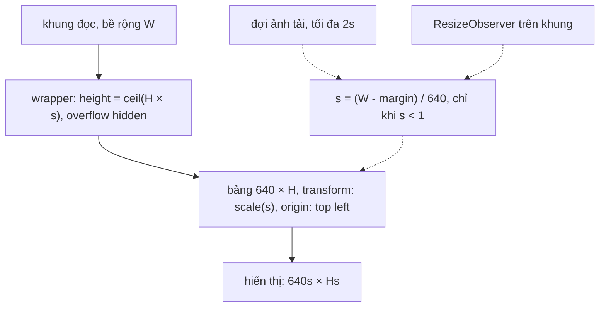

Email HTML vẫn được viết như năm 2005: bảng lồng bảng, `width="640"` cố định, vì đó là cách duy nhất chạy giống nhau trên mọi client mail. Mở email đó trong khung đọc rộng 360px (điện thoại, hay khung đọc bên cạnh danh sách thư) thì bảng tràn ra, khung phải cuộn ngang, người đọc phải kéo qua kéo lại từng dòng.

Bạn gặp đúng vấn đề này khi hiển thị bất kỳ HTML "cứng" nào trong khung hẹp: email, hoá đơn HTML, bài viết dán từ Word, bảng biểu nhúng.

Outlook Web xử lý bằng một "content handler" riêng cho thẻ `<table>`: **thu nhỏ cả bảng bằng `transform: scale()`** cho vừa khung, rồi bọc nó trong một div có chiều cao đã bù, và cho người đọc một nút để xem kích thước thật. Cùng nhóm đó còn một handler nhỏ khác: **vá `font-family`** để emoji trong email không hiện thành ô vuông.

> [!TIP]
> **Tóm tắt**
> - `scale = khung / bề rộng bảng`, chỉ áp khi `< 1`. `transform` không đổi kích thước layout, nên phải bọc một div có `height = ceil(cao × scale)`.
> - Chỉ scale **bảng ngoài cùng** (bảng lồng đi theo cha), và **đợi ảnh trong bảng tải xong** mới đo, có hạn chót 2 giây.
> - Chrome có thể trả margin âm cho bảng căn giữa: kẹp về 0 trước khi trừ.
> - Emoji: nối `, serif, EmojiFont` vào `font-family` của email, với `EmojiFont` là một `@font-face` chỉ gồm `local()` font emoji của máy và `unicode-range` dải emoji.

<iframe class="demo-frame" src="/demos/web-patterns/index.html?theme=dark#/scale-to-fit" title="Demo scale-to-fit" loading="lazy" style="height: 900px"></iframe>

<p class="demo-links">▶ <a href="/demos/web-patterns/index.html#/scale-to-fit" target="_blank" rel="noopener">Mở demo toàn màn hình ↗</a> · <a href="https://stackblitz.com/github/hunghg255/blog-hunghg/tree/master/examples/web-patterns?file=src/lib/scaleToFit.ts" target="_blank" rel="noopener">Sửa code trên StackBlitz ↗</a> · <a href="https://github.com/hunghg255/blog-hunghg/blob/master/examples/web-patterns/src/lib/scaleToFit.ts" target="_blank" rel="noopener">Xem source trên GitHub ↗</a></p>

Kéo thanh trượt xuống 300px: bảng 640px thu còn khoảng 0,46 lần và vừa khít, không còn thanh cuộn ngang. Bấm "Để tràn" để so với mặc định. Banner trong bảng được gán ảnh sau 1,2 giây để mô phỏng ảnh tải chậm.

## Outlook làm thế nào?

Module [`owa-controls-content-handler-wide`](https://github.com/hunghg255/codebase/tree/main/outlook.live.com/src/modules/owa-controls-content-handler-wide/src/handler) có hai file chính.

### `scaleElement.ts`: tính scale và bù chiều cao

```ts
let currentWidth = element.offsetWidth;
if (availableWidth > 0 && currentWidth > 0) {
    // offsetWidth excludes margins, need to extract them from availableWidth.
    availableWidth -= getLeftRightMargins(element);
    let scale = availableWidth / currentWidth;

    if (scale < MAX_SCALE) {
        element.style.transform = 'scale(' + scale + ', ' + scale + ')';
        element.style.transformOrigin = isRTL(element) ? 'top right' : 'top left';
        element.setAttribute(MIN_SCALE_ATTR_NAME, scale.toString());
        if (!elementWrapper) elementWrapper = wrap(element);
        // scale doesn't update element's height accordingly.
        elementWrapper.style.height =
            Math.max(getWrapperHeightWhenScaled(element, scale), CONTAINER_MIN_HEIGHT) + 'px';
    } else if (element.scrollWidth > availableWidth) {
        // element has spilling content because it has descendants with fixed widths.
        if (!elementWrapper) elementWrapper = wrap(element);
    }
}
```

Bốn chi tiết đáng học:

1. **`transformOrigin` theo hướng chữ**: tiếng Ả Rập, Do Thái (RTL) thu về góc trên **phải**, không thì bảng dạt sang trái.
2. **Bù chiều cao**: `getWrapperHeightWhenScaled` = `Math.ceil(offsetHeight * scale) + margin trên/dưới`, tối thiểu 40px (`CONTAINER_MIN_HEIGHT`, để nút phóng to hiện đủ).
3. **Margin âm của Chrome**: trong `getLeftRightMargins` có comment *"On some browsers (chrome versions >= 83), center the table by align=center or margin:0 auto will result in negative margins in computed styles"*, nên họ `Math.max(margin, 0)`.
4. **Trường hợp bảng vừa nhưng nội dung con tràn** (một ô có width cố định lớn hơn bảng): không scale, chỉ bọc lại.

Nút "phóng to" nằm ở [`scaleControlManager.ts`](https://github.com/hunghg255/codebase/blob/main/outlook.live.com/src/modules/owa-controls-content-handler/src/handlers/wideContentHandler/scaleControlManager.ts) (module `owa-controls-content-handler`): bấm vào thì mọi bảng trong khung về scale 1, khung chứa được nới rộng ra bằng phần chênh lớn nhất, cộng `paddingRight = 20px` *"because scrollbar has overlay style in Chrome"*.

### `wideContentHandler.ts`: chọn bảng nào, khi nào đo

```ts
// Delay the wide content handler to avoid forced reflow by getting clientwidth.
this.handlingContentTimer = setTimeout(() => {
    this.availableWidth = htmlContentRef ? htmlContentRef.clientWidth : 0;
    this.filterMatchedDescendants(tables, TABLE_TAG);
    this.imagesInTables = this.getImagesInTables(tables);
    ...
}, 0);
```

- `setTimeout(0)` để việc đọc `clientWidth` không ép trình duyệt tính layout giữa lúc đang render nội dung (forced reflow).
- `filterMatchedDescendants` bỏ mọi bảng nằm trong một bảng khác của danh sách. Email có thể lồng 3–4 tầng bảng; scale cả bảng con là thu nhỏ hai lần.
- **Đợi ảnh**: ảnh chưa tải có kích thước 0 hoặc kích thước mặc định, đo lúc đó thì sai. Có hai chế độ theo feature flag `rp-wait-all-table-images-finish-loading`:
  - tắt: `processImages` kiểm `img.complete` mỗi frame bằng `requestAnimationFrame`, đủ ảnh hoặc **quá 2 giây** thì scale (comment: *"safety net"*);
  - bật: nghe `load`/`error` của từng ảnh, đồng thời cứ 2000ms (`scaleElementsInterval`) scale lại một lần để người đọc thấy nội dung ở tỉ lệ gần đúng trong lúc chờ.

Trong handler này không có phần nào theo dõi khung đọc đổi bề rộng; scale được tính khi nội dung được xử lý.

### `patchEmojiFontsHandler.ts`: emoji trong email

```ts
const EMOJI_REGEXP = /[#-9][⃣]|[\ud800-\udbff][\udc00-\udfff]|[©-®]|[™-㊙]/;

function patchEmojiFonts(element: HTMLElement) {
    let existingFontFamilyStyle = element.style.fontFamily;
    if (!existingFontFamilyStyle) return;
    if (existingFontFamilyStyle.indexOf('EmojiFont') == -1) {
        let newFontFamilyStyle = `${existingFontFamilyStyle}, serif, EmojiFont`;
        if (element.tagName.toLowerCase() == 'font') element['face'] = newFontFamilyStyle;
        else element.style['font-family'] = newFontFamilyStyle;
    }
}
```

Handler chỉ được bật khi `shouldPatchEmojiFonts(messageBody)` thấy có emoji (regex trên), và chỉ chạy trên `div,span,font`. `EmojiFont` được khai báo trong CSS toàn cục của OWA (`owa-global-styles`):

```css
@font-face {
  font-family: EmojiFont;
  src: local("Apple Color Emoji"), local("Segoe UI Emoji"), local("NotoColorEmoji"),
       local("Android Emoji"), local("Segoe UI Symbol"), local("EmojiSymbols");
  unicode-range: U+200d, U+203c, ..., U+fe0f, U+1f000-1f9ff;
}
```

Không tải file font nào: `local()` chỉ trỏ tới font có sẵn trên máy. `unicode-range` giới hạn font này chỉ được dùng cho ký tự emoji. Vì sao chèn `serif` vào giữa? Có lẽ để ký tự thường mà font của email thiếu vẫn rơi về một font chữ bình thường trước khi tới EmojiFont (suy đoán; code không có comment).

Hai hạn chế đọc được từ code: dải `U+1F000-1F9FF` dừng trước khối U+1FA70–1FAFF, nơi có các emoji mới hơn (như 🫠, 🪴); và với thẻ `<font face="Arial">` không có `style`, `element.style.fontFamily` rỗng nên hàm bỏ qua luôn.

## Bên trong trình duyệt: transform không đổi layout

`transform` được áp **sau** khi layout xong, ở bước vẽ và ghép lớp (paint/composite). Phần tử bị `scale(0.5)` vẫn chiếm đúng chỗ như chưa scale trong luồng tài liệu: bảng cao 400px thu một nửa vẫn chừa khoảng trống 400px bên dưới, và vẫn rộng 640px làm khung có thanh cuộn ngang.

Vì vậy cần một wrapper:



- `offsetWidth`/`offsetHeight` là kích thước layout, **không** bị transform ảnh hưởng, nên đo được cả khi bảng đang scale. (`getBoundingClientRect()` thì có tính transform.)
- `overflow: hidden` trên wrapper cắt phần "bóng ma" 640px còn lại, để khung không có thanh cuộn ngang.

## Viết lại

```ts title=src/lib/scaleToFit.ts
export function scaleToFit(el: HTMLElement, availableWidth: number, rtl = false): ScaleResult | null {
  // offsetWidth/offsetHeight là kích thước layout: transform không ảnh hưởng, nên đo được cả khi đang scale
  const width = el.offsetWidth;
  if (availableWidth <= 0 || width <= 0) return null;
  const available = availableWidth - horizontalMargins(el);
  const scale = Math.min(1, available / width);

  if (scale < 1) {
    el.style.transform = `scale(${scale})`;
    el.style.transformOrigin = rtl ? 'top right' : 'top left';
    el.setAttribute(SCALE_ATTR, String(scale));
    const wrapper = getWrapper(el);
    wrapper.style.height = `${Math.max(Math.ceil(el.offsetHeight * scale) + verticalMargins(el), MIN_WRAPPER_HEIGHT)}px`;
    return { element: el, scale, overflowOnly: false };
  }
```

Chọn bảng ngoài cùng, đợi ảnh rồi mới theo dõi đổi cỡ (`outermostOnly`, `waitForImages` xem trong file đầy đủ):

```ts title=src/lib/scaleToFit.ts
  const run = () => {
    const tables = outermostOnly([...container.querySelectorAll<HTMLElement>('table')]);
    const results = tables
      .map((t) => scaleToFit(t, container.clientWidth, rtl))
      .filter((r): r is ScaleResult => r !== null);
    onScaled?.(results);
  };

  // ResizeObserver gọi callback sau layout; gom về một lần mỗi frame.
  // Chỉ bắt đầu theo dõi sau khi ảnh tải xong: RO gọi callback ngay khi observe, và đo lúc ảnh
  // chưa có kích thước thì chiều cao wrapper sẽ sai.
  const ro = new ResizeObserver(() => {
    cancelAnimationFrame(frame);
    frame = requestAnimationFrame(run);
  });
  void waitForImages(container).then(() => {
    if (!cancelled) ro.observe(container);
  });
```

::: spoiler Xem toàn bộ src/lib/scaleToFit.ts

```ts title=src/lib/scaleToFit.ts
/**
 * Thu nhỏ nội dung rộng cố định (bảng email 600–800px) cho vừa khung đọc hẹp, thay vì để tràn
 * và hiện thanh cuộn ngang. Ý tưởng từ owa-controls-content-handler-wide của Outlook Web.
 */

const SCALE_ATTR = 'data-scale';
const WRAPPER_ATTR = 'data-scale-wrapper';
const MIN_WRAPPER_HEIGHT = 40;

/** Margin trái + phải. Chrome có thể trả margin âm cho bảng căn giữa (`margin: 0 auto`), coi là 0. */
export function horizontalMargins(el: HTMLElement): number {
  const cs = getComputedStyle(el);
  return Math.max(parseFloat(cs.marginLeft) || 0, 0) + Math.max(parseFloat(cs.marginRight) || 0, 0);
}

function verticalMargins(el: HTMLElement): number {
  const cs = getComputedStyle(el);
  return (parseFloat(cs.marginTop) || 0) + (parseFloat(cs.marginBottom) || 0);
}

function getWrapper(el: HTMLElement): HTMLElement {
  const parent = el.parentElement;
  if (parent?.hasAttribute(WRAPPER_ATTR)) return parent;
  const wrapper = document.createElement('div');
  wrapper.setAttribute(WRAPPER_ATTR, '');
  // overflow: hidden để phần "bóng ma" của box chưa scale (transform không đổi layout) không tràn ra
  wrapper.style.overflow = 'hidden';
  el.before(wrapper);
  wrapper.append(el);
  return wrapper;
}

export interface ScaleResult {
  element: HTMLElement;
  scale: number;
  /** nội dung tràn do phần tử con có width cố định, không scale được mà chỉ bọc lại */
  overflowOnly: boolean;
}

/**
 * Thu nhỏ `el` cho vừa `availableWidth`. Không bao giờ phóng to (scale tối đa 1).
 * `transform: scale()` không đổi kích thước layout, nên phải bọc một div có height = chiều cao sau scale.
 */
export function scaleToFit(el: HTMLElement, availableWidth: number, rtl = false): ScaleResult | null {
  // offsetWidth/offsetHeight là kích thước layout: transform không ảnh hưởng, nên đo được cả khi đang scale
  const width = el.offsetWidth;
  if (availableWidth <= 0 || width <= 0) return null;
  const available = availableWidth - horizontalMargins(el);
  const scale = Math.min(1, available / width);

  if (scale < 1) {
    el.style.transform = `scale(${scale})`;
    el.style.transformOrigin = rtl ? 'top right' : 'top left';
    el.setAttribute(SCALE_ATTR, String(scale));
    const wrapper = getWrapper(el);
    wrapper.style.height = `${Math.max(Math.ceil(el.offsetHeight * scale) + verticalMargins(el), MIN_WRAPPER_HEIGHT)}px`;
    return { element: el, scale, overflowOnly: false };
  }

  resetScale(el);
  if (el.scrollWidth > available) {
    // bảng vừa nhưng ô bên trong có width cố định: bọc lại để cuộn ngang cục bộ, không vỡ cả trang
    const wrapper = getWrapper(el);
    wrapper.style.overflowX = 'auto';
    return { element: el, scale: 1, overflowOnly: true };
  }
  return { element: el, scale: 1, overflowOnly: false };
}

/** Bỏ scale (nút "phóng to" hoặc khung đã đủ rộng). Wrapper giữ lại để lần scale sau dùng tiếp. */
export function resetScale(el: HTMLElement) {
  el.style.transform = '';
  el.style.transformOrigin = '';
  el.removeAttribute(SCALE_ATTR);
  const wrapper = el.parentElement;
  if (wrapper?.hasAttribute(WRAPPER_ATTR)) wrapper.style.height = '';
}

/**
 * Bỏ phần tử nằm trong một phần tử khác của danh sách: bảng lồng bảng (rất phổ biến trong email)
 * chỉ scale bảng ngoài cùng, scale cả bảng con là thu nhỏ hai lần.
 */
export function outermostOnly<T extends Element>(elements: T[]): T[] {
  return elements.filter((el) => !elements.some((other) => other !== el && other.contains(el)));
}

/**
 * Đợi ảnh trong `root` tải xong (hoặc lỗi) vì ảnh làm bảng đổi kích thước.
 * Có hạn chót: ảnh treo thì cứ tính, đừng để bảng tràn mãi. Outlook dùng 2 giây.
 */
export function waitForImages(root: ParentNode, timeoutMs = 2000): Promise<{ timedOut: boolean }> {
  const pending = [...root.querySelectorAll('img')].filter((img) => img.src && !img.complete);
  if (pending.length === 0) return Promise.resolve({ timedOut: false });
  return new Promise((resolve) => {
    let left = pending.length;
    const timer = setTimeout(() => finish(true), timeoutMs);
    const done = () => {
      left--;
      if (left === 0) finish(false);
    };
    function finish(timedOut: boolean) {
      clearTimeout(timer);
      pending.forEach((img) => {
        img.removeEventListener('load', done);
        img.removeEventListener('error', done);
      });
      resolve({ timedOut });
    }
    pending.forEach((img) => {
      img.addEventListener('load', done);
      img.addEventListener('error', done);
    });
  });
}

/**
 * Gắn vào một khung đọc: scale mọi bảng ngoài cùng, và tính lại khi khung đổi bề rộng
 * (kéo thanh chia, xoay điện thoại). Handler của Outlook không có phần theo dõi khung đổi cỡ.
 * Trả về hàm huỷ.
 */
export function autoScaleTables(
  container: HTMLElement,
  onScaled?: (results: ScaleResult[]) => void,
  rtl = false,
): () => void {
  let frame = 0;
  let cancelled = false;
  const run = () => {
    const tables = outermostOnly([...container.querySelectorAll<HTMLElement>('table')]);
    const results = tables
      .map((t) => scaleToFit(t, container.clientWidth, rtl))
      .filter((r): r is ScaleResult => r !== null);
    onScaled?.(results);
  };

  // ResizeObserver gọi callback sau layout; gom về một lần mỗi frame.
  // Chỉ bắt đầu theo dõi sau khi ảnh tải xong: RO gọi callback ngay khi observe, và đo lúc ảnh
  // chưa có kích thước thì chiều cao wrapper sẽ sai.
  const ro = new ResizeObserver(() => {
    cancelAnimationFrame(frame);
    frame = requestAnimationFrame(run);
  });
  void waitForImages(container).then(() => {
    if (!cancelled) ro.observe(container);
  });
  return () => {
    cancelled = true;
    cancelAnimationFrame(frame);
    ro.disconnect();
  };
}

// ---- Emoji bị hiện thành ô vuông / đen trắng trong email đặt font-family riêng ----

/**
 * @font-face "EmojiFont" chỉ trỏ tới font emoji CÓ SẴN trên máy (local()), và nhờ unicode-range
 * chỉ áp cho ký tự emoji. Outlook dùng dải tới U+1F9FF; ở đây mở rộng tới U+1FAFF để có cả
 * emoji mới (🫠 🪴 …), và thêm biến thể chọn emoji U+FE0F, ZWJ U+200D.
 */
export const EMOJI_FONT_FACE = `@font-face {
  font-family: EmojiFont;
  src: local("Apple Color Emoji"), local("Segoe UI Emoji"), local("Noto Color Emoji"),
       local("NotoColorEmoji"), local("Segoe UI Symbol");
  unicode-range: U+00A9, U+00AE, U+200D, U+203C, U+2049, U+2122, U+2139, U+2194-21AA,
                 U+231A-23FF, U+24C2, U+25AA-27BF, U+2934-2935, U+2B05-2B55, U+3030, U+303D,
                 U+3297, U+3299, U+FE0F, U+1F000-1FAFF;
}`;

const EMOJI_RE = /[#*0-9]\u20e3|\p{Extended_Pictographic}/u;

export const hasEmoji = (text: string) => EMOJI_RE.test(text);

/**
 * Nối ", serif, EmojiFont" vào font-family đã khai báo inline: font của email không có emoji thì
 * trình duyệt sẽ rơi xuống EmojiFont. Xử lý cả `<font face="…">` (bản gốc chỉ đọc style.fontFamily
 * nên bỏ sót thẻ <font> không có style).
 */
export function patchEmojiFonts(root: ParentNode): number {
  let patched = 0;
  for (const el of root.querySelectorAll<HTMLElement>('[style*="font-family"], font[face]')) {
    const isFontTag = el.tagName === 'FONT';
    const current = isFontTag && !el.style.fontFamily ? el.getAttribute('face') ?? '' : el.style.fontFamily;
    if (!current || current.includes('EmojiFont')) continue;
    const next = `${current}, serif, EmojiFont`;
    if (isFontTag && !el.style.fontFamily) el.setAttribute('face', next);
    else el.style.fontFamily = next;
    patched++;
  }
  return patched;
}
```

:::

## Đi qua code

**`scaleToFit` luôn đo lại từ đầu.** Vì `offsetWidth` không đổi khi đang scale, gọi lại hàm với bề rộng mới cho ra scale mới mà không cần reset trước. Bề rộng tăng đủ thì nhánh `resetScale` bỏ transform và chiều cao wrapper.

**Wrapper được giữ lại** sau khi reset, chỉ xoá `height`. Bọc/gỡ wrapper liên tục khi người dùng kéo thanh chia sẽ làm DOM thay đổi liên tục, có thể làm mất selection hay trạng thái của nội dung bên trong.

**`outermostOnly`** làm đúng việc của `filterMatchedDescendants` nhưng gọn hơn: giữ phần tử không nằm trong phần tử nào khác của danh sách. O(n²) với n là số bảng; email có vài chục bảng là cùng.

**`waitForImages`** nghe `load`/`error` thay vì kiểm `complete` mỗi frame, dọn listener khi xong, và hết 2 giây thì vẫn resolve với `timedOut: true`. Ảnh lỗi cũng tính là "xong", giống Outlook.

**ResizeObserver chỉ bắt đầu sau khi ảnh tải xong.** RO gọi callback một lần ngay khi `observe()`. Nếu observe sớm, lần đo đầu tiên xảy ra lúc banner chưa có chiều cao, wrapper bị đặt thấp hơn bảng thật. Callback được gom về một lần mỗi frame bằng `requestAnimationFrame`.

**Vòng lặp RO có tự dừng không?** Scale làm wrapper đổi chiều cao, khung có thể đổi chiều cao theo, RO gọi lại, hàm tính lại ra **cùng** giá trị, không có gì đổi nữa. Trong demo khung có chiều cao cố định nên chỉ bề rộng kích hoạt RO.

**`patchEmojiFonts`** tìm cả `[style*="font-family"]` lẫn `font[face]`, và với `<font>` không có style thì sửa thuộc tính `face`.

**Khác bản gốc:**
- Tính lại khi khung đổi bề rộng (ResizeObserver), Outlook không có phần này trong handler.
- Bảng vừa nhưng nội dung con tràn: wrapper được đặt `overflow-x: auto` để cuộn cục bộ.
- Dải emoji mở rộng tới U+1FAFF, dùng `\p{Extended_Pictographic}` để phát hiện emoji thay vì dải surrogate.

## Tại sao không làm cách khác?

**CSS `zoom`**: `zoom` đổi cả layout (khác `transform`), nên không cần wrapper. Firefox chỉ hỗ trợ `zoom` từ bản 126 (2024); trước đó, `transform` là cách duy nhất chạy mọi nơi. Ngày nay `zoom` là lựa chọn đáng cân nhắc, nhưng nó tác động tới cách tính toạ độ chuột và `getBoundingClientRect` bên trong vùng zoom, nên cần thử kỹ với nội dung có tương tác.

**`max-width: 100%` cho bảng và ảnh**: chỉ hiệu quả khi bảng dùng width tương đối. Email đặt `width="640"` trên `<table>` và `<td>`; ép `max-width` làm cột co lại, chữ xuống dòng loạn, ảnh trong ô có width cố định vẫn tràn.

**Iframe + `<meta name="viewport">`**: hiển thị email trong iframe với viewport rộng 640 rồi để trình duyệt tự thu nhỏ chỉ có tác dụng ở cấp trang trên mobile, không áp được cho một iframe con trong trang.

## Edge case và cạm bẫy

- **Chữ quá nhỏ**: bảng 800px trong khung 320px là scale 0,4; chữ 14px thành 5,6px. Nên có nút xem kích thước thật như Outlook, và có thể đặt sàn (ví dụ dưới 0,5 thì để cuộn ngang thay vì scale).
- **Click và chọn chữ** vẫn chạy đúng trong vùng bị transform (trình duyệt tự đổi toạ độ). Nhưng code đọc toạ độ chuột rồi so với `offsetLeft`/`offsetTop` bên trong vùng đó sẽ lệch.
- **`position: fixed` bên trong bảng** bị transform "bắt" lại: phần tử fixed sẽ định vị theo bảng, không theo viewport. Email hiếm khi dùng, nhưng widget nhúng thì có.
- **Ảnh không bao giờ tải** (bị chặn ảnh ngoài vì quyền riêng tư): hạn chót 2 giây giúp bảng không tràn mãi.
- **Phông chữ web tải muộn** cũng đổi kích thước bảng. Có thể đợi `document.fonts.ready` cùng với ảnh.
- **Emoji**: kết quả vá phụ thuộc font có trên máy người đọc. Trên máy đã có font emoji màu mặc định tốt, trước và sau khi vá trông giống nhau; tác dụng thấy rõ trên các môi trường mà trình duyệt chọn nhầm font ký hiệu đen trắng làm font dự phòng.

## Dùng trong dự án

```ts
import { autoScaleTables, EMOJI_FONT_FACE, hasEmoji, patchEmojiFonts } from './scaleToFit';

// một lần cho cả app
const style = document.createElement('style');
style.textContent = EMOJI_FONT_FACE;
document.head.append(style);

// mỗi lần hiển thị email
const body = document.querySelector<HTMLElement>('.message-body')!;
body.innerHTML = sanitizedHtml;
if (hasEmoji(body.textContent ?? '')) patchEmojiFonts(body);
const stop = autoScaleTables(body, (results) => {
  const smallest = Math.min(...results.map((r) => r.scale));
  showZoomButton(smallest < 1);
});
// khi đóng email
stop();
```

## Kiểm thử

::: spoiler Ví dụ test (bản phác, không có trong repo)

```ts
// @vitest-environment jsdom
import { describe, expect, it, vi } from 'vitest';
import { outermostOnly, patchEmojiFonts, scaleToFit, waitForImages } from './scaleToFit';

describe('outermostOnly', () => {
  it('bỏ bảng lồng', () => {
    document.body.innerHTML = '<table id="a"><tr><td><table id="b"></table></td></tr></table><table id="c"></table>';
    const ids = outermostOnly([...document.querySelectorAll('table')]).map((t) => t.id);
    expect(ids).toEqual(['a', 'c']);
  });
});

describe('scaleToFit', () => {
  it('thu nhỏ và bù chiều cao wrapper', () => {
    document.body.innerHTML = '<div id="box"><table id="t"></table></div>';
    const t = document.getElementById('t')!;
    // jsdom không có layout: giả lập kích thước
    Object.defineProperty(t, 'offsetWidth', { value: 640 });
    Object.defineProperty(t, 'offsetHeight', { value: 400 });
    const r = scaleToFit(t, 320)!;
    expect(r.scale).toBe(0.5);
    expect(t.style.transform).toBe('scale(0.5)');
    expect(t.parentElement!.style.height).toBe('200px');
  });
  it('không phóng to bảng nhỏ', () => {
    document.body.innerHTML = '<table id="t"></table>';
    const t = document.getElementById('t')!;
    Object.defineProperty(t, 'offsetWidth', { value: 300 });
    expect(scaleToFit(t, 600)!.scale).toBe(1);
    expect(t.style.transform).toBe('');
  });
});

describe('waitForImages', () => {
  it('hết hạn chót thì vẫn resolve', async () => {
    vi.useFakeTimers();
    document.body.innerHTML = '';
    Object.defineProperty(document.querySelector('img')!, 'complete', { value: false });
    const p = waitForImages(document.body, 2000);
    vi.advanceTimersByTime(2000);
    await expect(p).resolves.toEqual({ timedOut: true });
    vi.useRealTimers();
  });
});

describe('patchEmojiFonts', () => {
  it('vá cả style lẫn <font face>', () => {
    document.body.innerHTML = '<p style="font-family: Georgia">a</p><font face="Arial">b</font>';
    expect(patchEmojiFonts(document.body)).toBe(2);
    expect(document.querySelector('p')!.style.fontFamily).toBe('Georgia, serif, EmojiFont');
    expect(document.querySelector('font')!.getAttribute('face')).toBe('Arial, serif, EmojiFont');
  });
});
```

:::

## So với thư viện và chuẩn web

- `ResizeObserver` có ở mọi trình duyệt hiện đại, là cách đúng để phản ứng khi **một phần tử** đổi kích thước (sự kiện `resize` của `window` không bắt được khi người dùng kéo thanh chia giữa hai khung).
- CSS `zoom` đã được chuẩn hoá lại trong CSS Viewport và có ở cả Firefox từ bản 126 (xem [caniuse](https://caniuse.com/css-zoom)); với nội dung chỉ để đọc, nó thay được cặp transform + wrapper.
- `@font-face` với `local()` và `unicode-range` là kỹ thuật chuẩn, dùng được cho mọi trường hợp "chỉ đổi font cho một nhóm ký tự", không riêng emoji.

---

Bài này thuộc series **[Học từ mã nguồn các web lớn](/series/web)** (65 bài, đọc theo thứ tự).

::: spoiler Xem nhanh danh sách bài trong series

*Mở đầu*

- [Mở đầu: đọc code production của 28 trang web](/blogs/learn-from-big-web-apps)

*Phần 1: trải nghiệm người dùng*

- [#1 Dark mode không nháy (Gatsby)](/blogs/web-dark-mode-no-flash)
- [#2 useValueByMedia: giá trị theo breakpoint (Toptal)](/blogs/web-use-value-by-media)
- [#3 Đoán ý định: idle, exit-intent, lắc chuột (Toptal, InVision)](/blogs/web-user-intent-idle-exit-wiggle)
- [#4 Validate form thân thiện (Udacity, Pipedrive)](/blogs/web-form-validation-ux)
- [#5 Magic number, EXIF và dán ảnh (Ello)](/blogs/web-file-magic-number-exif-paste)
- [#6 fastSmoothScroll: cuộn xa vẫn nhanh (Telegram)](/blogs/web-telegram-fast-smooth-scroll)
- [#7 Countdown time-travel và tombstone giỏ hàng (Best Buy)](/blogs/web-countdown-time-travel-tombstone)

*Phần 2: hiệu năng và đo lường*

- [#8 Hàng đợi requestAnimationFrame 3ms (Apple)](/blogs/web-raf-queue-3ms)
- [#9 srcset cho artwork và preconnect tự động (Apple)](/blogs/web-responsive-artwork-preconnect)
- [#10 Quick-fetch: gọi API trước khi bundle tải xong (HubSpot)](/blogs/web-quick-fetch-early-requests)
- [#11 Performance span và long task (Postman, Calibre)](/blogs/web-performance-spans-long-tasks)
- [#12 Gọi Web Worker như hàm async (Telegram)](/blogs/web-worker-promise-rpc)
- [#13 Đồng hồ media: đếm giờ xem và sửa lệch (Skillshare, Simplified)](/blogs/web-media-clock-watch-time-drift)

*Phần 3: nhiều tab, phiên đăng nhập, cập nhật*

- [#14 Bầu tab chủ cho thông báo (HubSpot, Telegram)](/blogs/web-leader-tab-notifications)
- [#15 Đồng bộ đăng nhập giữa tab và giới hạn cookie (Elastic, InVision)](/blogs/web-cross-tab-auth-cookie-guard)
- [#16 SPA tự cập nhật: Trello, Zappos, Facebook, Elastic](/blogs/web-spa-self-update-strategies)

*Phần 4: kiến trúc*

- [#17 Reverse portal: di chuyển component không remount (Zappos)](/blogs/web-reverse-portal)
- [#18 Page behaviors: gắn hành vi từ CMS (Intercom)](/blogs/web-page-behaviors-cms)
- [#19 Giới hạn tần suất hiển thị bằng bitmask (Outlook)](/blogs/web-frequency-cap-bitmask)
- [#20 Chuyển REST sang GraphQL dần dần (Coursera)](/blogs/web-rest-to-graphql-hybrid-link)

*Phần 5: soạn thảo và hiển thị nội dung*

- [#21 Autocomplete tại con trỏ trong contenteditable (Ello, Telegram)](/blogs/web-caret-autocomplete-contenteditable)
- [#22 Dark mode cho email HTML bằng CIELAB (Outlook)](/blogs/web-email-dark-mode-cielab)
- **#23 Thu nhỏ bảng rộng cho vừa khung, vá font emoji (Outlook)** (bài này)
- [#24 Cảnh báo quên đính kèm file (Outlook)](/blogs/web-forgotten-attachment-warning)
- [#25 Cắt chữ nhiều dòng chính xác (Pipedrive, Apple, Toptal)](/blogs/web-multiline-truncate-measure-text)
- [#26 Parse ngày giờ gõ tay khoan dung (Outlook, Elastic)](/blogs/web-lenient-date-parser)

*Phần 6: tương tác*

- [#27 menuAim: rê chéo vào submenu không bị đóng (Udemy)](/blogs/web-menu-aim-triangle)
- [#28 Kéo, vuốt chung cho chuột và cảm ứng (Telegram)](/blogs/web-unified-pointer-gestures)
- [#29 Phím tắt theo phạm vi, IME và bàn phím phi Latinh (Trello)](/blogs/web-scoped-keyboard-shortcuts)
- [#30 Nội suy màu: đổi theme và nền theo cuộn (Telegram, Anchor)](/blogs/web-color-interpolation-theme-scroll)
- [#31 Đường gióng hút cạnh và undo/redo trên canvas (Simplified)](/blogs/web-canvas-snap-guides-undo)
- [#32 Giả lập mù màu bằng feColorMatrix (Trello)](/blogs/web-color-vision-simulator)
- [#33 Vạch thước theo mức zoom và cấp phát màu cho biểu đồ (Anchor, Similarweb)](/blogs/web-timeline-ticks-color-stack)

*Phần 7: mạng, dữ liệu và async*

- [#34 Ô tìm kiếm chuẩn production (Similarweb, Udemy, Pipedrive)](/blogs/web-production-search-box)
- [#35 Điều phối async: latest-wins, single-flight (Glitch, Toptal)](/blogs/web-async-coordination-latest-wins)
- [#36 Polling thưa dần và debounce động (Trello)](/blogs/web-decaying-polling-dynamic-debounce)
- [#37 Cache phía client theo version (Similarweb, Telegram, Udemy)](/blogs/web-client-cache-versioned)
- [#38 Upload file lớn theo chunk (Outlook, Tribe)](/blogs/web-chunked-upload-pipeline)
- [#39 Phát video qua Service Worker bằng Range request (Telegram, Outlook)](/blogs/web-service-worker-range-streaming)

*Phần 8: hiệu năng và vận hành*

- [#40 TTI governor: hoãn việc phụ tới sau khi trang dùng được (Outlook)](/blogs/web-tti-governor)
- [#41 Tự đo LCP/CLS/TBT và phục vụ bản nhẹ cho máy yếu (Udemy)](/blogs/web-rum-adaptive-loading)

*Phần 9: thuật toán và dữ liệu phía client*

- [#42 Three-way merge ngay trên trình duyệt (Postman)](/blogs/web-three-way-merge-client)
- [#43 Dọn cache GraphQL bằng đếm tham chiếu (Outlook)](/blogs/web-graphql-cache-refcount-gc)
- [#44 LRU cache theo 3 cách (Apple, Similarweb, Outlook)](/blogs/web-lru-cache-three-ways)
- [#45 Lọc tăng dần trong Web Worker (Similarweb)](/blogs/web-incremental-filter-worker)
- [#46 Xếp hạng gợi ý trên client, so ngầm với server (Outlook)](/blogs/web-client-side-ranking-shadow-test)
- [#47 Nối OT với editor: undo stack và chặn echo (Glitch)](/blogs/web-ot-codemirror-undo)
- [#48 Ngôn ngữ markup riêng dịch hai chiều với HTML (Coursera)](/blogs/web-custom-markup-compiler)

*Phần 10: thời gian, ngôn ngữ, định dạng*

- [#49 Xử lý giờ mùa hè không cần thư viện (Udemy, Pipedrive)](/blogs/web-dst-without-library)
- [#50 Intl thực chiến: Segmenter, số rút gọn, số nhiều, fallback locale (Apple, Outlook)](/blogs/web-intl-in-production)
- [#51 WebVTT và bôi chọn transcript (Udemy, Coursera)](/blogs/web-webvtt-transcript-selection)

*Phần 11: tương tác và giao diện*

- [#52 Kéo-thả trên lịch (Pipedrive)](/blogs/web-calendar-drag-drop)
- [#53 Focus stack cho popup lồng nhau (Outlook)](/blogs/web-focus-stack-nested-popups)
- [#54 Clipboard: copy, dán chữ thuần, dán thông minh (Trello, Anchor, Pipedrive, Tribe)](/blogs/web-clipboard-tricks)
- [#55 Khôi phục vị trí cuộn khi trang còn đang tải (Apple, Zappos)](/blogs/web-scroll-restore-wait-height)
- [#56 Lấy màu từ ảnh: gradient nền, màu chữ (Apple, Telegram, Trello)](/blogs/web-colors-from-images)
- [#57 JS đọc breakpoint từ CSS, phát hiện chế độ PWA (Ello, Apple)](/blogs/web-css-js-breakpoint-bridge)

*Phần 12: media*

- [#58 Tin nhắn thoại: ghi âm, waveform realtime, nén 5-bit (Telegram)](/blogs/web-voice-message-waveform)
- [#59 Chụp frame video thành ảnh, canvas bị taint (Coursera, Outlook)](/blogs/web-video-frame-snapshot)

*Phần 13: đo lường, bảo mật, vận hành*

- [#60 Đo lúc ảnh màn hình đầu tải xong, cả khi chuyển trang SPA (Zappos, Best Buy, Outlook)](/blogs/web-above-the-fold-image-timing)
- [#61 Buffer analytics chờ SDK, phát hiện adblock (Best Buy)](/blogs/web-analytics-buffer-adblock)
- [#62 Proof-of-work trên client để chặn API ẩn danh (Udemy)](/blogs/web-client-proof-of-work)
- [#63 Prefetch không làm lệch số liệu, nén cài đặt bằng bit (Outlook)](/blogs/web-synthetic-prefetch-bit-flags)
- [#64 Micro-frontend: AngularJS và React chung app, giao tiếp xuyên frame (Similarweb, InVision, HubSpot)](/blogs/web-micro-frontend-bridges)

:::

Code + demo: [`examples/web-patterns`](https://github.com/hunghg255/blog-hunghg/tree/master/examples/web-patterns) · [Mở trên StackBlitz](https://stackblitz.com/github/hunghg255/blog-hunghg/tree/master/examples/web-patterns)
