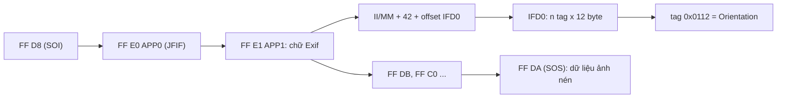

Ô upload ảnh nào cũng gặp ba loại "file lạ":

1. **Đuôi file nói dối.** Ảnh PNG bị đổi tên thành `avatar.jpg`, hoặc tệ hơn, một file chạy được đổi tên thành `cute.png`. `file.type` mà trình duyệt đưa cho bạn chỉ **đoán từ đuôi file**, nó không đọc nội dung.
2. **Ảnh chụp dọc bị nằm ngang.** Điện thoại thường lưu pixel theo chiều cảm biến (nằm ngang) và ghi thêm một con số **EXIF Orientation** để nói "khi hiển thị hãy xoay 90°". Chỗ nào bỏ qua con số đó là ảnh nằm ngang.
3. **Ảnh không đến từ ô chọn file.** Người dùng chụp màn hình rồi bấm Ctrl+V vào ô soạn bài. Mỗi trình duyệt (nhất là các bản cũ) đưa ảnh dán vào theo một kiểu khác nhau.

Ello, mạng xã hội cho giới nghệ thuật, xử lý cả ba trong editor của họ. Bài này đọc code của Ello, chỉ ra vài chỗ đã lỗi thời hoặc có bug, rồi viết lại bằng TypeScript.

> [!TIP]
> **Tóm tắt**
> - Xác định loại file bằng **magic number** (vài byte đầu), so sánh **theo byte**, chỉ đọc `file.slice(0, 12)` thay vì cả file.
> - EXIF Orientation nằm ở segment APP1 đầu file JPEG; đọc được bằng `DataView` trong khoảng 40 dòng, không cần thư viện.
> - Trình duyệt hiện nay **đã tự xoay ảnh theo EXIF**, cả trong `` lẫn khi `drawImage` lên canvas. Code xoay thủ công kiểu cũ giờ làm ảnh bị **xoay hai lần**.
> - Ảnh dán vào: đọc `clipboardData.files` trước, rồi tới data URL trong text, cuối cùng là `` trong `text/html`.

<iframe class="demo-frame" src="/demos/web-patterns/index.html?theme=dark#/file-sniff" title="Demo file-sniff" loading="lazy" style="height: 820px"></iframe>

<p class="demo-links">▶ <a href="/demos/web-patterns/index.html#/file-sniff" target="_blank" rel="noopener">Mở demo toàn màn hình ↗</a> · <a href="https://stackblitz.com/github/hunghg255/blog-hunghg/tree/master/examples/web-patterns?file=src/lib/fileSniff.ts" target="_blank" rel="noopener">Sửa code trên StackBlitz ↗</a> · <a href="https://github.com/hunghg255/blog-hunghg/blob/master/examples/web-patterns/src/lib/fileSniff.ts" target="_blank" rel="noopener">Xem source trên GitHub ↗</a></p>

## Ello làm thế nào?

Code nằm ở [`ello.co/src/helpers/file_helper.js`](https://github.com/hunghg255/codebase/blob/main/ello.co/src/helpers/file_helper.js) và [`src/components/editor/PasteHandler.js`](https://github.com/hunghg255/codebase/blob/main/ello.co/src/components/editor/PasteHandler.js). Saga upload (`src/sagas/uploader.js`) nối chúng lại: kiểm tra loại file, xoay ảnh nếu cần, rồi gửi lên S3.

### 1. Đọc 4 byte đầu để biết loại file

```js
export function isValidFileType(file) {
  return new Promise((resolve, reject) => {
    const fr = new FileReader()
    fr.onloadend = (e) => {
      const arr = (new Uint8Array(e.target.result)).subarray(0, 4)
      let header = ''
      arr.forEach((value) => { header += value.toString(16) })
      if (/ffd8ff/i.test(header)) fileType = SUPPORTED_IMAGE_TYPES.JPG
      else if (/424D/i.test(header)) fileType = SUPPORTED_IMAGE_TYPES.BMP
      else switch (header) {
        case '47494638': fileType = SUPPORTED_IMAGE_TYPES.GIF; break  // "GIF8"
        case '89504e47': fileType = SUPPORTED_IMAGE_TYPES.PNG; break  // "\x89PNG"
      }
      if (fileType !== SUPPORTED_IMAGE_TYPES.GIF) exifData = EXIF.readFromBinaryFile(e.target.result)
      resolve({ isValid, fileType, exifData })
    }
    fr.readAsArrayBuffer(file)
  })
}
```

(đã rút gọn). Ý tưởng đúng: **không tin `file.type`**, mà nhìn vào nội dung. Mỗi định dạng ảnh bắt đầu bằng một chuỗi byte cố định gọi là **chữ ký file (magic number)**:

| Định dạng | Byte đầu (hex) | Đọc ra chữ |
| --- | --- | --- |
| JPEG | `FF D8 FF` | (marker SOI + marker kế tiếp) |
| PNG | `89 50 4E 47 0D 0A 1A 0A` | `\x89PNG\r\n\x1a\n` |
| GIF | `47 49 46 38` | `GIF8` (GIF87a / GIF89a) |
| WebP | `52 49 46 46 ?? ?? ?? ?? 57 45 42 50` | `RIFF····WEBP` |
| BMP | `42 4D` | `BM` |

Nhưng cách ghép chuỗi hex có vài lỗi nhỏ:

- `value.toString(16)` **không thêm số 0 đứng đầu**: byte `0x0A` thành `"a"` chứ không phải `"0a"`. Chuỗi `header` vì thế có độ dài thay đổi, và regex như `/ffd8ff/` có thể khớp nhầm qua ranh giới byte. Ví dụ các byte `0F FD 8F F0` ghép thành `"ffd8ff0"`, bị nhận là JPEG.
- `/424D/` khớp **ở bất kỳ vị trí nào** trong 4 byte, nên file có `42 4D` ở byte thứ 2–3 cũng bị coi là BMP.
- `readAsArrayBuffer(file)` đọc **cả file** vào bộ nhớ chỉ để xem 4 byte (và EXIF). Ảnh 20MB từ máy ảnh là 20MB RAM.

Không lỗi nào gây hoạ lớn với 4 định dạng Ello hỗ trợ, nhưng đó là lý do bản viết lại so sánh **từng byte** và chỉ đọc đoạn đầu.

### 2. Xoay ảnh theo EXIF bằng canvas

Với ảnh không phải GIF, `processImage` tạo một `Image`, gọi `orientImage` để vẽ lên canvas có xoay, rồi xuất ra blob mới:

```js
switch (orientation) {
  case 8: width = img.height; height = img.width; transform = 'left'; break
  case 6: width = img.height; height = img.width; transform = 'right'; break
  case 3: transform = 'flip'; break
}
// …
case 'right':
  ctx.setTransform(0, 1, -1, 0, width, 0)   // xoay 90° theo chiều kim đồng hồ
  ctx.drawImage(img, 0, 0, height, width)
```

Code này viết cho thời trình duyệt **chưa** tự xoay ảnh: khi đó `img.width` là chiều rộng pixel thô, và `drawImage` vẽ đúng pixel thô. Từ khoảng năm 2020 thì khác (xem phần dưới). Mình thử trong Chromium: ảnh JPEG 160×100 có Orientation = 6 sau khi tải vào `new Image()` báo `width = 100, height = 160`, và `drawImage` đã vẽ ảnh ở dạng đứng. `orientImage` lại xoay thêm 90° nữa, nên ảnh bị **xoay hai lần**. Đây là suy luận từ code; mình chưa chạy thử trên chính ello.co.

Cũng nên để ý: vẽ lại lên canvas rồi xuất ra là **mã hoá lại ảnh**. Việc này làm mất chất lượng (JPEG), nhưng có một tác dụng phụ tốt: **xoá toàn bộ metadata EXIF**, kể cả toạ độ GPS nơi chụp.

### 3. Dán ảnh: ba nhánh cho ba kiểu trình duyệt

```js
export function pasted(e, d, id) {
  const items = e.clipboardData.items || {}
  const text = e.clipboardData.getData('text/plain')
  const isImage = some(items, item => /image/.test(item.type))
  if (items && isImage) {
    e.preventDefault()
    handleClipboardItems(items)            // 1. item là file ảnh: getAsFile()
  } else if (text.length) {
    e.preventDefault()
    handlePlainText(text)                  // 2. text, có thể là data URL ";base64,"
  } else {
    e.persist()
    requestAnimationFrame(() => checkForImages(e))  // 3. đợi trình duyệt chèn  rồi đọc src
  }
}
```

Nhánh 3 là phần thú vị: trên Firefox đời cũ, dán ảnh không cho bạn file nào cả, trình duyệt **tự chèn một `` vào vùng `contenteditable`**. Ello đợi một frame, tìm `` đó, chuyển `src` thành blob rồi xoá thẻ đi. Safari cũ còn tệ hơn: `src` là `webkit-fake-url://…` và đọc dữ liệu sẽ bị lỗi bảo mật, nên Ello chỉ hiện câu xin lỗi.

Một bug nhỏ đáng kể: hai nơi gọi `getBlobFromBase64(data, { type: 'image/png' })`, trong khi tham số thứ hai của hàm là **chuỗi** content type. Blob tạo ra vì vậy có `type` là `"[object object]"`. Upload vẫn chạy, vì bước kiểm tra sau đó đọc magic number chứ không đọc `type`. Đây là ví dụ thực tế cho lý do không nên tin `type`.

## Bên trong trình duyệt: `file.type`, EXIF và `image-orientation`

**`file.type` lấy từ đâu?** Với file chọn qua `<input type="file">` hay kéo thả, trình duyệt suy ra MIME type từ **đuôi file** (có khi hỏi hệ điều hành). Nó không đọc nội dung. File không có đuôi quen thuộc thì `type` là chuỗi rỗng. Phía server cũng phải kiểm tra lại, vì request có thể được dựng bằng tay; kiểm tra ở client chỉ để báo lỗi sớm và đẹp hơn.

**EXIF nằm ở đâu?** File JPEG là một chuỗi **segment**: mỗi segment bắt đầu bằng `FF` + 1 byte marker + 2 byte độ dài. EXIF nằm trong segment **APP1** (`FF E1`), bắt đầu bằng chữ `Exif\0\0`, theo sau là một "file TIFF thu nhỏ": 2 byte thứ tự byte (`II` little-endian hoặc `MM` big-endian), số 42, rồi một bảng tag. Tag `0x0112` là Orientation.



**Ai xoay ảnh?** CSS có thuộc tính `image-orientation`, giá trị mặc định là `from-image`: trình duyệt đọc EXIF và hiển thị ảnh đã xoay. Chrome 81, Firefox 77 và Safari 13.1 (khoảng năm 2020) đều chuyển sang mặc định này, áp dụng cho cả ``, ảnh nền CSS và `drawImage` lên canvas ([caniuse](https://caniuse.com/css-image-orientation)). Muốn xem pixel thô thì đặt `image-orientation: none`. Riêng `createImageBitmap` có tuỳ chọn `imageOrientation` riêng.

Hệ quả: trên web hiện nay bạn **không cần, và không nên**, tự xoay ảnh khi hiển thị. Hàng thứ ba trong demo là chuyện xảy ra khi vẫn tự xoay: ảnh lộn ngược.

Vậy còn đọc EXIF để làm gì? Vẫn có lý do:

- Biết **kích thước hiển thị thật** trước khi tải ảnh (Orientation 5–8 đổi chỗ rộng/cao), ví dụ để đặt `aspect-ratio` cho khung preview hoặc kiểm tra "ảnh bìa phải nằm ngang".
- Server hoặc thư viện xử lý ảnh **không** tự xoay. Gửi kèm orientation để server xử lý đúng.
- Cảnh báo người dùng trước khi upload rằng ảnh có GPS.

## Viết lại

Ba file nhỏ: `fileSniff.ts` (magic number), `fileSniffExif.ts` (Orientation), `fileSniffPaste.ts` (clipboard).

### Magic number: so theo byte, chỉ đọc 12 byte

```ts title=src/lib/fileSniff.ts
interface Signature {
  type: SniffedType;
  /** vị trí bắt đầu so khớp */
  offset: number;
  /** null = byte nào cũng được */
  bytes: Array<number | null>;
}

const ascii = (s: string) => Array.from(s, (c) => c.charCodeAt(0));

const SIGNATURES: Signature[] = [
  { type: 'image/jpeg', offset: 0, bytes: [0xff, 0xd8, 0xff] },
  { type: 'image/png', offset: 0, bytes: [0x89, 0x50, 0x4e, 0x47, 0x0d, 0x0a, 0x1a, 0x0a] },
  { type: 'image/gif', offset: 0, bytes: ascii('GIF8') }, // GIF87a / GIF89a
  // RIFF....WEBP: 4 byte ở giữa là kích thước file, bỏ qua
  { type: 'image/webp', offset: 0, bytes: [...ascii('RIFF'), null, null, null, null, ...ascii('WEBP')] },
  { type: 'image/bmp', offset: 0, bytes: ascii('BM') },
];

/** Số byte đầu cần đọc để nhận đủ mọi chữ ký ở trên. */
export const SNIFF_LENGTH = 12;

export function sniffImageType(head: Uint8Array): SniffedType | null {
  for (const sig of SIGNATURES) {
    if (head.length < sig.offset + sig.bytes.length) continue;
    const match = sig.bytes.every((b, i) => b === null || head[sig.offset + i] === b);
    if (match) return sig.type;
  }
  return null;
}

/** Đọc vài byte đầu của một File/Blob mà không đọc cả file vào bộ nhớ. */
export async function readHead(blob: Blob, length = SNIFF_LENGTH): Promise<Uint8Array> {
  return new Uint8Array(await blob.slice(0, length).arrayBuffer());
}
```

### Đi qua code

- Mỗi chữ ký là một mảng byte, `null` nghĩa là "byte nào cũng được" (4 byte kích thước trong header WebP). So sánh bằng `every`, không có chuyện lệch ranh giới như khi ghép chuỗi hex.
- `blob.slice(0, 12)` tạo một Blob con **không sao chép dữ liệu**; `arrayBuffer()` chỉ đọc 12 byte đó từ đĩa. File 20MB cũng chỉ tốn 12 byte bộ nhớ.
- `sniffFile` trả về cả loại thật lẫn loại khai báo, và cờ `mismatch`, để UI có thể từ chối hoặc chỉ cảnh báo.

```ts title=src/lib/fileSniff.ts
export async function sniffFile(file: File | Blob): Promise<SniffResult> {
  const type = sniffImageType(await readHead(file));
  const declaredType = file.type;
  // image/jpg không phải MIME chuẩn nhưng vẫn gặp ngoài đời: coi như image/jpeg
  const normalized = declaredType === 'image/jpg' ? 'image/jpeg' : declaredType;
  // lệch khi: nội dung là ảnh nhưng khai báo loại khác, hoặc khai báo là ảnh mà nội dung không phải
  const mismatch =
    normalized !== '' && normalized !== type && (type !== null || normalized.startsWith('image/'));
  return { type, declaredType, mismatch };
}
```

`image/jpg` không phải MIME type chuẩn (chuẩn là `image/jpeg`) nhưng vẫn gặp, kể cả trong code của Ello, nên được chuẩn hoá trước khi so.

### Đọc EXIF Orientation bằng DataView

```ts title=src/lib/fileSniffExif.ts
export function readJpegOrientation(buffer: ArrayBuffer): Orientation | null {
  const view = new DataView(buffer);
  if (view.byteLength < 4 || view.getUint16(0) !== 0xffd8) return null; // không phải JPEG

  let offset = 2;
  while (offset + 4 <= view.byteLength) {
    if (view.getUint8(offset) !== 0xff) return null; // lệch khỏi ranh giới segment: file hỏng
    const marker = view.getUint8(offset + 1);
    // SOS (0xDA): bắt đầu dữ liệu ảnh nén, EXIF luôn nằm trước đó
    if (marker === 0xda) return null;
    const length = view.getUint16(offset + 2); // tính cả 2 byte độ dài, không tính 0xFF + marker
    if (marker === 0xe1) {
      const orientation = readExifSegment(view, offset + 4, length - 2);
      if (orientation !== undefined) return orientation;
    }
    offset += 2 + length;
  }
  return null;
}

function readExifSegment(view: DataView, start: number, length: number): Orientation | null | undefined {
  if (start + length > view.byteLength || length < 14) return undefined;
  // "Exif\0\0"; APP1 cũng có thể là XMP, khi đó bỏ qua và tìm segment tiếp theo
  if (view.getUint32(start) !== 0x45786966 || view.getUint16(start + 4) !== 0) return undefined;

  const tiff = start + 6;
  const byteOrder = view.getUint16(tiff);
  if (byteOrder !== 0x4949 && byteOrder !== 0x4d4d) return null;
  const little = byteOrder === 0x4949; // "II" = Intel = little-endian
  if (view.getUint16(tiff + 2, little) !== 42) return null;

  const ifd0 = tiff + view.getUint32(tiff + 4, little);
  if (ifd0 + 2 > start + length) return null;
  const count = view.getUint16(ifd0, little);
  for (let i = 0; i < count; i++) {
    const entry = ifd0 + 2 + i * 12;
    if (entry + 12 > start + length) return null;
    if (view.getUint16(entry, little) === 0x0112) {
      // kiểu SHORT (3), giá trị nằm luôn trong 2 byte đầu của ô value
      const value = view.getUint16(entry + 8, little);
      return value >= 1 && value <= 8 ? (value as Orientation) : null;
    }
  }
  return null;
}
```

- Vòng lặp nhảy qua từng segment bằng độ dài của nó. Gặp `FF DA` (SOS, bắt đầu dữ liệu nén) là dừng, vì metadata luôn nằm trước.
- APP1 có thể chứa **XMP** thay vì EXIF, nên phải kiểm tra chữ `Exif\0\0` rồi mới đọc; nếu không phải thì tìm tiếp.
- `DataView.getUint16(offset, littleEndian)` lo phần thứ tự byte. Ảnh từ iPhone thường là `MM`, nhiều máy Android và máy ảnh là `II`.
- Mọi offset đều được kiểm tra không vượt quá segment: file hỏng hay cố ý tạo sai sẽ trả `null`, không ném lỗi.

**Khác bản gốc:** Ello dùng `exif-js` để đọc toàn bộ EXIF (có cả GPS, model máy…), rồi tự xoay bằng canvas. Bản viết lại chỉ đọc Orientation và **không xoay**, để trình duyệt làm việc đó. `orientationTransform` vẫn được export, chỉ để demo cho thấy hậu quả của việc xoay hai lần.

### Dán ảnh

```ts title=src/lib/fileSniffPaste.ts
export function readPaste(data: DataTransfer): PasteResult {
  // 1. File thật. `data.files` có ở mọi trình duyệt hiện đại; items là đường dự phòng.
  const files = Array.from(data.files).filter((f) => f.type.startsWith('image/'));
  if (files.length === 0) {
    for (const item of Array.from(data.items ?? [])) {
      if (item.kind === 'file' && item.type.startsWith('image/')) {
        const file = item.getAsFile();
        if (file) files.push(file);
      }
    }
  }
  if (files.length > 0) return { kind: 'files', files };

  // 2. Text là data URL
  const text = data.getData('text/plain');
  if (/^data:image\/[\w.+-]+;base64,/.test(text.trim())) {
    const blob = dataUrlToBlob(text);
    if (blob) return { kind: 'files', files: [new File([blob], 'pasted', { type: blob.type })] };
  }

  // 3. HTML có : copy ảnh từ trang web (chuột phải → Copy image ở một số trình duyệt)
  const html = data.getData('text/html');
  if (html) {
    const img = new DOMParser().parseFromString(html, 'text/html').querySelector('img');
    const src = img?.getAttribute('src') ?? '';
    if (src.startsWith('data:image/')) {
      const blob = dataUrlToBlob(src);
      if (blob) return { kind: 'files', files: [new File([blob], 'pasted', { type: blob.type })] };
    }
    if (src.startsWith('webkit-fake-url:')) {
      // Safari cũ: không đọc được dữ liệu ảnh (Ello hiện thông báo xin lỗi)
      return { kind: 'unsupported', reason: 'Trình duyệt không cho đọc ảnh vừa dán' };
    }
    if (/^https?:/.test(src) && !text) return { kind: 'image-url', url: src };
  }

  if (text) return { kind: 'text', text };
  return { kind: 'unsupported', reason: 'Clipboard không có ảnh hay chữ' };
}
```

**Khác bản gốc:** thay vì đợi trình duyệt chèn `` vào DOM rồi đọc lại (nhánh 3 của Ello), bản viết lại đọc `text/html` từ clipboard và parse bằng `DOMParser`. Như vậy không phải `preventDefault` muộn, không phải dọn `` thừa. Nhánh `webkit-fake-url` được giữ lại để báo lỗi rõ ràng, dù gần như chỉ còn gặp trên Safari rất cũ.

::: spoiler Xem toàn bộ src/lib/fileSniff.ts

```ts title=src/lib/fileSniff.ts
/**
 * Nhận loại file thật bằng "magic number" (vài byte đầu file), không tin đuôi file hay `file.type`.
 * Ý tưởng từ `isValidFileType` của Ello (src/helpers/file_helper.js), viết lại so sánh theo byte.
 */

export type SniffedType = 'image/jpeg' | 'image/png' | 'image/gif' | 'image/webp' | 'image/bmp';

interface Signature {
  type: SniffedType;
  /** vị trí bắt đầu so khớp */
  offset: number;
  /** null = byte nào cũng được */
  bytes: Array<number | null>;
}

const ascii = (s: string) => Array.from(s, (c) => c.charCodeAt(0));

const SIGNATURES: Signature[] = [
  { type: 'image/jpeg', offset: 0, bytes: [0xff, 0xd8, 0xff] },
  { type: 'image/png', offset: 0, bytes: [0x89, 0x50, 0x4e, 0x47, 0x0d, 0x0a, 0x1a, 0x0a] },
  { type: 'image/gif', offset: 0, bytes: ascii('GIF8') }, // GIF87a / GIF89a
  // RIFF....WEBP: 4 byte ở giữa là kích thước file, bỏ qua
  { type: 'image/webp', offset: 0, bytes: [...ascii('RIFF'), null, null, null, null, ...ascii('WEBP')] },
  { type: 'image/bmp', offset: 0, bytes: ascii('BM') },
];

/** Số byte đầu cần đọc để nhận đủ mọi chữ ký ở trên. */
export const SNIFF_LENGTH = 12;

export function sniffImageType(head: Uint8Array): SniffedType | null {
  for (const sig of SIGNATURES) {
    if (head.length < sig.offset + sig.bytes.length) continue;
    const match = sig.bytes.every((b, i) => b === null || head[sig.offset + i] === b);
    if (match) return sig.type;
  }
  return null;
}

/** Đọc vài byte đầu của một File/Blob mà không đọc cả file vào bộ nhớ. */
export async function readHead(blob: Blob, length = SNIFF_LENGTH): Promise<Uint8Array> {
  return new Uint8Array(await blob.slice(0, length).arrayBuffer());
}

export interface SniffResult {
  /** loại thật theo nội dung, null nếu không phải ảnh được hỗ trợ */
  type: SniffedType | null;
  /** loại trình duyệt đoán (từ đuôi file / hệ điều hành) */
  declaredType: string;
  /** đuôi file và nội dung không khớp: ảnh PNG đặt tên .jpg, file .exe đổi tên thành .png… */
  mismatch: boolean;
}

export async function sniffFile(file: File | Blob): Promise<SniffResult> {
  const type = sniffImageType(await readHead(file));
  const declaredType = file.type;
  // image/jpg không phải MIME chuẩn nhưng vẫn gặp ngoài đời: coi như image/jpeg
  const normalized = declaredType === 'image/jpg' ? 'image/jpeg' : declaredType;
  // lệch khi: nội dung là ảnh nhưng khai báo loại khác, hoặc khai báo là ảnh mà nội dung không phải
  const mismatch =
    normalized !== '' && normalized !== type && (type !== null || normalized.startsWith('image/'));
  return { type, declaredType, mismatch };
}
```

:::

::: spoiler Xem toàn bộ src/lib/fileSniffExif.ts

```ts title=src/lib/fileSniffExif.ts
/**
 * Đọc EXIF Orientation (tag 0x0112) từ JPEG mà không cần thư viện.
 * Ello dùng `exif-js` để đọc toàn bộ EXIF; ở đây chỉ cần đúng một tag nên tự parse cho gọn.
 *
 * Cấu trúc: JPEG = chuỗi segment [0xFF, marker, độ dài 2 byte big-endian, dữ liệu].
 * EXIF nằm trong segment APP1 (0xFFE1), bắt đầu bằng "Exif\0\0", theo sau là một file TIFF thu nhỏ:
 * "II" (little-endian) hoặc "MM" (big-endian), số 42, offset tới IFD0, rồi danh sách tag 12 byte/tag.
 */

/** 1 = bình thường; 3 = xoay 180°; 6 = cần xoay 90° theo chiều kim đồng hồ; 8 = xoay 90° ngược chiều.
 *  2, 4, 5, 7 là các biến thể lật gương. */
export type Orientation = 1 | 2 | 3 | 4 | 5 | 6 | 7 | 8;

export function readJpegOrientation(buffer: ArrayBuffer): Orientation | null {
  const view = new DataView(buffer);
  if (view.byteLength < 4 || view.getUint16(0) !== 0xffd8) return null; // không phải JPEG

  let offset = 2;
  while (offset + 4 <= view.byteLength) {
    if (view.getUint8(offset) !== 0xff) return null; // lệch khỏi ranh giới segment: file hỏng
    const marker = view.getUint8(offset + 1);
    // SOS (0xDA): bắt đầu dữ liệu ảnh nén, EXIF luôn nằm trước đó
    if (marker === 0xda) return null;
    const length = view.getUint16(offset + 2); // tính cả 2 byte độ dài, không tính 0xFF + marker
    if (marker === 0xe1) {
      const orientation = readExifSegment(view, offset + 4, length - 2);
      if (orientation !== undefined) return orientation;
    }
    offset += 2 + length;
  }
  return null;
}

function readExifSegment(view: DataView, start: number, length: number): Orientation | null | undefined {
  if (start + length > view.byteLength || length < 14) return undefined;
  // "Exif\0\0"; APP1 cũng có thể là XMP, khi đó bỏ qua và tìm segment tiếp theo
  if (view.getUint32(start) !== 0x45786966 || view.getUint16(start + 4) !== 0) return undefined;

  const tiff = start + 6;
  const byteOrder = view.getUint16(tiff);
  if (byteOrder !== 0x4949 && byteOrder !== 0x4d4d) return null;
  const little = byteOrder === 0x4949; // "II" = Intel = little-endian
  if (view.getUint16(tiff + 2, little) !== 42) return null;

  const ifd0 = tiff + view.getUint32(tiff + 4, little);
  if (ifd0 + 2 > start + length) return null;
  const count = view.getUint16(ifd0, little);
  for (let i = 0; i < count; i++) {
    const entry = ifd0 + 2 + i * 12;
    if (entry + 12 > start + length) return null;
    if (view.getUint16(entry, little) === 0x0112) {
      // kiểu SHORT (3), giá trị nằm luôn trong 2 byte đầu của ô value
      const value = view.getUint16(entry + 8, little);
      return value >= 1 && value <= 8 ? (value as Orientation) : null;
    }
  }
  return null;
}

/** Orientation đổi chỗ chiều rộng và chiều cao (xoay 90°)? */
export const swapsDimensions = (o: Orientation | null) => o !== null && o >= 5;

/** CSS transform tương ứng, để xoay thủ công khi trình duyệt KHÔNG tự xoay (trình duyệt cũ). */
export function orientationTransform(o: Orientation | null): string {
  switch (o) {
    case 2: return 'scaleX(-1)';
    case 3: return 'rotate(180deg)';
    case 4: return 'scaleY(-1)';
    case 5: return 'rotate(-90deg) scaleX(-1)'; // chuyển vị (transpose)
    case 6: return 'rotate(90deg)';
    case 7: return 'rotate(90deg) scaleX(-1)';
    case 8: return 'rotate(-90deg)';
    default: return 'none';
  }
}

/** EXIF nằm ở đầu file (APP1 tối đa 64KB), nên chỉ cần đọc 128KB đầu thay vì cả ảnh 10MB. */
export async function readOrientation(file: Blob): Promise<Orientation | null> {
  return readJpegOrientation(await file.slice(0, 128 * 1024).arrayBuffer());
}
```

:::

::: spoiler Xem toàn bộ src/lib/fileSniffPaste.ts

```ts title=src/lib/fileSniffPaste.ts
/**
 * Lấy ảnh từ sự kiện paste trên mọi trình duyệt.
 * Ý tưởng từ PasteHandler của Ello (src/components/editor/PasteHandler.js), có 3 nhánh:
 *  1. clipboardData có item kiểu image/* → lấy File bằng getAsFile() (Chrome, Edge, Firefox, Safari mới)
 *  2. text là data URL "…;base64,…" → tự chuyển thành Blob
 *  3. không có gì → để trình duyệt chèn  vào vùng soạn thảo rồi đọc lại src
 *     (Firefox đời cũ dán ảnh dưới dạng ; Safari cũ dùng "webkit-fake-url://")
 * Bản viết lại xử lý nhánh 3 bằng cách đọc text/html của clipboard thay vì đợi DOM thay đổi.
 */

export type PasteResult =
  | { kind: 'files'; files: File[] }
  | { kind: 'image-url'; url: string } // ảnh copy từ trang web khác: chỉ có URL
  | { kind: 'text'; text: string }
  | { kind: 'unsupported'; reason: string };

export function dataUrlToBlob(dataUrl: string): Blob | null {
  const match = /^data:([^;,]+)?(;base64)?,(.*)$/s.exec(dataUrl.trim());
  if (!match) return null;
  const [, mime = 'application/octet-stream', isBase64, data] = match;
  if (!isBase64) return new Blob([decodeURIComponent(data)], { type: mime });
  const binary = atob(data);
  const bytes = new Uint8Array(binary.length);
  for (let i = 0; i < binary.length; i++) bytes[i] = binary.charCodeAt(i);
  return new Blob([bytes], { type: mime });
}

export function readPaste(data: DataTransfer): PasteResult {
  // 1. File thật. `data.files` có ở mọi trình duyệt hiện đại; items là đường dự phòng.
  const files = Array.from(data.files).filter((f) => f.type.startsWith('image/'));
  if (files.length === 0) {
    for (const item of Array.from(data.items ?? [])) {
      if (item.kind === 'file' && item.type.startsWith('image/')) {
        const file = item.getAsFile();
        if (file) files.push(file);
      }
    }
  }
  if (files.length > 0) return { kind: 'files', files };

  // 2. Text là data URL
  const text = data.getData('text/plain');
  if (/^data:image\/[\w.+-]+;base64,/.test(text.trim())) {
    const blob = dataUrlToBlob(text);
    if (blob) return { kind: 'files', files: [new File([blob], 'pasted', { type: blob.type })] };
  }

  // 3. HTML có : copy ảnh từ trang web (chuột phải → Copy image ở một số trình duyệt)
  const html = data.getData('text/html');
  if (html) {
    const img = new DOMParser().parseFromString(html, 'text/html').querySelector('img');
    const src = img?.getAttribute('src') ?? '';
    if (src.startsWith('data:image/')) {
      const blob = dataUrlToBlob(src);
      if (blob) return { kind: 'files', files: [new File([blob], 'pasted', { type: blob.type })] };
    }
    if (src.startsWith('webkit-fake-url:')) {
      // Safari cũ: không đọc được dữ liệu ảnh (Ello hiện thông báo xin lỗi)
      return { kind: 'unsupported', reason: 'Trình duyệt không cho đọc ảnh vừa dán' };
    }
    if (/^https?:/.test(src) && !text) return { kind: 'image-url', url: src };
  }

  if (text) return { kind: 'text', text };
  return { kind: 'unsupported', reason: 'Clipboard không có ảnh hay chữ' };
}
```

:::

## Tại sao không làm cách khác?

**Chỉ dùng `accept="image/*"` trên input?** `accept` chỉ lọc danh sách trong hộp thoại chọn file, người dùng vẫn chọn "Tất cả file" được, và nó không áp dụng cho kéo thả hay dán.

**Tải ảnh vào `` xem có lỗi không?** Cách này cũng xác định được "có phải ảnh không", nhưng phải **giải mã cả ảnh**: chậm với ảnh lớn, và trình duyệt hỗ trợ nhiều định dạng hơn bạn muốn nhận (AVIF, SVG…). Magic number nhanh hơn và cho bạn danh sách cho phép rõ ràng.

**Dùng thư viện như `file-type`?** Rất tốt nếu cần nhận hàng trăm định dạng. Với 4–5 loại ảnh, một bảng 5 dòng là đủ và không tăng bundle.

**Vẫn tự xoay canvas như Ello để "chắc ăn"?** Trên trình duyệt hiện nay, đó chính là nguồn gốc của lỗi. Nếu thật sự cần pixel đã xoay (ví dụ để cắt ảnh), vẽ `` lên canvas là trình duyệt đã xoay sẵn cho bạn.

## Edge case và cạm bẫy

- **SVG không có magic number cố định.** Nó là văn bản XML; có thể có BOM, khoảng trắng, comment phía trước. SVG còn chứa được `<script>`, nên đừng nhận SVG từ người dùng nếu không làm sạch.
- **HEIC** (ảnh mặc định của iPhone) có chữ ký `ftypheic`/`ftypmif1` ở byte 4–11. Phần lớn trình duyệt (trừ Safari) không hiển thị được HEIC (tính tới 10/2026), nên nếu nhận thì phải chuyển đổi phía server.
- **Clipboard trên Safari** chỉ cho đọc dữ liệu trong sự kiện `paste` do người dùng thực hiện. `navigator.clipboard.read()` cần quyền và thao tác của người dùng.
- **Dán nhiều file:** từ trình quản lý file trên macOS/Windows có thể dán được nhiều file cùng lúc. `readPaste` trả về mảng; UI quyết định nhận một hay nhiều.
- **Ảnh copy từ web khác** thường chỉ có URL (trong `text/html`), không có dữ liệu. Tải ảnh đó về sẽ vướng CORS; Ello chọn cách chèn markdown ``.
- **Kiểm tra lại ở server.** Mọi thứ ở client đều có thể bị bỏ qua.

## Dùng trong dự án

```ts
import { sniffFile } from './lib/fileSniff';
import { readOrientation, swapsDimensions } from './lib/fileSniffExif';
import { readPaste } from './lib/fileSniffPaste';

async function acceptImage(file: File) {
  const { type, mismatch } = await sniffFile(file);
  if (!type) throw new Error('Chỉ nhận ảnh JPEG, PNG, GIF, WebP');
  if (mismatch) console.warn(`${file.name} thật ra là ${type}`);
  const orientation = type === 'image/jpeg' ? await readOrientation(file) : null;
  // gửi kèm loại thật để server không phải đoán, upload với đúng Content-Type
  return upload(new File([file], file.name, { type }), { portrait: swapsDimensions(orientation) });
}

editor.addEventListener('paste', (event) => {
  const result = readPaste(event.clipboardData!);
  if (result.kind === 'files') {
    event.preventDefault();
    result.files.forEach(acceptImage);
  }
});
```

## Kiểm thử

::: spoiler Ví dụ test (bản phác, không có trong repo)

```ts
import { describe, expect, it } from 'vitest';
import { sniffImageType } from './fileSniff';
import { readJpegOrientation } from './fileSniffExif';
import { dataUrlToBlob } from './fileSniffPaste';

const bytes = (...b: number[]) => new Uint8Array(b);

describe('sniffImageType', () => {
  it('nhận đúng chữ ký', () => {
    expect(sniffImageType(bytes(0xff, 0xd8, 0xff, 0xe0))).toBe('image/jpeg');
    expect(sniffImageType(bytes(0x89, 0x50, 0x4e, 0x47, 0x0d, 0x0a, 0x1a, 0x0a))).toBe('image/png');
    expect(sniffImageType(new TextEncoder().encode('RIFF\0\0\0\0WEBP'))).toBe('image/webp');
  });
  it('không khớp nhầm qua ranh giới byte như bản ghép chuỗi hex', () => {
    expect(sniffImageType(bytes(0x0f, 0xfd, 0x8f, 0xf0))).toBeNull();
  });
});

describe('readJpegOrientation', () => {
  it('đọc tag 0x0112 big-endian', () => {
    const jpeg = bytes(
      0xff, 0xd8,
      0xff, 0xe1, 0x00, 0x22, 0x45, 0x78, 0x69, 0x66, 0, 0,
      0x4d, 0x4d, 0, 0x2a, 0, 0, 0, 8,
      0, 1, 0x01, 0x12, 0, 3, 0, 0, 0, 1, 0, 6, 0, 0, 0, 0, 0, 0,
      0xff, 0xda,
    );
    expect(readJpegOrientation(jpeg.buffer)).toBe(6);
  });
  it('trả null với file không phải JPEG', () => {
    expect(readJpegOrientation(bytes(0x89, 0x50, 0x4e, 0x47).buffer)).toBeNull();
  });
});

it('dataUrlToBlob giữ đúng MIME', async () => {
  const blob = dataUrlToBlob('data:image/png;base64,iVBORw0KGgo=')!;
  expect(blob.type).toBe('image/png');
  expect(new Uint8Array(await blob.arrayBuffer())[0]).toBe(0x89);
});
```

:::

## So với thư viện và chuẩn web

- [`file-type`](https://github.com/sindresorhus/file-type) nhận diện rất nhiều định dạng bằng magic number, chạy được cả trên trình duyệt.
- [`exifr`](https://github.com/MikeKovarik/exifr) đọc EXIF nhanh và chỉ đọc phần đầu file; `exif-js` mà Ello dùng đã lâu không được cập nhật.
- `image-orientation: from-image` là mặc định trên các trình duyệt lớn (tính tới 10/2026), nên phần "tự xoay" của Ello có thể bỏ hẳn.
- Async Clipboard API (`navigator.clipboard.read()`) cho đọc ảnh từ clipboard ngoài sự kiện `paste`, nhưng cần quyền và cử chỉ của người dùng; sự kiện `paste` vẫn là cách đơn giản nhất cho ô soạn thảo.

---

Bài này thuộc series **[Học từ mã nguồn các web lớn](/series/web)** (65 bài, đọc theo thứ tự).

::: spoiler Xem nhanh danh sách bài trong series

*Mở đầu*

- [Mở đầu: đọc code production của 28 trang web](/blogs/learn-from-big-web-apps)

*Phần 1: trải nghiệm người dùng*

- [#1 Dark mode không nháy (Gatsby)](/blogs/web-dark-mode-no-flash)
- [#2 useValueByMedia: giá trị theo breakpoint (Toptal)](/blogs/web-use-value-by-media)
- [#3 Đoán ý định: idle, exit-intent, lắc chuột (Toptal, InVision)](/blogs/web-user-intent-idle-exit-wiggle)
- [#4 Validate form thân thiện (Udacity, Pipedrive)](/blogs/web-form-validation-ux)
- **#5 Magic number, EXIF và dán ảnh (Ello)** (bài này)
- [#6 fastSmoothScroll: cuộn xa vẫn nhanh (Telegram)](/blogs/web-telegram-fast-smooth-scroll)
- [#7 Countdown time-travel và tombstone giỏ hàng (Best Buy)](/blogs/web-countdown-time-travel-tombstone)

*Phần 2: hiệu năng và đo lường*

- [#8 Hàng đợi requestAnimationFrame 3ms (Apple)](/blogs/web-raf-queue-3ms)
- [#9 srcset cho artwork và preconnect tự động (Apple)](/blogs/web-responsive-artwork-preconnect)
- [#10 Quick-fetch: gọi API trước khi bundle tải xong (HubSpot)](/blogs/web-quick-fetch-early-requests)
- [#11 Performance span và long task (Postman, Calibre)](/blogs/web-performance-spans-long-tasks)
- [#12 Gọi Web Worker như hàm async (Telegram)](/blogs/web-worker-promise-rpc)
- [#13 Đồng hồ media: đếm giờ xem và sửa lệch (Skillshare, Simplified)](/blogs/web-media-clock-watch-time-drift)

*Phần 3: nhiều tab, phiên đăng nhập, cập nhật*

- [#14 Bầu tab chủ cho thông báo (HubSpot, Telegram)](/blogs/web-leader-tab-notifications)
- [#15 Đồng bộ đăng nhập giữa tab và giới hạn cookie (Elastic, InVision)](/blogs/web-cross-tab-auth-cookie-guard)
- [#16 SPA tự cập nhật: Trello, Zappos, Facebook, Elastic](/blogs/web-spa-self-update-strategies)

*Phần 4: kiến trúc*

- [#17 Reverse portal: di chuyển component không remount (Zappos)](/blogs/web-reverse-portal)
- [#18 Page behaviors: gắn hành vi từ CMS (Intercom)](/blogs/web-page-behaviors-cms)
- [#19 Giới hạn tần suất hiển thị bằng bitmask (Outlook)](/blogs/web-frequency-cap-bitmask)
- [#20 Chuyển REST sang GraphQL dần dần (Coursera)](/blogs/web-rest-to-graphql-hybrid-link)

*Phần 5: soạn thảo và hiển thị nội dung*

- [#21 Autocomplete tại con trỏ trong contenteditable (Ello, Telegram)](/blogs/web-caret-autocomplete-contenteditable)
- [#22 Dark mode cho email HTML bằng CIELAB (Outlook)](/blogs/web-email-dark-mode-cielab)
- [#23 Thu nhỏ bảng rộng cho vừa khung, vá font emoji (Outlook)](/blogs/web-email-wide-content-scale)
- [#24 Cảnh báo quên đính kèm file (Outlook)](/blogs/web-forgotten-attachment-warning)
- [#25 Cắt chữ nhiều dòng chính xác (Pipedrive, Apple, Toptal)](/blogs/web-multiline-truncate-measure-text)
- [#26 Parse ngày giờ gõ tay khoan dung (Outlook, Elastic)](/blogs/web-lenient-date-parser)

*Phần 6: tương tác*

- [#27 menuAim: rê chéo vào submenu không bị đóng (Udemy)](/blogs/web-menu-aim-triangle)
- [#28 Kéo, vuốt chung cho chuột và cảm ứng (Telegram)](/blogs/web-unified-pointer-gestures)
- [#29 Phím tắt theo phạm vi, IME và bàn phím phi Latinh (Trello)](/blogs/web-scoped-keyboard-shortcuts)
- [#30 Nội suy màu: đổi theme và nền theo cuộn (Telegram, Anchor)](/blogs/web-color-interpolation-theme-scroll)
- [#31 Đường gióng hút cạnh và undo/redo trên canvas (Simplified)](/blogs/web-canvas-snap-guides-undo)
- [#32 Giả lập mù màu bằng feColorMatrix (Trello)](/blogs/web-color-vision-simulator)
- [#33 Vạch thước theo mức zoom và cấp phát màu cho biểu đồ (Anchor, Similarweb)](/blogs/web-timeline-ticks-color-stack)

*Phần 7: mạng, dữ liệu và async*

- [#34 Ô tìm kiếm chuẩn production (Similarweb, Udemy, Pipedrive)](/blogs/web-production-search-box)
- [#35 Điều phối async: latest-wins, single-flight (Glitch, Toptal)](/blogs/web-async-coordination-latest-wins)
- [#36 Polling thưa dần và debounce động (Trello)](/blogs/web-decaying-polling-dynamic-debounce)
- [#37 Cache phía client theo version (Similarweb, Telegram, Udemy)](/blogs/web-client-cache-versioned)
- [#38 Upload file lớn theo chunk (Outlook, Tribe)](/blogs/web-chunked-upload-pipeline)
- [#39 Phát video qua Service Worker bằng Range request (Telegram, Outlook)](/blogs/web-service-worker-range-streaming)

*Phần 8: hiệu năng và vận hành*

- [#40 TTI governor: hoãn việc phụ tới sau khi trang dùng được (Outlook)](/blogs/web-tti-governor)
- [#41 Tự đo LCP/CLS/TBT và phục vụ bản nhẹ cho máy yếu (Udemy)](/blogs/web-rum-adaptive-loading)

*Phần 9: thuật toán và dữ liệu phía client*

- [#42 Three-way merge ngay trên trình duyệt (Postman)](/blogs/web-three-way-merge-client)
- [#43 Dọn cache GraphQL bằng đếm tham chiếu (Outlook)](/blogs/web-graphql-cache-refcount-gc)
- [#44 LRU cache theo 3 cách (Apple, Similarweb, Outlook)](/blogs/web-lru-cache-three-ways)
- [#45 Lọc tăng dần trong Web Worker (Similarweb)](/blogs/web-incremental-filter-worker)
- [#46 Xếp hạng gợi ý trên client, so ngầm với server (Outlook)](/blogs/web-client-side-ranking-shadow-test)
- [#47 Nối OT với editor: undo stack và chặn echo (Glitch)](/blogs/web-ot-codemirror-undo)
- [#48 Ngôn ngữ markup riêng dịch hai chiều với HTML (Coursera)](/blogs/web-custom-markup-compiler)

*Phần 10: thời gian, ngôn ngữ, định dạng*

- [#49 Xử lý giờ mùa hè không cần thư viện (Udemy, Pipedrive)](/blogs/web-dst-without-library)
- [#50 Intl thực chiến: Segmenter, số rút gọn, số nhiều, fallback locale (Apple, Outlook)](/blogs/web-intl-in-production)
- [#51 WebVTT và bôi chọn transcript (Udemy, Coursera)](/blogs/web-webvtt-transcript-selection)

*Phần 11: tương tác và giao diện*

- [#52 Kéo-thả trên lịch (Pipedrive)](/blogs/web-calendar-drag-drop)
- [#53 Focus stack cho popup lồng nhau (Outlook)](/blogs/web-focus-stack-nested-popups)
- [#54 Clipboard: copy, dán chữ thuần, dán thông minh (Trello, Anchor, Pipedrive, Tribe)](/blogs/web-clipboard-tricks)
- [#55 Khôi phục vị trí cuộn khi trang còn đang tải (Apple, Zappos)](/blogs/web-scroll-restore-wait-height)
- [#56 Lấy màu từ ảnh: gradient nền, màu chữ (Apple, Telegram, Trello)](/blogs/web-colors-from-images)
- [#57 JS đọc breakpoint từ CSS, phát hiện chế độ PWA (Ello, Apple)](/blogs/web-css-js-breakpoint-bridge)

*Phần 12: media*

- [#58 Tin nhắn thoại: ghi âm, waveform realtime, nén 5-bit (Telegram)](/blogs/web-voice-message-waveform)
- [#59 Chụp frame video thành ảnh, canvas bị taint (Coursera, Outlook)](/blogs/web-video-frame-snapshot)

*Phần 13: đo lường, bảo mật, vận hành*

- [#60 Đo lúc ảnh màn hình đầu tải xong, cả khi chuyển trang SPA (Zappos, Best Buy, Outlook)](/blogs/web-above-the-fold-image-timing)
- [#61 Buffer analytics chờ SDK, phát hiện adblock (Best Buy)](/blogs/web-analytics-buffer-adblock)
- [#62 Proof-of-work trên client để chặn API ẩn danh (Udemy)](/blogs/web-client-proof-of-work)
- [#63 Prefetch không làm lệch số liệu, nén cài đặt bằng bit (Outlook)](/blogs/web-synthetic-prefetch-bit-flags)
- [#64 Micro-frontend: AngularJS và React chung app, giao tiếp xuyên frame (Similarweb, InVision, HubSpot)](/blogs/web-micro-frontend-bridges)

:::

Code + demo: [`examples/web-patterns`](https://github.com/hunghg255/blog-hunghg/tree/master/examples/web-patterns) · [Mở trên StackBlitz](https://stackblitz.com/github/hunghg255/blog-hunghg/tree/master/examples/web-patterns)
