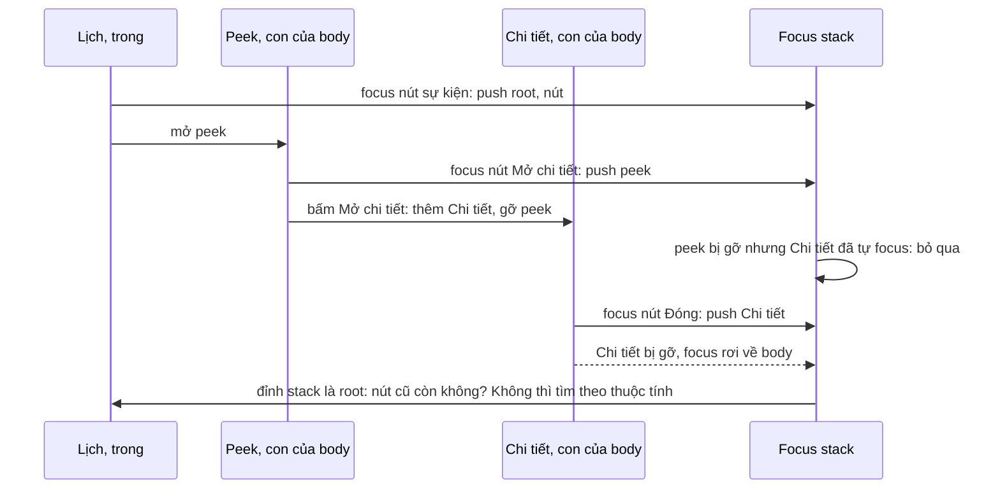

Quy tắc quen thuộc của dialog: đóng dialog thì trả focus về nút đã mở nó. Mọi thư viện focus trap đều làm việc này, thường bằng cách nhớ `document.activeElement` lúc mở (series Facebook có một bài riêng: [focus trap và Esc theo layer](/blogs/facebook-focus-trap)).

Quy tắc đó vỡ khi popup **mở nối nhau**. Lịch của Outlook web là ví dụ điển hình:

1. Bấm một cuộc hẹn trong lịch → mở **peek** (xem nhanh). Focus vào nút trong peek.
2. Trong peek bấm "Mở chi tiết" → mở **reading pane** và **đóng peek**. Reading pane nhớ "phần tử mở tôi" là nút "Mở chi tiết", nằm trong peek.
3. Đóng reading pane. Nút "Mở chi tiết" không còn tồn tại, nên trả focus về đâu?

Không ai xử lý thì focus rơi về `<body>`. Người dùng bàn phím mất chỗ đang đứng, bấm Tab là quay về đầu trang, và trình đọc màn hình đọc lại từ đầu. Tệ hơn, nếu còn một popup khác đang mở, phím Esc không tới được nó vì focus không nằm trong nó.

> [!TIP]
> **Tóm tắt**
> - Outlook coi mỗi con trực tiếp của `document.body` là một "popup root", giữ **stack các cặp (popup root → phần tử được focus cuối cùng trong nó)**: cập nhật qua `focus` (capture), phát hiện popup đóng qua `MutationObserver` trên `body` (`childList`, không `subtree`).
> - Popup đang giữ focus bị gỡ thì bỏ các mục không còn hợp lệ ở đỉnh stack, trả focus về phần tử của mục kế tiếp.
> - Phần tử cũ bị render lại (mất khỏi DOM) thì **dựng selector từ thuộc tính** của nó để tìm phần tử mới tương ứng. Bản viết lại dùng `CSS.escape` và so khớp chính xác, bỏ các thuộc tính hay đổi.
> - Phần thứ hai: "trọng tài focus" chọn vùng nhận focus theo **thứ tự ưu tiên** (soạn thư > danh sách > khung đọc), trong mỗi vùng thì component đăng ký sau thắng.

<iframe class="demo-frame" src="/demos/web-patterns/index.html?theme=dark#/focus-stack" title="Demo focus-stack" loading="lazy" style="height: 820px"></iframe>

<p class="demo-links">▶ <a href="/demos/web-patterns/index.html#/focus-stack" target="_blank" rel="noopener">Mở demo toàn màn hình ↗</a> · <a href="https://stackblitz.com/github/hunghg255/blog-hunghg/tree/master/examples/web-patterns?file=src/lib/focusStack.ts" target="_blank" rel="noopener">Sửa code trên StackBlitz ↗</a> · <a href="https://github.com/hunghg255/blog-hunghg/blob/master/examples/web-patterns/src/lib/focusStack.ts" target="_blank" rel="noopener">Xem source trên GitHub ↗</a></p>

Chọn **Không quản lý focus**, bấm "Phỏng vấn ứng viên" → "Mở chi tiết" → "Thêm tuỳ chọn…" → bấm Esc: dòng "Đang focus" chuyển thành `<body>`. Bấm Esc lần nữa thì hộp thoại Chi tiết **không đóng**, vì phím không tới được nó. Chọn **Focus stack** và làm lại: mỗi lần đóng, focus quay về đúng nút, kể cả nút sự kiện trong lịch đã bị render lại (log ghi `attributes`: tìm lại bằng thuộc tính).

## Outlook làm thế nào?

### Focus stack của lịch

Module [`owa-calendar-focus-manager`](https://github.com/hunghg255/codebase/blob/main/outlook.live.com/src/modules/owa-calendar-focus-manager/src/utils/moduleFocusController.ts) có bốn file nhỏ. Comment đầu `moduleFocusController.ts` mô tả đúng kịch bản peek → reading pane ở trên, và nêu giả định chính:

> We make an assumption here that every popup is always appended directly to document.body. We call those popups a "popupRoot"…

Ba mảnh ghép:

**1. Nghe focus ở cấp cửa sổ** (`rootFocusListener.ts`):

```ts
window.addEventListener('focus', (ev) => {
  if (shouldIgnore(ev)) return;                       // focus vào window, body
  let targetPopupRoot = getPopupRoot(ev.target);      // leo lên tới con trực tiếp của body
  // Safari sometimes incorrectly sets the target as the non-focusable container
  let target = isElementTabbable(ev.target) ? ev.target : ev.relatedTarget;
  if (target != null) handleFocusInNewPopup(ev.target, targetPopupRoot);
}, true /* capture phase */);
```

Sự kiện `focus` không nổi bọt (bubble), nhưng listener ở **pha capture** trên `window` vẫn nhận được mọi lần focus trong trang. Để ý dòng cuối: code tính `target` (có xử lý quirk của Safari) nhưng lại truyền `ev.target`. Biến `target` chỉ dùng để kiểm `!= null`, nên đoạn sửa cho Safari không có tác dụng.

**2. Stack** (`focusStack.ts`): mảng các `{ popupRoot, element, path, fullPath }`. Focus vào popup đã có trong stack thì cập nhật phần tử của nó; popup mới thì đẩy lên đỉnh. `handleFocusInNewPopup` còn xoá mục cũ rồi thêm lại, nên popup vừa được focus luôn nằm trên cùng.

**3. Theo dõi popup đóng** (`rootMutationObserver.ts`):

```ts
rootMutationObserver.observe(document.body, { childList: true, subtree: false });
// removedNodes → handleRemovedNode, addedNodes → handleAddedNode
```

Chỉ quan sát con trực tiếp của `body`. Vì mọi popup gắn thẳng vào body, cách này rẻ: thay đổi bên trong popup (gõ phím, render danh sách) không làm callback chạy.

Khi một node bị gỡ:

```ts
function handleRemovedNode(removedNode) {
  let topStackEntry = getTopStackEntry();
  removeStackEntry({ popupRoot: removedNode });
  if (isSamePopupRoot(topStackEntry, { popupRoot: removedNode })) {
    removeInvalidTopStackEntries();   // bỏ mục không còn trong DOM hoặc không còn gì focus được
    handleSettingFocusToPopupRoot(getTopStackEntry());
  }
}
```

Còn khi một node được **thêm**, Outlook gọi `preventFocusDuringCurrentRender()`: tăng một bộ đếm và giảm lại sau 200ms. Trong thời gian đó, `focusElement` không đặt focus. Lý do: popup mới mở sẽ tự đặt focus vào bên trong nó, controller không nên giành lại. Đúng trường hợp bước 2 ở trên: peek bị gỡ (đang giữ focus) cùng lúc reading pane được thêm.

### Tìm lại phần tử đã bị render lại

Phần hay nhất. Lúc lưu mục vào stack, Outlook tạo sẵn hai selector:

```ts
function createQuerySelectorForElement(element, attributesToIgnore?) {
  let selector = element.tagName;
  for (const attribute of element.attributes) {
    let value = attribute.value.replace('\\', '\\\\');
    // "[title*=text\nmoreText]" → "[title*='text'][title*='moreText']"
    value = value.replace(/[\n']/g, "'][" + attribute.name + "*='");
    selector += '[' + attribute.name + "*='" + value + "']";
  }
  return selector;   // vd: BUTTON[type*='button'][aria-label*='Phỏng vấn'][class*='ms-Button root-42']
}
// fullPath: cùng cách đó cho từng phần tử từ popup root xuống, bỏ class và style
```

Khi trả focus mà phần tử cũ không còn trong DOM (React đã thay bằng phần tử mới), Outlook thử `querySelectorAll(path)` trong popup root; đúng **một** kết quả thì focus vào đó. Không thì thử `fullPath` (selector theo cả đường đi từ popup root). `querySelectorAll` ném lỗi thì bắt lại và chỉ log một câu chung chung, vì thông báo lỗi chứa nguyên selector, tức chứa chữ trên giao diện (có thể là thông tin cá nhân).

Vài điểm yếu của cách dựng selector:

- `replace('\\', '\\\\')` với chuỗi chỉ thay **lần xuất hiện đầu tiên**. Giá trị có hai dấu `\` thì selector sai.
- Không escape `]`, `"` hay tên thuộc tính lạ (`xlink:href`, `@click`). Selector ném lỗi và việc tìm lại thất bại; `try/catch` chỉ để không làm hỏng trang.
- `*=` là so khớp **chứa chuỗi con**: `[aria-label*='Lưu']` khớp cả "Lưu nháp" lẫn "Lưu và gửi".
- Selector `path` vẫn chứa `class`. Class đổi theo trạng thái (`is-checked`, `root-42` sinh từ CSS-in-JS) thì không bao giờ khớp nữa.

### Trọng tài focus của mail

Module [`owa-mail-focus-manager`](https://github.com/hunghg255/codebase/blob/main/outlook.live.com/src/modules/owa-mail-focus-manager/src/mailModuleAutoFocusManager.ts) giải bài toán khác: đóng một dialog trong màn hình mail thì vùng nào nhận focus?

```ts
const componentPriorityList = [MailCompose /* cao nhất */, MailList, ReadingPane];

export function resetFocus(): Promise<void> {
  return new Promise((resolve) => window.requestAnimationFrame(() => {
    for (const component of componentPriorityList) if (setFocusToSynchronous(component)) break;
    resolve();
  }));
}

export function setFocusToSynchronous(component) {
  const callbacks = registeredComponents[component];
  for (let ii = callbacks.length - 1; ii >= 0; ii--)   // đăng ký sau thử trước (LIFO)
    if (callbacks[ii]?.()) return true;
  return false;
}
```

Mỗi component đăng ký một callback "thử focus vào tôi", trả `true` nếu thành công (ví dụ: khung soạn thư đang mở). `resetFocus` chờ tới frame sau để React kịp render, rồi thử theo thứ tự ưu tiên. Comment cảnh báo `setFocusToSynchronous` "gây repaint ngay, dùng hết sức thận trọng", chỉ dành cho lúc component đang giữ focus sắp unmount.

## Bên trong trình duyệt



- **Phần tử đang focus bị gỡ khỏi DOM** thì trình duyệt đưa `document.activeElement` về `<body>` mà **không** phát `focusin` nào cho body; còn việc có phát `blur`/`focusout` cho phần tử cũ hay không thì các trình duyệt từng xử lý khác nhau. Vì vậy phải phát hiện bằng MutationObserver, không chờ được sự kiện focus.
- **MutationObserver chạy theo microtask**, sau khi DOM đổi xong nhưng trước khi trình duyệt vẽ. Với `childList: true` và không `subtree`, chỉ thay đổi danh sách con trực tiếp của `body` mới tới callback.
- **`focus` không nổi bọt, `focusin` thì có.** Outlook dùng `focus` + capture; bản viết lại dùng `focusin` + capture trên `document`. Cả hai đều nhận được mọi lần focus.
- **`element.focus({ preventScroll })`**: mặc định trình duyệt cuộn phần tử vào tầm nhìn. Outlook chỉ cho cuộn khi đang hiện viền focus (người dùng đang dùng bàn phím), tránh trang tự nhảy khi người dùng dùng chuột.

## Viết lại

`focusStack.ts`. Locator dựng selector an toàn bằng `CSS.escape`, so khớp chính xác, bỏ thuộc tính hay đổi, và có thêm đường lui theo vị trí:

```ts title=src/lib/focusStack.ts
export function selectorFor(locator: Locator): string {
  if (locator.key !== undefined) return `[data-focus-key="${CSS.escape(locator.key)}"]`;
  return locator.tag + locator.attrs.map(([n, v]) => `[${CSS.escape(n)}="${CSS.escape(v)}"]`).join('');
}

export type LocateStrategy = 'same-element' | 'key' | 'attributes' | 'path';

export function locate(locator: Locator, root: Element): { element: HTMLElement; via: LocateStrategy } | null {
  const matches = root.querySelectorAll<HTMLElement>(selectorFor(locator));
  if (matches.length === 1) return { element: matches[0], via: locator.key !== undefined ? 'key' : 'attributes' };
  // không duy nhất (hoặc không còn): thử theo vị trí trong cây
  let el: Element | undefined = root;
  for (const index of locator.path) {
    el = el?.children[index];
    if (!el) return null;
  }
  return el && el !== root && el.tagName.toLowerCase() === locator.tag ? { element: el as HTMLElement, via: 'path' } : null;
}
```

Trả focus khi popup đang giữ focus bị gỡ:

```ts title=src/lib/focusStack.ts
  const restoreAfterRemoval = (removed: Element) => {
    // bỏ các mục đầu stack không còn dùng được (popup đã bị gỡ hoặc không còn gì để focus)
    while (stack.length && (!stack[stack.length - 1].root.isConnected || !firstFocusable(stack[stack.length - 1].root))) stack.pop();
    const top = stack[stack.length - 1];
    if (!top) return onRestore?.({ removed, target: null, via: 'none' });

    let target: HTMLElement | null = null;
    let via: RestoreInfo['via'] = 'none';
    if (isFocusable(top.element)) {
      target = top.element;
      via = 'same-element';
    } else {
      const found = locate(top.locator, top.root);
      if (found && isFocusable(found.element)) ({ element: target, via } = found);
      else if ((target = firstFocusable(top.root))) via = 'first-focusable';
    }
    // không có viền focus lúc trước (người dùng dùng chuột) thì đừng để focus kéo trang cuộn đi
    target?.focus({ preventScroll: !top.focusVisible });
    onRestore?.({ removed, target, via });
  };

  const observer = new MutationObserver((records) => {
    for (const record of records) {
      for (const node of Array.from(record.removedNodes)) {
        if (!(node instanceof Element)) continue;
        const at = indexOf(node);
        if (at === -1) continue;
        const wasTop = at === stack.length - 1;
        stack.splice(at, 1);
        // chỉ can thiệp khi popup bị gỡ đang giữ focus: trình duyệt đã đẩy focus về body
        if (!wasTop) continue;
        // đợi một tick: nếu cùng lúc có popup mới được mở, popup đó sẽ tự đặt focus (Outlook
        // dùng cờ "preventFocusUntilNextRender" 200ms cho việc này)
        setTimeout(() => {
          const active = document.activeElement;
          if (active && active !== document.body && active.isConnected) return;
          restoreAfterRemoval(node);
        }, 0);
      }
    }
  });
```

Trọng tài theo ưu tiên giữ nguyên cấu trúc của Outlook (đoạn code ở trên), chỉ khác hàm gỡ đăng ký; xem toàn bộ trong spoiler bên dưới.

## Đi qua code

1. **`popupRootOf`** leo từ phần tử lên tới con trực tiếp của `body`, giống `getPopupRoot` của Outlook. Ứng dụng React chính nằm trong `#root` nên cũng là một popup root, ở đáy stack.
2. **`onFocusIn`** lưu `focusVisible = target.matches(':focus-visible')` ngay lúc focus. Lúc trả focus, `preventScroll` bằng `!focusVisible`: cùng ý với `isFocusVisible()` của Outlook (đọc class `ms-Fabric--isFocusVisible` trên body) nhưng dùng pseudo-class chuẩn.
3. **Chờ một tick thay cho cờ 200ms.** Khi popup đang giữ focus bị gỡ, `setTimeout(0)` rồi mới kiểm: nếu `document.activeElement` đã ở một phần tử còn trong DOM (popup mới vừa tự focus), không làm gì. Effect của React chạy trước timeout đó, nên popup mở bằng React luôn kịp tự đặt focus. Cửa sổ 200ms của Outlook có thể nuốt mất một lần trả focus hợp lệ nếu người dùng đóng popup thứ hai rất nhanh.
4. **Locator** có ba tầng: `data-focus-key` (nên đặt cho nút mở popup, chắc chắn nhất), thuộc tính ổn định so khớp `=` với `CSS.escape` cho cả tên và giá trị, rồi **chỉ số con** từ popup root xuống. Outlook dùng chuỗi selector theo đường đi cho tầng cuối.
5. **Bỏ thuộc tính hay đổi**: `class`, `style`, `tabindex`, `aria-expanded`, `aria-pressed`… Nút mở popup thường có `aria-expanded="true"` lúc lưu và `"false"` lúc đóng; giữ nó trong selector là không bao giờ tìm lại được.
6. **`createFocusArbiter`** giữ nguyên ý của Outlook. Hàm gỡ đăng ký dùng `lastIndexOf` + `splice` một lần. Bản gốc `splice` trong vòng `for` mà không lùi chỉ số, nên nếu cùng callback được đăng ký hai lần liền nhau thì lần thứ hai bị bỏ sót (hiếm, nhưng dễ tránh).

**Khác bản gốc:** `focusin` thay `focus`; `setTimeout(0)` + kiểm `activeElement` thay cho cờ 200ms; locator có `data-focus-key` và chỉ số con thay cho selector `*=` theo đường đi; `:focus-visible` thay cho class của Fluent UI; không phụ thuộc `@fluentui/react` (`getFirstFocusable`, `isElementTabbable` viết lại bằng một selector và `getClientRects`).

::: spoiler Xem toàn bộ src/lib/focusStack.ts

```ts title=src/lib/focusStack.ts
/**
 * Focus stack cho popup lồng nhau (ý tưởng từ owa-calendar-focus-manager của Outlook)
 * và "trọng tài" chọn vùng nhận focus theo ưu tiên (owa-mail-focus-manager).
 *
 * Giả định giống Outlook: mọi popup (dialog, menu, panel…) được gắn THẲNG vào document.body.
 * Mỗi con trực tiếp của body là một "popup root"; stack lưu cặp (popup root → phần tử focus
 * cuối cùng trong nó). Khi popup đang chứa focus bị gỡ, focus được trả về mục kế trên stack,
 * kể cả khi phần tử cũ đã bị render lại (tìm lại bằng một "locator").
 */

// ---------- locator: mô tả một phần tử để tìm lại sau khi nó bị render lại ----------

export interface Locator {
  tag: string;
  /** data-focus-key nếu có: cách chắc chắn nhất, nên đặt cho nút mở popup */
  key?: string;
  /** các thuộc tính ổn định, so khớp chính xác */
  attrs: Array<[string, string]>;
  /** vị trí theo chỉ số con từ popup root xuống, dùng khi thuộc tính không đủ phân biệt */
  path: number[];
}

// thuộc tính hay đổi theo trạng thái: đưa vào selector thì tìm lại sẽ trượt
const VOLATILE = new Set(['class', 'style', 'tabindex', 'value', 'disabled', 'hidden', 'autofocus']);
const VOLATILE_PREFIX = ['aria-expanded', 'aria-pressed', 'aria-selected', 'aria-checked', 'aria-current', 'aria-activedescendant', 'data-state'];

function isStableAttribute(name: string) {
  return !VOLATILE.has(name) && !VOLATILE_PREFIX.includes(name);
}

export function describeElement(element: Element, root: Element): Locator {
  const path: number[] = [];
  for (let el: Element | null = element; el && el !== root; el = el.parentElement) {
    path.unshift(el.parentElement ? Array.prototype.indexOf.call(el.parentElement.children, el) : 0);
  }
  return {
    tag: element.tagName.toLowerCase(),
    key: element.getAttribute('data-focus-key') ?? undefined,
    attrs: Array.from(element.attributes)
      .filter((a) => a.value !== '' && isStableAttribute(a.name))
      .map((a) => [a.name, a.value]),
    path,
  };
}

/** CSS.escape cho cả tên lẫn giá trị: không bao giờ tạo selector làm querySelectorAll ném lỗi. */
export function selectorFor(locator: Locator): string {
  if (locator.key !== undefined) return `[data-focus-key="${CSS.escape(locator.key)}"]`;
  return locator.tag + locator.attrs.map(([n, v]) => `[${CSS.escape(n)}="${CSS.escape(v)}"]`).join('');
}

export type LocateStrategy = 'same-element' | 'key' | 'attributes' | 'path';

export function locate(locator: Locator, root: Element): { element: HTMLElement; via: LocateStrategy } | null {
  const matches = root.querySelectorAll<HTMLElement>(selectorFor(locator));
  if (matches.length === 1) return { element: matches[0], via: locator.key !== undefined ? 'key' : 'attributes' };
  // không duy nhất (hoặc không còn): thử theo vị trí trong cây
  let el: Element | undefined = root;
  for (const index of locator.path) {
    el = el?.children[index];
    if (!el) return null;
  }
  return el && el !== root && el.tagName.toLowerCase() === locator.tag ? { element: el as HTMLElement, via: 'path' } : null;
}

// ---------- tabbable ----------

const FOCUSABLE =
  'a[href], button:not([disabled]), input:not([disabled]):not([type="hidden"]), select:not([disabled]), textarea:not([disabled]), [tabindex]:not([tabindex="-1"]), [contenteditable="true"]';

export function isFocusable(el: Element | null): el is HTMLElement {
  if (!(el instanceof HTMLElement) || !el.isConnected) return false;
  if (!el.matches(FOCUSABLE) || el.closest('[inert]')) return false;
  return el.getClientRects().length > 0;
}

export function firstFocusable(root: Element): HTMLElement | null {
  if (isFocusable(root)) return root as HTMLElement;
  return Array.from(root.querySelectorAll(FOCUSABLE)).find(isFocusable) ?? null;
}

// ---------- focus stack ----------

interface Entry {
  root: Element;
  element: HTMLElement;
  locator: Locator;
  /** lúc được focus, phần tử có đang hiện viền focus (bàn phím) không */
  focusVisible: boolean;
}

export interface RestoreInfo {
  /** popup root vừa bị gỡ */
  removed: Element;
  target: HTMLElement | null;
  via: LocateStrategy | 'first-focusable' | 'none';
}

export interface FocusStackOptions {
  onRestore?: (info: RestoreInfo) => void;
}

/** Con trực tiếp của body chứa `node` (popup root của nó), hoặc null. */
export function popupRootOf(node: Node | null): Element | null {
  let el = node instanceof Element ? node : node?.parentElement ?? null;
  while (el && el.parentElement && el.parentElement !== document.body) el = el.parentElement;
  return el && el.parentElement === document.body ? el : null;
}

export function createFocusStack({ onRestore }: FocusStackOptions = {}) {
  const stack: Entry[] = [];
  const indexOf = (root: Element) => stack.findIndex((e) => e.root === root);

  const onFocusIn = (event: FocusEvent) => {
    const target = event.target;
    if (!(target instanceof HTMLElement) || target === document.body) return;
    const root = popupRootOf(target);
    if (!root) return;
    const entry: Entry = { root, element: target, locator: describeElement(target, root), focusVisible: target.matches(':focus-visible') };
    // Outlook xoá entry cũ rồi đẩy lên đỉnh: popup vừa được focus là popup "trên cùng"
    const at = indexOf(root);
    if (at !== -1) stack.splice(at, 1);
    stack.push(entry);
  };

  const restoreAfterRemoval = (removed: Element) => {
    // bỏ các mục đầu stack không còn dùng được (popup đã bị gỡ hoặc không còn gì để focus)
    while (stack.length && (!stack[stack.length - 1].root.isConnected || !firstFocusable(stack[stack.length - 1].root))) stack.pop();
    const top = stack[stack.length - 1];
    if (!top) return onRestore?.({ removed, target: null, via: 'none' });

    let target: HTMLElement | null = null;
    let via: RestoreInfo['via'] = 'none';
    if (isFocusable(top.element)) {
      target = top.element;
      via = 'same-element';
    } else {
      const found = locate(top.locator, top.root);
      if (found && isFocusable(found.element)) ({ element: target, via } = found);
      else if ((target = firstFocusable(top.root))) via = 'first-focusable';
    }
    // không có viền focus lúc trước (người dùng dùng chuột) thì đừng để focus kéo trang cuộn đi
    target?.focus({ preventScroll: !top.focusVisible });
    onRestore?.({ removed, target, via });
  };

  const observer = new MutationObserver((records) => {
    for (const record of records) {
      for (const node of Array.from(record.removedNodes)) {
        if (!(node instanceof Element)) continue;
        const at = indexOf(node);
        if (at === -1) continue;
        const wasTop = at === stack.length - 1;
        stack.splice(at, 1);
        // chỉ can thiệp khi popup bị gỡ đang giữ focus: trình duyệt đã đẩy focus về body
        if (!wasTop) continue;
        // đợi một tick: nếu cùng lúc có popup mới được mở, popup đó sẽ tự đặt focus (Outlook
        // dùng cờ "preventFocusUntilNextRender" 200ms cho việc này)
        setTimeout(() => {
          const active = document.activeElement;
          if (active && active !== document.body && active.isConnected) return;
          restoreAfterRemoval(node);
        }, 0);
      }
    }
  });

  document.addEventListener('focusin', onFocusIn, true);
  // chỉ quan sát con trực tiếp của body: rẻ, và đúng với giả định "popup gắn vào body"
  observer.observe(document.body, { childList: true });

  return {
    /** bản sao để hiển thị/debug */
    snapshot: () => stack.map((e) => ({ root: e.root, element: e.element, selector: selectorFor(e.locator) })),
    destroy() {
      observer.disconnect();
      document.removeEventListener('focusin', onFocusIn, true);
      stack.length = 0;
    },
  };
}

// ---------- trọng tài focus theo ưu tiên ----------

/**
 * Vùng ưu tiên cao thử trước; trong một vùng, callback đăng ký SAU thử trước (LIFO: component
 * mới mount, thường nằm trên cùng). Callback trả true nếu đã đặt được focus.
 */
export function createFocusArbiter<Area extends string>(priority: readonly Area[]) {
  const registry = new Map<Area, Array<() => boolean>>(priority.map((a) => [a, []]));

  const focusArea = (area: Area): boolean => {
    const callbacks = registry.get(area) ?? [];
    for (let i = callbacks.length - 1; i >= 0; i--) if (callbacks[i]()) return true;
    return false;
  };

  return {
    register(area: Area, tryFocus: () => boolean) {
      registry.get(area)?.push(tryFocus);
      return () => {
        const list = registry.get(area);
        const i = list?.lastIndexOf(tryFocus) ?? -1;
        if (list && i !== -1) list.splice(i, 1);
      };
    },
    /** chạy sau frame tới, khi React đã commit xong; trả về vùng nhận focus */
    reset(): Promise<Area | null> {
      return new Promise((resolve) =>
        requestAnimationFrame(() => resolve(priority.find((area) => focusArea(area)) ?? null)),
      );
    },
    focusArea,
  };
}
```

:::

## Tại sao không làm cách khác?

**Mỗi dialog tự nhớ `document.activeElement` lúc mở, trả về lúc đóng?** Đủ cho dialog đơn lẻ. Với chuỗi peek → chi tiết, "phần tử mở chi tiết" là nút trong peek, đã bị gỡ. Dialog không biết gì về popup khác, chỉ một nơi nhìn toàn cục (stack) mới biết "mục kế tiếp" là gì.

**Trả focus về nút mở popup đầu tiên, bỏ qua các bước giữa?** Đó chính là kết quả của stack trong ví dụ trên. Nhưng với chuỗi menu → submenu → dialog mà menu cha còn mở, đúng phải là quay về menu cha. Stack xử lý được cả hai trường hợp.

**Dùng `<dialog>` và `showModal()`?** Trình duyệt tự trả focus về phần tử đã focus trước khi mở dialog modal, khi dialog đóng. Phần tử đó đã bị gỡ thì trình duyệt cũng không làm gì thêm. Vẫn cần lớp này nếu popup được mở nối nhau hoặc dùng popup không phải `<dialog>` (Popover API, menu tự vẽ).

**Lưu ref của React thay vì selector?** Ref trỏ vào **phần tử cũ**. Danh sách bị render lại với key mới (dữ liệu tải lại, đổi tuần trong lịch) thì ref cũ chết. Thuộc tính dữ liệu (`data-event-id`) mới là thứ sống sót qua re-render.

## Edge case và cạm bẫy

- **Giả định "popup gắn thẳng vào body".** Popup render trong một `<div id="portal-root">` chung thì mọi popup cùng một root. Khi đó quan sát `#portal-root` thay cho `body`, hoặc đổi `popupRootOf` để dừng ở con của container portal.
- **Popup đóng mà focus không nằm trong nó** (người dùng đã bấm chỗ khác): không làm gì, đúng ý. Chỉ can thiệp khi `activeElement` đã rơi về `body`.
- **Phần tử tìm lại được nhưng đang ẩn hoặc disabled**: `isFocusable` kiểm `getClientRects().length > 0`, `[inert]` và `:disabled` qua selector, nên sẽ rơi xuống phần tử focus được đầu tiên trong root.
- **Shadow DOM**: `document.activeElement` chỉ trỏ tới shadow host. Cần đi xuống `shadowRoot.activeElement` nếu app dùng web component.
- **Hai controller cùng chạy** (thư viện dialog tự trả focus + focus stack): chúng có thể giành nhau. Tắt `returnFocus` của thư viện hoặc đặt focus stack làm nguồn duy nhất.
- **Thông tin cá nhân trong selector**: `aria-label="Gửi email cho Nguyễn Văn A"` nằm trong locator. Đừng gửi locator lên log/analytics, như Outlook đã cẩn thận không log lỗi `querySelectorAll`.

## Dùng trong dự án

```tsx
// một lần khi khởi động app
useEffect(() => createFocusStack().destroy, []);

// popup: render qua portal vào document.body, tự focus phần tử đầu khi mở
createPortal(<div role='dialog' aria-label='Chi tiết'>…</div>, document.body);

// nút mở popup: data-focus-key giúp tìm lại chắc chắn sau khi danh sách render lại
<button data-focus-key={`event-${event.id}`} onClick={openPeek}>{event.title}</button>
```

Trọng tài cho các vùng lớn:

```ts
const focusArbiter = createFocusArbiter(['compose', 'list', 'reading'] as const);
useEffect(() => focusArbiter.register('list', () => { listRef.current?.focus(); return document.activeElement === listRef.current; }), []);
// đóng dialog: await focusArbiter.reset();
```

::: spoiler Ví dụ test (bản phác, không có trong repo)

```ts
// @vitest-environment jsdom
import { describe, expect, it } from 'vitest';
import { createFocusArbiter, describeElement, locate, selectorFor } from './focusStack';

// jsdom chưa có CSS.escape: polyfill tối giản cho test (trình duyệt thật đã có sẵn)
if (!globalThis.CSS?.escape) {
  (globalThis as any).CSS = { escape: (v: string) => v.replace(/[^\w-]/g, (c) => '\\' + c) };
}

describe('locator', () => {
  it('bỏ thuộc tính hay đổi và escape giá trị', () => {
    document.body.innerHTML = `<div id="r"><button data-id='a"]b' aria-expanded="true" class="x">A</button></div>`;
    const root = document.getElementById('r')!;
    const loc = describeElement(root.querySelector('button')!, root);
    expect(loc.attrs).toEqual([['data-id', 'a"]b']]);
    expect(() => root.querySelectorAll(selectorFor(loc))).not.toThrow();
  });
  it('tìm lại phần tử sau khi bị thay', () => {
    document.body.innerHTML = '<div id="r"><button data-event-id="e2">Cũ</button></div>';
    const root = document.getElementById('r')!;
    const loc = describeElement(root.querySelector('button')!, root);
    root.innerHTML = '<button data-event-id="e1">Một</button><button data-event-id="e2">Mới</button>';
    expect(locate(loc, root)?.element.textContent).toBe('Mới');
    expect(locate(loc, root)?.via).toBe('attributes');
  });
});

describe('createFocusArbiter', () => {
  it('ưu tiên theo vùng, trong vùng thì đăng ký sau thắng', async () => {
    const arbiter = createFocusArbiter(['compose', 'list'] as const);
    const calls: string[] = [];
    arbiter.register('list', () => (calls.push('list-1'), true));
    arbiter.register('list', () => (calls.push('list-2'), false));
    arbiter.register('compose', () => (calls.push('compose'), false));
    expect(await arbiter.reset()).toBe('list');
    expect(calls).toEqual(['compose', 'list-2', 'list-1']);
  });
});
```

:::

Phần tạo stack phụ thuộc thứ tự microtask và timeout của trình duyệt thật, nên được kiểm bằng Playwright trên demo (mở chuỗi ba popup, đóng từng cái, đọc `document.activeElement`) thay vì jsdom.

## So với chuẩn web và thư viện

- **`<dialog>.showModal()`** và **Popover API** (`popover`, `popovertarget`) tự quản lý focus cho trường hợp đơn giản, có ở mọi trình duyệt lớn (tính tới 10/2026). Thuộc tính `inert` làm phần nền không focus được mà không cần focus trap.
- **React Aria** (`FocusScope` với `restoreFocus`) và **Radix** (`onCloseAutoFocus` để tự quyết định trả focus về đâu) xử lý trả focus cho từng overlay. Nếu app có overlay mở nối nhau hoặc danh sách bị render lại khi overlay đang mở, hãy thử đúng kịch bản trong demo với thư viện bạn dùng trước khi tin rằng focus sẽ về đúng chỗ.
- **`:focus-visible`** đã có ở mọi trình duyệt lớn; series Facebook có bài về [Pressable và focus-visible](/blogs/facebook-pressable).

---

Bài này thuộc series **[Học từ mã nguồn các web lớn](/series/web)** (65 bài, đọc theo thứ tự).

::: spoiler Xem nhanh danh sách bài trong series

*Mở đầu*

- [Mở đầu: đọc code production của 28 trang web](/blogs/learn-from-big-web-apps)

*Phần 1: trải nghiệm người dùng*

- [#1 Dark mode không nháy (Gatsby)](/blogs/web-dark-mode-no-flash)
- [#2 useValueByMedia: giá trị theo breakpoint (Toptal)](/blogs/web-use-value-by-media)
- [#3 Đoán ý định: idle, exit-intent, lắc chuột (Toptal, InVision)](/blogs/web-user-intent-idle-exit-wiggle)
- [#4 Validate form thân thiện (Udacity, Pipedrive)](/blogs/web-form-validation-ux)
- [#5 Magic number, EXIF và dán ảnh (Ello)](/blogs/web-file-magic-number-exif-paste)
- [#6 fastSmoothScroll: cuộn xa vẫn nhanh (Telegram)](/blogs/web-telegram-fast-smooth-scroll)
- [#7 Countdown time-travel và tombstone giỏ hàng (Best Buy)](/blogs/web-countdown-time-travel-tombstone)

*Phần 2: hiệu năng và đo lường*

- [#8 Hàng đợi requestAnimationFrame 3ms (Apple)](/blogs/web-raf-queue-3ms)
- [#9 srcset cho artwork và preconnect tự động (Apple)](/blogs/web-responsive-artwork-preconnect)
- [#10 Quick-fetch: gọi API trước khi bundle tải xong (HubSpot)](/blogs/web-quick-fetch-early-requests)
- [#11 Performance span và long task (Postman, Calibre)](/blogs/web-performance-spans-long-tasks)
- [#12 Gọi Web Worker như hàm async (Telegram)](/blogs/web-worker-promise-rpc)
- [#13 Đồng hồ media: đếm giờ xem và sửa lệch (Skillshare, Simplified)](/blogs/web-media-clock-watch-time-drift)

*Phần 3: nhiều tab, phiên đăng nhập, cập nhật*

- [#14 Bầu tab chủ cho thông báo (HubSpot, Telegram)](/blogs/web-leader-tab-notifications)
- [#15 Đồng bộ đăng nhập giữa tab và giới hạn cookie (Elastic, InVision)](/blogs/web-cross-tab-auth-cookie-guard)
- [#16 SPA tự cập nhật: Trello, Zappos, Facebook, Elastic](/blogs/web-spa-self-update-strategies)

*Phần 4: kiến trúc*

- [#17 Reverse portal: di chuyển component không remount (Zappos)](/blogs/web-reverse-portal)
- [#18 Page behaviors: gắn hành vi từ CMS (Intercom)](/blogs/web-page-behaviors-cms)
- [#19 Giới hạn tần suất hiển thị bằng bitmask (Outlook)](/blogs/web-frequency-cap-bitmask)
- [#20 Chuyển REST sang GraphQL dần dần (Coursera)](/blogs/web-rest-to-graphql-hybrid-link)

*Phần 5: soạn thảo và hiển thị nội dung*

- [#21 Autocomplete tại con trỏ trong contenteditable (Ello, Telegram)](/blogs/web-caret-autocomplete-contenteditable)
- [#22 Dark mode cho email HTML bằng CIELAB (Outlook)](/blogs/web-email-dark-mode-cielab)
- [#23 Thu nhỏ bảng rộng cho vừa khung, vá font emoji (Outlook)](/blogs/web-email-wide-content-scale)
- [#24 Cảnh báo quên đính kèm file (Outlook)](/blogs/web-forgotten-attachment-warning)
- [#25 Cắt chữ nhiều dòng chính xác (Pipedrive, Apple, Toptal)](/blogs/web-multiline-truncate-measure-text)
- [#26 Parse ngày giờ gõ tay khoan dung (Outlook, Elastic)](/blogs/web-lenient-date-parser)

*Phần 6: tương tác*

- [#27 menuAim: rê chéo vào submenu không bị đóng (Udemy)](/blogs/web-menu-aim-triangle)
- [#28 Kéo, vuốt chung cho chuột và cảm ứng (Telegram)](/blogs/web-unified-pointer-gestures)
- [#29 Phím tắt theo phạm vi, IME và bàn phím phi Latinh (Trello)](/blogs/web-scoped-keyboard-shortcuts)
- [#30 Nội suy màu: đổi theme và nền theo cuộn (Telegram, Anchor)](/blogs/web-color-interpolation-theme-scroll)
- [#31 Đường gióng hút cạnh và undo/redo trên canvas (Simplified)](/blogs/web-canvas-snap-guides-undo)
- [#32 Giả lập mù màu bằng feColorMatrix (Trello)](/blogs/web-color-vision-simulator)
- [#33 Vạch thước theo mức zoom và cấp phát màu cho biểu đồ (Anchor, Similarweb)](/blogs/web-timeline-ticks-color-stack)

*Phần 7: mạng, dữ liệu và async*

- [#34 Ô tìm kiếm chuẩn production (Similarweb, Udemy, Pipedrive)](/blogs/web-production-search-box)
- [#35 Điều phối async: latest-wins, single-flight (Glitch, Toptal)](/blogs/web-async-coordination-latest-wins)
- [#36 Polling thưa dần và debounce động (Trello)](/blogs/web-decaying-polling-dynamic-debounce)
- [#37 Cache phía client theo version (Similarweb, Telegram, Udemy)](/blogs/web-client-cache-versioned)
- [#38 Upload file lớn theo chunk (Outlook, Tribe)](/blogs/web-chunked-upload-pipeline)
- [#39 Phát video qua Service Worker bằng Range request (Telegram, Outlook)](/blogs/web-service-worker-range-streaming)

*Phần 8: hiệu năng và vận hành*

- [#40 TTI governor: hoãn việc phụ tới sau khi trang dùng được (Outlook)](/blogs/web-tti-governor)
- [#41 Tự đo LCP/CLS/TBT và phục vụ bản nhẹ cho máy yếu (Udemy)](/blogs/web-rum-adaptive-loading)

*Phần 9: thuật toán và dữ liệu phía client*

- [#42 Three-way merge ngay trên trình duyệt (Postman)](/blogs/web-three-way-merge-client)
- [#43 Dọn cache GraphQL bằng đếm tham chiếu (Outlook)](/blogs/web-graphql-cache-refcount-gc)
- [#44 LRU cache theo 3 cách (Apple, Similarweb, Outlook)](/blogs/web-lru-cache-three-ways)
- [#45 Lọc tăng dần trong Web Worker (Similarweb)](/blogs/web-incremental-filter-worker)
- [#46 Xếp hạng gợi ý trên client, so ngầm với server (Outlook)](/blogs/web-client-side-ranking-shadow-test)
- [#47 Nối OT với editor: undo stack và chặn echo (Glitch)](/blogs/web-ot-codemirror-undo)
- [#48 Ngôn ngữ markup riêng dịch hai chiều với HTML (Coursera)](/blogs/web-custom-markup-compiler)

*Phần 10: thời gian, ngôn ngữ, định dạng*

- [#49 Xử lý giờ mùa hè không cần thư viện (Udemy, Pipedrive)](/blogs/web-dst-without-library)
- [#50 Intl thực chiến: Segmenter, số rút gọn, số nhiều, fallback locale (Apple, Outlook)](/blogs/web-intl-in-production)
- [#51 WebVTT và bôi chọn transcript (Udemy, Coursera)](/blogs/web-webvtt-transcript-selection)

*Phần 11: tương tác và giao diện*

- [#52 Kéo-thả trên lịch (Pipedrive)](/blogs/web-calendar-drag-drop)
- **#53 Focus stack cho popup lồng nhau (Outlook)** (bài này)
- [#54 Clipboard: copy, dán chữ thuần, dán thông minh (Trello, Anchor, Pipedrive, Tribe)](/blogs/web-clipboard-tricks)
- [#55 Khôi phục vị trí cuộn khi trang còn đang tải (Apple, Zappos)](/blogs/web-scroll-restore-wait-height)
- [#56 Lấy màu từ ảnh: gradient nền, màu chữ (Apple, Telegram, Trello)](/blogs/web-colors-from-images)
- [#57 JS đọc breakpoint từ CSS, phát hiện chế độ PWA (Ello, Apple)](/blogs/web-css-js-breakpoint-bridge)

*Phần 12: media*

- [#58 Tin nhắn thoại: ghi âm, waveform realtime, nén 5-bit (Telegram)](/blogs/web-voice-message-waveform)
- [#59 Chụp frame video thành ảnh, canvas bị taint (Coursera, Outlook)](/blogs/web-video-frame-snapshot)

*Phần 13: đo lường, bảo mật, vận hành*

- [#60 Đo lúc ảnh màn hình đầu tải xong, cả khi chuyển trang SPA (Zappos, Best Buy, Outlook)](/blogs/web-above-the-fold-image-timing)
- [#61 Buffer analytics chờ SDK, phát hiện adblock (Best Buy)](/blogs/web-analytics-buffer-adblock)
- [#62 Proof-of-work trên client để chặn API ẩn danh (Udemy)](/blogs/web-client-proof-of-work)
- [#63 Prefetch không làm lệch số liệu, nén cài đặt bằng bit (Outlook)](/blogs/web-synthetic-prefetch-bit-flags)
- [#64 Micro-frontend: AngularJS và React chung app, giao tiếp xuyên frame (Similarweb, InVision, HubSpot)](/blogs/web-micro-frontend-bridges)

:::

Code + demo: [`examples/web-patterns`](https://github.com/hunghg255/blog-hunghg/tree/master/examples/web-patterns) · [Mở trên StackBlitz](https://stackblitz.com/github/hunghg255/blog-hunghg/tree/master/examples/web-patterns)
