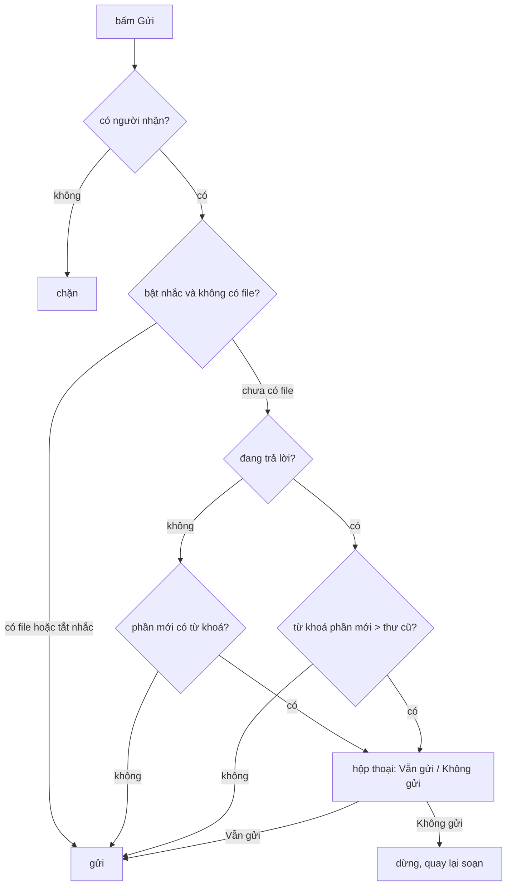

"Anh gửi em hợp đồng, file đính kèm nhé." Gửi. Ba phút sau: "Quên file, gửi lại ạ." Ai dùng email đủ lâu đều từng làm vậy. Gmail, Outlook, Thunderbird đều có tính năng nhắc trước khi gửi.

Cách làm nghe có vẻ chỉ là `if (body.includes('đính kèm') && attachments.length === 0)`. Nhưng thử vài tình huống:

- Trả lời một thư mà **thư gốc** nói "file đính kèm bên dưới", còn bạn chỉ viết "ok cảm ơn". Đừng làm phiền người ta.
- "Xem file đính kèm." có dấu chấm ngay sau từ khoá.
- Người dùng tiếng Đức, Nhật, Việt: mỗi ngôn ngữ một bộ từ khoá.
- Câu "không cần đính kèm gì đâu".

Outlook Web giải hai vấn đề đầu và vấn đề ngôn ngữ bằng vài chục dòng, gắn vào một **chuỗi kiểm tra trước khi gửi** (người nhận hợp lệ, add-in đang chạy, quên đính kèm…). Bài này đọc code đó, chỉ ra ba trường hợp regex của họ đếm hụt, và viết lại.

> [!TIP]
> **Tóm tắt**
> - Từ khoá **theo ngôn ngữ**, gồm cả danh từ ("tệp đính kèm") lẫn động từ ("gửi kèm"), để người dịch quyết định chứ không hard-code tiếng Anh.
> - Khi trả lời/chuyển tiếp: chỉ cảnh báo nếu **phần mới gõ có nhiều từ khoá hơn phần trích dẫn**.
> - Ranh giới từ nên theo Unicode (`(?<![\p{L}\p{N}\p{M}])`), không theo khoảng trắng, và chuẩn hoá NFC trước khi so.
> - Đặt cảnh báo vào một chuỗi kiểm tra có thứ tự, mỗi bước có thể chặn hoặc hỏi người dùng "Vẫn gửi?".

<iframe class="demo-frame" src="/demos/web-patterns/index.html?theme=dark#/forgotten-attachment" title="Demo forgotten-attachment" loading="lazy" style="height: 900px"></iframe>

<p class="demo-links">▶ <a href="/demos/web-patterns/index.html#/forgotten-attachment" target="_blank" rel="noopener">Mở demo toàn màn hình ↗</a> · <a href="https://stackblitz.com/github/hunghg255/blog-hunghg/tree/master/examples/web-patterns?file=src/lib/forgottenAttachment.ts" target="_blank" rel="noopener">Sửa code trên StackBlitz ↗</a> · <a href="https://github.com/hunghg255/blog-hunghg/blob/master/examples/web-patterns/src/lib/forgottenAttachment.ts" target="_blank" rel="noopener">Xem source trên GitHub ↗</a></p>

Thư mẫu ban đầu kết thúc bằng "file đính kèm." (có dấu chấm): regex gốc của Outlook đếm được **0**, tức sẽ không cảnh báo. Bật "Đang trả lời…" và đổi nội dung thành "Ok anh nhận được rồi": thư cũ có 2 từ khoá, phần mới 0, không cảnh báo.

## Outlook làm thế nào?

### Bộ từ khoá theo ngôn ngữ

[`owa-editor-forgotten-attachments-plugin/src/utils/getAttachmentTriggerKeywords.ts`](https://github.com/hunghg255/codebase/blob/main/outlook.live.com/src/modules/owa-editor-forgotten-attachments-plugin/src/utils/getAttachmentTriggerKeywords.ts):

```ts
import { attachNounsTriggers, attachVerbsTriggers } from './getAttachmentTriggerKeywords.locstring.json';

export function getAttachmentTriggerKeywords(): string[] {
    return (loc(attachNounsTriggers) || '')
        .split(',')
        .concat((loc(attachVerbsTriggers) || '').split(','))
        .filter(trigger => trigger !== '');
}
```

Từ khoá không nằm trong code mà trong **hai chuỗi đã dịch**, mỗi chuỗi là danh sách cách nhau bởi dấu phẩy: một cho danh từ, một cho động từ. Người dịch tiếng Đức tự thêm "Anhang, angehängt", người dịch tiếng Việt tự thêm "đính kèm, tệp đính kèm". File `.locstring.json` không có trong bản dump, nên không biết danh sách cụ thể.

### Đếm từ khoá

[`countTriggers.ts`](https://github.com/hunghg255/codebase/blob/main/outlook.live.com/src/modules/owa-editor-forgotten-attachments-plugin/src/utils/countTriggers.ts):

```ts
export function countTriggers(message: string, triggers: string[]): number {
    return triggers.reduce((numberOfTriggers, trigger) => {
        const escapedTrigger = trigger.replace(/[.*+?^${}()|[\]\\]/g, '\\$&');
        // The regex will match the trigger word if it has a whitespace character
        // in beginning or start of the line and a whitespace character at end or end of line.
        const regexStr = `(^|\\s)${escapedTrigger}(\\s|$)`;
        try {
            const triggerRegex = new RegExp(regexStr, 'gi');
            numberOfTriggers += (message.match(triggerRegex) || []).length;
        } catch (error) {
            trace.errorThatWillCauseAlert(`[ForgottenAttachments] Error parsing regex ...`, error);
        }
        return numberOfTriggers;
    }, 0);
}
```

Hai điểm tốt: escape từ khoá trước khi đưa vào `RegExp` (comment giải thích: chuỗi dịch có thể chứa ký tự đặc biệt của regex), và bọc `try/catch` để một chuỗi dịch hỏng không làm hỏng cả nút Gửi.

### So với thư được trích dẫn

[`owa-mail-forgotten-attachments/src/utils/checkForForgottenAttachments.ts`](https://github.com/hunghg255/codebase/blob/main/outlook.live.com/src/modules/owa-mail-forgotten-attachments/src/utils/checkForForgottenAttachments.ts):

```ts
function doesComposeTextBodyContainAttachmentTriggerWords(viewState: ComposeViewState): boolean {
    const { content, quotedBody, useSmartResponse, forgottenAttachments } = viewState;
    if (!useSmartResponse && quotedBody) {
        const attachmentTriggersInContent = getCountOfAttachmentTriggerKeywords(content);
        const attachmentTriggersInQuotedBody =
            forgottenAttachments && forgottenAttachments.attachmentKeywordsDetectedBeforeUserInput !== null
                ? forgottenAttachments.attachmentKeywordsDetectedBeforeUserInput
                : getCountOfAttachmentTriggerKeywords(quotedBody);
        if (attachmentTriggersInContent > attachmentTriggersInQuotedBody) return true;
    } else {
        return getCountOfAttachmentTriggerKeywords(content) > 0;
    }
    return false;
}
```

Đây là chi tiết đáng học nhất. Khi soạn thư trả lời ở dạng text, `content` chứa **cả** thư cũ được trích dẫn. Nếu chỉ hỏi "có từ khoá không" thì mọi thư trả lời cho một thư từng có file đều bị cảnh báo. Outlook so **số lượng**: phần đang soạn phải có **nhiều hơn** số từ khoá vốn có trong phần trích dẫn.

`attachmentKeywordsDetectedBeforeUserInput` xử lý trường hợp người dùng chuyển từ soạn HTML sang text: lúc đó số từ khoá của thư cũ đã được đếm trước khi người dùng gõ gì, dùng luôn con số đó. Với thư soạn HTML, việc đếm do một plugin của editor roosterjs làm (chạy khi editor sẵn sàng, khi nội dung đổi) và ghi kết quả vào `hasAttachmentTriggerWords`; file plugin đó không có trong bản dump.

Còn "có file chưa" thì tính cả ba loại: file thường, ảnh, ảnh chèn trong nội dung:

```ts
return attachmentWellViewState.docViewAttachments.length > 0 ||
    attachmentWellViewState.imageViewAttachments.length > 0 ||
    attachmentWellViewState.inlineAttachments.length > 0;
```

### Chuỗi kiểm tra trước khi gửi

Hàm trên được gọi từ [`owa-mail-compose-actions/src/utils/validateSend.tsx`](https://github.com/hunghg255/codebase/blob/main/outlook.live.com/src/modules/owa-mail-compose-actions/src/utils/validateSend.tsx), nơi nút Gửi đi qua một **danh sách** bước kiểm tra:

```tsx
{
    getConfirmDialogOptions: (viewState) => ({
        text: loc(attachmentReminderText),
        confirmOptions: { bodyElement: <LazyForgottenAttachmentsToggle />, okText: loc(sendButtonText), ... },
        continueOnUserConfirmation: true,
    }),
    validate: (viewState) => {
        if (getUserConfiguration().UserOptions.CheckForForgottenAttachments) {
            return !checkForForgottenAttachments(viewState);
        }
        return true;
    },
    errorCode: FORGOTTEN_ATTACHMENTS_ERROR_CODE,
},
```

Mỗi bước có `validate` (qua hay không) và tuỳ chọn `getConfirmDialogOptions` (hỏi người dùng). `continueOnUserConfirmation: true` nghĩa là người dùng bấm "Gửi" trong hộp thoại thì đi tiếp các bước sau. Người dùng có thể tắt cả tính năng trong cài đặt (`CheckForForgottenAttachments`), và hộp thoại có một `ForgottenAttachmentsToggle`, có lẽ là công tắc tắt nhắc ngay tại chỗ.

Thứ tự cũng có chủ đích. Bước kiểm tra add-in đang chạy đứng trước; ngay sau bước quên đính kèm là bước chèn nội dung "append on send", với comment giải thích nó phải đứng **sau** mọi bước kiểm tra để người dùng không thấy đoạn chèn thêm nếu thư bị chặn ở bước trước; bước cuối là add-in ItemSend.

## Ba chỗ regex của Outlook đếm hụt

Ranh giới `(^|\s)…(\s|$)` nghĩa là từ khoá phải có **khoảng trắng hoặc đầu/cuối chuỗi** ở hai bên. Chạy thử bằng Node:

| Câu | Regex gốc | Lý do |
|---|---|---|
| `Xem file đính kèm.` | 0 | dấu chấm không phải `\s` |
| `See attached, attached again` | 1 | dấu phẩy chặn từ đầu |
| `attached attached` | 1 | khoảng trắng giữa bị lần khớp thứ nhất "ăn" mất, lần thứ hai không còn `\s` phía trước |
| `Xem file đính kèm` dạng NFD | 0 | "í" là "i" + dấu sắc rời, không khớp "í" dựng sẵn |

Trường hợp đầu là nghiêm trọng nhất: câu tự nhiên nhất để báo có file ("xem file đính kèm.", "please see attached.") thường kết thúc bằng dấu câu.

Trường hợp NFD xảy ra thật: một số bộ gõ và ứng dụng trên macOS/iOS có thể tạo ra tiếng Việt ở dạng tổ hợp (NFD), trong khi chuỗi dịch lưu ở dạng dựng sẵn (NFC). Hai chuỗi trông giống hệt nhưng khác byte.



## Viết lại

```ts title=src/lib/forgottenAttachment.ts
export function countTriggers(text: string, triggers: string[]): number {
  const normalized = text.normalize('NFC');
  return triggers.reduce((sum, t) => {
    const re = new RegExp(`(?<![\\p{L}\\p{N}\\p{M}])${escapeRegExp(t.normalize('NFC'))}(?![\\p{L}\\p{N}\\p{M}])`, 'giu');
    return sum + (normalized.match(re) ?? []).length;
  }, 0);
}
```

Quy tắc so với thư trích dẫn và chuỗi kiểm tra:

```ts title=src/lib/forgottenAttachment.ts
export function checkForgottenAttachment(draft: Draft, triggers: string[], count = countTriggers): Verdict {
  const inContent = count(draft.content, triggers);
  const inQuoted = draft.quoted ? count(draft.quoted, triggers) : 0;
  if (draft.attachmentCount > 0) return { warn: false, inContent, inQuoted, reason: 'đã có file đính kèm' };
  if (draft.quoted) {
    const warn = inContent > inQuoted;
    return {
      warn,
      inContent,
      inQuoted,
      reason: warn ? `phần mới có ${inContent} từ khoá > ${inQuoted} trong thư cũ` : `phần mới (${inContent}) không nhiều hơn thư cũ (${inQuoted})`,
    };
  }
  return { warn: inContent > 0, inContent, inQuoted, reason: inContent > 0 ? `có ${inContent} từ khoá, chưa có file` : 'không có từ khoá' };
}
```

```ts title=src/lib/forgottenAttachment.ts
export async function runSendChecks<T>(draft: T, checks: SendCheck<T>[], confirm: Confirm): Promise<string | null> {
  for (const check of checks) {
    if (await check.validate(draft)) continue;
    if (!check.confirm) return check.id;
    const ok = await confirm(check.confirm, check.id);
    if (!ok) return check.id;
  }
  return null;
}
```

::: spoiler Xem toàn bộ src/lib/forgottenAttachment.ts

```ts title=src/lib/forgottenAttachment.ts
/**
 * Cảnh báo "hình như bạn quên đính kèm file" trước khi gửi.
 * Ý tưởng từ owa-mail-forgotten-attachments + owa-editor-forgotten-attachments-plugin của Outlook Web.
 */

/**
 * Từ khoá theo ngôn ngữ, gồm cả danh từ lẫn động từ. Outlook lấy hai chuỗi đã dịch
 * (attachNounsTriggers, attachVerbsTriggers) rồi tách theo dấu phẩy, nên người dịch tự quyết từ nào.
 */
export const TRIGGERS: Record<string, string[]> = {
  // tránh cụm chồng nhau ("tệp đính kèm" chứa "đính kèm") kẻo một chỗ bị đếm hai lần
  vi: ['đính kèm', 'gửi kèm', 'kèm theo', 'tệp kèm'],
  en: ['attach', 'attached', 'attaching', 'attachment', 'attachments', 'enclosed'],
};

const escapeRegExp = (s: string) => s.replace(/[.*+?^${}()|[\]\\]/g, '\\$&');

/**
 * Bản của Outlook: (^|\s)từ(\s|$). Giữ lại để so sánh trong demo và bài viết.
 * Hụt 3 trường hợp: từ đứng trước dấu câu ("xem file đính kèm."), hai từ liền nhau dùng chung
 * một khoảng trắng, và chữ tiếng Việt gõ ở dạng tổ hợp (NFD).
 */
export function countTriggersNaive(text: string, triggers: string[]): number {
  return triggers.reduce((sum, t) => {
    const re = new RegExp(`(^|\\s)${escapeRegExp(t)}(\\s|$)`, 'gi');
    return sum + (text.match(re) ?? []).length;
  }, 0);
}

/**
 * Đếm số lần xuất hiện của các từ khoá, theo ranh giới chữ Unicode:
 * - lookbehind/lookahead không "ăn" ký tự xung quanh, nên "attached, attached" đếm đủ 2;
 * - \p{L}\p{N}\p{M}: chữ, số và dấu thanh, để "đính kèmm" hay "reattach" không tính;
 * - chuẩn hoá NFC: macOS/iOS có thể gửi tiếng Việt dạng NFD, "ề" là "e" + 2 dấu rời.
 */
export function countTriggers(text: string, triggers: string[]): number {
  const normalized = text.normalize('NFC');
  return triggers.reduce((sum, t) => {
    const re = new RegExp(`(?<![\\p{L}\\p{N}\\p{M}])${escapeRegExp(t.normalize('NFC'))}(?![\\p{L}\\p{N}\\p{M}])`, 'giu');
    return sum + (normalized.match(re) ?? []).length;
  }, 0);
}

export interface Draft {
  /** phần người dùng tự gõ */
  content: string;
  /** thư cũ được trích dẫn khi trả lời/chuyển tiếp (rỗng nếu là thư mới) */
  quoted: string;
  attachmentCount: number;
}

export interface Verdict {
  warn: boolean;
  inContent: number;
  inQuoted: number;
  reason: string;
}

/**
 * Quy tắc của Outlook: khi trả lời, chỉ cảnh báo nếu phần MỚI gõ có NHIỀU từ khoá hơn phần trích dẫn.
 * Thư cũ ghi "file đính kèm" và đã có file, giờ trả lời "ok cảm ơn" thì không được làm phiền.
 */
export function checkForgottenAttachment(draft: Draft, triggers: string[], count = countTriggers): Verdict {
  const inContent = count(draft.content, triggers);
  const inQuoted = draft.quoted ? count(draft.quoted, triggers) : 0;
  if (draft.attachmentCount > 0) return { warn: false, inContent, inQuoted, reason: 'đã có file đính kèm' };
  if (draft.quoted) {
    const warn = inContent > inQuoted;
    return {
      warn,
      inContent,
      inQuoted,
      reason: warn ? `phần mới có ${inContent} từ khoá > ${inQuoted} trong thư cũ` : `phần mới (${inContent}) không nhiều hơn thư cũ (${inQuoted})`,
    };
  }
  return { warn: inContent > 0, inContent, inQuoted, reason: inContent > 0 ? `có ${inContent} từ khoá, chưa có file` : 'không có từ khoá' };
}

// ---- Chuỗi kiểm tra trước khi gửi ----

export interface SendCheck<T> {
  id: string;
  /** true = qua; false = cần hỏi người dùng */
  validate: (draft: T) => boolean | Promise<boolean>;
  /** câu hỏi xác nhận; không có thì check fail là chặn luôn */
  confirm?: { title: string; body: string; okText: string; cancelText: string };
}

export type Confirm = (dialog: NonNullable<SendCheck<unknown>['confirm']>, checkId: string) => Promise<boolean>;

/**
 * Chạy lần lượt từng kiểm tra (người nhận, add-in đang chạy, quên đính kèm…), giống validateSend của
 * Outlook. Kiểm tra fail mà có `confirm` thì hỏi; người dùng đồng ý thì đi tiếp, không thì dừng.
 * Trả về id của kiểm tra đã chặn việc gửi, hoặc null nếu được gửi.
 */
export async function runSendChecks<T>(draft: T, checks: SendCheck<T>[], confirm: Confirm): Promise<string | null> {
  for (const check of checks) {
    if (await check.validate(draft)) continue;
    if (!check.confirm) return check.id;
    const ok = await confirm(check.confirm, check.id);
    if (!ok) return check.id;
  }
  return null;
}
```

:::

## Đi qua code

**Lookbehind/lookahead thay cho nhóm bắt.** `(?<![\p{L}\p{N}\p{M}])từ(?![\p{L}\p{N}\p{M}])` kiểm tra ký tự hai bên nhưng **không tiêu thụ** chúng. Hai từ khoá liền nhau dùng chung khoảng trắng vẫn đếm đủ. Dấu câu, ngoặc, xuống dòng đều không phải chữ nên đều là ranh giới hợp lệ.

**`\p{M}` trong ranh giới.** Không có nó, "đính kèm" khớp được bên trong "đính kèm̀" (thêm một dấu tổ hợp lạ) vì dấu không phải `\p{L}`. Thêm `\p{M}` để coi dấu là một phần của chữ.

**NFC cả hai phía**: chuẩn hoá nội dung và từ khoá trước khi so.

**Bộ từ khoá tiếng Việt không chồng nhau**: `['đính kèm', 'gửi kèm', 'kèm theo', 'tệp kèm']`. Nếu có cả "đính kèm" lẫn "tệp đính kèm", câu "tệp đính kèm" bị đếm 2 lần. Với quy tắc so sánh số lượng, đếm dư ở cả hai phía thì kết quả vẫn ổn, nhưng con số hiển thị sẽ khó hiểu.

**`checkForgottenAttachment` nhận hàm đếm làm tham số** (`count = countTriggers`), để demo chạy cùng quy tắc với regex gốc và so sánh.

**`runSendChecks` tách logic khỏi UI**: hộp thoại được truyền vào dưới dạng hàm `confirm` trả về `Promise<boolean>`. Demo dùng một modal React; test dùng `async () => true`. Hàm trả về `id` của bước đã chặn (để ghi log, như `errorCode` của Outlook) hoặc `null` nếu được gửi.

**Khác bản gốc:**
- Ranh giới Unicode thay cho `\s`, chuẩn hoá NFC.
- Phần nội dung mới và phần trích dẫn được truyền riêng (giống `content`/`quotedBody` trong state của Outlook), thay vì tách từ một chuỗi.
- Không có phần đếm cho editor HTML (Outlook làm trong plugin roosterjs); với HTML, chỉ cần đếm trên `textContent` của phần không phải trích dẫn.

## Tại sao không làm cách khác?

**`body.includes('attach')`**: khớp cả "reattach", "attachment-free", và mọi thư trả lời cho thư có file. Nhiều cảnh báo sai thì người dùng sẽ tắt tính năng.

**`\b` của regex**: `\b` trong JavaScript chỉ hiểu chữ ASCII (`[A-Za-z0-9_]`), kể cả khi có cờ `u`. Với "đính kèm", ký tự "đ" không phải "word character" nên `\bđính` không bao giờ khớp ở đầu từ.

**Gọi model AI để hiểu ý**: chính xác hơn với câu phủ định ("không cần đính kèm"), nhưng thêm độ trễ và chi phí vào **mỗi lần bấm Gửi**, và gửi nội dung thư đi phân tích. Từ khoá + so sánh với thư cũ đã loại phần lớn cảnh báo sai với chi phí gần bằng 0.

## Edge case và cạm bẫy

- **Câu phủ định**: "không cần gửi kèm gì" vẫn bị cảnh báo. Có thể thêm danh sách cụm phủ định cho từng ngôn ngữ, nhưng ngữ pháp phủ định đa dạng; một cảnh báo thừa có nút "Vẫn gửi" là chấp nhận được.
- **Chữ ký email**: chữ ký có câu "Please do not open attachments from unknown senders" sẽ luôn kích hoạt. Nên loại phần chữ ký khi đếm, như loại phần trích dẫn.
- **Link thay cho file**: "file ở link Google Drive bên dưới" có từ "file" nhưng không có "đính kèm", không cảnh báo, đúng ý. Ngược lại "đính kèm link Drive" sẽ cảnh báo dù không cần file; có thể coi link Drive/OneDrive/Dropbox trong thư như một "file đính kèm".
- **Lookbehind** có ở Chrome, Firefox, và Safari từ 16.4 (tính tới 10/2026 đã phổ biến). Cần hỗ trợ Safari cũ hơn thì dùng nhóm bắt `(^|[^\p{L}\p{N}\p{M}])` và tự xử lý trường hợp hai từ liền nhau.
- **Người dùng nhiều ngôn ngữ**: Outlook lấy từ khoá theo ngôn ngữ giao diện. Người dùng giao diện tiếng Anh viết thư tiếng Việt sẽ không được nhắc. Demo gộp cả hai bộ từ khoá; với nhiều ngôn ngữ hơn, có thể gộp ngôn ngữ giao diện với ngôn ngữ phát hiện được từ nội dung.

## Dùng trong dự án

```ts
const checks: SendCheck<Draft>[] = [
  { id: 'no-recipient', validate: (d) => d.to.length > 0 },
  { id: 'big-file', validate: (d) => totalSize(d) < 25_000_000 },
  {
    id: 'forgotten-attachment',
    validate: (d) =>
      !prefs.remindAttachments ||
      !checkForgottenAttachment(
        { content: d.content, quoted: d.quoted, attachmentCount: d.files.length + d.cloudLinks.length },
        [...TRIGGERS[uiLang], ...TRIGGERS[detectLang(d.content)]],
      ).warn,
    confirm: { title: 'Hình như bạn quên đính kèm file?', body: '…', okText: 'Vẫn gửi', cancelText: 'Không gửi' },
  },
];
const blocked = await runSendChecks(draft, checks, showConfirmDialog);
if (!blocked) await send(draft);
else analytics.track('send_blocked', { reason: blocked });
```

Ý tưởng không chỉ dành cho email: form đăng bài có chữ "ảnh bên dưới" mà không có ảnh, ticket hỗ trợ ghi "xem log đính kèm", tin nhắn chat "gửi bạn file nè".

## Kiểm thử

::: spoiler Ví dụ test (bản phác, không có trong repo)

```ts
import { describe, expect, it } from 'vitest';
import { checkForgottenAttachment, countTriggers, countTriggersNaive, runSendChecks, TRIGGERS } from './forgottenAttachment';

const T = [...TRIGGERS.vi, ...TRIGGERS.en];

describe('countTriggers', () => {
  it('đếm được khi có dấu câu và từ liền nhau', () => {
    expect(countTriggersNaive('Xem file đính kèm.', T)).toBe(0);
    expect(countTriggers('Xem file đính kèm.', T)).toBe(1);
    expect(countTriggers('attached attached', T)).toBe(2);
  });
  it('chuẩn hoá NFD', () => {
    expect(countTriggers('file đính kèm'.normalize('NFD'), T)).toBe(1);
  });
  it('không khớp giữa từ', () => {
    expect(countTriggers('reattach', T)).toBe(0);
  });
});

describe('checkForgottenAttachment', () => {
  it('thư trả lời không thêm từ khoá thì không cảnh báo', () => {
    const v = checkForgottenAttachment({ content: 'ok cảm ơn', quoted: 'file đính kèm bên dưới', attachmentCount: 0 }, T);
    expect(v.warn).toBe(false);
  });
  it('có file thì không cảnh báo', () => {
    expect(checkForgottenAttachment({ content: 'file đính kèm', quoted: '', attachmentCount: 1 }, T).warn).toBe(false);
  });
});

describe('runSendChecks', () => {
  const checks = [
    { id: 'a', validate: () => true },
    { id: 'b', validate: () => false, confirm: { title: '', body: '', okText: '', cancelText: '' } },
    { id: 'c', validate: () => false },
  ];
  it('dừng ở bước người dùng từ chối', async () => {
    expect(await runSendChecks({}, checks, async () => false)).toBe('b');
  });
  it('đồng ý thì đi tiếp tới bước chặn cứng', async () => {
    expect(await runSendChecks({}, checks, async () => true)).toBe('c');
  });
});
```

:::

## So với thư viện và chuẩn web

- Thuộc tính `\p{…}` (Unicode property escapes) và lookbehind là chuẩn ES2018, có ở mọi trình duyệt hiện đại.
- `String.prototype.normalize` có ở mọi nơi; nên chuẩn hoá NFC dữ liệu người dùng **trước khi lưu** nói chung, không chỉ trước khi so từ khoá.
- `Intl.Segmenter` với `granularity: 'word'` tách được từ cho cả ngôn ngữ không dùng khoảng trắng như tiếng Nhật, tiếng Thái. Với các ngôn ngữ đó, regex dựa trên ranh giới chữ sẽ không đủ, và đếm từ khoá nên chạy trên kết quả của `Intl.Segmenter`.

---

Bài này thuộc series **[Học từ mã nguồn các web lớn](/series/web)** (42 bài, đọc theo thứ tự).

::: spoiler Xem nhanh danh sách bài trong series

*Mở đầu*

- [Mở đầu: đọc code production của 28 trang web](/blogs/learn-from-big-web-apps)

*Phần 1: trải nghiệm người dùng*

- [#1 Dark mode không nháy (Gatsby)](/blogs/web-dark-mode-no-flash)
- [#2 useValueByMedia: giá trị theo breakpoint (Toptal)](/blogs/web-use-value-by-media)
- [#3 Đoán ý định: idle, exit-intent, lắc chuột (Toptal, InVision)](/blogs/web-user-intent-idle-exit-wiggle)
- [#4 Validate form thân thiện (Udacity, Pipedrive)](/blogs/web-form-validation-ux)
- [#5 Magic number, EXIF và dán ảnh (Ello)](/blogs/web-file-magic-number-exif-paste)
- [#6 fastSmoothScroll: cuộn xa vẫn nhanh (Telegram)](/blogs/web-telegram-fast-smooth-scroll)
- [#7 Countdown time-travel và tombstone giỏ hàng (Best Buy)](/blogs/web-countdown-time-travel-tombstone)

*Phần 2: hiệu năng và đo lường*

- [#8 Hàng đợi requestAnimationFrame 3ms (Apple)](/blogs/web-raf-queue-3ms)
- [#9 srcset cho artwork và preconnect tự động (Apple)](/blogs/web-responsive-artwork-preconnect)
- [#10 Quick-fetch: gọi API trước khi bundle tải xong (HubSpot)](/blogs/web-quick-fetch-early-requests)
- [#11 Performance span và long task (Postman, Calibre)](/blogs/web-performance-spans-long-tasks)
- [#12 Gọi Web Worker như hàm async (Telegram)](/blogs/web-worker-promise-rpc)
- [#13 Đồng hồ media: đếm giờ xem và sửa lệch (Skillshare, Simplified)](/blogs/web-media-clock-watch-time-drift)

*Phần 3: nhiều tab, phiên đăng nhập, cập nhật*

- [#14 Bầu tab chủ cho thông báo (HubSpot, Telegram)](/blogs/web-leader-tab-notifications)
- [#15 Đồng bộ đăng nhập giữa tab và giới hạn cookie (Elastic, InVision)](/blogs/web-cross-tab-auth-cookie-guard)
- [#16 SPA tự cập nhật: Trello, Zappos, Facebook, Elastic](/blogs/web-spa-self-update-strategies)

*Phần 4: kiến trúc*

- [#17 Reverse portal: di chuyển component không remount (Zappos)](/blogs/web-reverse-portal)
- [#18 Page behaviors: gắn hành vi từ CMS (Intercom)](/blogs/web-page-behaviors-cms)
- [#19 Giới hạn tần suất hiển thị bằng bitmask (Outlook)](/blogs/web-frequency-cap-bitmask)
- [#20 Chuyển REST sang GraphQL dần dần (Coursera)](/blogs/web-rest-to-graphql-hybrid-link)

*Phần 5: soạn thảo và hiển thị nội dung*

- [#21 Autocomplete tại con trỏ trong contenteditable (Ello, Telegram)](/blogs/web-caret-autocomplete-contenteditable)
- [#22 Dark mode cho email HTML bằng CIELAB (Outlook)](/blogs/web-email-dark-mode-cielab)
- [#23 Thu nhỏ bảng rộng cho vừa khung, vá font emoji (Outlook)](/blogs/web-email-wide-content-scale)
- **#24 Cảnh báo quên đính kèm file (Outlook)** (bài này)
- [#25 Cắt chữ nhiều dòng chính xác (Pipedrive, Apple, Toptal)](/blogs/web-multiline-truncate-measure-text)
- [#26 Parse ngày giờ gõ tay khoan dung (Outlook, Elastic)](/blogs/web-lenient-date-parser)

*Phần 6: tương tác*

- [#27 menuAim: rê chéo vào submenu không bị đóng (Udemy)](/blogs/web-menu-aim-triangle)
- [#28 Kéo, vuốt chung cho chuột và cảm ứng (Telegram)](/blogs/web-unified-pointer-gestures)
- [#29 Phím tắt theo phạm vi, IME và bàn phím phi Latinh (Trello)](/blogs/web-scoped-keyboard-shortcuts)
- [#30 Nội suy màu: đổi theme và nền theo cuộn (Telegram, Anchor)](/blogs/web-color-interpolation-theme-scroll)
- [#31 Đường gióng hút cạnh và undo/redo trên canvas (Simplified)](/blogs/web-canvas-snap-guides-undo)
- [#32 Giả lập mù màu bằng feColorMatrix (Trello)](/blogs/web-color-vision-simulator)
- [#33 Vạch thước theo mức zoom và cấp phát màu cho biểu đồ (Anchor, Similarweb)](/blogs/web-timeline-ticks-color-stack)

*Phần 7: mạng, dữ liệu và async*

- [#34 Ô tìm kiếm chuẩn production (Similarweb, Udemy, Pipedrive)](/blogs/web-production-search-box)
- [#35 Điều phối async: latest-wins, single-flight (Glitch, Toptal)](/blogs/web-async-coordination-latest-wins)
- [#36 Polling thưa dần và debounce động (Trello)](/blogs/web-decaying-polling-dynamic-debounce)
- [#37 Cache phía client theo version (Similarweb, Telegram, Udemy)](/blogs/web-client-cache-versioned)
- [#38 Upload file lớn theo chunk (Outlook, Tribe)](/blogs/web-chunked-upload-pipeline)
- [#39 Phát video qua Service Worker bằng Range request (Telegram, Outlook)](/blogs/web-service-worker-range-streaming)

*Phần 8: hiệu năng và vận hành*

- [#40 TTI governor: hoãn việc phụ tới sau khi trang dùng được (Outlook)](/blogs/web-tti-governor)
- [#41 Tự đo LCP/CLS/TBT và phục vụ bản nhẹ cho máy yếu (Udemy)](/blogs/web-rum-adaptive-loading)

:::

Code + demo: [`examples/web-patterns`](https://github.com/hunghg255/blog-hunghg/tree/master/examples/web-patterns) · [Mở trên StackBlitz](https://stackblitz.com/github/hunghg255/blog-hunghg/tree/master/examples/web-patterns)
