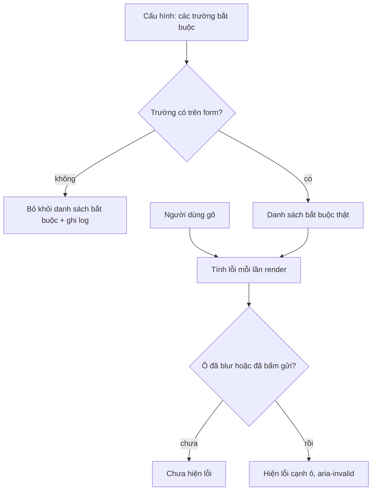

Validate form có hai mục tiêu ngược chiều nhau: chặn dữ liệu sai, và không chặn người dùng. Phần lớn form chỉ lo mục tiêu đầu. Kết quả là những form đòi mật khẩu "có chữ hoa, chữ thường, số và ký tự đặc biệt" nhưng chấp nhận `Password1!`, chấp nhận ngày 31/02, hoặc khoá nút Lưu vì một trường bắt buộc mà người dùng không hề nhìn thấy.

Bài này gom ba kỹ thuật nhỏ từ hai trang: form đăng ký của **auth.udacity.com** và hộp thoại "Thêm deal" của **Pipedrive**. Mỗi kỹ thuật chỉ vài dòng, nhưng mỗi cái tránh được một kiểu lỗi người dùng gặp thật.

> [!TIP]
> **Tóm tắt**
> - **Mật khẩu:** Udacity yêu cầu tối thiểu 10 ký tự và ít nhất 8 ký tự **khác nhau**. Luật này chặn được `aaaaaaaaaaaa`, `1111111111`, đơn giản hơn luật "phải có chữ hoa + số + ký tự đặc biệt" và không ép người dùng thêm `!` vào cuối.
> - **Ngày có thật:** tạo `Date` rồi đọc ngược lại; 30/02 bị Date "tràn" thành 01/03 nên không khớp.
> - **Trường bắt buộc phải điền được:** Pipedrive bỏ khỏi danh sách bắt buộc những trường không có trên form, và ghi log để đội phát triển biết cấu hình đang lệch.
> - Code gốc có hai lỗi nhỏ đáng biết: regex email của Udacity chấp nhận `abc.com` (không có `@`), và tính tuổi trộn giờ UTC với giờ địa phương.

<iframe class="demo-frame" src="/demos/web-patterns/index.html?theme=dark#/form-validation" title="Demo form-validation" loading="lazy" style="height: 720px"></iframe>

<p class="demo-links">▶ <a href="/demos/web-patterns/index.html#/form-validation" target="_blank" rel="noopener">Mở demo toàn màn hình ↗</a> · <a href="https://stackblitz.com/github/hunghg255/blog-hunghg/tree/master/examples/web-patterns?file=src/lib/formValidation.ts" target="_blank" rel="noopener">Sửa code trên StackBlitz ↗</a> · <a href="https://github.com/hunghg255/blog-hunghg/blob/master/examples/web-patterns/src/lib/formValidation.ts" target="_blank" rel="noopener">Xem source trên GitHub ↗</a></p>

## Udacity làm thế nào?

Toàn bộ logic nằm trong `auth.udacity.com/static/js/app/helpers/form-helper.js` (đường dẫn trong bản dump có thêm một cấp `auth.udacity.com/` ở đầu).

### Mật khẩu: đếm ký tự khác nhau

```js
const countUniqChars = (password) => {
  let seen = '';
  for (let i = 0; i < password.length; i++) {
    if (seen.indexOf(password[i]) === -1) seen += password[i];
  }
  return seen.length;
};

// Returns 0-3
export const calcPasswordStrength = (password) => {
  if (password.length < 1) return 0;
  if (password.length < 10) return 1;
  const entropy = countUniqChars(password);
  if (entropy < 8) return 2;
  return 3;
};
```

Và trong `validateForm`:

```js
if (password.length < 10) {
  fieldErrors.password = __('Password must contain at least 10 characters');
} else if (calcPasswordStrength(password) < 3) {
  fieldErrors.password = __('Password is too weak');
}
```

Luật rất ngắn: **dài ít nhất 10, có ít nhất 8 ký tự khác nhau**. Biến được đặt tên `entropy` hơi quá lời (số ký tự khác nhau không phải entropy theo nghĩa toán học), nhưng ý tưởng thì đúng hướng. Độ khó đoán của mật khẩu đến chủ yếu từ **độ dài** và **độ đa dạng**, chứ không đến từ việc có đủ bốn loại ký tự. Hướng dẫn NIST SP 800-63B cũng khuyên bỏ các luật thành phần kiểu "phải có ký tự đặc biệt", thay bằng độ dài tối thiểu và kiểm tra mật khẩu phổ biến/đã lộ.

Luật của Udacity chặn được những mật khẩu lười nhất (`aaaaaaaaaa`, `1212121212`), trong khi `mây trắng bay qua` (cụm từ dài, dễ nhớ) vẫn qua. Nó không chặn `password123` (11 ký tự, 10 ký tự khác nhau), nên chỉ nên là một lớp, không phải tất cả.

Một chi tiết nhỏ: `password[i]` và `password.length` đếm theo **đơn vị UTF-16**, nên một emoji như 😀 bị tính là 2 "ký tự". Mật khẩu chủ yếu là ASCII nên ít khi gặp, nhưng bản viết lại dùng `[...password]` để đếm theo code point.

### Ngày có thật: để Date tự tràn

```js
function isValidDate(day, month, year) {
  // the month number for date object starts from 0. like jan -- 0, feb -- 1.
  let date = new Date(year, month - 1, day);
  // if the date is not valid in this month, for example, Feb-30-2018,
  // the Date library will parse it to next month --> Mar-2-2018.
  // checking whether the month is equal to getMonth + 1 for date validation.
  return date.getMonth() + 1 === parseInt(month);
}
```

Thay vì viết bảng số ngày mỗi tháng và luật năm nhuận, ta để `Date` làm việc đó: `new Date(2018, 1, 30)` (30/02/2018) cho ra 02/03/2018. Tháng đọc ra khác tháng đưa vào, nên ngày không có thật. Comment trong code còn ghi lý do không parse chuỗi: một số trình duyệt không hiểu định dạng `YYYY/MM/DD`.

### Hai lỗi nhỏ trong cùng file

**Tính tuổi trộn hai múi giờ.** `isValidAge` lấy năm và tháng theo giờ địa phương nhưng lấy ngày theo UTC:

```js
let curYear = today.getFullYear();
let curMonth = today.getMonth() + 1;
//use UTC Date
let curDay = today.getUTCDate();
```

Ở Việt Nam (UTC+7), lúc 1 giờ sáng ngày 15 theo giờ địa phương thì UTC mới là ngày 14. Người sinh ngày 15 đúng hôm đó bị tính là **chưa** tới sinh nhật, thiếu một tuổi. Với form chặn người dưới 13 hoặc 16 tuổi, một người vừa đủ tuổi có thể bị từ chối trong vài giờ đầu ngày sinh nhật. Lỗi hiếm, nhưng là loại lỗi khó tái hiện nhất.

**Regex email không bắt buộc có `@`.**

```js
const EMAIL_REGEX = /^[A-Z0-9._%'+-\]+@[A-Z0-9.-]+\.[A-Z]{2,}$/i;
```

Có lẽ ý định là `[A-Z0-9._%'+-]+@…`. Nhưng dấu `\]` biến `]` thành ký tự thường, nên lớp ký tự không đóng ở đó mà kéo dài tới `]` sau `.-`. Bên trong, `+-\]` thành một **dải** từ `+` tới `]`, gồm cả `@`, chữ hoa, số và dấu chấm. Kết quả là regex chỉ còn kiểm tra "một chuỗi ký tự rồi tới `.` và đuôi 2 chữ cái":

```js
EMAIL_REGEX.test('abc.com'); // true
EMAIL_REGEX.test('foo.bar'); // true
```

Bundle production (`static/js/main.12b11e7b.chunk.js`) chứa đúng regex này, nên đây không phải lỗi của bản dump. Có lẽ server vẫn kiểm tra email lần nữa, nên người dùng chỉ nhận lỗi muộn hơn. Bài học: **mọi regex validate cần một vài test với dữ liệu sai**, không chỉ dữ liệu đúng.

## Pipedrive làm thế nào?

Hộp thoại "Thêm deal/người/công ty" của Pipedrive cho admin cấu hình trường nào là bắt buộc. Nhưng form thực tế có thể **không hiện** trường đó: người dùng không có quyền xem, trường thuộc một thực thể liên quan chưa tải, hoặc cấu hình trỏ tới trường đã bị xoá. Lúc đó validate theo cấu hình sẽ khoá nút Lưu vì một trường người dùng không cách nào điền.

Hook `useRequiredFields` (`pipedrive.com(dashboard)/webpack---/client/hooks/useRequiredFields.ts`) giải quyết đúng việc đó:

```ts
/**
 * Remove required field when it has not been provided by
 * the `dialogRelatedEntityfields` endpoint.
 *
 * This prevents situation where fields are not available to
 * be filled by the user but saving is disabled
 * due to validation error.
 */
const removeRequiredFieldWhenNotAvailable = (availableFields: Field[], requiredFields: RequiredFields) => {
  const entries = Object.entries(requiredFields).filter(([key, requiredField]) =>
    availableFields.some((item) => item.key === key && item.item_type === requiredField.type),
  );
  return Object.fromEntries(entries);
};
```

Một trường bắt buộc chỉ được giữ nếu tồn tại trong danh sách trường **đang hiển thị** (`visibleFields` cộng các trường của thực thể liên quan), và **cùng loại** (`item_type`). So cả loại để tránh trường hợp hai thực thể có trường trùng tên.

Phần thứ hai cũng quan trọng không kém: hook không im lặng bỏ qua.

```ts
useEffect(() => {
  const discrepancy = getDiscrepancy(fields, requiredFieldsByType || {});
  if (discrepancy.length > 0) {
    logger.warning('Missing related entity fields for required fields', {
      discrepancy: discrepancy.length,
      discrepancyKeys: discrepancy.join(','),
    });
  }
}, [fields]);
```

Người dùng không bị kẹt, còn đội phát triển nhận được log mỗi khi cấu hình và form lệch nhau. Đây là nguyên tắc **fail open + báo cáo**: với lỗi cấu hình mà người dùng không gây ra và không sửa được, để họ đi tiếp, rồi sửa cấu hình sau.

## Bên trong: luồng validate thân thiện



Lỗi được **tính** liên tục (rẻ, và cần để quyết định có khoá nút hay không), nhưng chỉ được **hiện** khi người dùng đã rời ô đó hoặc đã bấm gửi. Hiện lỗi "email chưa đúng" ngay khi người dùng gõ chữ đầu tiên là mắng họ vì chưa gõ xong.

## Viết lại

```ts title=src/lib/formValidation.ts
/** 0 = trống, 1 = quá ngắn, 2 = đủ dài nhưng ít ký tự khác nhau, 3 = đạt. */
export function passwordStrength(password: string, { minLength = 10, minUniqueChars = 8 }: PasswordRules = {}) {
  // [...str] tách theo code point: emoji 😀 là 1 ký tự, không phải 2 nửa surrogate
  const chars = [...password];
  const unique = new Set(chars).size;
  let score: PasswordScore;
  if (chars.length === 0) score = 0;
  else if (chars.length < minLength) score = 1;
  else if (unique < minUniqueChars) score = 2;
  else score = 3;
  return { score, length: chars.length, unique };
```

```ts title=src/lib/formValidation.ts
/**
 * 30/02/2024 có tồn tại không? Tạo Date rồi đọc ngược lại: ngày không có thật sẽ bị Date
 * "tràn" sang tháng sau (30/02 thành 01/03), nên các phần đọc ra không khớp đầu vào.
 */
export function isRealDate({ day, month, year }: DateParts) {
  if (![day, month, year].every(Number.isInteger)) return false;
  const date = new Date(2000, 0, 1, 12); // 12h trưa: tránh nửa đêm không tồn tại ở múi giờ có DST
  // setFullYear thay vì new Date(year, …): new Date(99, 0, 1) bị hiểu là năm 1999
  date.setFullYear(year, month - 1, day);
  return date.getFullYear() === year && date.getMonth() === month - 1 && date.getDate() === day;
}

/** Tuổi tròn tính tới `today`, dùng CÙNG một múi giờ (giờ địa phương) cho cả năm, tháng, ngày. */
export function ageOn(birth: DateParts, today = new Date()) {
  const y = today.getFullYear();
  const m = today.getMonth() + 1;
  const d = today.getDate();
  const hadBirthday = m > birth.month || (m === birth.month && d >= birth.day);
  return y - birth.year - (hadBirthday ? 0 : 1);
}
```

```ts title=src/lib/formValidation.ts

/**
 * Bỏ khỏi danh sách bắt buộc những trường KHÔNG có trên form (bị ẩn theo quyền, chưa tải
 * được, đã bị xoá khỏi cấu hình…). Nếu không, nút Lưu bị khoá vì một trường người dùng
 * không nhìn thấy và không cách nào điền.
 */
export function filterRequiredFields(required: RequiredFields, available: readonly FieldDef[]) {
  const kept: RequiredFields = {};
  const missing: string[] = [];
  for (const [key, rule] of Object.entries(required)) {
    if (available.some((field) => field.key === key && field.type === rule.type)) kept[key] = rule;
    else missing.push(key);
  }
  return { required: kept, missing };
}

/** Hook: trả về danh sách bắt buộc đã lọc, và báo (log/telemetry) khi cấu hình lệch với form. */
export function useRequiredFields(
  required: RequiredFields,
  available: readonly FieldDef[],
  onMissing?: (keys: string[]) => void,
) {
  const result = useMemo(() => filterRequiredFields(required, available), [required, available]);
  const onMissingRef = useRef(onMissing);
  useLayoutEffect(() => {
    onMissingRef.current = onMissing;
  });
  const missingKey = result.missing.join(',');
  useEffect(() => {
    if (missingKey) onMissingRef.current?.(missingKey.split(','));
  }, [missingKey]);
  return result.required;
}
```

::: spoiler Xem toàn bộ src/lib/formValidation.ts

```ts title=src/lib/formValidation.ts
import { useEffect, useLayoutEffect, useMemo, useRef } from 'react';

/**
 * Validate form theo hướng "giúp người dùng điền xong", gom từ hai nơi:
 * - auth.udacity.com: chấm độ mạnh mật khẩu bằng số ký tự KHÁC NHAU, kiểm tra ngày sinh có thật
 *   bằng cách để Date tự "tràn" sang tháng sau.
 * - Pipedrive: một trường chỉ được coi là bắt buộc khi nó thật sự hiện trên form.
 */

// ---------- Mật khẩu ----------

export type PasswordScore = 0 | 1 | 2 | 3;

export interface PasswordRules {
  minLength?: number;
  minUniqueChars?: number;
}

/** 0 = trống, 1 = quá ngắn, 2 = đủ dài nhưng ít ký tự khác nhau, 3 = đạt. */
export function passwordStrength(password: string, { minLength = 10, minUniqueChars = 8 }: PasswordRules = {}) {
  // [...str] tách theo code point: emoji 😀 là 1 ký tự, không phải 2 nửa surrogate
  const chars = [...password];
  const unique = new Set(chars).size;
  let score: PasswordScore;
  if (chars.length === 0) score = 0;
  else if (chars.length < minLength) score = 1;
  else if (unique < minUniqueChars) score = 2;
  else score = 3;
  return { score, length: chars.length, unique };
}

// ---------- Ngày tháng ----------

export interface DateParts {
  day: number;
  month: number; // 1–12
  year: number;
}

/**
 * 30/02/2024 có tồn tại không? Tạo Date rồi đọc ngược lại: ngày không có thật sẽ bị Date
 * "tràn" sang tháng sau (30/02 thành 01/03), nên các phần đọc ra không khớp đầu vào.
 */
export function isRealDate({ day, month, year }: DateParts) {
  if (![day, month, year].every(Number.isInteger)) return false;
  const date = new Date(2000, 0, 1, 12); // 12h trưa: tránh nửa đêm không tồn tại ở múi giờ có DST
  // setFullYear thay vì new Date(year, …): new Date(99, 0, 1) bị hiểu là năm 1999
  date.setFullYear(year, month - 1, day);
  return date.getFullYear() === year && date.getMonth() === month - 1 && date.getDate() === day;
}

/** Tuổi tròn tính tới `today`, dùng CÙNG một múi giờ (giờ địa phương) cho cả năm, tháng, ngày. */
export function ageOn(birth: DateParts, today = new Date()) {
  const y = today.getFullYear();
  const m = today.getMonth() + 1;
  const d = today.getDate();
  const hadBirthday = m > birth.month || (m === birth.month && d >= birth.day);
  return y - birth.year - (hadBirthday ? 0 : 1);
}

// ---------- Validate cả form ----------

export interface SignupValues {
  name: string;
  email: string;
  password: string;
  birth: { day: string; month: string; year: string };
}

export type SignupErrors = Partial<Record<'name' | 'email' | 'password' | 'birth', string>>;

const EMAIL = /^[^\s@]+@[^\s@]+\.[^\s@]{2,}$/;

export function validateSignup(values: SignupValues, minAge = 13, today = new Date()): SignupErrors {
  const errors: SignupErrors = {};
  if (!values.name.trim()) errors.name = 'Hãy nhập tên';
  if (!EMAIL.test(values.email.trim())) errors.email = 'Email chưa đúng định dạng';

  const { score } = passwordStrength(values.password);
  if (score < 2) errors.password = 'Mật khẩu cần ít nhất 10 ký tự';
  else if (score < 3) errors.password = 'Mật khẩu quá dễ đoán: dùng nhiều ký tự khác nhau hơn';

  const birth = { day: Number(values.birth.day), month: Number(values.birth.month), year: Number(values.birth.year) };
  if (!values.birth.day || !values.birth.month || !values.birth.year) errors.birth = 'Hãy nhập đủ ngày sinh';
  else if (!isRealDate(birth)) errors.birth = 'Ngày này không có trong lịch';
  else if (ageOn(birth, today) < minAge) errors.birth = `Bạn cần đủ ${minAge} tuổi`;
  return errors;
}

// ---------- Trường bắt buộc phải "điền được" ----------

export interface FieldDef {
  key: string;
  type: string;
}

export type RequiredFields = Record<string, { type: string }>;

/**
 * Bỏ khỏi danh sách bắt buộc những trường KHÔNG có trên form (bị ẩn theo quyền, chưa tải
 * được, đã bị xoá khỏi cấu hình…). Nếu không, nút Lưu bị khoá vì một trường người dùng
 * không nhìn thấy và không cách nào điền.
 */
export function filterRequiredFields(required: RequiredFields, available: readonly FieldDef[]) {
  const kept: RequiredFields = {};
  const missing: string[] = [];
  for (const [key, rule] of Object.entries(required)) {
    if (available.some((field) => field.key === key && field.type === rule.type)) kept[key] = rule;
    else missing.push(key);
  }
  return { required: kept, missing };
}

/** Hook: trả về danh sách bắt buộc đã lọc, và báo (log/telemetry) khi cấu hình lệch với form. */
export function useRequiredFields(
  required: RequiredFields,
  available: readonly FieldDef[],
  onMissing?: (keys: string[]) => void,
) {
  const result = useMemo(() => filterRequiredFields(required, available), [required, available]);
  const onMissingRef = useRef(onMissing);
  useLayoutEffect(() => {
    onMissingRef.current = onMissing;
  });
  const missingKey = result.missing.join(',');
  useEffect(() => {
    if (missingKey) onMissingRef.current?.(missingKey.split(','));
  }, [missingKey]);
  return result.required;
}

/** Trường bắt buộc nào còn trống. */
export function emptyRequired(required: RequiredFields, values: Record<string, unknown>) {
  return Object.keys(required).filter((key) => {
    const value = values[key];
    return value === undefined || value === null || String(value).trim() === '';
  });
}
```

:::

**Khác bản gốc:**

- `passwordStrength` trả cả `length` và `unique` để giao diện giải thích lý do ("12 ký tự, 1 ký tự khác nhau"), đếm theo code point, ngưỡng cấu hình được.
- `isRealDate` kiểm tra cả ngày, tháng, năm và dùng `setFullYear` để năm 0–99 không bị hiểu thành 1900–1999.
- `ageOn` dùng giờ địa phương cho cả ba phần.
- Regex email đơn giản hơn: `^[^\s@]+@[^\s@]+\.[^\s@]{2,}$`. Validate email ở client chỉ cần bắt lỗi gõ nhầm; cách duy nhất để biết email đúng là gửi thư xác nhận.
- `filterRequiredFields` không phụ thuộc React và trả cả danh sách `missing`; hook gọi `onMissing` để bạn gửi tới hệ thống log của mình.

## Đi qua code

**`[...password]` và `new Set`.** Toán tử spread trên chuỗi dùng iterator của chuỗi, đi theo code point. `new Set(chars).size` là số ký tự khác nhau, gọn hơn vòng lặp `indexOf` của bản gốc (bản gốc O(n²), nhưng với mật khẩu vài chục ký tự thì không đáng kể).

**`setFullYear(year, month - 1, day)`.** `new Date(99, 0, 1)` là ngày 1/1/**1999**, vì constructor coi năm 0–99 là 1900–1999. Với constructor, người dùng gõ năm "99" sẽ được chấp nhận như 1999 mà không ai hay. `setFullYear` không có quy tắc đó: năm 99 là năm 99, và `ageOn` trả về gần 2000 tuổi. Muốn chặn năm vô lý thì thêm một luật riêng (ví dụ 1900 tới năm nay), đừng dựa vào cách `Date` đoán.

**12 giờ trưa thay vì nửa đêm.** Ở một số múi giờ, ngày chuyển giờ mùa hè bắt đầu lúc 0:00, nên 0:00 của ngày đó không tồn tại và `Date` nhảy sang 1:00. Ngày vẫn đúng trong trường hợp này, nhưng đặt giờ ở giữa ngày thì khỏi phải nghĩ.

**`missingKey` làm dependency.** Mảng `missing` mới mỗi lần tính lại; chuỗi `'source'` thì không. Effect chỉ ghi log khi tập trường thiếu thật sự đổi, không ghi lại ở mỗi lần render.

## Tại sao không làm cách khác?

**Luật thành phần (chữ hoa + số + ký tự đặc biệt).** Người dùng đáp ứng bằng mẫu dễ đoán nhất: viết hoa chữ đầu, thêm `1!` vào cuối. Kẻ tấn công biết điều đó. Độ dài tối thiểu + chặn mật khẩu phổ biến hiệu quả hơn và đỡ khó chịu hơn.

**zxcvbn.** Thư viện ước lượng độ khó đoán thật sự (từ điển, mẫu bàn phím, ngày tháng). Chính xác hơn nhiều nhưng nặng khoảng vài trăm KB do chứa từ điển. Hợp lý khi tải lười lúc người dùng focus vào ô mật khẩu; luật của Udacity là phương án không tốn gì.

**`<input type="date">`.** Trình duyệt không cho chọn ngày không có thật, và có bàn phím/lịch phù hợp trên mobile. Udacity dùng ba ô riêng (ngày, tháng, năm), có lẽ vì chọn năm sinh trên lịch của `type="date"` rất mất công (phải lùi hàng chục năm). Với ngày sinh, ba ô hoặc một ô có mặt nạ thường dễ dùng hơn.

**Ẩn trường bắt buộc bằng CSS rồi vẫn validate.** Chính là lỗi Pipedrive tránh. Nếu trường không hiện thì hoặc không bắt buộc, hoặc phải hiện.

**Validate HTML gốc (`required`, `pattern`, `minlength`).** Nên dùng làm lớp nền: chạy được khi JavaScript chưa tải, trình đọc màn hình hiểu được. Nhưng thông báo lỗi khó tuỳ biến, và luật như "8 ký tự khác nhau" hay "trường bắt buộc phụ thuộc quyền" không viết được bằng attribute.

## Edge case và cạm bẫy

- **Đừng cắt khoảng trắng của mật khẩu.** `trim()` tên và email thì được, mật khẩu thì không: khoảng trắng là một ký tự hợp lệ, và cụm từ có dấu cách là mật khẩu tốt.
- **Unicode normalization.** "ầ" có thể được gõ thành một code point hoặc hai (a + dấu). Hai cách gõ cho ra hai mật khẩu khác nhau nếu server không chuẩn hoá. Nếu cho phép ký tự ngoài ASCII, chuẩn hoá `password.normalize('NFC')` ở cả client và server.
- **Client chỉ là lớp UX.** Mọi luật phải được kiểm tra lại ở server. Lỗi regex email của Udacity là ví dụ: không gây hại nhiều vì (có lẽ) server có lớp kiểm tra riêng.
- **Bỏ trường bắt buộc có thể làm hỏng dữ liệu.** "Fail open" hợp với trường mà thiếu thì vẫn xử lý được. Nếu backend thật sự không chấp nhận bản ghi thiếu trường đó, phải hiện trường ra (hoặc báo lỗi rõ ràng), không được lặng lẽ bỏ qua.
- **Thông báo lỗi cho trình đọc màn hình.** Gắn `aria-invalid` và `aria-describedby` trỏ tới phần tử chứa lỗi, như demo làm với thanh độ mạnh mật khẩu. Màu đỏ thôi là không đủ.

## Dùng trong dự án

```tsx
function DealDialog({ config, fields }: { config: RequiredFields; fields: FieldDef[] }) {
  const required = useRequiredFields(config, fields, (missing) =>
    logger.warn('required field not rendered', { missing }),
  );
  const [values, setValues] = useState<Record<string, string>>({});
  const blocking = emptyRequired(required, values);
  return (
    <form>
      {fields.map((f) => (
        <Field
          key={f.key}
          def={f}
          required={f.key in required}
          value={values[f.key] ?? ''}
          onChange={(v: string) => setValues((s) => ({ ...s, [f.key]: v }))}
        />
      ))}
      <button disabled={blocking.length > 0}>Lưu</button>
    </form>
  );
}
```

Với React Hook Form, Zod hay Valibot, các hàm thuần trong bài ghép vào được dễ dàng: `passwordStrength` trong `refine`, `isRealDate` trong `superRefine` cho cả nhóm ngày/tháng/năm, còn `filterRequiredFields` dùng để sinh schema động trước khi tạo form.

## Kiểm thử

::: spoiler Ví dụ test (bản phác, không có trong repo)

```ts
// formValidation.test.ts — Vitest
import { expect, test } from 'vitest';
import { ageOn, filterRequiredFields, isRealDate, passwordStrength, validateSignup } from './formValidation';

test('mật khẩu: độ dài và số ký tự khác nhau', () => {
  expect(passwordStrength('').score).toBe(0);
  expect(passwordStrength('abc').score).toBe(1);
  expect(passwordStrength('aaaaaaaaaaaa').score).toBe(2);
  expect(passwordStrength('mây trắng bay qua').score).toBe(3);
  expect(passwordStrength('😀😀😀').length).toBe(3); // đếm theo code point
});

test('ngày có thật', () => {
  expect(isRealDate({ day: 29, month: 2, year: 2024 })).toBe(true);
  expect(isRealDate({ day: 29, month: 2, year: 2023 })).toBe(false);
  expect(isRealDate({ day: 31, month: 4, year: 2024 })).toBe(false);
  expect(isRealDate({ day: 1, month: 13, year: 2024 })).toBe(false);
});

test('tuổi đúng vào ngày sinh nhật, bất kể giờ nào', () => {
  const birth = { day: 15, month: 6, year: 2010 };
  expect(ageOn(birth, new Date(2026, 5, 15, 0, 30))).toBe(16);
  expect(ageOn(birth, new Date(2026, 5, 14, 23, 59))).toBe(15);
});

test('email không có @ bị từ chối', () => {
  const base = { name: 'A', password: 'mây trắng bay qua', birth: { day: '1', month: '1', year: '2000' } };
  expect(validateSignup({ ...base, email: 'abc.com' }).email).toBeDefined();
  expect(validateSignup({ ...base, email: 'a@b.com' }).email).toBeUndefined();
});

test('trường bắt buộc không có trên form bị bỏ và được báo', () => {
  const { required, missing } = filterRequiredFields(
    { title: { type: 'text' }, source: { type: 'enum' } },
    [{ key: 'title', type: 'text' }],
  );
  expect(Object.keys(required)).toEqual(['title']);
  expect(missing).toEqual(['source']);
});
```

:::

---

Bài này thuộc series **[Học từ mã nguồn các web lớn](/series/web)** (65 bài, đọc theo thứ tự).

::: spoiler Xem nhanh danh sách bài trong series

*Mở đầu*

- [Mở đầu: đọc code production của 28 trang web](/blogs/learn-from-big-web-apps)

*Phần 1: trải nghiệm người dùng*

- [#1 Dark mode không nháy (Gatsby)](/blogs/web-dark-mode-no-flash)
- [#2 useValueByMedia: giá trị theo breakpoint (Toptal)](/blogs/web-use-value-by-media)
- [#3 Đoán ý định: idle, exit-intent, lắc chuột (Toptal, InVision)](/blogs/web-user-intent-idle-exit-wiggle)
- **#4 Validate form thân thiện (Udacity, Pipedrive)** (bài này)
- [#5 Magic number, EXIF và dán ảnh (Ello)](/blogs/web-file-magic-number-exif-paste)
- [#6 fastSmoothScroll: cuộn xa vẫn nhanh (Telegram)](/blogs/web-telegram-fast-smooth-scroll)
- [#7 Countdown time-travel và tombstone giỏ hàng (Best Buy)](/blogs/web-countdown-time-travel-tombstone)

*Phần 2: hiệu năng và đo lường*

- [#8 Hàng đợi requestAnimationFrame 3ms (Apple)](/blogs/web-raf-queue-3ms)
- [#9 srcset cho artwork và preconnect tự động (Apple)](/blogs/web-responsive-artwork-preconnect)
- [#10 Quick-fetch: gọi API trước khi bundle tải xong (HubSpot)](/blogs/web-quick-fetch-early-requests)
- [#11 Performance span và long task (Postman, Calibre)](/blogs/web-performance-spans-long-tasks)
- [#12 Gọi Web Worker như hàm async (Telegram)](/blogs/web-worker-promise-rpc)
- [#13 Đồng hồ media: đếm giờ xem và sửa lệch (Skillshare, Simplified)](/blogs/web-media-clock-watch-time-drift)

*Phần 3: nhiều tab, phiên đăng nhập, cập nhật*

- [#14 Bầu tab chủ cho thông báo (HubSpot, Telegram)](/blogs/web-leader-tab-notifications)
- [#15 Đồng bộ đăng nhập giữa tab và giới hạn cookie (Elastic, InVision)](/blogs/web-cross-tab-auth-cookie-guard)
- [#16 SPA tự cập nhật: Trello, Zappos, Facebook, Elastic](/blogs/web-spa-self-update-strategies)

*Phần 4: kiến trúc*

- [#17 Reverse portal: di chuyển component không remount (Zappos)](/blogs/web-reverse-portal)
- [#18 Page behaviors: gắn hành vi từ CMS (Intercom)](/blogs/web-page-behaviors-cms)
- [#19 Giới hạn tần suất hiển thị bằng bitmask (Outlook)](/blogs/web-frequency-cap-bitmask)
- [#20 Chuyển REST sang GraphQL dần dần (Coursera)](/blogs/web-rest-to-graphql-hybrid-link)

*Phần 5: soạn thảo và hiển thị nội dung*

- [#21 Autocomplete tại con trỏ trong contenteditable (Ello, Telegram)](/blogs/web-caret-autocomplete-contenteditable)
- [#22 Dark mode cho email HTML bằng CIELAB (Outlook)](/blogs/web-email-dark-mode-cielab)
- [#23 Thu nhỏ bảng rộng cho vừa khung, vá font emoji (Outlook)](/blogs/web-email-wide-content-scale)
- [#24 Cảnh báo quên đính kèm file (Outlook)](/blogs/web-forgotten-attachment-warning)
- [#25 Cắt chữ nhiều dòng chính xác (Pipedrive, Apple, Toptal)](/blogs/web-multiline-truncate-measure-text)
- [#26 Parse ngày giờ gõ tay khoan dung (Outlook, Elastic)](/blogs/web-lenient-date-parser)

*Phần 6: tương tác*

- [#27 menuAim: rê chéo vào submenu không bị đóng (Udemy)](/blogs/web-menu-aim-triangle)
- [#28 Kéo, vuốt chung cho chuột và cảm ứng (Telegram)](/blogs/web-unified-pointer-gestures)
- [#29 Phím tắt theo phạm vi, IME và bàn phím phi Latinh (Trello)](/blogs/web-scoped-keyboard-shortcuts)
- [#30 Nội suy màu: đổi theme và nền theo cuộn (Telegram, Anchor)](/blogs/web-color-interpolation-theme-scroll)
- [#31 Đường gióng hút cạnh và undo/redo trên canvas (Simplified)](/blogs/web-canvas-snap-guides-undo)
- [#32 Giả lập mù màu bằng feColorMatrix (Trello)](/blogs/web-color-vision-simulator)
- [#33 Vạch thước theo mức zoom và cấp phát màu cho biểu đồ (Anchor, Similarweb)](/blogs/web-timeline-ticks-color-stack)

*Phần 7: mạng, dữ liệu và async*

- [#34 Ô tìm kiếm chuẩn production (Similarweb, Udemy, Pipedrive)](/blogs/web-production-search-box)
- [#35 Điều phối async: latest-wins, single-flight (Glitch, Toptal)](/blogs/web-async-coordination-latest-wins)
- [#36 Polling thưa dần và debounce động (Trello)](/blogs/web-decaying-polling-dynamic-debounce)
- [#37 Cache phía client theo version (Similarweb, Telegram, Udemy)](/blogs/web-client-cache-versioned)
- [#38 Upload file lớn theo chunk (Outlook, Tribe)](/blogs/web-chunked-upload-pipeline)
- [#39 Phát video qua Service Worker bằng Range request (Telegram, Outlook)](/blogs/web-service-worker-range-streaming)

*Phần 8: hiệu năng và vận hành*

- [#40 TTI governor: hoãn việc phụ tới sau khi trang dùng được (Outlook)](/blogs/web-tti-governor)
- [#41 Tự đo LCP/CLS/TBT và phục vụ bản nhẹ cho máy yếu (Udemy)](/blogs/web-rum-adaptive-loading)

*Phần 9: thuật toán và dữ liệu phía client*

- [#42 Three-way merge ngay trên trình duyệt (Postman)](/blogs/web-three-way-merge-client)
- [#43 Dọn cache GraphQL bằng đếm tham chiếu (Outlook)](/blogs/web-graphql-cache-refcount-gc)
- [#44 LRU cache theo 3 cách (Apple, Similarweb, Outlook)](/blogs/web-lru-cache-three-ways)
- [#45 Lọc tăng dần trong Web Worker (Similarweb)](/blogs/web-incremental-filter-worker)
- [#46 Xếp hạng gợi ý trên client, so ngầm với server (Outlook)](/blogs/web-client-side-ranking-shadow-test)
- [#47 Nối OT với editor: undo stack và chặn echo (Glitch)](/blogs/web-ot-codemirror-undo)
- [#48 Ngôn ngữ markup riêng dịch hai chiều với HTML (Coursera)](/blogs/web-custom-markup-compiler)

*Phần 10: thời gian, ngôn ngữ, định dạng*

- [#49 Xử lý giờ mùa hè không cần thư viện (Udemy, Pipedrive)](/blogs/web-dst-without-library)
- [#50 Intl thực chiến: Segmenter, số rút gọn, số nhiều, fallback locale (Apple, Outlook)](/blogs/web-intl-in-production)
- [#51 WebVTT và bôi chọn transcript (Udemy, Coursera)](/blogs/web-webvtt-transcript-selection)

*Phần 11: tương tác và giao diện*

- [#52 Kéo-thả trên lịch (Pipedrive)](/blogs/web-calendar-drag-drop)
- [#53 Focus stack cho popup lồng nhau (Outlook)](/blogs/web-focus-stack-nested-popups)
- [#54 Clipboard: copy, dán chữ thuần, dán thông minh (Trello, Anchor, Pipedrive, Tribe)](/blogs/web-clipboard-tricks)
- [#55 Khôi phục vị trí cuộn khi trang còn đang tải (Apple, Zappos)](/blogs/web-scroll-restore-wait-height)
- [#56 Lấy màu từ ảnh: gradient nền, màu chữ (Apple, Telegram, Trello)](/blogs/web-colors-from-images)
- [#57 JS đọc breakpoint từ CSS, phát hiện chế độ PWA (Ello, Apple)](/blogs/web-css-js-breakpoint-bridge)

*Phần 12: media*

- [#58 Tin nhắn thoại: ghi âm, waveform realtime, nén 5-bit (Telegram)](/blogs/web-voice-message-waveform)
- [#59 Chụp frame video thành ảnh, canvas bị taint (Coursera, Outlook)](/blogs/web-video-frame-snapshot)

*Phần 13: đo lường, bảo mật, vận hành*

- [#60 Đo lúc ảnh màn hình đầu tải xong, cả khi chuyển trang SPA (Zappos, Best Buy, Outlook)](/blogs/web-above-the-fold-image-timing)
- [#61 Buffer analytics chờ SDK, phát hiện adblock (Best Buy)](/blogs/web-analytics-buffer-adblock)
- [#62 Proof-of-work trên client để chặn API ẩn danh (Udemy)](/blogs/web-client-proof-of-work)
- [#63 Prefetch không làm lệch số liệu, nén cài đặt bằng bit (Outlook)](/blogs/web-synthetic-prefetch-bit-flags)
- [#64 Micro-frontend: AngularJS và React chung app, giao tiếp xuyên frame (Similarweb, InVision, HubSpot)](/blogs/web-micro-frontend-bridges)

:::

Code + demo: [`examples/web-patterns`](https://github.com/hunghg255/blog-hunghg/tree/master/examples/web-patterns) · [Mở trên StackBlitz](https://stackblitz.com/github/hunghg255/blog-hunghg/tree/master/examples/web-patterns)
