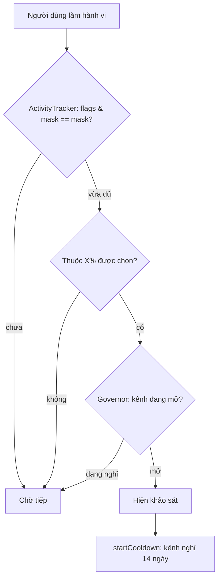

Ai làm sản phẩm cũng muốn hỏi người dùng: "Bạn có hài lòng không?", "Bạn có biết tính năng mới này?", "Thử giao diện mới nhé?". Mỗi đội một popup, mỗi popup một điều kiện `if` riêng. Kết quả quen thuộc: người dùng mở app là gặp ba popup chồng nhau, đóng hết, hôm sau lại gặp đúng ba popup đó.

Cần một chỗ **chung** trả lời câu hỏi "lúc này có được làm phiền người dùng không?", với các luật:

- Chỉ hỏi người **đã dùng đủ**: hỏi về Lịch người chưa bao giờ mở Lịch thì vô nghĩa.
- Hỏi xong thì **nghỉ** một thời gian, dù có bao nhiêu chiến dịch đang chờ.
- Chỉ hỏi **một phần** người dùng là đủ số liệu.
- Tip, mẹo nhỏ thì được hiện thường hơn, nhưng **không ngày nào cũng hiện**.

> [!TIP]
> **Tóm tắt**
> - Outlook trên web dùng **Floodgate**, SDK khảo sát trong app của Microsoft (có lẽ được port từ bản dùng trong Office), có ba lớp: `ActivityTracker` đếm hành vi và gói "đã đủ chưa" vào một **bitmask**; `Governor` giữ **cooldown theo kênh** (khảo sát 14 ngày, banner 15 ngày, khẩn cấp 0); `CampaignManager` chỉ **chọn X%** người dùng.
> - Kiểm tra "đủ hết điều kiện" chỉ là một phép so sánh: `(flags & mask) === mask`.
> - Bản viết lại thêm giới hạn "tối đa K ngày trong W ngày gần nhất" lưu gọn trong **một số 32 bit**, mỗi bit là một ngày.
> - Mọi hàm nhận `now` làm tham số: test được, và demo tua thời gian được.

<iframe class="demo-frame" src="/demos/web-patterns/index.html?theme=dark#/frequency-cap" title="Demo frequency-cap" loading="lazy" style="height: 820px"></iframe>

<p class="demo-links">▶ <a href="/demos/web-patterns/index.html#/frequency-cap" target="_blank" rel="noopener">Mở demo toàn màn hình ↗</a> · <a href="https://stackblitz.com/github/hunghg255/blog-hunghg/tree/master/examples/web-patterns?file=src/lib/frequencyCap.ts" target="_blank" rel="noopener">Sửa code trên StackBlitz ↗</a> · <a href="https://github.com/hunghg255/blog-hunghg/blob/master/examples/web-patterns/src/lib/frequencyCap.ts" target="_blank" rel="noopener">Xem source trên GitHub ↗</a></p>

Thử trong demo: bấm "Gửi email" ba lần rồi "Mở Lịch", khảo sát hiện ra. Lặp lại thì bị chặn vì kênh đang nghỉ 14 ngày; bấm "+7 ngày" hai lần để kênh mở lại. Ở phần tip, bấm "Mở hộp thư" nhiều lần trong ngày và qua nhiều ngày: chỉ ba ngày trong bảy ngày có tip. Hai con số "ngây thơ / có giới hạn" cho thấy người dùng đã bớt bị làm phiền bao nhiêu lần.

## Outlook làm thế nào?

Code Floodgate nằm ở `outlook.live.com/src/` ([xem trong repo](https://github.com/hunghg255/codebase/tree/main/outlook.live.com/src)): `ActivityTracker.ts`, `Governor.ts`, `GovernedChannel.ts`, `SurveyActivityListener.ts`, thư mục `Campaign/`. Đây là SDK của Microsoft được đóng gói vào bundle của Outlook, không phải code riêng của đội Outlook. Vài dấu vết cho thấy nó được chuyển từ ngôn ngữ khác sang: comment `// @Override` kiểu Java, comment "track ticks … in a thread-safe way" (JavaScript trên main thread không cần lo chuyện này), và dòng "Based on MSO" (MSO là thư viện dùng chung của Office).

Phía Outlook chỉ cần báo "người dùng vừa làm gì". Ví dụ trong `owa-calendar-events-actions/.../cancelCalendarEventOrchestrator.ts`:

```ts
// Log floodgate activity for cancelling a meeting. If the user doesn't belong to this group, triggering will be a no-op.
if (isHostAppFeatureEnabled('floodgate')) {
  const logFloodgateActivity = await lazyLogFloodgateActivity.import();
  logFloodgateActivity('MeetingCanceled');
}
```

Module Floodgate được tải lười (`lazy…import()`): người dùng không bao giờ thấy khảo sát thì không phải tải code khảo sát. Phần quyết định nằm hết trong SDK.

### `ActivityTracker`: nhiều ngưỡng, một bitmask

Mỗi khảo sát khai báo một danh sách hành vi cần theo dõi, mỗi hành vi một ngưỡng (vd "gửi email 5 lần", "mở Lịch 2 lần"). Constructor dựng mask:

```ts
if (trackingSet.getList().length > 32) {
  throw new Error("trackingSet list size must be less than 32");
}
for (let i = 0; i < this.trackedActivities.length; i++) {
  this.activationMask |= 0x1 << i;           // hành vi i = bit i
  if (this.trackedActivities[i].getCount() < 1) this.trackedActivities[i].setCount(1);
}
```

Mỗi lần hành vi `i` vượt ngưỡng thì `currentActivationFlags |= 0x1 << i`. Đủ hết điều kiện là `(currentActivationFlags & activationMask) === activationMask`. Không cần vòng lặp, không cần mảng boolean.

`incrementActivity(index, increment)` trả về một trong ba giá trị: `Pending` (chưa vượt ngưỡng nào), `SingleActivityActivated` (vừa vượt ngưỡng của một hành vi), `AllActivitiesActivated` (vừa vượt ngưỡng cuối cùng). Nó chỉ báo **đúng lúc vượt**: lưu `startedLessThanThreshold` trước khi cộng, rồi chỉ báo khi trước đó dưới ngưỡng và bây giờ đã đủ. Lần đếm thứ 6, thứ 7 sau đó không báo lại. Đây là kiểu "kích hoạt theo cạnh" (edge-triggered), giống cách đã gặp ở [ResizeObserver hay IntersectionObserver](/blogs/facebook-shared-intersection-observer).

Thêm hai chi tiết:

- **Tập có thứ tự** (`isOrdered`): hành vi phải xảy ra theo thứ tự, hành vi đứng sau `currentIndex` bị bỏ qua. Dùng cho kịch bản "mở tính năng X **rồi** dùng nó 3 lần".
- **Đếm qua nhiều phiên**: `initCounts` cộng số đếm của các phiên trước (với hành vi đánh dấu `IsAggregate`). Nếu tracker đã đủ điều kiện ngay khi khởi tạo, nó **không** bắn sự kiện ngay mà đặt cờ `isActivationByInitPending`, chờ người dùng làm một hành vi hợp lệ tiếp theo. Khảo sát vì vậy hiện ra lúc người dùng đang dùng tính năng, chứ không phải lúc vừa mở app.

Hai điểm nhỏ: thông báo lỗi nói "less than 32" nhưng điều kiện là `> 32` (cho phép đúng 32); và `isValidIndex` chỉ kiểm tra `index < length`, không chặn số âm.

### `Governor`: mỗi kênh một thời gian nghỉ

```ts
private static defaultChannelData: DefaultChannelData[] = [
  new DefaultChannelData("Standard", 14 * Governor.day),
  new DefaultChannelData("Urgent", 0),
  new DefaultChannelData("Banner", 15 * Governor.day),
  new DefaultChannelData("TeachingMessage", DEFAULT_TEACHING_MESSAGE_COOLDOWN * Governor.day), // 15
];
```

Khảo sát nào cũng thuộc một kênh. Hiện xong một khảo sát kênh Standard thì `startChannelCooldown(Standard)`: mọi khảo sát Standard khác phải đợi 14 ngày, dù thuộc đội nào. Giới hạn đặt trên **kênh**, không trên từng khảo sát, nên thêm chiến dịch mới không làm người dùng bị hỏi nhiều hơn. Trạng thái lưu là **thời điểm bắt đầu nghỉ**, không phải thời điểm hết nghỉ: đổi cấu hình cooldown thì áp dụng ngay cho cả người đang nghỉ.

### `CampaignManager`: chọn ai, và khi nào chọn lại

Mỗi chiến dịch có `nominationScheme` với tỉ lệ `percentageNumerator / percentageDenominator`:

```ts
// Creates a random number between [0 to (percentageDenominator - 1)]
return Math.floor(rand * this.percentageDenominator) < this.percentageNumerator;
```

Kết quả "được chọn hay không" được lưu lại, và chỉ bầu lại sau một khoảng: `nominationPeriod` nếu người dùng chưa thấy khảo sát, `cooldownPeriod` (nên dài hơn) nếu đã thấy. Khoảng này có thể tính bằng thời gian hoặc bằng **lần đổi bản build** (`CampaignDurationSingleBuildChange`): hỏi lại khi người dùng lên phiên bản mới, rất hợp cho khảo sát "bạn thấy bản cập nhật này thế nào". Có cả cờ `ForceCandidacy` để đội QA ép hiện khảo sát.

## Bên trong: bitmask trong JavaScript

Toán tử bit của JavaScript (`|`, `&`, `<<`, `>>`) làm việc trên **số nguyên có dấu 32 bit**. Vài điều cần nhớ:

- `1 << 31` là `-2147483648` (bit 31 là bit dấu). Muốn số không dấu thì thêm `>>> 0`.
- `x << 32` **bằng** `x`, không phải 0: số lần dịch chỉ lấy 5 bit thấp (32 & 31 = 0).
- `(1 << n) - 1` để tạo mask n bit sẽ sai với n = 31 và n = 32. Dùng `2 ** n - 1` an toàn hơn.
- Muốn quá 32 cờ thì dùng `BigInt` (`1n << 40n`) hoặc mảng số.

Với bộ đếm theo ngày, mỗi bit là một ngày: bit 0 là hôm nay, bit 1 là hôm qua… Sang ngày mới thì dịch trái số ngày đã trôi qua; bit nào ra khỏi cửa sổ thì không còn tính.



## Viết lại

File `src/lib/frequencyCap.ts` gồm bốn phần độc lập, dùng riêng hay ghép lại đều được.

### ActivityTracker

```ts title=src/lib/frequencyCap.ts
  return {
    increment(name: string, by = 1): IncrementResult {
      const index = activities.findIndex((a) => a.name === name);
      if (index < 0 || by <= 0) return 'pending';
      // `ordered`: phải làm theo thứ tự, việc phía sau chưa được tính
      if (ordered && index > currentIndex) return 'pending';
      const wasBelow = counts[index] < thresholds[index];
      counts[index] += by;
      // chỉ báo đúng lúc VƯỢT ngưỡng (theo cạnh), lần đếm sau đó không báo lại
      if (!(wasBelow && counts[index] >= thresholds[index])) return 'pending';
      finish(index);
      return (flags & allMask) === allMask ? 'all-activated' : 'single-activated';
    },
    isActivated: () => (flags & allMask) === allMask,
```

`wasBelow` giữ vai trò `startedLessThanThreshold` của Floodgate. Bản viết lại tra hành vi theo tên thay vì theo chỉ số, giới hạn 31 hành vi để không đụng bit dấu, và `allMask = 2 ** n - 1` thay cho vòng lặp OR.

### Governor

Gần như giữ nguyên ý của Floodgate: lưu `{ [kênh]: thời điểm bắt đầu nghỉ }`, `isOpen` so `now` với `start + cooldowns[kênh]`. Tham số `storage` là bất kỳ thứ gì có `getItem`/`setItem`: `localStorage`, một wrapper quanh API server (để đồng bộ giữa thiết bị), hoặc `Map` khi test.

### Chọn X% người dùng: băm thay vì random

```ts title=src/lib/frequencyCap.ts
export function isNominated(
  userId: string,
  campaignId: string,
  numerator: number,
  denominator = 100,
) {
  return hash32(`${campaignId}:${userId}`) % denominator < numerator;
}
```

Floodgate random rồi lưu kết quả. Cách đó đúng trên một thiết bị, nhưng người dùng Outlook mở trên ba máy sẽ có ba lần bốc thăm, xác suất được hỏi tăng gần gấp ba. Băm `campaignId:userId` cho ra cùng một kết quả ở mọi nơi, không cần lưu gì. Thêm `campaignId` vào chuỗi băm để mỗi chiến dịch chọn một nhóm khác nhau, không phải lúc nào cũng là đúng 10% người dùng đó.

### Giới hạn theo ngày bằng bitmask (phần mở rộng)

```ts title=src/lib/frequencyCap.ts
  /** dịch mask cho tới hôm nay: mỗi ngày trôi qua đẩy các bit sang trái một vị trí */
  function current(now: number): DayMask {
    const saved = readJson<DayMask>(storage, key, { day: localDay(now), mask: 0 });
    const today = localDay(now);
    const shift = today - saved.day;
    if (shift <= 0) return saved; // cùng ngày (hoặc đồng hồ bị lùi): giữ nguyên
    // `<<` trong JS chỉ lấy 5 bit thấp của số dịch (x << 32 === x), nên phải tự xử lý shift >= 32
    return { day: today, mask: shift >= 32 ? 0 : (saved.mask << shift) >>> 0 };
  }

  return {
    daysUsed: (now = Date.now()) => popcount(current(now).mask & windowMask),
    canShow(now = Date.now()) {
      const { mask } = current(now);
      if (oncePerDay && mask & 1) return false; // hôm nay đã hiện rồi
      return popcount(mask & windowMask) < maxDays;
    },
    record(now = Date.now()) {
      const state = current(now);
      storage.setItem(key, JSON.stringify({ day: state.day, mask: (state.mask | 1) >>> 0 }));
    },
```

- `current()` dịch mask tới hôm nay trước khi đọc hay ghi. Dịch từ 32 ngày trở lên thì mọi bit đều ra khỏi cửa sổ: trả về 0 thay vì tin vào `<<`.
- `canShow`: đã hiện hôm nay (bit 0) thì thôi, không thì đếm số bit 1 trong cửa sổ (`popcount`).
- `localDay` tính ngày theo giờ địa phương: "một lần mỗi ngày" theo cảm nhận của người dùng là qua nửa đêm của họ, không phải nửa đêm UTC.

Toàn bộ trạng thái là `{ day, mask }`, khoảng 30 byte trong `localStorage`, so với một mảng timestamp lớn dần theo thời gian.

::: spoiler Xem toàn bộ src/lib/frequencyCap.ts

```ts title=src/lib/frequencyCap.ts
/**
 * Quyết định KHI NÀO được hiện khảo sát / tip / banner cho người dùng, theo cách của Floodgate
 * (SDK khảo sát in-app của Microsoft, nằm trong bundle outlook.live.com):
 *
 * 1. ActivityTracker: điều kiện "đã làm đủ N việc" gói trong một bitmask 32 bit.
 * 2. Governor: mỗi kênh hiển thị (khảo sát, banner, tip…) có thời gian nghỉ (cooldown) riêng.
 * 3. Nomination: chỉ chọn X% người dùng.
 * Thêm (không có trong Floodgate): giới hạn "tối đa K ngày trong W ngày gần nhất" bằng bitmask theo ngày.
 *
 * Mọi hàm nhận `now` để test và để demo tua thời gian.
 */

export interface KeyValueStorage {
  getItem(key: string): string | null;
  setItem(key: string, value: string): void;
}

function readJson<T>(storage: KeyValueStorage, key: string, fallback: T): T {
  try {
    const raw = storage.getItem(key);
    return raw ? (JSON.parse(raw) as T) : fallback;
  } catch {
    return fallback; // dữ liệu hỏng: coi như chưa có
  }
}

// ---------- 1. ActivityTracker: nhiều ngưỡng, một bitmask ----------

export interface TrackedActivity {
  name: string;
  /** cần xảy ra bao nhiêu lần, tối thiểu 1 */
  count: number;
}

export type IncrementResult = 'pending' | 'single-activated' | 'all-activated';

export function createActivityTracker(activities: TrackedActivity[], { ordered = false } = {}) {
  if (activities.length === 0 || activities.length > 31) {
    // 31 thay vì 32: bit 31 là bit dấu của số nguyên 32 bit trong JS, tránh cho dễ đọc
    throw new Error('cần từ 1 đến 31 activity');
  }
  const thresholds = activities.map((a) => Math.max(1, a.count));
  const allMask = 2 ** activities.length - 1; // vd 3 activity -> 0b111
  let counts = activities.map(() => 0);
  let flags = 0; // bit i = activity i đã đủ ngưỡng
  let currentIndex = 0; // với `ordered`: activity đang chờ

  function finish(index: number) {
    flags |= 1 << index;
    if (index + 1 < activities.length) currentIndex = index + 1;
  }

  return {
    increment(name: string, by = 1): IncrementResult {
      const index = activities.findIndex((a) => a.name === name);
      if (index < 0 || by <= 0) return 'pending';
      // `ordered`: phải làm theo thứ tự, việc phía sau chưa được tính
      if (ordered && index > currentIndex) return 'pending';
      const wasBelow = counts[index] < thresholds[index];
      counts[index] += by;
      // chỉ báo đúng lúc VƯỢT ngưỡng (theo cạnh), lần đếm sau đó không báo lại
      if (!(wasBelow && counts[index] >= thresholds[index])) return 'pending';
      finish(index);
      return (flags & allMask) === allMask ? 'all-activated' : 'single-activated';
    },
    isActivated: () => (flags & allMask) === allMask,
    getFlags: () => flags,
    getCounts: () => [...counts],
    reset() {
      counts = activities.map(() => 0);
      flags = 0;
      currentIndex = 0;
    },
  };
}

// ---------- 2. Governor: cooldown theo kênh ----------

export const DAY = 24 * 60 * 60 * 1000;

/** Giá trị mặc định của Floodgate: Standard 14 ngày, Urgent 0, Banner 15, TeachingMessage 15. */
export const DEFAULT_COOLDOWNS = {
  standard: 14 * DAY,
  urgent: 0,
  banner: 15 * DAY,
  teaching: 15 * DAY,
};

export function createGovernor<C extends string>(
  storage: KeyValueStorage,
  cooldowns: Record<C, number>,
  key = 'fc-governor',
) {
  // lưu thời điểm BẮT ĐẦU nghỉ (như Floodgate), thời điểm mở lại = start + cooldown hiện tại:
  // đổi cấu hình cooldown thì áp dụng ngay cho cả người dùng cũ
  const load = () => readJson<Partial<Record<C, number>>>(storage, key, {});
  return {
    isOpen(channel: C, now = Date.now()) {
      const start = load()[channel];
      return start === undefined || now >= start + cooldowns[channel];
    },
    opensAt(channel: C) {
      const start = load()[channel];
      return start === undefined ? null : start + cooldowns[channel];
    },
    startCooldown(channel: C, now = Date.now()) {
      storage.setItem(key, JSON.stringify({ ...load(), [channel]: now }));
    },
  };
}

// ---------- 3. Chọn X% người dùng ----------

/** FNV-1a 32 bit: băm chuỗi ra số nguyên không dấu, đủ đều cho việc chia nhóm. */
export function hash32(text: string): number {
  let h = 0x811c9dc5;
  for (let i = 0; i < text.length; i++) {
    h ^= text.charCodeAt(i);
    h = Math.imul(h, 0x01000193);
  }
  return h >>> 0;
}

/**
 * Floodgate: `Math.floor(Math.random() * denominator) < numerator`, rồi lưu kết quả cho cả kỳ.
 * Ở đây băm userId + campaignId: cùng người luôn cùng kết quả, trên mọi thiết bị, không cần lưu.
 */
export function isNominated(
  userId: string,
  campaignId: string,
  numerator: number,
  denominator = 100,
) {
  return hash32(`${campaignId}:${userId}`) % denominator < numerator;
}

// ---------- 4. Giới hạn theo ngày bằng bitmask (mở rộng) ----------

/** Số thứ tự ngày theo giờ ĐỊA PHƯƠNG (qua nửa đêm của người dùng mới tính là ngày mới). */
export function localDay(now: number) {
  const offset = new Date(now).getTimezoneOffset() * 60_000;
  return Math.floor((now - offset) / DAY);
}

function popcount(n: number) {
  let count = 0;
  for (let x = n >>> 0; x; x &= x - 1) count++;
  return count;
}

interface DayMask {
  /** ngày ứng với bit 0 */
  day: number;
  /** bit i = 1: có hiển thị vào ngày (day - i) */
  mask: number;
}

/**
 * "Tối đa `maxDays` ngày có hiển thị trong `windowDays` ngày gần nhất", lưu trong MỘT số 32 bit.
 * Mỗi ngày một bit: `oncePerDay` (mặc định) thì mỗi ngày hiện tối đa một lần; tắt đi thì hiện
 * nhiều lần trong ngày vẫn chỉ tính là một ngày.
 */
export function createDailyCap(
  storage: KeyValueStorage,
  key: string,
  { maxDays = 3, windowDays = 7, oncePerDay = true } = {},
) {
  if (windowDays < 1 || windowDays > 32) throw new Error('windowDays phải từ 1 đến 32');
  const windowMask = 2 ** windowDays - 1; // 7 ngày -> 0b1111111

  /** dịch mask cho tới hôm nay: mỗi ngày trôi qua đẩy các bit sang trái một vị trí */
  function current(now: number): DayMask {
    const saved = readJson<DayMask>(storage, key, { day: localDay(now), mask: 0 });
    const today = localDay(now);
    const shift = today - saved.day;
    if (shift <= 0) return saved; // cùng ngày (hoặc đồng hồ bị lùi): giữ nguyên
    // `<<` trong JS chỉ lấy 5 bit thấp của số dịch (x << 32 === x), nên phải tự xử lý shift >= 32
    return { day: today, mask: shift >= 32 ? 0 : (saved.mask << shift) >>> 0 };
  }

  return {
    daysUsed: (now = Date.now()) => popcount(current(now).mask & windowMask),
    canShow(now = Date.now()) {
      const { mask } = current(now);
      if (oncePerDay && mask & 1) return false; // hôm nay đã hiện rồi
      return popcount(mask & windowMask) < maxDays;
    },
    record(now = Date.now()) {
      const state = current(now);
      storage.setItem(key, JSON.stringify({ day: state.day, mask: (state.mask | 1) >>> 0 }));
    },
    /** chuỗi bit để hiển thị: ký tự đầu là hôm nay */
    describe(now = Date.now()) {
      const { mask } = current(now);
      return Array.from({ length: windowDays }, (_, i) => ((mask >>> i) & 1 ? '■' : '□')).join('');
    },
  };
}
```

:::

**Khác bản gốc:** Floodgate là một engine đầy đủ (định nghĩa chiến dịch tải từ server, phạm vi theo môi trường và user fact, đếm qua nhiều phiên, hàng đợi hành vi tối đa 100 phần tử khi SDK chưa sẵn sàng). Bản viết lại chỉ giữ ba ý chính (bitmask điều kiện, cooldown theo kênh, chọn X%), đổi random sang băm, và thêm giới hạn theo ngày (không có trong Floodgate).

## Tại sao không làm cách khác?

**Lưu danh sách timestamp các lần hiện.** Dễ hiểu và chính xác tới từng giây. Nhưng mảng lớn dần, phải tự dọn phần cũ, và câu hỏi "bao nhiêu ngày khác nhau" phải tự gom nhóm. Khi luật chỉ ở mức ngày, bitmask gọn hơn nhiều.

**Để server quyết định.** Đúng nếu cần đồng bộ giữa thiết bị hoặc đổi luật mà không deploy client. Nhưng mỗi lần mở app phải hỏi server trước khi được hiện tip, và offline thì không có gì. Floodgate lấy định nghĩa chiến dịch từ server nhưng quyết định ở client.

**Mảng boolean thay cho bitmask.** Cũng được, `every(Boolean)` thay cho `(flags & mask) === mask`. Bitmask có lợi khi lưu (một số thay vì mảng) và khi so sánh nhanh nhiều tracker. Với vài hành vi thì khác biệt về tốc độ không đáng kể; lý do chính là gọn.

## Edge case và cạm bẫy

- **Đồng hồ máy người dùng sai hoặc bị chỉnh.** Lùi đồng hồ thì `shift <= 0`, bản viết lại giữ nguyên mask (không xoá lịch sử). Tiến đồng hồ xa rồi chỉnh lại thì mask đã bị dịch hết, người dùng được hiện tip sớm hơn. Cần chính xác tuyệt đối thì dùng thời gian server.
- **Đổi múi giờ** (đi công tác) có thể làm một ngày bị tính hai lần hoặc mất một ngày. Với tip thì chấp nhận được.
- **Nhiều tab.** Hai tab cùng đọc `canShow() === true` rồi cùng hiện. Ghi `record()` ngay khi quyết định hiện (trước khi animation chạy), hoặc chỉ cho [tab chủ](/blogs/web-leader-tab-notifications) hiện.
- **`localStorage` bị chặn** (Safari chế độ riêng tư cũ, iframe bên thứ ba): bọc `try/catch` và có bản dự phòng trong bộ nhớ như demo, chấp nhận mất trạng thái khi tải lại trang.
- **Hành vi bị đếm trùng.** Gọi `increment` trong render hoặc trong effect chạy hai lần (StrictMode) là đếm sai. Chỉ đếm trong event handler hoặc ở tầng logic, như Outlook gọi trong orchestrator.
- **Băm `userId` lộ thông tin?** Kết quả chỉ là "được chọn hay không". Nếu `userId` là email thì vẫn không nên gửi chuỗi băm đi đâu.

## Dùng trong dự án

```ts
const governor = createGovernor(localStorage, { survey: 14 * DAY, banner: 15 * DAY, urgent: 0 });
const npsTracker = createActivityTracker([{ name: 'doc-saved', count: 5 }, { name: 'shared', count: 1 }]);

export function logActivity(name: string) {
  if (npsTracker.increment(name) !== 'all-activated') return;
  npsTracker.reset();
  if (isNominated(currentUser.id, 'nps-2026-q4', 10) && governor.isOpen('survey')) {
    governor.startCooldown('survey');
    showNpsSurvey();
  }
}
```

Gắn `logActivity('doc-saved')` vào các chỗ hành vi xảy ra. Tracker trong ví dụ chỉ đếm trong một phiên; muốn đếm qua nhiều phiên thì lưu `getCounts()` và nạp lại khi khởi tạo, như `initCounts` của Floodgate.

## Kiểm thử

::: spoiler Ví dụ test (bản phác, không có trong repo)

```ts
import { createActivityTracker, createDailyCap, createGovernor, DAY, isNominated } from './frequencyCap';

const memory = () => {
  const m = new Map<string, string>();
  return { getItem: (k: string) => m.get(k) ?? null, setItem: (k: string, v: string) => void m.set(k, v) };
};

test('tracker chỉ báo đúng lúc vượt ngưỡng', () => {
  const t = createActivityTracker([{ name: 'send', count: 3 }, { name: 'calendar', count: 1 }]);
  expect(['send', 'calendar', 'send', 'send', 'send'].map((n) => t.increment(n))).toEqual([
    'pending', 'single-activated', 'pending', 'all-activated', 'pending',
  ]);
  expect(t.getFlags()).toBe(0b11);
});

test('tập có thứ tự bỏ qua hành vi đến sớm', () => {
  const t = createActivityTracker([{ name: 'a', count: 1 }, { name: 'b', count: 1 }], { ordered: true });
  expect(t.increment('b')).toBe('pending');
  expect(t.increment('a')).toBe('single-activated');
  expect(t.increment('b')).toBe('all-activated');
});

test('governor: kênh nghỉ đúng 14 ngày', () => {
  const now = Date.UTC(2026, 9, 27);
  const g = createGovernor(memory(), { survey: 14 * DAY });
  g.startCooldown('survey', now);
  expect(g.isOpen('survey', now + 14 * DAY - 1)).toBe(false);
  expect(g.isOpen('survey', now + 14 * DAY)).toBe(true);
});

test('daily cap: 3 ngày trong 7 ngày, mỗi ngày một lần', () => {
  const day0 = new Date(2026, 9, 27, 10).getTime();
  const cap = createDailyCap(memory(), 'tips', { maxDays: 3, windowDays: 7 });
  for (const d of [0, 1, 3]) {
    expect(cap.canShow(day0 + d * DAY)).toBe(true);
    cap.record(day0 + d * DAY);
    expect(cap.canShow(day0 + d * DAY)).toBe(false); // cùng ngày
  }
  expect(cap.canShow(day0 + 4 * DAY)).toBe(false); // đã đủ 3 ngày
  expect(cap.canShow(day0 + 7 * DAY)).toBe(true); // ngày 0 đã ra khỏi cửa sổ
  expect(cap.daysUsed(day0 + 40 * DAY)).toBe(0); // dịch >= 32 bit
});

test('chọn X%: ổn định và gần đúng tỉ lệ', () => {
  expect(isNominated('u1', 'c', 30)).toBe(isNominated('u1', 'c', 30));
  const picked = Array.from({ length: 10_000 }, (_, i) => isNominated(`u${i}`, 'c', 10)).filter(Boolean);
  expect(picked.length).toBeGreaterThan(900);
  expect(picked.length).toBeLessThan(1100);
});
```

:::

## So với các công cụ có sẵn

- **Nền tảng khảo sát/onboarding** (Intercom, Pendo, Appcues, Sprig…) đều có "frequency cap", "throttling" toàn cục cho mọi chiến dịch. Đó chính là `Governor`. Nếu đã dùng một công cụ như vậy thì bật tính năng đó lên thay vì tự viết.
- **Feature flag** (LaunchDarkly, GrowthBook, Unleash) chia nhóm người dùng bằng băm, giống `isNominated`, kèm giao diện quản lý.
- **Floodgate** là công cụ nội bộ của Microsoft, không phát hành riêng. Đáng đọc vì các ý tưởng trong đó (kênh, cooldown, kích hoạt theo cạnh, bầu lại theo bản build) dùng được với bất kỳ hệ thống nào.

---

Bài này thuộc series **[Học từ mã nguồn các web lớn](/series/web)** (65 bài, đọc theo thứ tự).

::: spoiler Xem nhanh danh sách bài trong series

*Mở đầu*

- [Mở đầu: đọc code production của 28 trang web](/blogs/learn-from-big-web-apps)

*Phần 1: trải nghiệm người dùng*

- [#1 Dark mode không nháy (Gatsby)](/blogs/web-dark-mode-no-flash)
- [#2 useValueByMedia: giá trị theo breakpoint (Toptal)](/blogs/web-use-value-by-media)
- [#3 Đoán ý định: idle, exit-intent, lắc chuột (Toptal, InVision)](/blogs/web-user-intent-idle-exit-wiggle)
- [#4 Validate form thân thiện (Udacity, Pipedrive)](/blogs/web-form-validation-ux)
- [#5 Magic number, EXIF và dán ảnh (Ello)](/blogs/web-file-magic-number-exif-paste)
- [#6 fastSmoothScroll: cuộn xa vẫn nhanh (Telegram)](/blogs/web-telegram-fast-smooth-scroll)
- [#7 Countdown time-travel và tombstone giỏ hàng (Best Buy)](/blogs/web-countdown-time-travel-tombstone)

*Phần 2: hiệu năng và đo lường*

- [#8 Hàng đợi requestAnimationFrame 3ms (Apple)](/blogs/web-raf-queue-3ms)
- [#9 srcset cho artwork và preconnect tự động (Apple)](/blogs/web-responsive-artwork-preconnect)
- [#10 Quick-fetch: gọi API trước khi bundle tải xong (HubSpot)](/blogs/web-quick-fetch-early-requests)
- [#11 Performance span và long task (Postman, Calibre)](/blogs/web-performance-spans-long-tasks)
- [#12 Gọi Web Worker như hàm async (Telegram)](/blogs/web-worker-promise-rpc)
- [#13 Đồng hồ media: đếm giờ xem và sửa lệch (Skillshare, Simplified)](/blogs/web-media-clock-watch-time-drift)

*Phần 3: nhiều tab, phiên đăng nhập, cập nhật*

- [#14 Bầu tab chủ cho thông báo (HubSpot, Telegram)](/blogs/web-leader-tab-notifications)
- [#15 Đồng bộ đăng nhập giữa tab và giới hạn cookie (Elastic, InVision)](/blogs/web-cross-tab-auth-cookie-guard)
- [#16 SPA tự cập nhật: Trello, Zappos, Facebook, Elastic](/blogs/web-spa-self-update-strategies)

*Phần 4: kiến trúc*

- [#17 Reverse portal: di chuyển component không remount (Zappos)](/blogs/web-reverse-portal)
- [#18 Page behaviors: gắn hành vi từ CMS (Intercom)](/blogs/web-page-behaviors-cms)
- **#19 Giới hạn tần suất hiển thị bằng bitmask (Outlook)** (bài này)
- [#20 Chuyển REST sang GraphQL dần dần (Coursera)](/blogs/web-rest-to-graphql-hybrid-link)

*Phần 5: soạn thảo và hiển thị nội dung*

- [#21 Autocomplete tại con trỏ trong contenteditable (Ello, Telegram)](/blogs/web-caret-autocomplete-contenteditable)
- [#22 Dark mode cho email HTML bằng CIELAB (Outlook)](/blogs/web-email-dark-mode-cielab)
- [#23 Thu nhỏ bảng rộng cho vừa khung, vá font emoji (Outlook)](/blogs/web-email-wide-content-scale)
- [#24 Cảnh báo quên đính kèm file (Outlook)](/blogs/web-forgotten-attachment-warning)
- [#25 Cắt chữ nhiều dòng chính xác (Pipedrive, Apple, Toptal)](/blogs/web-multiline-truncate-measure-text)
- [#26 Parse ngày giờ gõ tay khoan dung (Outlook, Elastic)](/blogs/web-lenient-date-parser)

*Phần 6: tương tác*

- [#27 menuAim: rê chéo vào submenu không bị đóng (Udemy)](/blogs/web-menu-aim-triangle)
- [#28 Kéo, vuốt chung cho chuột và cảm ứng (Telegram)](/blogs/web-unified-pointer-gestures)
- [#29 Phím tắt theo phạm vi, IME và bàn phím phi Latinh (Trello)](/blogs/web-scoped-keyboard-shortcuts)
- [#30 Nội suy màu: đổi theme và nền theo cuộn (Telegram, Anchor)](/blogs/web-color-interpolation-theme-scroll)
- [#31 Đường gióng hút cạnh và undo/redo trên canvas (Simplified)](/blogs/web-canvas-snap-guides-undo)
- [#32 Giả lập mù màu bằng feColorMatrix (Trello)](/blogs/web-color-vision-simulator)
- [#33 Vạch thước theo mức zoom và cấp phát màu cho biểu đồ (Anchor, Similarweb)](/blogs/web-timeline-ticks-color-stack)

*Phần 7: mạng, dữ liệu và async*

- [#34 Ô tìm kiếm chuẩn production (Similarweb, Udemy, Pipedrive)](/blogs/web-production-search-box)
- [#35 Điều phối async: latest-wins, single-flight (Glitch, Toptal)](/blogs/web-async-coordination-latest-wins)
- [#36 Polling thưa dần và debounce động (Trello)](/blogs/web-decaying-polling-dynamic-debounce)
- [#37 Cache phía client theo version (Similarweb, Telegram, Udemy)](/blogs/web-client-cache-versioned)
- [#38 Upload file lớn theo chunk (Outlook, Tribe)](/blogs/web-chunked-upload-pipeline)
- [#39 Phát video qua Service Worker bằng Range request (Telegram, Outlook)](/blogs/web-service-worker-range-streaming)

*Phần 8: hiệu năng và vận hành*

- [#40 TTI governor: hoãn việc phụ tới sau khi trang dùng được (Outlook)](/blogs/web-tti-governor)
- [#41 Tự đo LCP/CLS/TBT và phục vụ bản nhẹ cho máy yếu (Udemy)](/blogs/web-rum-adaptive-loading)

*Phần 9: thuật toán và dữ liệu phía client*

- [#42 Three-way merge ngay trên trình duyệt (Postman)](/blogs/web-three-way-merge-client)
- [#43 Dọn cache GraphQL bằng đếm tham chiếu (Outlook)](/blogs/web-graphql-cache-refcount-gc)
- [#44 LRU cache theo 3 cách (Apple, Similarweb, Outlook)](/blogs/web-lru-cache-three-ways)
- [#45 Lọc tăng dần trong Web Worker (Similarweb)](/blogs/web-incremental-filter-worker)
- [#46 Xếp hạng gợi ý trên client, so ngầm với server (Outlook)](/blogs/web-client-side-ranking-shadow-test)
- [#47 Nối OT với editor: undo stack và chặn echo (Glitch)](/blogs/web-ot-codemirror-undo)
- [#48 Ngôn ngữ markup riêng dịch hai chiều với HTML (Coursera)](/blogs/web-custom-markup-compiler)

*Phần 10: thời gian, ngôn ngữ, định dạng*

- [#49 Xử lý giờ mùa hè không cần thư viện (Udemy, Pipedrive)](/blogs/web-dst-without-library)
- [#50 Intl thực chiến: Segmenter, số rút gọn, số nhiều, fallback locale (Apple, Outlook)](/blogs/web-intl-in-production)
- [#51 WebVTT và bôi chọn transcript (Udemy, Coursera)](/blogs/web-webvtt-transcript-selection)

*Phần 11: tương tác và giao diện*

- [#52 Kéo-thả trên lịch (Pipedrive)](/blogs/web-calendar-drag-drop)
- [#53 Focus stack cho popup lồng nhau (Outlook)](/blogs/web-focus-stack-nested-popups)
- [#54 Clipboard: copy, dán chữ thuần, dán thông minh (Trello, Anchor, Pipedrive, Tribe)](/blogs/web-clipboard-tricks)
- [#55 Khôi phục vị trí cuộn khi trang còn đang tải (Apple, Zappos)](/blogs/web-scroll-restore-wait-height)
- [#56 Lấy màu từ ảnh: gradient nền, màu chữ (Apple, Telegram, Trello)](/blogs/web-colors-from-images)
- [#57 JS đọc breakpoint từ CSS, phát hiện chế độ PWA (Ello, Apple)](/blogs/web-css-js-breakpoint-bridge)

*Phần 12: media*

- [#58 Tin nhắn thoại: ghi âm, waveform realtime, nén 5-bit (Telegram)](/blogs/web-voice-message-waveform)
- [#59 Chụp frame video thành ảnh, canvas bị taint (Coursera, Outlook)](/blogs/web-video-frame-snapshot)

*Phần 13: đo lường, bảo mật, vận hành*

- [#60 Đo lúc ảnh màn hình đầu tải xong, cả khi chuyển trang SPA (Zappos, Best Buy, Outlook)](/blogs/web-above-the-fold-image-timing)
- [#61 Buffer analytics chờ SDK, phát hiện adblock (Best Buy)](/blogs/web-analytics-buffer-adblock)
- [#62 Proof-of-work trên client để chặn API ẩn danh (Udemy)](/blogs/web-client-proof-of-work)
- [#63 Prefetch không làm lệch số liệu, nén cài đặt bằng bit (Outlook)](/blogs/web-synthetic-prefetch-bit-flags)
- [#64 Micro-frontend: AngularJS và React chung app, giao tiếp xuyên frame (Similarweb, InVision, HubSpot)](/blogs/web-micro-frontend-bridges)

:::

Code + demo: [`examples/web-patterns`](https://github.com/hunghg255/blog-hunghg/tree/master/examples/web-patterns) · [Mở trên StackBlitz](https://stackblitz.com/github/hunghg255/blog-hunghg/tree/master/examples/web-patterns)
