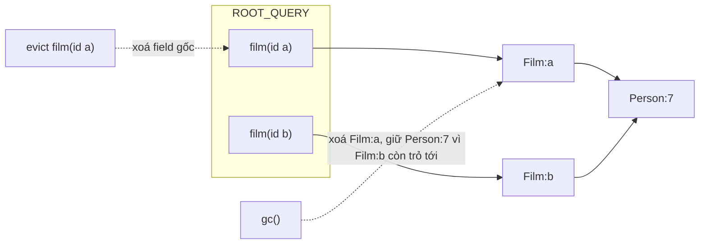

Cache GraphQL kiểu Apollo giữ mọi thứ đã từng tải. Với một trang tin tức mở vài phút thì không sao. Với Outlook, tab mở cả ngày, người dùng lướt qua hàng nghìn thư, lịch, danh bạ: cache chỉ có tăng, bộ nhớ của tab cứ thế phình.

Xoá ngay khi component unmount thì sao? Người dùng bấm sang thư khác rồi quay lại sau một giây: phải tải lại thứ vừa xoá. React còn có những lúc mount, unmount, mount lại liên tục (StrictMode, đổi `key`, Suspense), mỗi lần như vậy là một request thừa.

Outlook giải bằng một module nhỏ tên `QueryTracker`: **đếm số component đang dùng mỗi query; hết người dùng thì chờ 30 giây, nếu vẫn không ai dùng lại thì mới xoá field khỏi cache và chạy gc**.

> [!TIP]
> **Tóm tắt**
> - Component mount thì "giữ" (retain) query, unmount thì "nhả". Cache biết query nào còn được hiển thị.
> - Hết người giữ thì **chờ** một lúc (Outlook: 30 giây) rồi mới dọn: tránh tải lại khi component mount lại ngay.
> - Đếm theo **field gốc** chứ không chỉ theo query: hai query khác nhau có thể cùng chọn `film(id: 1)`. Dọn xong thì gc các entity không còn ai trỏ tới.
> - Mount lại trong lúc chờ phải **huỷ hẹn giờ**. Bản của Outlook không huỷ, nên có lúc dọn sớm hơn 30 giây rất nhiều.

<iframe class="demo-frame" src="/demos/web-patterns/index.html?theme=dark#/refcount-cache" title="Demo refcount-cache" loading="lazy" style="height: 900px"></iframe>

<p class="demo-links">▶ <a href="/demos/web-patterns/index.html#/refcount-cache" target="_blank" rel="noopener">Mở demo toàn màn hình ↗</a> · <a href="https://stackblitz.com/github/hunghg255/blog-hunghg/tree/master/examples/web-patterns?file=src/lib/refCountCache.ts" target="_blank" rel="noopener">Sửa code trên StackBlitz ↗</a> · <a href="https://github.com/hunghg255/blog-hunghg/blob/master/examples/web-patterns/src/lib/refCountCache.ts" target="_blank" rel="noopener">Xem source trên GitHub ↗</a></p>

Ở chế độ "Đếm tham chiếu + chờ 3s", bấm "Đóng/mở thẻ A 5 lần": vẫn chỉ 1 request. Đổi sang "Dọn ngay khi unmount" và bấm lại: 5 request. Chế độ "Không bao giờ dọn" thì không tải lại, nhưng mọi field và entity nằm mãi trong cache.

## Outlook làm thế nào?

Code ở [`outlook.live.com/src/modules/owa-query-tracker/src/queryTracker.ts`](https://github.com/hunghg255/codebase/blob/main/outlook.live.com/src/modules/owa-query-tracker/src/queryTracker.ts), khoảng 220 dòng. Hook gọi nó nằm ở `owa-apollo-hooks/src/useQueryTracker.ts`, được `useManagedQuery` và `useManagedMutation` dùng.

### Hai bảng đếm: query và selection

```ts
// When tracked queries reach a 0 reference count, the hx session id associated with them is released
interface TrackedQuery { key: DocumentNode; variables: any; sessionId?: SessionId; count: number; disposed?: boolean }

// When tracked selections reach a 0 reference count, their result is evicted from the apollo cache
// Note: selections needs to tracked independently of query documents because unrelated query documents can
// have the same selection -- we don't want to kick a cached result out from under an active component!
interface TrackedSelection { key: string; variables: any; count: number; disposed?: boolean }
```

Query `GetFilm { Film(id: "x") { … } }` để lại trong cache Apollo một field gốc `ROOT_QUERY.Film({"id":"x"})` trỏ tới entity `Film:x`. Comment của Outlook nói rõ lý do đếm riêng từng **selection** (field gốc): hai query khác nhau hoàn toàn vẫn có thể cùng chọn `Film(id: "x")`. Xoá theo query sẽ "rút thảm" dưới chân component kia.

`extractSelections` duyệt `selectionSet` cấp cao nhất của document, lấy tên field và giá trị các biến được truyền vào field đó. Bảng tra (`keyVariablesMap.ts`) dùng document làm khoá, rồi tìm tuyến tính theo `isEqual(variables)`; tác giả ghi chú sẵn rằng danh sách dài quá 500 phần tử sẽ log cảnh báo `KVMap.TooBig`.

### Nhả, chờ 30 giây, rồi evict + gc

Rút gọn từ `releaseRef` và `maybeCleanup`:

```ts
const CLEANUP_DELAY_MS = 1000 * 30;

function releaseRef(op) {
  const query = trackedQueries.get({ key: op.query, variables: op.variables });
  const selections = extractSelections(query).map(trackedSelections.get);
  decrement(query);
  selections.forEach(decrement);
  if (query.count === 0) {
    // don't immediately cleanup because we don't want to thrash in cases where react mounts/unmount/mounts
    self.setTimeout(() => maybeCleanup(query, selections), CLEANUP_DELAY_MS);
  }
}

function maybeCleanup(trackedQuery, querySelections) {
  if (!trackedQuery.disposed && trackedQuery.count === 0) {
    // trả session của tầng dữ liệu (hx), xoá query khỏi bảng
    querySelections.forEach((selection) => {
      if (!selection.disposed && selection.count === 0) {
        getApolloClient().cache.evict({ id: 'ROOT_QUERY', fieldName: selection.key, args: selection.variables, broadcast: false });
        selection.disposed = true;
      }
    });
    if (evicted) getApolloClient().cache.gc();
  }
}
```

Hai bước cuối là API thật của Apollo Client 3: `cache.evict` xoá **field gốc**, còn entity mà field đó trỏ tới vẫn nằm trong cache; `cache.gc()` mới quét và xoá những entity không còn đường nào trỏ tới từ `ROOT_QUERY`. `broadcast: false` để việc dọn không làm các query đang hiển thị chạy lại.

### Hook gọi nó: chạy lại sau mỗi lần render

```ts
export function useQueryTracker(query, options) {
  const op = { query, variables: options?.variables, context: options?.context };
  useEffect(() => {
    QueryTracker.addRef(op);
    return () => QueryTracker.releaseRef(op);
  });
}
```

`useEffect` **không có mảng phụ thuộc**, nên chạy lại sau **mỗi lần render**: nhả (đếm về 0, hẹn giờ dọn), rồi giữ lại (đếm lên 1). Có lẽ tác giả muốn chắc chắn biến mới luôn được theo dõi. Cái giá là mỗi lần render để lại một `setTimeout` 30 giây.

### Hẹn giờ không được huỷ: có lúc dọn gần như ngay

`releaseRef` hẹn giờ mỗi khi đếm về 0 nhưng **không lưu id của timer**, nên không huỷ được. `maybeCleanup` chỉ kiểm tra "lúc timer chạy, đếm có bằng 0 không". Ghép với hook ở trên, một kịch bản cụ thể:

| Thời điểm | Sự kiện | Đếm | Timer |
|---|---|---|---|
| 0s | component mount | 1 | |
| 10s | component render lại (đổi state) | 0 rồi 1 | T1 hẹn lúc 40s |
| 39s | người dùng đóng khung, component unmount | 0 | T2 hẹn lúc 69s |
| **40s** | **T1 chạy, thấy đếm = 0** | | **dọn ngay** |
| 41s | người dùng mở lại khung | 1 | phải tải lại |

Unmount mới 1 giây mà dữ liệu đã bị xoá, đúng tình huống "mount/unmount/mount" mà comment trong code muốn tránh. Sửa rất gọn: lưu id timer trong object query, giữ lại thì `clearTimeout`.

## Bên trong: evict và gc trong cache chuẩn hoá

Apollo (và urql với graphcache, Relay) lưu dữ liệu **chuẩn hoá** (normalized): mỗi object có `__typename` + `id` được tách ra thành một entity riêng, chỗ cũ thay bằng con trỏ `{ __ref: "Film:x" }`. Hai query trả về cùng một đạo diễn thì cache chỉ có một entity `Person:7`.



Vì vậy dọn cache có hai bước tách rời: **evict** gỡ field gốc (việc của mình, vì chỉ mình biết field nào hết người dùng), **gc** lo phần còn lại theo kiểu "đánh dấu và quét" (mark and sweep) giống bộ gom rác của ngôn ngữ: đi từ các field gốc theo mọi `__ref`, entity nào không tới được thì xoá.

## Viết lại

Code ở `src/lib/refCountCache.ts`: một cache chuẩn hoá tối giản (không cần Apollo) kèm bộ đếm. Phần giữ / nhả:

```ts title=src/lib/refCountCache.ts
  /** Giữ một query. Trả về hàm nhả, gọi nhiều lần cũng chỉ tính một. */
  function retain(queryKey: string, fieldKeys: string[]): () => void {
    let query = queries.get(queryKey);
    if (!query) {
      query = { refs: 0, fields: [...fieldKeys] };
      queries.set(queryKey, query);
      for (const field of query.fields) fieldOwners.set(field, (fieldOwners.get(field) ?? 0) + 1);
    }
    if (query.timer !== undefined) {
      // mount lại trong lúc đang chờ dọn: huỷ lịch, dữ liệu còn nguyên
      clearTimer(query.timer);
      query.timer = query.cleanupAt = undefined;
    }
    query.refs++;
    emit();

    const tracked = query;
    let released = false;
    return () => {
      if (released) return;
      released = true;
      tracked.refs--;
      if (tracked.refs === 0) {
        tracked.cleanupAt = Date.now() + delayMs;
        tracked.timer = setTimer(() => cleanup(queryKey), delayMs);
      }
      emit();
    };
  }
```

Dọn khi hết hạn chờ, rồi gc (hàm `gc` đánh dấu từ các field gốc, xem trong file đầy đủ):

```ts title=src/lib/refCountCache.ts
  function cleanup(queryKey: string) {
    const query = queries.get(queryKey);
    if (!query || query.refs > 0) return;
    queries.delete(queryKey);

    const evicted: string[] = [];
    for (const field of query.fields) {
      const owners = (fieldOwners.get(field) ?? 1) - 1;
      if (owners > 0) {
        fieldOwners.set(field, owners); // query khác vẫn chọn field này
        continue;
      }
      fieldOwners.delete(field);
      if (roots.delete(field)) evicted.push(field);
    }
    const removed = evicted.length > 0 ? gc() : [];
    emit(`dọn ${queryKey}: xoá ${evicted.length} field gốc, gc xoá ${removed.length} entity`);
  }
```

Hook `useRefCountedQuery` chỉ gọi `retain` trong `useEffect` với mảng phụ thuộc `[cache, queryKey, fieldKey]` và trả về hàm nhả làm cleanup.

::: spoiler Xem toàn bộ src/lib/refCountCache.ts

```ts title=src/lib/refCountCache.ts
import { useEffect, useSyncExternalStore } from 'react';

/**
 * Cache chuẩn hoá (normalized) tự dọn bằng đếm tham chiếu.
 *
 * Ý tưởng từ QueryTracker của Outlook (owa-query-tracker): component mount thì "giữ" query,
 * unmount thì "nhả"; query hết người giữ thì CHỜ một lúc rồi mới xoá các field gốc của nó
 * khỏi cache và chạy gc() để dọn những entity không còn ai trỏ tới.
 */

export type Ref = { __ref: string };
type Entity = Record<string, unknown>;

const isRef = (v: unknown): v is Ref => typeof v === 'object' && v !== null && '__ref' in v;

export interface RefCountCacheOptions {
  /** chờ bao lâu sau khi query hết người giữ mới dọn (Outlook: 30 giây) */
  delayMs?: number;
  /** tiêm hàm hẹn giờ để test, mặc định setTimeout/clearTimeout */
  setTimer?: (fn: () => void, ms: number) => unknown;
  clearTimer?: (id: unknown) => void;
}

interface TrackedQuery {
  refs: number;
  fields: string[];
  timer?: unknown;
  /** thời điểm hẹn dọn, để demo hiển thị đếm ngược */
  cleanupAt?: number;
}

export function createRefCountCache({
  delayMs = 30_000,
  setTimer = (fn, ms) => setTimeout(fn, ms),
  clearTimer = (id) => clearTimeout(id as ReturnType<typeof setTimeout>),
}: RefCountCacheOptions = {}) {
  const roots = new Map<string, unknown>(); // field gốc, vd 'film({"id":"a"})'
  const entities = new Map<string, Entity>(); // vd 'Film:a', 'Person:7'
  const queries = new Map<string, TrackedQuery>();
  // số query (đang dùng HOẶC đang chờ dọn) có chọn field này
  const fieldOwners = new Map<string, number>();
  const inflight = new Map<string, Promise<void>>();
  const listeners = new Set<() => void>();
  const log: string[] = [];
  let version = 0;

  const emit = (message?: string) => {
    version++;
    if (message) log.unshift(message);
    log.length = Math.min(log.length, 30);
    listeners.forEach((listener) => listener());
  };

  // ---- chuẩn hoá: object có __typename + id được tách ra thành entity, chỗ cũ thay bằng ref ----
  function normalize(value: unknown): unknown {
    if (Array.isArray(value)) return value.map(normalize);
    if (typeof value !== 'object' || value === null) return value;
    const obj = value as Entity;
    const fields: Entity = {};
    for (const [k, v] of Object.entries(obj)) fields[k] = normalize(v);
    if (typeof obj.__typename === 'string' && obj.id != null) {
      const id = `${obj.__typename}:${obj.id}`;
      entities.set(id, { ...entities.get(id), ...fields });
      return { __ref: id };
    }
    return fields;
  }

  function denormalize(value: unknown, seen = new Set<string>()): unknown {
    if (Array.isArray(value)) return value.map((v) => denormalize(v, seen));
    if (isRef(value)) {
      if (seen.has(value.__ref)) return value; // vòng lặp tham chiếu
      const entity = entities.get(value.__ref);
      return entity && denormalize(entity, new Set(seen).add(value.__ref));
    }
    if (typeof value !== 'object' || value === null) return value;
    return Object.fromEntries(Object.entries(value).map(([k, v]) => [k, denormalize(v, seen)]));
  }

  /** Đánh dấu mọi entity còn trỏ tới được từ field gốc, xoá phần còn lại. */
  function gc(): string[] {
    const reachable = new Set<string>();
    const visit = (value: unknown) => {
      if (Array.isArray(value)) return value.forEach(visit);
      if (isRef(value)) {
        if (reachable.has(value.__ref)) return;
        reachable.add(value.__ref);
        return visit(entities.get(value.__ref));
      }
      if (typeof value === 'object' && value !== null) Object.values(value).forEach(visit);
    };
    roots.forEach(visit);
    const removed = [...entities.keys()].filter((id) => !reachable.has(id));
    removed.forEach((id) => entities.delete(id));
    return removed;
  }

  function cleanup(queryKey: string) {
    const query = queries.get(queryKey);
    if (!query || query.refs > 0) return;
    queries.delete(queryKey);

    const evicted: string[] = [];
    for (const field of query.fields) {
      const owners = (fieldOwners.get(field) ?? 1) - 1;
      if (owners > 0) {
        fieldOwners.set(field, owners); // query khác vẫn chọn field này
        continue;
      }
      fieldOwners.delete(field);
      if (roots.delete(field)) evicted.push(field);
    }
    const removed = evicted.length > 0 ? gc() : [];
    emit(`dọn ${queryKey}: xoá ${evicted.length} field gốc, gc xoá ${removed.length} entity`);
  }

  /** Giữ một query. Trả về hàm nhả, gọi nhiều lần cũng chỉ tính một. */
  function retain(queryKey: string, fieldKeys: string[]): () => void {
    let query = queries.get(queryKey);
    if (!query) {
      query = { refs: 0, fields: [...fieldKeys] };
      queries.set(queryKey, query);
      for (const field of query.fields) fieldOwners.set(field, (fieldOwners.get(field) ?? 0) + 1);
    }
    if (query.timer !== undefined) {
      // mount lại trong lúc đang chờ dọn: huỷ lịch, dữ liệu còn nguyên
      clearTimer(query.timer);
      query.timer = query.cleanupAt = undefined;
    }
    query.refs++;
    emit();

    const tracked = query;
    let released = false;
    return () => {
      if (released) return;
      released = true;
      tracked.refs--;
      if (tracked.refs === 0) {
        tracked.cleanupAt = Date.now() + delayMs;
        tracked.timer = setTimer(() => cleanup(queryKey), delayMs);
      }
      emit();
    };
  }

  function write(fieldKey: string, value: unknown) {
    // Kết quả về muộn khi query đã bị dọn: bỏ đi, nếu không sẽ thành rác không ai dọn
    if (!fieldOwners.has(fieldKey)) return false;
    roots.set(fieldKey, normalize(value));
    emit(`ghi ${fieldKey}`);
    return true;
  }

  /** Tải field nếu cache chưa có; nhiều nơi gọi cùng lúc chỉ tạo một request. */
  function fetchOnce(fieldKey: string, fetcher: () => Promise<unknown>): Promise<void> {
    if (roots.has(fieldKey)) return Promise.resolve();
    let pending = inflight.get(fieldKey);
    if (!pending) {
      pending = fetcher()
        .then((value) => void write(fieldKey, value))
        .finally(() => inflight.delete(fieldKey));
      inflight.set(fieldKey, pending);
    }
    return pending;
  }

  const readCache = new Map<string, { version: number; value: unknown }>();
  /** Đọc field gốc đã ghép lại; trả cùng object nếu cache chưa đổi (cần cho useSyncExternalStore). */
  function read(fieldKey: string): unknown {
    const hit = readCache.get(fieldKey);
    if (hit?.version === version) return hit.value;
    const value = roots.has(fieldKey) ? denormalize(roots.get(fieldKey)) : undefined;
    readCache.set(fieldKey, { version, value });
    return value;
  }

  return {
    retain,
    write,
    read,
    fetchOnce,
    has: (fieldKey: string) => roots.has(fieldKey),
    gc,
    subscribe(listener: () => void) {
      listeners.add(listener);
      return () => listeners.delete(listener);
    },
    getVersion: () => version,
    /** ảnh chụp trạng thái cho demo / debug */
    inspect: () => ({
      roots: [...roots.keys()],
      entities: [...entities.keys()],
      queries: [...queries.entries()].map(([key, q]) => ({ key, refs: q.refs, cleanupAt: q.cleanupAt })),
      log: [...log],
    }),
  };
}

export type RefCountCache = ReturnType<typeof createRefCountCache>;

/** Hook: giữ query trong lúc component còn mount, tải nếu cache chưa có. */
export function useRefCountedQuery<T>(
  cache: RefCountCache,
  queryKey: string,
  fieldKey: string,
  fetcher: () => Promise<unknown>,
): T | undefined {
  const value = useSyncExternalStore(cache.subscribe, () => cache.read(fieldKey));
  useEffect(() => {
    const release = cache.retain(queryKey, [fieldKey]);
    void cache.fetchOnce(fieldKey, fetcher);
    return release;
    // fetcher thường là hàm mới mỗi lần render, không đưa vào deps
    // eslint-disable-next-line react-hooks/exhaustive-deps
  }, [cache, queryKey, fieldKey]);
  return value as T | undefined;
}
```

:::

**Khác bản gốc:**

- Mỗi query giữ **một** timer; giữ lại trong lúc chờ thì huỷ timer. Không còn chuyện dọn sớm.
- Hàm nhả chỉ có tác dụng một lần (cờ `released`), nên StrictMode chạy cleanup hai lần cũng không làm đếm âm.
- Hook dùng mảng phụ thuộc `[cache, queryKey, fieldKey]`: chỉ giữ / nhả khi query thật sự đổi, không phải mỗi lần render.
- Đếm field theo **số query còn chọn nó** (kể cả query đang chờ dọn), thay vì đếm số lượt giữ. Field chung của hai query chỉ bị xoá khi query cuối cùng bị dọn, kể cả khi query kia cũng đang trong thời gian chờ.
- Kết quả về muộn (query đã bị dọn trong lúc request đang chạy) bị bỏ qua. Ghi vào sẽ thành dữ liệu không ai giữ, không bao giờ được dọn.
- Không có phần session `hx` (tầng đồng bộ dữ liệu riêng của Outlook) và chỉ theo dõi field cấp cao nhất, giống bản gốc.

## Đi qua code

- **`retain` trả về hàm nhả** thay vì có `release(queryKey)` riêng. Hàm nhả "nhớ" đúng object query nó đã giữ, gọi lần hai không làm gì. Đây cũng là hình dạng React cần cho hàm cleanup của `useEffect`.
- **`fieldOwners`** đếm số query (trong bảng `queries`) có chọn field đó. Query chỉ rời bảng khi bị dọn, nên field sống chừng nào còn query nào chọn nó, dù query đó đang hiển thị hay đang chờ.
- **`setTimer` / `clearTimer` được tiêm vào** qua tuỳ chọn: test dùng hẹn giờ giả, demo truyền hàm không làm gì để mô phỏng chế độ "không bao giờ dọn".
- **`gc`** đánh dấu từ `roots` theo mọi `__ref`, rồi xoá entity không được đánh dấu. Có tập `reachable` nên vòng tham chiếu (A trỏ B, B trỏ A) không làm lặp vô hạn.
- **`read` có bộ nhớ đệm theo `version`**: `useSyncExternalStore` đòi hàm đọc trả về **cùng một object** nếu dữ liệu chưa đổi; ghép lại (denormalize) mỗi lần sẽ tạo object mới và React render vô tận.
- **`fetchOnce`** gộp các request trùng: hai thẻ cùng cần `film(a)` mount cùng lúc chỉ gửi một request.

## Tại sao không làm cách khác?

**Tại sao không dọn ngay khi hết người dùng?** Đó là chế độ thứ hai trong demo: mỗi lần đóng mở lại là một request. Các thao tác như quay lại thư vừa xem, chuyển tab trong cùng màn hình rất hay xảy ra, và người dùng thấy "đang tải" cho thứ họ vừa nhìn.

**Tại sao không giới hạn kích thước kiểu LRU?** LRU không biết cái gì **đang hiển thị**. Cache đầy mà thư đang mở là thư cũ nhất thì LRU sẽ xoá nó ngay dưới mắt người dùng. Đếm tham chiếu chỉ xoá thứ không còn ai dùng. Hai cách có thể kết hợp: đếm tham chiếu cho cái đang hiển thị, LRU giữ thêm vài mục vừa đóng (xem bài [#44 LRU cache](/blogs/web-lru-cache-three-ways)).

**Tại sao không dùng `WeakRef` / `FinalizationRegistry`?** Thời điểm bộ gom rác chạy không đoán được, và object kết quả của query thường bị cache giữ (nên không bao giờ "yếu"). Đếm tham chiếu tường minh dễ hiểu và dễ test hơn.

**Tại sao không để thư viện lo?** Một số thư viện có sẵn cơ chế tương tự: TanStack Query có `gcTime` (mặc định 5 phút, dọn query không còn observer), Relay có cơ chế `retain` / release và gc cho store. Apollo Client 3 không tự đếm số component đang dùng một field, nên Outlook tự làm lớp này.

## Edge case và cạm bẫy

- **Field có tham số.** `film(id: "a")` và `film(id: "b")` là hai field khác nhau. Khoá phải gồm cả tên field lẫn tham số, và tham số nên được chuẩn hoá (thứ tự key ổn định) trước khi ghép thành chuỗi.
- **Field lồng bên trong.** Chỉ field cấp cao nhất được đếm. Query `me { friends(first: 10) }` và `me { avatar }` cùng giữ field `me`; dữ liệu `friends` chỉ được dọn khi `me` hết người dùng.
- **Query không bao giờ mount.** Outlook ghi chú trong `getSessionId`: có thể query được đăng ký với đếm 0 trước khi `useEffect` chạy, và nếu component không bao giờ mount (render bị huỷ trong concurrent rendering) thì query nằm mãi. Bản viết lại chỉ đăng ký trong effect, nên không có tình huống này, nhưng nếu bạn đăng ký sớm hơn thì cần một lần dọn định kỳ.
- **Thời gian chờ quá dài.** `setTimeout` chỉ nhận tối đa 2^31−1 ms (khoảng 24,8 ngày); lớn hơn thì trình duyệt coi như hẹn ngay. Đừng dùng `Infinity` để "không bao giờ dọn".
- **Dữ liệu thay đổi trong lúc chờ.** Query đang chờ dọn vẫn nhận cập nhật từ mutation khác. Nếu dữ liệu cũ quá lâu là vấn đề, đánh dấu field là "cũ" (stale) khi giữ lại và tải lại ngầm.

## Dùng trong dự án

Với Apollo Client 3, có thể làm lớp đếm này ngay trên `cache.evict` / `cache.gc` giống Outlook. Với cache tự viết (store Zustand, Redux chuẩn hoá), dùng thẳng `createRefCountCache`:

```tsx
import { createRefCountCache, useRefCountedQuery } from './refCountCache';

export const cache = createRefCountCache({ delayMs: 30_000 });

function MessagePane({ id }: { id: string }) {
  const message = useRefCountedQuery<Message>(cache, `Message(${id})`, `message({"id":"${id}"})`, () =>
    fetch(`/api/messages/${id}`).then((r) => r.json()),
  );
  if (!message) return <Spinner />;
  return <MessageView message={message} />;
}
```

Muốn biết có hiệu quả không, log số field và entity trong cache theo thời gian (`cache.inspect()`): với đếm tham chiếu, con số này phải dao động quanh số thứ đang hiển thị, không tăng mãi.

## Kiểm thử

::: spoiler Ví dụ test (bản phác, không có trong repo)

```ts
import { describe, expect, it } from 'vitest';
import { createRefCountCache } from './refCountCache';

function setup() {
  const timers: Array<() => void> = [];
  const cache = createRefCountCache({
    delayMs: 1000,
    setTimer: (fn) => timers.push(fn) - 1,
    clearTimer: (id) => void (timers[id as number] = () => {}),
  });
  const flush = () => timers.splice(0).forEach((fn) => fn());
  return { cache, flush };
}
const director = { __typename: 'Person', id: 7 };

describe('createRefCountCache', () => {
  it('nhả rồi giữ lại trong lúc chờ thì không dọn', () => {
    const { cache, flush } = setup();
    const release = cache.retain('A', ['film(a)']);
    cache.write('film(a)', { __typename: 'Film', id: 'a', director });
    release();
    const again = cache.retain('A', ['film(a)']);
    flush();
    expect(cache.has('film(a)')).toBe(true);
    again();
  });

  it('dọn field gốc rồi gc, giữ entity còn được trỏ tới', () => {
    const { cache, flush } = setup();
    const a = cache.retain('A', ['film(a)']);
    const b = cache.retain('B', ['film(b)']);
    cache.write('film(a)', { __typename: 'Film', id: 'a', director });
    cache.write('film(b)', { __typename: 'Film', id: 'b', director });
    a();
    flush();
    expect(cache.inspect().entities.sort()).toEqual(['Film:b', 'Person:7']);
    b();
    flush();
    expect(cache.inspect().entities).toEqual([]);
  });

  it('gọi hàm nhả hai lần chỉ tính một', () => {
    const { cache } = setup();
    const r1 = cache.retain('A', ['x']);
    cache.retain('A', ['x']);
    r1();
    r1();
    expect(cache.inspect().queries[0].refs).toBe(1);
  });

  it('kết quả về sau khi query đã bị dọn thì bỏ qua', () => {
    const { cache, flush } = setup();
    cache.retain('A', ['x'])();
    flush();
    expect(cache.write('x', 1)).toBe(false);
    expect(cache.has('x')).toBe(false);
  });
});
```

:::

## So với thư viện và chuẩn web

- **Apollo Client 3**: [`cache.evict` và `cache.gc`](https://www.apollographql.com/docs/react/caching/garbage-collection) là hai API Outlook dựa vào. Apollo cũng có `cache.retain(id)` / `release(id)` để giữ một entity không bị gc, nhưng không tự đếm theo component.
- **TanStack Query**: mỗi query đếm số observer (component đang dùng); hết observer thì sau `gcTime` mới xoá. Cùng ý tưởng, đã có sẵn.
- **Relay**: store có `retain()` trả về một "disposable", hết người giữ thì dữ liệu đủ điều kiện để gc. Rất giống hình dạng `retain` trả về hàm nhả ở bài này.

---

Bài này thuộc series **[Học từ mã nguồn các web lớn](/series/web)** (65 bài, đọc theo thứ tự).

::: spoiler Xem nhanh danh sách bài trong series

*Mở đầu*

- [Mở đầu: đọc code production của 28 trang web](/blogs/learn-from-big-web-apps)

*Phần 1: trải nghiệm người dùng*

- [#1 Dark mode không nháy (Gatsby)](/blogs/web-dark-mode-no-flash)
- [#2 useValueByMedia: giá trị theo breakpoint (Toptal)](/blogs/web-use-value-by-media)
- [#3 Đoán ý định: idle, exit-intent, lắc chuột (Toptal, InVision)](/blogs/web-user-intent-idle-exit-wiggle)
- [#4 Validate form thân thiện (Udacity, Pipedrive)](/blogs/web-form-validation-ux)
- [#5 Magic number, EXIF và dán ảnh (Ello)](/blogs/web-file-magic-number-exif-paste)
- [#6 fastSmoothScroll: cuộn xa vẫn nhanh (Telegram)](/blogs/web-telegram-fast-smooth-scroll)
- [#7 Countdown time-travel và tombstone giỏ hàng (Best Buy)](/blogs/web-countdown-time-travel-tombstone)

*Phần 2: hiệu năng và đo lường*

- [#8 Hàng đợi requestAnimationFrame 3ms (Apple)](/blogs/web-raf-queue-3ms)
- [#9 srcset cho artwork và preconnect tự động (Apple)](/blogs/web-responsive-artwork-preconnect)
- [#10 Quick-fetch: gọi API trước khi bundle tải xong (HubSpot)](/blogs/web-quick-fetch-early-requests)
- [#11 Performance span và long task (Postman, Calibre)](/blogs/web-performance-spans-long-tasks)
- [#12 Gọi Web Worker như hàm async (Telegram)](/blogs/web-worker-promise-rpc)
- [#13 Đồng hồ media: đếm giờ xem và sửa lệch (Skillshare, Simplified)](/blogs/web-media-clock-watch-time-drift)

*Phần 3: nhiều tab, phiên đăng nhập, cập nhật*

- [#14 Bầu tab chủ cho thông báo (HubSpot, Telegram)](/blogs/web-leader-tab-notifications)
- [#15 Đồng bộ đăng nhập giữa tab và giới hạn cookie (Elastic, InVision)](/blogs/web-cross-tab-auth-cookie-guard)
- [#16 SPA tự cập nhật: Trello, Zappos, Facebook, Elastic](/blogs/web-spa-self-update-strategies)

*Phần 4: kiến trúc*

- [#17 Reverse portal: di chuyển component không remount (Zappos)](/blogs/web-reverse-portal)
- [#18 Page behaviors: gắn hành vi từ CMS (Intercom)](/blogs/web-page-behaviors-cms)
- [#19 Giới hạn tần suất hiển thị bằng bitmask (Outlook)](/blogs/web-frequency-cap-bitmask)
- [#20 Chuyển REST sang GraphQL dần dần (Coursera)](/blogs/web-rest-to-graphql-hybrid-link)

*Phần 5: soạn thảo và hiển thị nội dung*

- [#21 Autocomplete tại con trỏ trong contenteditable (Ello, Telegram)](/blogs/web-caret-autocomplete-contenteditable)
- [#22 Dark mode cho email HTML bằng CIELAB (Outlook)](/blogs/web-email-dark-mode-cielab)
- [#23 Thu nhỏ bảng rộng cho vừa khung, vá font emoji (Outlook)](/blogs/web-email-wide-content-scale)
- [#24 Cảnh báo quên đính kèm file (Outlook)](/blogs/web-forgotten-attachment-warning)
- [#25 Cắt chữ nhiều dòng chính xác (Pipedrive, Apple, Toptal)](/blogs/web-multiline-truncate-measure-text)
- [#26 Parse ngày giờ gõ tay khoan dung (Outlook, Elastic)](/blogs/web-lenient-date-parser)

*Phần 6: tương tác*

- [#27 menuAim: rê chéo vào submenu không bị đóng (Udemy)](/blogs/web-menu-aim-triangle)
- [#28 Kéo, vuốt chung cho chuột và cảm ứng (Telegram)](/blogs/web-unified-pointer-gestures)
- [#29 Phím tắt theo phạm vi, IME và bàn phím phi Latinh (Trello)](/blogs/web-scoped-keyboard-shortcuts)
- [#30 Nội suy màu: đổi theme và nền theo cuộn (Telegram, Anchor)](/blogs/web-color-interpolation-theme-scroll)
- [#31 Đường gióng hút cạnh và undo/redo trên canvas (Simplified)](/blogs/web-canvas-snap-guides-undo)
- [#32 Giả lập mù màu bằng feColorMatrix (Trello)](/blogs/web-color-vision-simulator)
- [#33 Vạch thước theo mức zoom và cấp phát màu cho biểu đồ (Anchor, Similarweb)](/blogs/web-timeline-ticks-color-stack)

*Phần 7: mạng, dữ liệu và async*

- [#34 Ô tìm kiếm chuẩn production (Similarweb, Udemy, Pipedrive)](/blogs/web-production-search-box)
- [#35 Điều phối async: latest-wins, single-flight (Glitch, Toptal)](/blogs/web-async-coordination-latest-wins)
- [#36 Polling thưa dần và debounce động (Trello)](/blogs/web-decaying-polling-dynamic-debounce)
- [#37 Cache phía client theo version (Similarweb, Telegram, Udemy)](/blogs/web-client-cache-versioned)
- [#38 Upload file lớn theo chunk (Outlook, Tribe)](/blogs/web-chunked-upload-pipeline)
- [#39 Phát video qua Service Worker bằng Range request (Telegram, Outlook)](/blogs/web-service-worker-range-streaming)

*Phần 8: hiệu năng và vận hành*

- [#40 TTI governor: hoãn việc phụ tới sau khi trang dùng được (Outlook)](/blogs/web-tti-governor)
- [#41 Tự đo LCP/CLS/TBT và phục vụ bản nhẹ cho máy yếu (Udemy)](/blogs/web-rum-adaptive-loading)

*Phần 9: thuật toán và dữ liệu phía client*

- [#42 Three-way merge ngay trên trình duyệt (Postman)](/blogs/web-three-way-merge-client)
- **#43 Dọn cache GraphQL bằng đếm tham chiếu (Outlook)** (bài này)
- [#44 LRU cache theo 3 cách (Apple, Similarweb, Outlook)](/blogs/web-lru-cache-three-ways)
- [#45 Lọc tăng dần trong Web Worker (Similarweb)](/blogs/web-incremental-filter-worker)
- [#46 Xếp hạng gợi ý trên client, so ngầm với server (Outlook)](/blogs/web-client-side-ranking-shadow-test)
- [#47 Nối OT với editor: undo stack và chặn echo (Glitch)](/blogs/web-ot-codemirror-undo)
- [#48 Ngôn ngữ markup riêng dịch hai chiều với HTML (Coursera)](/blogs/web-custom-markup-compiler)

*Phần 10: thời gian, ngôn ngữ, định dạng*

- [#49 Xử lý giờ mùa hè không cần thư viện (Udemy, Pipedrive)](/blogs/web-dst-without-library)
- [#50 Intl thực chiến: Segmenter, số rút gọn, số nhiều, fallback locale (Apple, Outlook)](/blogs/web-intl-in-production)
- [#51 WebVTT và bôi chọn transcript (Udemy, Coursera)](/blogs/web-webvtt-transcript-selection)

*Phần 11: tương tác và giao diện*

- [#52 Kéo-thả trên lịch (Pipedrive)](/blogs/web-calendar-drag-drop)
- [#53 Focus stack cho popup lồng nhau (Outlook)](/blogs/web-focus-stack-nested-popups)
- [#54 Clipboard: copy, dán chữ thuần, dán thông minh (Trello, Anchor, Pipedrive, Tribe)](/blogs/web-clipboard-tricks)
- [#55 Khôi phục vị trí cuộn khi trang còn đang tải (Apple, Zappos)](/blogs/web-scroll-restore-wait-height)
- [#56 Lấy màu từ ảnh: gradient nền, màu chữ (Apple, Telegram, Trello)](/blogs/web-colors-from-images)
- [#57 JS đọc breakpoint từ CSS, phát hiện chế độ PWA (Ello, Apple)](/blogs/web-css-js-breakpoint-bridge)

*Phần 12: media*

- [#58 Tin nhắn thoại: ghi âm, waveform realtime, nén 5-bit (Telegram)](/blogs/web-voice-message-waveform)
- [#59 Chụp frame video thành ảnh, canvas bị taint (Coursera, Outlook)](/blogs/web-video-frame-snapshot)

*Phần 13: đo lường, bảo mật, vận hành*

- [#60 Đo lúc ảnh màn hình đầu tải xong, cả khi chuyển trang SPA (Zappos, Best Buy, Outlook)](/blogs/web-above-the-fold-image-timing)
- [#61 Buffer analytics chờ SDK, phát hiện adblock (Best Buy)](/blogs/web-analytics-buffer-adblock)
- [#62 Proof-of-work trên client để chặn API ẩn danh (Udemy)](/blogs/web-client-proof-of-work)
- [#63 Prefetch không làm lệch số liệu, nén cài đặt bằng bit (Outlook)](/blogs/web-synthetic-prefetch-bit-flags)
- [#64 Micro-frontend: AngularJS và React chung app, giao tiếp xuyên frame (Similarweb, InVision, HubSpot)](/blogs/web-micro-frontend-bridges)

:::

Code + demo: [`examples/web-patterns`](https://github.com/hunghg255/blog-hunghg/tree/master/examples/web-patterns) · [Mở trên StackBlitz](https://stackblitz.com/github/hunghg255/blog-hunghg/tree/master/examples/web-patterns)
