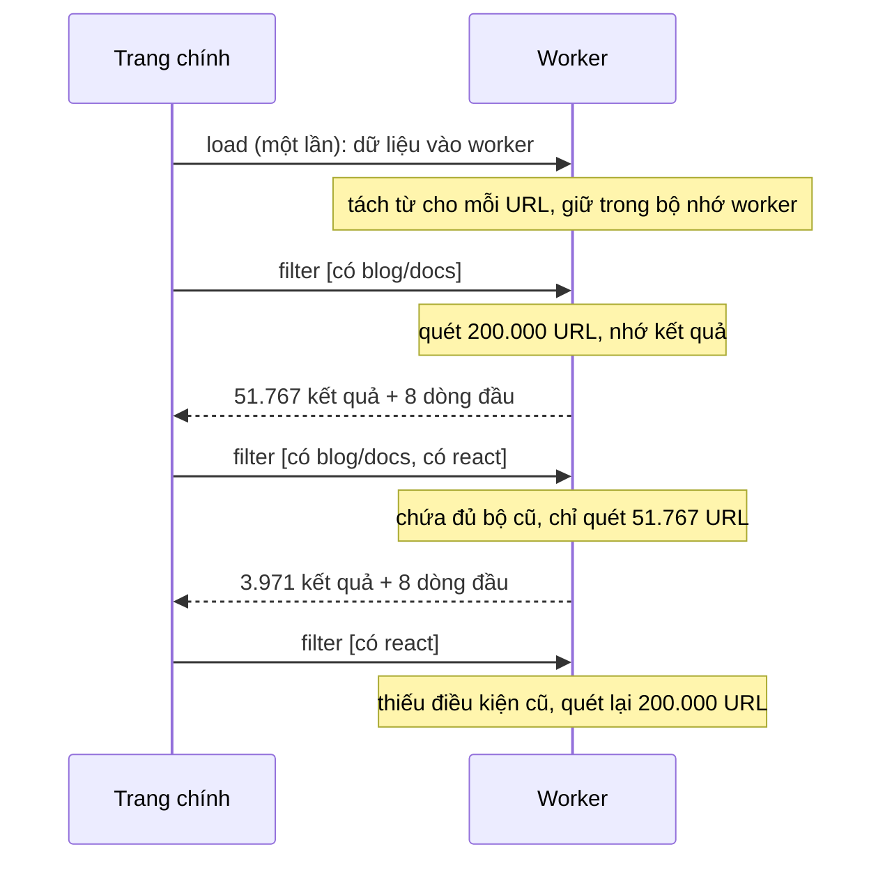

Similarweb có một màn hình tạo "segment": chọn ra một nhóm trang của website (ví dụ mọi trang blog có chữ "react" nhưng không có "login") bằng cách thêm dần từng điều kiện. Mỗi lần thêm một điều kiện, danh sách hàng trăm nghìn URL phổ biến phải lọc lại, kèm gợi ý từ khoá tiếp theo, ngay khi người dùng gõ.

Hai câu hỏi về hiệu năng:

1. Lọc ở đâu để giao diện không khựng? Similarweb đặt **cả dữ liệu lẫn việc lọc trong một Web Worker**.
2. Có phải lọc lại từ đầu mỗi lần không? Không: các điều kiện nối bằng **VÀ**, nên thêm điều kiện chỉ làm kết quả nhỏ đi. Kết quả mới chắc chắn nằm trong kết quả cũ, chỉ cần **lọc tiếp kết quả cũ** bằng điều kiện vừa thêm.

> [!TIP]
> **Tóm tắt**
> - Điều kiện nối bằng VÀ thì tập kết quả chỉ co lại khi thêm điều kiện. Nhớ bộ điều kiện và kết quả lần trước; nếu bộ mới chứa đủ bộ cũ thì chỉ lọc lại kết quả cũ.
> - Để dữ liệu **nằm sẵn trong worker**: trang chính chỉ gửi điều kiện (vài trăm byte) và nhận về số lượng + vài dòng đầu, không chuyển cả danh sách qua lại.
> - "Biên dịch" điều kiện một lần trước vòng lặp. Similarweb tạo `new RegExp` mới cho mỗi URL × mỗi cụm từ.
> - Bắt lỗi thì đừng trả về kết quả cũ của một bộ điều kiện khác.

<iframe class="demo-frame" src="/demos/web-patterns/index.html?theme=dark#/incremental-filter" title="Demo incremental-filter" loading="lazy" style="height: 1000px"></iframe>

<p class="demo-links">▶ <a href="/demos/web-patterns/index.html#/incremental-filter" target="_blank" rel="noopener">Mở demo toàn màn hình ↗</a> · <a href="https://stackblitz.com/github/hunghg255/blog-hunghg/tree/master/examples/web-patterns?file=src/lib/incrementalFilter.ts" target="_blank" rel="noopener">Sửa code trên StackBlitz ↗</a> · <a href="https://github.com/hunghg255/blog-hunghg/blob/master/examples/web-patterns/src/lib/incrementalFilter.ts" target="_blank" rel="noopener">Xem source trên GitHub ↗</a></p>

Thêm lần lượt "có blog / docs", "có react", "không có login": số URL phải quét đi từ 200.000 xuống 51.767 rồi 3.971. Bỏ điều kiện đầu tiên thì phải quét lại từ đầu. Chọn "RegExp tạo mới mỗi URL" và "Luồng chính" để thấy giao diện khựng; cùng việc đó trong worker thì vòng quay vẫn đều.

## Similarweb làm thế nào?

Code ở [`pro.similarweb.com/app/services/segments/`](https://github.com/hunghg255/codebase/tree/main/pro.similarweb.com/app/services/segments): `segmentsWizardService.worker.ts` (chạy trong worker), `workerProcessor.ts` (cầu nối RPC), `segmentsWizardService.ts` (phía trang chính).

### Dữ liệu sống trong worker

Khi mở màn hình, trang chính tải danh sách URL từ API rồi gửi vào worker một lần (`prepareSegments`). Worker tách sẵn từ khoá và thư mục của từng URL, rồi giữ trong biến cấp module:

```ts
/*** Worker Cache Data ***/
// worker cache data (for loading segments popular pages):
let allSegmentUrls: IUrlShareSegments[] = undefined;

// worker cache data (for last filtered by rules):
let filteredSegmentsRules = undefined;
let filteredSegmentUrls = undefined;
```

Mỗi `IUrlShareSegments` có `Segments` là một `Set` các từ trong URL, tách bằng regex Unicode `%[0-9a-f]{2}|[^\p{L}\p{N}]` (thư viện XRegExp), nên chữ có dấu, chữ Nhật, chữ Ả Rập đều là "chữ", còn mọi thứ khác là dấu ngăn. Tách một lần lúc nạp, về sau kiểm tra "URL có chứa từ X" chỉ là `set.has(x)`.

### Tái dùng kết quả lần lọc trước

Hàm `searchSegments(rules)` (rút gọn):

```ts
function searchSegments(rules) {
  let checkData = allSegmentUrls;
  let checkRules = rules;

  if (filteredSegmentUrls && filteredSegmentsRules) {
    const extraRules = differenceWith(rules, filteredSegmentsRules, isEqualRule);
    // if search rules include cached filtered rules, use filtered cache to shorten search operations
    if (filteredSegmentsRules.length !== 0 && extraRules.length === rules.length - filteredSegmentsRules.length) {
      checkData = filteredSegmentUrls;
      checkRules = extraRules;
    }
  }

  try {
    filteredSegmentUrls = matchPopularPagesByRules(checkData, checkRules);
    filteredSegmentsRules = cloneDeep(rules);
  } catch (err) {
    console.warn('Error in filtering popular pages', err.message);
  }
  return filteredSegmentUrls || [];
}
```

`matchPopularPagesByRules` kiểm tra mỗi URL bằng `checkRules.every(...)`: mọi điều kiện đều phải thoả (VÀ). Điều kiện kiểu "có" (`type === 0`) cần ít nhất một từ khớp; kiểu "không có" thì không được khớp từ nào.

Phép kiểm tra "bộ mới chứa bộ cũ" là: số điều kiện mới thêm đúng bằng chênh lệch độ dài. Nếu người dùng chỉ thêm điều kiện, điều này đúng, và chỉ cần lọc `filteredSegmentUrls` (nhỏ) bằng `extraRules`. Nếu họ xoá hay sửa một điều kiện cũ, đẳng thức sai, lọc lại từ `allSegmentUrls`.

### WorkerProcessor: RPC theo khoá

`workerProcessor.ts` là lớp RPC nhỏ: mỗi lời gọi có khoá `wrkRun-<số tăng dần>`, promise được lưu trong một object theo khoá, worker trả về `{ key, result }` hoặc `{ key, error }`. Cùng ý tưởng với `WorkerConnector` của Telegram ở bài [#12](/blogs/web-worker-promise-rpc), không có tiến độ hay huỷ.

### Ba chỗ đáng sửa

1. **Lỗi thì trả kết quả của bộ điều kiện khác.** Trong `catch`, `filteredSegmentUrls` vẫn là kết quả của lần trước, còn `filteredSegmentsRules` không đổi. Hàm trả về `filteredSegmentUrls || []`: người dùng thấy danh sách của bộ điều kiện cũ mà tưởng là của bộ mới. Lỗi nên được ném ra (worker sẽ gửi về `error`) để giao diện báo.
2. **Tạo RegExp trong vòng lọc.** Điều kiện "cụm từ chính xác" được kiểm tra bằng:

   ```ts
   const checkAnyExactInUrl = (exact, url) =>
     exact?.some((e) => new RegExp(`${escapeRegexString(e)}`, 'gi').test(url));
   ```

   Hàm này chạy cho **mỗi URL**, tức một regex mới cho mỗi URL × mỗi cụm từ. Mình đo trong Node trên 200.000 URL với một từ: tạo regex mỗi lần khoảng 76ms, regex tạo một lần khoảng 19ms, tra `Set` từ đã tách sẵn khoảng 17ms.
3. **Gửi cả danh sách qua lại.** `searchSegments` trả về toàn bộ mảng URL đã lọc (mỗi phần tử có hai `Set`), và trang chính chỉ dùng URL và tỉ lệ. Mọi thứ đi qua `postMessage` đều bị sao chép bằng thuật toán structured clone; trong Node, `structuredClone` 100.000 object kiểu này mất khoảng 230ms. `prepareSegments` cũng trả về toàn bộ danh sách đã chuẩn bị cho trang chính, kể cả khi trang chính chỉ dùng giá trị `true`.

Thêm một chi tiết ở `WorkerProcessor`: listener `message` lấy `{ resolve, reject } = this.workerRunsResolveReject[key]` **trước** khi kiểm tra có tồn tại không, nên khoá lạ sẽ ném `TypeError` thay vì in cảnh báo như ý định. Worker không có hàm được gọi thì không trả lời gì, promise chờ mãi.

## Bên trong: vì sao lọc tăng dần đúng?

Gọi `R` là tập điều kiện, `S(R)` là các URL thoả mọi điều kiện trong `R`. Vì là phép VÀ:

- Thêm điều kiện thì tập chỉ nhỏ đi: `R ⊆ R'` suy ra `S(R') ⊆ S(R)`.
- Và `S(R')` chính là các phần tử của `S(R)` thoả thêm phần `R' \ R`.



Điều này chỉ đúng với VÀ. Nếu cho phép HOẶC giữa các điều kiện ("có blog" HOẶC "có docs" ở cấp điều kiện), thêm điều kiện có thể làm tập **lớn** ra và cách tái dùng này sai.

## Viết lại

Code ở `src/lib/incrementalFilter.ts`. Điều kiện được "biên dịch" một lần thành hàm kiểm tra:

```ts title=src/lib/incrementalFilter.ts
const normalizeWords = (words: string[]) =>
  [...new Set(words.map((w) => w.trim().toLowerCase()).filter(Boolean))].sort();

/** Khoá so sánh hai điều kiện: cùng mode và cùng tập từ (không tính thứ tự, hoa thường). */
export const ruleKey = (rule: Rule) => `${rule.mode}:${normalizeWords(rule.words).join('|')}`;

/**
 * "Biên dịch" điều kiện MỘT lần thành hàm kiểm tra. Similarweb tạo `new RegExp(...)` bên trong
 * vòng lọc, tức là một regex mới cho mỗi URL × mỗi điều kiện.
 */
export function compilePageRule(rule: Rule): (page: Page) => boolean {
  const words = normalizeWords(rule.words);
  const include = rule.mode === 'include';
  return (page) => words.some((w) => page.tokens.has(w)) === include;
}
```

Bộ lọc nhớ lần chạy trước và so bộ điều kiện như một "túi" (multiset):

```ts title=src/lib/incrementalFilter.ts
export function createIncrementalFilter<T>(items: readonly T[], compile: (rule: Rule) => (item: T) => boolean) {
  let last: { keys: string[]; result: T[] } | null = null;

  function run(rules: Rule[], { incremental = true } = {}): FilterRun<T> {
    const keys = rules.map(ruleKey);

    // Đếm số lần xuất hiện của từng khoá để so như "túi" (multiset): [a, a] không chứa trong [a]
    let base: readonly T[] = items;
    let extra = rules;
    if (incremental && last && last.keys.length > 0) {
      const remaining = new Map<string, number>();
      keys.forEach((k) => remaining.set(k, (remaining.get(k) ?? 0) + 1));
      const containsOld = last.keys.every((k) => {
        const n = remaining.get(k) ?? 0;
        remaining.set(k, n - 1);
        return n > 0;
      });
      if (containsOld) {
        base = last.result;
        extra = rules.filter((r) => {
          const k = ruleKey(r);
          const n = remaining.get(k) ?? 0;
          if (n <= 0) return false;
          remaining.set(k, n - 1);
          return true;
        });
      }
    }

    // Lỗi ở đây cứ để ném ra: Similarweb nuốt lỗi rồi trả kết quả CŨ của bộ điều kiện khác
    const checks = extra.map(compile);
    const result = checks.length === 0 ? [...base] : base.filter((item) => checks.every((check) => check(item)));
    last = { keys, result };
    return { result, scanned: checks.length === 0 ? 0 : base.length, reused: base !== items };
  }

  return {
    run,
    reset() {
      last = null;
    },
  };
}
```

Phía worker chỉ trả về số lượng và vài dòng đầu:

```ts title=src/lib/incrementalFilter.worker.ts
    const start = performance.now();
    const { result, scanned, reused } = filters[matcher].run(rules, { incremental });
    return {
      count: result.length,
      scanned,
      reused,
      ms: performance.now() - start,
      top: result.slice(0, limit).map((p) => p.url),
    };
```

::: spoiler Xem toàn bộ src/lib/incrementalFilter.ts

```ts title=src/lib/incrementalFilter.ts
/**
 * Lọc danh sách lớn theo nhiều điều kiện, tái dùng kết quả lần lọc trước.
 *
 * Ý tưởng từ trình tạo segment của Similarweb (segmentsWizardService.worker.ts): các điều kiện được nối
 * bằng VÀ, nên thêm điều kiện chỉ làm tập kết quả nhỏ đi. Nếu bộ điều kiện mới chứa đủ bộ cũ thì
 * chỉ cần lọc tiếp KẾT QUẢ CŨ bằng phần điều kiện mới thêm, khỏi quét lại từ đầu.
 */

export interface Rule {
  /** include: trang phải chứa ít nhất một từ; exclude: không được chứa từ nào */
  mode: 'include' | 'exclude';
  words: string[];
}

export interface Page {
  url: string;
  share: number;
  /** các từ trong URL, tách sẵn một lần lúc nạp dữ liệu */
  tokens: Set<string>;
}

/** Tách URL thành từ: mọi ký tự không phải chữ hay số (kể cả chữ có dấu) đều là dấu ngăn. */
export function tokenize(url: string): Set<string> {
  const path = url.replace(/^https?:\/\/[^/]+/, '');
  return new Set(
    path
      .toLowerCase()
      .split(/[^\p{L}\p{N}]+/u)
      .filter(Boolean),
  );
}

const normalizeWords = (words: string[]) =>
  [...new Set(words.map((w) => w.trim().toLowerCase()).filter(Boolean))].sort();

/** Khoá so sánh hai điều kiện: cùng mode và cùng tập từ (không tính thứ tự, hoa thường). */
export const ruleKey = (rule: Rule) => `${rule.mode}:${normalizeWords(rule.words).join('|')}`;

/**
 * "Biên dịch" điều kiện MỘT lần thành hàm kiểm tra. Similarweb tạo `new RegExp(...)` bên trong
 * vòng lọc, tức là một regex mới cho mỗi URL × mỗi điều kiện.
 */
export function compilePageRule(rule: Rule): (page: Page) => boolean {
  const words = normalizeWords(rule.words);
  const include = rule.mode === 'include';
  return (page) => words.some((w) => page.tokens.has(w)) === include;
}

/**
 * Bản đối chứng mô phỏng cách Similarweb kiểm tra "cụm từ chính xác": tạo `new RegExp(…, 'gi')`
 * cho MỖI URL × mỗi từ. Chỉ để đo trong demo, đừng dùng.
 */
export function compileRegexRuleSlow(rule: Rule): (page: Page) => boolean {
  const include = rule.mode === 'include';
  const escape = (w: string) => w.replace(/[.*+?^${}()|[\]\\]/g, '\\$&');
  return (page) => rule.words.some((w) => new RegExp(escape(w.trim()), 'gi').test(page.url)) === include;
}

export interface FilterRun<T> {
  result: T[];
  /** số phần tử đã phải kiểm tra trong lần này */
  scanned: number;
  /** true nếu lọc tiếp trên kết quả lần trước */
  reused: boolean;
}

export function createIncrementalFilter<T>(items: readonly T[], compile: (rule: Rule) => (item: T) => boolean) {
  let last: { keys: string[]; result: T[] } | null = null;

  function run(rules: Rule[], { incremental = true } = {}): FilterRun<T> {
    const keys = rules.map(ruleKey);

    // Đếm số lần xuất hiện của từng khoá để so như "túi" (multiset): [a, a] không chứa trong [a]
    let base: readonly T[] = items;
    let extra = rules;
    if (incremental && last && last.keys.length > 0) {
      const remaining = new Map<string, number>();
      keys.forEach((k) => remaining.set(k, (remaining.get(k) ?? 0) + 1));
      const containsOld = last.keys.every((k) => {
        const n = remaining.get(k) ?? 0;
        remaining.set(k, n - 1);
        return n > 0;
      });
      if (containsOld) {
        base = last.result;
        extra = rules.filter((r) => {
          const k = ruleKey(r);
          const n = remaining.get(k) ?? 0;
          if (n <= 0) return false;
          remaining.set(k, n - 1);
          return true;
        });
      }
    }

    // Lỗi ở đây cứ để ném ra: Similarweb nuốt lỗi rồi trả kết quả CŨ của bộ điều kiện khác
    const checks = extra.map(compile);
    const result = checks.length === 0 ? [...base] : base.filter((item) => checks.every((check) => check(item)));
    last = { keys, result };
    return { result, scanned: checks.length === 0 ? 0 : base.length, reused: base !== items };
  }

  return {
    run,
    reset() {
      last = null;
    },
  };
}

// ---- dữ liệu giả cho demo: URL "trang phổ biến" của một website ----

const SECTIONS = ['blog', 'docs', 'shop', 'help', 'news', 'careers', 'vi', 'en'];
const WORDS = [
  'react', 'hooks', 'pricing', 'guide', 'api', 'mobile', 'login', 'cart', 'sale', 'giày',
  'sách', 'laptop', 'review', 'tutorial', 'release', 'security', 'performance', 'cache',
  'worker', 'design', 'team', 'remote', 'tuyển', 'dụng', 'faq', 'refund', 'shipping', 'account',
];

/** Sinh `count` URL giả, có seed để trang chính và worker sinh ra cùng một dữ liệu. */
export function generatePages(count: number, seed = 1): Page[] {
  let s = seed;
  const rand = () => (s = (s * 1103515245 + 12345) & 0x7fffffff) / 0x7fffffff;
  const pick = <V>(list: V[]) => list[Math.floor(rand() * list.length)];
  const pages: Page[] = [];
  for (let i = 0; i < count; i++) {
    const url = `https://example.vn/${pick(SECTIONS)}/${pick(WORDS)}-${pick(WORDS)}-${i}`;
    pages.push({ url, share: rand() / count, tokens: tokenize(url) });
  }
  return pages;
}
```

:::

Worker dùng lại `expose()` và `createWorkerClient()` của bài #12 nên có sẵn chuyển lỗi về trang chính và từ chối promise khi worker chết.

**Khác bản gốc:**

- So bộ điều kiện theo **khoá chuẩn hoá** (`mode` + danh sách từ đã viết thường, bỏ trùng, sắp xếp) và đếm như túi, thay vì `differenceWith` với hàm so từng trường. Hai điều kiện giống hệt nhau vẫn được đếm đúng.
- Điều kiện được biên dịch một lần trước vòng lặp; không có regex trong vòng lọc.
- Lỗi được ném ra, không trả về kết quả cũ.
- Worker trả về số lượng + `limit` dòng đầu, không trả cả danh sách.
- Chỉ có điều kiện theo từ. Bản gốc còn có "cụm từ chính xác", "thư mục" (URL bắt đầu bằng một đường dẫn) và "URL chính xác"; thêm chúng chỉ là thêm nhánh trong `compilePageRule`.

## Đi qua code

- **`tokenize`** bỏ phần `https://host`, viết thường, tách theo `[^\p{L}\p{N}]+` với cờ `u`: regex Unicode có sẵn trong JavaScript hiện đại, không cần XRegExp như bản gốc.
- **`ruleKey`** biến một điều kiện thành chuỗi, ví dụ `include:docs|react`. Hai điều kiện cùng ý nghĩa nhưng gõ khác thứ tự hay hoa thường cho cùng khoá.
- **So như túi.** Đếm số lần xuất hiện của mỗi khoá trong bộ mới, rồi trừ dần theo bộ cũ. Nếu khoá nào của bộ cũ không còn để trừ, bộ mới không chứa bộ cũ. Phần còn dư chính là các điều kiện mới thêm.
- **`scanned`** đếm số phần tử thật sự phải kiểm tra, để demo cho thấy lợi ích (200.000 so với 3.971).
- **Dữ liệu demo sinh bằng seed** (`generatePages(count, seed)`): worker và trang chính sinh ra cùng một danh sách mà không phải gửi qua `postMessage`.
- **Worker tạo trong `useEffect`** chứ không trong `useMemo`: StrictMode chạy effect, dọn, rồi chạy lại; tạo trong `useMemo` sẽ dùng lại một worker đã bị `terminate`.

## Tại sao không làm cách khác?

**Tại sao không lọc trên luồng chính?** Với tập điều kiện đơn giản, lọc 200.000 URL mất khoảng 15ms, vẫn trong một frame. Nhưng việc chuẩn bị dữ liệu (tách từ cho 200.000 URL) mất hàng trăm mili giây, và điều kiện kiểu regex làm mỗi lần lọc vượt 80ms (demo đo được frame dài khoảng 83ms). Đưa vào worker thì các con số đó không còn chặn giao diện.

**Tại sao không gửi dữ liệu vào worker mỗi lần lọc?** Mỗi lần gửi là một lần sao chép toàn bộ. Để dữ liệu sống trong worker, mỗi tin nhắn chỉ còn vài trăm byte.

**Tại sao không dùng `SharedArrayBuffer` hay transfer?** `ArrayBuffer` chuyển được (transfer) không tốn sao chép, nhưng danh sách object có `Set` không phải buffer. Muốn dùng phải mã hoá dữ liệu thành mảng số (cột URL, cột share, chỉ mục từ). `SharedArrayBuffer` còn cần trang bật cross-origin isolation (header COOP và COEP). Với bài toán này, giữ dữ liệu trong worker đơn giản hơn nhiều.

**Tại sao không dùng chỉ mục ngược (inverted index)?** Với điều kiện theo từ, có thể dựng sẵn `Map<từ, Set<chỉ số URL>>` và lấy giao/hợp các tập: nhanh hơn quét tuần tự. Đổi lại tốn bộ nhớ và không áp dụng được cho "cụm từ chính xác" hay regex. Lọc tăng dần là cải tiến rẻ đặt lên trên cách quét đơn giản.

## Edge case và cạm bẫy

- **Dữ liệu đổi thì phải quên kết quả cũ.** Similarweb gọi `resetSegmentsCache()` trong `prepareSegments`. Bản viết lại tạo bộ lọc mới mỗi lần `load`.
- **Hai yêu cầu lọc chồng nhau.** Người dùng thêm điều kiện nhanh hơn worker lọc: các tin nhắn xếp hàng trong worker và chạy lần lượt, kết quả về đúng thứ tự. Demo đánh số mỗi lần chạy (`runSeq`) để bỏ kết quả của lần đã lỗi thời.
- **Điều kiện rỗng.** Điều kiện "có" với danh sách từ rỗng thì không URL nào khớp. Kiểm tra ở giao diện trước khi gửi.
- **Kết quả cũ chiếm bộ nhớ.** `last.result` giữ một mảng có thể bằng cả danh sách. Với dữ liệu rất lớn, chỉ lưu chỉ số (`Uint32Array`) thay vì tham chiếu object.
- **Đổi nghĩa phép nối.** Nếu sau này thêm "HOẶC" giữa các điều kiện, phải tắt lọc tăng dần cho những trường hợp đó.

## Dùng trong dự án

Bất cứ màn hình "bộ lọc nâng cao" nào trên dữ liệu đã tải về client: bảng log, danh sách sản phẩm, kết quả phân tích.

```ts
// filter.worker.ts
import { expose } from './workerRpcHost';
import { createIncrementalFilter, type Rule } from './incrementalFilter';

let rows: Order[] = [];
let filter = createIncrementalFilter(rows, compileOrderRule);

expose({
  load(input: Order[]) {
    rows = input;
    filter = createIncrementalFilter(rows, compileOrderRule);
    return rows.length;
  },
  filter({ rules, page }: { rules: Rule[]; page: number }) {
    const { result } = filter.run(rules);
    return { total: result.length, rows: result.slice(page * 50, page * 50 + 50) };
  },
});
```

Trang chính chỉ cần `client.call('filter', { rules, page })`, và luôn nhận về đúng một trang 50 dòng.

## Kiểm thử

::: spoiler Ví dụ test (bản phác, không có trong repo)

```ts
import { describe, expect, it } from 'vitest';
import { compilePageRule, createIncrementalFilter, generatePages, ruleKey, type Rule } from './incrementalFilter';

const pages = generatePages(5000, 3);
const blog: Rule = { mode: 'include', words: ['blog'] };
const react: Rule = { mode: 'include', words: ['react'] };
const noLogin: Rule = { mode: 'exclude', words: ['login'] };

describe('createIncrementalFilter', () => {
  it('cho cùng kết quả với lọc từ đầu', () => {
    const inc = createIncrementalFilter(pages, compilePageRule);
    const full = createIncrementalFilter(pages, compilePageRule);
    for (const rules of [[blog], [blog, react], [blog, react, noLogin]]) {
      expect(inc.run(rules).result).toEqual(full.run(rules, { incremental: false }).result);
    }
  });

  it('thêm điều kiện thì chỉ quét kết quả cũ', () => {
    const f = createIncrementalFilter(pages, compilePageRule);
    const first = f.run([blog]);
    const second = f.run([blog, react]);
    expect(second.reused).toBe(true);
    expect(second.scanned).toBe(first.result.length);
  });

  it('bỏ điều kiện cũ thì quét lại từ đầu', () => {
    const f = createIncrementalFilter(pages, compilePageRule);
    f.run([blog, react]);
    const r = f.run([react]);
    expect(r.reused).toBe(false);
    expect(r.scanned).toBe(pages.length);
  });

  it('khoá không phụ thuộc thứ tự từ và hoa thường', () => {
    expect(ruleKey({ mode: 'include', words: ['React', 'blog'] })).toBe(ruleKey({ mode: 'include', words: ['blog', 'react'] }));
  });
});
```

:::

## So với thư viện và chuẩn web

- **[Comlink](https://github.com/GoogleChromeLabs/comlink)** biến worker thành object gọi được như hàm async, thay cho `WorkerProcessor` tự viết.
- **Chỉ mục ngược phía client**: [FlexSearch](https://github.com/nextapps-de/flexsearch), [MiniSearch](https://github.com/lucaong/minisearch) dựng index trong trình duyệt (và chạy được trong worker) cho bài toán tìm theo từ.
- **[`scheduler.yield()`](https://developer.mozilla.org/en-US/docs/Web/API/Scheduler/yield)** cho phép chia một vòng lọc dài trên luồng chính thành nhiều đoạn, nhường cho trình duyệt vẽ ở giữa. Đơn giản hơn worker nhưng tổng thời gian dài hơn; chưa có trên mọi trình duyệt (tính tới 10/2026, xem [caniuse](https://caniuse.com/mdn-api_scheduler_yield)).

---

Bài này thuộc series **[Học từ mã nguồn các web lớn](/series/web)** (65 bài, đọc theo thứ tự).

::: spoiler Xem nhanh danh sách bài trong series

*Mở đầu*

- [Mở đầu: đọc code production của 28 trang web](/blogs/learn-from-big-web-apps)

*Phần 1: trải nghiệm người dùng*

- [#1 Dark mode không nháy (Gatsby)](/blogs/web-dark-mode-no-flash)
- [#2 useValueByMedia: giá trị theo breakpoint (Toptal)](/blogs/web-use-value-by-media)
- [#3 Đoán ý định: idle, exit-intent, lắc chuột (Toptal, InVision)](/blogs/web-user-intent-idle-exit-wiggle)
- [#4 Validate form thân thiện (Udacity, Pipedrive)](/blogs/web-form-validation-ux)
- [#5 Magic number, EXIF và dán ảnh (Ello)](/blogs/web-file-magic-number-exif-paste)
- [#6 fastSmoothScroll: cuộn xa vẫn nhanh (Telegram)](/blogs/web-telegram-fast-smooth-scroll)
- [#7 Countdown time-travel và tombstone giỏ hàng (Best Buy)](/blogs/web-countdown-time-travel-tombstone)

*Phần 2: hiệu năng và đo lường*

- [#8 Hàng đợi requestAnimationFrame 3ms (Apple)](/blogs/web-raf-queue-3ms)
- [#9 srcset cho artwork và preconnect tự động (Apple)](/blogs/web-responsive-artwork-preconnect)
- [#10 Quick-fetch: gọi API trước khi bundle tải xong (HubSpot)](/blogs/web-quick-fetch-early-requests)
- [#11 Performance span và long task (Postman, Calibre)](/blogs/web-performance-spans-long-tasks)
- [#12 Gọi Web Worker như hàm async (Telegram)](/blogs/web-worker-promise-rpc)
- [#13 Đồng hồ media: đếm giờ xem và sửa lệch (Skillshare, Simplified)](/blogs/web-media-clock-watch-time-drift)

*Phần 3: nhiều tab, phiên đăng nhập, cập nhật*

- [#14 Bầu tab chủ cho thông báo (HubSpot, Telegram)](/blogs/web-leader-tab-notifications)
- [#15 Đồng bộ đăng nhập giữa tab và giới hạn cookie (Elastic, InVision)](/blogs/web-cross-tab-auth-cookie-guard)
- [#16 SPA tự cập nhật: Trello, Zappos, Facebook, Elastic](/blogs/web-spa-self-update-strategies)

*Phần 4: kiến trúc*

- [#17 Reverse portal: di chuyển component không remount (Zappos)](/blogs/web-reverse-portal)
- [#18 Page behaviors: gắn hành vi từ CMS (Intercom)](/blogs/web-page-behaviors-cms)
- [#19 Giới hạn tần suất hiển thị bằng bitmask (Outlook)](/blogs/web-frequency-cap-bitmask)
- [#20 Chuyển REST sang GraphQL dần dần (Coursera)](/blogs/web-rest-to-graphql-hybrid-link)

*Phần 5: soạn thảo và hiển thị nội dung*

- [#21 Autocomplete tại con trỏ trong contenteditable (Ello, Telegram)](/blogs/web-caret-autocomplete-contenteditable)
- [#22 Dark mode cho email HTML bằng CIELAB (Outlook)](/blogs/web-email-dark-mode-cielab)
- [#23 Thu nhỏ bảng rộng cho vừa khung, vá font emoji (Outlook)](/blogs/web-email-wide-content-scale)
- [#24 Cảnh báo quên đính kèm file (Outlook)](/blogs/web-forgotten-attachment-warning)
- [#25 Cắt chữ nhiều dòng chính xác (Pipedrive, Apple, Toptal)](/blogs/web-multiline-truncate-measure-text)
- [#26 Parse ngày giờ gõ tay khoan dung (Outlook, Elastic)](/blogs/web-lenient-date-parser)

*Phần 6: tương tác*

- [#27 menuAim: rê chéo vào submenu không bị đóng (Udemy)](/blogs/web-menu-aim-triangle)
- [#28 Kéo, vuốt chung cho chuột và cảm ứng (Telegram)](/blogs/web-unified-pointer-gestures)
- [#29 Phím tắt theo phạm vi, IME và bàn phím phi Latinh (Trello)](/blogs/web-scoped-keyboard-shortcuts)
- [#30 Nội suy màu: đổi theme và nền theo cuộn (Telegram, Anchor)](/blogs/web-color-interpolation-theme-scroll)
- [#31 Đường gióng hút cạnh và undo/redo trên canvas (Simplified)](/blogs/web-canvas-snap-guides-undo)
- [#32 Giả lập mù màu bằng feColorMatrix (Trello)](/blogs/web-color-vision-simulator)
- [#33 Vạch thước theo mức zoom và cấp phát màu cho biểu đồ (Anchor, Similarweb)](/blogs/web-timeline-ticks-color-stack)

*Phần 7: mạng, dữ liệu và async*

- [#34 Ô tìm kiếm chuẩn production (Similarweb, Udemy, Pipedrive)](/blogs/web-production-search-box)
- [#35 Điều phối async: latest-wins, single-flight (Glitch, Toptal)](/blogs/web-async-coordination-latest-wins)
- [#36 Polling thưa dần và debounce động (Trello)](/blogs/web-decaying-polling-dynamic-debounce)
- [#37 Cache phía client theo version (Similarweb, Telegram, Udemy)](/blogs/web-client-cache-versioned)
- [#38 Upload file lớn theo chunk (Outlook, Tribe)](/blogs/web-chunked-upload-pipeline)
- [#39 Phát video qua Service Worker bằng Range request (Telegram, Outlook)](/blogs/web-service-worker-range-streaming)

*Phần 8: hiệu năng và vận hành*

- [#40 TTI governor: hoãn việc phụ tới sau khi trang dùng được (Outlook)](/blogs/web-tti-governor)
- [#41 Tự đo LCP/CLS/TBT và phục vụ bản nhẹ cho máy yếu (Udemy)](/blogs/web-rum-adaptive-loading)

*Phần 9: thuật toán và dữ liệu phía client*

- [#42 Three-way merge ngay trên trình duyệt (Postman)](/blogs/web-three-way-merge-client)
- [#43 Dọn cache GraphQL bằng đếm tham chiếu (Outlook)](/blogs/web-graphql-cache-refcount-gc)
- [#44 LRU cache theo 3 cách (Apple, Similarweb, Outlook)](/blogs/web-lru-cache-three-ways)
- **#45 Lọc tăng dần trong Web Worker (Similarweb)** (bài này)
- [#46 Xếp hạng gợi ý trên client, so ngầm với server (Outlook)](/blogs/web-client-side-ranking-shadow-test)
- [#47 Nối OT với editor: undo stack và chặn echo (Glitch)](/blogs/web-ot-codemirror-undo)
- [#48 Ngôn ngữ markup riêng dịch hai chiều với HTML (Coursera)](/blogs/web-custom-markup-compiler)

*Phần 10: thời gian, ngôn ngữ, định dạng*

- [#49 Xử lý giờ mùa hè không cần thư viện (Udemy, Pipedrive)](/blogs/web-dst-without-library)
- [#50 Intl thực chiến: Segmenter, số rút gọn, số nhiều, fallback locale (Apple, Outlook)](/blogs/web-intl-in-production)
- [#51 WebVTT và bôi chọn transcript (Udemy, Coursera)](/blogs/web-webvtt-transcript-selection)

*Phần 11: tương tác và giao diện*

- [#52 Kéo-thả trên lịch (Pipedrive)](/blogs/web-calendar-drag-drop)
- [#53 Focus stack cho popup lồng nhau (Outlook)](/blogs/web-focus-stack-nested-popups)
- [#54 Clipboard: copy, dán chữ thuần, dán thông minh (Trello, Anchor, Pipedrive, Tribe)](/blogs/web-clipboard-tricks)
- [#55 Khôi phục vị trí cuộn khi trang còn đang tải (Apple, Zappos)](/blogs/web-scroll-restore-wait-height)
- [#56 Lấy màu từ ảnh: gradient nền, màu chữ (Apple, Telegram, Trello)](/blogs/web-colors-from-images)
- [#57 JS đọc breakpoint từ CSS, phát hiện chế độ PWA (Ello, Apple)](/blogs/web-css-js-breakpoint-bridge)

*Phần 12: media*

- [#58 Tin nhắn thoại: ghi âm, waveform realtime, nén 5-bit (Telegram)](/blogs/web-voice-message-waveform)
- [#59 Chụp frame video thành ảnh, canvas bị taint (Coursera, Outlook)](/blogs/web-video-frame-snapshot)

*Phần 13: đo lường, bảo mật, vận hành*

- [#60 Đo lúc ảnh màn hình đầu tải xong, cả khi chuyển trang SPA (Zappos, Best Buy, Outlook)](/blogs/web-above-the-fold-image-timing)
- [#61 Buffer analytics chờ SDK, phát hiện adblock (Best Buy)](/blogs/web-analytics-buffer-adblock)
- [#62 Proof-of-work trên client để chặn API ẩn danh (Udemy)](/blogs/web-client-proof-of-work)
- [#63 Prefetch không làm lệch số liệu, nén cài đặt bằng bit (Outlook)](/blogs/web-synthetic-prefetch-bit-flags)
- [#64 Micro-frontend: AngularJS và React chung app, giao tiếp xuyên frame (Similarweb, InVision, HubSpot)](/blogs/web-micro-frontend-bridges)

:::

Code + demo: [`examples/web-patterns`](https://github.com/hunghg255/blog-hunghg/tree/master/examples/web-patterns) · [Mở trên StackBlitz](https://stackblitz.com/github/hunghg255/blog-hunghg/tree/master/examples/web-patterns)
