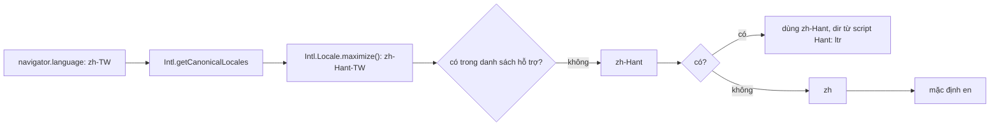

App đa ngôn ngữ luôn có mấy việc "nhỏ" mà ai cũng tưởng làm được trong năm phút:

1. Cắt mô tả sản phẩm còn khoảng 160 ký tự để hiện trên thẻ. Cắt cứng ở ký tự 160 thì câu đứt giữa chừng, có khi cắt đôi một emoji.
2. Hiện "1,2 Tr lượt tải" thay cho "1.234.567". Mỗi ngôn ngữ viết số rút gọn một kiểu, có ngôn ngữ dùng chữ số riêng.
3. "1 tệp, 2 tệp, 5 tệp" trong tiếng Việt không có gì khó. Tiếng Nga có ba dạng (файл, файла, файлов), tiếng Ba Lan, Séc, Ukraina mỗi thứ tiếng một luật.
4. Trình duyệt gửi `zh-TW` nhưng app chỉ có bản dịch `zh-Hant`. Gửi `nb-NO` nhưng app có `no`.

Bài này đọc cách **App Store web** (apps.apple.com) và **Outlook web** làm bốn việc trên, chỉ ra vài chỗ hỏng trong code gốc, rồi viết lại bằng các API `Intl` có sẵn trong trình duyệt.

> [!TIP]
> **Tóm tắt**
> - Cắt mô tả: Apple gom từng câu bằng `Intl.Segmenter`, chỉ nhận nếu dài ≥ 75% giới hạn, không thì lùi xuống cắt theo từ. Thêm một tầng grapheme để không cắt đôi emoji.
> - Số rút gọn: `Intl.NumberFormat(locale, { notation: 'compact' })`, ép chữ số Latin bằng Unicode extension `-u-nu-latn` khi sản phẩm cần.
> - Số nhiều: Outlook tự viết regex cho từng ngôn ngữ và xếp nhầm tiếng Ukraina chung luật với tiếng Séc. `Intl.PluralRules` trả đúng nhóm CLDR cho mọi ngôn ngữ, kể cả số thập phân.
> - Chọn locale: tỉa dần subtag như Outlook, nhưng thay bảng tra `zh-TW → zh-Hant` bằng `Intl.Locale.maximize()`.

<iframe class="demo-frame" src="/demos/web-patterns/index.html?theme=dark#/intl-kit" title="Demo intl-kit" loading="lazy" style="height: 760px"></iframe>

<p class="demo-links">▶ <a href="/demos/web-patterns/index.html#/intl-kit" target="_blank" rel="noopener">Mở demo toàn màn hình ↗</a> · <a href="https://stackblitz.com/github/hunghg255/blog-hunghg/tree/master/examples/web-patterns?file=src/lib/intlKit.ts" target="_blank" rel="noopener">Sửa code trên StackBlitz ↗</a> · <a href="https://github.com/hunghg255/blog-hunghg/blob/master/examples/web-patterns/src/lib/intlKit.ts" target="_blank" rel="noopener">Xem source trên GitHub ↗</a></p>

Thử tab **Số nhiều**, chọn Ukraina: cột regex kiểu Outlook ghi "21 файлів", "22 файлів", trong khi đúng phải là "21 файл", "22 файли". Tab **Chọn locale**: gõ `zh-TW` sẽ ra `zh-Hant` mà không cần khai báo gì thêm.

## Apple làm thế nào?

### Cắt mô tả theo câu

Hàm nằm ở [`apps.apple.com/src/utils/string-formatting.ts`](https://github.com/hunghg255/codebase/blob/main/apps.apple.com/src/utils/string-formatting.ts), tên `truncateAroundLimit(text, limit, locale)`. Ba bước:

```ts
const sentences = Array.from(
  new Intl.Segmenter(locale, { granularity: 'sentence' }).segment(text),
  (s) => s.segment,
);
let result = '';
for (const sentence of sentences) {
  if (result.length + sentence.length <= limit) result += sentence;
  else break;
}
result = result.trim();
if (result.length >= limit * 0.75) return result;   // đủ dài: giữ câu nguyên vẹn, không có "…"
// không thì gom từng từ (granularity: 'word') tới sát limit, rồi thêm '…'
```

Ý tưởng hay ở ngưỡng 75%: nếu các câu nguyên vẹn đã chiếm ba phần tư chỗ trống thì thà ngắn hơn một chút mà kết thúc tự nhiên, còn hơn chữ cuối là dấu "…". Câu đầu quá dài (một câu 300 ký tự) thì mới phải cắt theo từ.

Đọc kỹ thì có vài chỗ lệch:

- **Nhánh fallback khi không có `Intl.Segmenter`** dùng `if (indexOfLastSpace)`. `lastIndexOf` trả **-1** khi không có dấu cách, mà -1 là truthy, nên `slice(0, -1)` cắt mất ký tự cuối thay vì giữ nguyên. Ngược lại, dấu cách ở vị trí 0 (falsy) lại rơi vào nhánh "từ quá dài".
- **Hai bước dùng hai chuỗi khác nhau**: bước theo câu chạy trên `text`, bước theo từ chạy trên `decodedText` (đã giải mã HTML entity bằng thư viện `he`). Nếu mô tả có `&amp;`, độ dài ở hai bước không cùng thước đo.
- **Không chừa chỗ cho "…"**: bước theo từ gom tới đúng `limit` rồi mới cộng thêm dấu ba chấm, nên kết quả dài `limit + 1`.
- Kết quả theo từ có thể kết thúc bằng dấu phẩy: "đồng bộ trên mọi thiết bị,…".

### Số rút gọn với chữ số Latin

[`apps.apple.com/src/utils/number-formatting.ts`](https://github.com/hunghg255/codebase/blob/main/apps.apple.com/src/utils/number-formatting.ts):

```ts
function localeWithOptionsForNumbers(locale: string) {
  locale = locale.toLowerCase().replace('_', '-');
  if (locale === 'hi-in') return 'hi-in-u-nu-latn';
  else if (locale === 'my') return 'my-u-nu-latn'; // kèm mã radar nội bộ
  return locale;
}
new Intl.NumberFormat(localeWithOptionsForNumbers(locale), { notation: 'compact' }).format(value);
```

`-u-` mở đầu phần **Unicode extension** trong tag BCP 47, `nu-latn` nghĩa là "numbering system = latn" (0–9). Comment trong code cho biết đây là yêu cầu sản phẩm: trang sản phẩm ở Myanmar phải hiện số bằng chữ số Latin. Nó không phải sửa lỗi, vì chữ số Myanmar (၁၂၃) vẫn hoàn toàn đúng.

Một chi tiết đáng biết khi tự thử: trên Chromium mình dùng để test (10/2026), `new Intl.NumberFormat('my')` trả về `resolvedOptions().locale === 'en-US'`. Bản build này không có dữ liệu tiếng Myanmar nên lặng lẽ rơi về tiếng Anh, còn Node (ICU đầy đủ) thì in "၁.၂ သန်း". Cùng một dòng code, mỗi môi trường cho kết quả khác nhau. Muốn biết thật sự đang định dạng theo locale nào, hãy đọc `resolvedOptions()`.

## Outlook làm thế nào?

### Số nhiều bằng regex

[`owa-measurementunit-formatter/src/getSingularPluralExpressions.ts`](https://github.com/hunghg255/codebase/blob/main/outlook.live.com/src/modules/owa-measurementunit-formatter/src/getSingularPluralExpressions.ts) mở đầu bằng một comment rất thật thà: đây là bản port từ Script# `LocaleSpecific.cs`, luật số nhiều thật phức tạp hơn nhiều, "tôi muốn chúng ta chuyển sang thư viện tốt hơn". Mỗi ngôn ngữ có một cặp regex:

```ts
let russianSingular = new RegExp('^1$|[^1]1$');          // tận cùng 1, trừ 11
let russianOrPolishPlural = new RegExp('^[234]$|[^1][234]$'); // tận cùng 2,3,4, trừ 12,13,14
let czechPlural = new RegExp('^[234]$');                 // đúng 2, 3, 4
let defaultPlural = new RegExp('.');                      // khớp MỌI số

let ordinalRulesByCulture = {
  'cs-CZ': czech, 'sk-SK': czech, 'sl-SI': czech, 'uk-UA': czech,
  'pl-PL': singularPlural(defaultSingular, russianOrPolishPlural),
  'ru-RU': russian, 'lt-LT': russian, 'lv-LV': russian, /* … */
};
```

Và `getUnitString.ts` chọn dạng: `value.toString(10)` rồi test regex số ít, sau đó regex số nhiều thứ nhất, không khớp thì dùng số nhiều thứ hai. Comment ghi rõ "không thể test số nhiều mà không test số ít trước", vì `defaultPlural` khớp mọi thứ.

Đối chiếu với dữ liệu CLDR (qua `Intl.PluralRules` của Node, cùng nguồn với trình duyệt):

| Ngôn ngữ | Outlook dùng luật | Thực tế (CLDR) |
|---|---|---|
| Ukraina | như tiếng Séc: chỉ 2, 3, 4 là "few" | như tiếng Nga: 21 là "one", 22 là "few" |
| Slovenia | như tiếng Séc | có thêm dạng "two" (2, 102) riêng với "few" (3, 4) |
| Litva | như tiếng Nga | 5–9 cũng là "few", 11–19 là "other" |
| Latvia | như tiếng Nga | các nhóm zero/one/other, không có "few" |
| Mọi ngôn ngữ | `"1.5"` là chuỗi → dạng số nhiều thứ hai | số thập phân có nhóm riêng: "other" (Nga), "many" (Séc) |

Cách lưu chuỗi dịch cũng chỉ có ba ô (singular, firstPlural, secondPlural), nên ngôn ngữ có bốn dạng như tiếng Slovenia không biểu diễn được.

### Fallback locale

[`owa-shared-bootstrap/src/getSupportedFallbackForLocale.ts`](https://github.com/hunghg255/codebase/blob/main/outlook.live.com/src/modules/owa-shared-bootstrap/src/getSupportedFallbackForLocale.ts) có một bảng `localeManifest` khoảng 90 locale (kèm `dir: 'rtl' | 'ltr'`), một bảng ngoại lệ, và vòng lặp tỉa subtag:

```ts
const FALLBACK_OVERRIDE = {
  'en-us': 'en', 'nb-no': 'no', 'zh-cn': 'zh-Hans', 'zh-hk': 'zh-Hant',
  'zh-mo': 'zh-Hant', 'zh-sg': 'zh-Hans', 'zh-tw': 'zh-Hant', /* … */
};

let localeParts = localeCode.toLowerCase().split('-');
while (localeParts.length > 0) {
  let fallbackLocale = localeParts.join('-');          // zh-hant-tw → zh-hant → zh
  if (FALLBACK_OVERRIDE[fallbackLocale]) return /* … */;
  for (const key of Object.keys(localeManifest))
    if (!key.localeCompare(fallbackLocale, [], { sensitivity: 'base' })) return /* … */;
  localeParts.pop();
}
return { ...en, localeNotFound: true };
```

`localeCompare` với `sensitivity: 'base'` để so không phân biệt hoa thường (`zh-Hant` với `zh-hant`), bọc `try/catch` phòng locale lạ làm `localeCompare` ném lỗi. Cách làm đúng hướng. Điểm có thể bớt là bảng `zh-*`: nó mã hoá tay một kiến thức mà trình duyệt đã có sẵn.

## Bên trong trình duyệt



- **CLDR** (Unicode Common Locale Data Repository) là bộ dữ liệu chung về định dạng số, ngày, luật số nhiều, cách tách câu… cho hàng trăm ngôn ngữ. `Intl` của trình duyệt đọc dữ liệu này qua thư viện ICU.
- **`Intl.Segmenter`** tách văn bản theo grapheme (ký tự người dùng thấy), word hoặc sentence. Tiếng Nhật không có dấu cách nhưng vẫn tách được từ nhờ từ điển của ICU. Bộ tách câu dựa trên quy tắc chung nên dễ nhầm với chữ viết tắt: "TP. HCM" và "Mr. Smith" bị coi là hết câu ở dấu chấm.
- **`Intl.PluralRules(locale).select(n)`** trả về một trong `zero | one | two | few | many | other`. Đây là **nhóm**, không phải chữ: tiếng Nga dùng "one" cho 1, 21, 101; tiếng Anh chỉ có "one" và "other".
- **`Intl.Locale(tag).maximize()`** bổ sung script và vùng "có khả năng nhất" theo dữ liệu Likely Subtags của CLDR: `zh-TW` thành `zh-Hant-TW`, `sr-RS` thành `sr-Cyrl-RS`, `ar` thành `ar-Arab-EG`. Từ script suy ra hướng chữ (Arab, Hebr… là phải sang trái).

## Viết lại

Bốn hàm trong `intlKit.ts`. Cắt theo câu, có thêm tầng grapheme:

```ts title=src/lib/intlKit.ts
export function truncateAtSentence(
  text: string,
  limit: number,
  { locale = 'vi', minRatio = 0.75, ellipsis = '…' }: TruncateOptions = {},
): TruncateResult {
  if (text.length <= limit) return { text, level: 'none' };

  if (!hasSegmenter) {
    // fallback: cắt ở khoảng trắng cuối cùng trước limit
    const head = text.slice(0, limit);
    const space = head.lastIndexOf(' ');
    // lastIndexOf trả -1 khi không có khoảng trắng: phải so > 0, đừng dùng `if (space)`
    const cut = space > 0 ? head.slice(0, space) : head;
    return { text: cut.replace(TRAILING_PUNCT, '') + ellipsis, level: space > 0 ? 'word' : 'grapheme' };
  }

  // 1) gom từng câu nguyên vẹn
  let result = '';
  for (const { segment } of new Intl.Segmenter(locale, { granularity: 'sentence' }).segment(text)) {
    if (result.length + segment.length > limit) break;
    result += segment;
  }
  result = result.trim();
  if (result.length >= limit * minRatio) return { text: result, level: 'sentence' };

  // 2) không đủ dài: gom từng từ (chừa chỗ cho dấu …)
  const budget = limit - ellipsis.length;
  result = '';
  for (const { segment } of new Intl.Segmenter(locale, { granularity: 'word' }).segment(text)) {
    if (result.length + segment.length > budget) break;
    result += segment;
  }
  result = result.replace(TRAILING_PUNCT, '');
  if (result.length > 0) return { text: result + ellipsis, level: 'word' };

  // 3) một "từ" dài hơn cả limit (URL, chuỗi không dấu cách): cắt theo grapheme,
  // không cắt đôi emoji hay chữ có dấu tổ hợp
  result = '';
  for (const { segment } of new Intl.Segmenter(locale, { granularity: 'grapheme' }).segment(text)) {
    if (result.length + segment.length > budget) break;
    result += segment;
  }
  return { text: result + ellipsis, level: 'grapheme' };
}
```

Số nhiều chỉ còn hai dòng, phần khó nằm trong dữ liệu của trình duyệt:

```ts title=src/lib/intlKit.ts
// ---------- 3. Số nhiều ----------

/** Mỗi ngôn ngữ chỉ cần khai báo các dạng nó có; thiếu dạng nào thì rơi về `other`. */
export type PluralForms = Partial<Record<Intl.LDMLPluralRule, string>> & { other: string };

export function pluralForm(count: number, forms: PluralForms, locale: string): string {
  const category = new Intl.PluralRules(locale).select(count);
  return (forms[category] ?? forms.other).replace('#', new Intl.NumberFormat(locale).format(count));
}
```

Chuỗi fallback là phần duy nhất cần nghĩ (`resolveLocale` chỉ duyệt chuỗi này và so với danh sách hỗ trợ, không phân biệt hoa thường):

```ts title=src/lib/intlKit.ts
export function fallbackChain(requested: string): string[] {
  const chain: string[] = [];
  const push = (tag: string) => {
    if (tag && !chain.some((c) => c.toLowerCase() === tag.toLowerCase())) chain.push(tag);
  };
  let canonical = requested;
  try {
    canonical = Intl.getCanonicalLocales(requested.replace(/_/g, '-'))[0];
  } catch {
    // tag không hợp lệ: vẫn thử tỉa thủ công
  }
  const parts = canonical.split('-');
  push(canonical);
  try {
    const max = new Intl.Locale(canonical).maximize();
    if (max.script) {
      push(max.region ? `${max.language}-${max.script}-${max.region}` : '');
      push(`${max.language}-${max.script}`);
    }
  } catch {
    // bỏ qua
  }
  while (parts.length > 1) {
    parts.pop();
    push(parts.join('-'));
  }
  return chain;
}
```

## Đi qua code

1. **Ba tầng cắt** thay vì hai: câu → từ → grapheme. Tầng cuối dành cho URL hay chuỗi không dấu cách. Cắt theo grapheme nên "👨‍👩‍👧" (bảy code unit UTF-16) không bị cắt đôi thành ký tự hỏng.
2. **Chừa chỗ cho dấu ba chấm** (`budget = limit - ellipsis.length`) và bỏ dấu câu treo (`TRAILING_PUNCT`) trước khi thêm "…".
3. Fallback khi không có `Segmenter` so `space > 0`, không dùng `if (space)`.
4. `withLatinDigits` dựng tag bằng `new Intl.Locale(locale, { numberingSystem: 'latn' })` thay vì nối chuỗi `-u-nu-latn`. Nếu tag gốc đã có extension khác (`th-TH-u-ca-buddhist`), nối chuỗi sẽ sinh tag sai, còn `Intl.Locale` gộp đúng.
5. `pluralForm` nhận một object theo **tên nhóm CLDR**. Người dịch tiếng Ukraina điền `one/few/many/other`, người dịch tiếng Việt chỉ cần `other`. Thiếu nhóm nào thì rơi về `other`.
6. `fallbackChain` thử theo thứ tự: tag gốc (`zh-TW`), bản đầy đủ (`zh-Hant-TW`), ngôn ngữ + script (`zh-Hant`), rồi tỉa dần (`zh`). Bảng ngoại lệ chỉ còn những thứ không suy ra được, như `nb → no` (bản dịch tiếng Na Uy chung dùng cho Bokmål).
7. `textDirection` dùng `getTextInfo()` nếu trình duyệt có (Chromium, Safari), không thì suy từ script sau `maximize()`.

**Khác bản gốc:** Apple dùng thư viện `he` để giải mã HTML entity trước khi đo. Bản viết lại nhận chữ thuần, việc giải mã để cho tầng render. Outlook đọc hướng chữ từ bảng tĩnh; bản viết lại suy ra từ dữ liệu `Intl`, nên thêm locale mới không phải sửa bảng.

::: spoiler Xem toàn bộ src/lib/intlKit.ts

```ts title=src/lib/intlKit.ts
/**
 * Intl thực chiến: bốn việc nhỏ mà app đa ngôn ngữ nào cũng gặp.
 *
 * - truncateAtSentence: cắt mô tả gần giới hạn ký tự, ưu tiên hết câu (ý tưởng từ
 *   truncateAroundLimit của apps.apple.com).
 * - compactNumber: "12K" theo locale, có thể ép chữ số Latin (-u-nu-latn) như App Store.
 * - pluralForm: chọn dạng số nhiều bằng Intl.PluralRules thay cho regex tự viết
 *   (Outlook: owa-measurementunit-formatter).
 * - resolveLocale: tìm locale được hỗ trợ gần nhất theo BCP 47 (Outlook:
 *   getSupportedFallbackForLocale), dùng Intl.Locale.maximize() thay cho bảng tra tay.
 */

// ---------- 1. Cắt theo câu ----------

export type TruncateLevel = 'none' | 'sentence' | 'word' | 'grapheme';

export interface TruncateResult {
  text: string;
  level: TruncateLevel;
}

export interface TruncateOptions {
  locale?: string;
  /** kết quả cắt theo câu phải dài ít nhất bằng tỉ lệ này của limit, mặc định 0.75 như Apple */
  minRatio?: number;
  ellipsis?: string;
}

const hasSegmenter = typeof Intl !== 'undefined' && typeof Intl.Segmenter === 'function';

// dấu câu treo ở cuối trước khi thêm "…": "xin chào, …" trông như lỗi
const TRAILING_PUNCT = /[\s,;:–—-]+$/u;

export function truncateAtSentence(
  text: string,
  limit: number,
  { locale = 'vi', minRatio = 0.75, ellipsis = '…' }: TruncateOptions = {},
): TruncateResult {
  if (text.length <= limit) return { text, level: 'none' };

  if (!hasSegmenter) {
    // fallback: cắt ở khoảng trắng cuối cùng trước limit
    const head = text.slice(0, limit);
    const space = head.lastIndexOf(' ');
    // lastIndexOf trả -1 khi không có khoảng trắng: phải so > 0, đừng dùng `if (space)`
    const cut = space > 0 ? head.slice(0, space) : head;
    return { text: cut.replace(TRAILING_PUNCT, '') + ellipsis, level: space > 0 ? 'word' : 'grapheme' };
  }

  // 1) gom từng câu nguyên vẹn
  let result = '';
  for (const { segment } of new Intl.Segmenter(locale, { granularity: 'sentence' }).segment(text)) {
    if (result.length + segment.length > limit) break;
    result += segment;
  }
  result = result.trim();
  if (result.length >= limit * minRatio) return { text: result, level: 'sentence' };

  // 2) không đủ dài: gom từng từ (chừa chỗ cho dấu …)
  const budget = limit - ellipsis.length;
  result = '';
  for (const { segment } of new Intl.Segmenter(locale, { granularity: 'word' }).segment(text)) {
    if (result.length + segment.length > budget) break;
    result += segment;
  }
  result = result.replace(TRAILING_PUNCT, '');
  if (result.length > 0) return { text: result + ellipsis, level: 'word' };

  // 3) một "từ" dài hơn cả limit (URL, chuỗi không dấu cách): cắt theo grapheme,
  // không cắt đôi emoji hay chữ có dấu tổ hợp
  result = '';
  for (const { segment } of new Intl.Segmenter(locale, { granularity: 'grapheme' }).segment(text)) {
    if (result.length + segment.length > budget) break;
    result += segment;
  }
  return { text: result + ellipsis, level: 'grapheme' };
}

// ---------- 2. Số rút gọn ----------

/** Locale mà sản phẩm muốn hiện chữ số Latin thay vì chữ số bản địa (App Store ép hi-IN, my). */
export const LATIN_DIGITS_LOCALES = new Set(['hi-in', 'my']);

/** Thêm Unicode extension -u-nu-latn: "nu" = numbering system, "latn" = 0-9. */
export function withLatinDigits(locale: string): string {
  try {
    return new Intl.Locale(locale, { numberingSystem: 'latn' }).toString();
  } catch {
    return locale;
  }
}

export function compactNumber(value: number, locale: string, forceLatin = LATIN_DIGITS_LOCALES.has(locale.toLowerCase())) {
  const tag = forceLatin ? withLatinDigits(locale) : locale;
  const formatter = new Intl.NumberFormat(tag, { notation: 'compact' });
  return { text: formatter.format(value), numberingSystem: formatter.resolvedOptions().numberingSystem, tag };
}

// ---------- 3. Số nhiều ----------

/** Mỗi ngôn ngữ chỉ cần khai báo các dạng nó có; thiếu dạng nào thì rơi về `other`. */
export type PluralForms = Partial<Record<Intl.LDMLPluralRule, string>> & { other: string };

export function pluralForm(count: number, forms: PluralForms, locale: string): string {
  const category = new Intl.PluralRules(locale).select(count);
  return (forms[category] ?? forms.other).replace('#', new Intl.NumberFormat(locale).format(count));
}

/**
 * Bản sao logic regex của Outlook để so sánh trong demo: trả về 0 (singular),
 * 1 (firstPlural) hoặc 2 (secondPlural). Chỉ đúng cho số nguyên và tối đa 3 dạng.
 */
const OUTLOOK_RULES: Record<string, [RegExp, RegExp]> = {
  cs: [/^1$/, /^[234]$/],
  sk: [/^1$/, /^[234]$/],
  sl: [/^1$/, /^[234]$/],
  uk: [/^1$/, /^[234]$/],
  pl: [/^1$/, /^[234]$|[^1][234]$/],
  ru: [/^1$|[^1]1$/, /^[234]$|[^1][234]$/],
  lt: [/^1$|[^1]1$/, /^[234]$|[^1][234]$/],
  lv: [/^1$|[^1]1$/, /^[234]$|[^1][234]$/],
};

export function outlookPluralIndex(count: number, lang: string): 0 | 1 | 2 {
  const [singular, plural] = OUTLOOK_RULES[lang] ?? [/^1$/, /./];
  const s = count.toString(10);
  if (singular.test(s)) return 0;
  if (plural.test(s)) return 1;
  return 2;
}

// ---------- 4. Chọn locale được hỗ trợ ----------

export interface ResolvedLocale {
  locale: string;
  dir: 'ltr' | 'rtl';
  /** các ứng viên đã thử theo thứ tự */
  tried: string[];
  notFound?: boolean;
}

const RTL_SCRIPTS = new Set(['Arab', 'Hebr', 'Thaa', 'Syrc', 'Nkoo', 'Adlm', 'Rohg', 'Mand', 'Samr']);

/** Hướng chữ: dùng getTextInfo() nếu trình duyệt có, nếu không thì suy ra từ script. */
export function textDirection(locale: string): 'ltr' | 'rtl' {
  try {
    const loc = new Intl.Locale(locale) as Intl.Locale & {
      getTextInfo?: () => { direction: 'ltr' | 'rtl' };
      textInfo?: { direction: 'ltr' | 'rtl' };
    };
    const info = loc.getTextInfo?.() ?? loc.textInfo;
    if (info) return info.direction;
    return RTL_SCRIPTS.has(loc.maximize().script ?? '') ? 'rtl' : 'ltr';
  } catch {
    return 'ltr';
  }
}

/**
 * Ứng viên theo thứ tự ưu tiên: nguyên tag, rồi bản có script (zh-TW -> zh-Hant), rồi tỉa dần
 * subtag từ phải sang (Outlook: localeParts.pop()).
 */
export function fallbackChain(requested: string): string[] {
  const chain: string[] = [];
  const push = (tag: string) => {
    if (tag && !chain.some((c) => c.toLowerCase() === tag.toLowerCase())) chain.push(tag);
  };
  let canonical = requested;
  try {
    canonical = Intl.getCanonicalLocales(requested.replace(/_/g, '-'))[0];
  } catch {
    // tag không hợp lệ: vẫn thử tỉa thủ công
  }
  const parts = canonical.split('-');
  push(canonical);
  try {
    const max = new Intl.Locale(canonical).maximize();
    if (max.script) {
      push(max.region ? `${max.language}-${max.script}-${max.region}` : '');
      push(`${max.language}-${max.script}`);
    }
  } catch {
    // bỏ qua
  }
  while (parts.length > 1) {
    parts.pop();
    push(parts.join('-'));
  }
  return chain;
}

export interface ResolveOptions {
  defaultLocale?: string;
  /** ngoại lệ không suy ra được bằng quy tắc, vd { nb: 'no' } (Bokmål dùng bản dịch tiếng Na Uy chung) */
  aliases?: Record<string, string>;
}

export function resolveLocale(
  requested: string,
  supported: readonly string[],
  { defaultLocale = 'en', aliases = {} }: ResolveOptions = {},
): ResolvedLocale {
  const byLower = new Map(supported.map((s) => [s.toLowerCase(), s]));
  const aliasByLower = new Map(Object.entries(aliases).map(([k, v]) => [k.toLowerCase(), v]));
  const tried = fallbackChain(requested);
  for (const candidate of tried) {
    const key = candidate.toLowerCase();
    const hit = byLower.get(key) ?? byLower.get(aliasByLower.get(key)?.toLowerCase() ?? '');
    if (hit) return { locale: hit, dir: textDirection(hit), tried };
  }
  return { locale: defaultLocale, dir: textDirection(defaultLocale), tried, notFound: true };
}
```

:::

## Tại sao không làm cách khác?

**CSS `line-clamp` để cắt mô tả?** Hợp khi chỉ cần **hiển thị** gọn trong N dòng (xem [#25](/blogs/web-multiline-truncate-measure-text)). Nhưng thẻ meta `description`, chuỗi gửi lên push notification hay dữ liệu cho máy đọc thì cần một chuỗi đã cắt sẵn, nên phải cắt bằng JS.

**`str.slice(0, 160)` rồi lùi về dấu cách?** Đứt giữa câu, và không biết dấu cách trong tiếng Nhật, tiếng Thái (vốn không có). `slice` theo code unit còn cắt đôi emoji và chữ có dấu tổ hợp.

**Thư viện i18n (i18next, FormatJS)?** Bên trong chúng gọi chính `Intl.PluralRules` và `Intl.NumberFormat`. Dùng thư viện là hợp lý khi cần định dạng message ICU (`{count, plural, one {…} other {…}}`), quản lý file dịch. Bài này cho thấy phần nền đã có sẵn trong trình duyệt, không cần tự viết regex như Outlook (mà chính tác giả của nó cũng muốn bỏ).

**Header `Accept-Language` thay vì `navigator.language`?** Phía server nên dùng header. Thuật toán chọn locale gần nhất vẫn như nhau. `navigator.languages` còn cho cả danh sách ưu tiên, có thể chạy `resolveLocale` cho từng mục.

## Edge case và cạm bẫy

- **Bộ tách câu nhầm ở chữ viết tắt.** "TP. HCM", "Mr. Smith", "v.v. Tiếp theo" đều bị cắt sau dấu chấm. Mô tả nhiều chữ viết tắt thì nên để tầng "theo từ" xử lý, hoặc tăng `minRatio`.
- **`String.length` đếm code unit UTF-16**, không phải ký tự người dùng thấy. Giới hạn của backend (VARCHAR, giới hạn của Twitter…) có thể tính khác. Đếm theo grapheme: `[...new Intl.Segmenter().segment(s)].length`.
- **Thiếu dữ liệu locale thì Intl lặng lẽ fallback** (ví dụ `my` trên Chromium). Kiểm tra `resolvedOptions().locale` nếu kết quả quan trọng.
- **Chữ số bản địa không phải lỗi.** Chỉ ép `-u-nu-latn` khi sản phẩm yêu cầu (bảng số liệu cần so sánh, mã đơn hàng). Người dùng tiếng Ả Rập ở Ai Cập quen đọc ١٢٣.
- **Nhóm số nhiều phụ thuộc cả cách hiển thị số**: với JS, `1` và `1.0` là cùng một số nên `select` đều trả "one". Nếu UI hiện "1.0 file" thì tạo `new Intl.PluralRules(locale, { minimumFractionDigits: 1 })`: tiếng Anh khi đó trả "other" ("1.0 files"), khớp với chữ người dùng thấy.
- **`Intl.Locale.prototype.getTextInfo`** là API mới, chưa có ở mọi trình duyệt (xem bảng hỗ trợ trên [MDN](https://developer.mozilla.org/en-US/docs/Web/JavaScript/Reference/Global_Objects/Intl/Locale/getTextInfo)). Luôn có đường lui như `textDirection`.

## Dùng trong dự án

```ts
import { compactNumber, pluralForm, resolveLocale, truncateAtSentence } from './intlKit';

const { locale, dir } = resolveLocale(navigator.language, ['en', 'vi', 'zh-Hans', 'zh-Hant', 'ar'], {
  aliases: { nb: 'no' },
});
document.documentElement.lang = locale;
document.documentElement.dir = dir;

card.description = truncateAtSentence(app.description, 160, { locale }).text;
card.downloads = compactNumber(app.downloads, locale).text;
card.files = pluralForm(n, t('files'), locale); // t('files') = { one: '# файл', few: '# файла', many: '# файлов', other: '# файла' }
```

Với React, tạo `Intl.*` một lần cho mỗi locale (`useMemo` hoặc một `Map` cache như `partsFormatter` trong bài [#52](/blogs/web-calendar-drag-drop)): khởi tạo `Intl.NumberFormat` tốn hơn gọi `format` nhiều lần.

::: spoiler Ví dụ test (bản phác, không có trong repo)

```ts
import { describe, expect, it } from 'vitest';
import { compactNumber, fallbackChain, pluralForm, resolveLocale, truncateAtSentence } from './intlKit';

const TEXT = 'Ứng dụng giúp bạn ghi chú nhanh. Đồng bộ trên mọi thiết bị, kể cả khi offline. Hỗ trợ Markdown.';

describe('truncateAtSentence', () => {
  it('giữ nguyên câu khi đủ 75% giới hạn', () => {
    expect(truncateAtSentence(TEXT, 40)).toEqual({ text: 'Ứng dụng giúp bạn ghi chú nhanh.', level: 'sentence' });
  });
  it('lùi xuống cắt theo từ, không để dấu phẩy treo, không vượt giới hạn', () => {
    const r = truncateAtSentence(TEXT, 60);
    expect(r.level).toBe('word');
    expect(r.text.endsWith('bị…')).toBe(true);
    expect(r.text.length).toBeLessThanOrEqual(60);
  });
  it('không cắt đôi emoji', () => {
    const r = truncateAtSentence('a'.repeat(5) + '👨‍👩‍👧'.repeat(4), 10);
    expect(r.text).toBe('aaaaa…');
    expect(r.text.isWellFormed()).toBe(true); // không còn nửa cặp surrogate
  });
  it('một "từ" dài hơn cả giới hạn thì cắt theo grapheme', () => {
    expect(truncateAtSentence('x'.repeat(30), 10)).toEqual({ text: 'x'.repeat(9) + '…', level: 'grapheme' });
  });
});

describe('pluralForm', () => {
  const uk = { one: '# файл', few: '# файли', many: '# файлів', other: '# файлу' };
  it('tiếng Ukraina theo luật CLDR', () => {
    expect(pluralForm(21, uk, 'uk')).toBe('21 файл');
    expect(pluralForm(22, uk, 'uk')).toBe('22 файли');
    expect(pluralForm(11, uk, 'uk')).toBe('11 файлів');
  });
});

describe('locale', () => {
  it('zh-TW suy ra zh-Hant không cần bảng tra', () => {
    expect(fallbackChain('zh-TW')).toEqual(['zh-TW', 'zh-Hant-TW', 'zh-Hant', 'zh']);
    expect(resolveLocale('zh-TW', ['en', 'zh-Hant']).locale).toBe('zh-Hant');
  });
  it('alias và hướng chữ', () => {
    expect(resolveLocale('nb-NO', ['en', 'no'], { aliases: { nb: 'no' } }).locale).toBe('no');
    expect(resolveLocale('ar-EG', ['en', 'ar']).dir).toBe('rtl');
  });
  it('ép chữ số Latin', () => {
    expect(compactNumber(1_200_000, 'ar-EG', true).numberingSystem).toBe('latn');
  });
});
```

:::

## So với chuẩn web và thư viện

- `Intl.Segmenter` có ở mọi trình duyệt lớn (Firefox từ bản 125, 4/2024); `Intl.PluralRules`, `Intl.Locale`, `notation: 'compact'` thì đã có từ lâu (tính tới 10/2026; xem [caniuse Intl.Segmenter](https://caniuse.com/mdn-javascript_builtins_intl_segmenter)).
- **Intl.MessageFormat** là một đề xuất TC39 chưa hoàn tất, nhằm đưa cú pháp message có số nhiều vào thẳng ngôn ngữ. Trong lúc chờ, FormatJS (`@formatjs/intl`) là lựa chọn phổ biến cho cú pháp ICU MessageFormat.
- `Intl.DisplayNames` cho tên ngôn ngữ/quốc gia theo locale ("tiếng Trung (Phồn thể)"), hữu ích cho ô chọn ngôn ngữ đi kèm `resolveLocale`.

---

Bài này thuộc series **[Học từ mã nguồn các web lớn](/series/web)** (65 bài, đọc theo thứ tự).

::: spoiler Xem nhanh danh sách bài trong series

*Mở đầu*

- [Mở đầu: đọc code production của 28 trang web](/blogs/learn-from-big-web-apps)

*Phần 1: trải nghiệm người dùng*

- [#1 Dark mode không nháy (Gatsby)](/blogs/web-dark-mode-no-flash)
- [#2 useValueByMedia: giá trị theo breakpoint (Toptal)](/blogs/web-use-value-by-media)
- [#3 Đoán ý định: idle, exit-intent, lắc chuột (Toptal, InVision)](/blogs/web-user-intent-idle-exit-wiggle)
- [#4 Validate form thân thiện (Udacity, Pipedrive)](/blogs/web-form-validation-ux)
- [#5 Magic number, EXIF và dán ảnh (Ello)](/blogs/web-file-magic-number-exif-paste)
- [#6 fastSmoothScroll: cuộn xa vẫn nhanh (Telegram)](/blogs/web-telegram-fast-smooth-scroll)
- [#7 Countdown time-travel và tombstone giỏ hàng (Best Buy)](/blogs/web-countdown-time-travel-tombstone)

*Phần 2: hiệu năng và đo lường*

- [#8 Hàng đợi requestAnimationFrame 3ms (Apple)](/blogs/web-raf-queue-3ms)
- [#9 srcset cho artwork và preconnect tự động (Apple)](/blogs/web-responsive-artwork-preconnect)
- [#10 Quick-fetch: gọi API trước khi bundle tải xong (HubSpot)](/blogs/web-quick-fetch-early-requests)
- [#11 Performance span và long task (Postman, Calibre)](/blogs/web-performance-spans-long-tasks)
- [#12 Gọi Web Worker như hàm async (Telegram)](/blogs/web-worker-promise-rpc)
- [#13 Đồng hồ media: đếm giờ xem và sửa lệch (Skillshare, Simplified)](/blogs/web-media-clock-watch-time-drift)

*Phần 3: nhiều tab, phiên đăng nhập, cập nhật*

- [#14 Bầu tab chủ cho thông báo (HubSpot, Telegram)](/blogs/web-leader-tab-notifications)
- [#15 Đồng bộ đăng nhập giữa tab và giới hạn cookie (Elastic, InVision)](/blogs/web-cross-tab-auth-cookie-guard)
- [#16 SPA tự cập nhật: Trello, Zappos, Facebook, Elastic](/blogs/web-spa-self-update-strategies)

*Phần 4: kiến trúc*

- [#17 Reverse portal: di chuyển component không remount (Zappos)](/blogs/web-reverse-portal)
- [#18 Page behaviors: gắn hành vi từ CMS (Intercom)](/blogs/web-page-behaviors-cms)
- [#19 Giới hạn tần suất hiển thị bằng bitmask (Outlook)](/blogs/web-frequency-cap-bitmask)
- [#20 Chuyển REST sang GraphQL dần dần (Coursera)](/blogs/web-rest-to-graphql-hybrid-link)

*Phần 5: soạn thảo và hiển thị nội dung*

- [#21 Autocomplete tại con trỏ trong contenteditable (Ello, Telegram)](/blogs/web-caret-autocomplete-contenteditable)
- [#22 Dark mode cho email HTML bằng CIELAB (Outlook)](/blogs/web-email-dark-mode-cielab)
- [#23 Thu nhỏ bảng rộng cho vừa khung, vá font emoji (Outlook)](/blogs/web-email-wide-content-scale)
- [#24 Cảnh báo quên đính kèm file (Outlook)](/blogs/web-forgotten-attachment-warning)
- [#25 Cắt chữ nhiều dòng chính xác (Pipedrive, Apple, Toptal)](/blogs/web-multiline-truncate-measure-text)
- [#26 Parse ngày giờ gõ tay khoan dung (Outlook, Elastic)](/blogs/web-lenient-date-parser)

*Phần 6: tương tác*

- [#27 menuAim: rê chéo vào submenu không bị đóng (Udemy)](/blogs/web-menu-aim-triangle)
- [#28 Kéo, vuốt chung cho chuột và cảm ứng (Telegram)](/blogs/web-unified-pointer-gestures)
- [#29 Phím tắt theo phạm vi, IME và bàn phím phi Latinh (Trello)](/blogs/web-scoped-keyboard-shortcuts)
- [#30 Nội suy màu: đổi theme và nền theo cuộn (Telegram, Anchor)](/blogs/web-color-interpolation-theme-scroll)
- [#31 Đường gióng hút cạnh và undo/redo trên canvas (Simplified)](/blogs/web-canvas-snap-guides-undo)
- [#32 Giả lập mù màu bằng feColorMatrix (Trello)](/blogs/web-color-vision-simulator)
- [#33 Vạch thước theo mức zoom và cấp phát màu cho biểu đồ (Anchor, Similarweb)](/blogs/web-timeline-ticks-color-stack)

*Phần 7: mạng, dữ liệu và async*

- [#34 Ô tìm kiếm chuẩn production (Similarweb, Udemy, Pipedrive)](/blogs/web-production-search-box)
- [#35 Điều phối async: latest-wins, single-flight (Glitch, Toptal)](/blogs/web-async-coordination-latest-wins)
- [#36 Polling thưa dần và debounce động (Trello)](/blogs/web-decaying-polling-dynamic-debounce)
- [#37 Cache phía client theo version (Similarweb, Telegram, Udemy)](/blogs/web-client-cache-versioned)
- [#38 Upload file lớn theo chunk (Outlook, Tribe)](/blogs/web-chunked-upload-pipeline)
- [#39 Phát video qua Service Worker bằng Range request (Telegram, Outlook)](/blogs/web-service-worker-range-streaming)

*Phần 8: hiệu năng và vận hành*

- [#40 TTI governor: hoãn việc phụ tới sau khi trang dùng được (Outlook)](/blogs/web-tti-governor)
- [#41 Tự đo LCP/CLS/TBT và phục vụ bản nhẹ cho máy yếu (Udemy)](/blogs/web-rum-adaptive-loading)

*Phần 9: thuật toán và dữ liệu phía client*

- [#42 Three-way merge ngay trên trình duyệt (Postman)](/blogs/web-three-way-merge-client)
- [#43 Dọn cache GraphQL bằng đếm tham chiếu (Outlook)](/blogs/web-graphql-cache-refcount-gc)
- [#44 LRU cache theo 3 cách (Apple, Similarweb, Outlook)](/blogs/web-lru-cache-three-ways)
- [#45 Lọc tăng dần trong Web Worker (Similarweb)](/blogs/web-incremental-filter-worker)
- [#46 Xếp hạng gợi ý trên client, so ngầm với server (Outlook)](/blogs/web-client-side-ranking-shadow-test)
- [#47 Nối OT với editor: undo stack và chặn echo (Glitch)](/blogs/web-ot-codemirror-undo)
- [#48 Ngôn ngữ markup riêng dịch hai chiều với HTML (Coursera)](/blogs/web-custom-markup-compiler)

*Phần 10: thời gian, ngôn ngữ, định dạng*

- [#49 Xử lý giờ mùa hè không cần thư viện (Udemy, Pipedrive)](/blogs/web-dst-without-library)
- **#50 Intl thực chiến: Segmenter, số rút gọn, số nhiều, fallback locale (Apple, Outlook)** (bài này)
- [#51 WebVTT và bôi chọn transcript (Udemy, Coursera)](/blogs/web-webvtt-transcript-selection)

*Phần 11: tương tác và giao diện*

- [#52 Kéo-thả trên lịch (Pipedrive)](/blogs/web-calendar-drag-drop)
- [#53 Focus stack cho popup lồng nhau (Outlook)](/blogs/web-focus-stack-nested-popups)
- [#54 Clipboard: copy, dán chữ thuần, dán thông minh (Trello, Anchor, Pipedrive, Tribe)](/blogs/web-clipboard-tricks)
- [#55 Khôi phục vị trí cuộn khi trang còn đang tải (Apple, Zappos)](/blogs/web-scroll-restore-wait-height)
- [#56 Lấy màu từ ảnh: gradient nền, màu chữ (Apple, Telegram, Trello)](/blogs/web-colors-from-images)
- [#57 JS đọc breakpoint từ CSS, phát hiện chế độ PWA (Ello, Apple)](/blogs/web-css-js-breakpoint-bridge)

*Phần 12: media*

- [#58 Tin nhắn thoại: ghi âm, waveform realtime, nén 5-bit (Telegram)](/blogs/web-voice-message-waveform)
- [#59 Chụp frame video thành ảnh, canvas bị taint (Coursera, Outlook)](/blogs/web-video-frame-snapshot)

*Phần 13: đo lường, bảo mật, vận hành*

- [#60 Đo lúc ảnh màn hình đầu tải xong, cả khi chuyển trang SPA (Zappos, Best Buy, Outlook)](/blogs/web-above-the-fold-image-timing)
- [#61 Buffer analytics chờ SDK, phát hiện adblock (Best Buy)](/blogs/web-analytics-buffer-adblock)
- [#62 Proof-of-work trên client để chặn API ẩn danh (Udemy)](/blogs/web-client-proof-of-work)
- [#63 Prefetch không làm lệch số liệu, nén cài đặt bằng bit (Outlook)](/blogs/web-synthetic-prefetch-bit-flags)
- [#64 Micro-frontend: AngularJS và React chung app, giao tiếp xuyên frame (Similarweb, InVision, HubSpot)](/blogs/web-micro-frontend-bridges)

:::

Code + demo: [`examples/web-patterns`](https://github.com/hunghg255/blog-hunghg/tree/master/examples/web-patterns) · [Mở trên StackBlitz](https://stackblitz.com/github/hunghg255/blog-hunghg/tree/master/examples/web-patterns)
