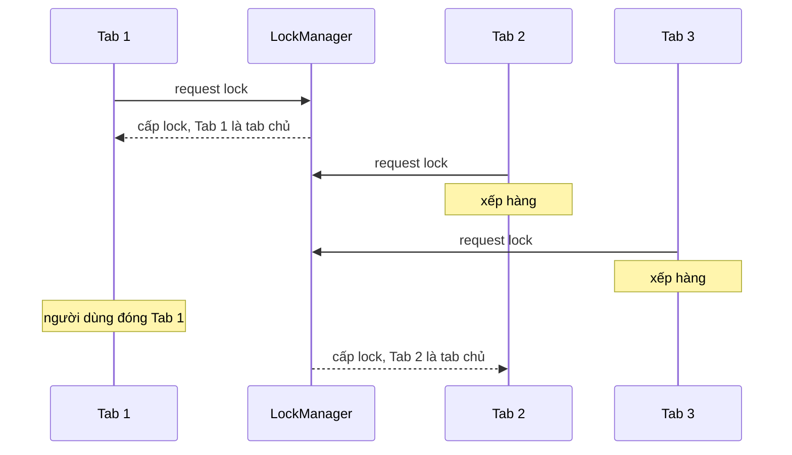

Người dùng app làm việc (CRM, chat, email) hay mở nhiều tab cùng một app: một tab danh sách khách hàng, một tab báo cáo, một tab đang soạn email. Server đẩy một thông báo "Khách hàng X vừa trả lời" qua WebSocket. Mỗi tab có một kết nối, nên **mỗi tab đều nhận được thông báo**. Không xử lý gì thì:

- Năm tab cùng phát tiếng "ting" một lúc, nghe như tiếng vọng.
- Năm thông báo hệ điều hành giống hệt nhau hiện ra ở góc màn hình.
- Server nhận năm lần "đã giao thông báo", số liệu analytics đếm gấp năm.

HubSpot và Telegram Web gặp đúng bài toán này và chọn hai cách khác nhau: HubSpot **bầu một tab chủ**, các tab khác vẫn chạy bình thường nhưng im lặng. Telegram Web thì quyết liệt hơn: **chỉ một tab được hoạt động**, tab cũ tự ngắt kết nối.

> [!TIP]
> **Tóm tắt**
> - Mọi tab đều cập nhật giao diện (số chưa đọc, toast trong app), nhưng chỉ **tab chủ** làm việc "một lần": phát âm thanh, hiện thông báo hệ điều hành, báo server "đã giao".
> - Bầu tab chủ bằng **Web Locks API**: tab giữ lock là tab chủ, tab đóng thì trình duyệt tự nhả lock cho tab đang chờ. Không cần heartbeat hay localStorage.
> - Âm thanh có thể bị chặn bởi chính sách autoplay: **thử mở khoá sớm** (khi thành tab chủ, khi tab được hiện lại), đừng chờ tới lúc có thông báo.
> - Khi kết nối không chia sẻ được giữa các tab (như MTProto của Telegram): tab mở sau cùng thắng, tab cũ hiện màn hình "đang mở ở tab khác".

<iframe class="demo-frame" src="/demos/web-patterns/index.html?theme=dark#/leader-tab" title="Demo leader-tab" loading="lazy" style="height: 600px"></iframe>

<p class="demo-links">▶ <a href="/demos/web-patterns/index.html#/leader-tab" target="_blank" rel="noopener">Mở demo toàn màn hình ↗</a> · <a href="https://stackblitz.com/github/hunghg255/blog-hunghg/tree/master/examples/web-patterns?file=src/lib/leaderTab.ts" target="_blank" rel="noopener">Sửa code trên StackBlitz ↗</a> · <a href="https://github.com/hunghg255/blog-hunghg/blob/master/examples/web-patterns/src/lib/leaderTab.ts" target="_blank" rel="noopener">Xem source trên GitHub ↗</a></p>

## HubSpot làm thế nào?

Code thông báo của HubSpot nằm trong `app.hubspot.com/js/manager/` ([xem trên GitHub](https://github.com/hunghg255/codebase/tree/main/app.hubspot.com/js/manager)). Có ba mảnh ghép.

### 1. `CrossTabManager.js`: bầu tab chủ

HubSpot dùng thư viện npm [`crosstab`](https://www.npmjs.com/package/crosstab) (thư viện bên ngoài, dựa trên localStorage) để bầu "master tab":

```js
var CROSS_TAB_NAMESPACE = "NOTIFICATIONS_" + getCurrentPortalId();
crossTab = new CrossTab(CROSS_TAB_NAMESPACE, {
  onBecomeMaster: handleBecomeMaster,
  onSurrenderMaster: handleSurrenderMaster,
  onMessage: handleMessage,
  onRemoved: handleRemoved
});
```

Chi tiết đáng để ý: tên nhóm có **id của portal** (tài khoản HubSpot). Người dùng mở hai tab tài khoản A và một tab tài khoản B thì có hai cuộc bầu riêng: tab của tài khoản B vẫn kêu cho thông báo của B.

`handleBecomeMaster` gọi `NotificationManager.setIsMaster(true)`, rồi nếu chưa phát được âm thanh thì phát một **âm thanh câm** (dummy sound), comment giải thích: trình duyệt chặn âm thanh nếu tab không hiển thị lúc âm thanh đầu tiên được phát. `onSurrenderMaster` và `onRemoved` đặt lại `false`.

Kênh nhắn tin của crosstab dùng cho hai việc: đóng một thông báo ở tab này thì đóng ở mọi tab (`MESSAGE_CLOSED_EVENT`), và đặt lại bộ đếm chưa đọc (`RESET_COUNTER_EVENT`).

### 2. `NotificationManager.js`: ai làm gì

Comment ngay trong constructor: *"Only the master tab is allowed to show browser notifications or play sounds"*. Cụ thể:

| Việc | Tab chủ | Tab phụ |
|---|---|---|
| Hiện thông báo trong app (tease, floating) | có | có |
| Gọi API `markAsDelivered` | có | không |
| Ghi analytics (`NotificationsUsageTracker`) | có | không |
| Phát âm thanh | chỉ khi tab đang hiển thị | không |
| Thông báo hệ điều hành | chỉ khi tab đang ẩn | không |

Hai dòng cuối là logic hay nhất. Hàm `_showBrowser` chỉ hiện thông báo hệ điều hành khi `!hubspotActive && isMaster`, trong đó `hubspotActive = !document.hidden`. Người dùng đang nhìn vào HubSpot thì thông báo trong app là đủ, không cần làm phiền thêm bằng thông báo hệ điều hành. Còn khi họ đang ở tab khác (Gmail chẳng hạn), thông báo hệ điều hành là cách duy nhất để họ biết.

### 3. Âm thanh và favicon

Âm báo được tạo bằng Web Audio (`NotificationUtil.js`): một oscillator chơi hai nốt 622,25 Hz và 932,33 Hz (Mi giáng và Si giáng), không cần file mp3. Trình duyệt không có Web Audio thì mới dùng file mp3. "Âm thanh câm" chỉ thật sự được phát ở nhánh mp3 (`audio.muted = 'muted'`), nhánh Web Audio trả về luôn. `NotificationManager` còn nghe `visibilitychange`: mỗi lần tab đổi trạng thái hiển thị mà chưa phát được âm thanh thì thử phát âm thanh câm lần nữa.

`FaviconUtil.js` đổi favicon sang file `fav-icon-red-big.ico` (có chấm đỏ) khi có thông báo chưa đọc. Nó tìm thẻ `<link>` hiện tại bằng điều kiện `rel === 'rel' || rel === 'shortcut icon'` (vế đầu có lẽ là lỗi gõ của `'icon'`), xoá thẻ đó và thêm thẻ mới. Mọi thao tác đi qua `window.top.document`: có lẽ phần thông báo chạy trong một iframe cùng origin, còn favicon thuộc về trang ngoài cùng.

## Telegram Web làm thế nào?

Telegram Web (bản "Z", viết bằng Teact) có một file 20 dòng: `web.telegram.org/src/util/activeTabMonitor.ts` ([xem trên GitHub](https://github.com/hunghg255/codebase/blob/main/web.telegram.org/src/util/activeTabMonitor.ts)):

```ts
const STORAGE_KEY = 'tt-active-tab';
const INTERVAL = 2000;
const tabKey = String(Date.now() + Math.random());
localStorage.setItem(STORAGE_KEY, tabKey);

const interval = window.setInterval(() => {
  if (callback && localStorage.getItem(STORAGE_KEY) !== tabKey) {
    callback();
    clearInterval(interval);
  }
}, INTERVAL);
```

Mỗi tab, ngay khi module được nạp, ghi một khoá ngẫu nhiên vào localStorage. Cứ 2 giây, tab kiểm tra: khoá trong localStorage còn là của mình không? Không còn nghĩa là **có tab mới hơn vừa mở**. Callback trong `App.tsx` ngắt kết nối (`disconnect()`), thêm `[Inactive]` vào tiêu đề tab, và hiện màn hình `AppInactive`: *"Such error, many tabs. Telegram supports only one active tab with the app."* kèm nút "Reload app". Bấm reload thì tab này ghi khoá mới, thành tab hoạt động, và tab kia lại bị ngắt.

Vì sao Telegram không bầu tab chủ như HubSpot? Có lẽ vì mỗi tab giữ một kết nối MTProto riêng với cùng một khoá đăng nhập, cùng ghi vào một bộ đệm cục bộ. Hai tab cùng nhận và xử lý một luồng cập nhật dễ làm lệch trạng thái (tin đã đọc, thứ tự tin). Chia sẻ một kết nối cho nhiều tab (qua SharedWorker chẳng hạn) là việc lớn; "tab sau cùng thắng" giải quyết được với 20 dòng code.

## Bên trong trình duyệt: Web Locks API

`crosstab` ra đời khi trình duyệt chưa có cách nào để các tab "thoả thuận" với nhau. Các thư viện thời đó tự làm bằng localStorage: mỗi tab ghi heartbeat định kỳ, tab nào lâu không ghi thì coi như đã đóng, rồi bầu lại. Cách này chạy được nhưng có độ trễ (phải chờ heartbeat hết hạn) và dễ sai khi trình duyệt làm chậm timer của tab nền.

[Web Locks API](https://developer.mozilla.org/en-US/docs/Web/API/Web_Locks_API) (tính tới 10/2026 đã có trên Chrome, Edge, Firefox và Safari, xem [caniuse](https://caniuse.com/mdn-api_lockmanager)) làm đúng việc này ở tầng trình duyệt:

```ts
navigator.locks.request('notification-leader', async () => {
  // chỉ MỘT tab cùng origin được ở trong hàm này tại một thời điểm
  await new Promise(() => {}); // không bao giờ resolve = giữ lock mãi
});
```

- Lock có phạm vi theo origin: mọi tab, iframe, worker cùng origin dùng chung.
- Tab nào gọi `request` trước thì được lock; các tab sau **xếp hàng**, callback của chúng chưa chạy.
- Tab giữ lock bị đóng, reload, hay crash thì trình duyệt **tự nhả lock** ngay, tab đầu hàng đợi được gọi callback. Không có heartbeat, không có độ trễ.



## Viết lại

File [`src/lib/leaderTab.ts`](https://github.com/hunghg255/blog-hunghg/blob/master/examples/web-patterns/src/lib/leaderTab.ts) có bốn phần: bầu tab chủ, "tab sau cùng thắng", âm thanh, favicon + tiêu đề.

### `electLeader`: bầu tab chủ bằng Web Locks

```ts title=src/lib/leaderTab.ts
export function electLeader(name: string, onChange: (isLeader: boolean) => void): LeaderHandle {
  let leader = false;
  let release: (() => void) | null = null;
  let destroyed = false;
  const controller = new AbortController();

  if (!('locks' in navigator)) {
    // Trình duyệt quá cũ: coi như chỉ có một tab. Muốn chính xác hơn thì dùng localStorage
    // + heartbeat như thư viện crosstab.
    leader = true;
    queueMicrotask(() => !destroyed && onChange(true));
  } else {
    navigator.locks
      .request(name, { signal: controller.signal }, () => {
        if (destroyed) return;
        leader = true;
        onChange(true);
        // Giữ lock tới khi Promise này resolve: gọi destroy() hoặc tab bị đóng.
        return new Promise<void>((resolve) => {
          release = resolve;
        });
      })
      .catch((error: unknown) => {
        // AbortError: destroy() khi còn đang xếp hàng chờ lock, không phải lỗi
        if ((error as Error).name !== 'AbortError') throw error;
      });
  }

  return {
    isLeader: () => leader,
    destroy() {
      if (destroyed) return;
      destroyed = true;
      controller.abort();
      release?.();
      if (leader) {
        leader = false;
        onChange(false);
      }
    },
  };
}
```

### `claimActiveTab`: kiểu Telegram

```ts title=src/lib/leaderTab.ts
export function claimActiveTab(key: string, onTakenOver: () => void) {
  const id = typeof crypto.randomUUID === 'function' ? crypto.randomUUID() : String(Date.now() + Math.random());
  localStorage.setItem(key, id);

  const onStorage = (event: StorageEvent) => {
    if (event.storageArea !== localStorage || event.key !== key) return;
    if (event.newValue === id) return;
    stop();
    onTakenOver();
  };
  const stop = () => window.removeEventListener('storage', onStorage);
  window.addEventListener('storage', onStorage);
  return stop;
}
```

### `createNotificationSound`: mở khoá âm thanh sớm

```ts title=src/lib/leaderTab.ts
export function createNotificationSound() {
  let context: AudioContext | null = null;

  async function unlock(): Promise<boolean> {
    context ??= new AudioContext();
    if (context.state === 'running') return true;
    // resume() bị chặn có thể treo mãi không resolve: chỉ chờ tối đa 200ms
    await Promise.race([context.resume().catch(() => {}), new Promise((r) => setTimeout(r, 200))]);
    // đọc lại sau await: TS tưởng state vẫn là giá trị đã kiểm tra ở trên
    return (context.state as AudioContextState) === 'running';
  }
```

Hàm `play()` tạo hai oscillator với đúng hai tần số của HubSpot, bắt đầu cách nhau 120ms. `setFaviconBadge(count)` vẽ một favicon có chấm đỏ lên canvas rồi gán data URL cho `<link rel="icon">`; `setTitleCount(count)` thêm `(3)` vào đầu tiêu đề tab.

Ghép lại trong app:

```ts
const sound = createNotificationSound();
const leader = electLeader(`notifications:${accountId}`, (isLeader) => {
  if (isLeader) void sound.unlock(); // như HubSpot: thử mở khoá ngay khi thành tab chủ
});

socket.on('notification', async (n) => {
  showInAppToast(n);                     // tab nào cũng làm
  setUnread((c) => c + 1);
  if (!leader.isLeader()) return;        // phần dưới chỉ tab chủ làm
  api.markAsDelivered(n.id);
  if (document.hidden) new Notification(n.title, { body: n.body, tag: n.id });
  else await sound.play();
});
```

::: spoiler Xem toàn bộ src/lib/leaderTab.ts

```ts title=src/lib/leaderTab.ts
/**
 * Nhiều tab cùng mở một app nhưng chỉ MỘT tab được làm việc "ồn ào":
 * phát âm thanh, hiện thông báo hệ điều hành, giữ kết nối realtime…
 *
 * - electLeader: bầu tab chủ bằng Web Locks API. Tab giữ lock là tab chủ; tab chủ đóng thì
 *   trình duyệt tự nhả lock và tab đang chờ kế tiếp lên thay. (HubSpot dùng thư viện `crosstab`
 *   để làm việc tương tự: onBecomeMaster / onSurrenderMaster.)
 * - claimActiveTab: kiểu của Telegram Web, tab mở SAU CÙNG thắng, các tab cũ tự ngắt.
 * - createNotificationSound: "mở khoá" âm thanh trước khi cần (HubSpot phát một âm thanh câm
 *   khi tab thành tab chủ / khi tab được hiện lại).
 * - setFaviconBadge / setTitleCount: chấm đỏ trên favicon và "(3)" trên tiêu đề tab.
 */

// ---------------------------------------------------------------------------
// Bầu tab chủ
// ---------------------------------------------------------------------------

export interface LeaderHandle {
  isLeader(): boolean;
  /** rời cuộc bầu (vd: component unmount). Đang là tab chủ thì nhả lock cho tab khác. */
  destroy(): void;
}

export function electLeader(name: string, onChange: (isLeader: boolean) => void): LeaderHandle {
  let leader = false;
  let release: (() => void) | null = null;
  let destroyed = false;
  const controller = new AbortController();

  if (!('locks' in navigator)) {
    // Trình duyệt quá cũ: coi như chỉ có một tab. Muốn chính xác hơn thì dùng localStorage
    // + heartbeat như thư viện crosstab.
    leader = true;
    queueMicrotask(() => !destroyed && onChange(true));
  } else {
    navigator.locks
      .request(name, { signal: controller.signal }, () => {
        if (destroyed) return;
        leader = true;
        onChange(true);
        // Giữ lock tới khi Promise này resolve: gọi destroy() hoặc tab bị đóng.
        return new Promise<void>((resolve) => {
          release = resolve;
        });
      })
      .catch((error: unknown) => {
        // AbortError: destroy() khi còn đang xếp hàng chờ lock, không phải lỗi
        if ((error as Error).name !== 'AbortError') throw error;
      });
  }

  return {
    isLeader: () => leader,
    destroy() {
      if (destroyed) return;
      destroyed = true;
      controller.abort();
      release?.();
      if (leader) {
        leader = false;
        onChange(false);
      }
    },
  };
}

// ---------------------------------------------------------------------------
// Tab mở sau cùng thắng (Telegram Web)
// ---------------------------------------------------------------------------

/**
 * Ghi id của tab này vào localStorage. Tab khác ghi đè (tức là vừa mở) thì gọi `onTakenOver`
 * đúng một lần. Telegram kiểm tra bằng setInterval 2s; ở đây dùng sự kiện `storage`
 * (chỉ bắn ở các tab KHÁC tab vừa ghi) nên phản ứng ngay.
 */
export function claimActiveTab(key: string, onTakenOver: () => void) {
  const id = typeof crypto.randomUUID === 'function' ? crypto.randomUUID() : String(Date.now() + Math.random());
  localStorage.setItem(key, id);

  const onStorage = (event: StorageEvent) => {
    if (event.storageArea !== localStorage || event.key !== key) return;
    if (event.newValue === id) return;
    stop();
    onTakenOver();
  };
  const stop = () => window.removeEventListener('storage', onStorage);
  window.addEventListener('storage', onStorage);
  return stop;
}

// ---------------------------------------------------------------------------
// Âm thanh thông báo
// ---------------------------------------------------------------------------

/**
 * Trình duyệt chặn phát âm thanh khi người dùng chưa tương tác với trang (autoplay policy).
 * AudioContext tạo ra lúc đó ở trạng thái "suspended"; resume() chỉ thành công khi trang đã
 * có tương tác. Vì vậy: thử mở khoá sớm (khi thành tab chủ, khi tab hiện lại, khi click),
 * để lúc có thông báo thật thì đã phát được.
 */
export function createNotificationSound() {
  let context: AudioContext | null = null;

  async function unlock(): Promise<boolean> {
    context ??= new AudioContext();
    if (context.state === 'running') return true;
    // resume() bị chặn có thể treo mãi không resolve: chỉ chờ tối đa 200ms
    await Promise.race([context.resume().catch(() => {}), new Promise((r) => setTimeout(r, 200))]);
    // đọc lại sau await: TS tưởng state vẫn là giá trị đã kiểm tra ở trên
    return (context.state as AudioContextState) === 'running';
  }

  /** hai nốt ngắn (tần số giống âm báo của HubSpot); trả về false nếu bị chặn */
  async function play(volume = 0.08): Promise<boolean> {
    if (!(await unlock()) || !context) return false;
    const ctx = context;
    const gain = ctx.createGain();
    gain.connect(ctx.destination);
    [622.25, 932.33].forEach((frequency, i) => {
      const osc = ctx.createOscillator();
      osc.frequency.value = frequency;
      osc.connect(gain);
      const at = ctx.currentTime + i * 0.12;
      gain.gain.setValueAtTime(volume, at);
      osc.start(at);
      osc.stop(at + 0.1);
    });
    return true;
  }

  return {
    unlock,
    play,
    isUnlocked: () => context?.state === 'running',
    close() {
      void context?.close();
      context = null;
    },
  };
}

// ---------------------------------------------------------------------------
// Favicon + tiêu đề
// ---------------------------------------------------------------------------

const originalIcons = new WeakMap<Document, string | null>();

/** Vẽ chấm đỏ lên favicon (count > 0) hoặc trả favicon gốc (count = 0). Trả về URL đang dùng. */
export function setFaviconBadge(count: number, doc: Document = document): string | null {
  let link = doc.querySelector<HTMLLinkElement>('link[rel~="icon"]');
  if (!originalIcons.has(doc)) originalIcons.set(doc, link?.href ?? null);
  const original = originalIcons.get(doc) ?? null;

  if (count <= 0) {
    if (link && original) link.href = original;
    return original;
  }

  const size = 32;
  const canvas = doc.createElement('canvas');
  canvas.width = canvas.height = size;
  const ctx = canvas.getContext('2d')!;
  // Không vẽ lại ảnh favicon gốc (cần cùng origin/CORS và phải chờ ảnh tải xong);
  // bản demo vẽ một ô vuông bo góc làm nền.
  ctx.fillStyle = '#3b82f6';
  ctx.beginPath();
  ctx.roundRect(2, 2, 28, 28, 7);
  ctx.fill();
  ctx.fillStyle = '#f2466b';
  ctx.beginPath();
  ctx.arc(23, 9, 8, 0, Math.PI * 2);
  ctx.fill();
  ctx.lineWidth = 2;
  ctx.strokeStyle = '#ffffff';
  ctx.stroke();
  const url = canvas.toDataURL('image/png');

  if (!link) {
    link = doc.createElement('link');
    link.rel = 'icon';
    doc.head.appendChild(link);
  }
  link.href = url;
  return url;
}

/** "(3) Hộp thư" — giữ nguyên tiêu đề gốc, chỉ thay phần đếm ở đầu. */
export function setTitleCount(count: number, doc: Document = document) {
  const base = doc.title.replace(/^\(\d+\+?\)\s*/, '');
  doc.title = count > 0 ? `(${count > 99 ? '99+' : count}) ${base}` : base;
}
```

:::

## Đi qua code

**Giữ lock bằng một Promise không resolve.** Callback của `navigator.locks.request` trả về Promise nào thì lock được giữ tới khi Promise đó xong. `electLeader` trả về một Promise chỉ resolve khi gọi `destroy()`. Tab đóng thì cả trang biến mất, lock được nhả theo.

**`AbortController` cho tab đang xếp hàng.** Component unmount khi chưa thành tab chủ: phải rút khỏi hàng đợi, nếu không thì sau này callback vẫn chạy trên một component đã chết. `signal` của `request` làm việc này; Promise bị reject với `AbortError`, bắt và bỏ qua.

**Cờ `destroyed`** chặn trường hợp lock được cấp đúng lúc vừa `destroy()`: callback trả về ngay, lock được nhả cho tab khác.

**`claimActiveTab` dùng sự kiện `storage` thay cho `setInterval`.** Sự kiện `storage` chỉ bắn ở các tab **khác** tab vừa ghi, nên tab mới ghi khoá của mình không tự đá chính mình. Telegram dùng polling 2s, phản ứng chậm tối đa 2 giây nhưng không phụ thuộc vào sự kiện. Bạn có thể giữ cả hai nếu lo sự kiện bị lỡ.

**`unlock()` chờ tối đa 200ms.** Khi trang chưa có tương tác, `AudioContext.resume()` có thể không bao giờ resolve. `Promise.race` với một timeout để hàm luôn trả lời "mở được hay chưa".

**Khác bản gốc:**
- Web Locks thay cho thư viện `crosstab` (localStorage + heartbeat).
- Âm thanh dùng lại một `AudioContext`; bản gốc tạo `new AudioContext()` mỗi lần phát mà không `close()`, mỗi context giữ tài nguyên âm thanh của hệ thống cho tới khi bị dọn.
- Favicon vẽ bằng canvas thay vì hai file `.ico` có sẵn, nên có thể vẽ cả con số nếu muốn.
- Kênh nhắn tin giữa các tab (đóng thông báo, đánh dấu đã đọc) không nằm trong lib: dùng `BroadcastChannel` trực tiếp như trong demo.

## Tại sao không làm cách khác?

**SharedWorker giữ một kết nối duy nhất?** Đây là giải pháp "đúng" nhất: một worker dùng chung cho mọi tab, giữ một WebSocket, phân phát dữ liệu cho các tab. Không còn chuyện năm kết nối, năm lần nhận. Nhưng SharedWorker phức tạp hơn nhiều (debug khó, vòng đời riêng) và Chrome trên Android không hỗ trợ (tính tới 10/2026). Bầu tab chủ là bước đơn giản hơn, giải quyết phần "ồn ào" mà không phải đổi kiến trúc kết nối.

**Để server lo, chỉ gửi cho một kết nối?** Server không biết tab nào đang được nhìn, không biết tab nào đã đóng mà chưa kịp ngắt kết nối. Trình duyệt biết rõ hơn.

**Chọn tab đang hiển thị làm tab chủ?** Nghe hợp lý, nhưng tab hiển thị đổi liên tục khi người dùng chuyển tab, bầu lại liên tục dễ sinh lỗi (hai tab cùng nghĩ mình là chủ trong một khoảnh khắc). HubSpot giữ một tab chủ cố định và để **tab chủ tự quyết** phát âm thanh hay hiện thông báo hệ điều hành dựa trên `document.hidden`. Kết quả gần như nhau mà đơn giản hơn nhiều.

**Thẻ `tag` của Notification API?** Tạo `new Notification(title, { tag })` với cùng `tag` từ nhiều tab thì thông báo sau **thay** thông báo trước, người dùng chỉ thấy một. Đây là lớp bảo vệ thứ hai nên dùng, nhưng không giải quyết được âm thanh và analytics bị đếm trùng.

## Edge case và cạm bẫy

- **Tab chủ có thể là tab bị bỏ quên**: tab mở từ sáng nằm cuối dãy tab. Thông báo hệ điều hành vẫn hiện (vì nó đang ẩn), nhưng người dùng bấm vào thông báo thì được đưa về tab cũ đó. Trong `notification.onclick` nhớ gọi `window.focus()`.
- **Autoplay**: Chrome cho `AudioContext` chạy nếu người dùng **đã từng tương tác với trang** (sticky user activation). Tab chủ được mở bằng Ctrl+click từ tab khác thì chưa có tương tác nào, âm thanh bị chặn cho tới khi người dùng click vào tab đó. Đây là lý do HubSpot thử mở khoá lại mỗi khi `visibilitychange`.
- **Web Locks theo origin và theo phân vùng lưu trữ**: app nhúng dưới dạng iframe trên một site khác thì nằm trong phân vùng riêng (storage partitioning), không bầu chung với tab mở trực tiếp app.
- **Nhiều tài khoản**: đặt tên lock theo tài khoản như HubSpot (`NOTIFICATIONS_<portalId>`), nếu không tab của tài khoản B sẽ im lặng vì tab chủ là của tài khoản A.
- **Favicon không phải lúc nào cũng thấy**: trình duyệt mobile không hiện favicon trên tab, tab bị ghim hoặc quá hẹp thì chấm đỏ rất nhỏ. Đừng để favicon là kênh báo duy nhất; tiêu đề `(3) …` và thông báo trong app vẫn cần.
- **Telegram "ping-pong"**: hai tab, bấm reload ở tab cũ thì tab kia bị ngắt. Người dùng có thể đá qua đá lại; đó là chủ ý, nhưng màn hình "inactive" phải giải thích rõ chuyện gì đang xảy ra.

## Dùng trong dự án

- App chat, CRM, email, dashboard cảnh báo: bất cứ chỗ nào có âm báo hoặc thông báo hệ điều hành.
- Polling định kỳ một API tốn kém (vd kiểm tra đơn hàng mới mỗi 30s): chỉ tab chủ poll, rồi phát kết quả cho các tab khác qua `BroadcastChannel`. Giảm tải server theo số tab.
- Đồng bộ dữ liệu offline (IndexedDB lên server): chỉ tab chủ đồng bộ, tránh hai tab gửi trùng.
- Kết nối không chia sẻ được (thiết bị Bluetooth/USB qua WebUSB, phiên làm việc độc quyền): kiểu "tab sau cùng thắng" của Telegram.

::: spoiler Ví dụ test (bản phác, không có trong repo)

```ts
import { describe, expect, it, vi } from 'vitest';
import { claimActiveTab, electLeader, setTitleCount } from './leaderTab';

// LockManager giả: một lock, hàng đợi FIFO, hỗ trợ AbortSignal
function installFakeLocks() {
  let held = false;
  const queue: Array<() => void> = [];
  const next = () => {
    const run = queue.shift();
    if (run) run();
    else held = false;
  };
  Object.defineProperty(navigator, 'locks', {
    configurable: true,
    value: {
      request(_name: string, opts: { signal: AbortSignal }, cb: () => Promise<void> | void) {
        return new Promise<void>((resolve, reject) => {
          const run = () => {
            held = true;
            Promise.resolve(cb()).then(() => { resolve(); next(); });
          };
          if (!held) run();
          else {
            queue.push(run);
            opts.signal.addEventListener('abort', () => {
              queue.splice(queue.indexOf(run), 1);
              reject(Object.assign(new Error('aborted'), { name: 'AbortError' }));
            });
          }
        });
      },
    },
  });
}

describe('electLeader', () => {
  it('tab chủ rời đi thì tab kế tiếp lên thay', async () => {
    installFakeLocks();
    const a = vi.fn(), b = vi.fn();
    const tabA = electLeader('x', a);
    const tabB = electLeader('x', b);
    await Promise.resolve();
    expect(a).toHaveBeenCalledWith(true);
    expect(b).not.toHaveBeenCalled();
    tabA.destroy();
    await new Promise((r) => setTimeout(r));
    expect(b).toHaveBeenCalledWith(true);
    expect(tabB.isLeader()).toBe(true);
  });
});

describe('claimActiveTab', () => {
  it('tab khác ghi khoá mới thì gọi onTakenOver', () => {
    const onTakenOver = vi.fn();
    claimActiveTab('active', onTakenOver);
    window.dispatchEvent(new StorageEvent('storage', { key: 'active', newValue: 'other', storageArea: localStorage }));
    expect(onTakenOver).toHaveBeenCalledTimes(1);
  });
});

it('setTitleCount giữ tiêu đề gốc', () => {
  document.title = 'Hộp thư';
  setTitleCount(3);
  setTitleCount(120);
  expect(document.title).toBe('(99+) Hộp thư');
  setTitleCount(0);
  expect(document.title).toBe('Hộp thư');
});
```

:::

## So với thư viện và chuẩn web

- **Web Locks API** là cách bầu tab chủ gọn nhất hiện nay. Thư viện `broadcast-channel` (npm) có sẵn tính năng bầu leader, các bản mới dùng Web Locks khi trình duyệt hỗ trợ.
- **BroadcastChannel** là kênh nhắn tin giữa các tab cùng origin, thay cho mẹo ghi localStorage để kích sự kiện `storage`. Có trên mọi trình duyệt chính (tính tới 10/2026).
- **SharedWorker** cho phép thật sự dùng chung một kết nối, nhưng không có trên Chrome Android (tính tới 10/2026).
- **Badging API** (`navigator.setAppBadge(3)`) hiện số trên icon của PWA đã cài, thay cho mẹo favicon. Chỉ có tác dụng với app đã cài và trên trình duyệt hỗ trợ.
- **Notification API**: dùng `tag` để gộp thông báo trùng, `renotify` để quyết định có rung/kêu lại khi thay thế hay không.

---

Bài này thuộc series **[Học từ mã nguồn các web lớn](/series/web)** (65 bài, đọc theo thứ tự).

::: spoiler Xem nhanh danh sách bài trong series

*Mở đầu*

- [Mở đầu: đọc code production của 28 trang web](/blogs/learn-from-big-web-apps)

*Phần 1: trải nghiệm người dùng*

- [#1 Dark mode không nháy (Gatsby)](/blogs/web-dark-mode-no-flash)
- [#2 useValueByMedia: giá trị theo breakpoint (Toptal)](/blogs/web-use-value-by-media)
- [#3 Đoán ý định: idle, exit-intent, lắc chuột (Toptal, InVision)](/blogs/web-user-intent-idle-exit-wiggle)
- [#4 Validate form thân thiện (Udacity, Pipedrive)](/blogs/web-form-validation-ux)
- [#5 Magic number, EXIF và dán ảnh (Ello)](/blogs/web-file-magic-number-exif-paste)
- [#6 fastSmoothScroll: cuộn xa vẫn nhanh (Telegram)](/blogs/web-telegram-fast-smooth-scroll)
- [#7 Countdown time-travel và tombstone giỏ hàng (Best Buy)](/blogs/web-countdown-time-travel-tombstone)

*Phần 2: hiệu năng và đo lường*

- [#8 Hàng đợi requestAnimationFrame 3ms (Apple)](/blogs/web-raf-queue-3ms)
- [#9 srcset cho artwork và preconnect tự động (Apple)](/blogs/web-responsive-artwork-preconnect)
- [#10 Quick-fetch: gọi API trước khi bundle tải xong (HubSpot)](/blogs/web-quick-fetch-early-requests)
- [#11 Performance span và long task (Postman, Calibre)](/blogs/web-performance-spans-long-tasks)
- [#12 Gọi Web Worker như hàm async (Telegram)](/blogs/web-worker-promise-rpc)
- [#13 Đồng hồ media: đếm giờ xem và sửa lệch (Skillshare, Simplified)](/blogs/web-media-clock-watch-time-drift)

*Phần 3: nhiều tab, phiên đăng nhập, cập nhật*

- **#14 Bầu tab chủ cho thông báo (HubSpot, Telegram)** (bài này)
- [#15 Đồng bộ đăng nhập giữa tab và giới hạn cookie (Elastic, InVision)](/blogs/web-cross-tab-auth-cookie-guard)
- [#16 SPA tự cập nhật: Trello, Zappos, Facebook, Elastic](/blogs/web-spa-self-update-strategies)

*Phần 4: kiến trúc*

- [#17 Reverse portal: di chuyển component không remount (Zappos)](/blogs/web-reverse-portal)
- [#18 Page behaviors: gắn hành vi từ CMS (Intercom)](/blogs/web-page-behaviors-cms)
- [#19 Giới hạn tần suất hiển thị bằng bitmask (Outlook)](/blogs/web-frequency-cap-bitmask)
- [#20 Chuyển REST sang GraphQL dần dần (Coursera)](/blogs/web-rest-to-graphql-hybrid-link)

*Phần 5: soạn thảo và hiển thị nội dung*

- [#21 Autocomplete tại con trỏ trong contenteditable (Ello, Telegram)](/blogs/web-caret-autocomplete-contenteditable)
- [#22 Dark mode cho email HTML bằng CIELAB (Outlook)](/blogs/web-email-dark-mode-cielab)
- [#23 Thu nhỏ bảng rộng cho vừa khung, vá font emoji (Outlook)](/blogs/web-email-wide-content-scale)
- [#24 Cảnh báo quên đính kèm file (Outlook)](/blogs/web-forgotten-attachment-warning)
- [#25 Cắt chữ nhiều dòng chính xác (Pipedrive, Apple, Toptal)](/blogs/web-multiline-truncate-measure-text)
- [#26 Parse ngày giờ gõ tay khoan dung (Outlook, Elastic)](/blogs/web-lenient-date-parser)

*Phần 6: tương tác*

- [#27 menuAim: rê chéo vào submenu không bị đóng (Udemy)](/blogs/web-menu-aim-triangle)
- [#28 Kéo, vuốt chung cho chuột và cảm ứng (Telegram)](/blogs/web-unified-pointer-gestures)
- [#29 Phím tắt theo phạm vi, IME và bàn phím phi Latinh (Trello)](/blogs/web-scoped-keyboard-shortcuts)
- [#30 Nội suy màu: đổi theme và nền theo cuộn (Telegram, Anchor)](/blogs/web-color-interpolation-theme-scroll)
- [#31 Đường gióng hút cạnh và undo/redo trên canvas (Simplified)](/blogs/web-canvas-snap-guides-undo)
- [#32 Giả lập mù màu bằng feColorMatrix (Trello)](/blogs/web-color-vision-simulator)
- [#33 Vạch thước theo mức zoom và cấp phát màu cho biểu đồ (Anchor, Similarweb)](/blogs/web-timeline-ticks-color-stack)

*Phần 7: mạng, dữ liệu và async*

- [#34 Ô tìm kiếm chuẩn production (Similarweb, Udemy, Pipedrive)](/blogs/web-production-search-box)
- [#35 Điều phối async: latest-wins, single-flight (Glitch, Toptal)](/blogs/web-async-coordination-latest-wins)
- [#36 Polling thưa dần và debounce động (Trello)](/blogs/web-decaying-polling-dynamic-debounce)
- [#37 Cache phía client theo version (Similarweb, Telegram, Udemy)](/blogs/web-client-cache-versioned)
- [#38 Upload file lớn theo chunk (Outlook, Tribe)](/blogs/web-chunked-upload-pipeline)
- [#39 Phát video qua Service Worker bằng Range request (Telegram, Outlook)](/blogs/web-service-worker-range-streaming)

*Phần 8: hiệu năng và vận hành*

- [#40 TTI governor: hoãn việc phụ tới sau khi trang dùng được (Outlook)](/blogs/web-tti-governor)
- [#41 Tự đo LCP/CLS/TBT và phục vụ bản nhẹ cho máy yếu (Udemy)](/blogs/web-rum-adaptive-loading)

*Phần 9: thuật toán và dữ liệu phía client*

- [#42 Three-way merge ngay trên trình duyệt (Postman)](/blogs/web-three-way-merge-client)
- [#43 Dọn cache GraphQL bằng đếm tham chiếu (Outlook)](/blogs/web-graphql-cache-refcount-gc)
- [#44 LRU cache theo 3 cách (Apple, Similarweb, Outlook)](/blogs/web-lru-cache-three-ways)
- [#45 Lọc tăng dần trong Web Worker (Similarweb)](/blogs/web-incremental-filter-worker)
- [#46 Xếp hạng gợi ý trên client, so ngầm với server (Outlook)](/blogs/web-client-side-ranking-shadow-test)
- [#47 Nối OT với editor: undo stack và chặn echo (Glitch)](/blogs/web-ot-codemirror-undo)
- [#48 Ngôn ngữ markup riêng dịch hai chiều với HTML (Coursera)](/blogs/web-custom-markup-compiler)

*Phần 10: thời gian, ngôn ngữ, định dạng*

- [#49 Xử lý giờ mùa hè không cần thư viện (Udemy, Pipedrive)](/blogs/web-dst-without-library)
- [#50 Intl thực chiến: Segmenter, số rút gọn, số nhiều, fallback locale (Apple, Outlook)](/blogs/web-intl-in-production)
- [#51 WebVTT và bôi chọn transcript (Udemy, Coursera)](/blogs/web-webvtt-transcript-selection)

*Phần 11: tương tác và giao diện*

- [#52 Kéo-thả trên lịch (Pipedrive)](/blogs/web-calendar-drag-drop)
- [#53 Focus stack cho popup lồng nhau (Outlook)](/blogs/web-focus-stack-nested-popups)
- [#54 Clipboard: copy, dán chữ thuần, dán thông minh (Trello, Anchor, Pipedrive, Tribe)](/blogs/web-clipboard-tricks)
- [#55 Khôi phục vị trí cuộn khi trang còn đang tải (Apple, Zappos)](/blogs/web-scroll-restore-wait-height)
- [#56 Lấy màu từ ảnh: gradient nền, màu chữ (Apple, Telegram, Trello)](/blogs/web-colors-from-images)
- [#57 JS đọc breakpoint từ CSS, phát hiện chế độ PWA (Ello, Apple)](/blogs/web-css-js-breakpoint-bridge)

*Phần 12: media*

- [#58 Tin nhắn thoại: ghi âm, waveform realtime, nén 5-bit (Telegram)](/blogs/web-voice-message-waveform)
- [#59 Chụp frame video thành ảnh, canvas bị taint (Coursera, Outlook)](/blogs/web-video-frame-snapshot)

*Phần 13: đo lường, bảo mật, vận hành*

- [#60 Đo lúc ảnh màn hình đầu tải xong, cả khi chuyển trang SPA (Zappos, Best Buy, Outlook)](/blogs/web-above-the-fold-image-timing)
- [#61 Buffer analytics chờ SDK, phát hiện adblock (Best Buy)](/blogs/web-analytics-buffer-adblock)
- [#62 Proof-of-work trên client để chặn API ẩn danh (Udemy)](/blogs/web-client-proof-of-work)
- [#63 Prefetch không làm lệch số liệu, nén cài đặt bằng bit (Outlook)](/blogs/web-synthetic-prefetch-bit-flags)
- [#64 Micro-frontend: AngularJS và React chung app, giao tiếp xuyên frame (Similarweb, InVision, HubSpot)](/blogs/web-micro-frontend-bridges)

:::

Code + demo: [`examples/web-patterns`](https://github.com/hunghg255/blog-hunghg/tree/master/examples/web-patterns) · [Mở trên StackBlitz](https://stackblitz.com/github/hunghg255/blog-hunghg/tree/master/examples/web-patterns)
