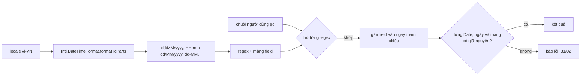

Ô chọn ngày nào cũng có lịch để bấm, nhưng người dùng quen tay vẫn gõ thẳng: `7/3`, `07.03.26 9:05 pm`, `21h05 7-3-2026`. Một người ở Việt Nam gõ `07/03/2026` nghĩa là ngày 7 tháng 3. Còn `new Date('07/03/2026')` trên Chromium trả về **ngày 3 tháng 7**.

Bài toán có hai vế ngược nhau:

- **Khoan dung**: nhận nhiều cách gõ (thiếu khoảng trắng, thiếu AM/PM, giờ 24h, tên tháng viết tắt, viết thường…).
- **Đúng locale**: thứ tự ngày/tháng/năm phải theo thói quen của người dùng, không theo thói quen của trình duyệt.

Outlook trên web giải bài này bằng một hàm 70 dòng: **biến chuỗi định dạng của locale thành regex**. Elastic Cloud thì có một hàm nhỏ đọc khoảng thời gian kiểu `"45min"`, `"2h"`, và hàm đó hiểu sai vài trường hợp rất đáng để xem.

> [!TIP]
> **Tóm tắt**
> - Đừng đưa chuỗi người dùng gõ cho `new Date()`. Kết quả phụ thuộc trình duyệt và không biết locale.
> - Lấy thứ tự field từ `Intl.DateTimeFormat(locale).formatToParts()`, đổi thành chuỗi định dạng (`dd/MM/yyyy`), rồi dựng regex: mỗi field một capture group, khoảng trắng tuỳ chọn, AM/PM tuỳ chọn (cách của Outlook).
> - Sau khi parse, **dựng lại `Date` và so ngày** để bắt `31/02`. Năm 2 chữ số thì chọn năm gần hiện tại nhất.
> - Parser khoảng thời gian phải **từ chối** đơn vị lạ, đừng âm thầm coi là giây: bản của Elastic đọc `"500ms"` thành 500 phút.

<iframe class="demo-frame" src="/demos/web-patterns/index.html?theme=dark#/lenient-date" title="Demo lenient-date" loading="lazy" style="height: 900px"></iframe>

<p class="demo-links">▶ <a href="/demos/web-patterns/index.html#/lenient-date" target="_blank" rel="noopener">Mở demo toàn màn hình ↗</a> · <a href="https://stackblitz.com/github/hunghg255/blog-hunghg/tree/master/examples/web-patterns?file=src/lib/lenientDate.ts" target="_blank" rel="noopener">Sửa code trên StackBlitz ↗</a> · <a href="https://github.com/hunghg255/blog-hunghg/blob/master/examples/web-patterns/src/lib/lenientDate.ts" target="_blank" rel="noopener">Xem source trên GitHub ↗</a></p>

Chọn locale rồi bấm các mẫu. Ô bên trái là parser khoan dung, kèm định dạng đã khớp và regex sinh ra. Ô bên phải là `new Date(chuỗi)`. Bảng phía dưới so `weirdTime.ts` của Elastic với bản sửa: các ô màu cam là chỗ bản gốc hiểu sai.

## Outlook làm thế nào?

Code nằm ở [`outlook.live.com/src/modules/owa-datetime/src/parsers/getDisplayDateParserRegExp.ts`](https://github.com/hunghg255/codebase/blob/main/outlook.live.com/src/modules/owa-datetime/src/parsers/getDisplayDateParserRegExp.ts). Comment đầu hàm nói thẳng mục tiêu:

> The expression is not 100% rigid and this is by design, so the user has some flexibility. For example, while the format might ask for 12-hour, the user can still enter a 24-hour value, AM/PM indicators are not mandatory, spaces can be omitted and month names can be full, abbreviated and are case-insensitive.

### Bước 1: tách chuỗi định dạng thành token

Chuỗi định dạng của Outlook có dạng `M/d/yyyy h:mm tt`. Một regex tách nó thành từng mảnh: chuỗi trong nháy đơn, các ký hiệu định dạng, và nhóm ký tự còn lại:

```ts
const tokenRegExp = /'[^']+'|dd|d|MMMM|MMM|MM|M|yyyy|yy|hh|h|HH|H|mm|m|ss|s|tt|t|[^\'dMyhHmst]+/g;
const tokens = owaFormatString.match(tokenRegExp);
```

Thứ tự trong regex quan trọng: `MMMM` phải đứng trước `MMM`, `MM`, `M`, nếu không `MMMM` sẽ bị tách thành bốn chữ `M`.

### Bước 2: mỗi token thành một mảnh regex

```ts
case 'd': case 'dd': case 'M': case 'MM': /* … h, H, m, s … */
  groups.push(token[0]);   regexp.push('(\\d\\d?)');      break;  // 1 hoặc 2 chữ số
case 'MMM': case 'MMMM':
  groups.push('n');        regexp.push('([^\\s\\d]+)');   break;  // tên tháng: chuỗi không có số
case 't': case 'tt':
  groups.push('t');        regexp.push('([^\\s\\d]*)');   break;  // AM/PM: có thể rỗng
case 'yy': case 'yyyy':
  groups.push('y');        regexp.push('(-?\\d{1,4})');   break;
default:
  // bỏ nháy, escape dấu chấm ("OWA only uses the dot, so we escape just that")
  regexp.push(token.replace('.', '\\.'));
```

Mảng `groups` ghi lại capture group thứ i là field gì. Cuối cùng là mẹo làm khoảng trắng thành tuỳ chọn:

```ts
new RegExp(regexp.join('').replace(/\s+/g, '\\s*'));
```

Với `M/d/yyyy h:mm tt`, kết quả là:

```
^(\d\d?)\/(\d\d?)\/(-?\d{1,4})\s*(\d\d?):(\d\d?)\s*([^\s\d]*)$
```

`3/7/2026 21:05`, `3/7/2026 9:05pm`, `3/7/2026  9:05 PM` đều khớp. Giờ là `(\d\d?)`, không giới hạn 1–12, nên gõ giờ 24h vẫn được.

### Bước 3: đổ field vào ngày tham chiếu

`parseDisplayDate.ts` chạy regex, rồi duyệt `captureGroups` để gán từng field. Field nào không có trong định dạng thì giữ giá trị của **ngày tham chiếu** (mặc định là hôm nay). Ba chi tiết đáng chú ý:

- **Tên tháng** tra trong bảng `monthNamesInUpperCase`, gồm tên đầy đủ và tên viết tắt **đã dịch theo ngôn ngữ giao diện**, đều viết hoa, nên gõ `MAR`, `mar`, `March` đều ra tháng 3.
- **AM/PM** tra trong bảng `timeIndicators` gồm 8 chuỗi đã dịch. Nếu người dùng gõ một chữ **không rỗng** mà không có trong bảng (vd `xm`), parser trả `null`.
- **Năm 2 chữ số** ghép với thế kỷ của năm tham chiếu: `year - (year % 100) + intValue`. Comment trong code lấy ví dụ năm 2017 gõ `18` ra 2018, "without going back to 1918".

Cuối cùng là kiểm tra tràn: Outlook kiểm từng field nằm trong giới hạn (ngày < 32, tháng < 12, giờ < 24…), dựng ngày, rồi kiểm **ngày của kết quả có bằng ngày đã gõ không**. `31/2` sẽ bị `Date` đẩy sang 3/3, ngày không còn là 31, nên bị từ chối.

### Những chỗ cần sửa khi mang sang dự án khác

Mình chạy lại hàm trong Node với vài định dạng:

| Định dạng | Chuỗi gõ | Kết quả |
|---|---|---|
| `M/d/yyyy h:mm tt` | `3/7/2026 9:05pm` | khớp |
| `M/d/yyyy h:mm tt` | `3-7-2026 9:05` | **không khớp**: dấu phân cách phải đúng là `/` |
| `dd.MM.yyyy` | `7.3.26` | khớp |
| `(d) M` | `(7) 3` | **không khớp**, còn `7 3` lại khớp và gán sai field |

Dòng cuối là do code chỉ escape dấu chấm. Dấu ngoặc trong định dạng trở thành một capture group thừa, làm lệch toàn bộ mảng `groups`. Với các định dạng Outlook thật sự dùng thì không sao (comment đã nói vậy), nhưng mang sang nơi khác thì phải escape đủ.

Thêm một điểm về năm: với năm tham chiếu 2026, gõ `99` ra **2099** chứ không phải 1999. Cách ghép thế kỷ đơn giản này đúng với lịch hẹn (gần như luôn ở tương lai gần) nhưng sai với ngày sinh.

## Elastic làm thế nào?

[`cloud.elastic.co/lib/weirdTime.ts`](https://github.com/hunghg255/codebase/blob/main/cloud.elastic.co/lib/weirdTime.ts) có comment rất thật thà: *"The API time format is …complicated"*. API có thể trả số `86400000` (mili giây), chuỗi `"default"` (30 phút), `"45min"`, `"2h"`, `"1d"`, hoặc không có gì. Hàm đọc chuỗi bằng một regex rồi nhìn **chữ cái đầu** của đơn vị:

```ts
// rút gọn: box(ms, value, unit) thay cho weirdApiTimeBox
const [, value, unit] = time.match(/(\d*)\s?(\w*)/)
if (unit.startsWith(`m`)) return box(value * 60_000, value, `min`)
if (unit.startsWith(`h`)) return box(value * 3_600_000, value, `h`)
if (unit.startsWith(`d`)) return box(value * 86_400_000, value, `d`)
return box(value * 1000, value, `s`) // assume seconds
```

Với dữ liệu từ đúng API đó thì ổn. Đưa chuỗi khác vào thì (mình chạy lại trong Node):

| Chuỗi | Bản gốc hiểu là | Lý do |
|---|---|---|
| `500ms` | **500 phút** | `ms` bắt đầu bằng `m` |
| `1.5h` | **1 giây** | `\d*` dừng ở dấu chấm, đơn vị rỗng thành giây |
| `1 week` | **1 giây** | đơn vị lạ thành giây |
| `h`, `abc` | `NaN` | không có số |

Nhánh `throw new Error('Unexpected time string')` không bao giờ chạy: mọi phần của regex đều có thể rỗng, nên nó khớp với mọi chuỗi.

## Bên trong trình duyệt



- **`new Date(string)`** chỉ được đặc tả chặt cho định dạng ISO (`2026-03-07T21:05`). Mọi định dạng khác là "tuỳ trình duyệt". Trên Chromium, `07/03/2026` là tháng 7, `March 7` là **năm 2001**, `2/31/2026` âm thầm thành 3/3. Còn `2026-03-07` (ISO, chỉ có ngày) được hiểu là nửa đêm **giờ UTC**, nên ở Nhật hiện ra 7 giờ sáng.
- **`formatToParts`** trả về từng mảnh (`day`, `month`, `year`, `literal`, `dayPeriod`…) theo đúng thứ tự của locale. Đây là cách lấy thứ tự field mà không phải tự viết bảng cho từng ngôn ngữ. Kết quả thực tế có vài bất ngờ: vi-VN khi có cả giờ thì đặt **giờ trước ngày** (`21:05 23/11/2026`), và ngày-tháng không có năm dùng gạch ngang (`23-11`).
- **`\s` trong regex JavaScript** khớp mọi ký tự khoảng trắng Unicode, kể cả no-break space (U+00A0) và narrow no-break space (U+202F) mà một số phiên bản ICU từng chèn trước AM/PM. Regex dựng theo kiểu Outlook vì thế không bị ảnh hưởng.

## Viết lại

`lenientDate.ts` gồm bốn phần: dựng regex từ định dạng, lấy tên tháng và AM/PM từ Intl, suy định dạng từ locale, và parse.

Phần khác nhất so với Outlook là cách xử lý chữ cố định:

```ts title=src/lib/lenientDate.ts
const escapeRegExp = (text: string) => text.replace(/[.*+?^${}()|[\]\\]/g, '\\$&');

/** Chuyển một đoạn chữ cố định trong định dạng thành regex. */
function literalToRegExp(text: string): string {
  let out = '';
  for (const char of text) {
    if (/\s/.test(char)) out += '\\s*'; // khoảng trắng (kể cả NBSP, U+202F) thành tuỳ chọn
    else if (char === TIME_SEPARATOR) out += '\\s*[:.hH]\\s*'; // 21:05, 21.05, 21h05
    // gõ / . - thay nhau đều được, nhưng PHẢI có: bỏ trống thì "7.3.2026" có thể bị
    // hiểu thành năm 20, 2 giờ 6 phút vì các nhóm số dính liền nhau
    else if (SEPARATORS.test(char)) out += '\\s*[./\\-]\\s*';
    else if (char === ',') out += '\\s*,?\\s*';
    else out += escapeRegExp(char);
  }
  return out;
}
```

Định dạng được suy từ Intl thay vì viết tay:

```ts title=src/lib/lenientDate.ts
export function formatFromLocale(
  locale: string,
  options: Intl.DateTimeFormatOptions = { year: 'numeric', month: '2-digit', day: '2-digit' },
): string | null {
  const format = new Intl.DateTimeFormat(locale, { ...options, timeZone: 'UTC' });
  const hour12 = format.resolvedOptions().hour12;
  let out = '';
  for (const { type, value } of format.formatToParts(Date.UTC(2026, 10, 23, 21, 5))) {
    switch (type) {
      case 'day': out += 'dd'; break;
      case 'month':
        if (/^\d+$/.test(value)) out += 'MM';
        else if (/\d/.test(value)) return null;
        else out += 'MMMM';
        break;
      case 'year': out += 'yyyy'; break;
      case 'hour': out += hour12 ? 'h' : 'HH'; break;
      case 'minute': out += 'mm'; break;
      case 'dayPeriod': out += 'tt'; break;
      default: out += /[dMyhHmst']/.test(value) ? `'${value}'` : value;
    }
  }
  return out;
}
```

Bước kiểm tra cuối của `parseLenientDate`:

```ts title=src/lib/lenientDate.ts
  if (pm === true && hour < 12) hour += 12;
  if (pm === false && hour === 12) hour = 0;
  if (month < 0 || month > 11 || day < 1 || hour > 23 || minute > 59 || second > 59) {
    return { ok: false, reason: 'giá trị vượt giới hạn' };
  }
  const date = new Date(year, month, day, hour, minute, second);
  if (year < 100) date.setFullYear(year); // new Date(26, …) là năm 1926, không phải năm 26
  // 31/02 bị Date tự "tràn" sang tháng 3: so lại ngày để bắt lỗi này
  if (date.getDate() !== day || date.getMonth() !== month) return { ok: false, reason: `tháng ${month + 1} không có ngày ${day}` };
  return { ok: true, date };
}
```

## Đi qua code

1. **Escape mọi ký tự đặc biệt** trong chữ cố định. Định dạng có ngoặc, dấu cộng… không còn làm lệch capture group.
2. **Dấu phân cách thay nhau được, nhưng phải có.** `/`, `.`, `-` khớp lẫn nhau, nên `7-3-2026` khớp `dd/MM/yyyy`. Bản đầu của mình cho phép bỏ trống luôn dấu phân cách, và `7.3.2026` bị hiểu thành năm 20, 2 giờ 6 phút: các nhóm `\d\d?` dính liền nhau thì regex chia kiểu nào cũng khớp. Dấu `:` của giờ khớp thêm `.` và `h` (`21h05` là cách viết rất phổ biến ở Việt Nam và Pháp).
3. **Định dạng từ `formatToParts`**: tháng là số thì `MM`, là chữ thì `MMMM`. Riêng tên tháng tiếng Việt có chữ số (`tháng 3`), regex tên tháng không bắt được, nên hàm trả `null` và định dạng đó bị bỏ qua.
4. **Nhiều parser cho một locale** (`buildLocaleParsers`): định dạng chuẩn của Intl, "ngày rồi giờ", "giờ rồi ngày", chỉ ngày, ngày-tháng không năm, tên tháng bằng chữ. AM/PM được thêm vào cả định dạng giờ 24h, vì `([^\s\d]*)` cho phép rỗng nên không hại gì. `parseWithParsers` thử lần lượt và trả kết quả đầu tiên khớp.
5. **Tên tháng và AM/PM lấy từ Intl** (`getLocaleNames`): format 12 tháng với `month: 'long'` và `'short'`, format 9 giờ và 21 giờ với `hour12: true` rồi lấy mảnh `dayPeriod`. vi-VN ra `SA`/`CH`. Luôn nhận thêm `am`/`pm` vì người dùng hay gõ vậy.
6. **Kiểm tra cuối** như Outlook, thêm kiểm tháng, và xử lý năm dưới 100 (`new Date(26, …)` là năm 1926).

**Khác bản gốc:**

- Outlook bắt buộc dấu phân cách đúng ký tự trong định dạng; bản viết lại cho `/ . -` thay nhau và chấp nhận `21h05`.
- Outlook ghép năm 2 chữ số với thế kỷ hiện tại; bản viết lại chọn năm gần năm tham chiếu nhất trong khoảng ±50 năm (`99` thành 1999, `26` thành 2026).
- Outlook lấy chuỗi định dạng và tên tháng từ bảng dịch của nó; bản viết lại lấy từ `Intl`.

Parser khoảng thời gian sửa các lỗi của Elastic: đơn vị tra trong bảng bí danh (`ms`, `min`, `phút`, `giờ`…), có phần thập phân, ghép được nhiều cặp (`1h30m`, `2 giờ 15 phút`), và **từ chối** mọi thứ không đọc được thay vì đoán.

::: spoiler Xem toàn bộ src/lib/lenientDate.ts

```ts title=src/lib/lenientDate.ts
/**
 * Parse ngày giờ người dùng tự gõ một cách "khoan dung" nhưng vẫn theo đúng thứ tự
 * ngày/tháng/năm của locale (ý tưởng từ owa-datetime/getDisplayDateParserRegExp của Outlook):
 * biến chuỗi định dạng của locale (vd `dd/MM/yyyy h:mm tt`) thành một regex có capture group,
 * cho phép bỏ khoảng trắng, gõ giờ 24h dù định dạng là 12h, bỏ AM/PM, gõ tên tháng đầy đủ
 * hoặc viết tắt, không phân biệt hoa thường.
 */

/** d: ngày, M: tháng (số), n: tên tháng, y: năm, H/h: giờ, m: phút, s: giây, t: AM/PM */
export type DateField = 'd' | 'M' | 'n' | 'y' | 'H' | 'h' | 'm' | 's' | 't';

export interface DateParser {
  format: string;
  regexp: RegExp;
  /** field tương ứng với từng capture group, theo thứ tự */
  groups: DateField[];
}

const TOKEN = /'[^']*'|dd?|MMMM|MMM|MM?|yyyy|yy|hh?|HH?|mm?|ss?|tt?|[^'dMyhHmst]+/g;
const SEPARATORS = /[./\-]/;
const TIME_SEPARATOR = ':';

const escapeRegExp = (text: string) => text.replace(/[.*+?^${}()|[\]\\]/g, '\\$&');

/** Chuyển một đoạn chữ cố định trong định dạng thành regex. */
function literalToRegExp(text: string): string {
  let out = '';
  for (const char of text) {
    if (/\s/.test(char)) out += '\\s*'; // khoảng trắng (kể cả NBSP, U+202F) thành tuỳ chọn
    else if (char === TIME_SEPARATOR) out += '\\s*[:.hH]\\s*'; // 21:05, 21.05, 21h05
    // gõ / . - thay nhau đều được, nhưng PHẢI có: bỏ trống thì "7.3.2026" có thể bị
    // hiểu thành năm 20, 2 giờ 6 phút vì các nhóm số dính liền nhau
    else if (SEPARATORS.test(char)) out += '\\s*[./\\-]\\s*';
    else if (char === ',') out += '\\s*,?\\s*';
    else out += escapeRegExp(char);
  }
  return out;
}

export function buildDateParser(format: string): DateParser {
  const groups: DateField[] = [];
  let source = '^\\s*';
  for (const token of format.match(TOKEN) ?? []) {
    switch (token) {
      case 'd': case 'dd': case 'M': case 'MM':
      case 'H': case 'HH': case 'h': case 'hh':
      case 'm': case 'mm': case 's': case 'ss':
        groups.push(token[0] as DateField);
        source += '(\\d\\d?)';
        break;
      case 'MMM': case 'MMMM':
        groups.push('n');
        source += '([^\\s\\d.,/-]+)\\.?'; // "thg", "Mar.", "März"…
        break;
      case 't': case 'tt':
        groups.push('t');
        source += '([^\\s\\d]*)'; // AM/PM không bắt buộc
        break;
      case 'yy': case 'yyyy':
        groups.push('y');
        source += '(\\d{1,4})';
        break;
      default:
        // chuỗi trong nháy đơn là chữ cố định ('年'); khác bản gốc: escape MỌI ký tự đặc biệt
        source += literalToRegExp(token.startsWith("'") ? token.slice(1, -1) : token);
    }
  }
  // dồn các \s* liên tiếp cho regex gọn
  source = source.replace(/(\\s\*)+/g, '\\s*') + '\\s*$';
  return { format, regexp: new RegExp(source, 'iu'), groups };
}

export interface LocaleNames {
  /** tên tháng (viết thường, cả dạng dài lẫn ngắn) -> 0..11 */
  months: Map<string, number>;
  /** chữ AM/PM viết thường -> true nếu là buổi chiều */
  periods: Map<string, boolean>;
}

const lower = (text: string, locale: string) => text.toLocaleLowerCase(locale).replace(/\.$/, '');

/** Lấy tên tháng và chữ AM/PM của locale từ Intl, không cần tự dịch. */
export function getLocaleNames(locale: string): LocaleNames {
  const months = new Map<string, number>();
  for (const month of ['long', 'short'] as const) {
    const format = new Intl.DateTimeFormat(locale, { month, timeZone: 'UTC' });
    for (let i = 0; i < 12; i++) months.set(lower(format.format(Date.UTC(2026, i, 15)), locale), i);
  }
  const periods = new Map<string, boolean>();
  const timeFormat = new Intl.DateTimeFormat(locale, { hour: 'numeric', hour12: true, timeZone: 'UTC' });
  for (const [hour, pm] of [[9, false], [21, true]] as const) {
    const part = timeFormat.formatToParts(Date.UTC(2026, 0, 1, hour)).find((p) => p.type === 'dayPeriod');
    if (part) periods.set(lower(part.value, locale), pm);
  }
  // luôn hiểu am/pm tiếng Anh, người dùng hay gõ vậy dù giao diện là ngôn ngữ khác
  periods.set('am', false).set('pm', true).set('a', false).set('p', true);
  return { months, periods };
}

/**
 * Suy ra chuỗi định dạng từ Intl thay vì tự viết tay cho từng locale.
 * vd vi-VN -> `dd/MM/yyyy`, en-US -> `MM/dd/yyyy`, de-DE -> `dd.MM.yyyy`.
 * Trả về null nếu tên tháng của locale có chữ số (vi-VN: "tháng 3"), regex tên tháng không bắt được.
 */
export function formatFromLocale(
  locale: string,
  options: Intl.DateTimeFormatOptions = { year: 'numeric', month: '2-digit', day: '2-digit' },
): string | null {
  const format = new Intl.DateTimeFormat(locale, { ...options, timeZone: 'UTC' });
  const hour12 = format.resolvedOptions().hour12;
  let out = '';
  for (const { type, value } of format.formatToParts(Date.UTC(2026, 10, 23, 21, 5))) {
    switch (type) {
      case 'day': out += 'dd'; break;
      case 'month':
        if (/^\d+$/.test(value)) out += 'MM';
        else if (/\d/.test(value)) return null;
        else out += 'MMMM';
        break;
      case 'year': out += 'yyyy'; break;
      case 'hour': out += hour12 ? 'h' : 'HH'; break;
      case 'minute': out += 'mm'; break;
      case 'dayPeriod': out += 'tt'; break;
      default: out += /[dMyhHmst']/.test(value) ? `'${value}'` : value;
    }
  }
  return out;
}

/**
 * Các parser cho một locale, thử lần lượt. Ngoài định dạng chuẩn của Intl (vi-VN đặt giờ
 * TRƯỚC ngày: `HH:mm dd/MM/yyyy`) còn nhận "ngày rồi giờ", chỉ ngày, ngày tháng không có năm
 * và tên tháng bằng chữ. AM/PM luôn được chấp nhận, kể cả ở locale dùng giờ 24h.
 */
export function buildLocaleParsers(locale: string): DateParser[] {
  const date = formatFromLocale(locale)!;
  const monthDay = formatFromLocale(locale, { month: '2-digit', day: '2-digit' });
  let time = formatFromLocale(locale, { hour: 'numeric', minute: '2-digit' })!;
  if (!time.includes('tt')) time += ' tt';
  const formats = [
    formatFromLocale(locale, { year: 'numeric', month: '2-digit', day: '2-digit', hour: 'numeric', minute: '2-digit' }),
    `${date} ${time}`,
    `${time} ${date}`,
    date,
    monthDay && `${monthDay} ${time}`,
    monthDay,
    formatFromLocale(locale, { year: 'numeric', month: 'long', day: 'numeric' }),
    formatFromLocale(locale, { month: 'long', day: 'numeric' }),
  ];
  return [...new Set(formats.filter((f): f is string => !!f))].map(buildDateParser);
}

export type ParseResult = { ok: true; date: Date } | { ok: false; reason: string };

/**
 * Năm 2 chữ số: chọn năm gần năm tham chiếu nhất (trong khoảng ±50 năm).
 * Outlook chỉ ghép thế kỷ của năm tham chiếu: năm 2026 gõ "99" thành 2099.
 */
export function expandTwoDigitYear(yy: number, referenceYear: number): number {
  let year = referenceYear - (referenceYear % 100) + yy;
  if (year > referenceYear + 50) year -= 100;
  else if (year <= referenceYear - 50) year += 100;
  return year;
}

/** Thử từng parser, trả kết quả đầu tiên thành công (hoặc lỗi của parser khớp được). */
export function parseWithParsers(input: string, parsers: DateParser[], names: LocaleNames, reference?: Date) {
  let firstError: ParseResult | null = null;
  for (const parser of parsers) {
    const result = parseLenientDate(input, parser, names, reference);
    if (result.ok) return { ...result, parser };
    if (result.reason !== 'không khớp định dạng') firstError ??= result;
  }
  return firstError ?? { ok: false as const, reason: 'không khớp định dạng nào' };
}

/** Parse theo parser đã dựng; field nào không gõ thì lấy từ `reference` (mặc định: bây giờ). */
export function parseLenientDate(
  input: string,
  { regexp, groups }: DateParser,
  names: LocaleNames,
  reference: Date = new Date(),
): ParseResult {
  const match = regexp.exec(input.normalize('NFC'));
  if (!match) return { ok: false, reason: 'không khớp định dạng' };

  let year = reference.getFullYear();
  let month = reference.getMonth();
  let day = reference.getDate();
  let hour = 0;
  let minute = 0;
  let second = 0;
  let pm: boolean | undefined;

  for (let i = 0; i < groups.length; i++) {
    const raw = match[i + 1] ?? '';
    const value = parseInt(raw, 10);
    switch (groups[i]) {
      case 'd': day = value; break;
      case 'M': month = value - 1; break;
      case 'n': {
        const found = names.months.get(raw.toLocaleLowerCase());
        if (found === undefined) return { ok: false, reason: `không hiểu tên tháng "${raw}"` };
        month = found;
        break;
      }
      case 'y': year = raw.length <= 2 ? expandTwoDigitYear(value, reference.getFullYear()) : value; break;
      case 'H': case 'h': hour = value; break;
      case 'm': minute = value; break;
      case 's': second = value; break;
      case 't':
        if (raw) {
          pm = names.periods.get(raw.toLocaleLowerCase().replace(/\./g, ''));
          if (pm === undefined) return { ok: false, reason: `không hiểu "${raw}"` };
        }
        break;
    }
  }

  if (pm === true && hour < 12) hour += 12;
  if (pm === false && hour === 12) hour = 0;
  if (month < 0 || month > 11 || day < 1 || hour > 23 || minute > 59 || second > 59) {
    return { ok: false, reason: 'giá trị vượt giới hạn' };
  }
  const date = new Date(year, month, day, hour, minute, second);
  if (year < 100) date.setFullYear(year); // new Date(26, …) là năm 1926, không phải năm 26
  // 31/02 bị Date tự "tràn" sang tháng 3: so lại ngày để bắt lỗi này
  if (date.getDate() !== day || date.getMonth() !== month) return { ok: false, reason: `tháng ${month + 1} không có ngày ${day}` };
  return { ok: true, date };
}
```

:::

::: spoiler Xem toàn bộ src/lib/lenientDateDuration.ts

```ts title=src/lib/lenientDateDuration.ts
/**
 * Đọc khoảng thời gian từ API/cấu hình/người dùng: 86400000, "45min", "2h", "1h30m",
 * "2 giờ 15 phút"… (ý tưởng từ lib/weirdTime.ts của Elastic Cloud, đã sửa các trường hợp
 * bản gốc hiểu sai như "500ms" thành 500 phút).
 */

const MINUTE = 60_000;
const UNIT_MS: Record<string, number> = {};
const aliases: Array<[number, string[]]> = [
  [1, ['ms', 'msec', 'millisecond', 'milliseconds', 'mili giây']],
  [1000, ['s', 'sec', 'secs', 'second', 'seconds', 'giây']],
  [MINUTE, ['m', 'min', 'mins', 'minute', 'minutes', 'phút']],
  [60 * MINUTE, ['h', 'hr', 'hrs', 'hour', 'hours', 'giờ', 'tiếng']],
  [24 * 60 * MINUTE, ['d', 'day', 'days', 'ngày']],
  [7 * 24 * 60 * MINUTE, ['w', 'week', 'weeks', 'tuần']],
];
for (const [ms, names] of aliases) for (const name of names) UNIT_MS[name] = ms;

export type DurationResult = { ok: true; ms: number } | { ok: false; reason: string };

export interface DurationOptions {
  /** giá trị khi rỗng hoặc "default" (Elastic: 30 phút) */
  defaultMs?: number;
  /** đơn vị khi chỉ có số: Elastic coi số thuần là mili giây, chuỗi số thuần là giây */
  bareNumberUnit?: 'ms' | 's';
}

// một cặp "số + đơn vị", đơn vị có thể có dấu cách bên trong ("mili giây")
const PART = /(\d+(?:[.,]\d+)?)\s*(mili giây|[\p{L}]*)/gu;

export function parseDuration(
  input: number | string | null | undefined,
  { defaultMs = 30 * MINUTE, bareNumberUnit = 's' }: DurationOptions = {},
): DurationResult {
  if (input == null || input === '' || input === 'default') return { ok: true, ms: defaultMs };
  if (typeof input === 'number') {
    return Number.isFinite(input) && input >= 0 ? { ok: true, ms: input } : { ok: false, reason: 'số không hợp lệ' };
  }

  const text = input.trim().toLocaleLowerCase('vi');
  let total = 0;
  let consumed = '';
  for (const [whole, rawValue, rawUnit] of text.matchAll(PART)) {
    const unit = rawUnit || bareNumberUnit;
    const factor = UNIT_MS[unit];
    // đơn vị lạ thì báo lỗi, KHÔNG âm thầm coi là giây như bản gốc
    if (factor === undefined) return { ok: false, reason: `không hiểu đơn vị "${rawUnit}"` };
    total += parseFloat(rawValue.replace(',', '.')) * factor;
    consumed += whole;
  }
  // mọi ký tự (trừ khoảng trắng) phải thuộc một cặp số + đơn vị: "abc", "h", "2h nữa" đều bị từ chối
  if (!consumed || consumed.replace(/\s/g, '') !== text.replace(/\s/g, '')) {
    return { ok: false, reason: 'không đọc được' };
  }
  return { ok: true, ms: Math.round(total) };
}

/** 5_400_000 -> "1h 30m" */
export function formatDuration(ms: number): string {
  const parts: string[] = [];
  let rest = ms;
  for (const [unit, size] of [['d', 24 * 60 * MINUTE], ['h', 60 * MINUTE], ['m', MINUTE], ['s', 1000]] as const) {
    if (rest >= size) {
      parts.push(`${Math.floor(rest / size)}${unit}`);
      rest %= size;
    }
  }
  if (rest || !parts.length) parts.push(`${rest}ms`);
  return parts.join(' ');
}
```

:::

## Tại sao không làm cách khác?

**Dùng thư viện như date-fns `parse` hay Day.js với plugin customParseFormat?** Hợp lý nếu dự án đã có. Nhưng các hàm này parse **chặt** theo một định dạng cho trước: định dạng `dd/MM/yyyy` không nhận `7-3-26`. Muốn khoan dung bạn vẫn phải thử nhiều định dạng, tức là quay về ý tưởng của Outlook.

**Chỉ cho chọn bằng `<input type="date">`?** Tốt cho mobile. Nhưng trên desktop nhiều người thấy gõ nhanh hơn, và `type="date"` không có giờ (phải dùng `datetime-local`, mỗi trình duyệt hiển thị một kiểu).

**Đoán thứ tự ngày/tháng từ dữ liệu** (nếu số đầu > 12 thì chắc là ngày)? Sai với đúng những ngày dễ nhầm nhất: `07/03` không có số nào lớn hơn 12.

## Edge case và cạm bẫy

- **Định dạng lấy từ ngôn ngữ giao diện, không phải từ `navigator.language`**: người Việt dùng giao diện tiếng Anh có thể vẫn quen gõ ngày trước. Hàm của Outlook nhận chuỗi định dạng làm tham số (có lẽ lấy từ cài đặt định dạng ngày của tài khoản); bạn cũng nên cho người dùng chọn.
- **Tên tháng có dấu chấm** (`Mar.`, `Okt.`): bản viết lại bỏ dấu chấm cuối khi tra. Tên tháng có chữ số (tiếng Việt) thì không dùng định dạng chữ.
- **Tiếng Việt và Unicode**: chuỗi gõ được `normalize('NFC')` trước khi chạy regex. Bàn phím có thể gửi "ờ" dưới dạng tổ hợp (o + dấu), so sánh với tên tháng sẽ trượt nếu không chuẩn hoá.
- **Múi giờ**: kết quả là giờ địa phương của trình duyệt. Outlook dựng ngày theo múi giờ của tài khoản (tham số `tz` của ngày tham chiếu). Nếu ứng dụng có múi giờ riêng cho người dùng, đừng dựng `Date` bằng giờ địa phương.
- **Quá khoan dung cũng là lỗi**: mỗi lần nới một quy tắc, hãy kiểm lại các chuỗi "dính liền" như `7.3.2026`. Regex nhiều nhóm tuỳ chọn rất dễ khớp theo cách bạn không ngờ.
- **Hiện lại kết quả cho người dùng xem** (như ô bên trái của demo) trước khi lưu. Parser khoan dung nào cũng có lúc đoán sai.

## Dùng trong dự án

```tsx
const parsers = buildLocaleParsers(locale);
const names = getLocaleNames(locale);

function onBlur(e: React.FocusEvent<HTMLInputElement>) {
  const result = parseWithParsers(e.target.value, parsers, names, selectedDate ?? new Date());
  if (result.ok) {
    setDate(result.date);
    e.target.value = new Intl.DateTimeFormat(locale, { dateStyle: 'short', timeStyle: 'short' }).format(result.date);
  } else {
    setError(result.reason);
  }
}
```

Với cấu hình kiểu "hết hạn sau", "nhắc trước":

```ts
const r = parseDuration(form.reminder);           // "1h30m", "2 giờ", "90" (giây)
if (!r.ok) throw new Error(`Không đọc được thời gian: ${r.reason}`);
```

::: spoiler Ví dụ test (bản phác, không có trong repo)

```ts
import { describe, expect, it } from 'vitest';
import { buildDateParser, buildLocaleParsers, getLocaleNames, parseLenientDate, parseWithParsers, expandTwoDigitYear } from './lenientDate';
import { parseDuration } from './lenientDateDuration';

const ref = new Date(2026, 9, 27);
const vi = { parsers: buildLocaleParsers('vi-VN'), names: getLocaleNames('vi-VN') };
const parse = (s: string) => parseWithParsers(s, vi.parsers, vi.names, ref);
const ymd = (r: ReturnType<typeof parse>) => (r.ok ? [r.date.getFullYear(), r.date.getMonth() + 1, r.date.getDate(), r.date.getHours(), r.date.getMinutes()] : r.reason);

describe('lenient date (vi-VN)', () => {
  it('ngày trước tháng, nhiều kiểu dấu phân cách', () => {
    expect(ymd(parse('07/03/2026 21:05'))).toEqual([2026, 3, 7, 21, 5]);
    expect(ymd(parse('7-3-26 9:05 CH'))).toEqual([2026, 3, 7, 21, 5]);
    expect(ymd(parse('7.3.2026'))).toEqual([2026, 3, 7, 0, 0]);
    expect(ymd(parse('7/3 21h05'))).toEqual([2026, 3, 7, 21, 5]);
  });
  it('bắt ngày không tồn tại', () => {
    expect(parse('31/02/2026').ok).toBe(false);
  });
  it('escape ký tự đặc biệt trong định dạng', () => {
    const r = parseLenientDate('(7) 3', buildDateParser('(d) M'), vi.names, ref);
    expect(r.ok && [r.date.getDate(), r.date.getMonth() + 1]).toEqual([7, 3]);
  });
  it('năm 2 chữ số chọn năm gần nhất', () => {
    expect(expandTwoDigitYear(99, 2026)).toBe(1999);
    expect(expandTwoDigitYear(30, 2026)).toBe(2030);
  });
});

describe('parseDuration', () => {
  it('đọc đúng các trường hợp bản gốc hiểu sai', () => {
    expect(parseDuration('500ms')).toEqual({ ok: true, ms: 500 });
    expect(parseDuration('1.5h')).toEqual({ ok: true, ms: 5_400_000 });
    expect(parseDuration('2 giờ 15 phút')).toEqual({ ok: true, ms: 8_100_000 });
  });
  it('từ chối chuỗi không đọc được', () => {
    expect(parseDuration('abc').ok).toBe(false);
    expect(parseDuration('2h nữa').ok).toBe(false);
  });
});
```

:::

## So với thư viện và chuẩn web

- **`Intl.DateTimeFormat`** chỉ format, không parse. Chưa có API chuẩn nào trong trình duyệt để parse ngày theo locale (tính tới 10/2026).
- **Temporal** (`Temporal.PlainDate.from`, `Temporal.Duration.from`) chỉ nhận chuỗi ISO 8601, ví dụ `PT1H30M` cho khoảng thời gian. Rất hợp cho dữ liệu giữa máy với máy, nhưng không dành cho chữ người gõ. Trước khi dùng, kiểm tra hỗ trợ trên [caniuse](https://caniuse.com/?search=Temporal).
- **date-fns `parse`, Day.js `customParseFormat`, Luxon `DateTime.fromFormat`** parse chặt theo một định dạng. Kết hợp với `buildLocaleParsers` (lấy danh sách định dạng từ Intl rồi thử lần lượt) là đủ cho phần lớn ứng dụng.

---

Bài này thuộc series **[Học từ mã nguồn các web lớn](/series/web)** (65 bài, đọc theo thứ tự).

::: spoiler Xem nhanh danh sách bài trong series

*Mở đầu*

- [Mở đầu: đọc code production của 28 trang web](/blogs/learn-from-big-web-apps)

*Phần 1: trải nghiệm người dùng*

- [#1 Dark mode không nháy (Gatsby)](/blogs/web-dark-mode-no-flash)
- [#2 useValueByMedia: giá trị theo breakpoint (Toptal)](/blogs/web-use-value-by-media)
- [#3 Đoán ý định: idle, exit-intent, lắc chuột (Toptal, InVision)](/blogs/web-user-intent-idle-exit-wiggle)
- [#4 Validate form thân thiện (Udacity, Pipedrive)](/blogs/web-form-validation-ux)
- [#5 Magic number, EXIF và dán ảnh (Ello)](/blogs/web-file-magic-number-exif-paste)
- [#6 fastSmoothScroll: cuộn xa vẫn nhanh (Telegram)](/blogs/web-telegram-fast-smooth-scroll)
- [#7 Countdown time-travel và tombstone giỏ hàng (Best Buy)](/blogs/web-countdown-time-travel-tombstone)

*Phần 2: hiệu năng và đo lường*

- [#8 Hàng đợi requestAnimationFrame 3ms (Apple)](/blogs/web-raf-queue-3ms)
- [#9 srcset cho artwork và preconnect tự động (Apple)](/blogs/web-responsive-artwork-preconnect)
- [#10 Quick-fetch: gọi API trước khi bundle tải xong (HubSpot)](/blogs/web-quick-fetch-early-requests)
- [#11 Performance span và long task (Postman, Calibre)](/blogs/web-performance-spans-long-tasks)
- [#12 Gọi Web Worker như hàm async (Telegram)](/blogs/web-worker-promise-rpc)
- [#13 Đồng hồ media: đếm giờ xem và sửa lệch (Skillshare, Simplified)](/blogs/web-media-clock-watch-time-drift)

*Phần 3: nhiều tab, phiên đăng nhập, cập nhật*

- [#14 Bầu tab chủ cho thông báo (HubSpot, Telegram)](/blogs/web-leader-tab-notifications)
- [#15 Đồng bộ đăng nhập giữa tab và giới hạn cookie (Elastic, InVision)](/blogs/web-cross-tab-auth-cookie-guard)
- [#16 SPA tự cập nhật: Trello, Zappos, Facebook, Elastic](/blogs/web-spa-self-update-strategies)

*Phần 4: kiến trúc*

- [#17 Reverse portal: di chuyển component không remount (Zappos)](/blogs/web-reverse-portal)
- [#18 Page behaviors: gắn hành vi từ CMS (Intercom)](/blogs/web-page-behaviors-cms)
- [#19 Giới hạn tần suất hiển thị bằng bitmask (Outlook)](/blogs/web-frequency-cap-bitmask)
- [#20 Chuyển REST sang GraphQL dần dần (Coursera)](/blogs/web-rest-to-graphql-hybrid-link)

*Phần 5: soạn thảo và hiển thị nội dung*

- [#21 Autocomplete tại con trỏ trong contenteditable (Ello, Telegram)](/blogs/web-caret-autocomplete-contenteditable)
- [#22 Dark mode cho email HTML bằng CIELAB (Outlook)](/blogs/web-email-dark-mode-cielab)
- [#23 Thu nhỏ bảng rộng cho vừa khung, vá font emoji (Outlook)](/blogs/web-email-wide-content-scale)
- [#24 Cảnh báo quên đính kèm file (Outlook)](/blogs/web-forgotten-attachment-warning)
- [#25 Cắt chữ nhiều dòng chính xác (Pipedrive, Apple, Toptal)](/blogs/web-multiline-truncate-measure-text)
- **#26 Parse ngày giờ gõ tay khoan dung (Outlook, Elastic)** (bài này)

*Phần 6: tương tác*

- [#27 menuAim: rê chéo vào submenu không bị đóng (Udemy)](/blogs/web-menu-aim-triangle)
- [#28 Kéo, vuốt chung cho chuột và cảm ứng (Telegram)](/blogs/web-unified-pointer-gestures)
- [#29 Phím tắt theo phạm vi, IME và bàn phím phi Latinh (Trello)](/blogs/web-scoped-keyboard-shortcuts)
- [#30 Nội suy màu: đổi theme và nền theo cuộn (Telegram, Anchor)](/blogs/web-color-interpolation-theme-scroll)
- [#31 Đường gióng hút cạnh và undo/redo trên canvas (Simplified)](/blogs/web-canvas-snap-guides-undo)
- [#32 Giả lập mù màu bằng feColorMatrix (Trello)](/blogs/web-color-vision-simulator)
- [#33 Vạch thước theo mức zoom và cấp phát màu cho biểu đồ (Anchor, Similarweb)](/blogs/web-timeline-ticks-color-stack)

*Phần 7: mạng, dữ liệu và async*

- [#34 Ô tìm kiếm chuẩn production (Similarweb, Udemy, Pipedrive)](/blogs/web-production-search-box)
- [#35 Điều phối async: latest-wins, single-flight (Glitch, Toptal)](/blogs/web-async-coordination-latest-wins)
- [#36 Polling thưa dần và debounce động (Trello)](/blogs/web-decaying-polling-dynamic-debounce)
- [#37 Cache phía client theo version (Similarweb, Telegram, Udemy)](/blogs/web-client-cache-versioned)
- [#38 Upload file lớn theo chunk (Outlook, Tribe)](/blogs/web-chunked-upload-pipeline)
- [#39 Phát video qua Service Worker bằng Range request (Telegram, Outlook)](/blogs/web-service-worker-range-streaming)

*Phần 8: hiệu năng và vận hành*

- [#40 TTI governor: hoãn việc phụ tới sau khi trang dùng được (Outlook)](/blogs/web-tti-governor)
- [#41 Tự đo LCP/CLS/TBT và phục vụ bản nhẹ cho máy yếu (Udemy)](/blogs/web-rum-adaptive-loading)

*Phần 9: thuật toán và dữ liệu phía client*

- [#42 Three-way merge ngay trên trình duyệt (Postman)](/blogs/web-three-way-merge-client)
- [#43 Dọn cache GraphQL bằng đếm tham chiếu (Outlook)](/blogs/web-graphql-cache-refcount-gc)
- [#44 LRU cache theo 3 cách (Apple, Similarweb, Outlook)](/blogs/web-lru-cache-three-ways)
- [#45 Lọc tăng dần trong Web Worker (Similarweb)](/blogs/web-incremental-filter-worker)
- [#46 Xếp hạng gợi ý trên client, so ngầm với server (Outlook)](/blogs/web-client-side-ranking-shadow-test)
- [#47 Nối OT với editor: undo stack và chặn echo (Glitch)](/blogs/web-ot-codemirror-undo)
- [#48 Ngôn ngữ markup riêng dịch hai chiều với HTML (Coursera)](/blogs/web-custom-markup-compiler)

*Phần 10: thời gian, ngôn ngữ, định dạng*

- [#49 Xử lý giờ mùa hè không cần thư viện (Udemy, Pipedrive)](/blogs/web-dst-without-library)
- [#50 Intl thực chiến: Segmenter, số rút gọn, số nhiều, fallback locale (Apple, Outlook)](/blogs/web-intl-in-production)
- [#51 WebVTT và bôi chọn transcript (Udemy, Coursera)](/blogs/web-webvtt-transcript-selection)

*Phần 11: tương tác và giao diện*

- [#52 Kéo-thả trên lịch (Pipedrive)](/blogs/web-calendar-drag-drop)
- [#53 Focus stack cho popup lồng nhau (Outlook)](/blogs/web-focus-stack-nested-popups)
- [#54 Clipboard: copy, dán chữ thuần, dán thông minh (Trello, Anchor, Pipedrive, Tribe)](/blogs/web-clipboard-tricks)
- [#55 Khôi phục vị trí cuộn khi trang còn đang tải (Apple, Zappos)](/blogs/web-scroll-restore-wait-height)
- [#56 Lấy màu từ ảnh: gradient nền, màu chữ (Apple, Telegram, Trello)](/blogs/web-colors-from-images)
- [#57 JS đọc breakpoint từ CSS, phát hiện chế độ PWA (Ello, Apple)](/blogs/web-css-js-breakpoint-bridge)

*Phần 12: media*

- [#58 Tin nhắn thoại: ghi âm, waveform realtime, nén 5-bit (Telegram)](/blogs/web-voice-message-waveform)
- [#59 Chụp frame video thành ảnh, canvas bị taint (Coursera, Outlook)](/blogs/web-video-frame-snapshot)

*Phần 13: đo lường, bảo mật, vận hành*

- [#60 Đo lúc ảnh màn hình đầu tải xong, cả khi chuyển trang SPA (Zappos, Best Buy, Outlook)](/blogs/web-above-the-fold-image-timing)
- [#61 Buffer analytics chờ SDK, phát hiện adblock (Best Buy)](/blogs/web-analytics-buffer-adblock)
- [#62 Proof-of-work trên client để chặn API ẩn danh (Udemy)](/blogs/web-client-proof-of-work)
- [#63 Prefetch không làm lệch số liệu, nén cài đặt bằng bit (Outlook)](/blogs/web-synthetic-prefetch-bit-flags)
- [#64 Micro-frontend: AngularJS và React chung app, giao tiếp xuyên frame (Similarweb, InVision, HubSpot)](/blogs/web-micro-frontend-bridges)

:::

Code + demo: [`examples/web-patterns`](https://github.com/hunghg255/blog-hunghg/tree/master/examples/web-patterns) · [Mở trên StackBlitz](https://stackblitz.com/github/hunghg255/blog-hunghg/tree/master/examples/web-patterns)
