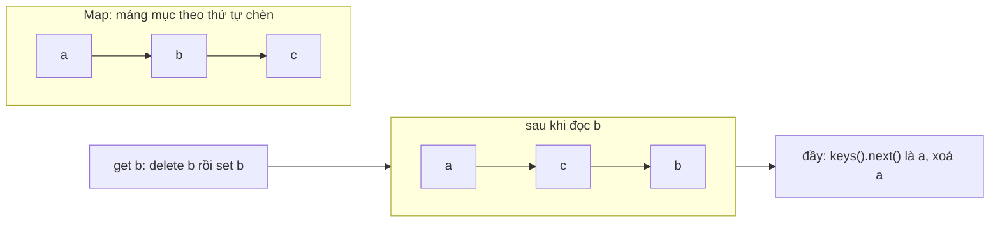

Cache trong trình duyệt nào cũng cần một giới hạn. Không giới hạn thì tab mở cả ngày sẽ giữ mọi thứ từng tải. Giới hạn thì phải chọn **xoá cái gì** khi đầy. Lựa chọn phổ biến nhất là **LRU** (least recently used): xoá thứ lâu nhất chưa được dùng tới.

Đọc code của ba trang lớn, mình gặp ba cách cài LRU khác nhau, mỗi cách một bài học:

- **Apple** (apps.apple.com) dựa vào tính chất ít người để ý của `Map`: **luôn giữ thứ tự chèn**. Code ngắn nhất.
- **Similarweb** viết danh sách liên kết đôi + `Map`, kiểu sách giáo khoa: mọi thao tác O(1).
- **Outlook** dùng mảng và `indexOf`, chậm hơn, nhưng có một tính năng hai bên kia không có: **ghim** những key đang hiển thị để chúng không bao giờ bị đẩy ra.

> [!TIP]
> **Tóm tắt**
> - `Map` duyệt theo thứ tự chèn: `map.keys().next().value` là key cũ nhất. Đọc thì xoá rồi chèn lại để đưa lên "mới nhất".
> - Cạm bẫy: `map.set(key, value)` với key **đã có** không đổi vị trí. Cập nhật giá trị mà quên xoá trước thì key vừa cập nhật vẫn bị coi là cũ nhất.
> - Danh sách liên kết đôi + `Map` cho O(1) thật sự; mảng + `indexOf` là O(n) mỗi lần chạm.
> - Ghim key đang dùng (Outlook): khi dọn thì bỏ qua key bị ghim, chấp nhận cache vượt giới hạn tạm thời.

<iframe class="demo-frame" src="/demos/web-patterns/index.html?theme=dark#/lru-cache" title="Demo lru-cache" loading="lazy" style="height: 1000px"></iframe>

<p class="demo-links">▶ <a href="/demos/web-patterns/index.html#/lru-cache" target="_blank" rel="noopener">Mở demo toàn màn hình ↗</a> · <a href="https://stackblitz.com/github/hunghg255/blog-hunghg/tree/master/examples/web-patterns?file=src/lib/lruCache.ts" target="_blank" rel="noopener">Sửa code trên StackBlitz ↗</a> · <a href="https://github.com/hunghg255/blog-hunghg/blob/master/examples/web-patterns/src/lib/lruCache.ts" target="_blank" rel="noopener">Xem source trên GitHub ↗</a></p>

Thử ở mục 1: mở A, B, C, ghim A, mở D. Cache đầy, B (lâu nhất chưa dùng mà không bị ghim) bị đẩy ra, A ở lại dù cũ nhất. Mục 2 cho thấy cạm bẫy của `Map.set`. Mục 3 đo 100.000 lần đọc/ghi.

## Apple: dựa vào thứ tự chèn của Map

Code ở [`apps.apple.com/shared/utils/src/lru-map.ts`](https://github.com/hunghg255/codebase/blob/main/apps.apple.com/shared/utils/src/lru-map.ts), kế thừa thẳng `Map` (rút gọn):

```ts
export class LruMap<K, V> extends Map<K, V> {
  get(key: K): V | undefined {
    let value: V | undefined;
    if (this.has(key)) {
      value = super.get(key);
      // Map entries are always in insertion order. So
      // readding, pushes this entry to the top of the LRU.
      this.delete(key);
      super.set(key, value!);
    }
    return value;
  }

  set(key: K, value: V): this {
    super.set(key, value);
    this.prune();
    return this;
  }

  private prune(): void {
    while (this.size > this.sizeLimit) {
      const leastRecentlyUsedKey = this.keys().next().value;
      this.delete(leastRecentlyUsedKey);
    }
  }
}
```

Ý tưởng gọn: đặc tả ECMAScript bảo đảm `Map` duyệt theo **thứ tự chèn**, nên key đầu tiên của `keys()` luôn là key được chèn (hoặc chèn lại) lâu nhất. "Dùng tới" một key bằng cách xoá rồi chèn lại nó ở cuối. Không cần cấu trúc phụ nào, và cả `delete` lẫn `set` của Map đều nhanh.

`LruMap` được dùng trong `shared/utils/src/history.ts` để nhớ state và vị trí cuộn của 10 trang gần nhất (`HISTORY_SIZE_LIMIT = 10`), phục vụ nút Back.

### Cạm bẫy: set() một key đã có

Nhìn lại `set`: nó gọi `super.set` **không xoá trước**. Theo đặc tả, `Map.prototype.set` với key đã tồn tại chỉ thay giá trị, **giữ nguyên vị trí cũ**. Hệ quả: cập nhật một key không làm nó "mới".

```ts
const lru = new LruMap<string, number>(3);
lru.set('a', 1).set('b', 1).set('c', 1);
lru.set('a', 2); // vừa cập nhật a
lru.set('d', 1); // đầy, phải đẩy key cũ nhất ra
[...lru.keys()]; // ['b', 'c', 'd'] : a bị đẩy ra dù vừa được cập nhật
```

Trong `history.ts` lỗi này không lộ ra, vì mọi chỗ `set` một key cũ đều `get` nó ngay trước đó (`updateState`, `beforeTransition`), và `get` đã đưa key lên cuối. Nhưng ai dùng lại class này cho việc khác sẽ gặp. Sửa bằng một dòng: `this.delete(key)` trước `super.set`.

Cũng trong thư mục đó có [`memoize.ts`](https://github.com/hunghg255/codebase/blob/main/apps.apple.com/shared/components/src/utils/memoize.ts) giới hạn 5 kết quả, dùng cùng mẹo `cache.keys().next().value` để xoá. Nhưng lần đọc trúng cache không xoá rồi chèn lại, nên đó là **FIFO** (vào trước ra trước), không phải LRU: kết quả được dùng liên tục vẫn bị đẩy ra khi tới lượt.

## Similarweb: danh sách liên kết đôi + Map

Code ở [`pro.similarweb.com/scripts/common/services/lruCache.ts`](https://github.com/hunghg255/codebase/blob/main/pro.similarweb.com/scripts/common/services/lruCache.ts), dùng cho `appInfoService.ts` (cache thông tin ứng dụng, mặc định 20 mục). Đây là cách cài trong sách giáo khoa:

- `Map<key, node>` để tìm node trong O(1).
- Danh sách liên kết đôi giữ thứ tự: `head` là mới dùng nhất, `tail` là lâu nhất.
- Đọc: tháo node khỏi chỗ cũ, gắn lên đầu. Đầy: tháo `tail`.

Có hai chi tiết nhỏ: `get()` gọi lại `put(key, value)` nên mỗi lần đọc tạo một node **mới** thay vì di chuyển node cũ (vẫn O(1), chỉ tốn thêm rác cho GC), và mỗi lần trượt cache in `console.log` ra console. Class có sẵn `*[Symbol.iterator]()` để duyệt bằng `for…of`.

## Outlook: mảng + ghim key đang dùng

Code ở [`outlook.live.com/src/modules/owa-mru-cache/src/MruCache.ts`](https://github.com/hunghg255/codebase/blob/main/outlook.live.com/src/modules/owa-mru-cache/src/MruCache.ts). Thứ tự giữ bằng một mảng `mruList`, chạm vào key là `indexOf` + `splice` + `push`: O(n) mỗi lần. Với cache hội thoại 50 mục (`owa-mail-store/src/store/conversationCache.ts`) thì không đáng kể.

Điểm đáng học là **tham chiếu (reference)**:

```ts
registerReference(reference: ReferenceGetter) {
  this.references.push(reference);
}

private purgeTillSize(size: number) {
  let i = 0;
  while (this.mruList.length > size && i < this.mruList.length) {
    const key = this.mruList[i];
    if (this.isReferenced(key)) i++; // đang được dùng: bỏ qua, xét key kế tiếp
    else this.removeItemAtIndex(i);
  }
}
```

Khung đọc thư đăng ký một hàm trả về danh sách hội thoại đang mở (`owa-mail-reading-pane-store/src/store/Store.ts`):

```ts
conversationCache.registerReference(() => [...store.loadedConversationReadingPaneViewStates.keys()]);
```

Thư đang hiển thị không bao giờ bị đẩy ra, kể cả khi nó là thư cũ nhất trong cache. Nếu mọi key đều đang được dùng, cache **chấp nhận vượt giới hạn** thay vì xoá thứ trên màn hình. Đây đúng là điểm yếu của LRU thuần mà bài [#43](/blogs/web-graphql-cache-refcount-gc) nói tới: LRU không biết cái gì đang hiển thị.

Outlook còn có `owa-nested-mru-cache`: cache hai tầng (ví dụ tầng một là người gửi, tầng hai là người nhận) cho mail tips, mỗi mục có hạn 2 giờ, tổng tối đa 300 mục, đầy thì sắp xếp toàn bộ theo thời gian tạo và xoá 50 mục cũ nhất một lượt. Có một chỗ đáng để ý: hàm dọn so tổng số mục với hằng `CACHE_LIMIT` thay vì giới hạn truyền vào constructor.

## Bên trong: vì sao Map đủ dùng làm LRU?

`Map` trong V8 (và các engine khác) được cài bằng bảng băm có thứ tự (ordered hash table): các mục nằm trong một mảng theo thứ tự chèn, bảng băm trỏ vào mảng đó. Xoá một mục chỉ đánh dấu ô là trống; khi quá nhiều ô trống thì bảng được dựng lại. Vì vậy:



- `delete` + `set` là hai thao tác O(1) trung bình.
- `keys().next()` lấy mục đầu, nhưng nếu đầu mảng toàn ô đã xoá thì phải bỏ qua chúng. Engine dọn lại bảng định kỳ nên chi phí trung bình vẫn thấp.

Danh sách liên kết đôi thì O(1) chắc chắn, nhưng mỗi mục là một object riêng (tốn bộ nhớ hơn, nhiều việc cho GC hơn). Trong số đo ở dưới, cả hai cách đều nhanh; mảng + `indexOf` mới là cách chậm hẳn khi cache lớn.

## Viết lại

Code ở `src/lib/lruCache.ts`. Bản dựa trên Map, đã sửa cạm bẫy `set` và thêm ghim:

```ts title=src/lib/lruCache.ts
  set(key: K, value: V): this {
    // Map.set với key đã có KHÔNG đổi vị trí của nó, phải xoá rồi chèn lại
    this.map.delete(key);
    this.map.set(key, value);
    this.prune();
    return this;
  }

  delete(key: K) {
    return this.map.delete(key);
  }

  /** Từ cũ nhất tới mới nhất. */
  keys() {
    return [...this.map.keys()];
  }

  private prune() {
    const { max, isPinned, onEvict } = this.options;
    if (this.map.size <= max) return;
    for (const [key, value] of this.map) {
      if (this.map.size <= max) break;
      if (isPinned?.(key)) continue; // đang dùng: bỏ qua, xét key kế tiếp
      this.map.delete(key);
      onEvict?.(key, value);
    }
  }
}
```

Bản danh sách liên kết đôi chỉ khác ở cách đưa node lên đầu và cách dọn từ đuôi:

```ts title=src/lib/lruCache.ts
  private moveToFront(node: Node<K, V>) {
    if (this.head === node) return;
    this.unlink(node);
    node.next = this.head;
    if (this.head) this.head.prev = node;
    this.head = node;
    this.tail ??= node;
  }

  private prune() {
    const { max, isPinned, onEvict } = this.options;
    let node = this.tail;
    while (this.nodes.size > max && node) {
      const prev = node.prev;
      if (!isPinned?.(node.key)) {
        this.unlink(node);
        this.nodes.delete(node.key);
        onEvict?.(node.key, node.value);
      }
      node = prev;
    }
  }
}
```

::: spoiler Xem toàn bộ src/lib/lruCache.ts

```ts title=src/lib/lruCache.ts
/**
 * Hai cách viết LRU cache không cần thư viện, cộng tính năng "ghim" key đang dùng.
 *
 * - LruMap: dựa vào việc Map luôn giữ thứ tự chèn (cách của Apple trên apps.apple.com).
 * - LinkedLru: danh sách liên kết đôi + Map, mọi thao tác O(1) (cách của Similarweb).
 * - isPinned: key đang được giao diện dùng thì không bị đẩy ra (ý tưởng từ MruCache của Outlook).
 */

export interface LruOptions<K, V> {
  max: number;
  /** key đang được dùng (vd thư đang mở) thì không bị đẩy ra, kể cả khi cache đã đầy */
  isPinned?: (key: K) => boolean;
  onEvict?: (key: K, value: V) => void;
}

function checkMax(max: number) {
  if (!Number.isInteger(max) || max < 0) throw new RangeError(`max phải là số nguyên ≥ 0, nhận ${max}`);
}

/** LRU dựa trên thứ tự chèn của Map: key đầu tiên luôn là key lâu chưa dùng nhất. */
export class LruMap<K, V> {
  private map = new Map<K, V>();
  private readonly options: LruOptions<K, V>;

  constructor(options: LruOptions<K, V>) {
    checkMax(options.max);
    this.options = options;
  }

  get size() {
    return this.map.size;
  }

  /** Đọc và đưa key lên "mới dùng nhất". */
  get(key: K): V | undefined {
    if (!this.map.has(key)) return undefined;
    const value = this.map.get(key)!;
    this.map.delete(key);
    this.map.set(key, value);
    return value;
  }

  /** Đọc mà KHÔNG đổi thứ tự (dùng cho debug, hiển thị). */
  peek(key: K): V | undefined {
    return this.map.get(key);
  }

  has(key: K) {
    return this.map.has(key);
  }

  set(key: K, value: V): this {
    // Map.set với key đã có KHÔNG đổi vị trí của nó, phải xoá rồi chèn lại
    this.map.delete(key);
    this.map.set(key, value);
    this.prune();
    return this;
  }

  delete(key: K) {
    return this.map.delete(key);
  }

  /** Từ cũ nhất tới mới nhất. */
  keys() {
    return [...this.map.keys()];
  }

  private prune() {
    const { max, isPinned, onEvict } = this.options;
    if (this.map.size <= max) return;
    for (const [key, value] of this.map) {
      if (this.map.size <= max) break;
      if (isPinned?.(key)) continue; // đang dùng: bỏ qua, xét key kế tiếp
      this.map.delete(key);
      onEvict?.(key, value);
    }
  }
}

interface Node<K, V> {
  key: K;
  value: V;
  prev: Node<K, V> | null;
  next: Node<K, V> | null;
}

/** LRU bằng danh sách liên kết đôi: head = mới dùng nhất, tail = lâu chưa dùng nhất. */
export class LinkedLru<K, V> {
  private nodes = new Map<K, Node<K, V>>();
  private head: Node<K, V> | null = null;
  private tail: Node<K, V> | null = null;
  private readonly options: LruOptions<K, V>;

  constructor(options: LruOptions<K, V>) {
    checkMax(options.max);
    this.options = options;
  }

  get size() {
    return this.nodes.size;
  }

  get(key: K): V | undefined {
    const node = this.nodes.get(key);
    if (!node) return undefined;
    this.moveToFront(node);
    return node.value;
  }

  peek(key: K): V | undefined {
    return this.nodes.get(key)?.value;
  }

  has(key: K) {
    return this.nodes.has(key);
  }

  set(key: K, value: V): this {
    const existing = this.nodes.get(key);
    if (existing) {
      existing.value = value;
      this.moveToFront(existing);
    } else {
      const node: Node<K, V> = { key, value, prev: null, next: this.head };
      if (this.head) this.head.prev = node;
      this.head = node;
      this.tail ??= node;
      this.nodes.set(key, node);
      this.prune();
    }
    return this;
  }

  delete(key: K) {
    const node = this.nodes.get(key);
    if (!node) return false;
    this.unlink(node);
    this.nodes.delete(key);
    return true;
  }

  /** Từ cũ nhất tới mới nhất, cùng thứ tự với LruMap.keys(). */
  keys() {
    const out: K[] = [];
    for (let node = this.tail; node; node = node.prev) out.push(node.key);
    return out;
  }

  private unlink(node: Node<K, V>) {
    if (node.prev) node.prev.next = node.next;
    else this.head = node.next;
    if (node.next) node.next.prev = node.prev;
    else this.tail = node.prev;
    node.prev = node.next = null;
  }

  private moveToFront(node: Node<K, V>) {
    if (this.head === node) return;
    this.unlink(node);
    node.next = this.head;
    if (this.head) this.head.prev = node;
    this.head = node;
    this.tail ??= node;
  }

  private prune() {
    const { max, isPinned, onEvict } = this.options;
    let node = this.tail;
    while (this.nodes.size > max && node) {
      const prev = node.prev;
      if (!isPinned?.(node.key)) {
        this.unlink(node);
        this.nodes.delete(node.key);
        onEvict?.(node.key, node.value);
      }
      node = prev;
    }
  }
}

/** Ghi nhớ kết quả hàm, giới hạn số kết quả bằng LRU (Apple có hàm memoize tương tự, giới hạn 5). */
export function memoizeLru<A extends unknown[], R>(
  fn: (...args: A) => R,
  { max = 5, key = (...args: A) => JSON.stringify(args) }: { max?: number; key?: (...args: A) => string } = {},
) {
  const cache = new LruMap<string, R>({ max });
  return (...args: A): R => {
    const k = key(...args);
    if (cache.has(k)) return cache.get(k)!;
    const result = fn(...args);
    cache.set(k, result);
    return result;
  };
}
```

:::

**Khác bản gốc:**

- `LruMap` không kế thừa `Map` mà bọc nó bên trong. Kế thừa thì mọi phương thức của Map (`forEach`, `entries`, `set` gọi từ constructor…) đều lộ ra ngoài và đi vòng qua logic LRU.
- `set` xoá key trước khi chèn: cập nhật giá trị cũng tính là "dùng tới".
- Thêm `peek` để đọc mà không đổi thứ tự (cho màn hình debug, log).
- Cả hai bản nhận `isPinned` (ý tưởng tham chiếu của Outlook) và `onEvict` (báo khi một key bị đẩy ra, để giải phóng tài nguyên đi kèm như object URL).
- `memoizeLru` là LRU thật: lần đọc trúng cũng đưa kết quả lên "mới nhất", khác `memoize` FIFO của Apple.

## Đi qua code

- **`prune` của `LruMap`** duyệt Map từ cũ tới mới và xoá trong lúc duyệt. Đặc tả cho phép xoá phần tử đang duyệt; vòng `for…of` vẫn đi tiếp đúng. Key bị ghim thì `continue`, xét key sau.
- **`prune` của `LinkedLru`** đi ngược từ `tail` về `head`, lưu `prev` trước khi tháo node. Cũng bỏ qua key bị ghim.
- **Cache có thể vượt `max`** khi số key bị ghim lớn hơn `max`. Đó là chủ ý: thà tốn thêm vài mục còn hơn xoá thứ đang hiển thị. Lần `set` tiếp theo sau khi bỏ ghim sẽ dọn về đúng giới hạn.
- **`keys()` của cả hai bản trả về cùng thứ tự** (cũ tới mới), nên demo kiểm tra được ba cách cho cùng kết quả trên cùng dãy thao tác.
- **`checkMax`** từ chối `max` không phải số nguyên không âm. Apple kiểm tra `isFinite`, vì `Infinity` làm vòng `prune` vô nghĩa.

## Tại sao không làm cách khác?

**Tại sao không dùng mảng như Outlook?** Với 50 mục thì mảng hoàn toàn ổn, và còn dễ đọc. Mục 3 của demo, trên Chromium, 100.000 lần đọc/ghi: sức chứa 500 thì ba cách gần như ngang nhau (khoảng 14 đến 24ms); 10.000 thì mảng mất khoảng 84ms, Map và danh sách liên kết khoảng 8 đến 13ms. Con số thay đổi theo máy, nhưng xu hướng thì rõ: chi phí của mảng tăng theo kích thước cache.

**Tại sao không dùng `WeakMap`?** `WeakMap` không có thứ tự, không đếm được kích thước, và key phải là object. Nó hợp cho việc "gắn dữ liệu phụ vào object, object mất thì dữ liệu mất theo", không phải cho cache có giới hạn.

**Tại sao không xoá theo thời gian (TTL)?** TTL trả lời "dữ liệu này còn đúng không", LRU trả lời "bộ nhớ đã đầy chưa". Hai việc khác nhau; Outlook dùng cả hai trong nested cache (hạn 2 giờ + giới hạn 300 mục).

## Edge case và cạm bẫy

- **Giá trị `undefined`.** `get` trả `undefined` cho cả "không có" lẫn "có, giá trị là undefined". Cần phân biệt thì kiểm tra `has` trước (như `memoizeLru`).
- **Key là object.** Map so key theo tham chiếu: hai object `{ id: 1 }` khác nhau là hai key. Dùng chuỗi ổn định (`JSON.stringify` với thứ tự key cố định) nếu cần so theo giá trị.
- **Hàm ghim chạy mỗi lần dọn.** Outlook gọi mọi hàm tham chiếu cho **mỗi** key được xét. Hàm ghim nên rẻ: tra một `Set` thay vì duyệt mảng.
- **Tài nguyên đi kèm.** Cache ảnh dạng object URL (`URL.createObjectURL`) phải `revokeObjectURL` trong `onEvict`, nếu không bộ nhớ của blob vẫn bị giữ.
- **SSR.** Cache cấp module trên server dùng chung giữa mọi request và sống suốt đời process. [`zappos.com/src/helpers/memoize.ts`](https://github.com/hunghg255/codebase/blob/main/zappos.com/src/helpers/memoize.ts) chỉ memoize khi chạy trên trình duyệt, trên server thì gọi thẳng hàm, vì cache chưa có giới hạn kích thước.

## Dùng trong dự án

```ts
import { LruMap } from './lruCache';

const openTabs = new Set<string>();

// Ảnh xem trước của tài liệu: giữ 30 ảnh gần nhất, ảnh đang mở thì không xoá
const thumbnails = new LruMap<string, string>({
  max: 30,
  isPinned: (docId) => openTabs.has(docId),
  onEvict: (_docId, objectUrl) => URL.revokeObjectURL(objectUrl),
});

async function getThumbnail(docId: string) {
  const hit = thumbnails.get(docId);
  if (hit) return hit;
  const blob = await fetch(`/api/docs/${docId}/thumbnail`).then((r) => r.blob());
  const url = URL.createObjectURL(blob);
  thumbnails.set(docId, url);
  return url;
}
```

## Kiểm thử

::: spoiler Ví dụ test (bản phác, không có trong repo)

```ts
import { describe, expect, it } from 'vitest';
import { LinkedLru, LruMap, memoizeLru } from './lruCache';

describe.each([
  ['LruMap', LruMap],
  ['LinkedLru', LinkedLru],
] as const)('%s', (_name, Lru) => {
  it('đẩy key lâu nhất chưa dùng ra', () => {
    const lru = new Lru<string, number>({ max: 2 });
    lru.set('a', 1).set('b', 2);
    lru.get('a');
    lru.set('c', 3);
    expect(lru.keys()).toEqual(['a', 'c']);
  });

  it('cập nhật giá trị cũng tính là dùng tới', () => {
    const lru = new Lru<string, number>({ max: 3 });
    lru.set('a', 1).set('b', 1).set('c', 1);
    lru.set('a', 2);
    lru.set('d', 1);
    expect(lru.keys()).toEqual(['c', 'a', 'd']);
  });

  it('không đẩy key bị ghim, báo key bị đẩy', () => {
    const evicted: string[] = [];
    const lru = new Lru<string, number>({ max: 1, isPinned: (k) => k === 'a', onEvict: (k) => evicted.push(k) });
    lru.set('a', 1).set('b', 1);
    expect(lru.keys()).toEqual(['a']);
    expect(evicted).toEqual(['b']);
  });
});

it('memoizeLru: lần trúng cũng đưa lên mới nhất', () => {
  let calls = 0;
  const double = memoizeLru((x: number) => (calls++, x * 2), { max: 2 });
  [1, 2, 1, 3, 1, 2].forEach((x) => double(x));
  expect(calls).toBe(4); // FIFO như memoize của Apple sẽ là 5
});
```

:::

## So với thư viện và chuẩn web

- **[`lru-cache`](https://github.com/isaacs/node-lru-cache)** (isaacs) là thư viện phổ biến nhất, có TTL, giới hạn theo kích thước (không chỉ số mục), `dispose` khi xoá. Nó cài bằng các mảng định kiểu thay vì object cho từng node để giảm áp lực GC.
- **[`quick-lru`](https://github.com/sindresorhus/quick-lru)** dùng hai Map luân phiên (thuật toán của `hashlru`): rất nhanh, nhưng là LRU xấp xỉ.
- **Cache API của trình duyệt** (`caches.open`) không có giới hạn theo LRU; trình duyệt chỉ xoá cả origin khi hết dung lượng. Cần LRU cho Cache API thì phải tự ghi thời điểm dùng và tự dọn (xem bài [#37](/blogs/web-client-cache-versioned)).

---

Bài này thuộc series **[Học từ mã nguồn các web lớn](/series/web)** (65 bài, đọc theo thứ tự).

::: spoiler Xem nhanh danh sách bài trong series

*Mở đầu*

- [Mở đầu: đọc code production của 28 trang web](/blogs/learn-from-big-web-apps)

*Phần 1: trải nghiệm người dùng*

- [#1 Dark mode không nháy (Gatsby)](/blogs/web-dark-mode-no-flash)
- [#2 useValueByMedia: giá trị theo breakpoint (Toptal)](/blogs/web-use-value-by-media)
- [#3 Đoán ý định: idle, exit-intent, lắc chuột (Toptal, InVision)](/blogs/web-user-intent-idle-exit-wiggle)
- [#4 Validate form thân thiện (Udacity, Pipedrive)](/blogs/web-form-validation-ux)
- [#5 Magic number, EXIF và dán ảnh (Ello)](/blogs/web-file-magic-number-exif-paste)
- [#6 fastSmoothScroll: cuộn xa vẫn nhanh (Telegram)](/blogs/web-telegram-fast-smooth-scroll)
- [#7 Countdown time-travel và tombstone giỏ hàng (Best Buy)](/blogs/web-countdown-time-travel-tombstone)

*Phần 2: hiệu năng và đo lường*

- [#8 Hàng đợi requestAnimationFrame 3ms (Apple)](/blogs/web-raf-queue-3ms)
- [#9 srcset cho artwork và preconnect tự động (Apple)](/blogs/web-responsive-artwork-preconnect)
- [#10 Quick-fetch: gọi API trước khi bundle tải xong (HubSpot)](/blogs/web-quick-fetch-early-requests)
- [#11 Performance span và long task (Postman, Calibre)](/blogs/web-performance-spans-long-tasks)
- [#12 Gọi Web Worker như hàm async (Telegram)](/blogs/web-worker-promise-rpc)
- [#13 Đồng hồ media: đếm giờ xem và sửa lệch (Skillshare, Simplified)](/blogs/web-media-clock-watch-time-drift)

*Phần 3: nhiều tab, phiên đăng nhập, cập nhật*

- [#14 Bầu tab chủ cho thông báo (HubSpot, Telegram)](/blogs/web-leader-tab-notifications)
- [#15 Đồng bộ đăng nhập giữa tab và giới hạn cookie (Elastic, InVision)](/blogs/web-cross-tab-auth-cookie-guard)
- [#16 SPA tự cập nhật: Trello, Zappos, Facebook, Elastic](/blogs/web-spa-self-update-strategies)

*Phần 4: kiến trúc*

- [#17 Reverse portal: di chuyển component không remount (Zappos)](/blogs/web-reverse-portal)
- [#18 Page behaviors: gắn hành vi từ CMS (Intercom)](/blogs/web-page-behaviors-cms)
- [#19 Giới hạn tần suất hiển thị bằng bitmask (Outlook)](/blogs/web-frequency-cap-bitmask)
- [#20 Chuyển REST sang GraphQL dần dần (Coursera)](/blogs/web-rest-to-graphql-hybrid-link)

*Phần 5: soạn thảo và hiển thị nội dung*

- [#21 Autocomplete tại con trỏ trong contenteditable (Ello, Telegram)](/blogs/web-caret-autocomplete-contenteditable)
- [#22 Dark mode cho email HTML bằng CIELAB (Outlook)](/blogs/web-email-dark-mode-cielab)
- [#23 Thu nhỏ bảng rộng cho vừa khung, vá font emoji (Outlook)](/blogs/web-email-wide-content-scale)
- [#24 Cảnh báo quên đính kèm file (Outlook)](/blogs/web-forgotten-attachment-warning)
- [#25 Cắt chữ nhiều dòng chính xác (Pipedrive, Apple, Toptal)](/blogs/web-multiline-truncate-measure-text)
- [#26 Parse ngày giờ gõ tay khoan dung (Outlook, Elastic)](/blogs/web-lenient-date-parser)

*Phần 6: tương tác*

- [#27 menuAim: rê chéo vào submenu không bị đóng (Udemy)](/blogs/web-menu-aim-triangle)
- [#28 Kéo, vuốt chung cho chuột và cảm ứng (Telegram)](/blogs/web-unified-pointer-gestures)
- [#29 Phím tắt theo phạm vi, IME và bàn phím phi Latinh (Trello)](/blogs/web-scoped-keyboard-shortcuts)
- [#30 Nội suy màu: đổi theme và nền theo cuộn (Telegram, Anchor)](/blogs/web-color-interpolation-theme-scroll)
- [#31 Đường gióng hút cạnh và undo/redo trên canvas (Simplified)](/blogs/web-canvas-snap-guides-undo)
- [#32 Giả lập mù màu bằng feColorMatrix (Trello)](/blogs/web-color-vision-simulator)
- [#33 Vạch thước theo mức zoom và cấp phát màu cho biểu đồ (Anchor, Similarweb)](/blogs/web-timeline-ticks-color-stack)

*Phần 7: mạng, dữ liệu và async*

- [#34 Ô tìm kiếm chuẩn production (Similarweb, Udemy, Pipedrive)](/blogs/web-production-search-box)
- [#35 Điều phối async: latest-wins, single-flight (Glitch, Toptal)](/blogs/web-async-coordination-latest-wins)
- [#36 Polling thưa dần và debounce động (Trello)](/blogs/web-decaying-polling-dynamic-debounce)
- [#37 Cache phía client theo version (Similarweb, Telegram, Udemy)](/blogs/web-client-cache-versioned)
- [#38 Upload file lớn theo chunk (Outlook, Tribe)](/blogs/web-chunked-upload-pipeline)
- [#39 Phát video qua Service Worker bằng Range request (Telegram, Outlook)](/blogs/web-service-worker-range-streaming)

*Phần 8: hiệu năng và vận hành*

- [#40 TTI governor: hoãn việc phụ tới sau khi trang dùng được (Outlook)](/blogs/web-tti-governor)
- [#41 Tự đo LCP/CLS/TBT và phục vụ bản nhẹ cho máy yếu (Udemy)](/blogs/web-rum-adaptive-loading)

*Phần 9: thuật toán và dữ liệu phía client*

- [#42 Three-way merge ngay trên trình duyệt (Postman)](/blogs/web-three-way-merge-client)
- [#43 Dọn cache GraphQL bằng đếm tham chiếu (Outlook)](/blogs/web-graphql-cache-refcount-gc)
- **#44 LRU cache theo 3 cách (Apple, Similarweb, Outlook)** (bài này)
- [#45 Lọc tăng dần trong Web Worker (Similarweb)](/blogs/web-incremental-filter-worker)
- [#46 Xếp hạng gợi ý trên client, so ngầm với server (Outlook)](/blogs/web-client-side-ranking-shadow-test)
- [#47 Nối OT với editor: undo stack và chặn echo (Glitch)](/blogs/web-ot-codemirror-undo)
- [#48 Ngôn ngữ markup riêng dịch hai chiều với HTML (Coursera)](/blogs/web-custom-markup-compiler)

*Phần 10: thời gian, ngôn ngữ, định dạng*

- [#49 Xử lý giờ mùa hè không cần thư viện (Udemy, Pipedrive)](/blogs/web-dst-without-library)
- [#50 Intl thực chiến: Segmenter, số rút gọn, số nhiều, fallback locale (Apple, Outlook)](/blogs/web-intl-in-production)
- [#51 WebVTT và bôi chọn transcript (Udemy, Coursera)](/blogs/web-webvtt-transcript-selection)

*Phần 11: tương tác và giao diện*

- [#52 Kéo-thả trên lịch (Pipedrive)](/blogs/web-calendar-drag-drop)
- [#53 Focus stack cho popup lồng nhau (Outlook)](/blogs/web-focus-stack-nested-popups)
- [#54 Clipboard: copy, dán chữ thuần, dán thông minh (Trello, Anchor, Pipedrive, Tribe)](/blogs/web-clipboard-tricks)
- [#55 Khôi phục vị trí cuộn khi trang còn đang tải (Apple, Zappos)](/blogs/web-scroll-restore-wait-height)
- [#56 Lấy màu từ ảnh: gradient nền, màu chữ (Apple, Telegram, Trello)](/blogs/web-colors-from-images)
- [#57 JS đọc breakpoint từ CSS, phát hiện chế độ PWA (Ello, Apple)](/blogs/web-css-js-breakpoint-bridge)

*Phần 12: media*

- [#58 Tin nhắn thoại: ghi âm, waveform realtime, nén 5-bit (Telegram)](/blogs/web-voice-message-waveform)
- [#59 Chụp frame video thành ảnh, canvas bị taint (Coursera, Outlook)](/blogs/web-video-frame-snapshot)

*Phần 13: đo lường, bảo mật, vận hành*

- [#60 Đo lúc ảnh màn hình đầu tải xong, cả khi chuyển trang SPA (Zappos, Best Buy, Outlook)](/blogs/web-above-the-fold-image-timing)
- [#61 Buffer analytics chờ SDK, phát hiện adblock (Best Buy)](/blogs/web-analytics-buffer-adblock)
- [#62 Proof-of-work trên client để chặn API ẩn danh (Udemy)](/blogs/web-client-proof-of-work)
- [#63 Prefetch không làm lệch số liệu, nén cài đặt bằng bit (Outlook)](/blogs/web-synthetic-prefetch-bit-flags)
- [#64 Micro-frontend: AngularJS và React chung app, giao tiếp xuyên frame (Similarweb, InVision, HubSpot)](/blogs/web-micro-frontend-bridges)

:::

Code + demo: [`examples/web-patterns`](https://github.com/hunghg255/blog-hunghg/tree/master/examples/web-patterns) · [Mở trên StackBlitz](https://stackblitz.com/github/hunghg255/blog-hunghg/tree/master/examples/web-patterns)
