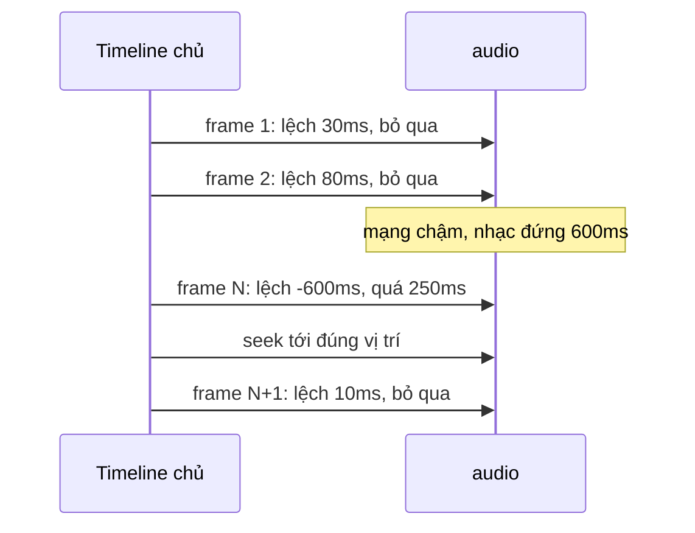

Hai bài toán nghe rất khác nhau nhưng cùng một gốc: **thời gian trong trình duyệt không chạy đều như ta nghĩ**.

1. **Đếm thời gian xem video.** Skillshare tính tiền cho giáo viên theo số phút học viên xem. Cách đơn giản là cộng dồn khoảng cách giữa hai lần `timeupdate`. Rồi một học viên gập laptop lúc đang xem, sáng hôm sau mở ra: khoảng cách giữa hai lần `timeupdate` là 9 tiếng, và 9 tiếng đó được cộng vào "đã xem".
2. **Phát nhạc khớp với animation.** Simplified có trình dựng video từ nhiều trang (page) animation và một bản nhạc nền. Mỗi thứ có đồng hồ riêng: `<audio>` chạy theo bộ giải mã âm thanh, animation chạy theo `requestAnimationFrame`. Mạng chậm làm nhạc đứng một nhịp để buffer, thế là nhạc trễ hơn hình, và càng xem càng lệch.

> [!TIP]
> **Tóm tắt**
> - Đếm giờ xem: cộng khoảng cách giữa các lần `timeupdate`, nhưng **bỏ khoảng nào dài bất thường** (trên 1s). Máy ngủ hay player bị treo đều tạo ra khoảng như vậy.
> - Gửi lên server theo **giây chẵn**, trừ phần đã gửi **trước** khi gọi API, có khoá chống gửi chồng, lỗi thì cộng lại.
> - Đồng bộ nhiều media: một **timeline chủ**, mỗi frame so thời gian từng track với timeline chủ, **lệch quá 250ms mới seek**. Seek liên tục khi lệch vài ms sẽ làm tiếng bị vấp.
> - Dùng `performance.now()` thay `Date.now()` cho mọi phép đo khoảng thời gian: nó không nhảy khi người dùng đổi giờ hệ thống.

<iframe class="demo-frame" src="/demos/web-patterns/index.html?theme=dark#/media-clock" title="Demo media-clock" loading="lazy" style="height: 1120px"></iframe>

<p class="demo-links">▶ <a href="/demos/web-patterns/index.html#/media-clock" target="_blank" rel="noopener">Mở demo toàn màn hình ↗</a> · <a href="https://stackblitz.com/github/hunghg255/blog-hunghg/tree/master/examples/web-patterns?file=src/lib/mediaClock.ts" target="_blank" rel="noopener">Sửa code trên StackBlitz ↗</a> · <a href="https://github.com/hunghg255/blog-hunghg/blob/master/examples/web-patterns/src/lib/mediaClock.ts" target="_blank" rel="noopener">Xem source trên GitHub ↗</a></p>

## Skillshare làm thế nào?

File `skillshare.com/core/src/models/freemium-usage-tracker.js` ([xem trên GitHub](https://github.com/hunghg255/codebase/blob/main/skillshare.com/core/src/models/freemium-usage-tracker.js)) là một Backbone model tên `TimeTracker`, khoảng 100 dòng. Model giữ một mốc `timestamp` và một con số `timeWatched` (ms). Hàm `markProgress` được gắn vào sự kiện `timeupdate` của video.js:

```js
markProgress: function(time) {
  if (!this.timestamp) return;
  const newTimestamp = (new Date()).getTime();
  const timeElapsed = newTimestamp - this.timestamp;
  this.timestamp = newTimestamp;
  // ... comment giải thích bên dưới
  if (timeElapsed > 1000) return;
  this.incrementTimeWatched(timeElapsed);
}
```

Comment trong code kể lại đúng sự cố ở đầu bài: một số người dùng có số giây xem "cao bất thường", vì khi máy ngủ rồi thức dậy, video player bị đứng rồi chạy lại, tạo ra một `timeElapsed` khổng lồ. `timeupdate` bắn mỗi 15–250ms (đúng theo [chuẩn HTML](https://html.spec.whatwg.org/multipage/media.html#event-media-timeupdate)), nên họ chọn ngưỡng 1000ms để có dư. Khoảng nào lớn hơn là dấu hiệu player đang "đông cứng", bỏ đi.

Để ý thứ tự: `this.timestamp = newTimestamp` chạy **trước** câu `return`. Khoảng bất thường bị bỏ, nhưng mốc vẫn được dời tới hiện tại, nên lần `timeupdate` kế tiếp lại đo bình thường.

Phần gửi lên server (`_trackTime`) có ba chi tiết đáng học:

```js
const elapsed = Math.floor(this.get('timeWatched') / 1000);
const msWatched = elapsed * 1000;
if (this.currentlySaving) return this.currentlySaving.always(this._trackTime);
this.incrementTimeWatched(-msWatched);           // trừ trước khi gửi
this.currentlySaving = this.save({ elapsed })
  .always(() => { this.currentlySaving = false; })
  .error(() => { this.incrementTimeWatched(msWatched, { silent: true }); });
```

- **Giây chẵn**: chỉ gửi phần nguyên giây, phần lẻ (vd 400ms) ở lại cho lần sau. Server nhận số nguyên, không có sai số làm tròn cộng dồn.
- **Trừ trước khi gửi**: trong lúc chờ server trả lời, video vẫn chạy, `timeWatched` vẫn tăng. Nếu đợi server trả lời xong mới trừ (hay tệ hơn, đặt về 0) thì phần xem trong lúc chờ bị mất.
- **Mutex** `currentlySaving`: đang có request thì không gửi thêm, xếp hàng chạy lại `_trackTime` khi request kia xong. Gửi lỗi thì cộng lại số đã trừ.

Một điểm yếu nhỏ: khi server lỗi, số đã trừ được cộng lại nên `timeWatched` vẫn ≥ 15s. Lần `timeupdate` kế tiếp (vài trăm ms sau) lại thấy đủ ngưỡng và gửi tiếp. Tức là lúc server đang có sự cố, mỗi tab đang xem video gửi vài request mỗi giây. Bản viết lại thêm một khoảng chờ sau khi lỗi.

## Simplified làm thế nào?

Trình dựng "story" có animation của Simplified nằm ở `simplified.app/simplified.app/static/js/_utils/timeline.js` ([xem trên GitHub](https://github.com/hunghg255/codebase/blob/main/simplified.app/simplified.app/static/js/_utils/timeline.js), chú ý thư mục lặp hai lần). Đây là một React context (`TimelineProvider`) bọc quanh một **timeline chủ** tạo bằng thư viện anime.js:

- Mỗi trang (page) có `duration` (mặc định 6s). Hàm `getSortedPagesWithMusicData` xếp các trang nối đuôi nhau, tính `startTime`/`endTime` cho từng trang, cộng ra tổng thời lượng.
- Nhạc nền có `offset` (bắt đầu ở giây nào của story), `start`/`end` (cắt đoạn nào của file nhạc). Nhạc dài hơn story thì `end` bị cắt bớt cho vừa.
- Mỗi trang và bản nhạc được `add` vào timeline chủ như một đoạn con, với `offset * 1000`.

Phần đồng bộ nằm trong callback `change` của đoạn nhạc, chạy mỗi khi timeline chủ cập nhật (mỗi frame lúc đang phát):

```js
change: (tl) => {
  const currentTime = (tl.progress / 100) * tl.duration;
  if (isPlaying && audioEl.paused) audioEl.play();
  if (Math.abs((audioEl.currentTime - (currentTime / 1000 + audioStart)) * 1000)
      > GLOBAL_TIMELINE_ALLOWED_DELTA) {
    audioEl.currentTime = currentTime / 1000 + audioStart;
  }
},
```

`GLOBAL_TIMELINE_ALLOWED_DELTA` được khai báo trong `_utils/constants.js` là `250`, kèm comment "lệch lớn hơn mức này thì timeline đồng bộ lại". Đoạn animation của từng trang làm y hệt với canvas: lệch quá 250ms thì gọi `seekToPosition`.

Ba callback còn lại lo phần "vào/ra khoảng": `changeBegin` (bắt đầu đoạn nhạc: đặt `currentTime = audioStart` và `play()`), `changeComplete` (hết đoạn: `pause()` và tua về 0). Hàm `seekRelative` thì tạm dừng, chờ đúng 250ms, rồi mới tua và phát lại.

**Tại sao lại chịu lệch tới 250ms?** Gán `audio.currentTime` không miễn phí: trình duyệt phải tìm lại vị trí trong file, có thể phải tải thêm dữ liệu, và người nghe thường nghe thấy một tiếng "vấp". Nếu seek mỗi khi lệch 5ms thì nhạc vấp liên tục. Lệch dưới khoảng 100–200ms thì mắt và tai khó nhận ra trong một video có nhạc nền (với lời thoại cần khớp môi thì ngưỡng phải chặt hơn nhiều). 250ms có lẽ là điểm cân bằng nhóm Simplified chọn sau khi thử.

## Bên trong trình duyệt: vì sao các đồng hồ lệch nhau?

- **`Date.now()` là giờ hệ thống.** Nó có thể nhảy lùi hay nhảy tới khi máy đồng bộ giờ qua mạng (NTP) hoặc người dùng đổi múi giờ. `performance.now()` là đồng hồ đơn điệu (monotonic), chỉ tăng, tính từ lúc trang mở. Đo khoảng thời gian thì luôn dùng `performance.now()`.
- **Khi máy ngủ**, JavaScript không chạy, không có `timeupdate`. Lúc thức dậy, sự kiện đầu tiên thấy một khoảng rất lớn. Chuẩn [High Resolution Time](https://w3c.github.io/hr-time/) để ngỏ việc đồng hồ của `performance.now()` có chạy trong lúc máy ngủ hay không, mỗi trình duyệt/hệ điều hành làm một kiểu. Vì vậy **đừng trông vào đồng hồ nào để "tự bỏ qua" lúc ngủ**: phải chủ động lọc khoảng bất thường như Skillshare.
- **Tab ẩn**: `requestAnimationFrame` ngừng chạy, `setInterval` bị giới hạn còn tối đa khoảng 1 lần/giây (Chrome còn giới hạn chặt hơn nữa với tab ẩn lâu, tính tới 10/2026). Nhưng `<audio>` vẫn phát bình thường ở tab ẩn. Quay lại tab là thấy hình và nhạc lệch nhau ngay.
- **`<audio>` có đồng hồ riêng**: `currentTime` đi theo phần âm thanh đã thực sự phát ra loa. Mạng chậm thì nó đứng chờ buffer (sự kiện `waiting`), còn timeline chủ chạy theo `performance.now()` thì không chờ ai.



## Viết lại

File [`src/lib/mediaClock.ts`](https://github.com/hunghg255/blog-hunghg/blob/master/examples/web-patterns/src/lib/mediaClock.ts) có hai phần độc lập, không phụ thuộc Backbone, video.js hay anime.js.

### 1. `createWatchTimeTracker`

```ts title=src/lib/mediaClock.ts

  /** gọi trong `timeupdate` (trình duyệt bắn khoảng 4 lần/giây khi đang phát) */
  function tick() {
    if (last === null) return;
    const t = now();
    const gap = t - last;
    last = t; // luôn cập nhật mốc, kể cả khi bỏ qua khoảng này
    if (gap > maxGap) {
      onDiscard?.(gap);
      return;
    }
    pendingMs += gap;
    if (pendingMs >= flushEvery && t >= retryAfter) void flush();
  }

  async function flush(): Promise<void> {
    if (saving) {
      // đang gửi dở: không gửi chồng, gửi tiếp ngay khi lần này xong
      flushAgain = true;
      return saving;
    }
    const seconds = Math.floor(pendingMs / 1000);
    if (seconds <= 0) return;
    // trừ TRƯỚC khi gửi: thời gian xem trong lúc chờ server vẫn được cộng tiếp vào pendingMs
    pendingMs -= seconds * 1000;
    saving = send(seconds)
      .catch(() => {
        pendingMs += seconds * 1000; // gửi lỗi: trả lại để lần sau gửi
        // không có dòng này thì tick (4 lần/giây) nào cũng thấy đủ ngưỡng và gửi lại ngay
        retryAfter = now() + flushEvery;
      })
      .finally(() => {
        saving = null;
        if (flushAgain) {
          flushAgain = false;
          void flush();
        }
      });
    return saving;
  }
```

Phần đầu hàm (khai báo `last`, `pendingMs`, `saving`) xem trong file đầy đủ ở cuối mục. Cách dùng: gắn `tracker.start` vào sự kiện `play`, `tracker.tick` vào `timeupdate`, `tracker.stop` vào `pause` và `ended`; `send` là hàm gọi API nhận số giây.

### 2. `createMasterClock`

Mỗi thứ cần chạy theo timeline chủ được bọc thành một `SyncTarget` (đơn vị ms, bốn hàm). Track nói rõ nó nằm ở đâu trên timeline chủ (`offset`, `duration`) và bắt đầu từ đâu trong media (`start`):

```ts title=src/lib/mediaClock.ts
export interface SyncTarget {
  currentTime(): number;
  seek(ms: number): void;
  play(): void;
  pause(): void;
}

export interface TrackSpec {
  id: string;
  target: SyncTarget;
  /** track bắt đầu ở mốc nào trên timeline chủ */
  offset: number;
  /** track kéo dài bao lâu trên timeline chủ */
  duration: number;
  /** bắt đầu phát từ đâu trong media (cắt đầu file nhạc), mặc định 0 */
  start?: number;
}
```

Lõi là hàm `sync`, chạy mỗi frame:

```ts title=src/lib/mediaClock.ts
  /** đưa mọi track về đúng vị trí; force = seek dù lệch ít (dùng khi tua) */
  function sync(t: number, force: boolean) {
    for (const track of tracks) {
      const inside = t >= track.offset && t < track.offset + track.duration;
      const expected = t - track.offset + (track.start ?? 0);
      if (!inside) {
        if (active.delete(track.id)) track.target.pause();
        continue;
      }
      if (!active.has(track.id)) {
        // vừa đi vào khoảng của track: luôn seek một lần cho chắc
        active.add(track.id);
        track.target.seek(expected);
        if (playing) track.target.play();
        continue;
      }
      const drift = track.target.currentTime() - expected;
      if (force || Math.abs(drift) > maxDrift) {
        track.target.seek(expected);
        if (!force) onCorrect?.(track.id, drift);
      }
    }
  }
```

Kèm hai adapter cho `<audio>`/`<video>` và cho Web Animations API (`element.animate()`):

```ts
const animation = card.animate(keyframes, { duration: 6000, fill: 'both' });
const clock = createMasterClock({
  duration: 12_000,
  tracks: [
    { id: 'page-1', target: animationTarget(animation), offset: 0, duration: 6000 },
    { id: 'music', target: mediaTarget(audioEl), offset: 2000, duration: 8000, start: 1000 },
  ],
});
playButton.onclick = () => clock.play();
```

::: spoiler Xem toàn bộ src/lib/mediaClock.ts

```ts title=src/lib/mediaClock.ts
/**
 * Hai "đồng hồ" cho media:
 *
 * 1. createWatchTimeTracker: đếm thời gian xem thật (ý tưởng từ freemium-usage-tracker của Skillshare).
 *    Cộng dồn khoảng cách giữa hai lần `timeupdate`; khoảng nào quá lớn (máy ngủ, tab bị treo)
 *    thì bỏ, không cộng. Gửi lên server theo giây chẵn, có khoá chống gửi chồng, lỗi thì cộng lại.
 *
 * 2. createMasterClock: một timeline chủ điều khiển nhiều track (audio, video, animation)
 *    (ý tưởng từ timeline.js của Simplified). Mỗi frame so thời gian của từng track với
 *    timeline chủ, lệch quá ngưỡng (250ms) thì seek lại; lệch nhỏ thì để yên.
 */

// ---------------------------------------------------------------------------
// 1. Đếm thời gian xem
// ---------------------------------------------------------------------------

export interface WatchTimeOptions {
  /** gửi lên server: số giây xem được kể từ lần gửi trước. Reject nếu lỗi. */
  send: (seconds: number) => Promise<void>;
  /** đủ bao nhiêu ms thì gửi một lần, mặc định 15s */
  flushEvery?: number;
  /** hai lần tick cách nhau quá ngưỡng này thì coi là máy bị treo/ngủ, bỏ qua (mặc định 1000ms) */
  maxGap?: number;
  /** đồng hồ, mặc định performance.now (đơn điệu, không nhảy khi đổi giờ hệ thống) */
  now?: () => number;
  onDiscard?: (gapMs: number) => void;
}

export function createWatchTimeTracker({
  send,
  flushEvery = 15_000,
  maxGap = 1000,
  now = () => performance.now(),
  onDiscard,
}: WatchTimeOptions) {
  let last: number | null = null; // null = đang không xem
  let pendingMs = 0; // đã xem nhưng chưa gửi
  let saving: Promise<void> | null = null;
  let flushAgain = false;
  let retryAfter = 0; // gửi lỗi thì chờ thêm một chu kỳ mới tự gửi lại

  /** gọi trong `timeupdate` (trình duyệt bắn khoảng 4 lần/giây khi đang phát) */
  function tick() {
    if (last === null) return;
    const t = now();
    const gap = t - last;
    last = t; // luôn cập nhật mốc, kể cả khi bỏ qua khoảng này
    if (gap > maxGap) {
      onDiscard?.(gap);
      return;
    }
    pendingMs += gap;
    if (pendingMs >= flushEvery && t >= retryAfter) void flush();
  }

  async function flush(): Promise<void> {
    if (saving) {
      // đang gửi dở: không gửi chồng, gửi tiếp ngay khi lần này xong
      flushAgain = true;
      return saving;
    }
    const seconds = Math.floor(pendingMs / 1000);
    if (seconds <= 0) return;
    // trừ TRƯỚC khi gửi: thời gian xem trong lúc chờ server vẫn được cộng tiếp vào pendingMs
    pendingMs -= seconds * 1000;
    saving = send(seconds)
      .catch(() => {
        pendingMs += seconds * 1000; // gửi lỗi: trả lại để lần sau gửi
        // không có dòng này thì tick (4 lần/giây) nào cũng thấy đủ ngưỡng và gửi lại ngay
        retryAfter = now() + flushEvery;
      })
      .finally(() => {
        saving = null;
        if (flushAgain) {
          flushAgain = false;
          void flush();
        }
      });
    return saving;
  }

  return {
    /** gọi khi `play` */
    start() {
      last = now();
    },
    tick,
    /** gọi khi `pause`/`ended`/rời trang: chốt khoảng cuối rồi gửi */
    stop() {
      tick();
      last = null;
      return flush();
    },
    flush,
    getPendingMs: () => pendingMs,
  };
}

// ---------------------------------------------------------------------------
// 2. Timeline chủ + sửa lệch
// ---------------------------------------------------------------------------

/** Một thứ có thời gian riêng cần chạy theo timeline chủ. Đơn vị: ms. */
export interface SyncTarget {
  currentTime(): number;
  seek(ms: number): void;
  play(): void;
  pause(): void;
}

export interface TrackSpec {
  id: string;
  target: SyncTarget;
  /** track bắt đầu ở mốc nào trên timeline chủ */
  offset: number;
  /** track kéo dài bao lâu trên timeline chủ */
  duration: number;
  /** bắt đầu phát từ đâu trong media (cắt đầu file nhạc), mặc định 0 */
  start?: number;
}

export interface MasterClockOptions {
  duration: number;
  tracks: TrackSpec[];
  /** lệch quá ngưỡng này thì seek lại, mặc định 250ms như Simplified */
  maxDrift?: number;
  now?: () => number;
  requestFrame?: (cb: () => void) => number;
  cancelFrame?: (id: number) => void;
  onFrame?: (time: number) => void;
  onCorrect?: (trackId: string, driftMs: number) => void;
  onEnd?: () => void;
}

export function createMasterClock({
  duration,
  tracks,
  maxDrift = 250,
  now = () => performance.now(),
  requestFrame = (cb) => requestAnimationFrame(cb),
  cancelFrame = (id) => cancelAnimationFrame(id),
  onFrame,
  onCorrect,
  onEnd,
}: MasterClockOptions) {
  let playing = false;
  let position = 0; // vị trí khi đang dừng
  let startedAt = 0; // now() tương ứng với vị trí 0 khi đang phát
  let frame = 0;
  const active = new Set<string>(); // track đang nằm trong khoảng của nó

  const time = () => (playing ? now() - startedAt : position);

  /** đưa mọi track về đúng vị trí; force = seek dù lệch ít (dùng khi tua) */
  function sync(t: number, force: boolean) {
    for (const track of tracks) {
      const inside = t >= track.offset && t < track.offset + track.duration;
      const expected = t - track.offset + (track.start ?? 0);
      if (!inside) {
        if (active.delete(track.id)) track.target.pause();
        continue;
      }
      if (!active.has(track.id)) {
        // vừa đi vào khoảng của track: luôn seek một lần cho chắc
        active.add(track.id);
        track.target.seek(expected);
        if (playing) track.target.play();
        continue;
      }
      const drift = track.target.currentTime() - expected;
      if (force || Math.abs(drift) > maxDrift) {
        track.target.seek(expected);
        if (!force) onCorrect?.(track.id, drift);
      }
    }
  }

  function loop() {
    const t = time();
    if (t >= duration) {
      pause();
      seek(0);
      onEnd?.();
      return;
    }
    sync(t, false);
    onFrame?.(t);
    frame = requestFrame(loop);
  }

  function play() {
    if (playing) return;
    playing = true;
    startedAt = now() - position;
    for (const track of tracks) if (active.has(track.id)) track.target.play();
    loop();
  }

  function pause() {
    if (!playing) return;
    position = time();
    playing = false;
    cancelFrame(frame);
    for (const track of tracks) track.target.pause();
  }

  function seek(ms: number) {
    const t = Math.max(0, Math.min(duration, ms));
    if (playing) startedAt = now() - t;
    else position = t;
    sync(t, true);
    onFrame?.(t);
  }

  return {
    play,
    pause,
    seek,
    time,
    isPlaying: () => playing,
    destroy() {
      cancelFrame(frame);
      playing = false;
    },
  };
}

/** Bọc <audio>/<video> (đơn vị giây) thành SyncTarget (đơn vị ms). */
export function mediaTarget(el: HTMLMediaElement): SyncTarget {
  return {
    currentTime: () => el.currentTime * 1000,
    seek: (ms) => {
      el.currentTime = ms / 1000;
    },
    // play() trả về Promise và có thể bị chặn autoplay: nuốt lỗi để không có unhandled rejection
    play: () => void el.play().catch(() => {}),
    pause: () => el.pause(),
  };
}

/** Bọc một Web Animation (element.animate) thành SyncTarget. */
export function animationTarget(animation: Animation): SyncTarget {
  return {
    currentTime: () => Number(animation.currentTime ?? 0),
    seek: (ms) => {
      animation.currentTime = ms;
    },
    play: () => animation.play(),
    pause: () => animation.pause(),
  };
}
```

:::

## Đi qua code

**`last` luôn được cập nhật** (dòng `last = t`) trước khi xét có bỏ khoảng hay không, giống Skillshare. Nếu chỉ cập nhật khi khoảng hợp lệ, sau một lần máy ngủ thì mọi khoảng sau đó đều đo từ mốc cũ và bị bỏ hết.

**`start()` và `stop()`**: khi video tạm dừng, `timeupdate` không bắn, nên lần bấm phát tiếp theo sẽ thấy một khoảng dài và tự bị bỏ. Nhưng tạm dừng 0,8 giây thì khoảng đó vẫn dưới ngưỡng và bị tính là "đang xem". `stop()` đặt `last = null` để thời gian tạm dừng không bao giờ được tính, dù ngắn.

**`flushAgain` thay cho `currentlySaving.always(...)`**: bản gốc xếp một lời gọi `_trackTime` vào sau request đang chạy, mỗi lần bị chặn lại xếp thêm một lời gọi. Bản viết lại chỉ giữ một cờ: bao nhiêu lần bị chặn cũng chỉ gửi lại một lần, gộp hết số giây đang chờ.

**`retryAfter`**: gửi lỗi thì chờ thêm một chu kỳ `flushEvery` mới tự gửi lại, tránh gửi request liên tục lúc server đang sự cố. Gọi `flush()` bằng tay (vd khi rời trang) thì vẫn gửi ngay.

**`sync` chia ba trường hợp** cho mỗi track: nằm ngoài khoảng (tạm dừng nếu đang phát), vừa đi vào khoảng (luôn seek một lần rồi phát, tương đương `changeBegin` của anime.js), và đang ở trong khoảng (chỉ seek khi lệch quá `maxDrift`). Khi người dùng tua (`seek`), `force = true` để mọi track nhảy theo ngay, không chờ lệch đủ 250ms.

**Thời gian chủ = `now() - startedAt`**, không cộng dồn từng frame. Cộng dồn `+16ms` mỗi frame thì sai số tích luỹ, và frame bị rớt (tab ẩn, máy bận) làm timeline chạy chậm hơn thực tế.

**Khác bản gốc:**
- Dùng `performance.now()` thay `new Date().getTime()`.
- `stop()` cắt thời gian tạm dừng; có `retryAfter` khi gửi lỗi; gộp các lần gửi bị chặn bằng một cờ.
- Master clock tự viết bằng `requestAnimationFrame` thay vì anime.js, nhận `now`/`requestFrame` từ ngoài để test được.
- Bản gốc gọi `audioEl.play()` mỗi frame nếu nhạc đang dừng mà timeline đang phát (tự hồi phục khi `play()` bị chặn lần đầu). Bản viết lại chỉ `play()` khi track bắt đầu và khi bấm phát.

## Tại sao không làm cách khác?

**Lấy thời gian xem từ `video.played`?** Thuộc tính [`played`](https://developer.mozilla.org/en-US/docs/Web/API/HTMLMediaElement/played) trả về các khoảng (TimeRanges) của video đã được phát. Nó trả lời câu "đã xem **những đoạn nào** của video", rất hợp để đánh dấu "đã học xong bài". Nhưng xem lại một đoạn hai lần thì `played` chỉ tính một lần, còn Skillshare cần "đã ngồi xem **bao lâu**" để chia doanh thu. Hai con số cho hai mục đích khác nhau.

**Đếm bằng `setInterval(1000)`?** Interval bị trình duyệt giãn ra ở tab ẩn và không chạy khi máy ngủ, nhưng lúc thức dậy nó không biết mình đã "lỡ" bao lâu. Gắn vào `timeupdate` thì chỉ đếm khi video **thật sự đang chạy**: video đứng chờ buffer thì không có `timeupdate`.

**Lấy chính `<audio>` làm đồng hồ chủ?** Các player video thường làm vậy: âm thanh vấp thì người nghe nhận ra ngay, còn hình trễ một frame thì ít ai thấy, nên hình chạy theo tiếng. Simplified không làm được vì story **không phải lúc nào cũng có nhạc**, và nhạc có thể chỉ phủ một đoạn giữa. Một timeline chủ độc lập rồi kéo mọi thứ theo nó là thiết kế chung hơn.

**Chỉnh `playbackRate` thay vì seek?** Lệch ít thì cho nhạc chạy nhanh/chậm 1–2% một lúc để đuổi kịp, không có tiếng vấp. Đây là kỹ thuật của các player chuyên nghiệp, nhưng đổi tốc độ cũng đổi cao độ trừ khi trình duyệt giữ cao độ (`preservesPitch`, mặc định bật). Với trình dựng video, seek khi lệch quá 250ms đơn giản và đủ tốt.

## Edge case và cạm bẫy

- **Ngưỡng 1000ms phụ thuộc tần suất gọi `tick`.** Với `timeupdate` (15–250ms một lần) thì 1000ms là dư. Nếu bạn tự gọi `tick()` từ `setInterval(2000)` thì ngưỡng 1000ms sẽ bỏ **mọi** khoảng. Ngưỡng phải lớn hơn chu kỳ gọi `tick` một khoảng an toàn.
- **Tab ẩn vẫn phát video** (người dùng nghe khoá học như podcast): `timeupdate` ở tab ẩn có thể thưa đi. Nếu khoảng giữa hai lần vượt 1s thì phần đó bị bỏ, tức là đếm **thiếu**. Đếm thiếu một chút an toàn hơn đếm thừa 9 tiếng, nhưng nếu nghe nền là trường hợp chính thì nâng ngưỡng hoặc xét `document.hidden`.
- **Rời trang**: `stop()` gọi `send()` bằng `fetch` thường có thể bị huỷ khi trang đóng. Trong `pagehide` nên gửi phần còn lại bằng `navigator.sendBeacon` hoặc `fetch(..., { keepalive: true })` (xem [bài Banzai của series Facebook](/blogs/facebook-batch-logger)).
- **Hai tab cùng xem một video**: mỗi tab đếm riêng, server nhận gấp đôi. Nếu quan trọng thì server nên giới hạn theo thời gian thực (không thể xem quá 60 giây trong một phút).
- **Seek trên `<audio>` chưa tải đủ dữ liệu** có thể mất vài trăm ms. Trong thời gian đó `currentTime` đã là giá trị mới nên `sync` không seek lại liên tục, nhưng nếu bạn tự đo lệch bằng sự kiện `seeked` thì nhớ bỏ qua lúc `el.seeking === true`.
- **Animation dài hơn track**: `animationTarget` seek thẳng vào `animation.currentTime`. Nếu animation kết thúc sớm hơn track mà không có `fill: 'both'` (hoặc `forwards`) thì nó biến mất ở frame cuối.

## Dùng trong dự án

- Thống kê thời gian học/xem để tính tiền, cấp chứng chỉ, hay đơn giản là "bạn đã xem 3 giờ tuần này": `createWatchTimeTracker` + server kiểm tra giới hạn.
- Trình dựng slide/video có nhạc nền, karaoke (lời chạy theo nhạc), bản trình chiếu có thuyết minh: `createMasterClock` với một track âm thanh và nhiều track animation.
- Nhiều `<video>` phát cùng lúc (so sánh trước/sau, nhiều góc quay): mỗi video là một track, timeline chủ giữ chúng khớp nhau.

::: spoiler Ví dụ test (bản phác, không có trong repo)

```ts
import { describe, expect, it, vi } from 'vitest';
import { createMasterClock, createWatchTimeTracker, type SyncTarget } from './mediaClock';

describe('createWatchTimeTracker', () => {
  it('bỏ qua khoảng dài bất thường, gửi theo giây chẵn', async () => {
    let t = 0;
    const send = vi.fn().mockResolvedValue(undefined);
    const tracker = createWatchTimeTracker({ send, flushEvery: 3000, now: () => t });
    tracker.start();
    for (let i = 0; i < 10; i++) { t += 250; tracker.tick(); } // 2,5s
    t += 9 * 3600_000; tracker.tick(); // máy ngủ 9 tiếng
    for (let i = 0; i < 3; i++) { t += 250; tracker.tick(); } // +0,75s -> 3,25s
    await Promise.resolve();
    expect(send).toHaveBeenCalledWith(3);
    expect(tracker.getPendingMs()).toBe(250);
  });

  it('gửi lỗi thì giữ lại số giây và chờ một chu kỳ', async () => {
    let t = 0;
    const send = vi.fn().mockRejectedValue(new Error('500'));
    const tracker = createWatchTimeTracker({ send, flushEvery: 1000, now: () => t });
    tracker.start();
    for (let i = 0; i < 4; i++) { t += 250; tracker.tick(); }
    await new Promise((r) => setTimeout(r));
    expect(tracker.getPendingMs()).toBe(1000);
    t += 250; tracker.tick(); // chưa hết thời gian chờ: không gửi lại
    expect(send).toHaveBeenCalledTimes(1);
  });
});

describe('createMasterClock', () => {
  it('seek lại khi lệch quá ngưỡng', () => {
    let t = 0;
    const frames: Array<() => void> = [];
    let mediaTime = 0;
    const target: SyncTarget = {
      currentTime: () => mediaTime,
      seek: vi.fn((ms) => { mediaTime = ms; }),
      play: vi.fn(),
      pause: vi.fn(),
    };
    const clock = createMasterClock({
      duration: 10_000,
      tracks: [{ id: 'a', target, offset: 0, duration: 10_000 }],
      now: () => t,
      requestFrame: (cb) => frames.push(cb),
      cancelFrame: () => {},
    });
    clock.play(); // frame đầu: vào khoảng, seek(0)
    t = 1000; mediaTime = 900; frames.shift()!(); // lệch 100ms: để yên
    expect(target.seek).toHaveBeenCalledTimes(1);
    t = 2000; mediaTime = 1500; frames.shift()!(); // lệch 500ms: seek
    expect(target.seek).toHaveBeenLastCalledWith(2000);
  });
});
```

:::

## So với thư viện và chuẩn web

- **Media Session API**, **Picture-in-Picture** không giải bài toán đếm giờ; chúng chỉ là cách điều khiển. Đếm giờ xem vẫn là việc của ứng dụng.
- **Web Animations API** (`element.animate`, `document.timeline`) cho mọi animation chung một đồng hồ của document, seek được bằng `currentTime`. Nếu mọi thứ trong story đều là Web Animation thì không cần timeline chủ: chỉ cần đặt `currentTime` cho tất cả. Timeline chủ chỉ cần khi trộn với `<audio>`/`<video>` hay canvas tự vẽ.
- **Web Audio API** (`AudioContext.currentTime`) là đồng hồ chính xác nhất cho âm thanh, hợp khi tự trộn nhiều đoạn nhạc. Đổi lại phải tự giải mã file và tự lo buffer, phức tạp hơn nhiều so với một thẻ `<audio>`.
- Các thư viện animation (anime.js, GSAP) đều có timeline với callback mỗi frame. Mẹo "lệch quá ngưỡng thì seek" của Simplified áp dụng được với bất kỳ timeline nào trong số đó.

---

Bài này thuộc series **[Học từ mã nguồn các web lớn](/series/web)** (21 bài, đọc theo thứ tự).

::: spoiler Xem nhanh danh sách bài trong series

*Mở đầu*

- [Mở đầu: đọc code production của 28 trang web](/blogs/learn-from-big-web-apps)

*Phần 1: trải nghiệm người dùng*

- [#1 Dark mode không nháy (Gatsby)](/blogs/web-dark-mode-no-flash)
- [#2 useValueByMedia: giá trị theo breakpoint (Toptal)](/blogs/web-use-value-by-media)
- [#3 Đoán ý định: idle, exit-intent, lắc chuột (Toptal, InVision)](/blogs/web-user-intent-idle-exit-wiggle)
- [#4 Validate form thân thiện (Udacity, Pipedrive)](/blogs/web-form-validation-ux)
- [#5 Magic number, EXIF và dán ảnh (Ello)](/blogs/web-file-magic-number-exif-paste)
- [#6 fastSmoothScroll: cuộn xa vẫn nhanh (Telegram)](/blogs/web-telegram-fast-smooth-scroll)
- [#7 Countdown time-travel và tombstone giỏ hàng (Best Buy)](/blogs/web-countdown-time-travel-tombstone)

*Phần 2: hiệu năng và đo lường*

- [#8 Hàng đợi requestAnimationFrame 3ms (Apple)](/blogs/web-raf-queue-3ms)
- [#9 srcset cho artwork và preconnect tự động (Apple)](/blogs/web-responsive-artwork-preconnect)
- [#10 Quick-fetch: gọi API trước khi bundle tải xong (HubSpot)](/blogs/web-quick-fetch-early-requests)
- [#11 Performance span và long task (Postman, Calibre)](/blogs/web-performance-spans-long-tasks)
- [#12 Gọi Web Worker như hàm async (Telegram)](/blogs/web-worker-promise-rpc)
- **#13 Đồng hồ media: đếm giờ xem và sửa lệch (Skillshare, Simplified)** (bài này)

*Phần 3: nhiều tab, phiên đăng nhập, cập nhật*

- [#14 Bầu tab chủ cho thông báo (HubSpot, Telegram)](/blogs/web-leader-tab-notifications)
- [#15 Đồng bộ đăng nhập giữa tab và giới hạn cookie (Elastic, InVision)](/blogs/web-cross-tab-auth-cookie-guard)
- [#16 SPA tự cập nhật: Trello, Zappos, Facebook](/blogs/web-spa-self-update-strategies)

*Phần 4: kiến trúc*

- [#17 Reverse portal: di chuyển component không remount (Zappos)](/blogs/web-reverse-portal)
- [#18 Page behaviors: gắn hành vi từ CMS (Intercom)](/blogs/web-page-behaviors-cms)
- [#19 Giới hạn tần suất hiển thị bằng bitmask (Outlook)](/blogs/web-frequency-cap-bitmask)
- [#20 Chuyển REST sang GraphQL dần dần (Coursera)](/blogs/web-rest-to-graphql-hybrid-link)

:::

Code + demo: [`examples/web-patterns`](https://github.com/hunghg255/blog-hunghg/tree/master/examples/web-patterns) · [Mở trên StackBlitz](https://stackblitz.com/github/hunghg255/blog-hunghg/tree/master/examples/web-patterns)
