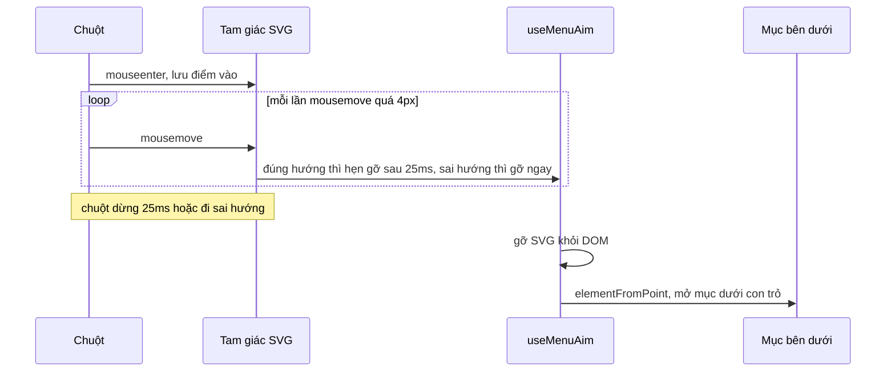

Mega menu "Danh mục" của Udemy: bên trái là danh sách lĩnh vực, rê chuột vào mục nào thì bên phải hiện submenu của mục đó. Giả sử bạn rê vào mục đầu tiên, thấy chủ đề mình cần ở góc dưới của submenu, và kéo chuột **chéo** xuống đó.

Đường chéo ấy đi ngang qua mấy mục bên dưới. Với cách làm thông thường (`mouseenter` vào mục nào thì mở mục đó), submenu đổi liên tục trên đường đi. Lúc chuột tới nơi, chủ đề bạn nhắm đã biến mất. Người dùng phải học cách đi theo hình chữ L: sang phải trước rồi mới xuống.

Cách sửa cổ điển là jQuery-menu-aim của Ben Kamens (Amazon từng dùng): ghi lại vài vị trí chuột gần nhất, tính góc, đoán người dùng đang nhắm vào submenu thì tạm chưa đổi. Udemy làm khác: **phủ hai tam giác SVG trong suốt lên vùng giữa mục đang mở và submenu**. Các mục bên cạnh nằm dưới tam giác nên không nhận được hover nữa.

> [!TIP]
> **Tóm tắt**
> - Vấn đề: rê chéo từ mục menu sang submenu thì đi ngang qua các mục khác và submenu bị đổi.
> - Udemy vẽ 2 tam giác vuông SVG nối mép mục đang mở với hai góc của submenu. SVG có `pointer-events: none`, chỉ `<path>` có `pointer-events: auto`, nên chỉ đúng hình tam giác chặn chuột.
> - Chuột đi **đúng hướng** thì tam giác ở lại thêm 25ms sau mỗi lần nhúc nhích; đi **sai hướng** (độ dốc lệch quá 2 lần) thì gỡ ngay; **dừng lại** thì sau 25ms gỡ, và mở mục đang nằm dưới con trỏ.
> - Sau khi gỡ tam giác, phần tử bên dưới chưa chắc nhận được `mouseover` vì chuột không di chuyển: phải tự tìm phần tử dưới con trỏ (Udemy: `forceHover`).

<iframe class="demo-frame" src="/demos/web-patterns/index.html?theme=dark#/menu-aim" title="Demo menu-aim" loading="lazy" style="height: 720px"></iframe>

<p class="demo-links">▶ <a href="/demos/web-patterns/index.html#/menu-aim" target="_blank" rel="noopener">Mở demo toàn màn hình ↗</a> · <a href="https://stackblitz.com/github/hunghg255/blog-hunghg/tree/master/examples/web-patterns?file=src/lib/menuAim.tsx" target="_blank" rel="noopener">Sửa code trên StackBlitz ↗</a> · <a href="https://github.com/hunghg255/blog-hunghg/blob/master/examples/web-patterns/src/lib/menuAim.tsx" target="_blank" rel="noopener">Xem source trên GitHub ↗</a></p>

Chọn "Ngây thơ" rồi rê chéo từ "Lập trình" xuống "Rust": submenu đổi sang "Thiết kế" ngay khi chuột lướt qua. Chọn "menuAim" và làm lại: hai tam giác tô cam che các mục bên dưới, "Rust" vẫn ở đó khi chuột tới nơi. Đi thẳng xuống thì tam giác bị gỡ ngay và menu đổi bình thường.

## Udemy làm thế nào?

Code nằm ở [`udemy.com/webpack---/src/menu-aim/menu-aim.tsx`](https://github.com/hunghg255/codebase/blob/main/udemy.com/webpack---/src/menu-aim/menu-aim.tsx). Đây là một HOC (`menuAim({ getTriggerNode, getMenuNode, onMouseLeave })`) dùng MobX để giữ state, kèm component `<MenuAimArea />` render hai tam giác. Nơi dùng: thanh danh mục `desktop/browse/browse-nav.react-component.tsx` và các dropdown ở header (`desktop/header-dropdown.react-component.tsx`).

### Tính hai tam giác từ hai hình chữ nhật

Khi chuột vào một mục (trigger), popper gọi `onMenuAimUpdate` qua `setTimeout(…, 0)` để đợi submenu render xong. Hàm này đọc `getBoundingClientRect()` của trigger và submenu rồi xét 4 trường hợp: submenu ở trên, dưới, phải hoặc trái trigger. Với submenu bên phải (như danh mục):

```ts
} else if (tRect.right <= mRect.left) {
  // Menu is right of the trigger. Aim areas are above and below the trigger.
  this.aimArea1 = {
    pos: {top: '0', right: '100%'},
    w: Math.round(mRect.left - tRect.left),
    h: Math.round(tRect.top - mRect.top) + 2,
    path: 'M0 %(h)sH%(w)sV0Z',
    dir: {x: 1, y: -1}, // up-right
  };
  this.aimArea2 = { /* đối xứng: pos {bottom: '0', right: '100%'}, dir {x: 1, y: 1} */ };
}
```

- SVG được định vị **tuyệt đối theo submenu** (`right: 100%` là nằm sát mép trái submenu, kéo dài sang trái). Nó được render bên trong submenu (thanh danh mục dùng `createPortal` vào node của submenu), nên về mặt DOM, chuột ở trên tam giác vẫn là ở "trong" submenu.
- Bề rộng tam giác tính từ **mép trái** trigger tới mép trái submenu, tức phủ cả chiều ngang của danh sách.
- Tam giác trên có đỉnh vuông ở góc trên trái submenu. Cạnh huyền đi từ mép trên trigger tới góc đó. Tam giác dưới đối xứng.
- `+2` để bịt khe hở do làm tròn pixel hoặc border (comment trong code).
- `dir` là hướng chuột "nên" đi: tam giác trên thì lên-phải, tam giác dưới thì xuống-phải.

### Đọc hướng chuột

Mỗi tam giác (`MenuAimSVG`) nhớ điểm chuột lúc đi vào, rồi trong `onMouseMove` so hướng đi **tính từ điểm vào** (không phải từ lần di chuyển trước):

```ts
const isMouseAngleWrong = (x, y, initialX, initialY) => {
  const dy = y - initialY, dx = x - initialX;
  const expectedSlope = h / w;
  const actualSlope = dy / dx;
  const xDirMatches = dx === 0 || dx > 0 === dir.x > 0;
  const yDirMatches = dy === 0 || dy > 0 === dir.y > 0;
  if (xDirMatches !== yDirMatches) return true;               // sai đường chéo
  if (pos.top === '100%' || pos.bottom === '100%') {           // submenu trên/dưới
    return 2 * Math.abs(actualSlope) < Math.abs(expectedSlope); // đi quá ngang
  }
  return 2 * Math.abs(expectedSlope) < Math.abs(actualSlope);   // submenu trái/phải: đi quá dọc
};

const onMouseMove = ({clientX: x, clientY: y}) => {
  if (Math.abs(x - initialX) > 4 || Math.abs(y - initialY) > 4) {
    const delay = isMouseAngleWrong(x, y, initialX, initialY) ? 0 : 25;
    hideAimArea({x, y}, delay);
  }
};
```

(Code gốc viết tách hai vế `xDirMatches && !yDirMatches || !xDirMatches && yDirMatches`; mình gộp thành `!==` cho gọn.)

Comment trong code giải thích từng con số:

- **4px**: bỏ qua các `mousemove` phát ra ngay khi tam giác vừa render, để nó không biến mất tức thì.
- **0ms** khi sai hướng: người dùng rõ ràng không nhắm vào submenu.
- **25ms** khi đúng hướng: đủ thấp để rê sang popper bên cạnh không thấy trễ, đủ cao để tam giác còn đó khi chuột đang di chuyển. Mỗi lần chuột nhúc nhích lại đặt lại hẹn giờ 25ms, nên tam giác chỉ biến mất khi chuột **dừng**.

### Sau khi gỡ tam giác: tự kích hoạt hover

Gỡ tam giác thì gọi `onMouseLeave` của consumer kèm vị trí chuột. Ở header, consumer đóng popper rồi gọi:

```ts
export function forceHover(selector: string, mousePos: {x: number; y: number}) {
  // On Chrome, manually trigger hover on the element behind the menu-aim triangle.
  setTimeout(() => {
    const hoverEl = /* phần tử khớp selector có hình chữ nhật chứa (x, y) */;
    hoverEl && hoverEl.dispatchEvent(new Event('mouseover', {bubbles: true}));
  }, 0);
}
```

Chuột đang đứng yên trên vị trí mà tam giác vừa biến mất. Theo comment của Udemy, Chrome không tự phát `mouseover` cho phần tử vừa lộ ra, nên mục nằm dưới con trỏ không mở. `forceHover` tìm phần tử theo toạ độ và tự phát sự kiện.

## Bên trong trình duyệt



- **`pointer-events`** quyết định phần tử nào nhận chuột. SVG có `pointer-events: none` và `width/height` là hình chữ nhật, nhưng chỉ `<path>` (hình tam giác) có `pointer-events: auto`. Nhờ vậy phần còn lại của hình chữ nhật không chặn chuột.
- **Hit-testing của SVG** theo đúng hình học: điểm nằm ngoài tam giác thì "xuyên qua" tới phần tử bên dưới, dù vẫn trong khung SVG.
- **`mouseover` không được phát chỉ vì DOM đổi**. Sự kiện chuột phát ra khi chuột di chuyển. Khi phần tử dưới con trỏ thay đổi mà chuột đứng yên, việc có phát `mouseover` hay không tuỳ trình duyệt và thời điểm.

## Viết lại

`menuAim.tsx` là một hook: `useMenuAim({ triggerRef, menuRef, onAimEnd })` trả về `update()` (gọi khi submenu mới render xong), `aimArea` (JSX hai tam giác, đặt bên trong submenu) và `active`.

Hướng chuột, viết lại thành hàm thuần dễ test:

```tsx title=src/lib/menuAim.tsx

/**
 * Chuột (tính từ lúc vào tam giác) có đang đi sai hướng không.
 * Sai nếu: đi theo đường chéo ngược lại, hoặc góc lệch quá xa so với cạnh huyền
 * (Udemy: độ dốc thực tế lệch quá 2 lần độ dốc kỳ vọng).
 */
export function isAimWrong(area: AimArea, dx: number, dy: number): boolean {
  const xOk = dx === 0 || dx > 0 === area.dir.x > 0;
  const yOk = dy === 0 || dy > 0 === area.dir.y > 0;
  if (xOk !== yOk) return true; // sai đường chéo
  const expected = Math.abs(area.h / area.w);
  const actual = Math.abs(dy / dx); // dx = 0 cho ra Infinity, vẫn so sánh được
  // submenu trên/dưới: đi quá ngang là sai; submenu trái/phải: đi quá dọc là sai
  return area.vertical ? 2 * actual < expected : 2 * expected < actual;
}
```

Hai handler của tam giác:

```tsx title=src/lib/menuAim.tsx
        onMouseEnter={(e) => {
          start.current = { x: e.clientX, y: e.clientY };
          // khác bản gốc: chuột vào rồi đứng yên (chưa đi quá moveThreshold) thì cũng gỡ sau
          // một lúc, không để tam giác che mục bên dưới mãi
          onHide({ x: e.clientX, y: e.clientY }, stopDelay * 4);
        }}
        onMouseMove={(e) => {
          const origin = (start.current ??= { x: e.clientX, y: e.clientY });
          const dx = e.clientX - origin.x;
          const dy = e.clientY - origin.y;
          if (Math.abs(dx) <= moveThreshold && Math.abs(dy) <= moveThreshold) return;
          // đúng hướng: gia hạn thêm stopDelay mỗi lần chuột nhúc nhích; sai hướng: gỡ ngay
          onHide({ x: e.clientX, y: e.clientY }, isAimWrong(area, dx, dy) ? 0 : stopDelay);
        }}
        onMouseLeave={onLeave}
      />
```

## Đi qua code

1. `computeAimAreas` giữ nguyên 4 trường hợp của Udemy, nhưng tính luôn thuộc tính `d` của `<path>` bằng template string, thay vì chuỗi `%(w)s` rồi `interpolate` qua thư viện i18n.
2. `isAimWrong` là hàm thuần nhận `area, dx, dy`, nên test được mà không cần DOM.
3. Điểm vào được giữ trong `useRef`. Bản gốc dùng `useState`, nên mỗi `mousemove` trên tam giác gây một lần re-render.
4. `onMouseEnter` hẹn gỡ sau `stopDelay * 4` (100ms). Bản gốc chỉ hẹn gỡ khi chuột đã đi quá 4px. Nếu chuột vào tam giác rồi đứng yên trong bán kính 4px, tam giác sẽ che mục bên dưới **mãi** cho tới khi chuột nhúc nhích. Test bằng Playwright của mình gặp đúng trường hợp này: đi thẳng xuống mục thứ tư, mục mới vừa mở thì tam giác mới xuất hiện ngay dưới con trỏ, và chuột dừng.
5. `hide` không gọi `onAimEnd` ngay. Nó ghi điểm vào `endedAt`, `setAreas(null)`, rồi `useEffect` gọi `onAimEnd` sau khi React commit. Bản đầu của mình gọi trong `setTimeout(0)` và `elementFromPoint` vẫn trả về **chính tam giác**: React chưa kịp gỡ SVG. `forceHover` của Udemy chạy được bằng `setTimeout(0)` có lẽ vì MobX cập nhật đồng bộ hơn, nhưng dựa vào `useEffect` thì chắc chắn hơn.
6. Demo dùng `document.elementFromPoint(x, y)` thay cho vòng lặp `querySelectorAll` + so `getBoundingClientRect`: một lần gọi, và tôn trọng thứ tự chồng lớp (z-index).

**Khác bản gốc:** hook thay cho HOC + MobX; điểm vào lưu trong ref; tự gỡ khi chuột đứng yên trong tam giác; báo `onAimEnd` sau commit; consumer tự quyết định làm gì với điểm cuối (demo: mở mục dưới con trỏ).

::: spoiler Xem toàn bộ src/lib/menuAim.tsx

```tsx title=src/lib/menuAim.tsx
import { useCallback, useEffect, useRef, useState, type RefObject } from 'react';

/**
 * Menu aim: rê chuột chéo từ một mục menu sang submenu của nó mà không làm các mục
 * nằm trên đường đi "giành" hover (ý tưởng từ menu-aim.tsx của Udemy).
 *
 * Cách làm: phủ khoảng trống giữa mục đang mở (trigger) và submenu bằng 2 tam giác SVG
 * trong suốt. Tam giác nằm TRÊN các mục bên cạnh nên chúng không nhận được hover. Chuột
 * còn đang di chuyển đúng hướng thì giữ tam giác; đi sai hướng hoặc dừng lại thì gỡ.
 */

export interface AimArea {
  /** vị trí tuyệt đối của SVG, tính theo submenu (submenu phải có position khác static) */
  pos: { top?: string; bottom?: string; left?: string; right?: string };
  w: number;
  h: number;
  /** thuộc tính d của <path> */
  d: string;
  /** hướng chuột được kỳ vọng: x=1 sang phải, y=-1 đi lên… */
  dir: { x: 1 | -1; y: 1 | -1 };
  /** submenu nằm trên/dưới trigger (true) hay trái/phải (false) */
  vertical: boolean;
}

// +2: bịt khe hở 1-2px giữa trigger và tam giác do làm tròn pixel hoặc border
const GAP = 2;

/** Tính 2 tam giác từ hình chữ nhật của trigger và submenu (4 trường hợp vị trí). */
export function computeAimAreas(t: DOMRect, m: DOMRect): [AimArea, AimArea] {
  const r = Math.round;
  if (t.top >= m.bottom) {
    // submenu ở TRÊN trigger: 2 tam giác ở hai bên trigger
    const h = r(t.bottom - m.bottom);
    const w1 = r(t.left - m.left) + GAP;
    const w2 = r(m.right - t.right) + GAP;
    return [
      { pos: { top: '100%', left: '0' }, w: w1, h, d: `M${w1} ${h}V0H0Z`, dir: { x: -1, y: -1 }, vertical: true },
      { pos: { top: '100%', right: '0' }, w: w2, h, d: `M0 ${h}V0H${w2}Z`, dir: { x: 1, y: -1 }, vertical: true },
    ];
  }
  if (t.bottom <= m.top) {
    // submenu ở DƯỚI trigger
    const h = r(m.top - t.top);
    const w1 = r(t.left - m.left) + GAP;
    const w2 = r(m.right - t.right) + GAP;
    return [
      { pos: { bottom: '100%', left: '0' }, w: w1, h, d: `M${w1} 0V${h}H0Z`, dir: { x: -1, y: 1 }, vertical: true },
      { pos: { bottom: '100%', right: '0' }, w: w2, h, d: `M0 0V${h}H${w2}Z`, dir: { x: 1, y: 1 }, vertical: true },
    ];
  }
  if (t.right <= m.left) {
    // submenu bên PHẢI trigger: 2 tam giác ở trên và dưới trigger
    const w = r(m.left - t.left);
    const h1 = r(t.top - m.top) + GAP;
    const h2 = r(m.bottom - t.bottom) + GAP;
    return [
      { pos: { top: '0', right: '100%' }, w, h: h1, d: `M0 ${h1}H${w}V0Z`, dir: { x: 1, y: -1 }, vertical: false },
      { pos: { bottom: '0', right: '100%' }, w, h: h2, d: `M0 0H${w}V${h2}Z`, dir: { x: 1, y: 1 }, vertical: false },
    ];
  }
  // submenu bên TRÁI trigger
  const w = r(t.right - m.right);
  const h1 = r(t.top - m.top) + GAP;
  const h2 = r(m.bottom - t.bottom) + GAP;
  return [
    { pos: { top: '0', left: '100%' }, w, h: h1, d: `M${w} ${h1}H0V0Z`, dir: { x: -1, y: -1 }, vertical: false },
    { pos: { bottom: '0', left: '100%' }, w, h: h2, d: `M${w} 0H0V${h2}Z`, dir: { x: -1, y: 1 }, vertical: false },
  ];
}

/**
 * Chuột (tính từ lúc vào tam giác) có đang đi sai hướng không.
 * Sai nếu: đi theo đường chéo ngược lại, hoặc góc lệch quá xa so với cạnh huyền
 * (Udemy: độ dốc thực tế lệch quá 2 lần độ dốc kỳ vọng).
 */
export function isAimWrong(area: AimArea, dx: number, dy: number): boolean {
  const xOk = dx === 0 || dx > 0 === area.dir.x > 0;
  const yOk = dy === 0 || dy > 0 === area.dir.y > 0;
  if (xOk !== yOk) return true; // sai đường chéo
  const expected = Math.abs(area.h / area.w);
  const actual = Math.abs(dy / dx); // dx = 0 cho ra Infinity, vẫn so sánh được
  // submenu trên/dưới: đi quá ngang là sai; submenu trái/phải: đi quá dọc là sai
  return area.vertical ? 2 * actual < expected : 2 * expected < actual;
}

export interface UseMenuAimOptions {
  triggerRef: RefObject<HTMLElement | null>;
  menuRef: RefObject<HTMLElement | null>;
  /**
   * Gọi khi tam giác bị gỡ (chuột dừng hoặc đi sai hướng), kèm vị trí chuột.
   * Phần tử nằm dưới chuột lúc này không tự nhận mouseover (chuột không hề di chuyển),
   * nên thường cần tự kích hoạt mục dưới con trỏ (Udemy: `forceHover`).
   */
  onAimEnd?: (point: { x: number; y: number }) => void;
  /** chuột dừng quá chừng này ms thì gỡ tam giác (Udemy: 25) */
  stopDelay?: number;
  /** bỏ qua mousemove trong bán kính này quanh điểm vào, tránh gỡ ngay khi tam giác vừa hiện (Udemy: 4px) */
  moveThreshold?: number;
  /** tô màu tam giác để nhìn thấy (debug/demo) */
  debug?: boolean;
}

export function useMenuAim({ triggerRef, menuRef, onAimEnd, stopDelay = 25, moveThreshold = 4, debug = false }: UseMenuAimOptions) {
  const [areas, setAreas] = useState<AimArea[] | null>(null);
  const timer = useRef<ReturnType<typeof setTimeout>>(undefined);
  const onAimEndRef = useRef(onAimEnd);
  useEffect(() => {
    onAimEndRef.current = onAimEnd;
  });
  useEffect(() => () => clearTimeout(timer.current), []);

  /** Gọi sau khi submenu của trigger mới đã render (vd trong useLayoutEffect). */
  const update = useCallback(() => {
    const trigger = triggerRef.current;
    const menu = menuRef.current;
    clearTimeout(timer.current);
    setAreas(trigger && menu ? computeAimAreas(trigger.getBoundingClientRect(), menu.getBoundingClientRect()) : null);
  }, [triggerRef, menuRef]);

  // điểm chuột lúc gỡ tam giác; báo cho người dùng SAU khi React đã gỡ SVG khỏi DOM,
  // nếu không elementFromPoint ở phía người dùng vẫn trả về chính tam giác
  // (Udemy làm tương tự bằng cách bọc forceHover trong setTimeout 0)
  const endedAt = useRef<{ x: number; y: number } | null>(null);
  useEffect(() => {
    if (areas === null && endedAt.current) {
      const point = endedAt.current;
      endedAt.current = null;
      onAimEndRef.current?.(point);
    }
  }, [areas]);

  const hide = useCallback((point: { x: number; y: number }, delay: number) => {
    clearTimeout(timer.current);
    const run = () => {
      endedAt.current = point;
      setAreas(null);
    };
    if (delay) timer.current = setTimeout(run, delay);
    else run();
  }, []);

  const cancelHide = useCallback(() => clearTimeout(timer.current), []);

  const aimArea = areas
    ? areas.map((area, i) => (
        <AimTriangle
          key={i}
          area={area}
          debug={debug}
          stopDelay={stopDelay}
          moveThreshold={moveThreshold}
          onHide={hide}
          onLeave={cancelHide}
        />
      ))
    : null;

  return { update, aimArea, active: areas !== null };
}

interface AimTriangleProps {
  area: AimArea;
  debug: boolean;
  stopDelay: number;
  moveThreshold: number;
  onHide: (point: { x: number; y: number }, delay: number) => void;
  onLeave: () => void;
}

function AimTriangle({ area, debug, stopDelay, moveThreshold, onHide, onLeave }: AimTriangleProps) {
  // điểm chuột đi vào tam giác; dùng ref (Udemy dùng state -> re-render mỗi lần mousemove)
  const start = useRef<{ x: number; y: number } | null>(null);
  // tam giác quá nhỏ thì không cần (Udemy: <= 4px)
  if (area.w <= 4 || area.h <= 4) return null;

  return (
    <svg
      aria-hidden='true'
      focusable='false'
      width={area.w}
      height={area.h}
      style={{ position: 'absolute', pointerEvents: 'none', overflow: 'visible', ...area.pos }}
    >
      <path
        d={area.d}
        style={{
          pointerEvents: 'auto',
          fill: debug ? 'color-mix(in oklab, var(--accent, #f80) 28%, transparent)' : 'transparent',
          stroke: debug ? 'var(--accent, #f80)' : 'none',
          strokeDasharray: '4 3',
        }}
        onMouseEnter={(e) => {
          start.current = { x: e.clientX, y: e.clientY };
          // khác bản gốc: chuột vào rồi đứng yên (chưa đi quá moveThreshold) thì cũng gỡ sau
          // một lúc, không để tam giác che mục bên dưới mãi
          onHide({ x: e.clientX, y: e.clientY }, stopDelay * 4);
        }}
        onMouseMove={(e) => {
          const origin = (start.current ??= { x: e.clientX, y: e.clientY });
          const dx = e.clientX - origin.x;
          const dy = e.clientY - origin.y;
          if (Math.abs(dx) <= moveThreshold && Math.abs(dy) <= moveThreshold) return;
          // đúng hướng: gia hạn thêm stopDelay mỗi lần chuột nhúc nhích; sai hướng: gỡ ngay
          onHide({ x: e.clientX, y: e.clientY }, isAimWrong(area, dx, dy) ? 0 : stopDelay);
        }}
        onMouseLeave={onLeave}
      />
    </svg>
  );
}
```

:::

## Tại sao không làm cách khác?

**Trễ 300ms rồi mới đổi mục?** Cách phổ biến nhất, và cũng khó chịu nhất: người dùng nào muốn đổi mục cũng phải đợi. Menu aim chỉ trễ khi bạn **đang nhắm** vào submenu.

**jQuery-menu-aim (ghi lại vị trí chuột, tính góc tới hai góc submenu)?** Cùng ý tưởng, nhưng phải tự chặn sự kiện của các mục bên cạnh (bỏ qua `mouseenter` khi đang nhắm) và chạy hẹn giờ kiểm tra lại. Cách tam giác của Udemy để trình duyệt làm việc chặn: phần tử nằm dưới thì không nhận được chuột, không cần sửa handler của từng mục.

**Một tam giác duy nhất từ con trỏ tới hai góc submenu** (kiểu "safe triangle" trong nhiều thư viện)? Chính xác hơn vì đỉnh tam giác là vị trí chuột thật, nhưng phải vẽ lại theo mỗi lần di chuyển. Hai tam giác cố định của Udemy chỉ tính lại khi đổi mục.

## Edge case và cạm bẫy

- **Submenu phải có `position` khác `static`**, vì tam giác định vị tuyệt đối theo nó. Và tam giác phải nằm **trong** submenu trong DOM: nếu để ngoài, `mouseleave` của submenu sẽ chạy khi chuột lên tam giác.
- **Tam giác quá nhỏ** (≤ 4px, như tam giác phía trên khi trigger là mục đầu tiên) thì không render.
- **Submenu đổi kích thước** sau khi mở (ảnh tải xong, nội dung lazy) thì tam giác tính lúc đầu đã cũ. Gọi `update()` lại khi submenu resize.
- **Bàn phím và cảm ứng**: menu aim chỉ dành cho chuột. Menu vẫn phải mở được bằng focus (demo mở khi `onFocus`) và bằng chạm. Udemy ghi rõ trong `BasicPopper`: chỉ mở bằng hover thì không dùng được trên mobile và với bàn phím.
- **Cuộn trang khi submenu đang mở**: toạ độ `getBoundingClientRect()` đổi, nhưng tam giác định vị theo submenu nên vẫn đúng chỗ. Chỉ cần tính lại nếu trigger và submenu cuộn khác nhau (vd danh sách bên trái có thanh cuộn riêng).

## Dùng trong dự án

```tsx
const triggerRef = useRef<HTMLElement | null>(null);
const menuRef = useRef<HTMLDivElement>(null);
const { update, aimArea } = useMenuAim({
  triggerRef,
  menuRef,
  onAimEnd: ({ x, y }) => {
    const item = document.elementFromPoint(x, y)?.closest<HTMLElement>('[data-index]');
    if (item) setActive(Number(item.dataset.index));
  },
});

useLayoutEffect(() => {
  triggerRef.current = itemRefs.current[active];
  update(); // submenu của mục mới đã render
}, [active, update]);

// trong JSX: tam giác nằm BÊN TRONG submenu (position: relative)
<div className="submenu" ref={menuRef}>{aimArea}{/* nội dung */}</div>
```

::: spoiler Ví dụ test (bản phác, không có trong repo)

```ts
import { describe, expect, it } from 'vitest';
import { computeAimAreas, isAimWrong } from './menuAim';

const rect = (x: number, y: number, w: number, h: number) =>
  ({ left: x, top: y, right: x + w, bottom: y + h, width: w, height: h }) as DOMRect;

describe('computeAimAreas', () => {
  it('submenu bên phải: tam giác trên và dưới trigger', () => {
    const trigger = rect(0, 100, 200, 40);
    const menu = rect(200, 0, 300, 400);
    const [above, below] = computeAimAreas(trigger, menu);
    expect(above).toMatchObject({ w: 200, h: 102, dir: { x: 1, y: -1 }, vertical: false });
    expect(below).toMatchObject({ w: 200, h: 262, dir: { x: 1, y: 1 } });
  });
});

describe('isAimWrong', () => {
  const [, below] = computeAimAreas(rect(0, 100, 200, 40), rect(200, 0, 300, 400));
  it('chéo xuống phải là đúng hướng', () => {
    expect(isAimWrong(below, 60, 50)).toBe(false);
  });
  it('đi lên trong tam giác dưới là sai đường chéo', () => {
    expect(isAimWrong(below, 60, -50)).toBe(true);
  });
  it('đi gần như thẳng xuống là sai (quá dốc)', () => {
    expect(isAimWrong(below, 2, 60)).toBe(true);
  });
});
```

:::

## So với thư viện và chuẩn web

- **Floating UI** có `safePolygon()` cho `useHover`: vẽ một đa giác "an toàn" từ con trỏ tới popover và giữ popover mở khi chuột còn trong đó. Cùng mục tiêu, cách tính khác (đa giác bám theo con trỏ thay vì hai tam giác cố định).
- **Radix UI**: submenu của `DropdownMenu` và `ContextMenu` cũng xử lý rê chéo bằng một vùng "grace area" hình đa giác.
- **Popover API** (`popover` attribute) và **CSS anchor positioning** lo việc hiển thị và định vị, nhưng **không** xử lý chuyện rê chéo. Phần đó vẫn cần JavaScript như trên.

---

Bài này thuộc series **[Học từ mã nguồn các web lớn](/series/web)** (42 bài, đọc theo thứ tự).

::: spoiler Xem nhanh danh sách bài trong series

*Mở đầu*

- [Mở đầu: đọc code production của 28 trang web](/blogs/learn-from-big-web-apps)

*Phần 1: trải nghiệm người dùng*

- [#1 Dark mode không nháy (Gatsby)](/blogs/web-dark-mode-no-flash)
- [#2 useValueByMedia: giá trị theo breakpoint (Toptal)](/blogs/web-use-value-by-media)
- [#3 Đoán ý định: idle, exit-intent, lắc chuột (Toptal, InVision)](/blogs/web-user-intent-idle-exit-wiggle)
- [#4 Validate form thân thiện (Udacity, Pipedrive)](/blogs/web-form-validation-ux)
- [#5 Magic number, EXIF và dán ảnh (Ello)](/blogs/web-file-magic-number-exif-paste)
- [#6 fastSmoothScroll: cuộn xa vẫn nhanh (Telegram)](/blogs/web-telegram-fast-smooth-scroll)
- [#7 Countdown time-travel và tombstone giỏ hàng (Best Buy)](/blogs/web-countdown-time-travel-tombstone)

*Phần 2: hiệu năng và đo lường*

- [#8 Hàng đợi requestAnimationFrame 3ms (Apple)](/blogs/web-raf-queue-3ms)
- [#9 srcset cho artwork và preconnect tự động (Apple)](/blogs/web-responsive-artwork-preconnect)
- [#10 Quick-fetch: gọi API trước khi bundle tải xong (HubSpot)](/blogs/web-quick-fetch-early-requests)
- [#11 Performance span và long task (Postman, Calibre)](/blogs/web-performance-spans-long-tasks)
- [#12 Gọi Web Worker như hàm async (Telegram)](/blogs/web-worker-promise-rpc)
- [#13 Đồng hồ media: đếm giờ xem và sửa lệch (Skillshare, Simplified)](/blogs/web-media-clock-watch-time-drift)

*Phần 3: nhiều tab, phiên đăng nhập, cập nhật*

- [#14 Bầu tab chủ cho thông báo (HubSpot, Telegram)](/blogs/web-leader-tab-notifications)
- [#15 Đồng bộ đăng nhập giữa tab và giới hạn cookie (Elastic, InVision)](/blogs/web-cross-tab-auth-cookie-guard)
- [#16 SPA tự cập nhật: Trello, Zappos, Facebook, Elastic](/blogs/web-spa-self-update-strategies)

*Phần 4: kiến trúc*

- [#17 Reverse portal: di chuyển component không remount (Zappos)](/blogs/web-reverse-portal)
- [#18 Page behaviors: gắn hành vi từ CMS (Intercom)](/blogs/web-page-behaviors-cms)
- [#19 Giới hạn tần suất hiển thị bằng bitmask (Outlook)](/blogs/web-frequency-cap-bitmask)
- [#20 Chuyển REST sang GraphQL dần dần (Coursera)](/blogs/web-rest-to-graphql-hybrid-link)

*Phần 5: soạn thảo và hiển thị nội dung*

- [#21 Autocomplete tại con trỏ trong contenteditable (Ello, Telegram)](/blogs/web-caret-autocomplete-contenteditable)
- [#22 Dark mode cho email HTML bằng CIELAB (Outlook)](/blogs/web-email-dark-mode-cielab)
- [#23 Thu nhỏ bảng rộng cho vừa khung, vá font emoji (Outlook)](/blogs/web-email-wide-content-scale)
- [#24 Cảnh báo quên đính kèm file (Outlook)](/blogs/web-forgotten-attachment-warning)
- [#25 Cắt chữ nhiều dòng chính xác (Pipedrive, Apple, Toptal)](/blogs/web-multiline-truncate-measure-text)
- [#26 Parse ngày giờ gõ tay khoan dung (Outlook, Elastic)](/blogs/web-lenient-date-parser)

*Phần 6: tương tác*

- **#27 menuAim: rê chéo vào submenu không bị đóng (Udemy)** (bài này)
- [#28 Kéo, vuốt chung cho chuột và cảm ứng (Telegram)](/blogs/web-unified-pointer-gestures)
- [#29 Phím tắt theo phạm vi, IME và bàn phím phi Latinh (Trello)](/blogs/web-scoped-keyboard-shortcuts)
- [#30 Nội suy màu: đổi theme và nền theo cuộn (Telegram, Anchor)](/blogs/web-color-interpolation-theme-scroll)
- [#31 Đường gióng hút cạnh và undo/redo trên canvas (Simplified)](/blogs/web-canvas-snap-guides-undo)
- [#32 Giả lập mù màu bằng feColorMatrix (Trello)](/blogs/web-color-vision-simulator)
- [#33 Vạch thước theo mức zoom và cấp phát màu cho biểu đồ (Anchor, Similarweb)](/blogs/web-timeline-ticks-color-stack)

*Phần 7: mạng, dữ liệu và async*

- [#34 Ô tìm kiếm chuẩn production (Similarweb, Udemy, Pipedrive)](/blogs/web-production-search-box)
- [#35 Điều phối async: latest-wins, single-flight (Glitch, Toptal)](/blogs/web-async-coordination-latest-wins)
- [#36 Polling thưa dần và debounce động (Trello)](/blogs/web-decaying-polling-dynamic-debounce)
- [#37 Cache phía client theo version (Similarweb, Telegram, Udemy)](/blogs/web-client-cache-versioned)
- [#38 Upload file lớn theo chunk (Outlook, Tribe)](/blogs/web-chunked-upload-pipeline)
- [#39 Phát video qua Service Worker bằng Range request (Telegram, Outlook)](/blogs/web-service-worker-range-streaming)

*Phần 8: hiệu năng và vận hành*

- [#40 TTI governor: hoãn việc phụ tới sau khi trang dùng được (Outlook)](/blogs/web-tti-governor)
- [#41 Tự đo LCP/CLS/TBT và phục vụ bản nhẹ cho máy yếu (Udemy)](/blogs/web-rum-adaptive-loading)

:::

Code + demo: [`examples/web-patterns`](https://github.com/hunghg255/blog-hunghg/tree/master/examples/web-patterns) · [Mở trên StackBlitz](https://stackblitz.com/github/hunghg255/blog-hunghg/tree/master/examples/web-patterns)
