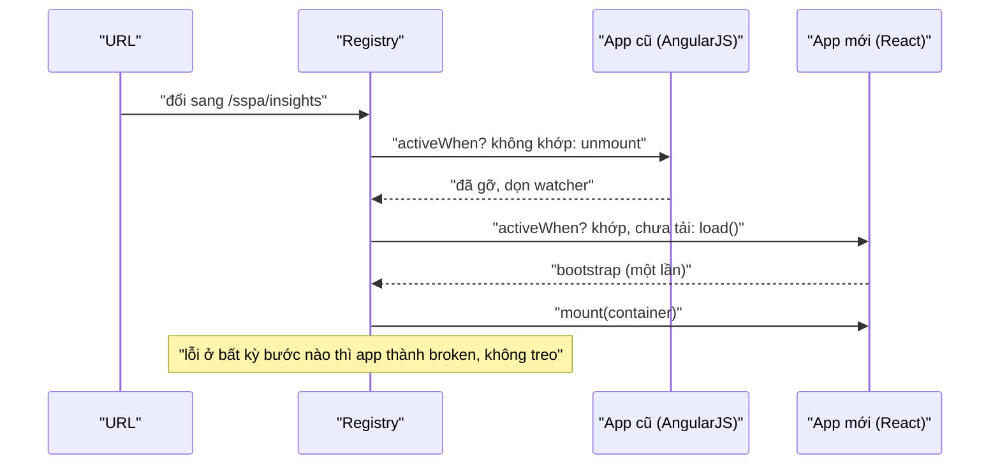

Ứng dụng web lớn hiếm khi là một khối code. Similarweb có một app AngularJS viết từ những năm 2010 và các trang React mới; InVision có trang chủ (`home-ui`) và trang quản lý team (`team-management-web`) do hai nhóm khác nhau làm; HubSpot nhúng thanh thông báo, banner dùng thử và nhiều widget khác bằng iframe vào trang của các sản phẩm. Các mảnh này phải **cùng sống trên một trang** và **nói chuyện với nhau**, dù mỗi mảnh có framework, có lịch phát hành riêng.

Bài này đọc ba "cây cầu" nối các mảnh đó:

1. **Mount theo route** (Similarweb): mỗi app tự gắn vào và gỡ ra khỏi trang khi URL đổi.
2. **Truyền dữ liệu qua URL** (InVision): app này mở trang của app kia, gửi kèm dữ liệu trong tham số.
3. **postMessage giữa frame** (HubSpot): iframe báo cho trang chứa, trang chứa báo lại cho iframe.

> [!TIP]
> **Tóm tắt**
> - Mỗi micro-app có `bootstrap`, `mount`, `unmount` và `activeWhen(url)`. Khi URL đổi: **gỡ app cũ trước, gắn app mới sau**, xếp hàng các lần đổi dồn dập. Lỗi lúc bootstrap phải **báo ra**, không nuốt rồi để Promise treo.
> - Dữ liệu đi qua URL thì dựng bằng `URLSearchParams` và mã hoá base64url từ UTF-8; nối chuỗi tay làm hỏng tham số có `&` và `btoa` ném lỗi với tiếng Việt.
> - Kiểm `event.origin` bằng cách **parse URL rồi so hostname**, không dùng regex chưa neo hai đầu; kiểm thêm `event.source`; gửi đi thì ghi rõ `targetOrigin`, không dùng `'*'` cho dữ liệu quan trọng.
> - `document.domain` (cách cũ để iframe cùng site đọc DOM của nhau) đã bị Chrome vô hiệu hoá mặc định từ 2023: đừng dựa vào nó.

<iframe class="demo-frame" src="/demos/web-patterns/index.html?theme=dark#/micro-frontend" title="Demo micro-frontend" loading="lazy" style="height: 1250px"></iframe>

<p class="demo-links">▶ <a href="/demos/web-patterns/index.html#/micro-frontend" target="_blank" rel="noopener">Mở demo toàn màn hình ↗</a> · <a href="https://stackblitz.com/github/hunghg255/blog-hunghg/tree/master/examples/web-patterns?file=src/lib/microFrontend.ts" target="_blank" rel="noopener">Sửa code trên StackBlitz ↗</a> · <a href="https://github.com/hunghg255/blog-hunghg/blob/master/examples/web-patterns/src/lib/microFrontend.ts" target="_blank" rel="noopener">Xem source trên GitHub ↗</a></p>

Trong demo: đổi route giữa `/dashboard`, `/sspa/insights`, `/onboarding` để thấy app cũ và app React lần lượt được gỡ, gắn. Tick "Bootstrap của app cũ lỗi" để thấy app bị đánh dấu `broken` thay vì treo. Phần 2 so URL kiểu InVision và bản viết lại; nhập type có dấu để thấy `btoa` ném lỗi. Phần 3 là một iframe thật gửi tin cho trang chứa, kèm bảng so regex kiểm origin của HubSpot với cách parse URL.

## Similarweb: AngularJS và React chung một trang

Similarweb dùng [single-spa](https://single-spa.js.org/), thư viện điều phối micro-frontend theo route. Cấu hình nằm ở [`pro.similarweb.com/single-spa/single-spa-config.ts`](https://github.com/hunghg255/codebase/blob/main/pro.similarweb.com/single-spa/single-spa-config.ts):

```ts
const matchesRegex = (regex) => (location) => regex.test(location.hash); // viết gọn lại

const commonEnv = await bootstrap();
registerApplication("angularjs", () => import("./angularjs/angularjs.app"),
    matchesRegex(/^(?!.*(ripng|sspa|onboarding))/), commonEnv);
registerApplication("react", () => import("./react/react.app"), matchesRegex(/sspa/), commonEnv);
start();
```

Đáng chú ý:

- **App cũ là mặc định.** Regex `^(?!.*(ripng|sspa|onboarding))` là "negative lookahead": khớp mọi hash **không** chứa ba từ đó. Mọi route chưa chuyển sang React vẫn thuộc AngularJS; muốn chuyển một trang thì đổi URL của nó sang dạng có `sspa`. Đây là cách làm của mẫu "strangler fig" (cây sung bóp nghẹt): app mới lớn dần quanh app cũ, từng route một.
- **Mỗi app là một chunk riêng** (`import()`), chỉ tải khi route khớp lần đầu.
- **Dữ liệu dùng chung tải một lần.** `bootstrap()` trong [`single-spa/bootstrap.tsx`](https://github.com/hunghg255/codebase/blob/main/pro.similarweb.com/single-spa/bootstrap.tsx) tải song song dữ liệu người dùng, cài đặt, bản dịch, mục gần đây, mục yêu thích… rồi truyền cho cả hai app dưới dạng `customProps` (`commonEnv`). Hai app không phải tự gọi lại cùng API.

### Bộ chuyển đổi cho AngularJS

single-spa cần mỗi app xuất ra ba hàm `bootstrap`, `mount`, `unmount`. AngularJS không có khái niệm đó, nên Similarweb dùng một adapter ([`single-spa/angularjs/angularjsLifecycleManager.ts`](https://github.com/hunghg255/codebase/blob/main/pro.similarweb.com/single-spa/angularjs/angularjsLifecycleManager.ts)). Tên tuỳ chọn và thông báo lỗi trong file (`single-spa-angularjs requires a configuration object`) cho thấy nó là bản chép, sửa nhẹ từ package mã nguồn mở `single-spa-angularjs`:

```ts
function unmount(opts, mountedInstances): Promise<void> {
    return new Promise((resolve) => {
        const container = getContainerEl(opts);
        if (!opts.appRemainsMounted) {
            mountedInstances.instance.get("$rootScope").$destroy();
            container.innerHTML = "";
        } else {
            container.style.display = "none";
        }
        setTimeout(resolve);
    });
}
```

`mount` (không trích ở đây) tạo một phần tử mới trong container rồi gọi `angular.bootstrap` lên nó; `unmount` gọi `$rootScope.$destroy()` để AngularJS gỡ mọi watcher, listener, `$interval` rồi xoá DOM. Tuỳ chọn `appRemainsMounted` cho phép chỉ **ẩn** app bằng `display: none` thay vì huỷ, đổi lấy việc quay lại nhanh (giống keep-alive, xem [bài keep-alive của series Facebook](/blogs/facebook-keep-alive-tabs)). Similarweb để `false`: mỗi lần rời khỏi vùng AngularJS là huỷ hẳn.

### Lỗi: bootstrap lỗi thì treo mãi

Hàm `bootstrap` của app AngularJS ([`single-spa/angularjs/angularjs.app.ts`](https://github.com/hunghg255/codebase/blob/main/pro.similarweb.com/single-spa/angularjs/angularjs.app.ts)):

```ts
export const bootstrap = (opts, props) => {
    return new Promise<void>(async (resolve) => {
        try {
            await legacyBootstrap(opts);
            await import("../../scripts");
            await import("../../app");
            window.runSWModule(opts);
            resolve();
        } catch (e) {
            swLog.error("ERROR in bootstrap: ", e);
        }
    });
};
```

Nhánh `catch` ghi log nhưng **không gọi `reject`**. Promise không bao giờ xong, single-spa đứng chờ ở bước bootstrap mãi (theo tài liệu của single-spa, mặc định nó chỉ cảnh báo khi quá thời gian chứ không huỷ). Hàm `mount`, nơi xoá màn hình loading `.app-loader`, không bao giờ chạy: người dùng thấy loading vô tận thay vì một trang báo lỗi. Thêm vào đó, `new Promise(async (resolve) => …)` là mẫu nên tránh: hàm async bên trong đã trả về một Promise, bọc thêm một lớp chỉ tạo cơ hội để quên `reject`.

## InVision: truyền dữ liệu qua URL

Khi người dùng chọn "Chuyển tài liệu sang team khác" ở trang chủ InVision, trang chủ chuyển sang app quản lý team kèm dữ liệu trong URL ([`utils/encodeDocumentTransferData.js`](https://github.com/hunghg255/codebase/blob/main/invisionapp.com%28dashboard%29/utils/encodeDocumentTransferData.js)):

```js
export const encodeDocumentTransferData = ({ id, type }) => {
  /* … This gets stringifyied and base64 encoded to make sure it never exceeds the url query
      parameter limit. As of now, this is the only way to share data between home-ui and
      team-management-web */
  const documentData = JSON.stringify({ [type]: [`${id}`] })
  return window.btoa(documentData)
}
```

Nơi gọi trong `components/Document/TileContainer.jsx`:

```js
const redirectTo = `${pathname}${search}`
const encodedDocumentData = encodeDocumentTransferData({ id, type })
const href = `/teams/documents/transfer?transferDocuments=${encodedDocumentData}&redirectTo=${redirectTo}`
navigate(href)
```

Ý tưởng hợp lý: hai app không chung store, không chung backend-for-frontend, thì URL là "hợp đồng" đơn giản nhất. Nhưng có ba chỗ không ổn:

1. **Chú thích sai về base64.** Base64 làm dữ liệu **dài thêm** khoảng một phần ba, không giúp tránh giới hạn độ dài URL. Lợi ích thật của base64 ở đây là gói JSON (có `{`, `"`, `[`) thành một chuỗi ít ký tự đặc biệt hơn.
2. **Không mã hoá URL.** Base64 chuẩn có thể chứa `+`, `/`, `=`. Khi đọc bằng `URLSearchParams`, `+` thành dấu cách. Nặng hơn là `redirectTo`: nếu trang hiện tại có query `?filter=mine&sort=recent` thì `&sort=recent` bị tách thành một tham số riêng của URL mới, `redirectTo` chỉ còn `/projects?filter=mine`. Demo cho thấy đúng như vậy.
3. **`btoa` chỉ nhận Latin-1.** Một ký tự ngoài bảng mã đó (tiếng Việt, emoji…) là `btoa` ném `InvalidCharacterError`. Với id và type do hệ thống đặt thì có lẽ không gặp, nhưng hàm trông như dùng được cho mọi dữ liệu.

## HubSpot: iframe nói chuyện với trang chứa

Thanh thông báo của HubSpot chạy trong iframe, còn biểu tượng chuông có số đỏ nằm ở thanh điều hướng của trang chứa. Có hai cách để hai bên nói chuyện, và code HubSpot dùng cả hai.

### Cách cũ: `document.domain` và đọc thẳng DOM của trang cha

[`js/util/CounterUtil.js`](https://github.com/hunghg255/codebase/blob/main/app.hubspot.com/js/util/CounterUtil.js):

```js
try {
  nav = window.parent.document.querySelector("#" + NEW_NAV_ID);
} catch (error) {
  document.domain = window.location.hostname.indexOf('qa') > 0 ? 'hubspotqa.com' : 'hubspot.com';
  // … thử lại, lỗi nữa thì gán document.domain = hostname rồi thử lần cuối
}
```

Khi iframe và trang chứa nằm ở hai subdomain khác nhau thì chúng **khác origin**, đọc `window.parent.document` sẽ ném `SecurityError`. Mẹo cũ: cả hai trang cùng gán `document.domain = 'hubspot.com'`, trình duyệt coi chúng là cùng origin, iframe đọc và sửa thẳng DOM của trang cha (thêm `<span>` số thông báo vào nút chuông). [`js/util/BrowserApiUtil.js`](https://github.com/hunghg255/codebase/blob/main/app.hubspot.com/js/util/BrowserApiUtil.js) còn gắn hàm lên `window.top.hubspot.notifications` để trang chứa gọi trực tiếp, và báo `SecurityError` về Sentry kèm `document.domain`, `document.referrer` để biết trang nào không cho truy cập.

Cách này giờ không dùng được nữa: Chrome đã vô hiệu hoá việc gán `document.domain` theo mặc định từ bản 115 (giữa năm 2023), trừ khi trang gửi header `Origin-Agent-Cluster: ?0` để xin giữ hành vi cũ, và MDN đánh dấu nó là deprecated (tính tới 10/2026). Lý do: nó phá vỡ ranh giới origin, và buộc trình duyệt đặt các trang cùng site vào cùng một tiến trình.

### Cách đúng: postMessage

[`js/manager/PostMessageManager.js`](https://github.com/hunghg255/codebase/blob/main/app.hubspot.com/js/manager/PostMessageManager.js):

```js
// Only accept messages from hubspot urls
if (!event.origin.match(/\.hubspot(qa)?\.com/)) {
  return;
}
// … JSON.parse(event.data) trong try, rồi switch (message.name):
// hiện / gỡ popup xin quyền thông báo, đặt lại số trên chuông
```

Có kiểm origin, có parse JSON trong `try`, có `switch` theo tên: đúng hướng. Nhưng regex `/\.hubspot(qa)?\.com/` **không neo đầu cuối**: nó tìm chuỗi con `.hubspot.com` ở bất cứ đâu trong origin. `https://app.hubspot.com.attacker.io` khớp. `https://evil.hubspotqa.com-login.net` cũng khớp. `http://` (không mã hoá) cũng khớp. Ngược lại `https://hubspot.com` (không có dấu chấm phía trước) thì bị chặn. Ở đây thiệt hại có lẽ nhỏ (trang lạ chỉ làm được việc như đặt lại số trên chuông), nhưng cùng mẫu regex này đặt trước một tin nhắn quan trọng hơn thì thành lỗ hổng.

Phía gửi trong cùng thư mục ([`js/utils.js`](https://github.com/hunghg255/codebase/blob/main/app.hubspot.com/js/utils.js)) có hai điểm đáng học và một điểm nên tránh:

- `verifyEvent(window.parent, event)` kiểm **`event.source`** (tin nhắn đến từ đúng cửa sổ cha), một lớp kiểm hay bị bỏ quên.
- Một `MutationObserver` theo dõi `document.body`, mỗi khi chiều cao đổi thì gửi `HEIGHT_CHANGE` cho trang cha để nó chỉnh chiều cao iframe: iframe "tự co giãn theo nội dung".
- Nhưng mọi tin đều gửi với `targetOrigin = '*'`: nếu iframe bị trang khác nhúng, trang đó nhận được hết. Với chiều cao hay tín hiệu "đã sẵn sàng" thì không sao; với dữ liệu người dùng thì phải ghi rõ origin đích.

## Bên trong: luồng của một lần đổi route



Thứ tự "gỡ trước, gắn sau" quan trọng: hai framework cùng nghe sự kiện `hashchange`, cùng chỉnh `document.title`, cùng thêm phím tắt toàn cục. Để hai app cùng sống trên màn hình dù chỉ một khung hình là dễ có hành vi lạ.

## Viết lại

Registry tối giản, thay cho single-spa trong demo. Không phải để thay thư viện trong dự án thật, mà để thấy phần lõi chỉ có vài chục dòng. Hàm áp dụng một URL:

```ts title=src/lib/microFrontend.ts
  async function apply(path: string | null) {
    // Gỡ app không còn khớp TRƯỚC, rồi mới gắn app mới: hai app không bao giờ cùng chiếm màn hình
    for (const app of apps) {
      if (app.status === 'mounted' && (path === null || !app.activeWhen(path))) {
        try {
          await app.lifecycles!.unmount(app.container(), props);
          setStatus(app, 'unmounted');
        } catch (error) {
          setStatus(app, 'broken', error);
        }
      }
    }
    if (path === null) return;
    for (const app of apps) {
      if (app.status === 'mounted' || app.status === 'broken' || !app.activeWhen(path)) continue;
      try {
        if (!app.lifecycles) {
          app.lifecycles = await app.load();
          // bootstrap lỗi thì ném ra ngoài (KHÔNG nuốt rồi để Promise treo mãi)
          await app.lifecycles.bootstrap?.(props);
        }
        await app.lifecycles.mount(app.container(), props);
        setStatus(app, 'mounted');
      } catch (error) {
        setStatus(app, 'broken', error);
      }
    }
  }
```

Kiểm origin:

```ts title=src/lib/microFrontend.ts
/**
 * Origin có thuộc `domain` (chính nó hoặc subdomain) không. So khớp trên hostname đã parse,
 * không dùng regex chưa neo hai đầu.
 */
export function isTrustedOrigin(origin: string, domain: string, { allowHttp = false } = {}): boolean {
  let url: URL;
  try {
    url = new URL(origin);
  } catch {
    return false; // "null" (iframe sandbox, file://…) cũng rơi vào đây
  }
  if (url.protocol !== 'https:' && !(allowHttp && url.protocol === 'http:')) return false;
  return url.hostname === domain || url.hostname.endsWith(`.${domain}`);
}
```

Phần xếp hàng `reroute`, `encodeTransferParam`, `buildTransferUrl` và `listenToFrames` nằm trong file đầy đủ:

::: spoiler Xem toàn bộ src/lib/microFrontend.ts

```ts title=src/lib/microFrontend.ts
/**
 * Ba "cây cầu" giữa các mảnh của một micro-frontend, ý tưởng từ:
 * - pro.similarweb.com (single-spa/single-spa-config.ts): AngularJS cũ và React mới cùng sống
 *   trong một trang, mỗi app tự mount/unmount theo URL.
 * - invisionapp.com (utils/encodeDocumentTransferData.js): truyền dữ liệu sang app khác qua
 *   một tham số URL mã hoá base64.
 * - app.hubspot.com (js/manager/PostMessageManager.js, js/util/CounterUtil.js): iframe thông
 *   báo nói chuyện với trang chứa bằng postMessage (và document.domain, cách cũ).
 */

// ---------------------------------------------------------------------------
// 1. Registry mount/unmount theo route (single-spa tối giản)
// ---------------------------------------------------------------------------

export interface Lifecycles<P> {
  /** chạy một lần, lần đầu app được kích hoạt */
  bootstrap?: (props: P) => Promise<void> | void;
  mount: (container: HTMLElement, props: P) => Promise<void> | void;
  unmount: (container: HTMLElement, props: P) => Promise<void> | void;
}

export interface AppDefinition<P> {
  name: string;
  /** tải code của app (thường là import() động) */
  load: () => Promise<Lifecycles<P>>;
  activeWhen: (path: string) => boolean;
  container: () => HTMLElement;
}

export type AppStatus = 'not-loaded' | 'mounted' | 'unmounted' | 'broken';

export function createAppRegistry<P>(props: P, onChange?: (name: string, status: AppStatus, error?: unknown) => void) {
  const apps: (AppDefinition<P> & { status: AppStatus; lifecycles?: Lifecycles<P> })[] = [];
  let queue = Promise.resolve();
  let pending: string | null = null;

  const setStatus = (app: (typeof apps)[number], status: AppStatus, error?: unknown) => {
    app.status = status;
    onChange?.(app.name, status, error);
  };

  async function apply(path: string | null) {
    // Gỡ app không còn khớp TRƯỚC, rồi mới gắn app mới: hai app không bao giờ cùng chiếm màn hình
    for (const app of apps) {
      if (app.status === 'mounted' && (path === null || !app.activeWhen(path))) {
        try {
          await app.lifecycles!.unmount(app.container(), props);
          setStatus(app, 'unmounted');
        } catch (error) {
          setStatus(app, 'broken', error);
        }
      }
    }
    if (path === null) return;
    for (const app of apps) {
      if (app.status === 'mounted' || app.status === 'broken' || !app.activeWhen(path)) continue;
      try {
        if (!app.lifecycles) {
          app.lifecycles = await app.load();
          // bootstrap lỗi thì ném ra ngoài (KHÔNG nuốt rồi để Promise treo mãi)
          await app.lifecycles.bootstrap?.(props);
        }
        await app.lifecycles.mount(app.container(), props);
        setStatus(app, 'mounted');
      } catch (error) {
        setStatus(app, 'broken', error);
      }
    }
  }

  return {
    register(app: AppDefinition<P>) {
      apps.push({ ...app, status: 'not-loaded' });
    },
    /**
     * Gọi mỗi khi URL đổi. Các lần đổi dồn dập được xếp hàng, và nếu trong lúc chờ có URL mới
     * hơn thì chỉ áp dụng URL mới nhất.
     */
    reroute(path: string): Promise<void> {
      pending = path;
      queue = queue.then(() => {
        if (pending === null) return;
        const next = pending;
        pending = null;
        return apply(next);
      });
      return queue;
    },
    /** gỡ hết (trang chứa bị huỷ) */
    destroy(): Promise<void> {
      pending = null;
      queue = queue.then(() => apply(null));
      return queue;
    },
    status: (name: string) => apps.find((a) => a.name === name)?.status,
  };
}

// ---------------------------------------------------------------------------
// 2. Truyền dữ liệu qua URL
// ---------------------------------------------------------------------------

/** JSON → UTF-8 → base64url (không có + / =, an toàn trong URL, không lỗi với tiếng Việt). */
export function encodeTransferParam(data: unknown): string {
  const bytes = new TextEncoder().encode(JSON.stringify(data));
  let binary = '';
  for (const b of bytes) binary += String.fromCharCode(b);
  return btoa(binary).replace(/\+/g, '-').replace(/\//g, '_').replace(/=+$/, '');
}

export function decodeTransferParam<T>(param: string): T {
  const base64 = param.replace(/-/g, '+').replace(/_/g, '/');
  const binary = atob(base64 + '='.repeat((4 - (base64.length % 4)) % 4));
  return JSON.parse(new TextDecoder().decode(Uint8Array.from(binary, (c) => c.charCodeAt(0))));
}

/** Dựng URL bằng URLSearchParams: mọi giá trị đều được mã hoá, kể cả `redirectTo` có `?` và `&`. */
export function buildTransferUrl(path: string, params: Record<string, string>): string {
  return `${path}?${new URLSearchParams(params)}`;
}

// ---------------------------------------------------------------------------
// 3. postMessage giữa các frame
// ---------------------------------------------------------------------------

/**
 * Origin có thuộc `domain` (chính nó hoặc subdomain) không. So khớp trên hostname đã parse,
 * không dùng regex chưa neo hai đầu.
 */
export function isTrustedOrigin(origin: string, domain: string, { allowHttp = false } = {}): boolean {
  let url: URL;
  try {
    url = new URL(origin);
  } catch {
    return false; // "null" (iframe sandbox, file://…) cũng rơi vào đây
  }
  if (url.protocol !== 'https:' && !(allowHttp && url.protocol === 'http:')) return false;
  return url.hostname === domain || url.hostname.endsWith(`.${domain}`);
}

export type BridgeMessage = { name: string; [key: string]: unknown };

/**
 * Nghe postMessage có kiểm origin + kiểm cả `source` (đúng frame mình mong đợi), parse an toàn,
 * rồi chuyển cho handler theo `name`.
 */
export function listenToFrames(
  handlers: Record<string, (message: BridgeMessage, event: MessageEvent) => void>,
  { isAllowed, sources }: { isAllowed: (origin: string) => boolean; sources?: () => (Window | null)[] },
  target: Window = window,
) {
  const onMessage = (event: MessageEvent) => {
    if (!isAllowed(event.origin)) return;
    if (sources && !sources().includes(event.source as Window)) return;
    let message: unknown = event.data;
    if (typeof message === 'string') {
      try {
        message = JSON.parse(message);
      } catch {
        return;
      }
    }
    if (!message || typeof message !== 'object' || typeof (message as BridgeMessage).name !== 'string') return;
    const handler = handlers[(message as BridgeMessage).name];
    // Object.hasOwn: "toString", "constructor"… không được coi là tên handler hợp lệ
    if (handler && Object.hasOwn(handlers, (message as BridgeMessage).name)) handler(message as BridgeMessage, event);
  };
  target.addEventListener('message', onMessage);
  return () => target.removeEventListener('message', onMessage);
}
```

:::

## Đi qua code

**`apply(path)`** chạy hai vòng: vòng một gỡ các app đang mount mà không còn khớp, vòng hai tải, bootstrap (chỉ lần đầu) và mount các app khớp. Mọi lỗi đều được bắt và chuyển app sang `broken`; app `broken` không được thử lại cho tới khi tải lại trang (single-spa làm tương tự với trạng thái `SKIP_BECAUSE_BROKEN`).

**`reroute(path)`** không gọi `apply` ngay mà xếp vào một chuỗi Promise (`queue`), và chỉ nhớ **URL mới nhất** (`pending`). Người dùng bấm Back năm lần liên tiếp thì không phải mount, unmount năm lần: các lần nằm chờ bị thay bằng lần cuối. Test cho thấy ba lần đổi trong cùng một tick chỉ dẫn tới một lần mount.

**`destroy()`** gỡ hết khi trang chứa bị huỷ, để app con dọn timer, listener.

**`encodeTransferParam`** đi qua `TextEncoder` (UTF-8) trước khi `btoa`, nên tiếng Việt không làm `btoa` ném lỗi; rồi đổi sang **base64url** (`-`, `_`, bỏ `=`), không còn ký tự nào cần mã hoá trong URL. **`buildTransferUrl`** dựng query bằng `URLSearchParams`, nên `redirectTo=/projects?filter=mine&sort=recent` đi nguyên vẹn.

**`isTrustedOrigin`** parse origin bằng `new URL`: origin `"null"` (iframe sandbox, `file://`) làm `URL` ném lỗi và bị chặn. Chỉ nhận `https:` (cho phép `http:` khi phát triển). So **hostname** bằng `===` hoặc `endsWith('.' + domain)`: dấu chấm phía trước loại được `nothubspot.com`, và so trên hostname nên phần đuôi `.attacker.io` không lọt qua.

**`listenToFrames`** kiểm origin, rồi kiểm `event.source` có nằm trong danh sách frame mong đợi không, parse JSON an toàn, kiểm có trường `name` dạng chuỗi, và chỉ gọi handler là **thuộc tính riêng** của object (`Object.hasOwn`). Bỏ bước cuối thì một tin nhắn `{ name: 'toString' }` sẽ gọi `Object.prototype.toString`; vô hại ở đây, nhưng `{ name: 'constructor' }` hay `__proto__` trong những đoạn code khác là đầu mối của lỗi khó đoán.

**Khác bản gốc:** registry là bản tự viết tối giản, không phải single-spa (không có parcel, không có timeout); bootstrap lỗi thì báo `broken` thay vì treo. Phần URL dùng base64url + `URLSearchParams` thay cho `btoa` + nối chuỗi. Phần postMessage so hostname thay cho regex, kiểm thêm `source` và tên handler.

## Tại sao không làm cách khác?

**Sao không dùng Module Federation?** Module Federation (webpack 5, có bản cho Vite, Rspack) giải bài toán **chia sẻ code** giữa các bản build: app A dùng component của app B lúc chạy. single-spa giải bài toán **điều phối vòng đời** trên một trang. Hai thứ thường đi cùng nhau. Similarweb chỉ cần bài toán thứ hai: hai app sống chung, không import lẫn nhau.

**Sao không dùng iframe cho cả app AngularJS?** iframe cách ly hoàn toàn (CSS, global, lỗi), nhưng mỗi iframe là một trang riêng: tải lại framework, không chung lịch sử điều hướng, khó làm modal phủ cả màn hình, khó co giãn chiều cao. HubSpot dùng iframe cho widget nhỏ, nơi cách ly đáng giá hơn sự liền mạch.

**Sao InVision không dùng `sessionStorage` thay URL?** `sessionStorage` không đi theo khi mở trong tab mới, không chia sẻ được qua link, và biến mất khi mở từ email. URL là cách duy nhất "chạy được ở mọi nơi" giữa hai app khác origin hoặc khác codebase.

**Sao không dùng `BroadcastChannel` thay postMessage?** `BroadcastChannel` chỉ hoạt động trong **cùng origin**. Giữa trang chứa và iframe khác origin thì `postMessage` là lựa chọn duy nhất.

## Edge case và cạm bẫy

- **Rò rỉ khi unmount.** App AngularJS phải `$destroy()`; app React phải `root.unmount()`. Quên thì `setInterval`, listener `window` của app cũ vẫn chạy trong lúc app mới đang hiển thị. Demo có một bộ đếm `setInterval` để thấy nó dừng khi app bị gỡ.
- **Đừng xoá trắng container dùng chung.** Adapter của Similarweb làm `container.innerHTML = ""`. Nếu hai app chia một container (hay lần unmount cũ chạy chậm hơn lần mount mới), app cũ có thể xoá luôn DOM của app mới. Bản demo cho mỗi app tự gỡ đúng phần tử của mình.
- **CSS và global.** Hai framework, hai bộ CSS, hai phiên bản lodash trên `window`. Similarweb có tuỳ chọn `preserveGlobal` để không xoá `window.angular` khi unmount. Đặt tiền tố cho class CSS, hoặc dùng CSS Modules.
- **Origin `"null"`.** iframe có `sandbox` không kèm `allow-same-origin` gửi tin với `event.origin === "null"`. Đừng thêm `"null"` vào danh sách tin cậy: mọi trang sandbox đều có origin đó.
- **Gửi với `'*'`.** Chỉ dùng `targetOrigin = '*'` cho dữ liệu không nhạy cảm. Nếu cần gửi lại cho đúng bên đã nhắn, dùng `event.origin` của tin nhận được.
- **Listener chồng nhau.** Trong `js/app.js` của HubSpot, `addEventListener('message', …)` nằm trong `useEffect` có dependency nhưng không có hàm dọn: mỗi lần dependency đổi là thêm một listener. Luôn trả về hàm `removeEventListener` (như `listenToFrames` làm).
- **URL dài.** Trình duyệt hiện đại chịu được URL rất dài, nhưng proxy, CDN, log server thường cắt ở vài KB. Dữ liệu lớn thì lưu ở server, URL chỉ mang id.

## Dùng trong dự án

Nối registry với URL thật (single-spa làm sẵn việc này):

```ts
import { createAppRegistry } from './microFrontend';

const registry = createAppRegistry({ user, i18n }, (name, status, error) => {
  if (status === 'broken') reportError(error, { app: name });
});
registry.register({
  name: 'legacy',
  load: () => import('./legacy/app'),
  activeWhen: (path) => !path.startsWith('/new/'),
  container: () => document.getElementById('legacy-root')!,
});
// app 'next' đăng ký tương tự, activeWhen: (path) => path.startsWith('/new/')

const sync = () => registry.reroute(location.pathname);
window.addEventListener('popstate', sync);
sync();
```

Trang chứa nghe iframe của một domain đối tác:

```ts
import { isTrustedOrigin, listenToFrames } from './microFrontend';

const frame = document.querySelector<HTMLIFrameElement>('#chat-widget')!;
const stop = listenToFrames(
  { resize: (m) => (frame.style.height = `${Number(m.height)}px`) },
  { isAllowed: (o) => isTrustedOrigin(o, 'widget.example.com'), sources: () => [frame.contentWindow] },
);
// phía iframe: parent.postMessage(JSON.stringify({ name: 'resize', height }), 'https://app.example.com')
```

## Kiểm thử

::: spoiler Ví dụ test (bản phác, không có trong repo)

```ts
import { describe, expect, it, vi } from 'vitest';
import { buildTransferUrl, createAppRegistry, decodeTransferParam, encodeTransferParam, isTrustedOrigin, listenToFrames } from './microFrontend';

describe('isTrustedOrigin', () => {
  it('so khớp hostname, không bị lừa bởi chuỗi con', () => {
    expect(isTrustedOrigin('https://app.hubspot.com', 'hubspot.com')).toBe(true);
    expect(isTrustedOrigin('https://hubspot.com', 'hubspot.com')).toBe(true);
    expect(isTrustedOrigin('https://app.hubspot.com.attacker.io', 'hubspot.com')).toBe(false);
    expect(isTrustedOrigin('https://nothubspot.com', 'hubspot.com')).toBe(false);
    expect(isTrustedOrigin('http://app.hubspot.com', 'hubspot.com')).toBe(false);
    expect(isTrustedOrigin('null', 'hubspot.com')).toBe(false);
  });
});

describe('transfer param', () => {
  it('chịu được Unicode và đi qua URL nguyên vẹn', () => {
    const data = { 'bản-thiết-kế': ['42'] };
    const url = buildTransferUrl('/t', { d: encodeTransferParam(data), redirectTo: '/p?x=1&y=2' });
    const q = new URL(url, 'https://x.test').searchParams;
    expect(q.get('redirectTo')).toBe('/p?x=1&y=2');
    expect(decodeTransferParam(q.get('d')!)).toEqual(data);
  });
});

describe('createAppRegistry', () => {
  it('gỡ app cũ trước khi gắn app mới, bootstrap một lần, lỗi thì thành broken', async () => {
    const order: string[] = [];
    const div = () => document.createElement('div');
    const app = (name: string, failBootstrap = false) => ({
      bootstrap: () => {
        order.push(name + ':bootstrap');
        if (failBootstrap) throw new Error('x');
      },
      mount: () => void order.push(name + ':mount'),
      unmount: () => void order.push(name + ':unmount'),
    });
    const r = createAppRegistry({});
    r.register({ name: 'old', load: async () => app('old'), activeWhen: (p) => !p.includes('new'), container: div });
    r.register({ name: 'new', load: async () => app('new'), activeWhen: (p) => p.includes('new'), container: div });
    r.register({ name: 'bad', load: async () => app('bad', true), activeWhen: (p) => p.includes('bad'), container: div });
    await r.reroute('/home');
    await r.reroute('/new');
    await r.reroute('/home');
    await r.reroute('/bad');
    expect(order).toEqual(['old:bootstrap', 'old:mount', 'old:unmount', 'new:bootstrap', 'new:mount', 'new:unmount', 'old:mount', 'bad:bootstrap']);
    expect(r.status('bad')).toBe('broken');
  });

  it('URL đổi dồn dập: chỉ áp dụng URL mới nhất', async () => {
    const mounts: string[] = [];
    const r = createAppRegistry({});
    for (const name of ['a', 'b', 'c']) {
      r.register({
        name,
        load: async () => ({ mount: () => void mounts.push(name), unmount: () => {} }),
        activeWhen: (p) => p === '/' + name,
        container: () => document.createElement('div'),
      });
    }
    r.reroute('/a');
    r.reroute('/b');
    await r.reroute('/c');
    expect(mounts).toEqual(['c']);
  });
});

describe('listenToFrames', () => {
  it('bỏ qua origin lạ, tên không có handler và tên kế thừa từ Object.prototype', () => {
    const handler = vi.fn();
    const stop = listenToFrames({ ping: handler }, { isAllowed: (o) => o === 'https://ok.test' });
    const send = (data: unknown, origin: string) => window.dispatchEvent(new MessageEvent('message', { data, origin }));
    send(JSON.stringify({ name: 'ping' }), 'https://evil.test');
    send(JSON.stringify({ name: 'toString' }), 'https://ok.test');
    send('không phải json', 'https://ok.test');
    send({ name: 'ping' }, 'https://ok.test');
    expect(handler).toHaveBeenCalledTimes(1);
    stop();
  });
});
```

:::

## So với thư viện và chuẩn web

- **single-spa** là thư viện Similarweb dùng; có sẵn adapter cho React, Vue, Angular, AngularJS, và khái niệm "parcel" để nhúng một mảnh app vào app khác. Nếu cần đúng bài toán "nhiều app theo route", dùng nó thay vì tự viết.
- **Module Federation** chia sẻ code lúc chạy giữa các bản build; thường đi kèm single-spa hoặc một router tự viết.
- **`postMessage` + kiểm origin** là cách chuẩn để nói chuyện giữa các origin. Thư viện như Comlink (của Google) bọc nó thành gọi hàm kiểu RPC, giống ý tưởng [bài #12 về Worker RPC](/blogs/web-worker-promise-rpc).
- **`document.domain`**: đã bị Chrome vô hiệu hoá theo mặc định từ bản 115 (2023), chỉ còn chạy khi trang gửi `Origin-Agent-Cluster: ?0` (tính tới 10/2026). Code mới không nên dùng.

---

Bài này thuộc series **[Học từ mã nguồn các web lớn](/series/web)** (65 bài, đọc theo thứ tự).

::: spoiler Xem nhanh danh sách bài trong series

*Mở đầu*

- [Mở đầu: đọc code production của 28 trang web](/blogs/learn-from-big-web-apps)

*Phần 1: trải nghiệm người dùng*

- [#1 Dark mode không nháy (Gatsby)](/blogs/web-dark-mode-no-flash)
- [#2 useValueByMedia: giá trị theo breakpoint (Toptal)](/blogs/web-use-value-by-media)
- [#3 Đoán ý định: idle, exit-intent, lắc chuột (Toptal, InVision)](/blogs/web-user-intent-idle-exit-wiggle)
- [#4 Validate form thân thiện (Udacity, Pipedrive)](/blogs/web-form-validation-ux)
- [#5 Magic number, EXIF và dán ảnh (Ello)](/blogs/web-file-magic-number-exif-paste)
- [#6 fastSmoothScroll: cuộn xa vẫn nhanh (Telegram)](/blogs/web-telegram-fast-smooth-scroll)
- [#7 Countdown time-travel và tombstone giỏ hàng (Best Buy)](/blogs/web-countdown-time-travel-tombstone)

*Phần 2: hiệu năng và đo lường*

- [#8 Hàng đợi requestAnimationFrame 3ms (Apple)](/blogs/web-raf-queue-3ms)
- [#9 srcset cho artwork và preconnect tự động (Apple)](/blogs/web-responsive-artwork-preconnect)
- [#10 Quick-fetch: gọi API trước khi bundle tải xong (HubSpot)](/blogs/web-quick-fetch-early-requests)
- [#11 Performance span và long task (Postman, Calibre)](/blogs/web-performance-spans-long-tasks)
- [#12 Gọi Web Worker như hàm async (Telegram)](/blogs/web-worker-promise-rpc)
- [#13 Đồng hồ media: đếm giờ xem và sửa lệch (Skillshare, Simplified)](/blogs/web-media-clock-watch-time-drift)

*Phần 3: nhiều tab, phiên đăng nhập, cập nhật*

- [#14 Bầu tab chủ cho thông báo (HubSpot, Telegram)](/blogs/web-leader-tab-notifications)
- [#15 Đồng bộ đăng nhập giữa tab và giới hạn cookie (Elastic, InVision)](/blogs/web-cross-tab-auth-cookie-guard)
- [#16 SPA tự cập nhật: Trello, Zappos, Facebook, Elastic](/blogs/web-spa-self-update-strategies)

*Phần 4: kiến trúc*

- [#17 Reverse portal: di chuyển component không remount (Zappos)](/blogs/web-reverse-portal)
- [#18 Page behaviors: gắn hành vi từ CMS (Intercom)](/blogs/web-page-behaviors-cms)
- [#19 Giới hạn tần suất hiển thị bằng bitmask (Outlook)](/blogs/web-frequency-cap-bitmask)
- [#20 Chuyển REST sang GraphQL dần dần (Coursera)](/blogs/web-rest-to-graphql-hybrid-link)

*Phần 5: soạn thảo và hiển thị nội dung*

- [#21 Autocomplete tại con trỏ trong contenteditable (Ello, Telegram)](/blogs/web-caret-autocomplete-contenteditable)
- [#22 Dark mode cho email HTML bằng CIELAB (Outlook)](/blogs/web-email-dark-mode-cielab)
- [#23 Thu nhỏ bảng rộng cho vừa khung, vá font emoji (Outlook)](/blogs/web-email-wide-content-scale)
- [#24 Cảnh báo quên đính kèm file (Outlook)](/blogs/web-forgotten-attachment-warning)
- [#25 Cắt chữ nhiều dòng chính xác (Pipedrive, Apple, Toptal)](/blogs/web-multiline-truncate-measure-text)
- [#26 Parse ngày giờ gõ tay khoan dung (Outlook, Elastic)](/blogs/web-lenient-date-parser)

*Phần 6: tương tác*

- [#27 menuAim: rê chéo vào submenu không bị đóng (Udemy)](/blogs/web-menu-aim-triangle)
- [#28 Kéo, vuốt chung cho chuột và cảm ứng (Telegram)](/blogs/web-unified-pointer-gestures)
- [#29 Phím tắt theo phạm vi, IME và bàn phím phi Latinh (Trello)](/blogs/web-scoped-keyboard-shortcuts)
- [#30 Nội suy màu: đổi theme và nền theo cuộn (Telegram, Anchor)](/blogs/web-color-interpolation-theme-scroll)
- [#31 Đường gióng hút cạnh và undo/redo trên canvas (Simplified)](/blogs/web-canvas-snap-guides-undo)
- [#32 Giả lập mù màu bằng feColorMatrix (Trello)](/blogs/web-color-vision-simulator)
- [#33 Vạch thước theo mức zoom và cấp phát màu cho biểu đồ (Anchor, Similarweb)](/blogs/web-timeline-ticks-color-stack)

*Phần 7: mạng, dữ liệu và async*

- [#34 Ô tìm kiếm chuẩn production (Similarweb, Udemy, Pipedrive)](/blogs/web-production-search-box)
- [#35 Điều phối async: latest-wins, single-flight (Glitch, Toptal)](/blogs/web-async-coordination-latest-wins)
- [#36 Polling thưa dần và debounce động (Trello)](/blogs/web-decaying-polling-dynamic-debounce)
- [#37 Cache phía client theo version (Similarweb, Telegram, Udemy)](/blogs/web-client-cache-versioned)
- [#38 Upload file lớn theo chunk (Outlook, Tribe)](/blogs/web-chunked-upload-pipeline)
- [#39 Phát video qua Service Worker bằng Range request (Telegram, Outlook)](/blogs/web-service-worker-range-streaming)

*Phần 8: hiệu năng và vận hành*

- [#40 TTI governor: hoãn việc phụ tới sau khi trang dùng được (Outlook)](/blogs/web-tti-governor)
- [#41 Tự đo LCP/CLS/TBT và phục vụ bản nhẹ cho máy yếu (Udemy)](/blogs/web-rum-adaptive-loading)

*Phần 9: thuật toán và dữ liệu phía client*

- [#42 Three-way merge ngay trên trình duyệt (Postman)](/blogs/web-three-way-merge-client)
- [#43 Dọn cache GraphQL bằng đếm tham chiếu (Outlook)](/blogs/web-graphql-cache-refcount-gc)
- [#44 LRU cache theo 3 cách (Apple, Similarweb, Outlook)](/blogs/web-lru-cache-three-ways)
- [#45 Lọc tăng dần trong Web Worker (Similarweb)](/blogs/web-incremental-filter-worker)
- [#46 Xếp hạng gợi ý trên client, so ngầm với server (Outlook)](/blogs/web-client-side-ranking-shadow-test)
- [#47 Nối OT với editor: undo stack và chặn echo (Glitch)](/blogs/web-ot-codemirror-undo)
- [#48 Ngôn ngữ markup riêng dịch hai chiều với HTML (Coursera)](/blogs/web-custom-markup-compiler)

*Phần 10: thời gian, ngôn ngữ, định dạng*

- [#49 Xử lý giờ mùa hè không cần thư viện (Udemy, Pipedrive)](/blogs/web-dst-without-library)
- [#50 Intl thực chiến: Segmenter, số rút gọn, số nhiều, fallback locale (Apple, Outlook)](/blogs/web-intl-in-production)
- [#51 WebVTT và bôi chọn transcript (Udemy, Coursera)](/blogs/web-webvtt-transcript-selection)

*Phần 11: tương tác và giao diện*

- [#52 Kéo-thả trên lịch (Pipedrive)](/blogs/web-calendar-drag-drop)
- [#53 Focus stack cho popup lồng nhau (Outlook)](/blogs/web-focus-stack-nested-popups)
- [#54 Clipboard: copy, dán chữ thuần, dán thông minh (Trello, Anchor, Pipedrive, Tribe)](/blogs/web-clipboard-tricks)
- [#55 Khôi phục vị trí cuộn khi trang còn đang tải (Apple, Zappos)](/blogs/web-scroll-restore-wait-height)
- [#56 Lấy màu từ ảnh: gradient nền, màu chữ (Apple, Telegram, Trello)](/blogs/web-colors-from-images)
- [#57 JS đọc breakpoint từ CSS, phát hiện chế độ PWA (Ello, Apple)](/blogs/web-css-js-breakpoint-bridge)

*Phần 12: media*

- [#58 Tin nhắn thoại: ghi âm, waveform realtime, nén 5-bit (Telegram)](/blogs/web-voice-message-waveform)
- [#59 Chụp frame video thành ảnh, canvas bị taint (Coursera, Outlook)](/blogs/web-video-frame-snapshot)

*Phần 13: đo lường, bảo mật, vận hành*

- [#60 Đo lúc ảnh màn hình đầu tải xong, cả khi chuyển trang SPA (Zappos, Best Buy, Outlook)](/blogs/web-above-the-fold-image-timing)
- [#61 Buffer analytics chờ SDK, phát hiện adblock (Best Buy)](/blogs/web-analytics-buffer-adblock)
- [#62 Proof-of-work trên client để chặn API ẩn danh (Udemy)](/blogs/web-client-proof-of-work)
- [#63 Prefetch không làm lệch số liệu, nén cài đặt bằng bit (Outlook)](/blogs/web-synthetic-prefetch-bit-flags)
- **#64 Micro-frontend: AngularJS và React chung app, giao tiếp xuyên frame (Similarweb, InVision, HubSpot)** (bài này)

:::

Code + demo: [`examples/web-patterns`](https://github.com/hunghg255/blog-hunghg/tree/master/examples/web-patterns) · [Mở trên StackBlitz](https://stackblitz.com/github/hunghg255/blog-hunghg/tree/master/examples/web-patterns)
