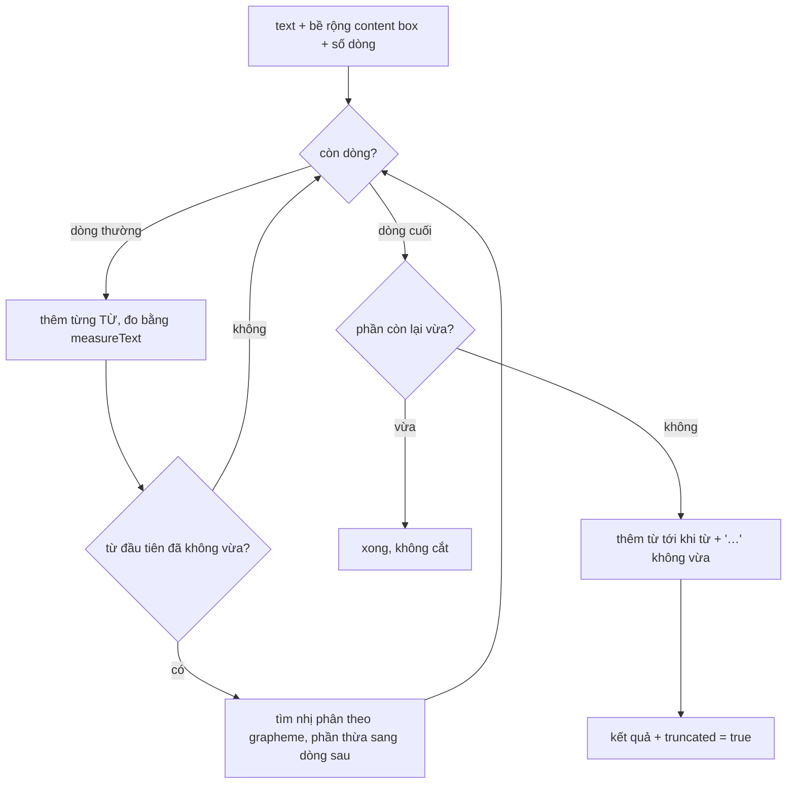

"Cắt chữ dài thành 2 dòng rồi thêm dấu …" nghe như việc của một dòng CSS. Cho tới khi bạn gặp một trong các yêu cầu sau:

- Ô lịch hẹn trong Pipedrive có icon loại hoạt động ở đầu dòng: **dòng đầu ngắn hơn** các dòng sau 20px.
- Ô mô tả ứng dụng trên App Store web chỉ hiện nút "Thêm" **khi chữ thật sự bị cắt**. CSS cắt được nhưng không cho JavaScript biết là đã cắt hay chưa.
- Tiêu đề có badge "MỚI" ở cuối. Badge **không được rớt xuống dòng riêng**, và khi tiêu đề là link thì viền focus không được bị `overflow: hidden` cắt mất.
- Tiêu đề lớn trên trang chủ Toptal **không được để một từ nằm trơ trọi** ở dòng cuối.

Ba trang web giải ba phần của bài toán này theo ba cách khác nhau. Bài này đọc từng cách, chỉ ra chỗ yếu, rồi viết lại thành một bộ nhỏ dùng được ngay.

> [!TIP]
> **Tóm tắt**
> - Cần **chuỗi đã cắt** hoặc **dòng đầu ngắn hơn** thì tự đo bằng `canvas.measureText` với đúng font của phần tử (Pipedrive). Đo theo **từ** chứ đừng theo từng ký tự, và đo lại khi web font tải xong.
> - Chỉ cần hiển thị thì dùng `-webkit-line-clamp`. Muốn biết có bị cắt không thì so `scrollHeight` với chiều cao khung trong **một** ResizeObserver dùng chung (App Store).
> - Badge dính từ cuối: chữ có `padding-inline-end` bằng bề rộng badge, badge có `margin-inline-start` âm bằng đúng số đó. Viền focus bị cắt: nới khung ra rồi `clip-path: inset(...)` cắt lại, bỏ clip khi `:focus-within`.
> - Chống từ mồ côi: nối hai từ cuối bằng khoảng trắng không ngắt (U+00A0), hoặc dùng `text-wrap: pretty` ở trình duyệt hỗ trợ.

<iframe class="demo-frame" src="/demos/web-patterns/index.html?theme=dark#/text-truncate" title="Demo text-truncate" loading="lazy" style="height: 760px"></iframe>

<p class="demo-links">▶ <a href="/demos/web-patterns/index.html#/text-truncate" target="_blank" rel="noopener">Mở demo toàn màn hình ↗</a> · <a href="https://stackblitz.com/github/hunghg255/blog-hunghg/tree/master/examples/web-patterns?file=src/lib/textTruncate.ts" target="_blank" rel="noopener">Sửa code trên StackBlitz ↗</a> · <a href="https://github.com/hunghg255/blog-hunghg/blob/master/examples/web-patterns/src/lib/textTruncate.ts" target="_blank" rel="noopener">Xem source trên GitHub ↗</a></p>

Kéo thanh "Độ rộng". Khối bên trái là `-webkit-line-clamp` thuần: cắt đúng nhưng không biết mình đã cắt. Khối giữa tự đo từng từ, chừa 44px cho nhãn giờ ở dòng đầu, và báo cả số lần gọi `measureText`. Khối bên phải là badge dính vào từ cuối: bấm Tab tới link để thấy viền focus không bị cắt.

## Pipedrive làm thế nào?

Lịch hoạt động của Pipedrive (màn hình `/activities`) xếp các cuộc hẹn thành ô trong lưới giờ. Ô càng ngắn thì càng ít dòng cho tiêu đề. Component cắt chữ nằm ở [`pipedrive.com(dashboard)/webpack---/client/entrypoints/calendar-view/components/text-truncate.js`](https://github.com/hunghg255/codebase/blob/main/pipedrive.com(dashboard)/webpack---/client/entrypoints/calendar-view/components/text-truncate.js).

Nơi gọi nó (`grid-item/grid-item-subject.jsx`) tính số dòng `lines` từ chiều cao ô (mỗi nửa giờ một dòng, trừ phần hiện giờ hẹn), và truyền `beforeSpacing={hasActivityType ? 20 : 0}`: chừa 20px ở dòng đầu khi có icon loại hoạt động.

Bên trong, component tạo một canvas (gắn vào một `DocumentFragment` dùng chung, không vào trang), gán `context.font` bằng `[font-weight, font-style, font-size, font-family].join(' ')` lấy từ computed style của chính nó, rồi đo bằng `measureText`.

Phần cắt chữ (`getText`, rút gọn) chạy hai vòng lặp lồng nhau: vòng ngoài theo dòng, vòng trong **tăng từng ký tự** cho tới khi chuỗi (kèm "…" nếu là dòng cuối) rộng hơn dòng, rồi lùi về khoảng trắng gần nhất để không cắt giữa từ:

```js
const lineWidth = line === lines - 1 ? elementWidth - beforeSpacing : elementWidth;
ellipsis = line === 0 ? '…' : '';
while (currentPos <= maxTextLength) {
  truncatedText = text.substr(startPos, currentPos);
  if (this.measureWidth(`${truncatedText}${ellipsis}`) < lineWidth) {
    currentPos++;                          // còn chỗ: thêm 1 ký tự rồi đo lại
  } else {
    do {                                   // tràn: lùi về khoảng trắng gần nhất
      if (loops >= maxLoops) break;        // maxLoops = 20
      loops++;
      const lastSpaceIndex = truncatedText.lastIndexOf(' ');
      currentPos = lastSpaceIndex > -1 ? lastSpaceIndex : currentPos - 1;
      truncatedText = text.substr(startPos, currentPos);
    } while (this.measureWidth(`${truncatedText}${ellipsis}`) > lineWidth);
    startPos += currentPos;
    break;
  }
}
```

Ngoài ra component chỉ tính lại khi `slotWidth` đổi, hoặc khi cửa sổ resize **và** đường dẫn đang là `/activities` (`throttle` 100ms rồi `requestAnimationFrame`).

Những gì đáng học:

- **Đo bằng canvas, không đụng DOM.** `measureText` không gây layout, nên chạy hàng trăm lần cũng không làm trang giật như việc chèn chữ vào DOM rồi đọc `offsetWidth`.
- **Dòng đầu có bề rộng riêng.** Đây là thứ `line-clamp` không làm được trực tiếp.
- **Có van an toàn** `maxLoops = 20` để vòng lùi không bao giờ chạy vô hạn.

Và những chỗ có thể làm tốt hơn (đọc từ code, không phải lỗi đã thấy trên trang thật):

- **Đo theo từng ký tự**: một tiêu đề 100 ký tự cần khoảng 100 lần `measureText` cho mỗi lần render. Đo theo từ chỉ cần khoảng số từ.
- `getText()` được gọi **trong `render()`**, và đọc `getBoundingClientRect()` ngay lúc render: mỗi lần render là một lần đọc layout.
- Font được lấy **một lần** khi mount. Nếu web font chưa tải xong lúc đó, mọi phép đo đều dùng font dự phòng.
- Bề rộng lấy từ `getBoundingClientRect().width` của chính phần tử, tức gồm cả padding và border. Ở Pipedrive phần tử này có lẽ không có padding nên không sao, nhưng mang sang nơi khác thì kết quả sẽ rộng hơn thực tế. Mình đã dính đúng lỗi này khi viết demo.
- Kết quả là **một chuỗi** để trình duyệt tự xuống dòng lại. Nếu trình duyệt ngắt dòng khác với phép đo (khác font, kerning…) thì chữ có thể tràn sang dòng thừa.

## App Store làm thế nào?

App Store trên web (viết bằng Svelte) có component dùng chung [`apps.apple.com/shared/components/src/components/LineClamp/LineClamp.svelte`](https://github.com/hunghg255/codebase/blob/main/apps.apple.com/shared/components/src/components/LineClamp/LineClamp.svelte). Phần cắt chữ thì để cho CSS (mixin `line-clamp`). Phần JavaScript chỉ trả lời câu hỏi "có bị cắt không, cao mấy dòng".

### Một ResizeObserver cho mọi instance

Observer được tạo ở `context="module"`, tức **một lần cho cả module**, dùng chung cho mọi `<LineClamp>` trên trang:

```ts
// A single observer is shared for all LineClamp instances for better performance.
const resizeObserver = new window.ResizeObserver((entries) => {
  for (const entry of entries) {
    const lineHeight = parseInt(getComputedStyle(entry.target).getPropertyValue('line-height'));
    const multiline = Math.ceil(entry.contentRect.height) > lineHeight;
    const truncated = Math.ceil(entry.target.scrollHeight) > Math.ceil(entry.borderBoxSize[0].blockSize);
    entry.target.dispatchEvent(new CustomEvent('lineClampResize', { detail: { multiline, truncated } }));
  }
});
```

Mẹo phát hiện bị cắt: phần tử line-clamp có `overflow: hidden`, nên `scrollHeight` (chiều cao toàn bộ nội dung) lớn hơn chiều cao khung đúng khi có dòng bị giấu. Component con nhận sự kiện và cập nhật state qua [hàng đợi rAF 3ms](/blogs/web-raf-queue-3ms) của chính App Store.

Nơi dùng rõ nhất là phần mô tả ứng dụng (`ProductDescriptionShelf.svelte`): nếu sau khi đo thấy **không bị cắt** thì mở luôn, khỏi hiện nút "Thêm" vô nghĩa:

```ts
function handleLineClampResize(event: CustomEvent) {
  if (!event.detail.truncated) isOpen = true;
}
```

Một điểm cần biết khi chép: `parseInt('normal')` ra `NaN`. Nếu phần tử để `line-height: normal` thì `multiline` luôn là `false` (so sánh với `NaN` luôn sai). App Store có lẽ luôn đặt line-height cụ thể nên không gặp.

### Badge dính vào từ cuối

Comment trong template nói rõ yêu cầu: giữa chữ và badge **không được có khoảng trắng**, nếu không badge có thể rớt xuống một dòng riêng. CSS làm phần còn lại:

```scss
.multiline-clamp__text {
  padding-inline-end: var(--mc-badgeSpacing);     // chữ "đặt cọc" chỗ cho badge
}
.multiline-clamp__badge:not(:empty) {
  margin-inline-start: calc(-1 * var(--mc-badgeSpacing)); // badge lùi vào đúng chỗ đó
}
```

Padding cuối của một phần tử inline chỉ nằm ở **mảnh cuối cùng** của nó, tức ngay sau từ cuối. Trình duyệt phải xếp "từ cuối + padding" trên cùng một dòng, nên khi badge lùi vào phần padding đó, badge luôn đứng cạnh từ cuối. Khi chữ bị cắt (`truncated`), badge chuyển sang `position: absolute` ở góc dưới phải.

### Viền focus không bị cắt

`line-clamp` cần `overflow: hidden`, mà `overflow: hidden` cắt luôn viền focus của link bên trong. Khi bật `allowFocusOverflow`:

```scss
.multiline-clamp--overflow {
  clip-path: inset(var(--mc-overflowBleedSize));  // cắt đúng phần đã nới ra
  scroll-padding: var(--mc-overflowBleedSize);
  @include overflow-bleed(var(--mc-overflowBleedSize));
  &:focus-within { clip-path: none; }             // đang focus thì cho viền tràn ra
}
```

Mixin `overflow-bleed` không có trong bản dump. Có lẽ nó thêm padding và margin âm cùng kích thước, để khung **rộng ra** mà bố cục xung quanh không đổi. Phần nới ra đủ chỗ cho viền focus. `clip-path` cắt đúng phần đó lúc bình thường, để dòng chữ bị ẩn phía dưới không ló ra trong vùng padding. Khi focus thì bỏ clip.

## Toptal làm thế nào?

Đơn giản nhất trong ba. [`toptal.com-home/lib/unorphan.js`](https://github.com/hunghg255/codebase/blob/main/toptal.com-home/lib/unorphan.js), dùng cho tiêu đề ở Hero, USP, Trustbar…:

```js
const unorphan = (sentence = '', threshold = 3) => {
  const words = sentence.split(' ')
  const { length } = words
  if (length > threshold) {
    words[length - 2] += ' ' + words.pop()
  }
  return words.join(' ')
}
```

Nối từ áp chót với từ cuối bằng `U+00A0` (no-break space). Trình duyệt không ngắt dòng ở khoảng trắng này, nên từ cuối luôn kéo theo một từ nữa xuống dòng. Hai điểm nhỏ: `split(' ')` coi hai dấu cách liền nhau là một "từ" rỗng, và nếu hai từ cuối gộp lại quá dài thì trên màn hình hẹp, cụm này có thể tràn khung.

## Bên trong trình duyệt



Vài điều nền tảng cần nắm:

- **`measureText` đo theo font của context**, không theo phần tử nào cả. Phải gán `context.font` bằng đúng font shorthand của phần tử. `getComputedStyle(el).font` trả về sẵn chuỗi này trên Chromium; trình duyệt nào trả chuỗi rỗng thì tự ghép từ `fontStyle`, `fontWeight`, `fontSize`, `fontFamily`.
- **Canvas không biết CSS** như `letter-spacing`, `text-transform`, `word-spacing`. Chromium có thuộc tính `letterSpacing` cho context 2D (bản viết lại tự gán nếu có); trình duyệt nào không có thì phép đo sẽ lệch nếu bạn dùng letter-spacing.
- **`-webkit-line-clamp`** chỉ có tác dụng cùng `display: -webkit-box` và `-webkit-box-orient: vertical`. Nó cắt chữ khi vẽ chứ không đổi DOM: `textContent` vẫn là chuỗi đầy đủ, nên JavaScript không lấy được bản đã cắt.
- **Padding trên phần tử line-clamp** làm dòng bị ẩn ló ra trong vùng padding dưới (vùng `overflow: hidden` cắt là padding box). Đặt padding ở khung ngoài. Ô đầu tiên trong demo có lỗi này cho tới khi mình tách khung.

## Viết lại

Bộ viết lại gồm bốn file nhỏ: đo và cắt chữ (`textTruncate.ts`), hook React (`textTruncateReact.ts`), observer dùng chung (`textTruncateObserver.ts`) và `unorphan` (`textTruncateUnorphan.ts`).

Bộ đo (`createCanvasMeasurer`) tạo canvas không gắn vào DOM, gán font từ computed style, và **cache kết quả theo chuỗi**: thuật toán cắt đo lại cùng một chuỗi nhiều lần (nhất là khi tìm nhị phân). Phần cốt lõi là hàm cắt theo từ:

```ts title=src/lib/textTruncate.ts
export function truncateText(
  text: string,
  { maxWidth, lines, measure, firstLineIndent = 0, ellipsis = '…' }: TruncateOptions,
): TruncateResult {
  const words = text.trim().split(/\s+/).filter(Boolean);
  const out: string[] = [];
  let index = 0;

  for (let line = 0; line < lines && index < words.length; line++) {
    const width = Math.max(0, line === 0 ? maxWidth - firstLineIndent : maxWidth);
    const isLast = line === lines - 1;

    if (isLast) {
      const rest = words.slice(index).join(' ');
      if (measure(rest) <= width) {
        out.push(rest);
        index = words.length;
        break;
      }
      // không vừa: lấy nhiều từ nhất có thể sao cho còn chỗ cho "…"
      let current = '';
      while (index < words.length) {
        const candidate = current ? `${current} ${words[index]}` : words[index];
        if (measure(candidate + ellipsis) > width) break;
        current = candidate;
        index++;
      }
      if (!current) current = longestFittingPrefix(words[index], ellipsis, width, measure);
      out.push(current + ellipsis);
      return { lines: out, text: out.join(' '), truncated: true };
    }

    let current = '';
    while (index < words.length) {
      const candidate = current ? `${current} ${words[index]}` : words[index];
      if (measure(candidate) > width) break;
      current = candidate;
      index++;
    }
    if (!current) {
      // một từ dài hơn cả dòng: cắt theo ký tự, phần còn lại sang dòng sau
      const head = longestFittingPrefix(words[index], '', width, measure) || graphemes(words[index])[0];
      words[index] = words[index].slice(head.length);
      if (!words[index]) index++;
      current = head;
    }
    out.push(current);
  }

  const truncated = index < words.length;
  return { lines: out, text: out.join(' '), truncated };
}
```

## Đi qua code

1. **Tách từ một lần** bằng `/\s+/`, nên hai dấu cách liền nhau không sinh "từ" rỗng.
2. **Dòng thường**: thêm từng từ cho tới khi tràn. Số lần đo xấp xỉ số từ, thay vì số ký tự như bản Pipedrive.
3. **Từ dài hơn cả dòng** (URL, mã đơn hàng): `longestFittingPrefix` tìm nhị phân trên **grapheme** (dùng `Intl.Segmenter`), nên không cắt đôi emoji ghép như 👩‍👩‍👧‍👦 hay chữ có dấu tổ hợp. Phần còn lại của từ đi tiếp sang dòng sau.
4. **Dòng cuối**: nếu phần còn lại vừa thì trả về luôn, không cắt. Nếu không, thêm từ chừng nào "chuỗi + …" còn vừa.
5. Kết quả trả về **từng dòng** và cờ `truncated`. Demo render mỗi dòng là một `div` có `white-space: nowrap`, nên dòng hiển thị khớp đúng với phép đo, không để trình duyệt ngắt lại.

Hook `useTruncatedText` bọc thuật toán vào vòng đời của component:

- Đo **content box**: `clientWidth` trừ padding trái phải.
- `ResizeObserver` thay cho `resize` của cửa sổ: ô co lại vì layout (sidebar mở, lưới đổi cột) cũng được tính.
- `document.fonts.ready`: tính lại khi web font tải xong.
- Gom nhiều lần resize trong một frame bằng `requestAnimationFrame`, giống Pipedrive.

Observer dùng chung theo kiểu App Store (`observeClamp`) giữ một `Map` từ phần tử sang callback và tính `line-height` dự phòng khi gặp `normal`; xem trong spoiler bên dưới.

**Khác bản gốc:**

- Pipedrive đo từng ký tự và trả về một chuỗi. Bản viết lại đo theo từ, tìm nhị phân cho từ quá dài, trả về từng dòng kèm cờ `truncated`, đo content box và đo lại khi font tải xong.
- App Store phát `CustomEvent` lên phần tử. Bản viết lại giữ một `Map` từ phần tử sang callback, và tính `line-height` dự phòng khi gặp `normal`.
- `unorphan` của Toptal được thêm giới hạn độ dài: hai từ cuối gộp lại dài quá 20 ký tự thì không nối, để không tràn trên màn hình hẹp.

::: spoiler Xem toàn bộ src/lib/textTruncate.ts

```ts title=src/lib/textTruncate.ts
/**
 * Cắt chữ nhiều dòng + dấu "…" bằng cách tự đo chữ với canvas.measureText
 * (ý tưởng từ TextTruncate trong lịch của Pipedrive).
 *
 * Dùng khi CSS line-clamp không đủ: cần chuỗi đã cắt (để làm title, tooltip, export),
 * dòng đầu ngắn hơn các dòng sau (chừa chỗ cho giờ/icon), hoặc cần biết có bị cắt hay không.
 */

export interface TextMeasurer {
  /** chiều rộng (px) của chuỗi khi vẽ bằng font của element */
  measure(text: string): number;
  /** số lần thực sự gọi measureText (không tính lần lấy từ cache) */
  readonly calls: number;
}

/** Ghép font shorthand từ computed style; Firefox có thể trả `font` rỗng nên tự ghép. */
export function fontFromStyle(style: CSSStyleDeclaration): string {
  if (style.font) return style.font;
  return [style.fontStyle, style.fontVariant, style.fontWeight, style.fontSize, style.fontFamily]
    .filter((part) => part && part !== 'normal')
    .join(' ');
}

/**
 * Tạo bộ đo chữ theo đúng font hiện tại của element. Canvas không cần gắn vào DOM.
 * Kết quả đo được cache theo chuỗi: vòng lặp cắt chữ đo lại cùng một chuỗi rất nhiều lần.
 */
export function createCanvasMeasurer(element: Element): TextMeasurer {
  const style = getComputedStyle(element);
  const context = document.createElement('canvas').getContext('2d');
  if (!context) throw new Error('Canvas 2D không khả dụng');
  context.font = fontFromStyle(style);
  // letter-spacing của CSS không tự áp lên canvas; trình duyệt nào có thuộc tính này thì set
  if ('letterSpacing' in context && style.letterSpacing !== 'normal') {
    (context as CanvasRenderingContext2D & { letterSpacing: string }).letterSpacing = style.letterSpacing;
  }

  const cache = new Map<string, number>();
  let calls = 0;
  return {
    measure(text) {
      let width = cache.get(text);
      if (width === undefined) {
        calls++;
        width = context.measureText(text).width;
        cache.set(text, width);
      }
      return width;
    },
    get calls() {
      return calls;
    },
  };
}

/** Tách chuỗi thành các ký tự hiển thị (grapheme), để không cắt đôi emoji hay chữ có dấu tổ hợp. */
function graphemes(text: string): string[] {
  if (typeof Intl !== 'undefined' && 'Segmenter' in Intl) {
    const segmenter = new Intl.Segmenter(undefined, { granularity: 'grapheme' });
    return Array.from(segmenter.segment(text), (s) => s.segment);
  }
  return Array.from(text);
}

/** Tìm tiền tố dài nhất của `word` (theo grapheme) mà `measure(prefix + suffix) <= width`. */
function longestFittingPrefix(word: string, suffix: string, width: number, measure: (s: string) => number) {
  const chars = graphemes(word);
  let lo = 0;
  let hi = chars.length;
  // tìm nhị phân: O(log n) lần đo thay vì đo từng ký tự
  while (lo < hi) {
    const mid = Math.ceil((lo + hi) / 2);
    if (measure(chars.slice(0, mid).join('') + suffix) <= width) lo = mid;
    else hi = mid - 1;
  }
  return chars.slice(0, lo).join('');
}

export interface TruncateOptions {
  /** chiều rộng khả dụng của mỗi dòng (px) */
  maxWidth: number;
  /** số dòng tối đa */
  lines: number;
  measure: (text: string) => number;
  /** dòng đầu ngắn hơn bao nhiêu px (vd chừa chỗ cho giờ hẹn ở đầu dòng) */
  firstLineIndent?: number;
  ellipsis?: string;
}

export interface TruncateResult {
  /** nội dung từng dòng sau khi cắt (dòng cuối đã có ellipsis nếu bị cắt) */
  lines: string[];
  /** toàn bộ chuỗi sau khi cắt */
  text: string;
  truncated: boolean;
}

/**
 * Xếp chữ vào tối đa `lines` dòng, ngắt theo từ, dòng cuối thêm "…" nếu còn thừa.
 * Từ dài hơn cả dòng thì cắt theo ký tự (tìm nhị phân).
 */
export function truncateText(
  text: string,
  { maxWidth, lines, measure, firstLineIndent = 0, ellipsis = '…' }: TruncateOptions,
): TruncateResult {
  const words = text.trim().split(/\s+/).filter(Boolean);
  const out: string[] = [];
  let index = 0;

  for (let line = 0; line < lines && index < words.length; line++) {
    const width = Math.max(0, line === 0 ? maxWidth - firstLineIndent : maxWidth);
    const isLast = line === lines - 1;

    if (isLast) {
      const rest = words.slice(index).join(' ');
      if (measure(rest) <= width) {
        out.push(rest);
        index = words.length;
        break;
      }
      // không vừa: lấy nhiều từ nhất có thể sao cho còn chỗ cho "…"
      let current = '';
      while (index < words.length) {
        const candidate = current ? `${current} ${words[index]}` : words[index];
        if (measure(candidate + ellipsis) > width) break;
        current = candidate;
        index++;
      }
      if (!current) current = longestFittingPrefix(words[index], ellipsis, width, measure);
      out.push(current + ellipsis);
      return { lines: out, text: out.join(' '), truncated: true };
    }

    let current = '';
    while (index < words.length) {
      const candidate = current ? `${current} ${words[index]}` : words[index];
      if (measure(candidate) > width) break;
      current = candidate;
      index++;
    }
    if (!current) {
      // một từ dài hơn cả dòng: cắt theo ký tự, phần còn lại sang dòng sau
      const head = longestFittingPrefix(words[index], '', width, measure) || graphemes(words[index])[0];
      words[index] = words[index].slice(head.length);
      if (!words[index]) index++;
      current = head;
    }
    out.push(current);
  }

  const truncated = index < words.length;
  return { lines: out, text: out.join(' '), truncated };
}
```

:::

::: spoiler Xem toàn bộ src/lib/textTruncateReact.ts

```ts title=src/lib/textTruncateReact.ts
import { useLayoutEffect, useState, type RefObject } from 'react';
import { createCanvasMeasurer, truncateText, type TruncateResult } from './textTruncate';

export interface UseTruncatedTextOptions {
  lines: number;
  firstLineIndent?: number;
}

/**
 * Cắt `text` cho vừa element `ref` (đo bằng canvas), tính lại khi element đổi kích thước
 * và khi web font tải xong (đo bằng font dự phòng thì kết quả sai).
 */
export function useTruncatedText(
  ref: RefObject<HTMLElement | null>,
  text: string,
  { lines, firstLineIndent = 0 }: UseTruncatedTextOptions,
): TruncateResult & { measureCalls: number } {
  const [result, setResult] = useState<TruncateResult & { measureCalls: number }>({
    lines: [text],
    text,
    truncated: false,
    measureCalls: 0,
  });

  useLayoutEffect(() => {
    const element = ref.current;
    if (!element) return;
    let frame = 0;

    const update = () => {
      cancelAnimationFrame(frame);
      // gom nhiều lần resize trong cùng một frame thành một lần tính
      frame = requestAnimationFrame(() => {
        const style = getComputedStyle(element);
        // clientWidth gồm cả padding; chữ chỉ được nằm trong content box
        const width = element.clientWidth - parseFloat(style.paddingLeft) - parseFloat(style.paddingRight);
        if (width <= 0) return; // đang ẩn (display: none): giữ kết quả cũ
        // tạo measurer mới mỗi lần: font có thể vừa đổi (web font tải xong, media query)
        const measurer = createCanvasMeasurer(element);
        const next = truncateText(text, { maxWidth: width, lines, firstLineIndent, measure: measurer.measure });
        setResult({ ...next, measureCalls: measurer.calls });
      });
    };

    const observer = new ResizeObserver(update);
    observer.observe(element);
    let alive = true;
    document.fonts?.ready.then(() => alive && update());
    return () => {
      alive = false;
      observer.disconnect();
      cancelAnimationFrame(frame);
    };
  }, [ref, text, lines, firstLineIndent]);

  return result;
}
```

:::

::: spoiler Xem toàn bộ src/lib/textTruncateObserver.ts

```ts title=src/lib/textTruncateObserver.ts
/**
 * Một ResizeObserver dùng chung cho mọi khối line-clamp (ý tưởng từ LineClamp.svelte của
 * App Store web): báo khối đang hiển thị mấy dòng và có bị cắt không, để đổi giao diện theo.
 */

export interface ClampState {
  /** cao hơn một dòng */
  multiline: boolean;
  /** số dòng đang hiển thị (làm tròn) */
  lineCount: number;
  /** nội dung dài hơn phần đang hiện (bị line-clamp cắt) */
  truncated: boolean;
}

type Listener = (state: ClampState) => void;

const listeners = new Map<Element, Listener>();
let observer: ResizeObserver | null = null;

function lineHeightOf(element: Element): number {
  const style = getComputedStyle(element);
  const lineHeight = parseFloat(style.lineHeight);
  // `line-height: normal` cho ra NaN; ước lượng ~1.2 lần cỡ chữ (giá trị "normal" phổ biến)
  return Number.isNaN(lineHeight) ? parseFloat(style.fontSize) * 1.2 : lineHeight;
}

function onResize(entries: ResizeObserverEntry[]) {
  for (const entry of entries) {
    const listener = listeners.get(entry.target);
    if (!listener) continue;
    const contentHeight = entry.contentRect.height;
    const borderBox = entry.borderBoxSize?.[0]?.blockSize ?? (entry.target as HTMLElement).offsetHeight;
    const lineHeight = lineHeightOf(entry.target);
    listener({
      multiline: contentHeight > lineHeight + 1,
      lineCount: Math.max(1, Math.round(contentHeight / lineHeight)),
      truncated: Math.ceil(entry.target.scrollHeight) > Math.ceil(borderBox),
    });
  }
}

/** Theo dõi một khối line-clamp. Trả về hàm huỷ. */
export function observeClamp(element: Element, listener: Listener): () => void {
  observer ??= new ResizeObserver(onResize);
  listeners.set(element, listener);
  observer.observe(element);
  return () => {
    listeners.delete(element);
    observer?.unobserve(element);
  };
}
```

:::

::: spoiler Xem toàn bộ src/lib/textTruncateUnorphan.ts

```ts title=src/lib/textTruncateUnorphan.ts
/**
 * Chống "từ mồ côi" (một từ nằm trơ trọi ở dòng cuối của tiêu đề) bằng cách nối hai từ
 * cuối bằng khoảng trắng không ngắt dòng (ý tưởng từ lib/unorphan.js của Toptal).
 */

const NBSP = ' ';

export interface UnorphanOptions {
  /** chỉ áp dụng khi câu có nhiều hơn chừng này từ (Toptal: 3) */
  minWords?: number;
  /** không nối nếu hai từ cuối gộp lại dài hơn chừng này ký tự (tránh tràn khung hẹp) */
  maxJoinedLength?: number;
}

export function unorphan(sentence: string, { minWords = 3, maxJoinedLength = 20 }: UnorphanOptions = {}): string {
  const words = sentence.trim().split(/\s+/);
  if (words.length <= minWords) return words.join(' ');
  const last = words.pop()!;
  const beforeLast = words.pop()!;
  if (beforeLast.length + 1 + last.length > maxJoinedLength) return [...words, beforeLast, last].join(' ');
  return [...words, beforeLast + NBSP + last].join(' ');
}
```

:::

## Tại sao không làm cách khác?

**Chỉ dùng `-webkit-line-clamp`?** Đủ cho 80% trường hợp, và nên là lựa chọn đầu tiên. Nhưng nó không cho bạn chuỗi đã cắt (để làm `title`, gửi đi, xuất file), không cho dòng đầu ngắn hơn, và không báo là đã cắt hay chưa.

**Chèn chữ vào DOM rồi đo `offsetHeight`, bớt dần từng từ?** Chính xác tuyệt đối vì dùng đúng bộ xếp chữ của trình duyệt, nhưng mỗi lần thử là một lần layout. Với hàng trăm ô lịch, cách này làm trang giật.

**Dùng `Range.getClientRects()` để biết từng dòng kết thúc ở đâu?** Cũng chính xác, và cần ít lần đo hơn. Nhưng vẫn phải render đủ chữ vào DOM trước, và vẫn đọc layout.

**Đo từng từ một lần rồi cộng dồn?** Nhanh nhất: mỗi từ một lần `measureText`. Đổi lại sai số nhỏ vì kerning và ligature ở chỗ nối giữa các từ. Bản viết lại đo cả cụm đang ghép, chậm hơn một chút nhưng sát với cách trình duyệt vẽ.

## Edge case và cạm bẫy

- **Web font chưa tải**: đo bằng font dự phòng rồi hiển thị bằng font thật thì chữ tràn. Hãy đo lại sau `document.fonts.ready`.
- **Phần tử đang ẩn** (`display: none`, tab chưa mở): bề rộng là 0. Hook giữ kết quả cũ thay vì cắt ra chuỗi rỗng.
- **SSR**: server không có canvas. Hãy render chuỗi đầy đủ với `-webkit-line-clamp` làm phương án dự phòng, rồi để client cắt lại.
- **Chữ phải sang trái** (tiếng Ả Rập, Do Thái): "…" phải nằm ở cuối theo chiều đọc. Dùng `padding-inline-end` và `inset-inline-end` như App Store thay vì `right`.
- **ResizeObserver không chạy khi chỉ đổi chữ** mà khung không đổi kích thước (vd chữ ngắn đi nhưng vẫn cao 2 dòng). Cờ `truncated` có thể cũ. Gọi lại phép đo khi nội dung đổi.
- **Khoảng trắng giữa chữ và badge** trong JSX/template. Một dấu xuống dòng cũng là khoảng trắng. App Store phải viết `</span\n>{#if …}` để không có khoảng trắng nào.
- **Viền focus** khi cho tràn: lúc focus, vùng nới ra có thể làm lộ một vệt mỏng của dòng bị ẩn. Đây là đánh đổi để viền focus nhìn thấy được, và chỉ xảy ra khi đang focus.

## Dùng trong dự án

```tsx
function EventTitle({ title, hasIcon, lines }: { title: string; hasIcon: boolean; lines: number }) {
  const ref = useRef<HTMLDivElement>(null);
  const { lines: rows, truncated } = useTruncatedText(ref, title, { lines, firstLineIndent: hasIcon ? 20 : 0 });
  return (
    <div ref={ref} title={truncated ? title : undefined}>
      {rows.map((row, i) => (
        <div key={i} style={{ whiteSpace: 'nowrap' }}>{row}</div>
      ))}
    </div>
  );
}
```

Với mô tả dài và nút "Xem thêm", không cần canvas:

```tsx
useEffect(() => observeClamp(ref.current!, ({ truncated }) => setShowMore(truncated)), []);
```

::: spoiler Ví dụ test (bản phác, không có trong repo)

```ts
import { describe, expect, it } from 'vitest';
import { truncateText } from './textTruncate';
import { unorphan } from './textTruncateUnorphan';

// mỗi ký tự rộng 10px, kể cả dấu cách và "…": dễ tính tay
const measure = (s: string) => Array.from(s).length * 10;

describe('truncateText', () => {
  it('không cắt khi vừa', () => {
    const r = truncateText('một hai ba', { maxWidth: 200, lines: 1, measure });
    expect(r).toEqual({ lines: ['một hai ba'], text: 'một hai ba', truncated: false });
  });

  it('ngắt theo từ và thêm … ở dòng cuối', () => {
    // 80px mỗi dòng = 8 ký tự
    const r = truncateText('aaa bbb ccc ddd eee', { maxWidth: 80, lines: 2, measure });
    expect(r.lines).toEqual(['aaa bbb', 'ccc ddd…']);
    expect(r.truncated).toBe(true);
  });

  it('dòng đầu ngắn hơn khi có firstLineIndent', () => {
    const r = truncateText('aaa bbb ccc', { maxWidth: 80, lines: 2, measure, firstLineIndent: 40 });
    expect(r.lines[0]).toBe('aaa');
  });

  it('cắt từ quá dài theo ký tự', () => {
    const r = truncateText('xxxxxxxxxxxxxxxxxxxx', { maxWidth: 50, lines: 1, measure });
    expect(r.lines).toEqual(['xxxx…']);
  });
});

describe('unorphan', () => {
  it('nối hai từ cuối bằng NBSP', () => {
    expect(unorphan('học từ các trang web')).toBe('học từ các trang web');
  });
  it('bỏ qua câu ngắn và cụm cuối quá dài', () => {
    expect(unorphan('ba từ thôi')).toBe('ba từ thôi');
    expect(unorphan('xin chào supercalifragilistic expialidocious')).not.toContain(' ');
  });
});
```

:::

## So với CSS hiện đại

- **`-webkit-line-clamp`** chạy trên mọi trình duyệt lớn (tính tới 10/2026). Thuộc tính `line-clamp` không tiền tố đã có trong đặc tả CSS Overflow 4; trước khi bỏ tiền tố, hãy kiểm tra trên [caniuse](https://caniuse.com/?search=line-clamp).
- **`text-wrap: balance`** chia đều độ dài các dòng của tiêu đề ngắn. Chromium, Firefox và Safari đều đã hỗ trợ (tính tới 10/2026).
- **`text-wrap: pretty`** nhắm đúng vấn đề từ mồ côi ở đoạn văn. Chromium đã hỗ trợ; trình duyệt khác xem [caniuse](https://caniuse.com/?search=text-wrap%20pretty). Trình duyệt chưa hỗ trợ sẽ bỏ qua thuộc tính, nên có thể dùng song song với `unorphan`.
- **Không có CSS nào** trả về chuỗi đã cắt hay báo "đã cắt". Hai việc này vẫn cần JavaScript như Pipedrive và App Store đang làm.

---

Bài này thuộc series **[Học từ mã nguồn các web lớn](/series/web)** (42 bài, đọc theo thứ tự).

::: spoiler Xem nhanh danh sách bài trong series

*Mở đầu*

- [Mở đầu: đọc code production của 28 trang web](/blogs/learn-from-big-web-apps)

*Phần 1: trải nghiệm người dùng*

- [#1 Dark mode không nháy (Gatsby)](/blogs/web-dark-mode-no-flash)
- [#2 useValueByMedia: giá trị theo breakpoint (Toptal)](/blogs/web-use-value-by-media)
- [#3 Đoán ý định: idle, exit-intent, lắc chuột (Toptal, InVision)](/blogs/web-user-intent-idle-exit-wiggle)
- [#4 Validate form thân thiện (Udacity, Pipedrive)](/blogs/web-form-validation-ux)
- [#5 Magic number, EXIF và dán ảnh (Ello)](/blogs/web-file-magic-number-exif-paste)
- [#6 fastSmoothScroll: cuộn xa vẫn nhanh (Telegram)](/blogs/web-telegram-fast-smooth-scroll)
- [#7 Countdown time-travel và tombstone giỏ hàng (Best Buy)](/blogs/web-countdown-time-travel-tombstone)

*Phần 2: hiệu năng và đo lường*

- [#8 Hàng đợi requestAnimationFrame 3ms (Apple)](/blogs/web-raf-queue-3ms)
- [#9 srcset cho artwork và preconnect tự động (Apple)](/blogs/web-responsive-artwork-preconnect)
- [#10 Quick-fetch: gọi API trước khi bundle tải xong (HubSpot)](/blogs/web-quick-fetch-early-requests)
- [#11 Performance span và long task (Postman, Calibre)](/blogs/web-performance-spans-long-tasks)
- [#12 Gọi Web Worker như hàm async (Telegram)](/blogs/web-worker-promise-rpc)
- [#13 Đồng hồ media: đếm giờ xem và sửa lệch (Skillshare, Simplified)](/blogs/web-media-clock-watch-time-drift)

*Phần 3: nhiều tab, phiên đăng nhập, cập nhật*

- [#14 Bầu tab chủ cho thông báo (HubSpot, Telegram)](/blogs/web-leader-tab-notifications)
- [#15 Đồng bộ đăng nhập giữa tab và giới hạn cookie (Elastic, InVision)](/blogs/web-cross-tab-auth-cookie-guard)
- [#16 SPA tự cập nhật: Trello, Zappos, Facebook, Elastic](/blogs/web-spa-self-update-strategies)

*Phần 4: kiến trúc*

- [#17 Reverse portal: di chuyển component không remount (Zappos)](/blogs/web-reverse-portal)
- [#18 Page behaviors: gắn hành vi từ CMS (Intercom)](/blogs/web-page-behaviors-cms)
- [#19 Giới hạn tần suất hiển thị bằng bitmask (Outlook)](/blogs/web-frequency-cap-bitmask)
- [#20 Chuyển REST sang GraphQL dần dần (Coursera)](/blogs/web-rest-to-graphql-hybrid-link)

*Phần 5: soạn thảo và hiển thị nội dung*

- [#21 Autocomplete tại con trỏ trong contenteditable (Ello, Telegram)](/blogs/web-caret-autocomplete-contenteditable)
- [#22 Dark mode cho email HTML bằng CIELAB (Outlook)](/blogs/web-email-dark-mode-cielab)
- [#23 Thu nhỏ bảng rộng cho vừa khung, vá font emoji (Outlook)](/blogs/web-email-wide-content-scale)
- [#24 Cảnh báo quên đính kèm file (Outlook)](/blogs/web-forgotten-attachment-warning)
- **#25 Cắt chữ nhiều dòng chính xác (Pipedrive, Apple, Toptal)** (bài này)
- [#26 Parse ngày giờ gõ tay khoan dung (Outlook, Elastic)](/blogs/web-lenient-date-parser)

*Phần 6: tương tác*

- [#27 menuAim: rê chéo vào submenu không bị đóng (Udemy)](/blogs/web-menu-aim-triangle)
- [#28 Kéo, vuốt chung cho chuột và cảm ứng (Telegram)](/blogs/web-unified-pointer-gestures)
- [#29 Phím tắt theo phạm vi, IME và bàn phím phi Latinh (Trello)](/blogs/web-scoped-keyboard-shortcuts)
- [#30 Nội suy màu: đổi theme và nền theo cuộn (Telegram, Anchor)](/blogs/web-color-interpolation-theme-scroll)
- [#31 Đường gióng hút cạnh và undo/redo trên canvas (Simplified)](/blogs/web-canvas-snap-guides-undo)
- [#32 Giả lập mù màu bằng feColorMatrix (Trello)](/blogs/web-color-vision-simulator)
- [#33 Vạch thước theo mức zoom và cấp phát màu cho biểu đồ (Anchor, Similarweb)](/blogs/web-timeline-ticks-color-stack)

*Phần 7: mạng, dữ liệu và async*

- [#34 Ô tìm kiếm chuẩn production (Similarweb, Udemy, Pipedrive)](/blogs/web-production-search-box)
- [#35 Điều phối async: latest-wins, single-flight (Glitch, Toptal)](/blogs/web-async-coordination-latest-wins)
- [#36 Polling thưa dần và debounce động (Trello)](/blogs/web-decaying-polling-dynamic-debounce)
- [#37 Cache phía client theo version (Similarweb, Telegram, Udemy)](/blogs/web-client-cache-versioned)
- [#38 Upload file lớn theo chunk (Outlook, Tribe)](/blogs/web-chunked-upload-pipeline)
- [#39 Phát video qua Service Worker bằng Range request (Telegram, Outlook)](/blogs/web-service-worker-range-streaming)

*Phần 8: hiệu năng và vận hành*

- [#40 TTI governor: hoãn việc phụ tới sau khi trang dùng được (Outlook)](/blogs/web-tti-governor)
- [#41 Tự đo LCP/CLS/TBT và phục vụ bản nhẹ cho máy yếu (Udemy)](/blogs/web-rum-adaptive-loading)

:::

Code + demo: [`examples/web-patterns`](https://github.com/hunghg255/blog-hunghg/tree/master/examples/web-patterns) · [Mở trên StackBlitz](https://stackblitz.com/github/hunghg255/blog-hunghg/tree/master/examples/web-patterns)
