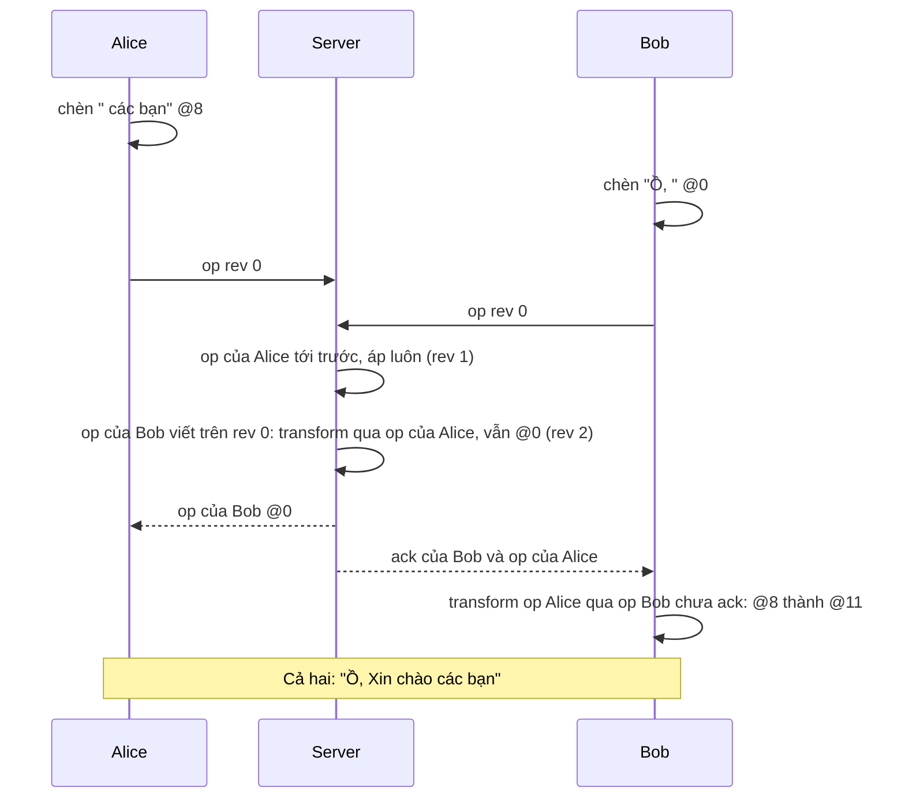

Glitch là trình soạn code chạy trên web, cho nhiều người cùng sửa một project như Google Docs. Phần đồng bộ dùng **Operational Transformation** (OT): mỗi thay đổi là một op ("chèn `abc` ở vị trí 12", "xoá `x` ở vị trí 40"), server sắp xếp các op, và op đến muộn được **transform** (dời vị trí) cho khớp với những op đã áp trước nó.

Thuật toán OT có nhiều tài liệu. Phần ít ai nói tới là **nối OT với editor** cho đúng, và Glitch có một file làm đúng việc đó: [`source/otfs/ot-codemirror.js`](https://github.com/hunghg255/codebase/blob/main/glitch.com/source/otfs/ot-codemirror.js). Ba vấn đề nó giải quyết:

1. **Echo**: áp op của người khác vào editor cũng làm editor phát sự kiện "change". Nếu coi đó là thay đổi của mình và gửi lên server, chữ của người khác bị nhân đôi.
2. **Undo của editor không dùng được**: Ctrl+Z mặc định của CodeMirror sẽ hoàn tác cả chữ người khác vừa gõ.
3. **Undo của mình phải "đi theo" văn bản**: mình gõ "các bạn" ở cuối, người khác chèn "Ồ, " ở đầu. Ctrl+Z phải xoá đúng "các bạn", không phải ba ký tự ở vị trí cũ.

> [!TIP]
> **Tóm tắt**
> - Khi áp op của người khác, bật một cờ (`ignoreNextChanges`) để sự kiện "change" mà editor phát ra **không bị gửi ngược** lên server.
> - Tự quản undo/redo bằng stack các **op nghịch đảo**. Gõ từng ký tự liền nhau được **gộp theo từ** thành một bước, giới hạn 500 bước.
> - Mỗi khi op của người khác tới, **transform mọi entry** trong undo/redo stack theo op đó. Ctrl+Z sau đó vẫn xoá đúng chữ của mình.
> - Thư viện CRDT/OT hiện đại (Yjs, Automerge, ShareDB) có binding và undo manager làm sẵn những việc này; hiểu chúng giúp debug khi binding tự viết bị lệch.

<iframe class="demo-frame" src="/demos/web-patterns/index.html?theme=dark#/ot-binding" title="Demo ot-binding" loading="lazy" style="height: 820px"></iframe>

<p class="demo-links">▶ <a href="/demos/web-patterns/index.html#/ot-binding" target="_blank" rel="noopener">Mở demo toàn màn hình ↗</a> · <a href="https://stackblitz.com/github/hunghg255/blog-hunghg/tree/master/examples/web-patterns?file=src/lib/otBinding.ts" target="_blank" rel="noopener">Sửa code trên StackBlitz ↗</a> · <a href="https://github.com/hunghg255/blog-hunghg/blob/master/examples/web-patterns/src/lib/otBinding.ts" target="_blank" rel="noopener">Xem source trên GitHub ↗</a></p>

Bấm **Kịch bản**: Alice gõ " các bạn", Bob chèn "Ồ, " ở đầu, rồi Alice bấm Ctrl+Z tới hết. Kết quả "Ồ, Xin chào". Tắt "Transform undo stack" rồi chạy lại: undo xoá theo vị trí cũ và ra "Ồ, Xin cbạn". Tắt "Chặn echo" rồi gõ một chữ ở ô của Bob: Alice nhận op, gửi ngược lên server, rồi Bob cũng gửi ngược lại, chữ cứ nhân lên.

## Glitch làm thế nào?

Glitch có hai lớp: [`ot-client.js`](https://github.com/hunghg255/codebase/blob/main/glitch.com/source/otfs/ot-client.js) nói chuyện với server qua WebSocket (gửi op, chờ ack, transform op đang chờ khi có op mới về), và `ot-codemirror.js` nối client đó với editor. Lõi transform nằm trong package `@glitchdotcom/glitch-ot`, không có trong bản dump. Code là CoffeeScript đã được decaffeinate sang JavaScript.

### Chặn echo bằng một cờ

```js
// otOpsToCMChanges: áp op của người khác
if (cmDoc.getEditor()) ignoreNextChanges = true;
// ... replaceRange cho từng op, gói trong editor.operation()

// handleCMChanges: editor báo có thay đổi
if (!ignoreNextChanges) {
    const [ops, inverseOps] = Array.from(self.cmChangesToOps(editor.getDoc(), changes));
    sendOpsPromise = otClient.sendOps(ops);
    self.addOpsToStack(editor.getDoc().undoStack, inverseOps, UNDO_LIMIT);
}
ignoreNextChanges = false;
```

Hai chi tiết đáng học:

- Mọi op được áp trong **`editor.operation()`**: CodeMirror gom tất cả thay đổi trong callback thành một lần cập nhật DOM và **một** sự kiện `changes`. Vì vậy một cờ boolean là đủ: lần `changes` kế tiếp chắc chắn là của lô op vừa áp.
- Sự kiện `changes` (số nhiều) đi kèm danh sách thay đổi. `cmChangesToOps` (lấy từ ot.js) đổi danh sách đó thành op theo **chỉ số ký tự** và đồng thời tạo **op nghịch đảo** để đưa vào undo stack.

### Undo stack của riêng mình

Trong `connect()`, Glitch thay hẳn lệnh undo/redo của CodeMirror: `CodeMirror.commands.undo = self.undo`.

Gõ "hello" là 5 thay đổi; không ai muốn bấm Ctrl+Z 5 lần. `addOpsToStack` gộp op mới vào entry trên cùng nếu `continuousOps` đúng: cùng loại (cùng chèn hoặc cùng xoá), từng ký tự một, liền vị trí, và cùng là chữ hoặc cùng là khoảng trắng. Kết quả là undo theo **từ**: gõ "các bạn" thành bốn bước `" "`, `"các"`, `" "`, `"bạn"`. Stack giữ tối đa `UNDO_LIMIT = 500` bước.

### Transform undo stack theo op người khác

Đây là phần quan trọng nhất:

```js
// handleOpList: op của người khác tới
otOpsToCMChanges(cmDocuments[docId], ops);
updateHistoryStack(cmDocuments[docId].undoStack, JSON.parse(JSON.stringify(ops)));
updateHistoryStack(cmDocuments[docId].redoStack, ops);

var updateHistoryStack = function(stack, remoteOps) {
    return stack.map((localOps) => otClient.updateOps(localOps, remoteOps));
};
```

Mỗi entry trong undo và redo stack được transform theo op vừa tới. Entry "xoá `các bạn` ở vị trí 8" thành "xoá `các bạn` ở vị trí 11" sau khi người khác chèn 3 ký tự ở đầu.

Hai điều có thể rút ra khi đọc kỹ:

- `stack.map(...)` tạo một mảng mới nhưng kết quả bị bỏ đi. Code chỉ đúng nếu `updateOps` (và `ot.updateOp` bên trong glitch-ot) **sửa op tại chỗ**. Có lẽ đúng là vậy, nhưng phần đó không có trong dump. Dùng `forEach` sẽ nói rõ ý định hơn.
- Op được `JSON.parse(JSON.stringify(...))` trước khi đưa vào undo stack, còn redo stack nhận bản gốc. Có lẽ `updateOp` cũng sửa luôn op của người khác khi transform, nên mỗi lần gọi cần một bản riêng.

### Op của chính mình đang chờ server

`ot-client.js` giữ hai nhóm op: `awaitAck` (đã gửi, chờ server xác nhận) và `pending` (gõ trong lúc chờ). Op của người khác tới thì `updateOpLists` transform cả hai nhóm theo op đó. Mỗi lần gửi còn hẹn giờ 5 giây chờ ack; quá hạn thì làm mới WebSocket (`ackTimeout` → `self.ws.refresh()`).

## Bên trong: transform hai op chèn/xoá

Hai người cùng sửa từ bản `"Xin chào"`. Alice chèn `" các bạn"` ở vị trí 8, Bob chèn `"Ồ, "` ở vị trí 0. Mỗi bên áp op của mình trước, op của bên kia sau. Muốn hai bên ra cùng một văn bản thì op tới sau phải được dời:



Undo stack chỉ là thêm một danh sách op cần transform. Entry trên cùng của stack áp lên văn bản hiện tại, nên transform theo op mới tới cũng giống hệt cách client transform op đang chờ gửi.

## Viết lại

Bản viết lại gói trong một file: op văn bản và transform, một `TextModel` giả lập CodeMirror (phát "change" cho mọi thay đổi, kể cả do code áp vào), server và client kiểu ot.js. Transform hai op đơn:

```ts title=src/lib/otBinding.ts
/**
 * Transform một op `a` để áp được SAU `b` (cả hai cùng xuất phát từ một văn bản).
 * `aFirst`: khi hai bên chèn cùng chỗ, chữ của `a` đứng trước.
 */
function transformOne(a: TextOp, b: TextOp, aFirst: boolean): TextOp[] {
  const aEnd = a.position + a.text.length;
  if (b.type === 'insert') {
    const n = b.text.length;
    if (a.type === 'insert') {
      return a.position < b.position || (a.position === b.position && aFirst) ? [a] : [{ ...a, position: a.position + n }];
    }
    // a xoá [p, end): b chèn trước, sau, hoặc NẰM GIỮA vùng xoá
    if (aEnd <= b.position) return [a];
    if (a.position >= b.position) return [{ ...a, position: a.position + n }];
    const cut = b.position - a.position;
    return [
      { type: 'remove', position: a.position, text: a.text.slice(0, cut) },
      { type: 'remove', position: a.position + n, text: a.text.slice(cut) },
    ];
  }
  // b xoá [bp, bEnd)
  const bp = b.position;
  const bEnd = bp + b.text.length;
  if (a.type === 'insert') {
    if (a.position <= bp) return [a];
    if (a.position >= bEnd) return [{ ...a, position: a.position - b.text.length }];
    return [{ ...a, position: bp }]; // chèn vào giữa chỗ đã bị xoá: dồn về mép
  }
  // Cả hai cùng xoá: chỉ xoá phần b chưa xoá
  const left = a.position < bp ? a.text.slice(0, Math.min(aEnd, bp) - a.position) : '';
  const right = aEnd > bEnd ? a.text.slice(Math.max(a.position, bEnd) - a.position) : '';
  const text = left + right;
  if (!text) return [];
  const position = a.position < bp ? a.position : Math.max(bp, a.position - b.text.length);
  return [{ type: 'remove', position, text }];
}
```

Client: chặn echo và đẩy op nghịch đảo vào undo stack:

```ts title=src/lib/otBinding.ts
  model.onChange((ops, origin) => {
    if (ignoreNextChanges) {
      ignoreNextChanges = false;
      return;
    }
    sendLocal(ops);
    if (origin === 'history') return; // undo/redo tự quản stack của nó
    pushUndo(invertOps(ops));
    redoStack.length = 0;
  });
```

Nhận op từ server: ack của mình thì gửi lô đang chờ, op của người khác thì transform op đang chờ, transform undo/redo stack, rồi áp với cờ chặn echo:

```ts title=src/lib/otBinding.ts
    /** Server phát lại một op-list cho mọi client; của mình thì coi như ack. */
    receive(message: ServerMessage) {
      revision = message.revision;
      if (message.clientId === clientId) {
        outstanding = buffer;
        buffer = null;
        if (outstanding) send(revision, outstanding);
        return;
      }
      let remote = message.ops;
      // op của mình chưa tới server: transform op của người khác qua chúng (server sẽ làm ngược lại)
      if (outstanding) [outstanding, remote] = transform(outstanding, remote, false);
      if (buffer) [buffer, remote] = transform(buffer, remote, false);
      if (transformHistory) {
        rebaseStack(undoStack, remote);
        rebaseStack(redoStack, remote);
      }
      ignoreNextChanges = ignoreRemoteChanges;
      model.apply(remote, 'remote');
      ignoreNextChanges = false;
    },
```

::: spoiler Xem toàn bộ src/lib/otBinding.ts

```ts title=src/lib/otBinding.ts
/**
 * Soạn thảo cộng tác bằng Operational Transformation (OT), tối giản, cho văn bản thuần.
 *
 * Ý tưởng từ Glitch (source/otfs/ot-codemirror.js):
 * - Editor phát sự kiện "change" cho MỌI thay đổi, kể cả thay đổi do code áp vào. Khi áp op
 *   của người khác, bật cờ `ignoreNextChanges` để thay đổi đó không bị gửi ngược lên server (echo).
 * - Undo/redo là stack riêng chứa op nghịch đảo. Mỗi khi op của người khác tới, MỌI entry trong
 *   stack được transform theo op đó, để Ctrl+Z vẫn xoá đúng chữ mình gõ dù văn bản đã dịch chỗ.
 * - Gõ liên tiếp từng ký tự được gộp thành một bước undo (theo từ), tối đa 500 bước.
 */

export interface TextOp {
  type: 'insert' | 'remove';
  position: number;
  text: string;
}

// ---------------------------------------------------------------------------
// Op cơ bản
// ---------------------------------------------------------------------------

export function applyOps(doc: string, ops: TextOp[]): string {
  for (const op of ops) {
    if (op.position < 0 || op.position > doc.length) throw new RangeError(`op ngoài văn bản: ${op.position}`);
    if (op.type === 'insert') {
      doc = doc.slice(0, op.position) + op.text + doc.slice(op.position);
    } else {
      if (doc.slice(op.position, op.position + op.text.length) !== op.text) {
        throw new Error(`xoá sai chữ: muốn "${op.text}", thấy "${doc.slice(op.position, op.position + op.text.length)}"`);
      }
      doc = doc.slice(0, op.position) + doc.slice(op.position + op.text.length);
    }
  }
  return doc;
}

/** Ép op vào văn bản hiện có: kẹp vị trí, lấy đúng chữ đang nằm ở chỗ bị xoá. */
function fitOps(doc: string, ops: TextOp[]): TextOp[] {
  return ops.map((op) => {
    const position = Math.min(Math.max(0, op.position), doc.length);
    const fitted: TextOp =
      op.type === 'insert' ? { ...op, position } : { ...op, position, text: doc.slice(position, position + op.text.length) };
    doc = applyOps(doc, [fitted]);
    return fitted;
  });
}

/** Op nghịch đảo: áp sau `ops` thì về lại văn bản cũ (đảo thứ tự, đổi insert ↔ remove). */
export function invertOps(ops: TextOp[]): TextOp[] {
  return ops
    .map((op): TextOp => ({ ...op, type: op.type === 'insert' ? 'remove' : 'insert' }))
    .reverse();
}

/**
 * Transform một op `a` để áp được SAU `b` (cả hai cùng xuất phát từ một văn bản).
 * `aFirst`: khi hai bên chèn cùng chỗ, chữ của `a` đứng trước.
 */
function transformOne(a: TextOp, b: TextOp, aFirst: boolean): TextOp[] {
  const aEnd = a.position + a.text.length;
  if (b.type === 'insert') {
    const n = b.text.length;
    if (a.type === 'insert') {
      return a.position < b.position || (a.position === b.position && aFirst) ? [a] : [{ ...a, position: a.position + n }];
    }
    // a xoá [p, end): b chèn trước, sau, hoặc NẰM GIỮA vùng xoá
    if (aEnd <= b.position) return [a];
    if (a.position >= b.position) return [{ ...a, position: a.position + n }];
    const cut = b.position - a.position;
    return [
      { type: 'remove', position: a.position, text: a.text.slice(0, cut) },
      { type: 'remove', position: a.position + n, text: a.text.slice(cut) },
    ];
  }
  // b xoá [bp, bEnd)
  const bp = b.position;
  const bEnd = bp + b.text.length;
  if (a.type === 'insert') {
    if (a.position <= bp) return [a];
    if (a.position >= bEnd) return [{ ...a, position: a.position - b.text.length }];
    return [{ ...a, position: bp }]; // chèn vào giữa chỗ đã bị xoá: dồn về mép
  }
  // Cả hai cùng xoá: chỉ xoá phần b chưa xoá
  const left = a.position < bp ? a.text.slice(0, Math.min(aEnd, bp) - a.position) : '';
  const right = aEnd > bEnd ? a.text.slice(Math.max(a.position, bEnd) - a.position) : '';
  const text = left + right;
  if (!text) return [];
  const position = a.position < bp ? a.position : Math.max(bp, a.position - b.text.length);
  return [{ type: 'remove', position, text }];
}

/**
 * Transform hai DANH SÁCH op đồng thời: trả về [a', b'] sao cho apply(apply(doc, b), a') ===
 * apply(apply(doc, a), b'). `aFirst` quyết định thứ tự khi chèn cùng chỗ.
 */
export function transform(a: TextOp[], b: TextOp[], aFirst: boolean): [TextOp[], TextOp[]] {
  if (a.length === 0 || b.length === 0) return [a, b];
  if (a.length > 1) {
    const [a1, b1] = transform([a[0]], b, aFirst);
    const [aRest, b2] = transform(a.slice(1), b1, aFirst);
    return [[...a1, ...aRest], b2];
  }
  if (b.length > 1) {
    const [a1, b1] = transform(a, [b[0]], aFirst);
    const [a2, bRest] = transform(a1, b.slice(1), aFirst);
    return [a2, [...b1, ...bRest]];
  }
  return [transformOne(a[0], b[0], aFirst), transformOne(b[0], a[0], !aFirst)];
}

/** Dời một vị trí con trỏ qua các op. */
export function transformIndex(index: number, ops: TextOp[]) {
  for (const op of ops) {
    if (op.type === 'insert') {
      if (op.position < index) index += op.text.length;
    } else if (op.position < index) {
      index -= Math.min(op.text.length, index - op.position);
    }
  }
  return index;
}

/** Đổi một lần sửa trong textarea (giá trị cũ → mới) thành op: tìm phần đầu và đuôi giống nhau. */
export function diffToOps(before: string, after: string): TextOp[] {
  let start = 0;
  while (start < before.length && start < after.length && before[start] === after[start]) start++;
  let endBefore = before.length;
  let endAfter = after.length;
  while (endBefore > start && endAfter > start && before[endBefore - 1] === after[endAfter - 1]) {
    endBefore--;
    endAfter--;
  }
  const ops: TextOp[] = [];
  if (endBefore > start) ops.push({ type: 'remove', position: start, text: before.slice(start, endBefore) });
  if (endAfter > start) ops.push({ type: 'insert', position: start, text: after.slice(start, endAfter) });
  return ops;
}

// ---------------------------------------------------------------------------
// Editor giả lập CodeMirror: phát "change" cho mọi thay đổi
// ---------------------------------------------------------------------------

export type ChangeOrigin = 'input' | 'remote' | 'history';

export class TextModel {
  value: string;
  private listeners = new Set<(ops: TextOp[], origin: ChangeOrigin) => void>();

  constructor(value = '') {
    this.value = value;
  }

  /**
   * `lenient`: áp như CodeMirror replaceRange — xoá theo vị trí và độ dài, không kiểm tra chữ.
   * Dùng để thấy undo "mù" xoá nhầm chữ của người khác.
   */
  apply(ops: TextOp[], origin: ChangeOrigin, lenient = false): TextOp[] {
    if (ops.length === 0) return ops;
    if (lenient) ops = fitOps(this.value, ops);
    this.value = applyOps(this.value, ops);
    this.listeners.forEach((fn) => fn(ops, origin));
    return ops;
  }

  onChange(fn: (ops: TextOp[], origin: ChangeOrigin) => void) {
    this.listeners.add(fn);
    return () => {
      this.listeners.delete(fn);
    };
  }
}

// ---------------------------------------------------------------------------
// Server và client (mô hình client–server kiểu ot.js / Google Wave)
// ---------------------------------------------------------------------------

export interface ServerMessage {
  clientId: string;
  revision: number;
  ops: TextOp[];
}

export class OTServer {
  doc: string;
  history: TextOp[][] = [];

  constructor(doc = '') {
    this.doc = doc;
  }

  get revision() {
    return this.history.length;
  }

  /** Nhận op của client viết trên bản `revision`; transform qua mọi op server đã nhận sau đó. */
  receive(clientId: string, revision: number, ops: TextOp[]): ServerMessage {
    let transformed = ops;
    for (const concurrent of this.history.slice(revision)) {
      // op đã có trong lịch sử thắng khi chèn cùng chỗ
      [transformed] = transform(transformed, concurrent, false);
    }
    this.doc = applyOps(this.doc, transformed);
    this.history.push(transformed);
    return { clientId, revision: this.history.length, ops: transformed };
  }
}

export interface OTClientOptions {
  clientId: string;
  model: TextModel;
  send: (revision: number, ops: TextOp[]) => void;
  /** Glitch: UNDO_LIMIT = 500 */
  undoLimit?: number;
  /** tắt để thấy echo: thay đổi do op của người khác bị gửi ngược lên server */
  ignoreRemoteChanges?: boolean;
  /** tắt để thấy undo sai chỗ khi người khác vừa sửa */
  transformHistory?: boolean;
}

export function createOTClient(options: OTClientOptions) {
  const { clientId, model, send, undoLimit = 500 } = options;
  let ignoreRemoteChanges = options.ignoreRemoteChanges ?? true;
  let transformHistory = options.transformHistory ?? true;

  let revision = 0;
  let outstanding: TextOp[] | null = null; // đã gửi, chờ server xác nhận
  let buffer: TextOp[] | null = null; // gõ trong lúc chờ
  const undoStack: TextOp[][] = []; // phần tử cuối = bước undo kế tiếp
  const redoStack: TextOp[][] = [];
  let ignoreNextChanges = false;

  const sendLocal = (ops: TextOp[]) => {
    if (outstanding) {
      buffer = buffer ? [...buffer, ...ops] : ops;
    } else {
      outstanding = ops;
      send(revision, ops);
    }
  };

  /** Gõ liên tiếp cùng loại, từng ký tự, cùng là chữ hoặc cùng là khoảng trắng → một bước undo. */
  const continuous = (prev: TextOp[] | undefined, inverse: TextOp[]) => {
    if (!prev || prev.length !== 1 || inverse.length !== 1) return false;
    const [a] = prev;
    const [b] = inverse;
    if (a.type !== b.type || b.text.length !== 1) return false;
    if (/\s/.test(a.text) !== /\s/.test(b.text)) return false;
    // inverse của "chèn" là "xoá": ký tự mới ngay sau đoạn cũ
    if (b.type === 'remove') return b.position === a.position + a.text.length;
    // inverse của "xoá lùi" (Backspace) là "chèn": ký tự mới ngay trước đoạn cũ
    return b.position + b.text.length === a.position;
  };

  const pushUndo = (inverse: TextOp[]) => {
    const top = undoStack[undoStack.length - 1];
    if (continuous(top, inverse)) {
      const [a] = top;
      const [b] = inverse;
      undoStack[undoStack.length - 1] =
        b.type === 'remove'
          ? [{ ...a, text: a.text + b.text }]
          : [{ ...b, text: b.text + a.text }];
    } else {
      undoStack.push(inverse);
      if (undoStack.length > undoLimit) undoStack.shift();
    }
  };

  /**
   * Op người khác `remote` (đã ở hệ toạ độ của văn bản hiện tại) → transform các stack.
   * Entry trên cùng áp lên văn bản hiện tại; entry sâu hơn áp lên văn bản SAU KHI các entry
   * phía trên đã undo, nên remote phải được transform dần qua từng entry (Glitch dùng chung
   * một remote cho mọi entry).
   */
  const rebaseStack = (stack: TextOp[][], remote: TextOp[]) => {
    let r = remote;
    for (let i = stack.length - 1; i >= 0; i--) {
      const [entry, rest] = transform(stack[i], r, true);
      stack[i] = entry;
      r = rest;
    }
    for (let i = stack.length - 1; i >= 0; i--) if (stack[i].length === 0) stack.splice(i, 1);
  };

  model.onChange((ops, origin) => {
    if (ignoreNextChanges) {
      ignoreNextChanges = false;
      return;
    }
    sendLocal(ops);
    if (origin === 'history') return; // undo/redo tự quản stack của nó
    pushUndo(invertOps(ops));
    redoStack.length = 0;
  });

  const applyHistory = (from: TextOp[][], to: TextOp[][]) => {
    const ops = from.pop();
    if (!ops) return false;
    // Không transform stack thì op có thể đã lệch chỗ: áp "mù" như CodeMirror để thấy hậu quả
    const applied = model.apply(ops, 'history', !transformHistory);
    to.push(invertOps(applied));
    return true;
  };

  return {
    clientId,
    get revision() {
      return revision;
    },
    get pending() {
      return (outstanding?.length ?? 0) + (buffer?.length ?? 0);
    },
    get undoDepth() {
      return undoStack.length;
    },
    get redoDepth() {
      return redoStack.length;
    },
    set ignoreRemoteChanges(v: boolean) {
      ignoreRemoteChanges = v;
    },
    set transformHistory(v: boolean) {
      transformHistory = v;
    },

    /** Server phát lại một op-list cho mọi client; của mình thì coi như ack. */
    receive(message: ServerMessage) {
      revision = message.revision;
      if (message.clientId === clientId) {
        outstanding = buffer;
        buffer = null;
        if (outstanding) send(revision, outstanding);
        return;
      }
      let remote = message.ops;
      // op của mình chưa tới server: transform op của người khác qua chúng (server sẽ làm ngược lại)
      if (outstanding) [outstanding, remote] = transform(outstanding, remote, false);
      if (buffer) [buffer, remote] = transform(buffer, remote, false);
      if (transformHistory) {
        rebaseStack(undoStack, remote);
        rebaseStack(redoStack, remote);
      }
      ignoreNextChanges = ignoreRemoteChanges;
      model.apply(remote, 'remote');
      ignoreNextChanges = false;
    },

    undo: () => applyHistory(undoStack, redoStack),
    redo: () => applyHistory(redoStack, undoStack),
  };
}

export type OTClient = ReturnType<typeof createOTClient>;
```

:::

## Đi qua code

- **`transformOne`** xử lý bốn cặp: chèn/chèn (bên nào đứng trước khi trùng chỗ là do tham số `aFirst`), xoá/chèn (chèn rơi vào giữa vùng xoá thì **tách** op xoá làm hai, giữ chữ mới), chèn/xoá (chèn vào giữa chỗ đã bị xoá thì dồn về mép), xoá/xoá (chỉ xoá phần bên kia chưa xoá).
- **`transform`** cho danh sách op chạy đệ quy: tách op đầu, transform, rồi transform phần còn lại với kết quả. Op có thể tách thành nhiều op nên không làm một vòng `for` đơn giản được.
- **Server** nhận op kèm số `revision` mà client đã thấy, transform qua mọi op server nhận sau revision đó, rồi phát lại cho mọi client. Client gửi thấy op của mình quay về thì coi như ack.
- **`receive`** dùng `aFirst = false` cho op của mình, giống server (op đã nằm trong lịch sử thắng khi chèn trùng chỗ). Hai bên chọn giống nhau thì mới hội tụ.
- **`continuous` + `pushUndo`** gộp undo theo từ như `continuousOps` của Glitch. Có thêm trường hợp Backspace liên tiếp: op nghịch đảo là "chèn", ký tự mới nằm ngay trước đoạn cũ.
- **`rebaseStack`** transform entry trên cùng trước, rồi đưa op *đã transform* xuống entry dưới. Entry sâu hơn áp lên văn bản sau khi các entry phía trên đã undo, nên về lý thuyết đây là cách chính xác. Glitch dùng cùng một op cho mọi entry; fuzz test của mình (400 lượt ngẫu nhiên, op một ký tự) không tìm ra trường hợp nào cách của Glitch gây lỗi, nên đây là chi tiết chứ không phải bug.
- **`applyHistory`** khi tắt transform (để demo) áp op theo kiểu `replaceRange` của CodeMirror: xoá theo vị trí và độ dài, không kiểm tra chữ. Chế độ bình thường thì `applyOps` kiểm tra chữ bị xoá đúng là chữ mong đợi, sai là ném lỗi ngay thay vì làm hỏng văn bản.

**Khác bản gốc:** Glitch đồng bộ cả cây file (thêm, đổi tên, xoá file cũng là op) và hiện con trỏ của người khác bằng `markText`; bản viết lại chỉ có một văn bản. Lõi transform của Glitch là package riêng; ở đây viết tay cho chèn/xoá chữ thuần.

## Tại sao không làm cách khác?

- **So sánh nội dung thay vì dùng cờ để chặn echo?** Có thể bỏ qua thay đổi nếu văn bản sau khi áp đúng bằng văn bản mong đợi, nhưng không phân biệt được khi người dùng gõ đúng thứ vừa nhận. Cờ đơn giản và chính xác vì editor gom thay đổi theo lô.
- **Dùng undo của editor rồi lọc bớt thay đổi của người khác?** Undo của editor lưu theo trạng thái văn bản của riêng nó; xoá một mục giữa lịch sử làm các mục sau sai vị trí. Tự quản stack op là cách các thư viện cộng tác đều chọn.
- **Khoá văn bản khi có người khác đang gõ?** Chỉ dùng được cho form đơn giản. Soạn thảo cùng lúc là lý do tồn tại của OT/CRDT.

## Edge case và cạm bẫy

- **Undo đúng chữ không có nghĩa là undo hợp ý.** Mình gõ "các bạn", người khác sửa "các" thành "mọi". Ctrl+Z bây giờ xoá phần còn lại của mình, chữ của người khác giữ nguyên. Đó là hành vi đúng của "undo cục bộ" nhưng có thể làm câu văn kỳ lạ.
- **Op trong undo stack có thể biến mất.** Người khác xoá hết đoạn mình vừa gõ thì entry "xoá các bạn" thành rỗng. `rebaseStack` bỏ các entry rỗng để Ctrl+Z không "không làm gì".
- **Vị trí tính theo đơn vị UTF-16.** `"🎉".length === 2`. Op theo chỉ số `string` của JavaScript thì server cũng phải đếm giống vậy; server viết bằng ngôn ngữ đếm theo code point hoặc byte sẽ lệch khi có emoji.
- **Con trỏ của mình** cũng phải transform khi áp op của người khác (`transformIndex` trong demo), nếu không con trỏ nhảy về chỗ cũ.
- **Gõ tiếng Việt bằng bộ gõ.** Bộ gõ (IME) sửa chữ vừa gõ (`a` → `ă` → `ắ`), nên một ký tự có thể sinh ba lần chèn/xoá. Tách thay đổi bằng diff đầu/đuôi như `diffToOps` vẫn ra op đúng; undo chỉ gộp tốt nếu chuỗi thay đổi đủ "liền".

## Dùng trong dự án

```ts
const model = new TextModel(initialText); // hoặc bọc CodeMirror/Monaco/textarea
const client = createOTClient({
  clientId: myId,
  model,
  send: (revision, ops) => socket.send(JSON.stringify({ revision, ops })),
});

socket.onmessage = (e) => client.receive(JSON.parse(e.data));

textarea.addEventListener('input', () => model.apply(diffToOps(model.value, textarea.value), 'input'));
textarea.addEventListener('keydown', (e) => {
  if ((e.ctrlKey || e.metaKey) && e.key.toLowerCase() === 'z') {
    e.preventDefault();
    e.shiftKey ? client.redo() : client.undo();
  }
});
```

::: spoiler Ví dụ test (bản phác, không có trong repo)

```ts
import { describe, expect, it } from 'vitest';
import { applyOps, createOTClient, OTServer, TextModel, transform, type ServerMessage, type TextOp } from './otBinding';

function setup(initial = 'Xin chào') {
  const server = new OTServer(initial);
  const up: { from: string; revision: number; ops: TextOp[] }[] = [];
  const down: Record<string, ServerMessage[]> = { A: [], B: [] };
  const make = (id: 'A' | 'B') => {
    const model = new TextModel(initial);
    return { model, client: createOTClient({ clientId: id, model, send: (revision, ops) => up.push({ from: id, revision, ops }) }) };
  };
  const A = make('A');
  const B = make('B');
  const flush = () => {
    while (up.length || down.A.length || down.B.length) {
      if (up.length) {
        const m = up.shift()!;
        const msg = server.receive(m.from, m.revision, m.ops);
        down.A.push(msg);
        down.B.push(msg);
      } else if (down.A.length) A.client.receive(down.A.shift()!);
      else B.client.receive(down.B.shift()!);
    }
  };
  return { server, A, B, flush };
}

const type = (model: TextModel, at: number, text: string) =>
  [...text].forEach((ch, i) => model.apply([{ type: 'insert', position: at + i, text: ch }], 'input'));

describe('otBinding', () => {
  it('transform hội tụ với mọi cặp op ngẫu nhiên', () => {
    const rand = (n: number) => Math.floor(Math.random() * n);
    for (let i = 0; i < 3000; i++) {
      const doc = 'abcdefghij'.slice(0, rand(11));
      const op = (): TextOp =>
        doc && Math.random() < 0.5
          ? (() => { const p = rand(doc.length); return { type: 'remove', position: p, text: doc.slice(p, p + 1 + rand(Math.min(4, doc.length - p))) }; })()
          : { type: 'insert', position: rand(doc.length + 1), text: 'xyz'.slice(0, 1 + rand(3)) };
      const a = [op()];
      const b = [op()];
      const [a2, b2] = transform(a, b, true);
      expect(applyOps(applyOps(doc, b), a2)).toBe(applyOps(applyOps(doc, a), b2));
    }
  });

  it('undo sau khi người khác chèn phía trước', () => {
    const s = setup();
    type(s.A.model, 8, ' các bạn');
    s.flush();
    type(s.B.model, 0, 'Ồ, ');
    s.flush();
    while (s.A.client.undoDepth) s.A.client.undo();
    s.flush();
    expect(s.A.model.value).toBe('Ồ, Xin chào');
    expect(s.B.model.value).toBe('Ồ, Xin chào');
    expect(s.server.doc).toBe('Ồ, Xin chào');
  });

  it('không transform stack: undo xoá nhầm', () => {
    const s = setup();
    s.A.client.transformHistory = false;
    type(s.A.model, 8, '!!!');
    s.flush();
    type(s.B.model, 0, 'Ồ, ');
    s.flush();
    s.A.client.undo();
    s.flush();
    expect(s.A.model.value).toBe('Ồ, Xin c!!!'); // "xoá 3 ký tự từ vị trí 8" trúng "hào"
  });
});
```

Repo có thêm một fuzz test: 200 vòng, mỗi vòng 30 thao tác gõ, xoá, undo ngẫu nhiên và giao tin theo thứ tự ngẫu nhiên. Cuối mỗi vòng, văn bản của hai client và server luôn giống nhau.

:::

## So với thư viện

- **ot.js / ShareDB** dùng đúng mô hình client–server này (op có revision, server transform theo lịch sử). ShareDB có kiểu `rich-text` cho Quill và binding sẵn cho vài editor.
- **CRDT (Yjs, Automerge)** không cần server sắp xếp: mỗi ký tự có định danh riêng nên các thay đổi tự hội tụ. Yjs có `Y.UndoManager` với tham số `trackedOrigins` để chỉ undo thay đổi của mình, đúng bài toán Glitch giải tay, và có binding cho CodeMirror 6, Monaco, ProseMirror.
- **CodeMirror 6** có package `@codemirror/collab` (giao thức gửi/nhận op theo phiên bản) và hệ thống `history` cho phép đánh dấu transaction đến từ người khác để không đưa vào undo.

---

Bài này thuộc series **[Học từ mã nguồn các web lớn](/series/web)** (65 bài, đọc theo thứ tự).

::: spoiler Xem nhanh danh sách bài trong series

*Mở đầu*

- [Mở đầu: đọc code production của 28 trang web](/blogs/learn-from-big-web-apps)

*Phần 1: trải nghiệm người dùng*

- [#1 Dark mode không nháy (Gatsby)](/blogs/web-dark-mode-no-flash)
- [#2 useValueByMedia: giá trị theo breakpoint (Toptal)](/blogs/web-use-value-by-media)
- [#3 Đoán ý định: idle, exit-intent, lắc chuột (Toptal, InVision)](/blogs/web-user-intent-idle-exit-wiggle)
- [#4 Validate form thân thiện (Udacity, Pipedrive)](/blogs/web-form-validation-ux)
- [#5 Magic number, EXIF và dán ảnh (Ello)](/blogs/web-file-magic-number-exif-paste)
- [#6 fastSmoothScroll: cuộn xa vẫn nhanh (Telegram)](/blogs/web-telegram-fast-smooth-scroll)
- [#7 Countdown time-travel và tombstone giỏ hàng (Best Buy)](/blogs/web-countdown-time-travel-tombstone)

*Phần 2: hiệu năng và đo lường*

- [#8 Hàng đợi requestAnimationFrame 3ms (Apple)](/blogs/web-raf-queue-3ms)
- [#9 srcset cho artwork và preconnect tự động (Apple)](/blogs/web-responsive-artwork-preconnect)
- [#10 Quick-fetch: gọi API trước khi bundle tải xong (HubSpot)](/blogs/web-quick-fetch-early-requests)
- [#11 Performance span và long task (Postman, Calibre)](/blogs/web-performance-spans-long-tasks)
- [#12 Gọi Web Worker như hàm async (Telegram)](/blogs/web-worker-promise-rpc)
- [#13 Đồng hồ media: đếm giờ xem và sửa lệch (Skillshare, Simplified)](/blogs/web-media-clock-watch-time-drift)

*Phần 3: nhiều tab, phiên đăng nhập, cập nhật*

- [#14 Bầu tab chủ cho thông báo (HubSpot, Telegram)](/blogs/web-leader-tab-notifications)
- [#15 Đồng bộ đăng nhập giữa tab và giới hạn cookie (Elastic, InVision)](/blogs/web-cross-tab-auth-cookie-guard)
- [#16 SPA tự cập nhật: Trello, Zappos, Facebook, Elastic](/blogs/web-spa-self-update-strategies)

*Phần 4: kiến trúc*

- [#17 Reverse portal: di chuyển component không remount (Zappos)](/blogs/web-reverse-portal)
- [#18 Page behaviors: gắn hành vi từ CMS (Intercom)](/blogs/web-page-behaviors-cms)
- [#19 Giới hạn tần suất hiển thị bằng bitmask (Outlook)](/blogs/web-frequency-cap-bitmask)
- [#20 Chuyển REST sang GraphQL dần dần (Coursera)](/blogs/web-rest-to-graphql-hybrid-link)

*Phần 5: soạn thảo và hiển thị nội dung*

- [#21 Autocomplete tại con trỏ trong contenteditable (Ello, Telegram)](/blogs/web-caret-autocomplete-contenteditable)
- [#22 Dark mode cho email HTML bằng CIELAB (Outlook)](/blogs/web-email-dark-mode-cielab)
- [#23 Thu nhỏ bảng rộng cho vừa khung, vá font emoji (Outlook)](/blogs/web-email-wide-content-scale)
- [#24 Cảnh báo quên đính kèm file (Outlook)](/blogs/web-forgotten-attachment-warning)
- [#25 Cắt chữ nhiều dòng chính xác (Pipedrive, Apple, Toptal)](/blogs/web-multiline-truncate-measure-text)
- [#26 Parse ngày giờ gõ tay khoan dung (Outlook, Elastic)](/blogs/web-lenient-date-parser)

*Phần 6: tương tác*

- [#27 menuAim: rê chéo vào submenu không bị đóng (Udemy)](/blogs/web-menu-aim-triangle)
- [#28 Kéo, vuốt chung cho chuột và cảm ứng (Telegram)](/blogs/web-unified-pointer-gestures)
- [#29 Phím tắt theo phạm vi, IME và bàn phím phi Latinh (Trello)](/blogs/web-scoped-keyboard-shortcuts)
- [#30 Nội suy màu: đổi theme và nền theo cuộn (Telegram, Anchor)](/blogs/web-color-interpolation-theme-scroll)
- [#31 Đường gióng hút cạnh và undo/redo trên canvas (Simplified)](/blogs/web-canvas-snap-guides-undo)
- [#32 Giả lập mù màu bằng feColorMatrix (Trello)](/blogs/web-color-vision-simulator)
- [#33 Vạch thước theo mức zoom và cấp phát màu cho biểu đồ (Anchor, Similarweb)](/blogs/web-timeline-ticks-color-stack)

*Phần 7: mạng, dữ liệu và async*

- [#34 Ô tìm kiếm chuẩn production (Similarweb, Udemy, Pipedrive)](/blogs/web-production-search-box)
- [#35 Điều phối async: latest-wins, single-flight (Glitch, Toptal)](/blogs/web-async-coordination-latest-wins)
- [#36 Polling thưa dần và debounce động (Trello)](/blogs/web-decaying-polling-dynamic-debounce)
- [#37 Cache phía client theo version (Similarweb, Telegram, Udemy)](/blogs/web-client-cache-versioned)
- [#38 Upload file lớn theo chunk (Outlook, Tribe)](/blogs/web-chunked-upload-pipeline)
- [#39 Phát video qua Service Worker bằng Range request (Telegram, Outlook)](/blogs/web-service-worker-range-streaming)

*Phần 8: hiệu năng và vận hành*

- [#40 TTI governor: hoãn việc phụ tới sau khi trang dùng được (Outlook)](/blogs/web-tti-governor)
- [#41 Tự đo LCP/CLS/TBT và phục vụ bản nhẹ cho máy yếu (Udemy)](/blogs/web-rum-adaptive-loading)

*Phần 9: thuật toán và dữ liệu phía client*

- [#42 Three-way merge ngay trên trình duyệt (Postman)](/blogs/web-three-way-merge-client)
- [#43 Dọn cache GraphQL bằng đếm tham chiếu (Outlook)](/blogs/web-graphql-cache-refcount-gc)
- [#44 LRU cache theo 3 cách (Apple, Similarweb, Outlook)](/blogs/web-lru-cache-three-ways)
- [#45 Lọc tăng dần trong Web Worker (Similarweb)](/blogs/web-incremental-filter-worker)
- [#46 Xếp hạng gợi ý trên client, so ngầm với server (Outlook)](/blogs/web-client-side-ranking-shadow-test)
- **#47 Nối OT với editor: undo stack và chặn echo (Glitch)** (bài này)
- [#48 Ngôn ngữ markup riêng dịch hai chiều với HTML (Coursera)](/blogs/web-custom-markup-compiler)

*Phần 10: thời gian, ngôn ngữ, định dạng*

- [#49 Xử lý giờ mùa hè không cần thư viện (Udemy, Pipedrive)](/blogs/web-dst-without-library)
- [#50 Intl thực chiến: Segmenter, số rút gọn, số nhiều, fallback locale (Apple, Outlook)](/blogs/web-intl-in-production)
- [#51 WebVTT và bôi chọn transcript (Udemy, Coursera)](/blogs/web-webvtt-transcript-selection)

*Phần 11: tương tác và giao diện*

- [#52 Kéo-thả trên lịch (Pipedrive)](/blogs/web-calendar-drag-drop)
- [#53 Focus stack cho popup lồng nhau (Outlook)](/blogs/web-focus-stack-nested-popups)
- [#54 Clipboard: copy, dán chữ thuần, dán thông minh (Trello, Anchor, Pipedrive, Tribe)](/blogs/web-clipboard-tricks)
- [#55 Khôi phục vị trí cuộn khi trang còn đang tải (Apple, Zappos)](/blogs/web-scroll-restore-wait-height)
- [#56 Lấy màu từ ảnh: gradient nền, màu chữ (Apple, Telegram, Trello)](/blogs/web-colors-from-images)
- [#57 JS đọc breakpoint từ CSS, phát hiện chế độ PWA (Ello, Apple)](/blogs/web-css-js-breakpoint-bridge)

*Phần 12: media*

- [#58 Tin nhắn thoại: ghi âm, waveform realtime, nén 5-bit (Telegram)](/blogs/web-voice-message-waveform)
- [#59 Chụp frame video thành ảnh, canvas bị taint (Coursera, Outlook)](/blogs/web-video-frame-snapshot)

*Phần 13: đo lường, bảo mật, vận hành*

- [#60 Đo lúc ảnh màn hình đầu tải xong, cả khi chuyển trang SPA (Zappos, Best Buy, Outlook)](/blogs/web-above-the-fold-image-timing)
- [#61 Buffer analytics chờ SDK, phát hiện adblock (Best Buy)](/blogs/web-analytics-buffer-adblock)
- [#62 Proof-of-work trên client để chặn API ẩn danh (Udemy)](/blogs/web-client-proof-of-work)
- [#63 Prefetch không làm lệch số liệu, nén cài đặt bằng bit (Outlook)](/blogs/web-synthetic-prefetch-bit-flags)
- [#64 Micro-frontend: AngularJS và React chung app, giao tiếp xuyên frame (Similarweb, InVision, HubSpot)](/blogs/web-micro-frontend-bridges)

:::

Code + demo: [`examples/web-patterns`](https://github.com/hunghg255/blog-hunghg/tree/master/examples/web-patterns) · [Mở trên StackBlitz](https://stackblitz.com/github/hunghg255/blog-hunghg/tree/master/examples/web-patterns)
