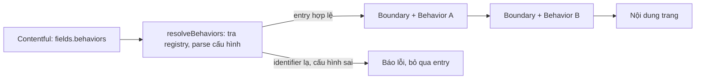

Trang marketing thường do đội marketing dựng bằng CMS: kéo thả section, sửa chữ, đổi ảnh, không cần lập trình viên. Rồi sẽ tới lúc họ muốn những thứ "có code":

- Trang bảng giá: hiện popup khi người dùng định rời trang, nhưng không quá 4 lần.
- Trang tuyển dụng: đọc thành phố từ URL để lọc danh sách việc làm.
- Trang chiến dịch: đổi màu nền section hero, chỉ riêng trang này.
- Trang đặt lịch demo: tự mở chatbot khi trang tải xong.

Cách dễ nhất là `if (page.slug === 'pricing') …` rải khắp code. Mỗi lần marketing muốn thêm, bớt, đổi trang là một lần lập trình viên sửa code và deploy. Sau vài chục chiến dịch, code đầy những nhánh `if` mà không ai dám xoá.

> [!TIP]
> **Tóm tắt**
> - Intercom gọi mỗi đoạn hành vi như vậy là một **page behavior**: một component React có tên (identifier). CMS lưu cho mỗi trang danh sách behavior kèm cấu hình; code chỉ giữ một **registry** `identifier -> component`.
> - Các behavior bọc quanh nội dung trang theo thứ tự, như middleware. Thêm behavior mới chỉ là thêm một dòng vào registry.
> - Dữ liệu CMS do người nhập: phải **kiểm tra cấu hình trước khi render**, bỏ qua entry sai thay vì để cả trang sập, và giới hạn những gì CSS từ CMS được phép làm.

<iframe class="demo-frame" src="/demos/web-patterns/index.html?theme=dark#/page-behaviors" title="Demo page-behaviors" loading="lazy" style="height: 900px"></iframe>

<p class="demo-links">▶ <a href="/demos/web-patterns/index.html#/page-behaviors" target="_blank" rel="noopener">Mở demo toàn màn hình ↗</a> · <a href="https://stackblitz.com/github/hunghg255/blog-hunghg/tree/master/examples/web-patterns?file=src/lib/pageBehaviors.ts" target="_blank" rel="noopener">Sửa code trên StackBlitz ↗</a> · <a href="https://github.com/hunghg255/blog-hunghg/blob/master/examples/web-patterns/src/lib/pageBehaviors.ts" target="_blank" rel="noopener">Xem source trên GitHub ↗</a></p>

Trong demo, bên trái là JSON giống dữ liệu CMS trả về, bên phải là trang. Chọn "Cấu hình có lỗi": một identifier gõ sai, một CSS cố chèn `}` để thoát khối, một behavior ném lỗi khi render. Trang vẫn hiện, banner hợp lệ vẫn chạy, ba lỗi được báo ở log.

## Intercom làm thế nào?

Site intercom.com dùng Next.js + Contentful. Thư mục `lib/page-behaviors/` ([xem trong repo](https://github.com/hunghg255/codebase/tree/main/intercom.com/lib/page-behaviors)) có 17 behavior và một file điều phối `PageBehaviors.tsx`:

```tsx
export default function PageBehaviors({ pageBehaviors, children }: IPageBehaviors) {
  let tree = children;
  pageBehaviors.forEach((pageBehavior) => {
    // pageBehaviorsByIdentifier: { 'custom-styles': CustomStyles, 'exit-intent-modal': ExitIntentModal, … }
    const Behavior = pageBehaviorsByIdentifier[pageBehavior.fields.identifier];
    tree = <Behavior id={pageBehavior.sys.id} data={pageBehavior.fields}>{tree}</Behavior>;
  });
  return <>{tree}</>;
}
```

`src/components/common/Page.tsx` đặt `<PageBehaviors pageBehaviors={fields.behaviors || []}>` bọc quanh layout của mọi trang. `fields.behaviors` là danh sách entry kiểu `pageBehavior` mà người biên tập gắn vào trang trong Contentful. Key của registry có kiểu `IPageBehavior['fields']['identifier']`, sinh tự động từ content model của Contentful. Kiểu này là union các chuỗi, nên có lẽ field `identifier` trong Contentful được cấu hình chỉ cho chọn từ danh sách cố định (thư mục `@types/generated` không có trong bản dump để kiểm tra).

Mỗi behavior nhận `id` (id của entry trong CMS), `data` (các field của entry, gồm `configuration` là JSON tự do và `references` trỏ tới entry khác) và `children`. Behavior muốn làm gì cũng được, miễn là cuối cùng render `children`. Một vài behavior tiêu biểu:

| Behavior | Làm gì | Kỹ thuật |
| --- | --- | --- |
| `custom-styles` | CSS riêng cho trang | `<style>{jsonToCss(data.configuration)}</style>` |
| `exit-intent-modal` | Popup khi chuột rời cửa sổ | cookie `viewed-<id>`, `dismissed-<id>`, `submitted-<id>`; tối đa 4 lần |
| `careers-location` | Đọc thành phố từ URL | context provider bọc children |
| `cda-updater` | Gửi dữ liệu cho Intercom Messenger | `window.Intercom('update', data.configuration)` |
| `book-custom-demo` | Tự mở chatbot | bấm một nút ẩn mỗi giây cho tới khi Messenger mở |
| `mobile-carousels`, `csf-page`… | Style riêng cho một trang | `<style jsx global>` viết cứng |

Điểm hay nhất là `id` của entry được dùng làm khoá lưu trữ. Exit-intent dùng cookie `viewed-${id}`: hai chiến dịch dùng chung behavior `exit-intent-modal` nhưng là hai entry khác nhau, nên đếm số lần hiện riêng. Người biên tập tạo chiến dịch mới bằng cách nhân bản entry, không cần ai nghĩ tới chuyện đặt tên khoá.

`lib/jsonToCss.ts` biến JSON (`{ ".hero": { "color": "red" } }`) thành chuỗi CSS, gặp object lồng thì coi key là media query và đệ quy vào trong.

### Những chỗ nên làm khác

**Identifier lạ làm sập trang.** Không có behavior tương ứng thì `PageBehaviorComponent` là `undefined`, React ném lỗi "Element type is invalid". Có lẽ Contentful chặn được ở khâu nhập liệu, nhưng chỉ cần code mới deploy chậm hơn content model (thêm identifier trong CMS trước khi code có component) là trang lỗi.

**Kiểm tra cấu hình bằng `throw` trong render.** `ExitIntentModal` kiểm tra `data.references[0]` có đúng loại entry không, sai thì `throw new Error(…)`. Ý tưởng "fail fast" đúng, nhưng ném trong lúc render mà không có error boundary bao quanh behavior thì lỗi nổi lên tới boundary gần nhất ở trên, thường là cả trang. Một entry cấu hình sai của marketing không nên làm trang trắng.

**CSS từ CMS không có giới hạn.** `jsonToCss` ghép chuỗi thẳng. Giá trị `"red;} body{display:none"` đóng khối hiện tại và mở khối mới, ẩn cả trang. Selector cũng không bị giới hạn trong phạm vi trang, nên sửa nhầm `header` là đổi luôn header chung.

**Sửa DOM mà React đang quản lý.** `MobileCarousels` có `useEffect` không mảng deps, chạy sau **mỗi** lần render, dùng `innerHTML` thay chữ trong hero. Đoạn chữ đó do React render ra. Lần sau React cập nhật node đó, nó không biết DOM đã bị đổi, kết quả khó đoán.

**Thứ tự bọc ngược với thứ tự trong CMS.** `forEach` bọc lần lượt, nên entry **đầu** danh sách nằm **trong** cùng. Với middleware, người ta thường hiểu ngược lại. Ít khi quan trọng, nhưng sẽ quan trọng khi hai behavior cùng cung cấp một context.

## Bên trong: middleware ở tầng render

Bọc component lồng nhau chính là chuỗi middleware. Mỗi behavior có quyền chạy code trước con (cung cấp context, chặn render), sau con (thêm modal, thêm `<style>`), hoặc chạy effect song song.



Bản viết lại thêm hai lớp bảo vệ quanh mô hình này:

1. **Tách kiểm tra khỏi render.** Mỗi behavior khai báo hàm `parse` để kiểm tra và chuẩn hoá cấu hình. Entry có identifier lạ hoặc `parse` ném lỗi bị bỏ qua trước khi render, và được báo qua `onIssue` (gửi về Sentry chẳng hạn).
2. **Error boundary cho từng behavior.** Behavior ném lỗi lúc render thì boundary của nó render thẳng phần bên trong (`fallback = inner`), như thể behavior đó không tồn tại.

## Viết lại

### Kiểm tra trước khi render

```ts title=src/lib/pageBehaviors.ts
  for (const entry of entries) {
    const definition = Object.hasOwn(registry, entry.identifier)
      ? registry[entry.identifier]
      : undefined;
    if (!definition) {
      issues.push({
        ...pick(entry),
        reason: 'unknown',
        message: `không có behavior "${entry.identifier}"`,
      });
      continue;
    }
    try {
      const config = definition.parse ? definition.parse(entry.configuration) : entry.configuration;
      resolved.push({ entry, definition, config });
    } catch (error) {
      issues.push({ ...pick(entry), reason: 'invalid-config', message: errorMessage(error) });
    }
  }
```

`Object.hasOwn` thay cho `registry[entry.identifier]` trần: identifier là chuỗi do người nhập, `"constructor"` hay `"toString"` sẽ lấy nhầm thuộc tính của `Object.prototype`.

Một behavior được khai báo kèm `parse`, TypeScript suy ra kiểu cấu hình cho component từ giá trị `parse` trả về:

```tsx
const announcementBar = defineBehavior({
  parse: (raw) => ({ text: requireString(raw, 'text') }), // sai thì throw
  component: ({ config, children }) => (<><Banner>{config.text}</Banner>{children}</>),
});
```

### Bọc theo thứ tự middleware

```ts title=src/lib/pageBehaviors.ts
  const tree = resolved.reduceRight<ReactNode>((inner, { entry, definition, config }) => {
    const wrapped = createElement(definition.component, { id: entry.id, config, children: inner });
    // key theo id: đổi cấu hình của entry này không làm remount entry khác
    return createElement(BehaviorBoundary, {
      key: entry.id,
      issue: pick(entry),
      onIssue,
      fallback: inner,
      config,
      children: wrapped,
    });
  }, children);
```

`PageBehaviors` gọi `resolveBehaviors` trong `useMemo`, báo `issues` trong một effect, rồi dựng cây. `reduceRight` bọc từ cuối danh sách ra ngoài, nên entry đầu tiên nằm ngoài cùng. `BehaviorBoundary` nhận `fallback: inner`: khi behavior lỗi, nó render đúng phần cây bên trong mà behavior lẽ ra đã bọc. Boundary cũng tự "hồi phục" khi `config` đổi (người biên tập sửa lỗi rồi xem trước lại).

### CSS từ CMS có giới hạn

```ts title=src/lib/pageBehaviors.ts
    .map(([key, body]) => {
      if (FORBIDDEN.test(key)) throw new Error(`selector không hợp lệ: ${key}`);
      if (key.startsWith('@')) return `${key}{${jsonToCss(body as CssJson, scope)}}`;
      const rules = Object.entries(body)
        .map(([property, value]) => {
          if (typeof value === 'object')
            throw new Error(`"${key}" lồng selector: dùng @media hoặc tách ra`);
          const text = String(value);
          if (FORBIDDEN.test(property) || FORBIDDEN.test(text) || text.includes(';')) {
            throw new Error(`giá trị không hợp lệ ở ${key} { ${property} }`);
          }
          return `${property}:${text};`;
        })
        .join('');
      return `${scopeSelector(key, scope)}{${rules}}`;
```

Ba quy tắc (biểu thức `FORBIDDEN = /[{}<]/`): không cho `{`, `}` và `<` ở bất kỳ đâu (không đóng/mở khối, không viết được `</style>`), không cho `;` trong giá trị (mỗi thuộc tính chỉ một khai báo), và thêm `scope` vào trước mọi selector. Demo dùng scope `.pb-preview`: CMS viết `.hero` thì CSS thật là `.pb-preview .hero`.

::: spoiler Xem toàn bộ src/lib/pageBehaviors.ts

```ts title=src/lib/pageBehaviors.ts
import {
  Component,
  createElement,
  Fragment,
  useEffect,
  useMemo,
  type ComponentType,
  type ReactNode,
} from 'react';

/**
 * Page behaviors: CMS khai báo cho mỗi trang một danh sách "hành vi" (exit-intent, style riêng,
 * banner…), code chỉ cần một registry `identifier -> component`. Mỗi behavior bọc quanh nội dung
 * trang như một lớp middleware. Ý tưởng từ `lib/page-behaviors/PageBehaviors.tsx` của intercom.com.
 */

/** Một entry như CMS trả về (Contentful: sys.id + fields.identifier + fields.configuration). */
export interface BehaviorEntry {
  id: string;
  identifier: string;
  configuration?: unknown;
}

export interface BehaviorProps<C> {
  /** id của entry trong CMS: dùng làm khoá lưu trữ riêng cho từng instance */
  id: string;
  config: C;
  children: ReactNode;
}

export interface BehaviorDefinition<C = unknown> {
  /** kiểm tra + chuẩn hoá cấu hình do người biên tập nhập; sai thì throw */
  parse?: (raw: unknown) => C;
  component: ComponentType<BehaviorProps<C>>;
}

/** Chỉ để TypeScript suy ra kiểu C từ parse cho component. */
export function defineBehavior<C>(definition: BehaviorDefinition<C>): BehaviorDefinition<C> {
  return definition;
}

// eslint-disable-next-line @typescript-eslint/no-explicit-any
export type BehaviorRegistry = Record<string, BehaviorDefinition<any>>;

export interface BehaviorIssue {
  id: string;
  identifier: string;
  reason: 'unknown' | 'invalid-config' | 'render-error';
  message: string;
}

export interface ResolvedBehavior {
  entry: BehaviorEntry;
  definition: BehaviorDefinition<unknown>;
  config: unknown;
}

/** Tách việc kiểm tra cấu hình ra khỏi render: entry sai bị bỏ qua và báo lại, trang vẫn chạy. */
export function resolveBehaviors(entries: BehaviorEntry[], registry: BehaviorRegistry) {
  const resolved: ResolvedBehavior[] = [];
  const issues: BehaviorIssue[] = [];
  for (const entry of entries) {
    const definition = Object.hasOwn(registry, entry.identifier)
      ? registry[entry.identifier]
      : undefined;
    if (!definition) {
      issues.push({
        ...pick(entry),
        reason: 'unknown',
        message: `không có behavior "${entry.identifier}"`,
      });
      continue;
    }
    try {
      const config = definition.parse ? definition.parse(entry.configuration) : entry.configuration;
      resolved.push({ entry, definition, config });
    } catch (error) {
      issues.push({ ...pick(entry), reason: 'invalid-config', message: errorMessage(error) });
    }
  }
  return { resolved, issues };
}

const pick = ({ id, identifier }: BehaviorEntry) => ({ id, identifier });
const errorMessage = (error: unknown) => (error instanceof Error ? error.message : String(error));

interface BoundaryProps {
  issue: Omit<BehaviorIssue, 'reason' | 'message'>;
  onIssue?: (issue: BehaviorIssue) => void;
  /** nội dung trang bên trong, dùng làm fallback khi chính behavior bị lỗi */
  fallback: ReactNode;
  /** cấu hình đổi thì cho behavior chạy lại (có thể người biên tập đã sửa lỗi) */
  config: unknown;
  children: ReactNode;
}

/** Behavior lỗi lúc render thì bỏ lớp đó đi, vẫn render nội dung trang bên trong. */
class BehaviorBoundary extends Component<BoundaryProps, { failed: boolean; config: unknown }> {
  state = { failed: false, config: this.props.config };
  static getDerivedStateFromError() {
    return { failed: true };
  }
  static getDerivedStateFromProps(
    props: BoundaryProps,
    state: { failed: boolean; config: unknown },
  ) {
    return props.config === state.config ? null : { failed: false, config: props.config };
  }
  componentDidCatch(error: unknown) {
    this.props.onIssue?.({
      ...this.props.issue,
      reason: 'render-error',
      message: errorMessage(error),
    });
  }
  render() {
    return this.state.failed ? this.props.fallback : this.props.children;
  }
}

export interface PageBehaviorsProps {
  behaviors: BehaviorEntry[];
  registry: BehaviorRegistry;
  onIssue?: (issue: BehaviorIssue) => void;
  children: ReactNode;
}

/**
 * Bọc children bằng từng behavior. Behavior ĐẦU danh sách nằm NGOÀI cùng (giống thứ tự middleware).
 * (Bản của Intercom dùng forEach nên ngược lại: behavior đầu danh sách nằm trong cùng.)
 */
export function PageBehaviors({ behaviors, registry, onIssue, children }: PageBehaviorsProps) {
  const { resolved, issues } = useMemo(
    () => resolveBehaviors(behaviors, registry),
    [behaviors, registry],
  );

  useEffect(() => {
    issues.forEach((issue) => onIssue?.(issue));
    // chỉ báo lại khi danh sách behavior đổi
    // eslint-disable-next-line react-hooks/exhaustive-deps
  }, [issues]);

  const tree = resolved.reduceRight<ReactNode>((inner, { entry, definition, config }) => {
    const wrapped = createElement(definition.component, { id: entry.id, config, children: inner });
    // key theo id: đổi cấu hình của entry này không làm remount entry khác
    return createElement(BehaviorBoundary, {
      key: entry.id,
      issue: pick(entry),
      onIssue,
      fallback: inner,
      config,
      children: wrapped,
    });
  }, children);

  return createElement(Fragment, null, tree);
}

// ---- CSS từ JSON (cho behavior "custom-styles") ----

export type CssJson = {
  [selectorOrAtRule: string]: CssJson | { [property: string]: string | number };
};

// { } đóng/mở khối, < có thể thành </style>; ; trong giá trị mở thêm khai báo khác
const FORBIDDEN = /[{}<]/;

/**
 * `{ ".hero": { color: "red" }, "@media (max-width: 600px)": { ".hero": { padding: 0 } } }`
 * -> `.hero{color:red;} @media (max-width: 600px){.hero{padding:0;}}`
 * Khác `jsonToCss` của Intercom: chặn ký tự phá cấu trúc ({ } < và ; trong giá trị), và có `scope`
 * để mọi selector chỉ áp dụng bên trong trang (không lỡ tay đổi style của header/footer chung).
 */
export function jsonToCss(json: CssJson | undefined, scope = ''): string {
  if (!json) return '';
  return Object.entries(json)
    .map(([key, body]) => {
      if (FORBIDDEN.test(key)) throw new Error(`selector không hợp lệ: ${key}`);
      if (key.startsWith('@')) return `${key}{${jsonToCss(body as CssJson, scope)}}`;
      const rules = Object.entries(body)
        .map(([property, value]) => {
          if (typeof value === 'object')
            throw new Error(`"${key}" lồng selector: dùng @media hoặc tách ra`);
          const text = String(value);
          if (FORBIDDEN.test(property) || FORBIDDEN.test(text) || text.includes(';')) {
            throw new Error(`giá trị không hợp lệ ở ${key} { ${property} }`);
          }
          return `${property}:${text};`;
        })
        .join('');
      return `${scopeSelector(key, scope)}{${rules}}`;
    })
    .join('\n');
}

function scopeSelector(selector: string, scope: string) {
  if (!scope) return selector;
  return selector
    .split(',')
    .map((part) => (part.trim() === ':scope' ? scope : `${scope} ${part.trim()}`))
    .join(', ');
}
```

:::

**Khác bản gốc:** Intercom tra registry trực tiếp trong render, kiểm tra cấu hình bằng `throw` bên trong behavior, bọc bằng `forEach` (entry đầu nằm trong cùng) và sinh CSS không kiểm tra. Bản viết lại tách bước `resolveBehaviors`, có error boundary cho từng behavior, bọc theo thứ tự middleware và chặn ký tự phá cấu trúc trong CSS.

## Tại sao không làm cách khác?

**Cho CMS nhập JavaScript.** Linh hoạt nhất và nguy hiểm nhất: một lỗi gõ là trang lỗi, một tài khoản CMS bị lộ là XSS trên toàn site, và Content Security Policy chặt (không `unsafe-inline`) sẽ không cho chạy. Page behavior giữ code trong repo (được review, test), CMS chỉ chọn và cấu hình. CSP của chính intercom.com (`content-security-policy.js`) phản ánh đúng lựa chọn này: `script-src` không có `'unsafe-inline'`, còn `style-src` thì có. CMS được đưa CSS vào trang, không được đưa script.

**Feature flag.** Flag trả lời "bật hay tắt", page behavior trả lời "trang này có hành vi gì, cấu hình ra sao". Hai thứ dùng chung được: behavior có thể đọc flag bên trong.

**Gắn behavior vào từng section thay vì trang.** Intercom cũng có component theo section (render từ `bodyContent`). Behavior cấp trang dành cho thứ không thuộc section nào: modal, CSS toàn trang, context, gọi API bên thứ ba.

## Edge case và cạm bẫy

- **Thêm/bớt behavior lúc đang chạy làm remount nội dung trang.** Cấu trúc lồng nhau đổi thì React coi nội dung là cây mới. Với trang CMS thì danh sách behavior cố định trong một lần tải trang nên không sao. Chế độ xem trước (preview) của CMS thì sẽ thấy state bị reset.
- **Behavior chỉ chạy ở client.** Exit-intent, `window.Intercom`, `localStorage` đều không có ở server. Behavior dùng `useEffect` cho phần đó, còn phần render (banner, `<style>`) thì vẫn SSR được.
- **Khoá lưu trữ theo `id` của entry.** Nhân bản entry trong CMS là có bộ đếm mới. Nhưng sửa chính entry đó (đổi nội dung popup) thì bộ đếm cũ vẫn giữ: người đã bấm "không hiện nữa" sẽ không thấy nội dung mới. Muốn reset thì tạo entry mới.
- **Error boundary không bắt lỗi trong effect và event handler.** Behavior ném lỗi trong `useEffect` hay `onClick` thì phải tự `try/catch` (hoặc báo qua `window.onerror`).
- **Nội dung trang ném lỗi.** Boundary của behavior sẽ bắt và render lại phần bên trong, phần đó lại ném lỗi, lỗi đi tiếp lên boundary bên ngoài. Cuối cùng vẫn tới error boundary của trang, nhưng `onIssue` bị gọi nhầm cho từng behavior trên đường đi. Nếu cần chính xác, đặt một boundary riêng ngay quanh nội dung trang.
- **CSP chặt cho style.** Nếu `style-src` của bạn không có `'unsafe-inline'`, thẻ `<style>` do behavior render sẽ bị chặn. Khi đó cần nonce (Next.js hỗ trợ truyền nonce qua header) hoặc sinh CSS lúc build.
- **CSS từ CMS vẫn có thể làm xấu trang** (chữ trắng trên nền trắng). Giới hạn chỉ chặn được việc phá cấu trúc stylesheet, không chặn được thiết kế tồi.

## Dùng trong dự án

Với bất kỳ CMS nào (Contentful, Sanity, Strapi, Payload…), tạo một content type `pageBehavior` gồm `identifier` (danh sách chọn), `configuration` (JSON), rồi cho trang tham chiếu tới nhiều entry. Phía code:

```tsx
// app/[slug]/page.tsx
const page = await cms.getPage(slug);
return (
  <PageBehaviors behaviors={page.behaviors} registry={registry} onIssue={(i) => Sentry.captureMessage(i.message, { extra: i })}>
    <Sections items={page.sections} />
  </PageBehaviors>
);
```

Gợi ý thêm cho người biên tập: trong chế độ preview, hiện danh sách `issues` ngay trên trang (như log của demo) để họ thấy cấu hình sai trước khi publish.

## Kiểm thử

::: spoiler Ví dụ test (bản phác, không có trong repo)

```tsx
import { render, screen } from '@testing-library/react';
import { defineBehavior, jsonToCss, PageBehaviors, resolveBehaviors } from './pageBehaviors';

const registry = {
  banner: defineBehavior({
    parse: (raw) => {
      if (typeof (raw as { text?: unknown })?.text !== 'string') throw new Error('cần text');
      return raw as { text: string };
    },
    component: ({ config, children }) => (<><p>{config.text}</p>{children}</>),
  }),
  broken: defineBehavior({ component: () => { throw new Error('boom'); } }),
};

test('entry sai bị bỏ qua và báo lại', () => {
  const { resolved, issues } = resolveBehaviors(
    [
      { id: '1', identifier: 'banner', configuration: { text: 'hi' } },
      { id: '2', identifier: 'banner', configuration: {} },
      { id: '3', identifier: 'toString' },
    ],
    registry,
  );
  expect(resolved).toHaveLength(1);
  expect(issues.map((i) => i.reason)).toEqual(['invalid-config', 'unknown']);
});

test('behavior lỗi khi render không làm mất nội dung trang', () => {
  const onIssue = vi.fn();
  vi.spyOn(console, 'error').mockImplementation(() => {});
  render(
    <PageBehaviors behaviors={[{ id: 'x', identifier: 'broken' }]} registry={registry} onIssue={onIssue}>
      <main>nội dung</main>
    </PageBehaviors>,
  );
  expect(screen.getByText('nội dung')).toBeInTheDocument();
  expect(onIssue).toHaveBeenCalledWith(expect.objectContaining({ id: 'x', reason: 'render-error' }));
});

test('jsonToCss: scope và chặn thoát khối', () => {
  expect(jsonToCss({ '.a, .b': { color: 'red' } }, '.page')).toBe('.page .a, .page .b{color:red;}');
  expect(() => jsonToCss({ '.a': { color: 'red;} body{display:none' } })).toThrow();
});
```

:::

## So với các cách có sẵn

- **Builder.io, Plasmic** cho đăng ký component code vào trình kéo thả (`registerComponent`), cùng tinh thần "code trong repo, CMS chọn và cấu hình", nhưng ở cấp section.
- **Google Tag Manager** cho marketing chèn script tuỳ ý: nhanh nhưng là JavaScript không review, đúng cái page behavior muốn tránh.
- **Mã nguồn Intercom**: kiến trúc gọn, đáng học; phần thiếu là kiểm tra đầu vào và cô lập lỗi.

---

Bài này thuộc series **[Học từ mã nguồn các web lớn](/series/web)** (42 bài, đọc theo thứ tự).

::: spoiler Xem nhanh danh sách bài trong series

*Mở đầu*

- [Mở đầu: đọc code production của 28 trang web](/blogs/learn-from-big-web-apps)

*Phần 1: trải nghiệm người dùng*

- [#1 Dark mode không nháy (Gatsby)](/blogs/web-dark-mode-no-flash)
- [#2 useValueByMedia: giá trị theo breakpoint (Toptal)](/blogs/web-use-value-by-media)
- [#3 Đoán ý định: idle, exit-intent, lắc chuột (Toptal, InVision)](/blogs/web-user-intent-idle-exit-wiggle)
- [#4 Validate form thân thiện (Udacity, Pipedrive)](/blogs/web-form-validation-ux)
- [#5 Magic number, EXIF và dán ảnh (Ello)](/blogs/web-file-magic-number-exif-paste)
- [#6 fastSmoothScroll: cuộn xa vẫn nhanh (Telegram)](/blogs/web-telegram-fast-smooth-scroll)
- [#7 Countdown time-travel và tombstone giỏ hàng (Best Buy)](/blogs/web-countdown-time-travel-tombstone)

*Phần 2: hiệu năng và đo lường*

- [#8 Hàng đợi requestAnimationFrame 3ms (Apple)](/blogs/web-raf-queue-3ms)
- [#9 srcset cho artwork và preconnect tự động (Apple)](/blogs/web-responsive-artwork-preconnect)
- [#10 Quick-fetch: gọi API trước khi bundle tải xong (HubSpot)](/blogs/web-quick-fetch-early-requests)
- [#11 Performance span và long task (Postman, Calibre)](/blogs/web-performance-spans-long-tasks)
- [#12 Gọi Web Worker như hàm async (Telegram)](/blogs/web-worker-promise-rpc)
- [#13 Đồng hồ media: đếm giờ xem và sửa lệch (Skillshare, Simplified)](/blogs/web-media-clock-watch-time-drift)

*Phần 3: nhiều tab, phiên đăng nhập, cập nhật*

- [#14 Bầu tab chủ cho thông báo (HubSpot, Telegram)](/blogs/web-leader-tab-notifications)
- [#15 Đồng bộ đăng nhập giữa tab và giới hạn cookie (Elastic, InVision)](/blogs/web-cross-tab-auth-cookie-guard)
- [#16 SPA tự cập nhật: Trello, Zappos, Facebook, Elastic](/blogs/web-spa-self-update-strategies)

*Phần 4: kiến trúc*

- [#17 Reverse portal: di chuyển component không remount (Zappos)](/blogs/web-reverse-portal)
- **#18 Page behaviors: gắn hành vi từ CMS (Intercom)** (bài này)
- [#19 Giới hạn tần suất hiển thị bằng bitmask (Outlook)](/blogs/web-frequency-cap-bitmask)
- [#20 Chuyển REST sang GraphQL dần dần (Coursera)](/blogs/web-rest-to-graphql-hybrid-link)

*Phần 5: soạn thảo và hiển thị nội dung*

- [#21 Autocomplete tại con trỏ trong contenteditable (Ello, Telegram)](/blogs/web-caret-autocomplete-contenteditable)
- [#22 Dark mode cho email HTML bằng CIELAB (Outlook)](/blogs/web-email-dark-mode-cielab)
- [#23 Thu nhỏ bảng rộng cho vừa khung, vá font emoji (Outlook)](/blogs/web-email-wide-content-scale)
- [#24 Cảnh báo quên đính kèm file (Outlook)](/blogs/web-forgotten-attachment-warning)
- [#25 Cắt chữ nhiều dòng chính xác (Pipedrive, Apple, Toptal)](/blogs/web-multiline-truncate-measure-text)
- [#26 Parse ngày giờ gõ tay khoan dung (Outlook, Elastic)](/blogs/web-lenient-date-parser)

*Phần 6: tương tác*

- [#27 menuAim: rê chéo vào submenu không bị đóng (Udemy)](/blogs/web-menu-aim-triangle)
- [#28 Kéo, vuốt chung cho chuột và cảm ứng (Telegram)](/blogs/web-unified-pointer-gestures)
- [#29 Phím tắt theo phạm vi, IME và bàn phím phi Latinh (Trello)](/blogs/web-scoped-keyboard-shortcuts)
- [#30 Nội suy màu: đổi theme và nền theo cuộn (Telegram, Anchor)](/blogs/web-color-interpolation-theme-scroll)
- [#31 Đường gióng hút cạnh và undo/redo trên canvas (Simplified)](/blogs/web-canvas-snap-guides-undo)
- [#32 Giả lập mù màu bằng feColorMatrix (Trello)](/blogs/web-color-vision-simulator)
- [#33 Vạch thước theo mức zoom và cấp phát màu cho biểu đồ (Anchor, Similarweb)](/blogs/web-timeline-ticks-color-stack)

*Phần 7: mạng, dữ liệu và async*

- [#34 Ô tìm kiếm chuẩn production (Similarweb, Udemy, Pipedrive)](/blogs/web-production-search-box)
- [#35 Điều phối async: latest-wins, single-flight (Glitch, Toptal)](/blogs/web-async-coordination-latest-wins)
- [#36 Polling thưa dần và debounce động (Trello)](/blogs/web-decaying-polling-dynamic-debounce)
- [#37 Cache phía client theo version (Similarweb, Telegram, Udemy)](/blogs/web-client-cache-versioned)
- [#38 Upload file lớn theo chunk (Outlook, Tribe)](/blogs/web-chunked-upload-pipeline)
- [#39 Phát video qua Service Worker bằng Range request (Telegram, Outlook)](/blogs/web-service-worker-range-streaming)

*Phần 8: hiệu năng và vận hành*

- [#40 TTI governor: hoãn việc phụ tới sau khi trang dùng được (Outlook)](/blogs/web-tti-governor)
- [#41 Tự đo LCP/CLS/TBT và phục vụ bản nhẹ cho máy yếu (Udemy)](/blogs/web-rum-adaptive-loading)

:::

Code + demo: [`examples/web-patterns`](https://github.com/hunghg255/blog-hunghg/tree/master/examples/web-patterns) · [Mở trên StackBlitz](https://stackblitz.com/github/hunghg255/blog-hunghg/tree/master/examples/web-patterns)
