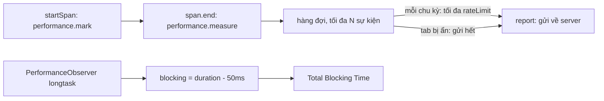

Core Web Vitals (LCP, INP, CLS) cho biết trang tải và phản hồi thế nào nói chung. Nhưng với một app như Postman, câu hỏi thật là cụ thể hơn: "mở một workspace mất bao lâu?", "bấm Send tới lúc hiện response mất bao lâu?", "có bao nhiêu phần trăm người dùng phải chờ quá nửa giây?". Những con số đó phải tự đo, theo từng thao tác, ngay trên máy người dùng.

Bài này ghép ba mảnh từ hai codebase:

- **Postman**: span đo bằng User Timing API (`performance.mark`/`measure`), hàng đợi và harvester gửi về New Relic với giới hạn tốc độ.
- **Postman**: một lỗi race kinh điển khi chuyển trang nhanh, và cách chặn.
- **Calibre**: cách trình bày long task, tách riêng phần "chặn" vượt 50ms.

> [!TIP]
> **Tóm tắt**
> - Đo thao tác bằng `performance.mark` + `performance.measure`: mốc thời gian chuẩn, hiện luôn trong DevTools, không cần thư viện.
> - Gửi qua hàng đợi có giới hạn (Postman: tối đa 60 sự kiện / 30 giây) và gửi nốt khi tab bị ẩn.
> - Mỗi span có ngưỡng Apdex: dưới ngưỡng là hài lòng, dưới 4 lần ngưỡng là chấp nhận, còn lại là bực mình.
> - Long task chỉ "chặn" phần vượt 50ms; tổng các phần đó là Total Blocking Time. Chuyển trang thì để lần bấm sau cùng thắng.

<iframe class="demo-frame" src="/demos/web-patterns/index.html?theme=dark#/perf-spans" title="Demo perf-spans" loading="lazy" style="height: 900px"></iframe>

<p class="demo-links">▶ <a href="/demos/web-patterns/index.html#/perf-spans" target="_blank" rel="noopener">Mở demo toàn màn hình ↗</a> · <a href="https://stackblitz.com/github/hunghg255/blog-hunghg/tree/master/examples/web-patterns?file=src/lib/perfSpans.ts" target="_blank" rel="noopener">Sửa code trên StackBlitz ↗</a> · <a href="https://github.com/hunghg255/blog-hunghg/blob/master/examples/web-patterns/src/lib/perfSpans.ts" target="_blank" rel="noopener">Xem source trên GitHub ↗</a></p>

## Bên trong trình duyệt: User Timing và Long Tasks API

**User Timing** là hai hàm:

```ts
performance.mark('open-workspace:start');
// … làm việc …
const m = performance.measure('open-workspace', { start: 'open-workspace:start', detail: { apdexMs: 500 } });
m.duration; // ms, số thực
```

Lợi ích so với tự gọi `Date.now()` hai lần:

- Mốc thời gian là `performance.now()`: đơn điệu (không nhảy khi người dùng chỉnh giờ hệ thống), độ phân giải dưới mili giây.
- Mark và measure hiện trong tab Performance của DevTools (mục Timings), nằm ngay cạnh các khung hình, task, request. Khi một span chậm, bạn thấy luôn nó chậm vì cái gì.
- `measure` không có `start` thì tính từ `timeOrigin`, tức lúc bắt đầu điều hướng. Đó là cách đo "từ lúc mở trang tới khi X".
- Tham số `detail` gắn thêm dữ liệu tuỳ ý vào entry, `PerformanceObserver` đọc lại được.

**Long Tasks API**: `PerformanceObserver` với `type: 'longtask'` báo mọi task chiếm main thread trên 50ms. Con số 50ms đến từ mô hình RAIL: phản hồi dưới 100ms thì người dùng thấy là tức thì, chia đôi cho task đang chạy và việc xử lý input. Một task 400ms nghĩa là cú click rơi vào lúc đó phải chờ tới 350ms "thừa". Hiện chỉ trình duyệt Chromium hỗ trợ `longtask` (tính tới 10/2026, xem [MDN](https://developer.mozilla.org/en-US/docs/Web/API/PerformanceLongTaskTiming)).



## Postman làm thế nào?

### 1. PerformanceTelemetryService: ba tầng

Thư mục [`web.postman.co/js/services/PerformanceTelemetryService/`](https://github.com/hunghg255/codebase/tree/main/web.postman.co/js/services/PerformanceTelemetryService) (khoảng 1.100 dòng) chia ba "container":

- `interfaceContainer`: API công khai (`init`, `startSpan`, `endSpan`, `addMarker`). Mỗi hàm bọc trong `try/catch` và nuốt lỗi, comment ghi rõ: "TelemetryService only logs the error and fails without breakage". Đo lường hỏng không được làm hỏng tính năng.
- `coreContainer`: tạo mark/measure, kiểm tra span hợp lệ (có `name`, `domain` nằm trong danh sách `config/domains.js`, `apdexThreshold` là số).
- `reporterContainer`: hàng đợi, harvester, gửi sang New Relic.

Điểm độc đáo nhất là **trạng thái span nằm ngay trong performance timeline**. Không có `Map` nào lưu span đang chạy: tên mark mã hoá toàn bộ thông tin (`lib/coreContainer/performanceEntry.js`):

```js
`TelemetryService-v1::${span.uid || ''}::${span.name}::${span.domain}::${type}::${apdexThreshold}`
```

`startSpan` kiểm tra đã có mark `start` với tiền tố đó chưa (có thì báo lỗi "span hasn't ended"), rồi tạo mark. `endSpan` tìm mark start bằng `performance.getEntries().filter(e => e.name.startsWith(prefix))`, tạo mark `end`, tạo measure, đọc lại measure, đưa vào hàng đợi, rồi `clearMarks`/`clearMeasures`. Khi gửi đi, `getSpanFromPerformanceEntryName` tách ngược tên ra các trường. Trường `uid` cho phép cùng một span chạy song song nhiều lần (vd mở 3 collection cùng lúc).

Marker (`addMarker`) chỉ tạo mark `end` và measure không có start: trình duyệt tính từ đầu điều hướng. `appsdk/services/PageService.js` dùng nó đúng một lần, để đo `INITIAL_TAB_LOAD_TIME` sau khi trang đầu tiên kích hoạt xong.

### 2. Harvester có giới hạn tốc độ

`config/config.js`: `harvestStart: 25000`, `harvestInterval: 30000`, `rateLimit: 60`, `DEFAULT_APDEX_THRESHOLD: 250`. `lib/reporterContainer/harvester.js`:

```js
setTimeout(() => {
  harvestEvents(rateLimit);
  setInterval(() => harvestEvents(rateLimit), harvestInterval);
}, harvestStart);

window.addEventListener('beforeunload', function () { harvestEvents(rateLimit); });

function harvestEvents (rateLimit) {
  for (let i = 0; i < rateLimit; i++) {
    if (eventQueue.isEmpty()) break;
    addEventToVendorQueue(eventQueue.dequeue());
  }
}
```

Chờ 25 giây mới gửi lần đầu để không tranh tài nguyên lúc app khởi động. Mỗi 30 giây gửi tối đa 60 sự kiện, phần dư để chu kỳ sau: một vòng lặp lỗi bắn hàng nghìn span cũng không thể làm ngập New Relic. Mỗi sự kiện thành một `newrelic.addPageAction(name, { pm_duration, pm_apdex_t, … })`, và theo comment trong code, agent của New Relic tự gửi phần còn lại bằng beacon khi trang đóng.

### 3. Những chỗ nên làm khác

Đọc kỹ thì có vài điểm không nên chép:

- **Tra cứu bằng `performance.getEntries()`**: mỗi lần start/end đều duyệt toàn bộ timeline (gồm cả resource timing của mọi request). App chạy cả ngày thì danh sách này dài. Giữ một `Map` tên span → tên mark thì O(1).
- **`interfaceContainer/startSpan.js` chỉ gọi `resolve()` trong nhánh `try`**: khi có lỗi, promise trả về không bao giờ settle. Ai `await startSpan(...)` sẽ treo mãi.
- **`init` lưu `harvestStart`, `harvestInterval`, `rateLimit` vào `Init.harvestStart`…** trong khi harvester đọc từ `Init.clientInformation`: giá trị tuỳ chỉnh truyền vào `init` không có tác dụng, luôn dùng mặc định.
- **Hàng đợi không giới hạn**: `eventQueue` là mảng trần. Rate limit 60/30s mà app sinh 200 sự kiện/30s thì hàng đợi lớn mãi.
- **`beforeunload`** thường không chạy trên mobile khi người dùng vuốt tắt app; `visibilitychange` → `hidden` đáng tin hơn (đã phân tích trong bài [Banzai của series Facebook](/blogs/facebook-batch-logger)).

### 4. Race khi chuyển trang

`PageService.switchPage` (khoảng dòng 60–157) chạy `controller.didActivate()` (có thể async, vd tải dữ liệu) rồi mới đặt view. Comment kể lại một lỗi thật: "On navigating from home page to a workspace, switchPage is triggered twice in parallel… This might result in calling the previous page's didDeactivate twice." Cách vá là một cờ `_activeTransition`, và chỉ xoá cờ nếu nó vẫn trỏ tới trang của mình:

```js
if (this._activeTransition === activePage) {
  this._clearActiveTransition();
}
```

Nhưng đọc code thì bước đặt view (`setActiveView(view)`, `_setActive(activePage)`) không kiểm tra cờ này. Bấm trang A (tải chậm) rồi trang B (tải nhanh): B hiển thị trước, rồi A tải xong và **ghi đè** B. Người dùng đứng ở URL của B nhưng nhìn thấy A. Mục 3 của demo tái hiện đúng tình huống này.

## Calibre làm thế nào?

Calibre là dịch vụ theo dõi hiệu năng; trang báo cáo của họ có biểu đồ "Main Thread Activity". Dữ liệu đo sẵn từ server (lấy qua GraphQL), còn [`app/assets/javascripts/utils/mainThreadActivity.js`](https://github.com/hunghg255/codebase/blob/main/calibreapp.com/calibreapp.com/app/assets/javascripts/utils/mainThreadActivity.js) chỉ biến danh sách task thành các đoạn để vẽ. Ý tưởng trình bày đáng học:

- Mỗi task vẽ một thanh, màu theo loại việc (`scripting`, `styleLayout`, `paintCompositeRender`, `parseHTML`…).
- Task có task con thì thêm một **dải đỏ mỏng phía trên**, bắt đầu từ `start_time + 50`, dài `duration - 50`: đúng phần vượt ngưỡng. Mỗi task con cũng được tính `blockingDuration` là phần của nó nằm sau mốc 50ms.

Nhìn vào là biết ngay task nào "có tội" và tội bao nhiêu, thay vì chỉ thấy một thanh dài. Một lưu ý nhỏ khi đọc code: nhánh task không có task con đặt `startTime: start_time + 50` nhưng `endTime: end_time - 50`, lệch với `duration: duration - 50` cùng dòng, và vẫn sinh dải đỏ cho task ngắn hơn 50ms (thời lượng âm). Bản viết lại tính `blocking = max(0, duration - 50)`.

## Viết lại

Ba file nhỏ: `perfSpans.ts` (span + harvester), `perfLongTasks.ts` (long task), `perfNavigation.ts` (chuyển trang).

### Span

```ts title=src/lib/perfSpans.ts
  function startSpan(name: string, { domain = 'app', uid = '', apdexMs = 250 } = {}) {
    const key = `${domain}:${name}:${uid}`;
    try {
      if (domains && !domains.includes(domain)) throw new Error(`domain không hợp lệ: ${domain}`);
      if (active.has(key)) throw new Error(`span "${key}" đang chạy, chưa end`);
      const startMark = `${PREFIX}:start:${key}:${seq++}`;
      performance.mark(startMark);
      active.set(key, startMark);
    } catch (error) {
      onError(error as Error);
    }
    let ended = false;
    return {
      end() {
        if (ended) return;
        ended = true;
        const startMark = active.get(key);
        if (!startMark) return;
        active.delete(key);
        try {
          measure(name, domain, apdexMs, startMark);
        } catch (error) {
          onError(error as Error);
        } finally {
          performance.clearMarks(startMark);
        }
      },
      /** huỷ span (vd người dùng chuyển trang giữa chừng): không gửi số đo dở dang */
      cancel() {
        ended = true;
        const startMark = active.get(key);
        active.delete(key);
        if (startMark) performance.clearMarks(startMark);
      },
    };
  }
```

`end()` gọi hàm `measure` nội bộ: `performance.measure(name, { start: startMark, detail: { apdexMs } })` rồi đưa `{ name, domain, startTime, duration, apdexMs }` vào hàng đợi và xoá measure khỏi timeline.

Khoá span (`domain:name:uid`) nằm trong một `Map`, tên mark có thêm số thứ tự để không bao giờ trùng. Lỗi (span trùng, domain lạ) đi qua `onError` rồi thôi, giống tinh thần "fails without breakage" của Postman. `cancel()` dùng khi việc đang đo bị bỏ dở, vd người dùng chuyển trang trước khi workspace mở xong: số đo dở dang còn tệ hơn không có số đo.

### Harvester

```ts title=src/lib/perfSpans.ts
  function harvest(limit = rateLimit) {
    const batch = queue.splice(0, limit);
    if (batch.length > 0) report(batch);
    return batch.length;
  }

  // Chu kỳ gửi: chờ harvestStartMs rồi gửi đều đặn
  let interval: ReturnType<typeof setInterval> | undefined;
  const startTimer = setTimeout(() => {
    harvest();
    interval = setInterval(harvest, harvestIntervalMs);
  }, harvestStartMs);

  // Postman gửi lần cuối ở beforeunload; trên mobile sự kiện đó hay không chạy,
  // visibilitychange -> hidden đáng tin hơn (xem bài Banzai trong series Facebook).
  const onHidden = () => {
    if (document.visibilityState === 'hidden') harvest(Infinity);
  };
  document.addEventListener('visibilitychange', onHidden);
```

`harvest(Infinity)` khi tab bị ẩn gửi hết hàng đợi. Hàng đợi bị chặn ở `maxQueue`: đầy thì bỏ sự kiện cũ nhất và đếm số bị bỏ (con số đó cũng đáng gửi lên, để biết dữ liệu có bị thiếu không).

### Long task

```ts title=src/lib/perfLongTasks.ts
export function observeLongTasks(onTask: (segment: TaskSegment) => void): () => void {
  if (!supportsLongTasks()) return () => {};
  const observer = new PerformanceObserver((list) => {
    for (const entry of list.getEntries()) onTask(toSegment(entry.startTime, entry.duration));
  });
  observer.observe({ type: 'longtask', buffered: true });
  return () => observer.disconnect();
}
```

Mỗi entry đổi thành `{ start, duration, blocking: max(0, duration - 50) }`; cộng các `blocking` lại là Total Blocking Time.

### Chuyển trang: lần bấm sau cùng thắng

```ts title=src/lib/perfNavigation.ts
    async switchPage(name, activate, commit) {
      const mine = ++token;
      controller?.abort();
      controller = new AbortController();
      const { signal } = controller;
      try {
        const result = await activate(signal);
        // có lần chuyển trang mới hơn trong lúc chờ -> bỏ kết quả này
        if (mine !== token) return false;
        commit(result);
        current = name;
        return true;
      } catch (error) {
        if (signal.aborted || mine !== token) return false;
        throw error;
      }
    },
```

Mỗi lần `switchPage` lấy một số thứ tự (`token`) và huỷ lần trước qua `AbortController`. Khi `activate` xong, chỉ commit nếu số của mình vẫn là số mới nhất.

::: spoiler Xem toàn bộ src/lib/perfSpans.ts

```ts title=src/lib/perfSpans.ts
/**
 * Đo "span" (một việc có điểm đầu, điểm cuối) bằng User Timing API rồi gửi về server theo
 * nhịp có giới hạn. Ý tưởng từ PerformanceTelemetryService của web.postman.co
 * (js/services/PerformanceTelemetryService/).
 *
 * - startSpan/end dùng performance.mark + performance.measure: span hiện luôn trong tab
 *   Performance của DevTools, và mốc thời gian là đồng hồ đơn điệu của trình duyệt.
 * - marker(): đo từ lúc bắt đầu điều hướng (timeOrigin) tới bây giờ, vd "lần đầu vẽ xong tab".
 * - Harvester: gom vào hàng đợi, mỗi chu kỳ chỉ gửi tối đa `rateLimit` sự kiện.
 */

export interface SpanEvent {
  name: string;
  domain: string;
  startTime: number;
  duration: number;
  /** ngưỡng Apdex: dưới ngưỡng là "hài lòng" */
  apdexMs: number;
}

export interface TelemetryOptions {
  /** gửi một lô sự kiện (Postman gọi newrelic.addPageAction cho từng sự kiện) */
  report: (events: SpanEvent[]) => void;
  /** lần gửi đầu tiên sau bao lâu (Postman: 25s, để không tranh tài nguyên lúc khởi động) */
  harvestStartMs?: number;
  harvestIntervalMs?: number;
  /** tối đa bao nhiêu sự kiện mỗi chu kỳ (Postman: 60 / 30s) */
  rateLimit?: number;
  /** hàng đợi không được phình vô hạn khi người dùng để tab mở cả ngày */
  maxQueue?: number;
  domains?: readonly string[];
  /** giống Postman: lỗi đo lường không bao giờ được làm hỏng tính năng */
  onError?: (error: Error) => void;
}

const PREFIX = 'telemetry';

export function createTelemetry({
  report,
  harvestStartMs = 25_000,
  harvestIntervalMs = 30_000,
  rateLimit = 60,
  maxQueue = 500,
  domains,
  onError = () => {},
}: TelemetryOptions) {
  const queue: SpanEvent[] = [];
  const active = new Map<string, string>(); // khoá span -> tên mark bắt đầu
  let dropped = 0;
  let seq = 0;

  function enqueue(event: SpanEvent) {
    queue.push(event);
    if (queue.length > maxQueue) {
      queue.shift(); // bỏ sự kiện cũ nhất
      dropped++;
    }
  }

  function measure(name: string, domain: string, apdexMs: number, start?: string) {
    const measureName = `${PREFIX}:${domain}:${name}`;
    // không có start: tính từ timeOrigin (lúc bắt đầu điều hướng).
    // `detail` gắn thêm dữ liệu vào entry, DevTools và PerformanceObserver đều đọc được.
    const entry = performance.measure(measureName, { start: start ?? 0, detail: { apdexMs } });
    // Trình duyệt cũ trả về undefined thay vì PerformanceMeasure
    const m = entry ?? performance.getEntriesByName(measureName, 'measure').at(-1)!;
    enqueue({ name, domain, startTime: m.startTime, duration: m.duration, apdexMs });
    performance.clearMeasures(measureName);
  }

  function startSpan(name: string, { domain = 'app', uid = '', apdexMs = 250 } = {}) {
    const key = `${domain}:${name}:${uid}`;
    try {
      if (domains && !domains.includes(domain)) throw new Error(`domain không hợp lệ: ${domain}`);
      if (active.has(key)) throw new Error(`span "${key}" đang chạy, chưa end`);
      const startMark = `${PREFIX}:start:${key}:${seq++}`;
      performance.mark(startMark);
      active.set(key, startMark);
    } catch (error) {
      onError(error as Error);
    }
    let ended = false;
    return {
      end() {
        if (ended) return;
        ended = true;
        const startMark = active.get(key);
        if (!startMark) return;
        active.delete(key);
        try {
          measure(name, domain, apdexMs, startMark);
        } catch (error) {
          onError(error as Error);
        } finally {
          performance.clearMarks(startMark);
        }
      },
      /** huỷ span (vd người dùng chuyển trang giữa chừng): không gửi số đo dở dang */
      cancel() {
        ended = true;
        const startMark = active.get(key);
        active.delete(key);
        if (startMark) performance.clearMarks(startMark);
      },
    };
  }

  function marker(name: string, { domain = 'app', apdexMs = 1000 } = {}) {
    try {
      measure(name, domain, apdexMs);
    } catch (error) {
      onError(error as Error);
    }
  }

  function harvest(limit = rateLimit) {
    const batch = queue.splice(0, limit);
    if (batch.length > 0) report(batch);
    return batch.length;
  }

  // Chu kỳ gửi: chờ harvestStartMs rồi gửi đều đặn
  let interval: ReturnType<typeof setInterval> | undefined;
  const startTimer = setTimeout(() => {
    harvest();
    interval = setInterval(harvest, harvestIntervalMs);
  }, harvestStartMs);

  // Postman gửi lần cuối ở beforeunload; trên mobile sự kiện đó hay không chạy,
  // visibilitychange -> hidden đáng tin hơn (xem bài Banzai trong series Facebook).
  const onHidden = () => {
    if (document.visibilityState === 'hidden') harvest(Infinity);
  };
  document.addEventListener('visibilitychange', onHidden);

  return {
    startSpan,
    marker,
    harvest,
    stats: () => ({ queued: queue.length, active: active.size, dropped }),
    destroy() {
      clearTimeout(startTimer);
      clearInterval(interval);
      document.removeEventListener('visibilitychange', onHidden);
    },
  };
}

export type Telemetry = ReturnType<typeof createTelemetry>;
```

:::

::: spoiler Xem toàn bộ src/lib/perfLongTasks.ts và perfNavigation.ts

```ts title=src/lib/perfLongTasks.ts
/**
 * Theo dõi long task (việc chiếm main thread > 50ms) và tách phần "chặn" (blocking) ra để
 * vẽ lên dòng thời gian, như biểu đồ Main Thread Activity của calibreapp.com
 * (app/assets/javascripts/utils/mainThreadActivity.js).
 *
 * Calibre lấy dữ liệu từ Lighthouse chạy trên server. Ở đây lấy ngay trong trình duyệt của
 * người dùng bằng PerformanceObserver (entry type 'longtask', chỉ Chromium hỗ trợ).
 */

/** Ngưỡng của định nghĩa long task và của Total Blocking Time. */
export const LONG_TASK_MS = 50;

export interface TaskSegment {
  start: number;
  duration: number;
  /** phần vượt 50ms: khoảng thời gian một cú click sẽ phải chờ thêm */
  blocking: number;
}

export function toSegment(start: number, duration: number): TaskSegment {
  return { start, duration, blocking: Math.max(0, duration - LONG_TASK_MS) };
}

/** Total Blocking Time: tổng phần vượt 50ms của mọi task. */
export function totalBlockingTime(segments: TaskSegment[]) {
  return segments.reduce((sum, s) => sum + s.blocking, 0);
}

export const supportsLongTasks = () =>
  typeof PerformanceObserver !== 'undefined' &&
  (PerformanceObserver.supportedEntryTypes ?? []).includes('longtask');

/**
 * Gọi `onTask` cho mỗi long task. `buffered: true` để nhận cả task xảy ra trước khi đăng ký
 * (trong lúc tải trang). Trình duyệt không hỗ trợ thì trả về hàm huỷ rỗng.
 */
export function observeLongTasks(onTask: (segment: TaskSegment) => void): () => void {
  if (!supportsLongTasks()) return () => {};
  const observer = new PerformanceObserver((list) => {
    for (const entry of list.getEntries()) onTask(toSegment(entry.startTime, entry.duration));
  });
  observer.observe({ type: 'longtask', buffered: true });
  return () => observer.disconnect();
}

/** Chặn main thread `ms` mili giây (chỉ để demo / test). */
export function busyWait(ms: number) {
  const end = performance.now() + ms;
  while (performance.now() < end) {
    // cố ý không làm gì
  }
}
```

```ts title=src/lib/perfNavigation.ts
/**
 * Chuyển trang an toàn khi người dùng bấm nhanh: trang nào được yêu cầu SAU CÙNG thì thắng,
 * dù trang trước tải xong muộn hơn. Bài học từ PageService.switchPage của web.postman.co
 * (appsdk/services/PageService.js), nơi chỉ cờ `_activeTransition` được bảo vệ khỏi race.
 */

export interface PageSwitcher {
  /**
   * `activate` nhận AbortSignal: bị huỷ khi có lần chuyển trang mới hơn.
   * Trả về true nếu trang này được hiển thị, false nếu đã bị lần chuyển khác vượt mặt.
   */
  switchPage<T>(name: string, activate: (signal: AbortSignal) => Promise<T>, commit: (result: T) => void): Promise<boolean>;
  readonly current: string | null;
}

export function createPageSwitcher(): PageSwitcher {
  let token = 0;
  let controller: AbortController | null = null;
  let current: string | null = null;

  return {
    async switchPage(name, activate, commit) {
      const mine = ++token;
      controller?.abort();
      controller = new AbortController();
      const { signal } = controller;
      try {
        const result = await activate(signal);
        // có lần chuyển trang mới hơn trong lúc chờ -> bỏ kết quả này
        if (mine !== token) return false;
        commit(result);
        current = name;
        return true;
      } catch (error) {
        if (signal.aborted || mine !== token) return false;
        throw error;
      }
    },
    get current() {
      return current;
    },
  };
}
```

:::

**Khác bản gốc:**

- Span đang chạy giữ trong `Map` thay vì tra lại performance timeline mỗi lần.
- Apdex lưu trong `detail` của measure thay vì nhét vào tên entry.
- Hàng đợi có trần, gửi nốt ở `visibilitychange` thay vì `beforeunload`, `report` nhận cả lô (gửi một request thay vì mỗi sự kiện một lời gọi).
- Long task đo ngay trong trình duyệt người dùng (Calibre dùng dữ liệu đo trên server).
- Chuyển trang: chặn commit của lần cũ, không chỉ chặn việc xoá cờ.

## Tại sao không làm cách khác?

**`Date.now()` trước và sau.** Không đơn điệu, độ phân giải 1ms, và không hiện trong DevTools.

**Gửi ngay mỗi span.** Một request cho mỗi thao tác là quá nhiều; app hỏng sinh lỗi dồn dập sẽ tự DDoS server thu thập. Gom lô + rate limit giải quyết cả hai.

**Chỉ dùng thư viện APM (New Relic, Datadog RUM, Sentry Performance).** Chúng làm tốt việc gửi và vẽ biểu đồ, và đều nhận span tuỳ chỉnh. Postman cũng dùng New Relic làm đích đến. Phần tự viết ở đây là lớp mỏng định nghĩa span của bạn, nên đổi nhà cung cấp chỉ cần đổi hàm `report`.

**Đo long task bằng `setInterval` xem trễ bao nhiêu.** Chạy được trên mọi trình duyệt nhưng chính nó tốn CPU và chỉ thấy độ trễ, không thấy task cụ thể. Dùng làm phương án dự phòng khi không có `longtask` thì được.

## Edge case và cạm bẫy

- **Tab nền.** Trình duyệt hãm timer và rAF khi tab ẩn: một span bắt đầu, người dùng chuyển tab 5 phút rồi quay lại sẽ ra 5 phút. Nên `cancel()` span đang chạy khi `visibilitychange` → `hidden`, hoặc gắn cờ để lọc khi phân tích.
- **`uid` cho span song song.** Mở 10 collection cùng lúc mà không có `uid` thì từ lần thứ hai đều là "span trùng". Demo nút "Bắn 10 span một lúc" dùng `uid` riêng cho từng cái.
- **Độ chính xác bị giảm.** Để chống tấn công timing, trình duyệt làm tròn `performance.now()` (từ vài micro giây tới khoảng 1ms, tuỳ trình duyệt và trang có cross-origin isolated hay không). Không ảnh hưởng tới việc đo thao tác hàng chục mili giây.
- **Measure tích tụ.** Không `clearMarks`/`clearMeasures` thì app chạy cả ngày giữ hàng chục nghìn entry trong bộ nhớ.
- **Long task trong iframe khác origin** được báo nhưng không cho biết chi tiết bên trong (attribution chỉ ghi container).

## Dùng trong dự án

Tạo một instance cho cả app, bọc mỗi thao tác cần đo bằng `startSpan`/`end`, và `cancel()` khi thao tác lỗi hoặc bị bỏ dở.

::: spoiler Xem ví dụ tích hợp

```ts
export const telemetry = createTelemetry({
  domains: ['workspace', 'request', 'app'],
  report: (events) => navigator.sendBeacon('/telemetry', JSON.stringify(events)),
  onError: (e) => import.meta.env.DEV && console.warn(e),
});

async function openWorkspace(id: string) {
  const span = telemetry.startSpan('open-workspace', { domain: 'workspace', uid: id, apdexMs: 500 });
  try {
    await loadWorkspace(id);
    span.end();
  } catch (error) {
    span.cancel(); // lỗi thì đừng ghi số đo như thể thành công
    throw error;
  }
}
```

:::

Với router, bọc mỗi lần chuyển trang bằng `createPageSwitcher` và huỷ span của trang cũ trong `activate` khi `signal` bị abort.

## Kiểm thử

::: spoiler Ví dụ test (bản phác, không có trong repo)

```ts
// môi trường node: performance.mark/measure có sẵn, chỉ cần giả `document`
import { afterEach, beforeEach, describe, expect, it, vi } from 'vitest';
import { createTelemetry } from './perfSpans';
import { toSegment, totalBlockingTime } from './perfLongTasks';
import { createPageSwitcher } from './perfNavigation';

beforeEach(() => {
  vi.stubGlobal('document', { visibilityState: 'visible', addEventListener() {}, removeEventListener() {} });
});
afterEach(() => {
  vi.useRealTimers();
  vi.unstubAllGlobals();
});

describe('telemetry', () => {
  it('gửi theo lô có giới hạn và không làm hỏng app khi span sai', () => {
    vi.useFakeTimers();
    const report = vi.fn();
    const onError = vi.fn();
    const t = createTelemetry({ report, onError, harvestStartMs: 1000, harvestIntervalMs: 1000, rateLimit: 2 });
    for (let i = 0; i < 5; i++) t.startSpan('x', { uid: String(i) }).end();
    t.startSpan('dup');
    t.startSpan('dup'); // trùng
    expect(onError).toHaveBeenCalledTimes(1);
    vi.advanceTimersByTime(1000);
    expect(report).toHaveBeenLastCalledWith(expect.any(Array));
    expect(report.mock.calls[0][0]).toHaveLength(2);
    vi.advanceTimersByTime(2000);
    expect(report).toHaveBeenCalledTimes(3);
    expect(t.stats().queued).toBe(0);
    t.destroy();
  });

  it('cancel không gửi gì', () => {
    const report = vi.fn();
    const t = createTelemetry({ report });
    t.startSpan('a').cancel();
    expect(t.harvest(Infinity)).toBe(0);
    t.destroy();
  });
});

describe('long task', () => {
  it('chỉ tính phần vượt 50ms', () => {
    const tasks = [toSegment(0, 30), toSegment(100, 120), toSegment(500, 400)];
    expect(tasks.map((t) => t.blocking)).toEqual([0, 70, 350]);
    expect(totalBlockingTime(tasks)).toBe(420);
  });
});

describe('page switcher', () => {
  it('lần bấm sau cùng thắng dù xong trước', async () => {
    vi.useFakeTimers();
    const sw = createPageSwitcher();
    const shown: string[] = [];
    const load = (name: string, ms: number) => (signal: AbortSignal) =>
      new Promise<string>((resolve, reject) => {
        const id = setTimeout(() => resolve(name), ms);
        signal.addEventListener('abort', () => (clearTimeout(id), reject(signal.reason)));
      });
    const a = sw.switchPage('A', load('A', 1200), (p) => shown.push(p));
    const b = sw.switchPage('B', load('B', 300), (p) => shown.push(p));
    await vi.runAllTimersAsync();
    expect(await a).toBe(false);
    expect(await b).toBe(true);
    expect(shown).toEqual(['B']);
  });
});
```

:::

## So sánh với thư viện và chuẩn web

- **`web-vitals`** (thư viện của Google) đo LCP, INP, CLS… theo đúng định nghĩa chuẩn. Span tự định nghĩa bổ sung cho nó, không thay thế.
- **Long Animation Frames API (LoAF, entry type `long-animation-frame`)** là thế hệ sau của Long Tasks: báo theo khung hình và kèm attribution tới script gây chậm. Hiện cũng chỉ có trên Chromium (tính tới 10/2026). Nếu có thì nên ưu tiên LoAF để tìm nguyên nhân INP kém.
- **OpenTelemetry cho web** có khái niệm span với parent/child và context propagation sang backend. Nặng hơn nhiều; đáng dùng khi bạn cần nối span frontend với trace backend.
- **`AbortController` + `signal`** cho chuyển trang là cách các router hiện đại (React Router data API, TanStack Router) tự huỷ loader của lần điều hướng cũ.

---

Bài này thuộc series **[Học từ mã nguồn các web lớn](/series/web)** (21 bài, đọc theo thứ tự).

::: spoiler Xem nhanh danh sách bài trong series

*Mở đầu*

- [Mở đầu: đọc code production của 28 trang web](/blogs/learn-from-big-web-apps)

*Phần 1: trải nghiệm người dùng*

- [#1 Dark mode không nháy (Gatsby)](/blogs/web-dark-mode-no-flash)
- [#2 useValueByMedia: giá trị theo breakpoint (Toptal)](/blogs/web-use-value-by-media)
- [#3 Đoán ý định: idle, exit-intent, lắc chuột (Toptal, InVision)](/blogs/web-user-intent-idle-exit-wiggle)
- [#4 Validate form thân thiện (Udacity, Pipedrive)](/blogs/web-form-validation-ux)
- [#5 Magic number, EXIF và dán ảnh (Ello)](/blogs/web-file-magic-number-exif-paste)
- [#6 fastSmoothScroll: cuộn xa vẫn nhanh (Telegram)](/blogs/web-telegram-fast-smooth-scroll)
- [#7 Countdown time-travel và tombstone giỏ hàng (Best Buy)](/blogs/web-countdown-time-travel-tombstone)

*Phần 2: hiệu năng và đo lường*

- [#8 Hàng đợi requestAnimationFrame 3ms (Apple)](/blogs/web-raf-queue-3ms)
- [#9 srcset cho artwork và preconnect tự động (Apple)](/blogs/web-responsive-artwork-preconnect)
- [#10 Quick-fetch: gọi API trước khi bundle tải xong (HubSpot)](/blogs/web-quick-fetch-early-requests)
- **#11 Performance span và long task (Postman, Calibre)** (bài này)
- [#12 Gọi Web Worker như hàm async (Telegram)](/blogs/web-worker-promise-rpc)
- [#13 Đồng hồ media: đếm giờ xem và sửa lệch (Skillshare, Simplified)](/blogs/web-media-clock-watch-time-drift)

*Phần 3: nhiều tab, phiên đăng nhập, cập nhật*

- [#14 Bầu tab chủ cho thông báo (HubSpot, Telegram)](/blogs/web-leader-tab-notifications)
- [#15 Đồng bộ đăng nhập giữa tab và giới hạn cookie (Elastic, InVision)](/blogs/web-cross-tab-auth-cookie-guard)
- [#16 SPA tự cập nhật: Trello, Zappos, Facebook](/blogs/web-spa-self-update-strategies)

*Phần 4: kiến trúc*

- [#17 Reverse portal: di chuyển component không remount (Zappos)](/blogs/web-reverse-portal)
- [#18 Page behaviors: gắn hành vi từ CMS (Intercom)](/blogs/web-page-behaviors-cms)
- [#19 Giới hạn tần suất hiển thị bằng bitmask (Outlook)](/blogs/web-frequency-cap-bitmask)
- [#20 Chuyển REST sang GraphQL dần dần (Coursera)](/blogs/web-rest-to-graphql-hybrid-link)

:::

Code + demo: [`examples/web-patterns`](https://github.com/hunghg255/blog-hunghg/tree/master/examples/web-patterns) · [Mở trên StackBlitz](https://stackblitz.com/github/hunghg255/blog-hunghg/tree/master/examples/web-patterns)
