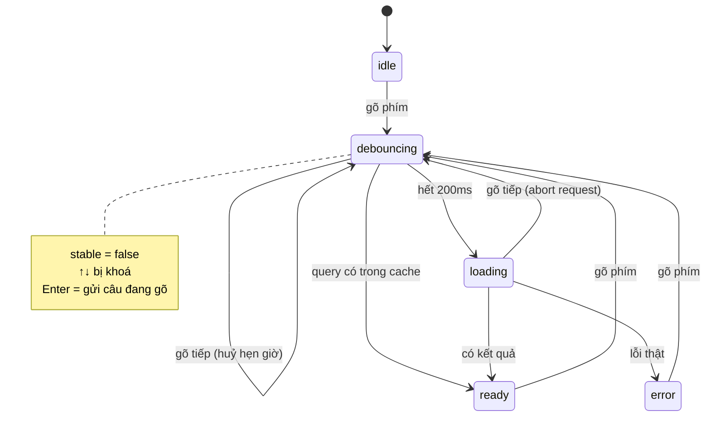

Ô tìm kiếm có gợi ý (autocomplete) là thứ ai cũng làm được trong 30 dòng: `onChange` → `fetch` → `setItems`. Rồi người dùng thật bắt đầu dùng:

- Gõ `react native` nhanh, 12 phím là 12 request. Mạng chập chờn, câu trả lời cho `r` về **sau** câu trả lời cho `react native` và đè lên.
- Gõ xong bấm ↓ rồi Enter ngay theo thói quen. Danh sách trên màn hình vẫn là kết quả của `react`, nên Enter mở nhầm khoá học.
- Gõ `net` để tìm ".NET": không tô đậm được vì từ bắt đầu bằng dấu chấm. Gõ `pot` thì "despotism" cũng sáng lên.
- Chuyển sang trang khác khi 3 widget đang tải: request vẫn chạy, kết quả về thì set state vào component đã unmount.

Ba site trong repo [codebase](https://github.com/hunghg255/codebase) mỗi site giải một phần. Bài này ghép chúng lại.

> [!TIP]
> **Tóm tắt**
> - **Debounce + abort**: chờ 200ms sau phím cuối mới gọi, gọi mới thì `abort()` request cũ, và bỏ qua `AbortError` (Udemy).
> - **Khoá phím khi kết quả chưa chốt**: đang debounce hoặc đang tải thì ↓/↑ không chạy, Enter gửi nguyên câu đang gõ thay vì chọn gợi ý cũ (ý tưởng của Pipedrive, sửa phần Enter).
> - **Gộp nhiều AbortSignal** (signal riêng của request + signal "chuyển trang") bằng `AbortSignal.any`, hoặc tự viết như Similarweb nhưng nhớ gỡ listener.
> - **Tô đậm chỉ ở đầu từ**, trả về các đoạn text để React render, không chèn `<strong>` vào chuỗi HTML (Udemy chèn HTML và có thể cắt vào giữa `&lt;`).

<iframe class="demo-frame" src="/demos/web-patterns/index.html?theme=dark#/search-box" title="Demo search-box" loading="lazy" style="height: 900px"></iframe>

<p class="demo-links">▶ <a href="/demos/web-patterns/index.html#/search-box" target="_blank" rel="noopener">Mở demo toàn màn hình ↗</a> · <a href="https://stackblitz.com/github/hunghg255/blog-hunghg/tree/master/examples/web-patterns?file=src/lib/searchBox.ts" target="_blank" rel="noopener">Sửa code trên StackBlitz ↗</a> · <a href="https://github.com/hunghg255/blog-hunghg/blob/master/examples/web-patterns/src/lib/searchBox.ts" target="_blank" rel="noopener">Xem source trên GitHub ↗</a></p>

Bấm "⌨ Tự gõ" ở chế độ Ngây thơ: 12 request, kết quả của các query cũ liên tục hiện lên, và Enter chọn nhầm. Chuyển sang Production rồi bấm lại: 1 request, ↓ bị khoá, Enter gửi câu "react native".

## Similarweb làm thế nào?

[`pro.similarweb.com/app/services/fetchService.ts`](https://github.com/hunghg255/codebase/blob/main/pro.similarweb.com/app/services/fetchService.ts) là lớp bọc `fetch` cho cả app. Mọi request GET được ghi vào một registry, và registry bị huỷ sạch mỗi khi router bắt đầu chuyển trang:

```ts
let pendingRequestsAbortControllers: Record<string, AbortController> = {};

export const createMultiAbortController = (signals: AbortSignal[]) => {
  const controller = new AbortController();
  function onAbort() {
    controller.abort();
    for (const signal of signals) signal.removeEventListener('abort', onAbort);
  }
  for (const signal of signals) {
    if (signal.aborted) { onAbort(); break; }
    signal.addEventListener('abort', onAbort);
  }
  return controller;
};
```

Trong `send()`, nhánh GET tạo `requestId = getUuid()`, gộp signal của người gọi (`cancellation`) với một controller mới, lưu vào registry, và `delete` trong `finally`. Request nào cần sống qua lần chuyển trang thì truyền `preventAutoCancellation: true`. `app.ts` gọi `abortAllPendingRequests()` trong handler `navChangeStart` của router.

`createMultiAbortController` là bản tự viết của [`AbortSignal.any()`](https://developer.mozilla.org/en-US/docs/Web/API/AbortSignal/any_static): một signal abort khi bất kỳ signal nguồn nào abort. Hai điểm cần biết:

- **Listener chỉ được gỡ khi có abort.** Request xong bình thường thì listener vẫn nằm trên signal của người gọi. Nếu người gọi dùng một signal sống lâu (một controller cho cả màn hình) cho nhiều request, listener tích tụ cho tới khi màn hình đó bị huỷ.
- **Retry hồi sinh request đã huỷ.** Nhánh `catch` gửi lại khi `numberOfRetry > 1`, mà `AbortError` cũng là lỗi. Request bị `abortAllPendingRequests()` huỷ sẽ được gửi lại với một controller mới, sau khi đã chuyển trang. Trong bản dump, chỗ duy nhất truyền `numberOfRetry` là một request POST với giá trị 1, nên lỗi này có lẽ chưa xảy ra trên thực tế.

## Udemy làm thế nào?

Store gợi ý nằm trong package nội bộ `@udemy/react-autosuggest-components`, file [`webpack---/src/autosuggest/autosuggest.mobx-store.ts`](https://github.com/hunghg255/codebase/blob/main/udemy.com/webpack---/src/autosuggest/autosuggest.mobx-store.ts) (MobX). Phần lõi:

```ts
// suggest(inputValue), mỗi phím:
this._suggestTimeoutId !== undefined && clearTimeout(this._suggestTimeoutId);
this._cancelSource?.abort();
// ...rồi: cache có thì dùng, không thì setTimeout(this._loadSuggestions, 200)

// _loadSuggestions():
this._cancelSource = new AbortController();
try {
  await this.loadSuggestions({ q: this.query, signal: this._cancelSource.signal });
} catch (e) {
  const isAborted = axios.isCancel(e) || (e as DOMException)?.name === 'AbortError';
  !isAborted && this.setSuggestions([]);   // (và gửi Sentry nếu không phải do huỷ)
}
```

(Đã rút gọn.) `suggestTimeout = 200`, `minInputLength = 1`. Mỗi phím: huỷ hẹn giờ cũ, `abort()` request cũ, rồi mới hẹn 200ms. Lỗi do chính mình huỷ thì không gửi Sentry và không xoá danh sách gợi ý.

**Về cache:** lớp gốc chỉ **đọc** `cachedSuggestions`. Dòng **ghi** cache trong phương thức mẫu `loadSuggestions` bị comment (`// this.cachedSuggestions[q] = this.suggestions; // If suggestions are cacheable.`) để lớp con tự quyết. Một số lớp con có ghi (ví dụ `messaging/new-thread/user-autosuggest.mobx-store.js` chỉ cache khi có kết quả), nhiều lớp con thì không. Cache là một object thường, không giới hạn kích thước.

`loadSuggestions` là phương thức lớp con viết đè, và **phải tự truyền `signal` xuống request**. `course-autosuggest.mobx-store.js` có truyền (`udApi.get(url, { signal, params: { q } })`). `user-autosuggest.mobx-store.js` thì không: request cũ vẫn chạy tới cùng, và khi về nó gọi `this.setSuggestions(...)` đè lên kết quả của query mới hơn. Lớp gốc không chặn được vì nó chỉ bắt lỗi, không kiểm tra lại `signal.aborted` sau khi `await` xong.

### Tô đậm từ khoá

[`webpack---/src/bold-search-terms.ts`](https://github.com/hunghg255/codebase/blob/main/udemy.com/webpack---/src/bold-search-terms.ts):

```ts
const specialCharactersPrefix = '(\\s|^[\x21-\x2f\x3a-\x40\x5b-\x60\x7b-\x7e]*)';
const regex = new RegExp(`(${specialCharactersPrefix}${escapeRegex(escapeHtml(term))})`, 'ig');
// boldSearchTerms: escapeHtml(text).split(' ') rồi word.replace(regex, '<strong>$1</strong>')
```

Ba dải `\x21-\x2f`, `\x3a-\x40`, `\x5b-\x60`, `\x7b-\x7e` là toàn bộ dấu câu ASCII. Escape HTML **trước** rồi mới chèn `<strong>`, nên tên khoá học chứa `<script>` không thành thẻ thật. Nhưng vì tô đậm trên chuỗi đã escape, dấu câu đứng đầu từ có thể là ký tự `&` của một entity: `C# <3` thành `C# &lt;3`, tìm `lt` sẽ ra `<strong>&lt</strong>;3`, trình duyệt hiển thị `<;3`. Ngoài ra từ ghép bằng gạch nối như `react-native` không khớp với `native`, vì dấu câu chỉ được phép ở **đầu** từ (`^[...]*`).

## Pipedrive làm thế nào?

Ô tìm kiếm toàn cục của Pipedrive (dashboard), [`webpack---/src/hooks/keyboard.js`](https://github.com/hunghg255/codebase/blob/main/pipedrive.com%28dashboard%29/webpack---/src/hooks/keyboard.js):

```js
useEffect(() => {
  setInputDebouncing(true);
  finishInputDebounce();               // debounce(() => setInputDebouncing(false), 350)
  return () => finishInputDebounce.cancel();
}, [term]);

// trong onKeyDown, sau khi xử lý Escape:
if (inputDebouncing || queryInProgress) return;   // kết quả chưa chốt: bỏ qua ↑ ↓ Enter
```

Ý tưởng đáng học: **danh sách trên màn hình chỉ được chọn bằng bàn phím khi nó khớp với chữ trong ô**. Cờ `inputDebouncing` bật ngay khi `term` đổi và chỉ tắt sau 350ms không gõ; `queryInProgress` lấy từ Redux. Một trong hai còn bật thì mọi phím mũi tên và Enter bị bỏ qua.

Cái giá: Enter trong lúc đó **mất luôn**, không có gì xảy ra. Người gõ nhanh bấm Enter phải bấm lại lần nữa.

Cùng file còn có `useScrollItemIntoView`: item đang chọn đổi thì cuộn nó vào tầm nhìn (`scroll-into-view-if-needed`, `block: 'nearest'`), **trừ khi chuột vừa di trong 16ms**. Item được chọn bằng hover thì đã nằm dưới con trỏ, cuộn nữa sẽ làm danh sách trượt khỏi chuột.

## Bên trong: một lần gõ phím đi qua những trạng thái nào



Chỉ ở `ready` (và `idle`, `error`) thì danh sách trên màn hình khớp với ô nhập. Đó cũng là điều kiện để bàn phím được chọn gợi ý.

## Viết lại

### Gộp signal và registry

```ts title=src/lib/searchBox.ts
export function anySignal(signals: AbortSignal[]): CombinedSignal {
  const native = (AbortSignal as { any?: (s: AbortSignal[]) => AbortSignal }).any;
  if (native) return { signal: native.call(AbortSignal, signals), dispose: () => {} };

  const controller = new AbortController();
  const cleanups: Array<() => void> = [];
  const dispose = () => cleanups.splice(0).forEach((fn) => fn());

  for (const source of signals) {
    if (source.aborted) {
      controller.abort(source.reason);
      dispose();
      break;
    }
    const onAbort = () => {
      controller.abort(source.reason);
      dispose();
    };
    source.addEventListener('abort', onAbort, { once: true });
    cleanups.push(() => source.removeEventListener('abort', onAbort));
  }
  return { signal: controller.signal, dispose };
}
```

Trình duyệt có `AbortSignal.any` thì dùng luôn: theo spec, signal nguồn chỉ giữ tham chiếu yếu tới signal kết quả, nên không tích tụ listener như bản tự viết. Bản tự viết dùng `{ once: true }` và trả thêm `dispose()` để người gọi gỡ listener khi request xong.

`createRequestRegistry()` (trong file đầy đủ) giữ một `Set<AbortController>`. `run(task, ownSignal)` tạo controller mới, gộp với signal riêng của người gọi bằng `anySignal`, chạy `task(signal)`, rồi trong `finally` xoá controller khỏi set và gọi `dispose()`. `abortAll()` huỷ mọi controller còn trong set.

### Store gợi ý

```ts title=src/lib/searchBox.ts
  async function fetchNow(query: string) {
    const controller = new AbortController();
    inflight = controller;
    const { signal } = controller;
    onEvent?.('request', query);
    set({ status: 'loading' });
    try {
      const items = await load(query, signal);
      // chốt chặn cuối: dù load() quên tôn trọng signal, kết quả của query cũ cũng bị bỏ
      if (signal.aborted) return;
      remember(query, items);
      set({ items, shownQuery: query, status: 'ready', activeIndex: -1 });
    } catch (error) {
      if (isAbortError(error) || signal.aborted) return; // mình tự huỷ: không phải lỗi
      onError?.(error);
      set({ items: [], shownQuery: query, status: 'error', activeIndex: -1 });
    } finally {
      if (inflight === controller) inflight = undefined;
    }
  }
```

```ts title=src/lib/searchBox.ts
    setInput(input: string) {
      cancelPending();
      const query = input.trim();
      if (query.length < minLength) {
        set({ input, items: [], shownQuery: query, status: 'idle', activeIndex: -1 });
        return;
      }
      const cached = cache.get(query);
      if (cached) {
        onEvent?.('cache-hit', query);
        remember(query, cached);
        set({ input, items: cached, shownQuery: query, status: 'ready', activeIndex: -1 });
        return;
      }
      // giữ danh sách cũ trên màn hình (đỡ nhấp nháy) nhưng đánh dấu là chưa chốt
      set({ input, status: 'debouncing', activeIndex: -1 });
      timer = setTimeout(() => void fetchNow(query), debounceMs);
    },
```

`move(delta)` trả `false` và không làm gì khi `stable` là `false`. `enter()` chỉ trả về gợi ý khi `stable` và đang có mục được chọn; còn lại trả `{ type: 'query', query }`.

## Đi qua code

- **`if (signal.aborted) return` sau `await`.** Đây là chốt chặn cho lớp con quên truyền `signal` (đúng trường hợp `user-autosuggest` của Udemy): request vẫn chạy, nhưng kết quả của query cũ không bao giờ vào state.
- **`stable` là trạng thái suy ra**, không phải cờ riêng: `ready | idle | error` là chốt, `debouncing | loading` là chưa. Không cần hẹn giờ 350ms riêng như Pipedrive.
- **Giữ danh sách cũ khi đang debounce**, chỉ làm mờ đi (`.sb-dim` trong demo). Xoá trắng mỗi phím làm danh sách nhấp nháy.
- **Enter khi chưa chốt trả về `{ type: 'query' }`.** Người dùng không mất phím Enter, và cũng không mở nhầm gợi ý cũ.
- **Cache LRU tối đa 50 query** bằng `Map`: `delete` rồi `set` để đưa key lên cuối, quá giới hạn thì xoá key đầu tiên (`keys().next()`).

**Khác bản gốc:**
- Udemy: lớp gốc chỉ đọc cache; ở đây store tự ghi cache, có giới hạn. Kiểm tra `signal.aborted` sau `await` là phần thêm.
- Pipedrive: Enter khi chưa chốt gửi câu tìm kiếm thay vì bị bỏ qua; không dùng hẹn giờ 350ms riêng.
- Similarweb: dùng `AbortSignal.any` nếu có, và có `dispose()`.

::: spoiler Xem toàn bộ src/lib/searchBox.ts

```ts title=src/lib/searchBox.ts
/**
 * Ô tìm kiếm/autocomplete "chuẩn production", gom mẹo từ 3 site:
 * - Similarweb (services/fetchService.ts): gộp nhiều AbortSignal thành một, và một registry
 *   để huỷ mọi request GET đang chạy khi chuyển trang.
 * - Udemy (autosuggest.mobx-store.ts): debounce 200ms, huỷ request cũ, nuốt AbortError
 *   (không báo lỗi, không xoá gợi ý). Lớp gốc của Udemy chỉ ĐỌC cache theo query, dòng ghi
 *   cache bị comment để lớp con tự quyết; cache có giới hạn kích thước ở đây là phần thêm.
 * - Pipedrive (hooks/keyboard.js): khoá phím mũi tên/Enter khi kết quả chưa "chốt"
 *   (đang debounce hoặc đang tải) để không chọn nhầm kết quả của query cũ.
 */

// ---------------------------------------------------------------------------
// 1. Gộp nhiều AbortSignal
// ---------------------------------------------------------------------------

export interface CombinedSignal {
  signal: AbortSignal;
  /** gỡ listener trên các signal nguồn khi request đã xong (tránh rò bộ nhớ) */
  dispose(): void;
}

/**
 * Signal abort khi BẤT KỲ signal nguồn nào abort.
 * Có `AbortSignal.any` (chuẩn mới) thì dùng; không thì tự làm như Similarweb, nhưng thêm
 * `dispose()`: signal nguồn sống lâu (vd signal của cả trang) mà request nào cũng gắn
 * listener rồi không gỡ thì listener tích tụ mãi.
 */
export function anySignal(signals: AbortSignal[]): CombinedSignal {
  const native = (AbortSignal as { any?: (s: AbortSignal[]) => AbortSignal }).any;
  if (native) return { signal: native.call(AbortSignal, signals), dispose: () => {} };

  const controller = new AbortController();
  const cleanups: Array<() => void> = [];
  const dispose = () => cleanups.splice(0).forEach((fn) => fn());

  for (const source of signals) {
    if (source.aborted) {
      controller.abort(source.reason);
      dispose();
      break;
    }
    const onAbort = () => {
      controller.abort(source.reason);
      dispose();
    };
    source.addEventListener('abort', onAbort, { once: true });
    cleanups.push(() => source.removeEventListener('abort', onAbort));
  }
  return { signal: controller.signal, dispose };
}

export const isAbortError = (error: unknown) =>
  error instanceof DOMException ? error.name === 'AbortError' : (error as Error)?.name === 'AbortError';

// ---------------------------------------------------------------------------
// 2. Registry các request đang chạy (huỷ hàng loạt khi chuyển trang)
// ---------------------------------------------------------------------------

export function createRequestRegistry() {
  const pending = new Set<AbortController>();
  return {
    /** Bọc một lời gọi: tự gắn signal của registry (gộp với signal riêng nếu có). */
    async run<T>(task: (signal: AbortSignal) => Promise<T>, own?: AbortSignal): Promise<T> {
      const controller = new AbortController();
      const combined = anySignal(own ? [own, controller.signal] : [controller.signal]);
      pending.add(controller);
      try {
        return await task(combined.signal);
      } finally {
        pending.delete(controller);
        combined.dispose();
      }
    },
    abortAll(reason = 'navigation') {
      const count = pending.size;
      pending.forEach((c) => c.abort(new DOMException(reason, 'AbortError')));
      pending.clear();
      return count;
    },
    get size() {
      return pending.size;
    },
  };
}

// ---------------------------------------------------------------------------
// 3. Store cho ô gợi ý
// ---------------------------------------------------------------------------

export type SuggestStatus = 'idle' | 'debouncing' | 'loading' | 'ready' | 'error';

export interface SuggestState<T> {
  input: string;
  /** query đã chuẩn hoá (trim) ứng với `items` đang hiển thị */
  shownQuery: string;
  items: T[];
  status: SuggestStatus;
  activeIndex: number;
  /** true = kết quả đang hiển thị khớp với ô nhập, được phép chọn bằng bàn phím */
  stable: boolean;
}

export interface SuggestStoreOptions<T> {
  load: (query: string, signal: AbortSignal) => Promise<T[]>;
  debounceMs?: number;
  minLength?: number;
  cacheSize?: number;
  /** gọi khi request lỗi thật (không phải do mình huỷ) */
  onError?: (error: unknown) => void;
  /** để demo đếm: mỗi request thật sự gửi đi / bị huỷ / lấy từ cache */
  onEvent?: (event: 'request' | 'abort' | 'cache-hit', query: string) => void;
}

export function createSuggestStore<T>({
  load,
  debounceMs = 200,
  minLength = 1,
  cacheSize = 50,
  onError,
  onEvent,
}: SuggestStoreOptions<T>) {
  let state: SuggestState<T> = {
    input: '',
    shownQuery: '',
    items: [],
    status: 'idle',
    activeIndex: -1,
    stable: true,
  };
  const listeners = new Set<() => void>();
  const cache = new Map<string, T[]>(); // Map giữ thứ tự chèn -> dùng làm LRU đơn giản
  let timer: ReturnType<typeof setTimeout> | undefined;
  let inflight: AbortController | undefined;

  const set = (patch: Partial<SuggestState<T>>) => {
    state = { ...state, ...patch };
    state.stable = state.status === 'ready' || state.status === 'idle' || state.status === 'error';
    listeners.forEach((l) => l());
  };

  const remember = (query: string, items: T[]) => {
    cache.delete(query);
    cache.set(query, items);
    if (cache.size > cacheSize) cache.delete(cache.keys().next().value as string);
  };

  async function fetchNow(query: string) {
    const controller = new AbortController();
    inflight = controller;
    const { signal } = controller;
    onEvent?.('request', query);
    set({ status: 'loading' });
    try {
      const items = await load(query, signal);
      // chốt chặn cuối: dù load() quên tôn trọng signal, kết quả của query cũ cũng bị bỏ
      if (signal.aborted) return;
      remember(query, items);
      set({ items, shownQuery: query, status: 'ready', activeIndex: -1 });
    } catch (error) {
      if (isAbortError(error) || signal.aborted) return; // mình tự huỷ: không phải lỗi
      onError?.(error);
      set({ items: [], shownQuery: query, status: 'error', activeIndex: -1 });
    } finally {
      if (inflight === controller) inflight = undefined;
    }
  }

  function cancelPending() {
    clearTimeout(timer);
    timer = undefined;
    if (inflight && !inflight.signal.aborted) {
      inflight.abort();
      onEvent?.('abort', '');
    }
    inflight = undefined;
  }

  return {
    getState: () => state,
    subscribe(listener: () => void) {
      listeners.add(listener);
      return () => listeners.delete(listener);
    },

    setInput(input: string) {
      cancelPending();
      const query = input.trim();
      if (query.length < minLength) {
        set({ input, items: [], shownQuery: query, status: 'idle', activeIndex: -1 });
        return;
      }
      const cached = cache.get(query);
      if (cached) {
        onEvent?.('cache-hit', query);
        remember(query, cached);
        set({ input, items: cached, shownQuery: query, status: 'ready', activeIndex: -1 });
        return;
      }
      // giữ danh sách cũ trên màn hình (đỡ nhấp nháy) nhưng đánh dấu là chưa chốt
      set({ input, status: 'debouncing', activeIndex: -1 });
      timer = setTimeout(() => void fetchNow(query), debounceMs);
    },

    /** ↑ / ↓. Trả false nếu bị khoá vì kết quả chưa chốt. */
    move(delta: 1 | -1) {
      if (!state.stable || state.items.length === 0) return false;
      const n = state.items.length;
      // -1 = chưa chọn gì (con trỏ vẫn ở ô nhập); đi vòng: cuối -> ô nhập -> đầu
      const next = state.activeIndex + delta;
      set({ activeIndex: next < -1 ? n - 1 : next >= n ? -1 : next });
      return true;
    },

    /**
     * Enter. Kết quả đã chốt và có mục đang chọn -> chọn mục đó.
     * Chưa chốt -> KHÔNG chọn mục cũ (Pipedrive bỏ qua phím luôn); ở đây coi như gửi
     * nguyên câu đang gõ, giống Enter trên ô tìm kiếm của Google.
     */
    enter(): { type: 'item'; item: T } | { type: 'query'; query: string } {
      if (state.stable && state.activeIndex >= 0) {
        return { type: 'item', item: state.items[state.activeIndex] };
      }
      return { type: 'query', query: state.input.trim() };
    },

    clear() {
      cancelPending();
      set({ input: '', items: [], shownQuery: '', status: 'idle', activeIndex: -1 });
    },

    dispose: cancelPending,
  };
}

export type SuggestStore<T> = ReturnType<typeof createSuggestStore<T>>;
```

:::

::: spoiler Xem toàn bộ src/lib/searchHighlight.ts

```ts title=src/lib/searchHighlight.ts
/**
 * Tô đậm từ khoá trong gợi ý tìm kiếm, chỉ khớp ở ĐẦU từ.
 *
 * Ý tưởng từ Udemy (bold-search-terms.ts): "pot" khớp "pottery", "Harry Potter" nhưng không
 * khớp "despotism"; cho phép ký tự đặc biệt đứng trước, nên "net" khớp ".NET".
 * Udemy escape HTML rồi chèn `<strong>` vào chuỗi HTML. Bản này trả về các đoạn text để
 * React render, không cần HTML, nên không bao giờ cắt vào giữa một entity như `&amp;`.
 */
export interface Segment {
  text: string;
  match: boolean;
}

const escapeRegex = (s: string) => s.replace(/[.*+?^${}()|[\]\\]/g, '\\$&');

export function highlightTerms(rawText: string, query: string): Segment[] {
  // Chuẩn hoá NFC: chữ "ệ" có thể đến dưới dạng 1 ký tự hoặc "e" + 2 dấu rời (NFD). Dấu rời là
  // \p{M}, không phải \p{L}, nên nếu không chuẩn hoá thì "t" trong "Việt" (NFD) bị coi là đầu từ.
  const text = rawText.normalize('NFC');
  const terms = query
    .normalize('NFC')
    .trim()
    .split(/\s+/)
    .filter(Boolean)
    // term dài trước: query "re react" thì "react" được thử trước "re", tô đậm trọn từ
    .sort((a, b) => b.length - a.length)
    .map(escapeRegex);
  if (terms.length === 0) return [{ text, match: false }];

  // (?<![\p{L}\p{N}]) = trước đó KHÔNG phải chữ/số -> chỉ khớp đầu từ.
  // Dấu câu như "." hay "#" được phép đứng trước, nên "net" khớp ".NET", "c" khớp "#c".
  // Cờ u để \p{L} hiểu chữ có dấu tiếng Việt.
  const re = new RegExp(`(?<![\\p{L}\\p{N}])(${terms.join('|')})`, 'giu');

  const segments: Segment[] = [];
  let last = 0;
  for (const m of text.matchAll(re)) {
    const start = m.index ?? 0;
    if (start > last) segments.push({ text: text.slice(last, start), match: false });
    segments.push({ text: m[0], match: true });
    last = start + m[0].length;
  }
  if (last < text.length) segments.push({ text: text.slice(last), match: false });
  return segments;
}
```

:::

### Tô đậm từ khoá

```ts title=src/lib/searchHighlight.ts
  // (?<![\p{L}\p{N}]) = trước đó KHÔNG phải chữ/số -> chỉ khớp đầu từ.
  // Dấu câu như "." hay "#" được phép đứng trước, nên "net" khớp ".NET", "c" khớp "#c".
  // Cờ u để \p{L} hiểu chữ có dấu tiếng Việt.
  const re = new RegExp(`(?<![\\p{L}\\p{N}])(${terms.join('|')})`, 'giu');
```

`(?<![\p{L}\p{N}])` là lookbehind phủ định: vị trí khớp không được đứng ngay sau một chữ cái hoặc chữ số (Unicode, nhờ cờ `u`). Nhờ vậy `net` khớp `.NET`, `native` khớp `react-native`, `pot` không khớp `despotism`, và chữ có dấu như `Việt`, `Nẵng` được tính là chữ cái. Kết quả là mảng `{ text, match }`; component render `<strong>` cho đoạn khớp, React tự escape phần còn lại.

## Tại sao không làm cách khác?

- **Chỉ debounce, không abort?** Debounce giảm số request nhưng không chặn được việc trả lời về sai thứ tự: gõ `rea`, dừng 250ms (gửi), gõ tiếp `ct` (gửi), request thứ nhất về sau và đè.
- **Đánh số request (`requestId`) thay cho abort?** Chặn được kết quả cũ, nhưng request cũ vẫn chiếm băng thông và server. Abort làm cả hai. Store ở trên làm cả hai: abort, và kiểm tra lại sau `await`.
- **Throttle thay vì debounce?** Throttle gửi đều đặn trong lúc gõ, hợp với "tìm khi đang gõ" trên dữ liệu cục bộ. Với API, debounce ít request hơn hẳn.
- **`dangerouslySetInnerHTML` với `<mark>`?** Dễ viết, nhưng mọi lỗi escape là một lỗ XSS. Trả về các đoạn text thì không có HTML nào để escape sai.

## Edge case và cạm bẫy

- **IME (gõ tiếng Việt bằng Telex/VNI trên một số bộ gõ, tiếng Nhật, tiếng Trung).** Trong lúc soạn chữ (`compositionstart` → `compositionend`), `onChange` có thể bắn với chữ chưa xong. Có thể bỏ qua khi `event.nativeEvent.isComposing`, và Enter trong lúc soạn là để chốt chữ, không phải để tìm.
- **Gõ không dấu.** `viet` không khớp `Việt`. Muốn khớp phải bỏ dấu cả hai phía (`normalize('NFD').replace(/\p{M}/gu, '')`) rồi ánh xạ vị trí ngược về chuỗi gốc để tô; phức tạp hơn đáng kể.
- **Chuẩn hoá Unicode.** `ệ` có thể là 1 ký tự (NFC) hoặc `e` + 2 dấu rời (NFD, hay gặp với dữ liệu từ macOS). Dấu rời thuộc `\p{M}` chứ không phải `\p{L}`, nên `highlightTerms` chuẩn hoá cả text lẫn query về NFC trước khi so.
- **`AbortSignal.any` và `signal.reason`.** Khi huỷ bằng `abort(reason)`, `fetch` reject với chính `reason` đó (không phải lúc nào cũng là `DOMException` tên `AbortError`). `isAbortError` vì vậy nên kiểm tra cả `signal.aborted`, như trong `fetchNow`.
- **Cache theo query cần hết hạn** nếu dữ liệu đổi thường xuyên (danh sách người dùng, đơn hàng). Thêm `savedAt` vào mỗi mục và bỏ qua mục quá N phút.

## Dùng trong dự án

```tsx
const store = useMemo(
  () => createSuggestStore<Course>({ load: (q, signal) => api.get('/courses', { params: { q }, signal }) }),
  [],
);
const state = useSyncExternalStore(store.subscribe, store.getState);

<input
  role='combobox'
  value={state.input}
  onChange={(e) => store.setInput(e.target.value)}
  onKeyDown={(e) => {
    if (e.key === 'ArrowDown' || e.key === 'ArrowUp') (e.preventDefault(), store.move(e.key === 'ArrowDown' ? 1 : -1));
    if (e.key === 'Enter' && !e.nativeEvent.isComposing) {
      const r = store.enter();
      r.type === 'item' ? openCourse(r.item) : goToSearchPage(r.query);
    }
  }}
/>;
```

Chuyển trang: gọi `registry.abortAll()` trong hook điều hướng của router, và cho các request dài (upload, export) đi ngoài registry.

## Kiểm thử

::: spoiler Ví dụ test (bản phác, không có trong repo)

```ts
import { afterEach, beforeEach, describe, expect, it, vi } from 'vitest';
import { anySignal, createSuggestStore } from './searchBox';
import { highlightTerms } from './searchHighlight';

beforeEach(() => vi.useFakeTimers());
afterEach(() => vi.useRealTimers());

/** API giả: trả lời sau `ms`, tôn trọng signal */
const api = (ms: number) =>
  vi.fn((q: string, signal: AbortSignal) =>
    new Promise<string[]>((resolve, reject) => {
      const t = setTimeout(() => resolve([`${q}-1`, `${q}-2`]), ms);
      signal.addEventListener('abort', () => (clearTimeout(t), reject(new DOMException('', 'AbortError'))));
    }),
  );

describe('createSuggestStore', () => {
  it('gõ liên tục chỉ gửi một request cho query cuối', async () => {
    const load = api(100);
    const store = createSuggestStore({ load });
    for (const q of ['r', 're', 'rea', 'react']) store.setInput(q);
    await vi.advanceTimersByTimeAsync(400);
    expect(load).toHaveBeenCalledTimes(1);
    expect(store.getState().items).toEqual(['react-1', 'react-2']);
  });

  it('load() quên signal thì kết quả cũ vẫn không vào state', async () => {
    const load = vi.fn((q: string) => new Promise<string[]>((r) => setTimeout(() => r([q]), q === 'a' ? 500 : 50)));
    const store = createSuggestStore({ load, debounceMs: 0 });
    store.setInput('a');
    await vi.advanceTimersByTimeAsync(1);
    store.setInput('ab');
    await vi.advanceTimersByTimeAsync(600);
    expect(store.getState().items).toEqual(['ab']);
  });

  it('chưa chốt thì khoá phím và Enter gửi câu đang gõ', async () => {
    const store = createSuggestStore({ load: api(100) });
    store.setInput('react');
    await vi.advanceTimersByTimeAsync(400);
    store.setInput('react n');
    expect(store.move(1)).toBe(false);
    expect(store.enter()).toEqual({ type: 'query', query: 'react n' });
  });

  it('query cũ lấy từ cache, không gửi lại', async () => {
    const load = api(10);
    const store = createSuggestStore({ load, debounceMs: 0 });
    store.setInput('net');
    await vi.advanceTimersByTimeAsync(50);
    store.setInput('go');
    await vi.advanceTimersByTimeAsync(50);
    store.setInput('net');
    expect(load).toHaveBeenCalledTimes(2);
    expect(store.getState().status).toBe('ready');
  });
});

describe('anySignal', () => {
  it('abort khi một trong các nguồn abort', () => {
    const a = new AbortController();
    const b = new AbortController();
    const { signal } = anySignal([a.signal, b.signal]);
    b.abort();
    expect(signal.aborted).toBe(true);
  });
});

describe('highlightTerms', () => {
  const marked = (text: string, q: string) =>
    highlightTerms(text, q).filter((s) => s.match).map((s) => s.text);
  it('chỉ khớp đầu từ, cho phép dấu câu đứng trước', () => {
    expect(marked('.NET Core', 'net')).toEqual(['NET']);
    expect(marked('react-native', 'native')).toEqual(['native']);
    expect(marked('Harry Potter, despotism', 'pot')).toEqual(['Pot']);
    expect(marked('C# <3', 'lt')).toEqual([]);
  });
  it('hiểu chữ có dấu ở cả NFC lẫn NFD', () => {
    expect(marked('Học tiếng Việt'.normalize('NFD'), 'việt')).toEqual(['Việt']);
    // chỉ chữ t đầu "tiếng"; chữ t cuối "Việt" đứng sau chữ ệ nên không phải đầu từ
    expect(marked('Học tiếng Việt'.normalize('NFD'), 't')).toEqual(['t']);
  });
});
```

:::

## So với thư viện và chuẩn web

- [`AbortSignal.any()`](https://developer.mozilla.org/en-US/docs/Web/API/AbortSignal/any_static) và [`AbortSignal.timeout()`](https://developer.mozilla.org/en-US/docs/Web/API/AbortSignal/timeout_static) đã có trong các trình duyệt chính ([caniuse](https://caniuse.com/mdn-api_abortsignal_any_static)). `anySignal` ở trên chỉ là đường lùi.
- TanStack Query truyền sẵn `signal` vào `queryFn` và tự huỷ query không còn ai dùng; cache theo `queryKey`. Nếu dự án đã dùng nó, store ở trên có thể rút gọn còn phần khoá phím và tô đậm.
- [Downshift](https://www.downshift-js.com/) và React Aria (`useComboBox`) lo phần a11y của combobox (`aria-activedescendant`, `role='listbox'`, đọc số kết quả cho trình đọc màn hình). Store ở trên chỉ lo dữ liệu, nên ghép với một trong hai được.
- [`<search>`](https://developer.mozilla.org/en-US/docs/Web/HTML/Element/search) là thẻ HTML ngữ nghĩa cho vùng tìm kiếm; bọc form tìm kiếm trong nó giúp trình đọc màn hình nhận ra landmark.

---

Bài này thuộc series **[Học từ mã nguồn các web lớn](/series/web)** (65 bài, đọc theo thứ tự).

::: spoiler Xem nhanh danh sách bài trong series

*Mở đầu*

- [Mở đầu: đọc code production của 28 trang web](/blogs/learn-from-big-web-apps)

*Phần 1: trải nghiệm người dùng*

- [#1 Dark mode không nháy (Gatsby)](/blogs/web-dark-mode-no-flash)
- [#2 useValueByMedia: giá trị theo breakpoint (Toptal)](/blogs/web-use-value-by-media)
- [#3 Đoán ý định: idle, exit-intent, lắc chuột (Toptal, InVision)](/blogs/web-user-intent-idle-exit-wiggle)
- [#4 Validate form thân thiện (Udacity, Pipedrive)](/blogs/web-form-validation-ux)
- [#5 Magic number, EXIF và dán ảnh (Ello)](/blogs/web-file-magic-number-exif-paste)
- [#6 fastSmoothScroll: cuộn xa vẫn nhanh (Telegram)](/blogs/web-telegram-fast-smooth-scroll)
- [#7 Countdown time-travel và tombstone giỏ hàng (Best Buy)](/blogs/web-countdown-time-travel-tombstone)

*Phần 2: hiệu năng và đo lường*

- [#8 Hàng đợi requestAnimationFrame 3ms (Apple)](/blogs/web-raf-queue-3ms)
- [#9 srcset cho artwork và preconnect tự động (Apple)](/blogs/web-responsive-artwork-preconnect)
- [#10 Quick-fetch: gọi API trước khi bundle tải xong (HubSpot)](/blogs/web-quick-fetch-early-requests)
- [#11 Performance span và long task (Postman, Calibre)](/blogs/web-performance-spans-long-tasks)
- [#12 Gọi Web Worker như hàm async (Telegram)](/blogs/web-worker-promise-rpc)
- [#13 Đồng hồ media: đếm giờ xem và sửa lệch (Skillshare, Simplified)](/blogs/web-media-clock-watch-time-drift)

*Phần 3: nhiều tab, phiên đăng nhập, cập nhật*

- [#14 Bầu tab chủ cho thông báo (HubSpot, Telegram)](/blogs/web-leader-tab-notifications)
- [#15 Đồng bộ đăng nhập giữa tab và giới hạn cookie (Elastic, InVision)](/blogs/web-cross-tab-auth-cookie-guard)
- [#16 SPA tự cập nhật: Trello, Zappos, Facebook, Elastic](/blogs/web-spa-self-update-strategies)

*Phần 4: kiến trúc*

- [#17 Reverse portal: di chuyển component không remount (Zappos)](/blogs/web-reverse-portal)
- [#18 Page behaviors: gắn hành vi từ CMS (Intercom)](/blogs/web-page-behaviors-cms)
- [#19 Giới hạn tần suất hiển thị bằng bitmask (Outlook)](/blogs/web-frequency-cap-bitmask)
- [#20 Chuyển REST sang GraphQL dần dần (Coursera)](/blogs/web-rest-to-graphql-hybrid-link)

*Phần 5: soạn thảo và hiển thị nội dung*

- [#21 Autocomplete tại con trỏ trong contenteditable (Ello, Telegram)](/blogs/web-caret-autocomplete-contenteditable)
- [#22 Dark mode cho email HTML bằng CIELAB (Outlook)](/blogs/web-email-dark-mode-cielab)
- [#23 Thu nhỏ bảng rộng cho vừa khung, vá font emoji (Outlook)](/blogs/web-email-wide-content-scale)
- [#24 Cảnh báo quên đính kèm file (Outlook)](/blogs/web-forgotten-attachment-warning)
- [#25 Cắt chữ nhiều dòng chính xác (Pipedrive, Apple, Toptal)](/blogs/web-multiline-truncate-measure-text)
- [#26 Parse ngày giờ gõ tay khoan dung (Outlook, Elastic)](/blogs/web-lenient-date-parser)

*Phần 6: tương tác*

- [#27 menuAim: rê chéo vào submenu không bị đóng (Udemy)](/blogs/web-menu-aim-triangle)
- [#28 Kéo, vuốt chung cho chuột và cảm ứng (Telegram)](/blogs/web-unified-pointer-gestures)
- [#29 Phím tắt theo phạm vi, IME và bàn phím phi Latinh (Trello)](/blogs/web-scoped-keyboard-shortcuts)
- [#30 Nội suy màu: đổi theme và nền theo cuộn (Telegram, Anchor)](/blogs/web-color-interpolation-theme-scroll)
- [#31 Đường gióng hút cạnh và undo/redo trên canvas (Simplified)](/blogs/web-canvas-snap-guides-undo)
- [#32 Giả lập mù màu bằng feColorMatrix (Trello)](/blogs/web-color-vision-simulator)
- [#33 Vạch thước theo mức zoom và cấp phát màu cho biểu đồ (Anchor, Similarweb)](/blogs/web-timeline-ticks-color-stack)

*Phần 7: mạng, dữ liệu và async*

- **#34 Ô tìm kiếm chuẩn production (Similarweb, Udemy, Pipedrive)** (bài này)
- [#35 Điều phối async: latest-wins, single-flight (Glitch, Toptal)](/blogs/web-async-coordination-latest-wins)
- [#36 Polling thưa dần và debounce động (Trello)](/blogs/web-decaying-polling-dynamic-debounce)
- [#37 Cache phía client theo version (Similarweb, Telegram, Udemy)](/blogs/web-client-cache-versioned)
- [#38 Upload file lớn theo chunk (Outlook, Tribe)](/blogs/web-chunked-upload-pipeline)
- [#39 Phát video qua Service Worker bằng Range request (Telegram, Outlook)](/blogs/web-service-worker-range-streaming)

*Phần 8: hiệu năng và vận hành*

- [#40 TTI governor: hoãn việc phụ tới sau khi trang dùng được (Outlook)](/blogs/web-tti-governor)
- [#41 Tự đo LCP/CLS/TBT và phục vụ bản nhẹ cho máy yếu (Udemy)](/blogs/web-rum-adaptive-loading)

*Phần 9: thuật toán và dữ liệu phía client*

- [#42 Three-way merge ngay trên trình duyệt (Postman)](/blogs/web-three-way-merge-client)
- [#43 Dọn cache GraphQL bằng đếm tham chiếu (Outlook)](/blogs/web-graphql-cache-refcount-gc)
- [#44 LRU cache theo 3 cách (Apple, Similarweb, Outlook)](/blogs/web-lru-cache-three-ways)
- [#45 Lọc tăng dần trong Web Worker (Similarweb)](/blogs/web-incremental-filter-worker)
- [#46 Xếp hạng gợi ý trên client, so ngầm với server (Outlook)](/blogs/web-client-side-ranking-shadow-test)
- [#47 Nối OT với editor: undo stack và chặn echo (Glitch)](/blogs/web-ot-codemirror-undo)
- [#48 Ngôn ngữ markup riêng dịch hai chiều với HTML (Coursera)](/blogs/web-custom-markup-compiler)

*Phần 10: thời gian, ngôn ngữ, định dạng*

- [#49 Xử lý giờ mùa hè không cần thư viện (Udemy, Pipedrive)](/blogs/web-dst-without-library)
- [#50 Intl thực chiến: Segmenter, số rút gọn, số nhiều, fallback locale (Apple, Outlook)](/blogs/web-intl-in-production)
- [#51 WebVTT và bôi chọn transcript (Udemy, Coursera)](/blogs/web-webvtt-transcript-selection)

*Phần 11: tương tác và giao diện*

- [#52 Kéo-thả trên lịch (Pipedrive)](/blogs/web-calendar-drag-drop)
- [#53 Focus stack cho popup lồng nhau (Outlook)](/blogs/web-focus-stack-nested-popups)
- [#54 Clipboard: copy, dán chữ thuần, dán thông minh (Trello, Anchor, Pipedrive, Tribe)](/blogs/web-clipboard-tricks)
- [#55 Khôi phục vị trí cuộn khi trang còn đang tải (Apple, Zappos)](/blogs/web-scroll-restore-wait-height)
- [#56 Lấy màu từ ảnh: gradient nền, màu chữ (Apple, Telegram, Trello)](/blogs/web-colors-from-images)
- [#57 JS đọc breakpoint từ CSS, phát hiện chế độ PWA (Ello, Apple)](/blogs/web-css-js-breakpoint-bridge)

*Phần 12: media*

- [#58 Tin nhắn thoại: ghi âm, waveform realtime, nén 5-bit (Telegram)](/blogs/web-voice-message-waveform)
- [#59 Chụp frame video thành ảnh, canvas bị taint (Coursera, Outlook)](/blogs/web-video-frame-snapshot)

*Phần 13: đo lường, bảo mật, vận hành*

- [#60 Đo lúc ảnh màn hình đầu tải xong, cả khi chuyển trang SPA (Zappos, Best Buy, Outlook)](/blogs/web-above-the-fold-image-timing)
- [#61 Buffer analytics chờ SDK, phát hiện adblock (Best Buy)](/blogs/web-analytics-buffer-adblock)
- [#62 Proof-of-work trên client để chặn API ẩn danh (Udemy)](/blogs/web-client-proof-of-work)
- [#63 Prefetch không làm lệch số liệu, nén cài đặt bằng bit (Outlook)](/blogs/web-synthetic-prefetch-bit-flags)
- [#64 Micro-frontend: AngularJS và React chung app, giao tiếp xuyên frame (Similarweb, InVision, HubSpot)](/blogs/web-micro-frontend-bridges)

:::

Code + demo: [`examples/web-patterns`](https://github.com/hunghg255/blog-hunghg/tree/master/examples/web-patterns) · [Mở trên StackBlitz](https://stackblitz.com/github/hunghg255/blog-hunghg/tree/master/examples/web-patterns)
