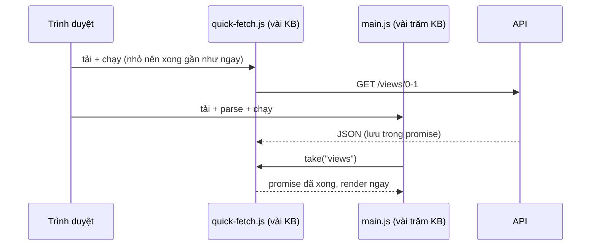

Một SPA điển hình khởi động theo kiểu thác nước (waterfall):

1. Tải HTML (gần như rỗng).
2. Tải `main.js` vài trăm KB, parse, chạy.
3. React render, component mount, `useEffect` chạy, **lúc này mới** gọi API.
4. Chờ API, render dữ liệu.

Bước 2 và bước 4 đều là chờ mạng, và chúng nối đuôi nhau dù không phụ thuộc gì vào nhau: URL API cần gọi (`/views/0-1`) đã nằm sẵn trong địa chỉ trang từ bước 1. Trang danh sách CRM của HubSpot gỡ thác nước này bằng một kỹ thuật họ gọi là **quick-fetch**: một script rất nhỏ đọc URL, bắn request API ngay lập tức, để dành promise. Khi app khởi động xong, lớp API hỏi "có request sớm nào tên `views` không?" và dùng luôn.

> [!TIP]
> **Tóm tắt**
> - Request API không phụ thuộc vào JS của app thì bắn ngay từ một script nhỏ ở đầu trang, song song với lúc tải bundle.
> - App "nhận" request sớm đúng một lần rồi xoá. Request sớm lỗi thì gọi lại bằng đường thường.
> - Bản viết lại kiểm tra URL có khớp với thứ app thật sự cần, và bỏ request quá cũ: HubSpot chỉ khớp theo tên.
> - Phía server có lựa chọn native: `<link rel="preload" as="fetch">`, 103 Early Hints, hoặc nhúng dữ liệu vào HTML.

<iframe class="demo-frame" src="/demos/web-patterns/index.html?theme=dark#/quick-fetch" title="Demo quick-fetch" loading="lazy" style="height: 720px"></iframe>

<p class="demo-links">▶ <a href="/demos/web-patterns/index.html#/quick-fetch" target="_blank" rel="noopener">Mở demo toàn màn hình ↗</a> · <a href="https://stackblitz.com/github/hunghg255/blog-hunghg/tree/master/examples/web-patterns?file=src/lib/quickFetch.ts" target="_blank" rel="noopener">Sửa code trên StackBlitz ↗</a> · <a href="https://github.com/hunghg255/blog-hunghg/blob/master/examples/web-patterns/src/lib/quickFetch.ts" target="_blank" rel="noopener">Xem source trên GitHub ↗</a></p>

Kéo "Tải bundle" và "API" rồi bấm hai nút: kiểu thường mất `bundle + API`, quick-fetch chỉ mất `max(bundle, API)`. Bật "request sớm bị lỗi" hoặc "app cần record khác" để xem đường lui.

## Bên trong trình duyệt: tại sao script nhỏ chạy sớm hơn?



Trình duyệt tải song song nhiều file, nhưng **chạy** JS trên một main thread. Script nhỏ tải xong trước, chạy trước, và lúc request API của nó đang bay thì trình duyệt vẫn tiếp tục tải `main.js`. Tổng thời gian tới lúc có dữ liệu từ `bundle + API` thành `max(bundle, API)`. Trên mạng 3G, bundle 1,5 giây và API 0,8 giây thì tiết kiệm được gần một giây.

Điều kiện để làm được: URL và tham số của request phải suy ra được từ thứ có sẵn lúc đầu trang (địa chỉ trang, cookie, vài biến server in vào HTML), không cần đến state của app.

## HubSpot làm thế nào?

Ba file trong [`app.hubspot.com/js/quick-fetch/`](https://github.com/hunghg255/codebase/tree/main/app.hubspot.com/js/quick-fetch) định nghĩa request sớm cho trang CRM: `restQuickFetch.js` (REST), `graphqlQuickFetch.js` (một query GraphQL `PageDataQuery`) và `objectTypesQuickFetch.js`. Thư viện chạy bên dưới (`window.quickFetch` và module `quick-fetch`) không nằm trong bản dump, nên phần dưới chỉ mô tả API của nó qua cách code gọi.

### 1. Script đầu trang

`restQuickFetch.js` (40 dòng) đọc `window.location.pathname`, tách `objectTypeId` (vd `0-1` là contact), rồi:

```js
window.quickFetch.makeEarlyRequest('views', Object.assign({}, baseQuickFetchConfig, {
  url: window.quickFetch.getApiUrl("/sales/v3/views/" + encodedTypeId + "?count=20000")
}));
window.quickFetch.makeEarlyRequest('properties', /* … /properties/v4/<id> … */);
window.quickFetch.afterAuth(function (_ref) {
  var enabled_gates = _ref.portal.enabled_gates;
  if (enabled_gates.includes('CRM:Datasets:PinnedViewsBackendRedesign')) {
    window.quickFetch.makeEarlyRequest('pinnedViewDefinitions', /* … */);
  } else {
    window.quickFetch.makeEarlyRequest('pinnedViews', /* … */);
  }
});
if (pathname.match('/board')) { /* thêm request 'boardCard' */ }
```

Vài điểm đáng học:

- Mỗi request có **tên** (`views`, `properties`…). Tên là "hợp đồng" giữa script đầu trang và lớp API của app.
- `baseQuickFetchConfig` đặt `timeout: 15000`: request sớm treo thì không giữ app chờ mãi.
- `afterAuth` cho phép request phụ thuộc: chờ thông tin portal (danh sách feature gate) rồi mới quyết định gọi endpoint nào. Vẫn sớm hơn nhiều so với đợi app chạy.
- Chỉ bắn khi chắc chắn app sẽ cần: `isMigratedObjectTypeId(objectTypeId)`, và request board chỉ khi URL có `/board`.

Cách file này được nạp vào trang không có trong dump; có lẽ nó được build thành một bundle riêng và chèn vào HTML trước bundle chính, vì đó là cách duy nhất để nó chạy sớm.

### 2. Lớp API nhận lại request

`js/utils/makeQuickFetchedRequest.js` bọc một hàm gọi API bình thường:

```js
export var makeQuickFetchedRequest = function (requestName, request) {
  return function (...params) {
    var quickFetchedRequest = quickFetch.getRequestStateByName(requestName);
    return quickFetchedRequest ? new Promise(function (resolve, reject) {
      quickFetchedRequest.whenFinished(function (result) {
        quickFetch.removeEarlyRequest(requestName);
        resolve(result);
      });
      quickFetchedRequest.onError(function () {
        quickFetch.removeEarlyRequest(requestName);
        request.apply(void 0, params).then(resolve, reject);
      });
    }) : request.apply(void 0, params);
  };
};
```

`js/rewrite/views/api/viewsAPI.js` dùng nó để bọc hàm `http.get` lấy danh sách view: `fetchViews(objectTypeId)` không biết gì về quick-fetch, chỉ thấy một hàm trả về promise. Comment của hàm nói rõ hai quy tắc: (1) request sớm lỗi thì **gọi lại** bằng đường thường; (2) dù thành công hay lỗi, request sớm đều bị **xoá sau lần dùng đầu tiên**, "để các file API không trả về dữ liệu cũ". Lần gọi `fetchViews` thứ hai (vd người dùng bấm làm mới) luôn đi đường thường.

Có một biến thể khác, `js/lib/quickFetch.js` (`quickFetchResponse`), trả về `null` khi không có request sớm và **không** gọi lại khi lỗi: người gọi phải tự lo. Hai cách cùng tồn tại trong một codebase, cách bọc hàm an toàn hơn vì người gọi không cần biết quick-fetch tồn tại.

### 3. Chỗ có thể sai

`makeQuickFetchedRequest` khớp request **theo tên, bỏ qua tham số**. Nếu lần gọi đầu là `fetchViews('0-2')` trong khi request sớm được bắn cho `0-1` (người dùng đổi trang trước khi app khởi động xong, hoặc một component khác gọi trước), app nhận dữ liệu của `0-1`. Trong thực tế điều này hiếm vì tên request gắn với trang hiện tại, nhưng nó là loại lỗi rất khó tái hiện. Bản viết lại so sánh URL.

## Viết lại

Hai nửa: `createQuickFetch()` cho script đầu trang (không phụ thuộc gì, vài trăm byte sau khi minify) và `withQuickFetch()` cho app. Phía đầu trang, `makeEarlyRequest(name, url)` gọi `fetch` ngay, gắn timeout bằng `AbortController`, lưu `{ url, startedAt, status, promise }` vào một `Map` theo tên. Phía app, chỗ quan trọng nhất là `take()`:

```ts title=src/lib/quickFetch.ts
  /**
   * Lấy request sớm ra và XOÁ khỏi danh sách (chỉ dùng một lần). Trả về null nếu không có,
   * đã quá cũ, hoặc URL không khớp với thứ app thật sự cần.
   */
  function take(name: string, expectedUrl?: string): EarlyRequest | null {
    const request = requests.get(name);
    if (!request) return null;
    requests.delete(name);
    if (now() - request.startedAt > maxAgeMs) return null;
    if (expectedUrl !== undefined && request.url !== expectedUrl) return null;
    return request;
  }
```

Lấy ra **và xoá ngay**, kể cả khi không dùng được (quá cũ, sai URL). Request sớm chỉ có một cơ hội.

```ts title=src/lib/quickFetch.ts
/**
 * Bọc hàm gọi API của app: có request sớm khớp URL thì dùng nó, request sớm lỗi thì
 * gọi lại bằng đường bình thường; không có thì gọi bình thường.
 */
export function withQuickFetch<Args extends unknown[], T>(
  name: string,
  toUrl: (...args: Args) => string,
  request: (...args: Args) => Promise<T>,
  getQuickFetch: () => QuickFetch | undefined = () => window.__quickFetch,
) {
  return async (...args: Args): Promise<T> => {
    const early = getQuickFetch()?.take(name, toUrl(...args));
    if (!early) return request(...args);
    try {
      return (await early.promise) as T;
    } catch {
      return request(...args);
    }
  };
}
```

::: spoiler Xem toàn bộ src/lib/quickFetch.ts

```ts title=src/lib/quickFetch.ts
/**
 * Quick-fetch: bắn request API ngay khi HTML vừa tới, song song với lúc trình duyệt tải
 * bundle JS; khi app khởi động xong thì "nhận lại" promise đó thay vì gọi API lần nữa.
 * Ý tưởng từ app.hubspot.com (js/quick-fetch/restQuickFetch.js + utils/makeQuickFetchedRequest.js).
 *
 * File này có 2 nửa:
 * - createQuickFetch(): chạy trong một script RẤT nhỏ ở <head> (không React, không thư viện).
 * - withQuickFetch(): dùng trong app, bọc hàm gọi API bình thường.
 * Hai nửa gặp nhau qua một biến global (mặc định window.__quickFetch).
 */

export type Fetcher = (url: string, init?: RequestInit) => Promise<unknown>;

export interface EarlyRequest {
  name: string;
  url: string;
  startedAt: number;
  status: 'pending' | 'done' | 'error';
  promise: Promise<unknown>;
}

export interface QuickFetchOptions {
  fetcher?: Fetcher;
  /** quá hạn này mà app chưa nhận thì bỏ: dữ liệu đã cũ */
  maxAgeMs?: number;
  /** hết giờ thì coi như lỗi, app sẽ tự gọi lại */
  timeoutMs?: number;
  now?: () => number;
}

const defaultFetcher: Fetcher = async (url, init) => {
  const res = await fetch(url, { credentials: 'same-origin', ...init });
  if (!res.ok) throw new Error(`HTTP ${res.status}`);
  return res.json();
};

export function createQuickFetch({
  fetcher = defaultFetcher,
  maxAgeMs = 30_000,
  timeoutMs = 15_000,
  now = () => performance.now(),
}: QuickFetchOptions = {}) {
  const requests = new Map<string, EarlyRequest>();

  function makeEarlyRequest(name: string, url: string, init?: RequestInit): EarlyRequest {
    const controller = new AbortController();
    const timer = setTimeout(() => controller.abort(new Error('quick-fetch timeout')), timeoutMs);
    const request: EarlyRequest = {
      name,
      url,
      startedAt: now(),
      status: 'pending',
      promise: fetcher(url, { ...init, signal: controller.signal }).finally(() => clearTimeout(timer)),
    };
    request.promise.then(
      () => (request.status = 'done'),
      () => (request.status = 'error'),
    );
    // Chưa ai nhận thì lỗi vẫn không được thành "unhandled rejection"
    request.promise.catch(() => {});
    requests.set(name, request);
    return request;
  }

  /**
   * Chạy `then` sau khi request `name` xong: request phụ thuộc kết quả request trước
   * (HubSpot: chờ auth trả về danh sách feature gate rồi mới quyết định gọi API nào).
   */
  function after(name: string, then: (result: unknown) => void) {
    requests.get(name)?.promise.then(then, () => {});
  }

  /**
   * Lấy request sớm ra và XOÁ khỏi danh sách (chỉ dùng một lần). Trả về null nếu không có,
   * đã quá cũ, hoặc URL không khớp với thứ app thật sự cần.
   */
  function take(name: string, expectedUrl?: string): EarlyRequest | null {
    const request = requests.get(name);
    if (!request) return null;
    requests.delete(name);
    if (now() - request.startedAt > maxAgeMs) return null;
    if (expectedUrl !== undefined && request.url !== expectedUrl) return null;
    return request;
  }

  return { makeEarlyRequest, after, take, peek: () => [...requests.values()] };
}

export type QuickFetch = ReturnType<typeof createQuickFetch>;

declare global {
  interface Window {
    __quickFetch?: QuickFetch;
  }
}

/**
 * Bọc hàm gọi API của app: có request sớm khớp URL thì dùng nó, request sớm lỗi thì
 * gọi lại bằng đường bình thường; không có thì gọi bình thường.
 */
export function withQuickFetch<Args extends unknown[], T>(
  name: string,
  toUrl: (...args: Args) => string,
  request: (...args: Args) => Promise<T>,
  getQuickFetch: () => QuickFetch | undefined = () => window.__quickFetch,
) {
  return async (...args: Args): Promise<T> => {
    const early = getQuickFetch()?.take(name, toUrl(...args));
    if (!early) return request(...args);
    try {
      return (await early.promise) as T;
    } catch {
      return request(...args);
    }
  };
}
```

:::

**Khác bản gốc:**

- Khớp theo tên **và** URL (`toUrl(...args)` so với URL của request sớm). HubSpot chỉ khớp theo tên.
- Request sớm có tuổi thọ (`maxAgeMs`, mặc định 30 giây): tab mở từ lâu mà app chưa nhận thì dữ liệu coi như cũ.
- Timeout dùng `AbortController` để thật sự huỷ request, thay vì chỉ ngừng chờ.
- `request.promise.catch(() => {})`: request sớm lỗi khi app chưa kịp nhận sẽ không thành "unhandled rejection" trong console.

## Đi qua code

**Script đầu trang trong thực tế** là một file riêng, đặt trước bundle chính:

```html
<script type="module">
  import { createQuickFetch } from '/quick-fetch.js';
  const qf = (window.__quickFetch = createQuickFetch());
  const m = location.pathname.match(/^\/contacts\/views\/([\w-]+)/);
  if (m) qf.makeEarlyRequest('views', `/api/views/${m[1]}`);
</script>
<script type="module" src="/assets/main.js"></script>
```

Với Vite, `quick-fetch.js` có thể là một entry riêng (`build.rollupOptions.input`), hoặc đơn giản là inline script nếu đủ ngắn. Quy tắc: file này không được import React, router hay bất kỳ thứ gì nặng, nếu không nó mất luôn lợi thế "chạy sớm".

**`after()`** tương đương `afterAuth` của HubSpot: chạy callback khi một request sớm khác xong. Dùng cho request phụ thuộc, vd cần biết người dùng thuộc gói nào rồi mới gọi API phù hợp.

## Tại sao không làm cách khác?

**`<link rel="preload" as="fetch" href="/api/views/0-1" crossorigin>`.** Đơn giản và native, nhưng có điều kiện: request trong app phải khớp với preload (cùng URL, cùng chế độ credentials) thì trình duyệt mới dùng lại, sai một chút là tải hai lần kèm cảnh báo "preloaded but not used" trong console. Chỉ hợp với GET, không thêm được header tuỳ ý (vd CSRF token), không có logic (`afterAuth`, feature gate). Nếu API của bạn đơn giản thì nên thử cách này trước.

**Server nhúng dữ liệu vào HTML (SSR, `<script type="application/json">`).** Nhanh nhất vì không tốn thêm round-trip, nhưng HTML chỉ gửi được khi dữ liệu xong, và server trang phải gọi được API (cùng hạ tầng, có quyền). HubSpot phục vụ HTML tĩnh rồi để client gọi API, nên quick-fetch hợp hơn.

**React Query `prefetchQuery` / loader của router.** Vẫn phải đợi bundle chạy xong mới bắt đầu, tức vẫn là thác nước. Cách hợp lý là kết hợp: quick-fetch bắn sớm, rồi `queryFn` của React Query dùng `withQuickFetch` để nhận lại.

## Edge case và cạm bẫy

- **Bắn request mà app không dùng** tốn băng thông và tải server. Chỉ quick-fetch những request chắc chắn cần cho màn hình đầu tiên, có điều kiện như HubSpot (`isMigratedObjectTypeId`, `/board`).
- **Cookie và CSRF.** Script đầu trang chạy trên cùng origin nên cookie tự gửi theo. Header như CSRF token phải đọc được từ cookie hoặc từ HTML.
- **Người dùng chuyển trang trước khi app khởi động.** Request sớm thành rác; `take()` theo URL sẽ bỏ nó, app gọi mới. Thử "app cần record khác" trong demo.
- **Lỗi 401 khi phiên hết hạn.** Request sớm lỗi, app gọi lại và gặp đúng lỗi đó, lúc này luồng xử lý đăng nhập bình thường của app sẽ lo. Đừng để script đầu trang tự redirect.
- **Đừng dùng lại lần hai.** Đó là lý do cả HubSpot và bản viết lại đều xoá request sau lần nhận đầu.

## Dùng trong dự án

```ts
// api/views.ts
import { withQuickFetch } from '../lib/quickFetch';

export const fetchViews = withQuickFetch(
  'views',
  (typeId: string) => `/api/views/${typeId}`,
  (typeId: string) => fetch(`/api/views/${typeId}`).then((r) => r.json() as Promise<View[]>),
);

// trong component (React Query)
const { data } = useQuery({ queryKey: ['views', typeId], queryFn: () => fetchViews(typeId) });
```

Đo trước và sau bằng Performance panel hoặc span (xem bài #11): thời điểm "có dữ liệu" phải sớm lên đúng bằng phần chồng lấn giữa thời gian tải bundle và thời gian API.

## Kiểm thử

::: spoiler Ví dụ test (bản phác, không có trong repo)

```ts
import { describe, expect, it, vi } from 'vitest';
import { createQuickFetch, withQuickFetch } from './quickFetch';

describe('quick-fetch', () => {
  it('app nhận lại request sớm, không gọi API lần hai', async () => {
    const fetcher = vi.fn().mockResolvedValue({ views: 1 });
    const qf = createQuickFetch({ fetcher });
    qf.makeEarlyRequest('views', '/api/views/0-1');
    const normal = vi.fn();
    const fetchViews = withQuickFetch('views', (id: string) => `/api/views/${id}`, normal, () => qf);
    await expect(fetchViews('0-1')).resolves.toEqual({ views: 1 });
    expect(normal).not.toHaveBeenCalled();
    expect(fetcher).toHaveBeenCalledTimes(1);
  });

  it('chỉ dùng một lần', async () => {
    const qf = createQuickFetch({ fetcher: async () => 'early' });
    qf.makeEarlyRequest('views', '/v');
    const fetchViews = withQuickFetch('views', () => '/v', async () => 'normal', () => qf);
    expect(await fetchViews()).toBe('early');
    expect(await fetchViews()).toBe('normal');
  });

  it('lỗi thì gọi lại bằng đường thường', async () => {
    const qf = createQuickFetch({ fetcher: () => Promise.reject(new Error('503')) });
    qf.makeEarlyRequest('views', '/v');
    const fetchViews = withQuickFetch('views', () => '/v', async () => 'normal', () => qf);
    expect(await fetchViews()).toBe('normal');
  });

  it('URL không khớp hoặc quá cũ thì bỏ', async () => {
    let t = 0;
    const qf = createQuickFetch({ fetcher: async () => 'early', maxAgeMs: 1000, now: () => t });
    qf.makeEarlyRequest('a', '/x/1');
    expect(qf.take('a', '/x/2')).toBeNull();
    qf.makeEarlyRequest('b', '/y');
    t = 5000;
    expect(qf.take('b', '/y')).toBeNull();
  });
});
```

:::

## So sánh với thư viện và chuẩn web

- **103 Early Hints** (header `Link: </api/views/0-1>; rel=preload; as=fetch` gửi trước cả response HTML) đẩy ý tưởng này lên tầng HTTP. Hỗ trợ phụ thuộc trình duyệt lẫn CDN (tính tới 10/2026), xem [MDN](https://developer.mozilla.org/en-US/docs/Web/HTTP/Status/103).
- **Remix / React Router loader, Next.js Server Components** gọi dữ liệu ở server song song với việc gửi JS, giải quyết cùng vấn đề cho app có server render.
- **Speculation Rules (prerender)** đi xa hơn: tải sẵn cả trang kế tiếp trước khi người dùng bấm, nhưng đó là cho điều hướng tiếp theo, không phải lần tải đầu.

---

Bài này thuộc series **[Học từ mã nguồn các web lớn](/series/web)** (65 bài, đọc theo thứ tự).

::: spoiler Xem nhanh danh sách bài trong series

*Mở đầu*

- [Mở đầu: đọc code production của 28 trang web](/blogs/learn-from-big-web-apps)

*Phần 1: trải nghiệm người dùng*

- [#1 Dark mode không nháy (Gatsby)](/blogs/web-dark-mode-no-flash)
- [#2 useValueByMedia: giá trị theo breakpoint (Toptal)](/blogs/web-use-value-by-media)
- [#3 Đoán ý định: idle, exit-intent, lắc chuột (Toptal, InVision)](/blogs/web-user-intent-idle-exit-wiggle)
- [#4 Validate form thân thiện (Udacity, Pipedrive)](/blogs/web-form-validation-ux)
- [#5 Magic number, EXIF và dán ảnh (Ello)](/blogs/web-file-magic-number-exif-paste)
- [#6 fastSmoothScroll: cuộn xa vẫn nhanh (Telegram)](/blogs/web-telegram-fast-smooth-scroll)
- [#7 Countdown time-travel và tombstone giỏ hàng (Best Buy)](/blogs/web-countdown-time-travel-tombstone)

*Phần 2: hiệu năng và đo lường*

- [#8 Hàng đợi requestAnimationFrame 3ms (Apple)](/blogs/web-raf-queue-3ms)
- [#9 srcset cho artwork và preconnect tự động (Apple)](/blogs/web-responsive-artwork-preconnect)
- **#10 Quick-fetch: gọi API trước khi bundle tải xong (HubSpot)** (bài này)
- [#11 Performance span và long task (Postman, Calibre)](/blogs/web-performance-spans-long-tasks)
- [#12 Gọi Web Worker như hàm async (Telegram)](/blogs/web-worker-promise-rpc)
- [#13 Đồng hồ media: đếm giờ xem và sửa lệch (Skillshare, Simplified)](/blogs/web-media-clock-watch-time-drift)

*Phần 3: nhiều tab, phiên đăng nhập, cập nhật*

- [#14 Bầu tab chủ cho thông báo (HubSpot, Telegram)](/blogs/web-leader-tab-notifications)
- [#15 Đồng bộ đăng nhập giữa tab và giới hạn cookie (Elastic, InVision)](/blogs/web-cross-tab-auth-cookie-guard)
- [#16 SPA tự cập nhật: Trello, Zappos, Facebook, Elastic](/blogs/web-spa-self-update-strategies)

*Phần 4: kiến trúc*

- [#17 Reverse portal: di chuyển component không remount (Zappos)](/blogs/web-reverse-portal)
- [#18 Page behaviors: gắn hành vi từ CMS (Intercom)](/blogs/web-page-behaviors-cms)
- [#19 Giới hạn tần suất hiển thị bằng bitmask (Outlook)](/blogs/web-frequency-cap-bitmask)
- [#20 Chuyển REST sang GraphQL dần dần (Coursera)](/blogs/web-rest-to-graphql-hybrid-link)

*Phần 5: soạn thảo và hiển thị nội dung*

- [#21 Autocomplete tại con trỏ trong contenteditable (Ello, Telegram)](/blogs/web-caret-autocomplete-contenteditable)
- [#22 Dark mode cho email HTML bằng CIELAB (Outlook)](/blogs/web-email-dark-mode-cielab)
- [#23 Thu nhỏ bảng rộng cho vừa khung, vá font emoji (Outlook)](/blogs/web-email-wide-content-scale)
- [#24 Cảnh báo quên đính kèm file (Outlook)](/blogs/web-forgotten-attachment-warning)
- [#25 Cắt chữ nhiều dòng chính xác (Pipedrive, Apple, Toptal)](/blogs/web-multiline-truncate-measure-text)
- [#26 Parse ngày giờ gõ tay khoan dung (Outlook, Elastic)](/blogs/web-lenient-date-parser)

*Phần 6: tương tác*

- [#27 menuAim: rê chéo vào submenu không bị đóng (Udemy)](/blogs/web-menu-aim-triangle)
- [#28 Kéo, vuốt chung cho chuột và cảm ứng (Telegram)](/blogs/web-unified-pointer-gestures)
- [#29 Phím tắt theo phạm vi, IME và bàn phím phi Latinh (Trello)](/blogs/web-scoped-keyboard-shortcuts)
- [#30 Nội suy màu: đổi theme và nền theo cuộn (Telegram, Anchor)](/blogs/web-color-interpolation-theme-scroll)
- [#31 Đường gióng hút cạnh và undo/redo trên canvas (Simplified)](/blogs/web-canvas-snap-guides-undo)
- [#32 Giả lập mù màu bằng feColorMatrix (Trello)](/blogs/web-color-vision-simulator)
- [#33 Vạch thước theo mức zoom và cấp phát màu cho biểu đồ (Anchor, Similarweb)](/blogs/web-timeline-ticks-color-stack)

*Phần 7: mạng, dữ liệu và async*

- [#34 Ô tìm kiếm chuẩn production (Similarweb, Udemy, Pipedrive)](/blogs/web-production-search-box)
- [#35 Điều phối async: latest-wins, single-flight (Glitch, Toptal)](/blogs/web-async-coordination-latest-wins)
- [#36 Polling thưa dần và debounce động (Trello)](/blogs/web-decaying-polling-dynamic-debounce)
- [#37 Cache phía client theo version (Similarweb, Telegram, Udemy)](/blogs/web-client-cache-versioned)
- [#38 Upload file lớn theo chunk (Outlook, Tribe)](/blogs/web-chunked-upload-pipeline)
- [#39 Phát video qua Service Worker bằng Range request (Telegram, Outlook)](/blogs/web-service-worker-range-streaming)

*Phần 8: hiệu năng và vận hành*

- [#40 TTI governor: hoãn việc phụ tới sau khi trang dùng được (Outlook)](/blogs/web-tti-governor)
- [#41 Tự đo LCP/CLS/TBT và phục vụ bản nhẹ cho máy yếu (Udemy)](/blogs/web-rum-adaptive-loading)

*Phần 9: thuật toán và dữ liệu phía client*

- [#42 Three-way merge ngay trên trình duyệt (Postman)](/blogs/web-three-way-merge-client)
- [#43 Dọn cache GraphQL bằng đếm tham chiếu (Outlook)](/blogs/web-graphql-cache-refcount-gc)
- [#44 LRU cache theo 3 cách (Apple, Similarweb, Outlook)](/blogs/web-lru-cache-three-ways)
- [#45 Lọc tăng dần trong Web Worker (Similarweb)](/blogs/web-incremental-filter-worker)
- [#46 Xếp hạng gợi ý trên client, so ngầm với server (Outlook)](/blogs/web-client-side-ranking-shadow-test)
- [#47 Nối OT với editor: undo stack và chặn echo (Glitch)](/blogs/web-ot-codemirror-undo)
- [#48 Ngôn ngữ markup riêng dịch hai chiều với HTML (Coursera)](/blogs/web-custom-markup-compiler)

*Phần 10: thời gian, ngôn ngữ, định dạng*

- [#49 Xử lý giờ mùa hè không cần thư viện (Udemy, Pipedrive)](/blogs/web-dst-without-library)
- [#50 Intl thực chiến: Segmenter, số rút gọn, số nhiều, fallback locale (Apple, Outlook)](/blogs/web-intl-in-production)
- [#51 WebVTT và bôi chọn transcript (Udemy, Coursera)](/blogs/web-webvtt-transcript-selection)

*Phần 11: tương tác và giao diện*

- [#52 Kéo-thả trên lịch (Pipedrive)](/blogs/web-calendar-drag-drop)
- [#53 Focus stack cho popup lồng nhau (Outlook)](/blogs/web-focus-stack-nested-popups)
- [#54 Clipboard: copy, dán chữ thuần, dán thông minh (Trello, Anchor, Pipedrive, Tribe)](/blogs/web-clipboard-tricks)
- [#55 Khôi phục vị trí cuộn khi trang còn đang tải (Apple, Zappos)](/blogs/web-scroll-restore-wait-height)
- [#56 Lấy màu từ ảnh: gradient nền, màu chữ (Apple, Telegram, Trello)](/blogs/web-colors-from-images)
- [#57 JS đọc breakpoint từ CSS, phát hiện chế độ PWA (Ello, Apple)](/blogs/web-css-js-breakpoint-bridge)

*Phần 12: media*

- [#58 Tin nhắn thoại: ghi âm, waveform realtime, nén 5-bit (Telegram)](/blogs/web-voice-message-waveform)
- [#59 Chụp frame video thành ảnh, canvas bị taint (Coursera, Outlook)](/blogs/web-video-frame-snapshot)

*Phần 13: đo lường, bảo mật, vận hành*

- [#60 Đo lúc ảnh màn hình đầu tải xong, cả khi chuyển trang SPA (Zappos, Best Buy, Outlook)](/blogs/web-above-the-fold-image-timing)
- [#61 Buffer analytics chờ SDK, phát hiện adblock (Best Buy)](/blogs/web-analytics-buffer-adblock)
- [#62 Proof-of-work trên client để chặn API ẩn danh (Udemy)](/blogs/web-client-proof-of-work)
- [#63 Prefetch không làm lệch số liệu, nén cài đặt bằng bit (Outlook)](/blogs/web-synthetic-prefetch-bit-flags)
- [#64 Micro-frontend: AngularJS và React chung app, giao tiếp xuyên frame (Similarweb, InVision, HubSpot)](/blogs/web-micro-frontend-bridges)

:::

Code + demo: [`examples/web-patterns`](https://github.com/hunghg255/blog-hunghg/tree/master/examples/web-patterns) · [Mở trên StackBlitz](https://stackblitz.com/github/hunghg255/blog-hunghg/tree/master/examples/web-patterns)
