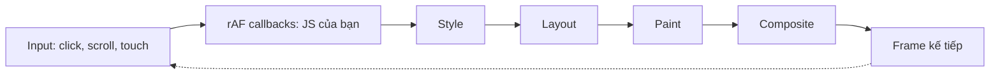

Trang chủ App Store trên web (apps.apple.com) là hàng chục "kệ" (shelf) cuộn ngang, mỗi kệ hàng chục ứng dụng, mỗi ứng dụng một ảnh. Khi bạn cuộn nhanh, IntersectionObserver báo hàng trăm phần tử vừa vào hoặc ra khỏi màn hình **cùng lúc**. Mỗi thông báo kéo theo một việc nhỏ: bắt đầu tải ảnh, render ô trong kệ, đo xem đoạn mô tả có bị cắt dòng không.

Từng việc chỉ tốn vài phần trăm mili giây. Nhưng 400 việc chạy liền một mạch là một frame dài 200ms: thanh cuộn khựng, animation đứng hình, cú chạm của người dùng phải đợi.

Apple xử lý bằng một class nhỏ tên `RequestAnimationFrameLimiter`: **gom mọi việc vào một `requestAnimationFrame`, nhưng mỗi frame chỉ chạy tối đa 3ms**, phần còn lại để frame sau.

> [!TIP]
> **Tóm tắt**
> - Đừng để mỗi nơi tự gọi `requestAnimationFrame`. Gom việc vào **một hàng đợi** và chạy trong **một** callback rAF.
> - Đặt **ngân sách thời gian** mỗi frame (Apple: 3ms). Hết ngân sách thì dừng, frame sau chạy tiếp.
> - Luôn chạy ít nhất một task mỗi frame, và **bắt lỗi từng task**: bản của Apple sẽ kẹt vĩnh viễn nếu một task ném lỗi.
> - Đánh đổi: việc xong **muộn hơn** (trải ra nhiều frame) để giao diện **luôn mượt**. Với việc không gấp, cân nhắc `scheduler.postTask` hoặc `requestIdleCallback`.

<iframe class="demo-frame" src="/demos/web-patterns/index.html?theme=dark#/raf-queue" title="Demo raf-queue" loading="lazy" style="height: 700px"></iframe>

<p class="demo-links">▶ <a href="/demos/web-patterns/index.html#/raf-queue" target="_blank" rel="noopener">Mở demo toàn màn hình ↗</a> · <a href="https://stackblitz.com/github/hunghg255/blog-hunghg/tree/master/examples/web-patterns?file=src/lib/rafQueue.ts" target="_blank" rel="noopener">Sửa code trên StackBlitz ↗</a> · <a href="https://github.com/hunghg255/blog-hunghg/blob/master/examples/web-patterns/src/lib/rafQueue.ts" target="_blank" rel="noopener">Xem source trên GitHub ↗</a></p>

Bấm "Chạy hết trong 1 frame": quả bóng khựng lại khoảng 220ms (400 task × 0,5ms). Bấm "Chạy qua RafQueue": cùng 400 task, xong sau khoảng 1,1 giây (khoảng 68 frame), nhưng không frame nào dài quá ~17ms và quả bóng không dừng.

## Apple làm thế nào?

Code nằm ở [`apps.apple.com/shared/components/src/utils/rafQueue.ts`](https://github.com/hunghg255/codebase/blob/main/apps.apple.com/shared/components/src/utils/rafQueue.ts) (rút gọn kiểu):

```ts
export class RequestAnimationFrameLimiter {
    constructor() {
        this.queue = [];
        // ideal limit for scroll based animations: https://developers.google.com/web/fundamentals/performance/rendering/optimize-javascript-execution#reduce_complexity_or_use_web_workers
        this.RAF_FN_LIMIT_MS = 3;
        this.requestId = null;
    }

    private flush(): void {
        this.requestId = this.queue.length === 0 ? null : window.requestAnimationFrame((timestamp) => {
            const start = window.performance.now();
            let ellapsedTime = 0;
            let count = 0;
            while (count < this.queue.length && ellapsedTime < this.RAF_FN_LIMIT_MS) {
                let item = this.queue[count];
                if (item) item(timestamp);
                count = count + 1;
                ellapsedTime = window.performance.now() - start;
            }
            this.queue = this.queue.slice(count);
            this.flush();
        });
    }

    public add(callback: () => void): void {
        this.queue.push(callback);
        if (this.requestId === null) this.flush();
    }
}

export const getRafQueue = () => {
    if (typeof window === 'undefined') {
        raf = { add: (callback) => callback() };    // SSR: chạy ngay
    } else if (raf === null) {
        raf = new RequestAnimationFrameLimiter();
    }
    return raf;
};
```

Cơ chế rất gọn:

1. `add` đẩy callback vào mảng. Nếu chưa có rAF nào đang chờ (`requestId === null`) thì đặt lịch.
2. Trong callback rAF, chạy lần lượt từng việc, đo thời gian bằng `performance.now()` sau **mỗi** việc. Vượt 3ms thì dừng.
3. Cắt bỏ phần đã chạy (`slice`) rồi gọi lại `flush()`: còn việc thì đặt rAF cho frame sau, hết việc thì `requestId = null`.
4. `getRafQueue()` trả về **một** instance dùng chung cho cả app, và trên server (SSR với Svelte) thì chạy callback ngay vì không có `window`.

Hàng đợi này được dùng ở những chỗ phát sinh nhiều việc nhỏ cùng lúc:

- `actions/intersection-observer.ts`: action Svelte `use:intersectionObserver` không gọi callback của component trực tiếp, mà `rafQueue.add(() => customCallback(ioEntry.isIntersecting))`.
- `components/Artwork/loaders/LazyLoader.svelte`: khi ảnh vào màn hình, việc đánh dấu "ảnh này đã hiện, bắt đầu tải" đi qua hàng đợi.
- `components/Shelf/ShelfItem.svelte`: ô trong kệ chuyển từ "chưa render" sang "render" qua hàng đợi, với comment "update DOM using RAF in browser for smoother scrolling".
- `components/LineClamp/LineClamp.svelte`: cập nhật trạng thái "có bị cắt dòng không" (để đặt vị trí badge) sau khi ResizeObserver báo.

### Một lỗi nhỏ nhưng nguy hiểm

Nhìn kỹ vòng lặp: nếu một `item(timestamp)` **ném lỗi**, lỗi bay ra khỏi callback rAF. Hai dòng `this.queue = this.queue.slice(count)` và `this.flush()` không bao giờ chạy. `requestId` vẫn giữ id của frame cũ (khác `null`), nên mọi lần `add()` sau đó đều nghĩ "đã có lịch rồi" và không đặt rAF nữa. **Toàn bộ hàng đợi dùng chung của app đứng yên vĩnh viễn**: ảnh không tải, kệ không render, cho tới khi tải lại trang. Một lỗi trong một component kéo sập những component chẳng liên quan.

Hai chi tiết khác:

- `queue.slice(count)` tạo **mảng mới** mỗi frame. Với vài trăm phần tử thì không sao, nhưng đó là O(n) mỗi frame trong khi chỉ cần dời một con trỏ.
- Callback được `add` **trong lúc** vòng lặp đang chạy sẽ được chạy luôn trong frame đó (vì `this.queue.length` được đọc lại mỗi vòng), miễn còn ngân sách. Đây có lẽ là hành vi mong muốn, nhưng cũng có nghĩa là một task tự thêm task con liên tục có thể chiếm hết mọi frame.

## Bên trong trình duyệt: một frame có bao nhiêu thời gian?

Màn hình 60Hz vẽ một frame mỗi ~16,7ms (120Hz: ~8,3ms). Trong khoảng đó trình duyệt phải làm cả phần của nó:



Các callback `requestAnimationFrame` chạy **ngay trước** style và layout của frame. Mọi rAF trong cùng frame nhận cùng một `timestamp` và chạy liên tiếp: 400 lần gọi `requestAnimationFrame` riêng lẻ không "tự chia" ra 400 frame, chúng vẫn chạy hết trong **một** frame. Đó là lý do cần một hàng đợi có ngân sách.

Vì sao 3ms? Comment trong code dẫn tới bài "Optimize JavaScript execution" của Google (nay ở web.dev). Ý chính của bài: với animation và cuộn, phần JavaScript trong mỗi frame nên giữ ở mức vài mili giây, để trình duyệt còn đủ thời gian cho style, layout, paint và composite. 3ms là con số thận trọng, đủ chỗ cho cả màn hình 120Hz.

Một điều nên biết: **cuộn trang thường chạy trên compositor thread**, nên kể cả khi main thread bị chặn 200ms, trang vẫn có thể cuộn được (nhưng nội dung mới không được vẽ, IntersectionObserver không chạy, các animation bằng JavaScript đứng hình, click phải đợi). Quả bóng trong demo chạy bằng JavaScript chính là để thấy main thread bị chặn.

## Viết lại

Phần chính của class:

```ts title=src/lib/rafQueue.ts
export class RafQueue {
  private queue: Entry[] = [];
  private head = 0; // chỉ số task kế tiếp; tránh queue.shift() O(n) mỗi lần
  private frameId: number | null = null;
  private readonly budgetMs: number;
  private readonly onFrame?: (stats: RafQueueStats) => void;
  private readonly onError: (error: unknown) => void;

  constructor({ budgetMs = 3, onFrame, onError = defaultOnError }: RafQueueOptions = {}) {
    this.budgetMs = budgetMs;
    this.onFrame = onFrame;
    this.onError = onError;
  }

  /** Thêm task; trả về hàm huỷ (task chưa chạy thì sẽ không chạy nữa). */
  add(task: Task): () => void {
    const entry: Entry = { task };
    this.queue.push(entry);
    this.schedule();
    return () => {
      entry.task = null;
    };
  }
```

Mỗi task được bọc trong một object `{ task }`. Hàm huỷ chỉ cần đặt `entry.task = null`, không phải tìm vị trí trong mảng, và vẫn đúng sau khi mảng được dọn.

Vòng chạy mỗi frame:

```ts title=src/lib/rafQueue.ts
  private schedule() {
    if (this.frameId === null && this.head < this.queue.length) {
      this.frameId = requestAnimationFrame(this.run);
    }
  }

  private run = (frameTime: number) => {
    this.frameId = null;
    if (this.head >= this.queue.length) return;
    const start = performance.now();
    let ran = 0;
    // Chạy ít nhất 1 task mỗi frame (kể cả task dài hơn ngân sách), nếu không hàng đợi kẹt mãi
    do {
      const entry = this.queue[this.head++];
      const task = entry.task;
      entry.task = null; // nhả tham chiếu cho GC, và huỷ sau khi chạy thì không có tác dụng gì
      if (!task) continue; // task đã bị huỷ: bỏ qua, không tính vào ngân sách
      try {
        task(frameTime);
      } catch (error) {
        // Apple: một task ném lỗi là cả hàng đợi đứng (requestId không bao giờ về null)
        this.onError(error);
      }
      ran++;
    } while (this.head < this.queue.length && performance.now() - start < this.budgetMs);

    // dọn mảng khi đã chạy hết, để mảng không phình mãi
    if (this.head >= this.queue.length) {
      this.queue = [];
      this.head = 0;
    }
    this.onFrame?.({ ran, spent: performance.now() - start, pending: this.pending });
    this.schedule();
  };
}
```

## Đi qua code

1. **`do … while` thay vì `while`**: luôn chạy ít nhất một task mỗi frame. Một task tốn 10ms vẫn chạy được (frame đó sẽ dài), thay vì không bao giờ được chạy. Bản của Apple cũng có tính chất này vì `ellapsedTime` bắt đầu từ 0.
2. **`try/catch` quanh từng task**: lỗi được báo qua `onError` (mặc định là [`reportError`](https://developer.mozilla.org/en-US/docs/Web/API/Window/reportError), nên vẫn hiện trong console và các công cụ theo dõi lỗi như Sentry vẫn bắt được), và vòng lặp chạy tiếp. Nút thứ ba trong demo cố tình cho task #20 ném lỗi: 399 ô còn lại vẫn sáng.
3. **Con trỏ `head`** thay cho `slice`: mỗi task chạy xong chỉ tăng chỉ số. Khi chạy hết thì mảng được thay bằng mảng rỗng.
4. **`frameId = null` ngay đầu `run`**, và `schedule()` ở cuối: kể cả khi có gì đó bất thường xảy ra giữa chừng, trạng thái "đã có lịch" không bao giờ bị kẹt.
5. **`onFrame`** báo số task đã chạy, thời gian đã dùng, số task còn chờ. Demo dùng nó để biết khi nào xong; trong app thật, nó hữu ích để đo xem hàng đợi có bị dồn ứ không.
6. **`getRafQueue()`** giữ ý tưởng một instance dùng chung và chạy ngay trên server.

**Khác bản gốc:** bắt lỗi từng task, huỷ được task, `clear()` để dọn khi đổi route, con trỏ thay cho `slice`, tuỳ chỉnh ngân sách, có callback đo đạc. Hành vi "task thêm trong lúc chạy thì chạy luôn nếu còn ngân sách" được giữ nguyên.

::: spoiler Xem toàn bộ src/lib/rafQueue.ts

```ts title=src/lib/rafQueue.ts
/**
 * Hàng đợi requestAnimationFrame có "ngân sách" thời gian mỗi frame.
 * Ý tưởng từ RequestAnimationFrameLimiter của apps.apple.com
 * (shared/components/src/utils/rafQueue.ts): gom nhiều callback vào MỘT rAF, chạy tới khi hết
 * ~3ms thì dừng, phần còn lại để frame sau. Main thread luôn còn chỗ cho input và render.
 */

type Task = (frameTime: number) => void;
/** bọc task trong object để huỷ được mà không cần biết vị trí của nó trong mảng */
type Entry = { task: Task | null };

export interface RafQueueStats {
  /** số task đã chạy trong frame vừa rồi */
  ran: number;
  /** thời gian đã dùng trong frame vừa rồi (ms) */
  spent: number;
  /** số task còn chờ */
  pending: number;
}

export interface RafQueueOptions {
  /** ngân sách mỗi frame (ms). Apple: 3ms */
  budgetMs?: number;
  /** gọi sau mỗi frame có chạy task (để đo đạc) */
  onFrame?: (stats: RafQueueStats) => void;
  /** task ném lỗi: mặc định báo qua reportError và CHẠY TIẾP các task khác */
  onError?: (error: unknown) => void;
}

const defaultOnError = (error: unknown) => {
  if (typeof reportError === 'function') reportError(error);
  else setTimeout(() => { throw error; });
};

export class RafQueue {
  private queue: Entry[] = [];
  private head = 0; // chỉ số task kế tiếp; tránh queue.shift() O(n) mỗi lần
  private frameId: number | null = null;
  private readonly budgetMs: number;
  private readonly onFrame?: (stats: RafQueueStats) => void;
  private readonly onError: (error: unknown) => void;

  constructor({ budgetMs = 3, onFrame, onError = defaultOnError }: RafQueueOptions = {}) {
    this.budgetMs = budgetMs;
    this.onFrame = onFrame;
    this.onError = onError;
  }

  /** Thêm task; trả về hàm huỷ (task chưa chạy thì sẽ không chạy nữa). */
  add(task: Task): () => void {
    const entry: Entry = { task };
    this.queue.push(entry);
    this.schedule();
    return () => {
      entry.task = null;
    };
  }

  get pending() {
    let count = 0;
    for (let i = this.head; i < this.queue.length; i++) if (this.queue[i].task) count++;
    return count;
  }

  /** Huỷ hết task đang chờ (ví dụ khi rời trang/route). */
  clear() {
    this.queue = [];
    this.head = 0;
    if (this.frameId !== null) cancelAnimationFrame(this.frameId);
    this.frameId = null;
  }

  private schedule() {
    if (this.frameId === null && this.head < this.queue.length) {
      this.frameId = requestAnimationFrame(this.run);
    }
  }

  private run = (frameTime: number) => {
    this.frameId = null;
    if (this.head >= this.queue.length) return;
    const start = performance.now();
    let ran = 0;
    // Chạy ít nhất 1 task mỗi frame (kể cả task dài hơn ngân sách), nếu không hàng đợi kẹt mãi
    do {
      const entry = this.queue[this.head++];
      const task = entry.task;
      entry.task = null; // nhả tham chiếu cho GC, và huỷ sau khi chạy thì không có tác dụng gì
      if (!task) continue; // task đã bị huỷ: bỏ qua, không tính vào ngân sách
      try {
        task(frameTime);
      } catch (error) {
        // Apple: một task ném lỗi là cả hàng đợi đứng (requestId không bao giờ về null)
        this.onError(error);
      }
      ran++;
    } while (this.head < this.queue.length && performance.now() - start < this.budgetMs);

    // dọn mảng khi đã chạy hết, để mảng không phình mãi
    if (this.head >= this.queue.length) {
      this.queue = [];
      this.head = 0;
    }
    this.onFrame?.({ ran, spent: performance.now() - start, pending: this.pending });
    this.schedule();
  };
}

let shared: RafQueue | null = null;

/** Hàng đợi dùng chung cho cả app (Apple: getRafQueue). Trên server thì chạy ngay. */
export function getRafQueue(): Pick<RafQueue, 'add'> {
  if (typeof window === 'undefined') {
    return {
      add(task) {
        task(0);
        return () => {};
      },
    };
  }
  return (shared ??= new RafQueue());
}
```

:::

## Tại sao không làm cách khác?

**Mỗi chỗ tự `requestAnimationFrame`?** Như phần trên: chúng vẫn chạy chung trong một frame, không có giới hạn nào cả.

**`setTimeout(fn, 0)` cho từng việc?** Mỗi task thành một macrotask riêng, trình duyệt có cơ hội xử lý input giữa các task. Nhưng không có liên hệ với frame: DOM có thể bị sửa giữa chừng hai frame, và trình duyệt có thể render khi mới xong một nửa số việc (giao diện "nhấp nháy" từng phần). Với việc cập nhật giao diện, chạy ngay trước khi vẽ (rAF) hợp lý hơn.

**`requestIdleCallback`?** Chạy khi trình duyệt rảnh, có `deadline.timeRemaining()` sẵn. Hợp với việc **không gấp** (gửi log, tiền xử lý dữ liệu). Nhưng trong lúc cuộn liên tục, trình duyệt có thể không rảnh mấy, và việc "hiện ảnh khi vào màn hình" sẽ bị trễ thấy rõ. Kiểm tra hỗ trợ trên Safari trước khi dùng ([caniuse](https://caniuse.com/requestidlecallback)).

**`scheduler.postTask` / `scheduler.yield()`?** API lập lịch mới, có mức ưu tiên (`user-blocking`, `user-visible`, `background`), huỷ được bằng `AbortSignal`. Đây là hướng đi đúng cho việc chia nhỏ tác vụ dài, nhưng chưa có trên mọi trình duyệt ([caniuse](https://caniuse.com/mdn-api_scheduler_posttask)), và không gắn với thời điểm vẽ frame như rAF.

**Web Worker?** Chỉ dùng được cho tính toán thuần. Những việc ở đây đều đụng DOM.

## Edge case và cạm bẫy

- **Đánh đổi độ trễ:** 400 việc × 0,5ms không còn xong trong 220ms mà trải ra hơn 1 giây. Với việc người dùng đang **chờ** (bấm nút mở menu), đừng đưa qua hàng đợi này.
- **Thứ tự đọc/ghi DOM:** các task chạy liền nhau trong một frame. Task A ghi style, task B đọc `offsetHeight` sẽ ép layout đồng bộ (layout thrashing). Nếu task vừa đọc vừa ghi, cân nhắc tách thành hai pha (đọc hết rồi ghi hết), như thư viện fastdom.
- **Tab nền:** `requestAnimationFrame` dừng khi tab bị ẩn. Việc trong hàng đợi sẽ đợi tới khi tab hiện lại. Đúng với việc cập nhật giao diện, sai với việc phải xảy ra (gửi dữ liệu).
- **Task giữ tham chiếu tới component đã unmount:** dùng hàm huỷ mà `add` trả về trong cleanup của component, nếu không task vẫn chạy và sửa DOM đã bị gỡ.
- **Ngân sách không phải hạn chót:** vòng lặp chỉ kiểm tra **sau** mỗi task. Một task 20ms vẫn làm frame dài 20ms. Hàng đợi giúp với nhiều việc nhỏ, không giúp với một việc lớn; việc lớn phải tự chia nhỏ.

## Dùng trong dự án

```tsx
import { useEffect, useRef, useState } from 'react';
import { getRafQueue } from './lib/rafQueue';

/** Như useInView, nhưng cập nhật state qua hàng đợi rAF: cuộn nhanh qua 500 ô cũng không khựng. */
function useQueuedInView<T extends Element>() {
  const ref = useRef<T>(null);
  const [inView, setInView] = useState(false);
  useEffect(() => {
    const queue = getRafQueue();
    const cancels: Array<() => void> = [];
    const io = new IntersectionObserver(([entry]) => {
      cancels.push(queue.add(() => setInView(entry.isIntersecting)));
    });
    io.observe(ref.current!);
    return () => {
      io.disconnect();
      cancels.forEach((cancel) => cancel());
    };
  }, []);
  return [ref, inView] as const;
}
```

Với nhiều phần tử, hãy dùng chung một IntersectionObserver (xem [bài Facebook #1](/blogs/facebook-shared-intersection-observer)); hàng đợi rAF là lớp thứ hai, giới hạn lượng việc được làm mỗi frame.

## Kiểm thử

::: spoiler Ví dụ test (bản phác, không có trong repo)

```ts
import { beforeEach, describe, expect, it, vi } from 'vitest';
import { RafQueue } from './rafQueue';

// rAF giả: lưu callback, test tự gọi từng frame
let frames: FrameRequestCallback[] = [];
let now = 0;
beforeEach(() => {
  frames = [];
  now = 0;
  vi.stubGlobal('requestAnimationFrame', (cb: FrameRequestCallback) => frames.push(cb));
  vi.stubGlobal('cancelAnimationFrame', () => {});
  vi.spyOn(performance, 'now').mockImplementation(() => now);
});
const nextFrame = () => frames.shift()!(now);

describe('RafQueue', () => {
  it('dừng khi hết ngân sách, frame sau chạy tiếp', () => {
    const q = new RafQueue({ budgetMs: 3 });
    const ran: number[] = [];
    for (let i = 0; i < 5; i++) q.add(() => { now += 1; ran.push(i); }); // mỗi task 1ms
    nextFrame();
    expect(ran).toEqual([0, 1, 2]);
    nextFrame();
    expect(ran).toEqual([0, 1, 2, 3, 4]);
    expect(frames).toHaveLength(0); // hết việc thì không đặt rAF nữa
  });

  it('task ném lỗi không làm kẹt hàng đợi', () => {
    const onError = vi.fn();
    const q = new RafQueue({ onError });
    const ok = vi.fn();
    q.add(() => { throw new Error('boom'); });
    q.add(ok);
    nextFrame();
    expect(onError).toHaveBeenCalledOnce();
    expect(ok).toHaveBeenCalled();
    q.add(ok);
    expect(frames).toHaveLength(1); // vẫn đặt lịch được
  });

  it('huỷ được task chưa chạy', () => {
    const q = new RafQueue();
    const fn = vi.fn();
    const cancel = q.add(fn);
    cancel();
    nextFrame();
    expect(fn).not.toHaveBeenCalled();
  });
});
```

:::

## So với thư viện và chuẩn web

- [`scheduler.yield()`](https://developer.mozilla.org/en-US/docs/Web/API/Scheduler/yield) là cách chuẩn để "nhường" main thread giữa một vòng lặp dài, giữ thứ tự ưu tiên cho phần tiếp theo. Kết hợp: chạy việc cho tới khi hết ngân sách, rồi `await scheduler.yield()`.
- React (từ bản 18) tự chia nhỏ việc render khi dùng `startTransition`; Scheduler của React cũng nhường main thread sau khoảng 5ms. Ý tưởng giống hàng đợi của Apple, ở tầng framework.
- [fastdom](https://github.com/wilsonpage/fastdom) gom các lần đọc và ghi DOM vào rAF theo hai pha, chống layout thrashing, nhưng không giới hạn thời gian mỗi frame.

---

Bài này thuộc series **[Học từ mã nguồn các web lớn](/series/web)** (65 bài, đọc theo thứ tự).

::: spoiler Xem nhanh danh sách bài trong series

*Mở đầu*

- [Mở đầu: đọc code production của 28 trang web](/blogs/learn-from-big-web-apps)

*Phần 1: trải nghiệm người dùng*

- [#1 Dark mode không nháy (Gatsby)](/blogs/web-dark-mode-no-flash)
- [#2 useValueByMedia: giá trị theo breakpoint (Toptal)](/blogs/web-use-value-by-media)
- [#3 Đoán ý định: idle, exit-intent, lắc chuột (Toptal, InVision)](/blogs/web-user-intent-idle-exit-wiggle)
- [#4 Validate form thân thiện (Udacity, Pipedrive)](/blogs/web-form-validation-ux)
- [#5 Magic number, EXIF và dán ảnh (Ello)](/blogs/web-file-magic-number-exif-paste)
- [#6 fastSmoothScroll: cuộn xa vẫn nhanh (Telegram)](/blogs/web-telegram-fast-smooth-scroll)
- [#7 Countdown time-travel và tombstone giỏ hàng (Best Buy)](/blogs/web-countdown-time-travel-tombstone)

*Phần 2: hiệu năng và đo lường*

- **#8 Hàng đợi requestAnimationFrame 3ms (Apple)** (bài này)
- [#9 srcset cho artwork và preconnect tự động (Apple)](/blogs/web-responsive-artwork-preconnect)
- [#10 Quick-fetch: gọi API trước khi bundle tải xong (HubSpot)](/blogs/web-quick-fetch-early-requests)
- [#11 Performance span và long task (Postman, Calibre)](/blogs/web-performance-spans-long-tasks)
- [#12 Gọi Web Worker như hàm async (Telegram)](/blogs/web-worker-promise-rpc)
- [#13 Đồng hồ media: đếm giờ xem và sửa lệch (Skillshare, Simplified)](/blogs/web-media-clock-watch-time-drift)

*Phần 3: nhiều tab, phiên đăng nhập, cập nhật*

- [#14 Bầu tab chủ cho thông báo (HubSpot, Telegram)](/blogs/web-leader-tab-notifications)
- [#15 Đồng bộ đăng nhập giữa tab và giới hạn cookie (Elastic, InVision)](/blogs/web-cross-tab-auth-cookie-guard)
- [#16 SPA tự cập nhật: Trello, Zappos, Facebook, Elastic](/blogs/web-spa-self-update-strategies)

*Phần 4: kiến trúc*

- [#17 Reverse portal: di chuyển component không remount (Zappos)](/blogs/web-reverse-portal)
- [#18 Page behaviors: gắn hành vi từ CMS (Intercom)](/blogs/web-page-behaviors-cms)
- [#19 Giới hạn tần suất hiển thị bằng bitmask (Outlook)](/blogs/web-frequency-cap-bitmask)
- [#20 Chuyển REST sang GraphQL dần dần (Coursera)](/blogs/web-rest-to-graphql-hybrid-link)

*Phần 5: soạn thảo và hiển thị nội dung*

- [#21 Autocomplete tại con trỏ trong contenteditable (Ello, Telegram)](/blogs/web-caret-autocomplete-contenteditable)
- [#22 Dark mode cho email HTML bằng CIELAB (Outlook)](/blogs/web-email-dark-mode-cielab)
- [#23 Thu nhỏ bảng rộng cho vừa khung, vá font emoji (Outlook)](/blogs/web-email-wide-content-scale)
- [#24 Cảnh báo quên đính kèm file (Outlook)](/blogs/web-forgotten-attachment-warning)
- [#25 Cắt chữ nhiều dòng chính xác (Pipedrive, Apple, Toptal)](/blogs/web-multiline-truncate-measure-text)
- [#26 Parse ngày giờ gõ tay khoan dung (Outlook, Elastic)](/blogs/web-lenient-date-parser)

*Phần 6: tương tác*

- [#27 menuAim: rê chéo vào submenu không bị đóng (Udemy)](/blogs/web-menu-aim-triangle)
- [#28 Kéo, vuốt chung cho chuột và cảm ứng (Telegram)](/blogs/web-unified-pointer-gestures)
- [#29 Phím tắt theo phạm vi, IME và bàn phím phi Latinh (Trello)](/blogs/web-scoped-keyboard-shortcuts)
- [#30 Nội suy màu: đổi theme và nền theo cuộn (Telegram, Anchor)](/blogs/web-color-interpolation-theme-scroll)
- [#31 Đường gióng hút cạnh và undo/redo trên canvas (Simplified)](/blogs/web-canvas-snap-guides-undo)
- [#32 Giả lập mù màu bằng feColorMatrix (Trello)](/blogs/web-color-vision-simulator)
- [#33 Vạch thước theo mức zoom và cấp phát màu cho biểu đồ (Anchor, Similarweb)](/blogs/web-timeline-ticks-color-stack)

*Phần 7: mạng, dữ liệu và async*

- [#34 Ô tìm kiếm chuẩn production (Similarweb, Udemy, Pipedrive)](/blogs/web-production-search-box)
- [#35 Điều phối async: latest-wins, single-flight (Glitch, Toptal)](/blogs/web-async-coordination-latest-wins)
- [#36 Polling thưa dần và debounce động (Trello)](/blogs/web-decaying-polling-dynamic-debounce)
- [#37 Cache phía client theo version (Similarweb, Telegram, Udemy)](/blogs/web-client-cache-versioned)
- [#38 Upload file lớn theo chunk (Outlook, Tribe)](/blogs/web-chunked-upload-pipeline)
- [#39 Phát video qua Service Worker bằng Range request (Telegram, Outlook)](/blogs/web-service-worker-range-streaming)

*Phần 8: hiệu năng và vận hành*

- [#40 TTI governor: hoãn việc phụ tới sau khi trang dùng được (Outlook)](/blogs/web-tti-governor)
- [#41 Tự đo LCP/CLS/TBT và phục vụ bản nhẹ cho máy yếu (Udemy)](/blogs/web-rum-adaptive-loading)

*Phần 9: thuật toán và dữ liệu phía client*

- [#42 Three-way merge ngay trên trình duyệt (Postman)](/blogs/web-three-way-merge-client)
- [#43 Dọn cache GraphQL bằng đếm tham chiếu (Outlook)](/blogs/web-graphql-cache-refcount-gc)
- [#44 LRU cache theo 3 cách (Apple, Similarweb, Outlook)](/blogs/web-lru-cache-three-ways)
- [#45 Lọc tăng dần trong Web Worker (Similarweb)](/blogs/web-incremental-filter-worker)
- [#46 Xếp hạng gợi ý trên client, so ngầm với server (Outlook)](/blogs/web-client-side-ranking-shadow-test)
- [#47 Nối OT với editor: undo stack và chặn echo (Glitch)](/blogs/web-ot-codemirror-undo)
- [#48 Ngôn ngữ markup riêng dịch hai chiều với HTML (Coursera)](/blogs/web-custom-markup-compiler)

*Phần 10: thời gian, ngôn ngữ, định dạng*

- [#49 Xử lý giờ mùa hè không cần thư viện (Udemy, Pipedrive)](/blogs/web-dst-without-library)
- [#50 Intl thực chiến: Segmenter, số rút gọn, số nhiều, fallback locale (Apple, Outlook)](/blogs/web-intl-in-production)
- [#51 WebVTT và bôi chọn transcript (Udemy, Coursera)](/blogs/web-webvtt-transcript-selection)

*Phần 11: tương tác và giao diện*

- [#52 Kéo-thả trên lịch (Pipedrive)](/blogs/web-calendar-drag-drop)
- [#53 Focus stack cho popup lồng nhau (Outlook)](/blogs/web-focus-stack-nested-popups)
- [#54 Clipboard: copy, dán chữ thuần, dán thông minh (Trello, Anchor, Pipedrive, Tribe)](/blogs/web-clipboard-tricks)
- [#55 Khôi phục vị trí cuộn khi trang còn đang tải (Apple, Zappos)](/blogs/web-scroll-restore-wait-height)
- [#56 Lấy màu từ ảnh: gradient nền, màu chữ (Apple, Telegram, Trello)](/blogs/web-colors-from-images)
- [#57 JS đọc breakpoint từ CSS, phát hiện chế độ PWA (Ello, Apple)](/blogs/web-css-js-breakpoint-bridge)

*Phần 12: media*

- [#58 Tin nhắn thoại: ghi âm, waveform realtime, nén 5-bit (Telegram)](/blogs/web-voice-message-waveform)
- [#59 Chụp frame video thành ảnh, canvas bị taint (Coursera, Outlook)](/blogs/web-video-frame-snapshot)

*Phần 13: đo lường, bảo mật, vận hành*

- [#60 Đo lúc ảnh màn hình đầu tải xong, cả khi chuyển trang SPA (Zappos, Best Buy, Outlook)](/blogs/web-above-the-fold-image-timing)
- [#61 Buffer analytics chờ SDK, phát hiện adblock (Best Buy)](/blogs/web-analytics-buffer-adblock)
- [#62 Proof-of-work trên client để chặn API ẩn danh (Udemy)](/blogs/web-client-proof-of-work)
- [#63 Prefetch không làm lệch số liệu, nén cài đặt bằng bit (Outlook)](/blogs/web-synthetic-prefetch-bit-flags)
- [#64 Micro-frontend: AngularJS và React chung app, giao tiếp xuyên frame (Similarweb, InVision, HubSpot)](/blogs/web-micro-frontend-bridges)

:::

Code + demo: [`examples/web-patterns`](https://github.com/hunghg255/blog-hunghg/tree/master/examples/web-patterns) · [Mở trên StackBlitz](https://stackblitz.com/github/hunghg255/blog-hunghg/tree/master/examples/web-patterns)
