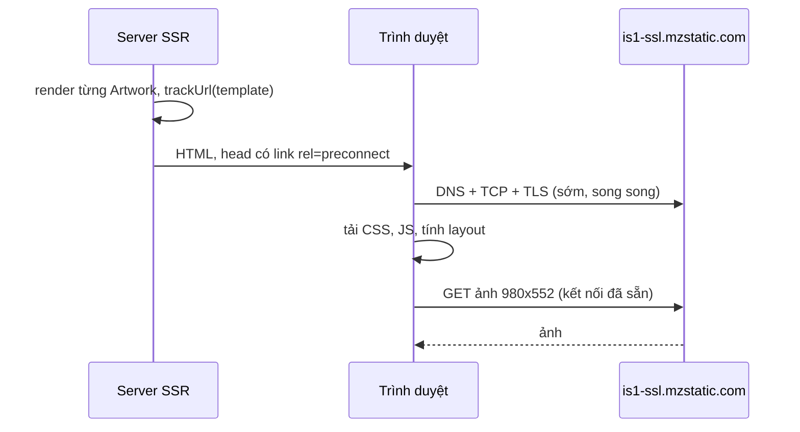

Trang chủ App Store trên web (apps.apple.com) có hàng trăm ảnh: icon app, ảnh chụp màn hình, banner lớn. Cùng một banner hiển thị rộng 490px trên điện thoại nhưng 1600px trên màn hình 27 inch, lại còn nhân đôi trên màn hình Retina. Nếu chỉ có một file ảnh thì luôn sai: ảnh to làm điện thoại tải thừa vài MB, ảnh nhỏ thì màn hình lớn bị mờ.

HTML đã có sẵn lời giải là `srcset` + `sizes`, nhưng viết tay hai thuộc tính này cho từng ảnh thì không ai làm nổi. Apple giải quyết bằng ba thứ: server ảnh nhận kích thước ngay trong URL, một bảng "profile" mô tả mỗi loại ảnh rộng bao nhiêu ở từng breakpoint, và một hàm sinh `srcset`/`sizes` từ hai thứ đó. Thêm một mẹo nhỏ: khi render phía server, mọi ảnh báo origin của mình để trang in sẵn `<link rel="preconnect">`.

> [!TIP]
> **Tóm tắt**
> - Server ảnh nhận `{w}x{h}` trong URL nên client tự chọn cỡ, không cần lưu sẵn từng bản.
> - "Profile" = độ rộng hiển thị ở 5 breakpoint. Từ đó sinh `srcset` (mỗi cỡ × mật độ 1x, 2x, không vượt ảnh gốc) và `sizes` (khớp đúng media query của layout).
> - `sizes` là để trình duyệt chọn ảnh TRƯỚC khi có CSS. Sai `sizes` thì `srcset` tốt mấy cũng vô ích.
> - SSR gom origin của mọi ảnh để in `<link rel="preconnect">` trong `<head>`. Ảnh `` thường không cần `crossorigin`, font thì cần.

<iframe class="demo-frame" src="/demos/web-patterns/index.html?theme=dark#/artwork-preconnect" title="Demo artwork-preconnect" loading="lazy" style="height: 980px"></iframe>

<p class="demo-links">▶ <a href="/demos/web-patterns/index.html#/artwork-preconnect" target="_blank" rel="noopener">Mở demo toàn màn hình ↗</a> · <a href="https://stackblitz.com/github/hunghg255/blog-hunghg/tree/master/examples/web-patterns?file=src/lib/artwork.ts" target="_blank" rel="noopener">Sửa code trên StackBlitz ↗</a> · <a href="https://github.com/hunghg255/blog-hunghg/blob/master/examples/web-patterns/src/lib/artwork.ts" target="_blank" rel="noopener">Xem source trên GitHub ↗</a></p>

## Bên trong trình duyệt: srcset, sizes và preconnect

### Trình duyệt chọn ảnh thế nào?

Với `srcset` dạng mô tả độ rộng (`url 490w, url 980w…`), trình duyệt cần biết **ảnh sẽ được vẽ rộng bao nhiêu CSS pixel**. Nhưng lúc preload scanner đọc HTML, CSS có thể chưa tải xong, layout chưa có. Vì vậy bạn phải tự khai báo con số đó qua `sizes`:

```html

```

Quy trình (đơn giản hoá):

1. Duyệt `sizes` từ trái sang phải, lấy độ rộng của media condition đầu tiên khớp. Mục cuối không có điều kiện là giá trị mặc định. Không mục nào hợp lệ thì coi như `100vw`.
2. Nhân với `devicePixelRatio` ra số pixel cần.
3. Chọn ứng viên trong `srcset` đủ lớn. Spec cho trình duyệt quyền tự quyết ở bước này (vd đã có ảnh to hơn trong cache thì dùng luôn), nên đừng viết code giả định chính xác ứng viên nào được chọn.

Kéo thanh trượt trong demo: bảng tô màu là kết quả của quy tắc trên, còn ô "Trình duyệt thật chọn gì?" nhúng một `<picture>` thật vào iframe rộng đúng chừng đó và đọc `img.currentSrc`. Hai kết quả khớp nhau trên Chromium.

### Preconnect để làm gì?

Lần đầu tải từ một origin mới (vd `is1-ssl.mzstatic.com`), trình duyệt phải tra DNS, mở TCP, bắt tay TLS: thường 100–300ms trên mạng di động, trước khi byte ảnh đầu tiên về. `<link rel="preconnect" href="https://is1-ssl.mzstatic.com">` trong `<head>` cho phép làm việc đó **sớm**, song song với lúc tải HTML/CSS, thay vì đợi tới lúc gặp thẻ `` (hoặc lâu hơn nữa với `loading="lazy"`).

Một chi tiết hay bị làm sai: kết nối mở với `crossorigin` và không có `crossorigin` là **hai kết nối khác nhau**. Ảnh `` thông thường tải ở chế độ no-cors nên preconnect cho ảnh không đặt `crossorigin`. Font thì luôn tải theo CORS, nên preconnect cho font phải có `crossorigin`. Chính App Store làm đúng điều này: thẻ preconnect cho font trong `src/components/structure/Fonts.svelte` có `crossorigin="anonymous"`.



## Apple làm thế nào?

Code nằm trong thư viện component dùng chung của các app Apple Media (`@amp/web-app-components`, viết bằng Svelte), thư mục [`apps.apple.com/shared/components/src/components/Artwork/`](https://github.com/hunghg255/codebase/tree/main/apps.apple.com/shared/components/src/components/Artwork). Đầu file `utils/srcset.ts` ghi "COPIED FROM … ember-ui-media-artwork … converted to TypeScript": logic này có từ thời Apple Music dùng Ember, rồi được chép sang Svelte.

### 1. Template URL

Dữ liệu artwork từ API có dạng:

```ts
{ template: 'https://is1-ssl.mzstatic.com/image/thumb/…/{w}x{h}{c}.{f}', width: 4000, height: 2250, backgroundColor: '…' }
```

`buildSrc` chỉ việc thay placeholder: `{w}` `{h}` là kích thước, `{c}` là "crop code" (`sr` cắt vừa khung, `bb` giữ nguyên ảnh, `bf` fill…; `constants.ts` liệt kê hơn 150 mã), `{f}` là định dạng (jpg, webp, png), `{q}` là chất lượng. Phần lớn độ dài của `srcset.ts` là xử lý URL "bẩn": template có crop code hay chất lượng viết cứng thì dùng regex thay lại thành placeholder.

### 2. Profile: ảnh này rộng bao nhiêu ở từng breakpoint

`src/config/components/artwork.ts` định nghĩa hơn 60 profile, mỗi cái là một tuple `[widths, aspectRatio, crop]`:

```ts
const heroSizes = [1600, 1240, 920, 920, 490];
['large-hero', [heroSizes, HD, 'sr']],          // HD = 16/9
['card', [cardSizes, THREE_QUARTERS, 'sr']],    // cardSizes = [525, 525, 490, 394, 738]
['app-icon-river', [[128, 128, 128, 88, 88], ONE, 'bb']],
```

Mảng `widths` xếp theo thứ tự `xlarge, large, medium, small, xsmall` (hằng `ARTWORK_IDENTIFIERS` trong `utils/artProfile.ts`). Breakpoint nằm ở `shared/components/config/components/artwork.ts`: `xsmall ≤ 739`, `small 740–999`, `medium 1000–1319`, `large 1320–1679`, `xlarge ≥ 1680`. Profile chính là bản sao của layout CSS dưới dạng số, để JS sinh được `sizes` khớp với CSS.

### 3. Sinh srcset và sizes

`buildResponsiveSrcset` lặp qua mỗi mật độ (`PIXEL_DENSITIES = [1, 2]`) × mỗi cỡ trong profile, có ba quy tắc:

- **Không xin ảnh to hơn ảnh gốc** (`Math.min(calculatedWidth, artworkMaxWidth)`), trừ crop `bf` (server tự fill).
- Ảnh gốc nhỏ hơn mọi cỡ thì dùng cỡ nhỏ nhất.
- Gom vào một `Set` để bỏ trùng: hai cỡ cùng bị chặn ở độ rộng ảnh gốc sẽ ra cùng một URL.

Tại sao cố định `[1, 2]` thay vì đọc `devicePixelRatio`? Comment trong `constants.ts` giải thích: giá trị này khác nhau giữa server (lúc SSR không có màn hình) và trình duyệt, đọc nó sẽ làm HTML server và client lệch nhau, ảnh có thể bị tải hai lần.

`getImageSizes` sinh `sizes` với hai chi tiết đáng chú ý: mục **nhỏ nhất** bỏ phần `min-width` (nếu không, viewport hẹp hơn mức min sẽ không khớp mục nào và rơi xuống mục cuối, tức ảnh to nhất), còn mục **cuối** không có điều kiện.

### 4. Markup

Trong `Artwork.svelte`:

```svelte
<picture>
  {#if webpSourceSet}<source {sizes} srcset={webpSourceSet} type="image/webp" />{/if}
  <source {sizes} {srcset} type={FILE_TO_MIME_TYPE[fileType]} />
  
</picture>
```

Hai `<source>` cùng `sizes`: trình duyệt hỗ trợ webp lấy nguồn đầu, còn lại lấy jpg. `width`/`height` lấy từ profile để giữ chỗ, tránh layout shift. Prop `fetchPriority` và `lazyLoad` có comment hướng dẫn: ảnh dự kiến là LCP thì đặt `lazyLoad={false}` và `fetchPriority="high"`.

### 5. PreconnectTracker

`utils/preconnect.ts` rất ngắn: một class giữ `Set<string>` các origin, hàm `trackUrl(url)` parse URL bằng `new URL()` trong `try/catch` ("Worst case this misses a preconnect. We'd rather it not take down the whole component"). Tracker chỉ được tạo trên server (`PreconnectTracker.setup(context)` đặt vào Svelte context), mỗi `<Artwork>` gọi `preconnectTracker?.trackUrl(template)`. Ở trình duyệt context không có tracker, dấu `?.` biến lời gọi thành không làm gì. Comment nói các thẻ được in bởi component `<Preconnects />` đặt cuối `<App>`; component này không có trong bản dump nên mình không xem được cách nó đưa thẻ lên `<head>`.

## Viết lại

Bản viết lại bỏ phần regex sửa URL (đặc thù server ảnh Apple), giữ lại ba hàm cốt lõi và tracker. Kiểu `Profile` là `{ widths, aspectRatio, crop }`, `widths` giữ nguyên thứ tự `xlarge → xsmall` như Apple để chép bảng số liệu sang là dùng được.

```ts title=src/lib/artwork.ts
 */
export function profileSizes(profile: Profile, maxWidth?: number): SizeSpec[] {
  const all = profile.widths.map((width, i) => ({
    size: PROFILE_ORDER[i],
    width,
    height: Math.round(width / profile.aspectRatio),
  }));
  all.sort((a, b) => SMALL_TO_LARGE.indexOf(a.size) - SMALL_TO_LARGE.indexOf(b.size));
  const fit = maxWidth ? all.filter((s) => s.width <= maxWidth) : all;
  return fit.length > 0 ? fit : all.slice(0, 1);
}
```

`profileSizes` chuyển profile thành danh sách cỡ từ nhỏ đến lớn và lọc theo độ rộng ảnh gốc. Tiếp theo là `srcset`:

```ts title=src/lib/artwork.ts
export interface SrcsetOptions {
  fileType?: SrcParams['fileType'];
  quality?: number;
  /** mật độ điểm ảnh cần hỗ trợ; Apple cố định [1, 2] thay vì đọc devicePixelRatio */
  densities?: number[];
}

/**
 * srcset dạng "url 490w, url 920w, …": mỗi size × mỗi mật độ một ứng viên.
 * Không xin ảnh rộng hơn bản gốc (trừ crop 'bf' = server tự fill), loại trùng bằng Map theo độ rộng.
 */
export function buildSrcset(artwork: Artwork, profile: Profile, opts: SrcsetOptions = {}): string {
  const { densities = [1, 2], fileType, quality } = opts;
  const candidates = new Map<number, string>();
  for (const density of densities) {
    for (const spec of profileSizes(profile, artwork.width)) {
      const wanted = Math.ceil(spec.width * density);
      const width = profile.crop === 'bf' ? wanted : Math.min(wanted, artwork.width);
      const height = Math.round((width * spec.height) / spec.width);
      const url = buildSrc(artwork.template, { width, height, crop: profile.crop, fileType, quality });
      candidates.set(width, `${url} ${width}w`);
    }
  }
  return [...candidates.entries()]
    .sort(([a], [b]) => a - b)
    .map(([, candidate]) => candidate)
    .join(', ');
}
```

Mình dùng `Map` theo độ rộng thay cho `Set` theo chuỗi: vừa bỏ trùng, vừa sắp xếp được theo độ rộng cho dễ đọc khi debug (thứ tự trong `srcset` không ảnh hưởng tới lựa chọn của trình duyệt).

```ts title=src/lib/artwork.ts
/**
 * sizes: báo cho trình duyệt biết ảnh sẽ rộng bao nhiêu ở từng viewport, TRƯỚC khi có CSS.
 * Size nhỏ nhất chỉ giữ max-width (không có min, nếu không viewport hẹp hơn sẽ rơi xuống
 * mục cuối = ảnh to nhất); mục cuối không có điều kiện (giá trị mặc định).
 */
export function buildSizes(profile: Profile, maxWidth?: number, bp: Breakpoints = APPLE_BREAKPOINTS) {
  const conditions = mediaConditions(bp);
  const specs = profileSizes(profile, maxWidth);
  return specs
    .map(({ size, width }, i) => {
      if (i === specs.length - 1) return `${width}px`;
      const condition = i === 0 && bp[size].max ? `(max-width:${bp[size].max}px)` : conditions[size];
      return `${condition} ${width}px`;
    })
    .join(', ');
}
```

Tracker cho SSR giữ nguyên tinh thần của Apple, thêm `toHtml()` để in thẻ (giới hạn số lượng, không đặt `crossorigin`):

```ts title=src/lib/artworkPreconnect.ts
export class PreconnectTracker {
  private readonly originSet = new Set<string>();

  /** Ghi nhận URL; trả về true nếu đây là origin mới. */
  trackUrl(url: string): boolean {
    try {
      const { origin } = new URL(url);
      if (this.originSet.has(origin)) return false;
      this.originSet.add(origin);
      return true;
    } catch {
      // URL hỏng (vd template rỗng): thiếu một preconnect còn hơn làm hỏng cả component
      return false;
    }
  }
```

::: spoiler Xem toàn bộ src/lib/artwork.ts

```ts title=src/lib/artwork.ts
/**
 * Dựng `srcset` + `sizes` cho ảnh từ một template URL (ý tưởng từ component Artwork của
 * apps.apple.com: shared/components/src/components/Artwork/utils/srcset.ts).
 *
 * Server ảnh của Apple nhận kích thước ngay trong đường dẫn:
 *   https://is1-ssl.mzstatic.com/image/thumb/…/{w}x{h}{c}.{f}
 * Client chỉ cần thay {w} {h} {c} {f} là có ảnh đúng cỡ, không phải lưu sẵn từng bản.
 */

export type Size = 'xsmall' | 'small' | 'medium' | 'large' | 'xlarge';

/** Khoảng viewport của từng size, cùng giá trị Apple dùng (px). */
export type Breakpoints = Record<Size, { min?: number; max?: number }>;

export const APPLE_BREAKPOINTS: Breakpoints = {
  xsmall: { max: 739 },
  small: { min: 740, max: 999 },
  medium: { min: 1000, max: 1319 },
  large: { min: 1320, max: 1679 },
  xlarge: { min: 1680 },
};

/** Ảnh gốc: template URL + kích thước thật (để không xin ảnh to hơn bản gốc). */
export interface Artwork {
  template: string;
  width: number;
  height: number;
}

/**
 * "Profile" = ảnh này hiển thị rộng bao nhiêu ở từng size.
 * `widths` xếp từ xlarge xuống xsmall như Apple, profile ít phần tử thì chỉ có các size lớn.
 */
export interface Profile {
  widths: number[];
  aspectRatio: number;
  /** crop code của server ảnh Apple: 'sr' = cắt vừa khung, 'bb' = giữ nguyên, 'bf' = fill… */
  crop: string;
}

const SMALL_TO_LARGE: Size[] = ['xsmall', 'small', 'medium', 'large', 'xlarge'];
const PROFILE_ORDER: Size[] = ['xlarge', 'large', 'medium', 'small', 'xsmall'];

export interface SizeSpec {
  size: Size;
  width: number;
  height: number;
}

/** Media condition cho từng size: "(min-width:740px) and (max-width:999px)"… */
export function mediaConditions(bp: Breakpoints = APPLE_BREAKPOINTS): Record<Size, string> {
  const out = {} as Record<Size, string>;
  for (const size of SMALL_TO_LARGE) {
    const { min, max } = bp[size];
    const parts = [];
    if (min) parts.push(`(min-width:${min}px)`);
    if (max) parts.push(`(max-width:${max}px)`);
    out[size] = parts.join(' and ');
  }
  return out;
}

/**
 * Các kích thước hiển thị của profile, từ nhỏ đến lớn. Bỏ các size rộng hơn ảnh gốc;
 * nếu ảnh gốc nhỏ hơn mọi size thì giữ size nhỏ nhất (giống Apple).
 */
export function profileSizes(profile: Profile, maxWidth?: number): SizeSpec[] {
  const all = profile.widths.map((width, i) => ({
    size: PROFILE_ORDER[i],
    width,
    height: Math.round(width / profile.aspectRatio),
  }));
  all.sort((a, b) => SMALL_TO_LARGE.indexOf(a.size) - SMALL_TO_LARGE.indexOf(b.size));
  const fit = maxWidth ? all.filter((s) => s.width <= maxWidth) : all;
  return fit.length > 0 ? fit : all.slice(0, 1);
}

export interface SrcParams {
  width: number;
  height: number;
  crop?: string;
  fileType?: 'jpg' | 'webp' | 'png';
  quality?: number;
}

/** Thay placeholder trong template. Template không có {q}/{c} thì bỏ qua tham số đó. */
export function buildSrc(template: string, p: SrcParams): string {
  return template
    .replace('{w}', String(p.width))
    .replace('{h}', String(p.height))
    .replace('{c}', p.crop ?? '')
    .replace('{q}', String(p.quality ?? 60))
    .replace('{f}', p.fileType ?? 'jpg');
}

export interface SrcsetOptions {
  fileType?: SrcParams['fileType'];
  quality?: number;
  /** mật độ điểm ảnh cần hỗ trợ; Apple cố định [1, 2] thay vì đọc devicePixelRatio */
  densities?: number[];
}

/**
 * srcset dạng "url 490w, url 920w, …": mỗi size × mỗi mật độ một ứng viên.
 * Không xin ảnh rộng hơn bản gốc (trừ crop 'bf' = server tự fill), loại trùng bằng Map theo độ rộng.
 */
export function buildSrcset(artwork: Artwork, profile: Profile, opts: SrcsetOptions = {}): string {
  const { densities = [1, 2], fileType, quality } = opts;
  const candidates = new Map<number, string>();
  for (const density of densities) {
    for (const spec of profileSizes(profile, artwork.width)) {
      const wanted = Math.ceil(spec.width * density);
      const width = profile.crop === 'bf' ? wanted : Math.min(wanted, artwork.width);
      const height = Math.round((width * spec.height) / spec.width);
      const url = buildSrc(artwork.template, { width, height, crop: profile.crop, fileType, quality });
      candidates.set(width, `${url} ${width}w`);
    }
  }
  return [...candidates.entries()]
    .sort(([a], [b]) => a - b)
    .map(([, candidate]) => candidate)
    .join(', ');
}

/**
 * sizes: báo cho trình duyệt biết ảnh sẽ rộng bao nhiêu ở từng viewport, TRƯỚC khi có CSS.
 * Size nhỏ nhất chỉ giữ max-width (không có min, nếu không viewport hẹp hơn sẽ rơi xuống
 * mục cuối = ảnh to nhất); mục cuối không có điều kiện (giá trị mặc định).
 */
export function buildSizes(profile: Profile, maxWidth?: number, bp: Breakpoints = APPLE_BREAKPOINTS) {
  const conditions = mediaConditions(bp);
  const specs = profileSizes(profile, maxWidth);
  return specs
    .map(({ size, width }, i) => {
      if (i === specs.length - 1) return `${width}px`;
      const condition = i === 0 && bp[size].max ? `(max-width:${bp[size].max}px)` : conditions[size];
      return `${condition} ${width}px`;
    })
    .join(', ');
}

// ---- Mô phỏng trình duyệt chọn ứng viên (để demo giải thích) ----

/** Đánh giá chuỗi sizes cho một viewport, trả về độ rộng slot (px). */
export function evaluateSizes(sizes: string, viewportWidth: number): number {
  for (const entry of sizes.split(',').map((s) => s.trim())) {
    const match = entry.match(/^(.*?)\s*(\d+)px$/);
    if (!match) continue;
    const [, condition, px] = match;
    const ok = [...condition.matchAll(/\((min|max)-width:(\d+)px\)/g)].every(([, kind, value]) =>
      kind === 'min' ? viewportWidth >= +value : viewportWidth <= +value,
    );
    if (ok) return +px;
  }
  return viewportWidth; // sizes không hợp lệ -> trình duyệt coi như 100vw
}

/**
 * Quy tắc đơn giản: ứng viên nhỏ nhất có độ rộng ≥ slot × DPR, không có thì lấy to nhất.
 * Trình duyệt thật được phép chọn khác (vd dùng ảnh to hơn đã có trong cache).
 */
export function pickCandidate(srcset: string, slotWidth: number, dpr: number) {
  const list = srcset.split(', ').map((c) => {
    const [url, w] = c.split(' ');
    return { url, width: parseInt(w, 10) };
  });
  const need = slotWidth * dpr;
  return list.find((c) => c.width >= need) ?? list[list.length - 1];
}
```

:::

::: spoiler Xem toàn bộ src/lib/artworkPreconnect.ts

```ts title=src/lib/artworkPreconnect.ts
/**
 * Gom origin của mọi ảnh đã render để sinh <link rel="preconnect"> (ý tưởng từ
 * PreconnectTracker của apps.apple.com: Artwork/utils/preconnect.ts).
 *
 * Apple chỉ dùng nó khi render phía server: mỗi <Artwork> báo URL của mình, cuối trang
 * in các thẻ preconnect vào HTML. Ở client tracker không tồn tại và component bỏ qua.
 */
export class PreconnectTracker {
  private readonly originSet = new Set<string>();

  /** Ghi nhận URL; trả về true nếu đây là origin mới. */
  trackUrl(url: string): boolean {
    try {
      const { origin } = new URL(url);
      if (this.originSet.has(origin)) return false;
      this.originSet.add(origin);
      return true;
    } catch {
      // URL hỏng (vd template rỗng): thiếu một preconnect còn hơn làm hỏng cả component
      return false;
    }
  }

  get origins(): string[] {
    return [...this.originSet];
  }

  /**
   * HTML để chèn vào <head> khi SSR.
   * Ảnh  bình thường tải ở chế độ no-cors nên KHÔNG đặt `crossorigin`: kết nối mở
   * với crossorigin chỉ dùng được cho request CORS (font, fetch), dùng sai là phí một kết nối.
   */
  toHtml({ max = 4, exclude }: { max?: number; exclude?: string } = {}): string {
    return this.origins
      .filter((origin) => origin !== exclude)
      .slice(0, max)
      .map((origin) => `<link rel="preconnect" href="${origin}">`)
      .join('\n');
  }
}

/**
 * Bản cho client (không có trong code Apple): thêm preconnect lúc chạy cho origin chưa có.
 * Chỉ có ích khi gọi TRƯỚC lúc ảnh thật sự được tải (vd vừa nhận dữ liệu trang, ảnh còn
 * nằm dưới màn hình với loading="lazy").
 */
export function ensurePreconnect(
  url: string,
  { doc = document, crossOrigin = false }: { doc?: Document; crossOrigin?: boolean } = {},
): HTMLLinkElement | null {
  let origin: string;
  try {
    origin = new URL(url, doc.baseURI).origin;
  } catch {
    return null;
  }
  if (origin === doc.location?.origin) return null; // cùng origin thì kết nối đã có sẵn
  const existing = Array.from(doc.head.querySelectorAll<HTMLLinkElement>('link[rel="preconnect"]')).find(
    (link) => new URL(link.href).origin === origin && link.hasAttribute('crossorigin') === crossOrigin,
  );
  if (existing) return existing;
  const link = doc.createElement('link');
  link.rel = 'preconnect';
  link.href = origin;
  if (crossOrigin) link.crossOrigin = 'anonymous';
  doc.head.appendChild(link);
  return link;
}
```

:::

**Khác bản gốc:**

- Khi ảnh gốc nhỏ hơn mọi cỡ, Apple dùng cỡ nhỏ nhất cho `srcset` nhưng `sizes` lại ra chuỗi dạng `"490w"` (nhánh cuối của `imageSizes`). `w` không phải đơn vị độ dài hợp lệ trong `sizes`, nên trình duyệt bỏ qua và coi như `100vw`. Bản viết lại dùng chung `profileSizes` cho cả hai nên luôn ra `"490px"`.
- Không có `memoize` (Apple memoize `getImageSizes`); hàm đủ rẻ, cần thì bọc ở tầng component.
- Thêm `ensurePreconnect()` cho client-side rendering (xem dưới) và `evaluateSizes`/`pickCandidate` chỉ để demo minh hoạ.

## Đi qua code

**Vì sao `sizes` phải khớp CSS?** Trình duyệt tin `sizes` tuyệt đối. Khai báo `sizes="100vw"` cho một card thật ra chỉ rộng 394px trên tablet 768px thì máy 2x sẽ tải ảnh 1536px thay vì 788px, gần gấp 4 lần số pixel. Ngược lại khai báo nhỏ hơn thực tế thì ảnh bị mờ. Đây là lý do Apple giữ breakpoint ở một chỗ (`ArtworkConfig`) và dùng chung cho cả media query của layout lẫn `sizes`.

**Vì sao không vượt ảnh gốc?** Server ảnh có thể phóng to, nhưng ảnh phóng to không thêm chi tiết mà chỉ tốn byte. Thử chọn "Ảnh gốc rộng 600px" trong demo: mọi ứng viên lớn hơn 600 gộp thành một.

**Vì sao `[1, 2]` mà không có 3x?** Ở ảnh chụp, khác biệt giữa 2x và 3x khó thấy, trong khi 3x tốn gấp 2,25 lần pixel so với 2x. Máy 3x vẫn không bị mờ hẳn: chọn DPR 3 ở viewport 390px trong demo, cần 1470px và bảng chọn bản 1600w (vốn là bản 1x của màn hình lớn). Ở viewport rộng thì chạm trần ở ứng viên lớn nhất (3200w), tức bản 2x.

## Tại sao không làm cách khác?

**Dùng density descriptor (`1x, 2x`)?** Chỉ đúng khi ảnh có kích thước cố định (icon 64px). Ảnh co giãn theo layout cần `w` + `sizes`, nếu không trình duyệt không biết slot rộng bao nhiêu.

**Để `sizes` trống?** Mặc định `100vw`: ảnh trong lưới 4 cột sẽ bị tải to gấp 4 lần cần thiết.

**Preconnect tới mọi origin?** Mỗi kết nối tốn CPU (TLS) và có thể bị đóng nếu không dùng trong khoảng 10 giây. Nên giới hạn vài origin quan trọng nhất (bản viết lại mặc định 4) và dùng `dns-prefetch` cho phần còn lại.

## Edge case và cạm bẫy

- **Template hỏng.** `new URL('')` ném lỗi. Một ảnh hỏng không được làm sập cả trang, cả Apple và bản viết lại đều nuốt lỗi trong tracker.
- **`loading="lazy"` + preconnect.** Đây là trường hợp preconnect có lợi nhất: ảnh dưới màn hình chỉ tải khi cuộn tới, lúc đó kết nối đã sẵn.
- **Preconnect ở client là quá muộn** nếu gọi cùng lúc với render ``: trình duyệt đằng nào cũng mở kết nối ngay. `ensurePreconnect` chỉ có ích khi gọi sớm hơn, vd lúc vừa nhận JSON dữ liệu trang, trước khi render danh sách ảnh.
- **`<source type="image/webp">` khi template không có `{f}`.** Apple bỏ nguồn webp trong trường hợp này (`isNotWebpException`), vì URL không đổi định dạng được thì nguồn "webp" thực chất vẫn là jpg.
- **CLS.** `srcset` không giữ chỗ. Luôn đặt `width`/`height` (hoặc `aspect-ratio`) cho ``.

## Dùng trong dự án

Một component React bọc lại (dùng `<picture>` để có thêm nguồn webp):

::: spoiler Xem component ArtworkImage

```tsx
import { buildSizes, buildSrcset, type Artwork, type Profile } from './lib/artwork';

const CARD: Profile = { widths: [525, 525, 490, 394, 738], aspectRatio: 3 / 4, crop: 'sr' };

export function ArtworkImage({ artwork, profile = CARD, alt = '', priority = false }: {
  artwork: Artwork; profile?: Profile; alt?: string; priority?: boolean;
}) {
  const sizes = buildSizes(profile, artwork.width);
  const [largest] = [...profile.widths].sort((a, b) => b - a);
  return (
    <picture>
      <source type='image/webp' sizes={sizes} srcSet={buildSrcset(artwork, profile, { fileType: 'webp' })} />
      
    </picture>
  );
}
```

:::

Với SSR (Next.js, Remix, SvelteKit…), tạo một `PreconnectTracker` cho mỗi request, truyền xuống qua context, gọi `trackUrl` trong component ảnh và in `tracker.toHtml({ exclude: siteOrigin })` vào `<head>`. Nếu framework stream HTML, `<head>` đã gửi đi trước khi các component bên dưới render; khi đó gửi preconnect qua header `Link: <https://cdn…>; rel=preconnect` (hoặc 103 Early Hints) với danh sách origin cố định sẽ đơn giản hơn.

## Kiểm thử

::: spoiler Ví dụ test (bản phác, không có trong repo)

```ts
import { describe, expect, it } from 'vitest';
import { buildSizes, buildSrcset, evaluateSizes, pickCandidate } from './artwork';
import { PreconnectTracker } from './artworkPreconnect';

const HERO = { widths: [1600, 1240, 920, 920, 490], aspectRatio: 16 / 9, crop: 'sr' };
const art = (width: number) => ({ template: 'https://cdn.test/{w}x{h}{c}.{f}', width, height: width });

describe('srcset', () => {
  it('sinh 1x và 2x, bỏ trùng, sắp theo độ rộng', () => {
    const widths = buildSrcset(art(4000), HERO).split(', ').map((c) => parseInt(c.split(' ')[1]));
    expect(widths).toEqual([490, 920, 980, 1240, 1600, 1840, 2480, 3200]);
  });
  it('không vượt ảnh gốc', () => {
    // chỉ còn cỡ xsmall (490): 1x = 490, 2x bị chặn ở 600
    expect(buildSrcset(art(600), HERO)).toBe('https://cdn.test/490x276sr.jpg 490w, https://cdn.test/600x338sr.jpg 600w');
  });
});

describe('sizes', () => {
  it('mục đầu chỉ có max-width, mục cuối không điều kiện', () => {
    const sizes = buildSizes(HERO);
    expect(sizes.startsWith('(max-width:739px) 490px')).toBe(true);
    expect(sizes.endsWith(', 1600px')).toBe(true);
    expect(evaluateSizes(sizes, 320)).toBe(490);
    expect(evaluateSizes(sizes, 1400)).toBe(1240);
  });
  it('ảnh gốc nhỏ hơn mọi cỡ vẫn ra đơn vị px', () => {
    expect(buildSizes(HERO, 300)).toBe('490px');
  });
  it('máy 2x ở viewport 390px chọn bản 980w', () => {
    const srcset = buildSrcset(art(4000), HERO);
    expect(pickCandidate(srcset, evaluateSizes(buildSizes(HERO), 390), 2).width).toBe(980);
  });
});

describe('PreconnectTracker', () => {
  it('gom origin, bỏ URL hỏng, giới hạn số thẻ', () => {
    const t = new PreconnectTracker();
    expect(t.trackUrl('https://a.test/1.jpg')).toBe(true);
    expect(t.trackUrl('https://a.test/2.jpg')).toBe(false);
    expect(t.trackUrl('')).toBe(false);
    t.trackUrl('https://b.test/x');
    expect(t.toHtml({ max: 1 })).toBe('<link rel="preconnect" href="https://a.test">');
  });
});
```

:::

## So sánh với thư viện và chuẩn web

- **`next/image`** cũng sinh `srcset` tự động từ danh sách `deviceSizes`/`imageSizes` trong config, nhưng `sizes` vẫn là việc của bạn; không truyền `sizes` thì nó chỉ sinh `1x, 2x`. Cách "profile" của Apple bổ sung đúng mảnh đó: một nguồn sự thật cho độ rộng theo breakpoint.
- **Image CDN** (Cloudinary, imgix, Cloudflare Images…) đều nhận kích thước qua URL giống server của Apple; hàm `buildSrc` chỉ cần đổi template.
- **`sizes="auto"`** cho ảnh `loading="lazy"`: trình duyệt tự dùng kích thước layout thật vì ảnh lazy được tải sau khi có layout. Tính năng mới, hỗ trợ chưa đồng đều (tính tới 10/2026), xem [caniuse](https://caniuse.com/?search=sizes%20auto); nó không giúp được ảnh trên màn hình đầu tiên.
- **`<link rel="preconnect">`** được mọi trình duyệt hiện đại hỗ trợ; header `Link` và 103 Early Hints cho phép gửi nó trước cả HTML.

---

Bài này thuộc series **[Học từ mã nguồn các web lớn](/series/web)** (42 bài, đọc theo thứ tự).

::: spoiler Xem nhanh danh sách bài trong series

*Mở đầu*

- [Mở đầu: đọc code production của 28 trang web](/blogs/learn-from-big-web-apps)

*Phần 1: trải nghiệm người dùng*

- [#1 Dark mode không nháy (Gatsby)](/blogs/web-dark-mode-no-flash)
- [#2 useValueByMedia: giá trị theo breakpoint (Toptal)](/blogs/web-use-value-by-media)
- [#3 Đoán ý định: idle, exit-intent, lắc chuột (Toptal, InVision)](/blogs/web-user-intent-idle-exit-wiggle)
- [#4 Validate form thân thiện (Udacity, Pipedrive)](/blogs/web-form-validation-ux)
- [#5 Magic number, EXIF và dán ảnh (Ello)](/blogs/web-file-magic-number-exif-paste)
- [#6 fastSmoothScroll: cuộn xa vẫn nhanh (Telegram)](/blogs/web-telegram-fast-smooth-scroll)
- [#7 Countdown time-travel và tombstone giỏ hàng (Best Buy)](/blogs/web-countdown-time-travel-tombstone)

*Phần 2: hiệu năng và đo lường*

- [#8 Hàng đợi requestAnimationFrame 3ms (Apple)](/blogs/web-raf-queue-3ms)
- **#9 srcset cho artwork và preconnect tự động (Apple)** (bài này)
- [#10 Quick-fetch: gọi API trước khi bundle tải xong (HubSpot)](/blogs/web-quick-fetch-early-requests)
- [#11 Performance span và long task (Postman, Calibre)](/blogs/web-performance-spans-long-tasks)
- [#12 Gọi Web Worker như hàm async (Telegram)](/blogs/web-worker-promise-rpc)
- [#13 Đồng hồ media: đếm giờ xem và sửa lệch (Skillshare, Simplified)](/blogs/web-media-clock-watch-time-drift)

*Phần 3: nhiều tab, phiên đăng nhập, cập nhật*

- [#14 Bầu tab chủ cho thông báo (HubSpot, Telegram)](/blogs/web-leader-tab-notifications)
- [#15 Đồng bộ đăng nhập giữa tab và giới hạn cookie (Elastic, InVision)](/blogs/web-cross-tab-auth-cookie-guard)
- [#16 SPA tự cập nhật: Trello, Zappos, Facebook, Elastic](/blogs/web-spa-self-update-strategies)

*Phần 4: kiến trúc*

- [#17 Reverse portal: di chuyển component không remount (Zappos)](/blogs/web-reverse-portal)
- [#18 Page behaviors: gắn hành vi từ CMS (Intercom)](/blogs/web-page-behaviors-cms)
- [#19 Giới hạn tần suất hiển thị bằng bitmask (Outlook)](/blogs/web-frequency-cap-bitmask)
- [#20 Chuyển REST sang GraphQL dần dần (Coursera)](/blogs/web-rest-to-graphql-hybrid-link)

*Phần 5: soạn thảo và hiển thị nội dung*

- [#21 Autocomplete tại con trỏ trong contenteditable (Ello, Telegram)](/blogs/web-caret-autocomplete-contenteditable)
- [#22 Dark mode cho email HTML bằng CIELAB (Outlook)](/blogs/web-email-dark-mode-cielab)
- [#23 Thu nhỏ bảng rộng cho vừa khung, vá font emoji (Outlook)](/blogs/web-email-wide-content-scale)
- [#24 Cảnh báo quên đính kèm file (Outlook)](/blogs/web-forgotten-attachment-warning)
- [#25 Cắt chữ nhiều dòng chính xác (Pipedrive, Apple, Toptal)](/blogs/web-multiline-truncate-measure-text)
- [#26 Parse ngày giờ gõ tay khoan dung (Outlook, Elastic)](/blogs/web-lenient-date-parser)

*Phần 6: tương tác*

- [#27 menuAim: rê chéo vào submenu không bị đóng (Udemy)](/blogs/web-menu-aim-triangle)
- [#28 Kéo, vuốt chung cho chuột và cảm ứng (Telegram)](/blogs/web-unified-pointer-gestures)
- [#29 Phím tắt theo phạm vi, IME và bàn phím phi Latinh (Trello)](/blogs/web-scoped-keyboard-shortcuts)
- [#30 Nội suy màu: đổi theme và nền theo cuộn (Telegram, Anchor)](/blogs/web-color-interpolation-theme-scroll)
- [#31 Đường gióng hút cạnh và undo/redo trên canvas (Simplified)](/blogs/web-canvas-snap-guides-undo)
- [#32 Giả lập mù màu bằng feColorMatrix (Trello)](/blogs/web-color-vision-simulator)
- [#33 Vạch thước theo mức zoom và cấp phát màu cho biểu đồ (Anchor, Similarweb)](/blogs/web-timeline-ticks-color-stack)

*Phần 7: mạng, dữ liệu và async*

- [#34 Ô tìm kiếm chuẩn production (Similarweb, Udemy, Pipedrive)](/blogs/web-production-search-box)
- [#35 Điều phối async: latest-wins, single-flight (Glitch, Toptal)](/blogs/web-async-coordination-latest-wins)
- [#36 Polling thưa dần và debounce động (Trello)](/blogs/web-decaying-polling-dynamic-debounce)
- [#37 Cache phía client theo version (Similarweb, Telegram, Udemy)](/blogs/web-client-cache-versioned)
- [#38 Upload file lớn theo chunk (Outlook, Tribe)](/blogs/web-chunked-upload-pipeline)
- [#39 Phát video qua Service Worker bằng Range request (Telegram, Outlook)](/blogs/web-service-worker-range-streaming)

*Phần 8: hiệu năng và vận hành*

- [#40 TTI governor: hoãn việc phụ tới sau khi trang dùng được (Outlook)](/blogs/web-tti-governor)
- [#41 Tự đo LCP/CLS/TBT và phục vụ bản nhẹ cho máy yếu (Udemy)](/blogs/web-rum-adaptive-loading)

:::

Code + demo: [`examples/web-patterns`](https://github.com/hunghg255/blog-hunghg/tree/master/examples/web-patterns) · [Mở trên StackBlitz](https://stackblitz.com/github/hunghg255/blog-hunghg/tree/master/examples/web-patterns)
