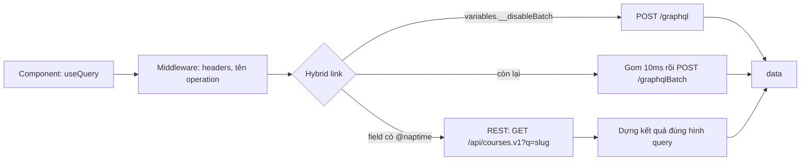

Chuyển một hệ thống lớn từ REST sang GraphQL hiếm khi làm được "một phát xong". Server có hàng trăm endpoint, mỗi đội sở hữu vài cái, lịch chuyển đổi mỗi đội một khác. Phía frontend thì kẹt ở giữa:

- Viết component mới bằng REST thì sau này phải viết lại lần nữa.
- Viết bằng GraphQL thì phải đợi server có schema cho dữ liệu đó.
- Trộn hai kiểu thì mỗi component một cách lấy dữ liệu, cache một kiểu, loading một kiểu, xử lý lỗi một kiểu.

> [!TIP]
> **Tóm tắt**
> - Coursera cho component **luôn viết query GraphQL**. Query nào gắn directive `@naptime` thì một link mạng tự dịch thành lời gọi REST (Naptime là framework REST của Coursera) và dựng kết quả đúng hình query. Query không có directive đi lên gateway GraphQL.
> - Chuyển một màn hình sang GraphQL thật chỉ là bỏ `@naptime` (và đổi tên field), code đọc dữ liệu không đổi.
> - Query GraphQL được **gom batch** mặc định; biến `__disableBatch` để tách riêng query cần nhanh. Khoá batch gồm cả headers để không gom nhầm request khác quyền.
> - Bản viết lại: link là hàm trả Promise, không cần Apollo; có parser GraphQL tối giản để chạy demo.

<iframe class="demo-frame" src="/demos/web-patterns/index.html?theme=dark#/hybrid-link" title="Demo hybrid-link" loading="lazy" style="height: 820px"></iframe>

<p class="demo-links">▶ <a href="/demos/web-patterns/index.html#/hybrid-link" target="_blank" rel="noopener">Mở demo toàn màn hình ↗</a> · <a href="https://stackblitz.com/github/hunghg255/blog-hunghg/tree/master/examples/web-patterns?file=src/lib/hybridLink.ts" target="_blank" rel="noopener">Sửa code trên StackBlitz ↗</a> · <a href="https://github.com/hunghg255/blog-hunghg/blob/master/examples/web-patterns/src/lib/hybridLink.ts" target="_blank" rel="noopener">Xem source trên GitHub ↗</a></p>

Trong demo, ba component (thông tin khoá học, ghi chú, đối tác) gọi ba query cùng lúc. Lúc đầu cả ba còn `@naptime`: ba request REST. Đánh dấu dần từng query "→ GraphQL" rồi bấm "Tải trang": các query đã chuyển gom thành một `POST /graphqlBatch`. Khung hiển thị dữ liệu không đổi gì. Mở "Xem query" để thấy query thay đổi ra sao.

## Coursera làm thế nào?

Có hai lớp code. Thư mục `coursera.org/modules/` là mã nguồn của package `@coursera/graphql-utils` (file `modules/index.js` export `createHybridLink`, `naptime`, `waitForGraphQL`). Cấu hình Apollo Client thì ở `static/bundles/page/lib/network/Apollo.tsx` ([xem trong repo](https://github.com/hunghg255/codebase/tree/main/coursera.org/modules/network)). Thư mục `packages/@react-aria` bên cạnh là thư viện React Aria của Adobe được đóng gói kèm, không liên quan tới phần này.

### Hai cách viết cùng một dữ liệu

Query vẫn đi REST, trong `static/bundles/goal-setting/hoc/withCourseBranchId.tsx`:

```graphql
query CourseIdQuery($slug: String!) {
  CoursesV1 @naptime {
    slug(slug: $slug, showHidden: true) { elements { id } }
  }
}
```

Query đã đi gateway GraphQL, trong `static/bundles/page/common/queries.ts`:

```graphql
DegreeLearnerMembershipsV1Resource {
  byUser(userId: $userId) {
    elements { id createdAt degreeId role degree { id name slug } }
  }
}
```

Cùng một hình: field gốc là resource có phiên bản (`CoursesV1`, `DegreeLearnerMembershipsV1Resource`), field con là "handler" của Naptime (`get`, `slug`, `byUser`… với tham số), kết quả là `{ elements: [...] }` như REST trả về. Gateway GraphQL phơi chính các resource Naptime dưới tên có đuôi `Resource`, và thêm khả năng nối dữ liệu liên quan (`degree { … }`) trong một lần gọi. Trong bản dump có 45 chỗ dùng `@naptime`.

`@naptime` được xử lý bởi `NaptimeLink` trong package `@coursera/apollo-link-naptime` (mã nguồn không có trong bản dump; đừng nhầm với `modules/network/createNaptimeLink.js` có trong dump, link này chỉ dịch **mutation** qua `naptimeFetch` → `performNaptimeMutation`), đặt **trước** link GraphQL trong chuỗi link mặc định:

```ts
const defaultLink = ApolloLink.from([linkMiddleware, AuthRedirectLink, naptimeLink, graphqlLink]);
```

Thứ tự này cho thấy cách hoạt động (suy đoán vì không có mã nguồn): `naptimeLink` nhận query có `@naptime` và tự gọi REST, các query khác được chuyển tiếp (`forward`) sang `graphqlLink`.

### `HTTPHybridLink`: ba đường cho một operation

`graphqlLink` ở trên là `createHybridLink(...)` trong `modules/network/createHybridLink.js`:

```js
// The batching link is enabled by default.
// Passing the `__disableBatch` variable to any particular query will re-route the query to the non-batching link.
// Documents with the naptime tag will only use naptimeLink (REST endpoint).
request(operation, forward) {
  if (operation.query.fallbackToNaptime) {
    return this.naptimeLink.request(operation, forward);
  } else if (!this.batchedLink || (operation.variables && operation.variables.__disableBatch)) {
    return this.httpLink.request(operation, forward);
  }
  return this.batchedLink.request(operation, forward);
}
```

- `fallbackToNaptime` là cờ do template tag `naptime` (`modules/naptime-tag.js`) gắn vào document. Tag này chỉ nhận **mutation** với đúng một handler: `create`, `update`, `delete`, `action`. `naptime.js` dịch handler sang REST: `create` thành `POST /api/<resource>`, `update` thành `PUT /api/<resource>/<id>`, `delete` thành `DELETE`, `action` thành `POST` kèm query string. Thiếu tham số bắt buộc (vd `update` cần `id` và `body`) thì `invariant` báo lỗi ngay.
- Query thường đi `/graphqlBatch` (gom nhiều query một request) hoặc `/graphql` nếu có `__disableBatch`.
- Khoá gom batch:

```js
const batchKey = (operation) => {
  const context = operation.getContext();
  const contextConfig = { http: context.http, credentials: context.credentials, headers: context.headers };
  // may throw error if config not serializable
  return selectURI(operation, context.uri) + JSON.stringify(contextConfig);
};
```

Hai query khác headers (vd một query gửi kèm token khác) không bị gom chung, vì server chỉ đọc một bộ headers cho cả lô.

Vài chi tiết khác trong `Apollo.tsx` đáng học: middleware gắn tên operation vào header rồi `fetchWithOperationName` thêm `?opname=…` vào URL ("for visibility in edge access logs": nhìn log CDN là biết query nào chậm, vì mọi request đều là `POST /graphql`); link `AuthRedirectLink` chuyển hướng tới trang đăng nhập khi query có directive `@redirectToLogin` gặp lỗi 403; và một `linkFromOperation` chọn link theo `context.clientName` để cùng một Apollo Client gọi được nhiều backend GraphQL (Contentful, các dịch vụ "dgs").

## Bên trong: Apollo Link là gì?

Apollo Client không tự gửi request. Nó đưa mỗi operation (document + variables + context) qua một **chuỗi link**. Mỗi link có thể sửa operation rồi chuyển tiếp (`forward(operation)`), hoặc tự trả kết quả (link cuối, "terminating link", thường là HTTP). Link trả về `Observable` để hỗ trợ cả subscription (nhiều kết quả cho một operation).



Với component, cả ba đường đều trả về `{ data }` cùng một hình. Đó là toàn bộ bí quyết: **hình dạng dữ liệu** là hợp đồng, còn **đường đi** là chi tiết mà link quyết định.

## Viết lại

Bản viết lại không phụ thuộc Apollo: `Link = (operation) => Promise<GraphQLResult>`. Để demo chạy được mà không cài thư viện `graphql`, file `hybridLinkGql.ts` có một parser tối giản (field, alias, tham số, directive không tham số, không có fragment). Dự án thật dùng `gql` của Apollo.

### Chọn đường

```ts title=src/lib/hybridLink.ts
export function createHybridLink({ naptime, single, batch }: HybridLinkOptions): Link {
  return (operation) => {
    const marked = operation.query.selections.filter((field) => hasDirective(field, 'naptime'));
    if (marked.length > 0) {
      // Một operation chỉ đi một đường: trộn hai loại thì kết quả phải ghép từ hai nguồn, khó đúng
      // (lỗi, loading, cache từng phần). Tách thành hai query riêng.
      if (marked.length !== operation.query.selections.length) {
        return Promise.reject(
          new Error('Không trộn field @naptime với field GraphQL trong cùng operation'),
        );
      }
      return naptime(operation);
    }
    if (!batch || operation.variables.__disableBatch) return single(operation);
    return batch(operation);
  };
}
```

Khác Coursera ở một điểm: operation trộn field `@naptime` với field GraphQL thường bị **từ chối** rõ ràng. Gộp kết quả từ hai nguồn nghe thì hay, nhưng lỗi một phần, loading một phần, cache một phần đều phải xử lý. Tách thành hai query thì đơn giản hơn nhiều.

### Dịch handler sang URL REST

```ts title=src/lib/hybridLink.ts
    case 'getAll':
      break;
    case 'multiGet':
      params.set('ids', ([] as unknown[]).concat(args.ids).join(','));
      break;
    default:
      params.set('q', handler.name);
      for (const [key, value] of Object.entries(args)) params.set(key, String(value));
  }
  if (fields.length) params.set('fields', fields.join(','));
  return { method: 'GET', url: withQuery(root, params) };
```

Đoạn trên là nhánh query; nhánh mutation ngay phía trên nó (`create`, `update`, `delete`, `action`) làm giống `naptime.js` của Coursera. Phần query (`get` thành `/api/x.v1/<id>`, `multiGet` thành `?ids=`, `getAll`, finder khác thành `?q=<tên>`) là quy ước REST công khai của Naptime (kiểu `/api/courses.v1?q=slug&slug=…`); cách `NaptimeLink` thật dựng URL thì không xem được. `fields=` được lấy từ những trường query chọn trong `elements { … }`: REST trả về đúng các trường cần, giống tinh thần GraphQL.

Sau khi có JSON, hàm `shape` chỉ giữ lại các trường query yêu cầu (kể cả alias), để kết quả REST giống hệt kết quả server GraphQL thật sẽ trả.

### Gom batch

```ts title=src/lib/hybridLink.ts
  return (op) =>
    new Promise((resolve, reject) => {
      const key = batchKey(uri, op);
      let queue = queues.get(key);
      if (!queue) {
        queue = { items: [], timer: setTimeout(() => void flush(key), batchInterval) };
        queues.set(key, queue);
      }
      queue.items.push({ op, resolve, reject });
      if (queue.items.length >= batchMax) void flush(key);
    });
```

Operation đầu tiên của một khoá mở một hàng đợi và hẹn giờ `batchInterval` (10ms). Các operation tới trong lúc đó vào chung hàng đợi. Hết giờ, hoặc đủ `batchMax`, thì gửi một request mảng; server trả mảng kết quả cùng thứ tự. `batchKey = uri + headers` như Coursera.

::: spoiler Xem toàn bộ src/lib/hybridLink.ts

```ts title=src/lib/hybridLink.ts
import type { ArgValue, DocumentNode, FieldNode } from './hybridLinkGql';

/**
 * "Link" mạng cho phép component viết MỘT kiểu query GraphQL, còn link quyết định đi đường nào:
 * - field có directive @naptime -> gọi thẳng REST API cũ (Naptime) và tự dựng kết quả đúng hình query
 * - `variables.__disableBatch` -> POST /graphql riêng lẻ
 * - còn lại -> gom nhiều query vào một POST /graphqlBatch
 * Ý tưởng từ `modules/network/createHybridLink.js` + `naptime.js` của coursera.org. Bản này không
 * phụ thuộc Apollo: link là hàm trả Promise (Apollo Link trả Observable, xem bài viết).
 */

export interface Operation {
  query: DocumentNode;
  variables: Record<string, unknown>;
  /** dữ liệu phụ đi kèm (headers…), giống operation.getContext() của Apollo */
  context: { headers?: Record<string, string> };
}

export interface GraphQLResult {
  data?: Record<string, unknown> | null;
  errors?: { message: string }[];
}

export type Link = (operation: Operation) => Promise<GraphQLResult>;
export type Fetcher = (url: string, init: RequestInit) => Promise<Response>;

const hasDirective = (field: FieldNode, name: string) => field.directives.includes(name);

/** Xoá biến điều khiển (bắt đầu bằng __) trước khi gửi lên server. */
function publicVariables(variables: Record<string, unknown>) {
  return Object.fromEntries(Object.entries(variables).filter(([key]) => !key.startsWith('__')));
}

async function readJson(response: Response) {
  if (!response.ok) throw new Error(`HTTP ${response.status} ${response.url}`);
  return response.json();
}

// ---------- 1. GraphQL thường ----------

export function createHttpLink({
  uri,
  fetch: doFetch = fetch,
}: {
  uri: string;
  fetch?: Fetcher;
}): Link {
  return async ({ query, variables, context }) => {
    const response = await doFetch(uri, {
      method: 'POST',
      headers: { 'Content-Type': 'application/json', ...context.headers },
      body: JSON.stringify({
        query: query.source,
        variables: publicVariables(variables),
        operationName: query.name,
      }),
    });
    return readJson(response);
  };
}

// ---------- 2. Gom nhiều operation vào một request ----------

export interface BatchOptions {
  uri: string;
  fetch?: Fetcher;
  /** chờ bao lâu để gom thêm operation (ms) */
  batchInterval?: number;
  batchMax?: number;
}

/**
 * Operation khác headers (khác người dùng, khác quyền…) không được gom chung một request:
 * khoá lô = uri + headers, giống batchKey của Coursera.
 */
const batchKey = (uri: string, op: Operation) => uri + JSON.stringify(op.context.headers ?? {});

export function createBatchLink({
  uri,
  fetch: doFetch = fetch,
  batchInterval = 10,
  batchMax = 10,
}: BatchOptions): Link {
  type Pending = {
    op: Operation;
    resolve: (r: GraphQLResult) => void;
    reject: (e: unknown) => void;
  };
  const queues = new Map<string, { items: Pending[]; timer: ReturnType<typeof setTimeout> }>();

  async function flush(key: string) {
    const queue = queues.get(key);
    if (!queue) return;
    queues.delete(key);
    clearTimeout(queue.timer);
    const { items } = queue;
    try {
      const response = await doFetch(uri, {
        method: 'POST',
        headers: { 'Content-Type': 'application/json', ...items[0].op.context.headers },
        body: JSON.stringify(
          items.map(({ op }) => ({
            query: op.query.source,
            variables: publicVariables(op.variables),
            operationName: op.query.name,
          })),
        ),
      });
      const results = (await readJson(response)) as GraphQLResult[];
      // server trả mảng kết quả cùng thứ tự với mảng gửi lên
      items.forEach((item, index) =>
        item.resolve(results[index] ?? { errors: [{ message: 'thiếu kết quả' }] }),
      );
    } catch (error) {
      items.forEach((item) => item.reject(error));
    }
  }

  return (op) =>
    new Promise((resolve, reject) => {
      const key = batchKey(uri, op);
      let queue = queues.get(key);
      if (!queue) {
        queue = { items: [], timer: setTimeout(() => void flush(key), batchInterval) };
        queues.set(key, queue);
      }
      queue.items.push({ op, resolve, reject });
      if (queue.items.length >= batchMax) void flush(key);
    });
}

// ---------- 3. REST (Naptime) ----------

/** `CoursesV1` -> `courses.v1` (Coursera: parseNaptimeResourceName, nhận cả đuôi `Resource`) */
export function naptimeResourceName(field: string): string {
  const match = field.match(/^(.*)V(\d+)(?:Resource)?$/);
  if (!match) throw new Error(`không đọc được tên resource từ "${field}"`);
  return `${match[1].charAt(0).toLowerCase()}${match[1].slice(1)}.v${match[2]}`;
}

function resolveArgs(args: Record<string, ArgValue>, variables: Record<string, unknown>) {
  return Object.fromEntries(
    Object.entries(args).map(([name, arg]) => {
      const value = arg.kind === 'variable' ? variables[arg.name] : arg.value;
      if (value === undefined) throw new Error(`thiếu biến cho tham số "${name}"`);
      return [name, value];
    }),
  );
}

/** Các trường cần lấy trong `elements { … }`: gửi kèm `fields=` để REST trả ít dữ liệu hơn. */
function requestedFields(handler: FieldNode) {
  const elements = handler.selections.find((f) => f.name === 'elements');
  return (elements?.selections ?? [])
    .map((f) => f.name)
    .filter((name) => name !== 'id' && name !== '__typename');
}

export interface RestRequest {
  method: 'GET' | 'POST' | 'PUT' | 'DELETE';
  url: string;
  body?: string;
}

/**
 * Quy ước URL của Naptime:
 * get(id) -> GET /api/x.v1/<id> · multiGet(ids) -> GET ?ids= · getAll -> GET /api/x.v1
 * finder khác -> GET ?q=<tên finder>&<tham số> · create/update/delete/action như naptime.js của Coursera
 */
export function toRestRequest(
  baseUrl: string,
  resource: string,
  handler: FieldNode,
  args: Record<string, unknown>,
): RestRequest {
  const root = `${baseUrl}/${resource}`;
  const params = new URLSearchParams();
  const fields = requestedFields(handler);
  const body = 'body' in args ? JSON.stringify(args.body) : undefined;
  switch (handler.name) {
    case 'get':
      if (fields.length) params.set('fields', fields.join(','));
      return {
        method: 'GET',
        url: withQuery(`${root}/${encodeURIComponent(String(args.id))}`, params),
      };
    case 'create':
      return { method: 'POST', url: root, body: body ?? '{}' };
    case 'update':
      return { method: 'PUT', url: `${root}/${encodeURIComponent(String(args.id))}`, body };
    case 'delete':
      return { method: 'DELETE', url: `${root}/${encodeURIComponent(String(args.id))}` };
    case 'action':
      for (const [key, value] of Object.entries(args))
        if (key !== 'body') params.set(key, String(value));
      return { method: 'POST', url: withQuery(root, params), body: body ?? '{}' };
    case 'getAll':
      break;
    case 'multiGet':
      params.set('ids', ([] as unknown[]).concat(args.ids).join(','));
      break;
    default:
      params.set('q', handler.name);
      for (const [key, value] of Object.entries(args)) params.set(key, String(value));
  }
  if (fields.length) params.set('fields', fields.join(','));
  return { method: 'GET', url: withQuery(root, params) };
}

const withQuery = (url: string, params: URLSearchParams) =>
  params.toString() ? `${url}?${params}` : url;

/** Chỉ giữ đúng các trường query yêu cầu, như server GraphQL thật. */
export function shape(value: unknown, selections: FieldNode[]): unknown {
  if (selections.length === 0 || value === null || typeof value !== 'object') return value;
  if (Array.isArray(value)) return value.map((item) => shape(item, selections));
  const source = value as Record<string, unknown>;
  return Object.fromEntries(
    selections.map((field) => [
      field.alias ?? field.name,
      shape(source[field.name] ?? null, field.selections),
    ]),
  );
}

export function createNaptimeLink({
  baseUrl = '/api',
  fetch: doFetch = fetch,
}: { baseUrl?: string; fetch?: Fetcher } = {}): Link {
  return async ({ query, variables, context }) => {
    // mỗi field gốc (resource) và mỗi handler bên trong là một request REST, chạy song song
    const entries = await Promise.all(
      query.selections.map(async (resourceField) => {
        const resource = naptimeResourceName(resourceField.name);
        const handlers = await Promise.all(
          resourceField.selections.map(async (handler) => {
            const request = toRestRequest(
              baseUrl,
              resource,
              handler,
              resolveArgs(handler.args, variables),
            );
            const response = await doFetch(request.url, {
              method: request.method,
              body: request.body,
              credentials: 'include',
              headers: { 'Content-Type': 'application/json', ...context.headers },
            });
            if (!response.ok)
              throw new Error(`HTTP ${response.status} ${request.method} ${request.url}`);
            const json = response.status === 204 ? {} : await response.json();
            // REST trả { elements: [...], paging }; với create/update/action lấy elements[0] cho gọn
            // (giống transformMutationResponse của Coursera)
            const result = ['create', 'update', 'action'].includes(handler.name)
              ? (json.elements?.[0] ?? json)
              : json;
            return [handler.alias ?? handler.name, shape(result, handler.selections)] as const;
          }),
        );
        return [resourceField.alias ?? resourceField.name, Object.fromEntries(handlers)] as const;
      }),
    );
    return { data: Object.fromEntries(entries) };
  };
}

// ---------- 4. Hybrid: chọn đường cho từng operation ----------

export interface HybridLinkOptions {
  naptime: Link;
  single: Link;
  batch?: Link;
}

export function createHybridLink({ naptime, single, batch }: HybridLinkOptions): Link {
  return (operation) => {
    const marked = operation.query.selections.filter((field) => hasDirective(field, 'naptime'));
    if (marked.length > 0) {
      // Một operation chỉ đi một đường: trộn hai loại thì kết quả phải ghép từ hai nguồn, khó đúng
      // (lỗi, loading, cache từng phần). Tách thành hai query riêng.
      if (marked.length !== operation.query.selections.length) {
        return Promise.reject(
          new Error('Không trộn field @naptime với field GraphQL trong cùng operation'),
        );
      }
      return naptime(operation);
    }
    if (!batch || operation.variables.__disableBatch) return single(operation);
    return batch(operation);
  };
}

/** Middleware: gắn header, đo thời gian… Giống ApolloLink.from([a, b, terminating]). */
export type Middleware = (operation: Operation, forward: Link) => Promise<GraphQLResult>;

export function composeLinks(middlewares: Middleware[], terminating: Link): Link {
  return middlewares.reduceRight<Link>(
    (next, middleware) => (operation) => middleware(operation, next),
    terminating,
  );
}
```

:::

::: spoiler Xem parser tối giản src/lib/hybridLinkGql.ts

```ts title=src/lib/hybridLinkGql.ts
/**
 * Parser GraphQL TỐI GIẢN cho demo hybridLink (không phụ thuộc thư viện `graphql`).
 * Hỗ trợ: query/mutation, tên operation, khai báo biến, alias, tham số ($biến hoặc literal),
 * directive không tham số (@naptime), selection lồng nhau. Không hỗ trợ fragment, list/object literal.
 * Dự án thật: dùng `gql` của graphql-tag / @apollo/client.
 */

export type ArgValue =
  | { kind: 'variable'; name: string }
  | { kind: 'literal'; value: string | number | boolean | null };

export interface FieldNode {
  name: string;
  alias?: string;
  args: Record<string, ArgValue>;
  directives: string[];
  selections: FieldNode[];
}

export interface DocumentNode {
  operation: 'query' | 'mutation';
  name?: string;
  /** tên các biến đã khai báo, không có dấu $ */
  variables: string[];
  selections: FieldNode[];
  /** chuỗi gốc, gửi nguyên lên server GraphQL */
  source: string;
}

const TOKEN =
  /\s+|#[^\n]*|,|"(?:[^"\\]|\\.)*"|-?\d+(?:\.\d+)?|[A-Za-z_][A-Za-z0-9_]*|\.\.\.|[{}():$@!=[\]]/gy;

function tokenize(source: string): string[] {
  const tokens: string[] = [];
  TOKEN.lastIndex = 0;
  while (TOKEN.lastIndex < source.length) {
    const start = TOKEN.lastIndex;
    const match = TOKEN.exec(source);
    if (!match) throw new SyntaxError(`ký tự không hợp lệ ở vị trí ${start}: "${source[start]}"`);
    const text = match[0];
    if (/^\s|^#|^,$/.test(text)) continue; // khoảng trắng, comment, dấu phẩy đều bị GraphQL bỏ qua
    tokens.push(text);
  }
  return tokens;
}

export function parse(source: string): DocumentNode {
  const tokens = tokenize(source);
  let i = 0;
  const peek = () => tokens[i];
  const next = () => {
    if (i >= tokens.length) throw new SyntaxError('hết chuỗi bất ngờ');
    return tokens[i++];
  };
  const expect = (text: string) => {
    const token = next();
    if (token !== text) throw new SyntaxError(`cần "${text}", gặp "${token}"`);
  };

  function value(): ArgValue {
    const token = next();
    if (token === '$') return { kind: 'variable', name: next() };
    if (token.startsWith('"')) return { kind: 'literal', value: JSON.parse(token) as string };
    if (/^-?\d/.test(token)) return { kind: 'literal', value: Number(token) };
    if (token === 'true' || token === 'false') return { kind: 'literal', value: token === 'true' };
    if (token === 'null') return { kind: 'literal', value: null };
    throw new SyntaxError(`giá trị không hỗ trợ: "${token}"`);
  }

  function selectionSet(): FieldNode[] {
    expect('{');
    const fields: FieldNode[] = [];
    while (peek() !== '}') {
      if (peek() === '...') throw new SyntaxError('fragment chưa được hỗ trợ');
      let name = next();
      let alias: string | undefined;
      if (peek() === ':') {
        next();
        alias = name;
        name = next();
      }
      const args: Record<string, ArgValue> = {};
      if (peek() === '(') {
        next();
        while (peek() !== ')') {
          const argName = next();
          expect(':');
          args[argName] = value();
        }
        next();
      }
      const directives: string[] = [];
      while (peek() === '@') {
        next();
        directives.push(next());
      }
      const selections = peek() === '{' ? selectionSet() : [];
      fields.push({ name, alias, args, directives, selections });
    }
    next();
    return fields;
  }

  let operation: DocumentNode['operation'] = 'query';
  let name: string | undefined;
  const variables: string[] = [];
  if (peek() === 'query' || peek() === 'mutation') {
    operation = next() as DocumentNode['operation'];
    if (peek() !== '(' && peek() !== '{') name = next();
    if (peek() === '(') {
      // ($slug: String!, $limit: Int = 10): chỉ cần tên biến, bỏ qua kiểu và giá trị mặc định
      next();
      while (peek() !== ')') {
        if (next() === '$') variables.push(next());
      }
      next();
    }
  }
  const selections = selectionSet();
  if (i !== tokens.length) throw new SyntaxError('chỉ hỗ trợ một operation mỗi document');
  return { operation, name, variables, selections, source };
}

/** Template tag giống graphql-tag: gql`query { … }` */
export function gql(strings: TemplateStringsArray, ...values: unknown[]): DocumentNode {
  return parse(
    strings.reduce((out, s, k) => out + s + (k < values.length ? String(values[k]) : ''), ''),
  );
}
```

:::

**Khác bản gốc:** Coursera dùng Apollo Link (Observable), tách hai package (`NaptimeLink` cho query, tag `naptime` cho mutation) và hỗ trợ `concatBatchedLink` để chèn middleware riêng cho đường batch. Bản viết lại gộp một link cho cả query lẫn mutation, trả Promise, từ chối operation trộn hai loại, và xoá biến điều khiển (`__disableBatch`) trước khi gửi lên server.

### Dùng với Apollo Link thật

Chuyển sang Apollo chỉ là bọc các hàm trên: link REST trả `Observable` thay vì Promise, phần chọn đường dùng `split` có sẵn.

::: spoiler Xem cách ghép với Apollo Client

```ts
import { ApolloLink, Observable, split, HttpLink } from '@apollo/client';
import { BatchHttpLink } from '@apollo/client/link/batch-http';
import { hasDirectives } from '@apollo/client/utilities';

const naptimeLink = new ApolloLink((operation) =>
  new Observable((observer) => {
    myNaptimeRequest(operation.query, operation.variables, operation.getContext())
      .then((result) => { observer.next(result); observer.complete(); })
      .catch((error) => observer.error(error));
  }),
);

const graphqlLink = split(
  (op) => Boolean(op.variables.__disableBatch),
  new HttpLink({ uri: '/graphql' }),
  new BatchHttpLink({ uri: '/graphqlBatch', batchInterval: 10, batchMax: 10 }),
);

export const link = split((op) => hasDirectives(['naptime'], op.query), naptimeLink, graphqlLink);
```

:::

`split(test, left, right)` là cách Apollo viết "if/else" giữa các link. `BatchHttpLink` có sẵn tuỳ chọn `batchKey` nếu muốn tách lô theo headers như Coursera.

## Tại sao không làm cách khác?

**Gateway GraphQL gọi REST ở server (schema stitching, "BFF").** Đây là đích đến dài hạn và Coursera cũng có (các field `…V1Resource`). Nhưng mỗi resource phải được đăng ký vào gateway trước. `@naptime` cho frontend viết theo kiểu GraphQL **ngay hôm nay**, kể cả với resource gateway chưa có.

**`apollo-link-rest` (directive `@rest`).** Thư viện cộng đồng cùng ý tưởng: `@rest(type: "Post", path: "/posts/{args.id}")`, bạn tự khai báo đường dẫn cho từng field. Naptime không cần khai báo vì mọi resource theo cùng một quy ước URL. API của bạn càng đồng nhất thì link tự viết càng ngắn.

**Viết REST trước, đổi sau.** Mỗi màn hình bị viết hai lần, và trong lúc chờ thì hai kiểu cache, hai kiểu loading cùng tồn tại.

## Edge case và cạm bẫy

- **Tên field khác nhau giữa hai đường** (`CoursesV1` và `CoursesV1Resource`). Dùng alias `CoursesV1: CoursesV1Resource { … }` khi chuyển để key trong `data` không đổi, như demo đang làm.
- **Cache chuẩn hoá (normalized cache).** Apollo cache theo `__typename` + `id`. Kết quả dựng từ REST phải có `__typename` khớp với kiểu mà gateway trả, nếu không cùng một khoá học sẽ thành hai mục trong cache. Coursera có hẳn `naptimeIntrospectionFragmentMatcher.ts` ("hybrid heuristic & introspection fragment matcher") để xử lý chuyện kiểu dữ liệu giữa hai nguồn.
- **Lỗi một phần.** GraphQL trả `data` kèm `errors`; REST trả mã HTTP. Link phải quy về một kiểu (bản viết lại: HTTP lỗi thành exception; `createNaptimeLink` của Coursera đẩy cả `err.result` nếu có `data` lẫn `errors`).
- **Batch làm chậm query nhanh.** Một lô chỉ trả về khi query **chậm nhất** xong. Query quan trọng cho lần vẽ đầu nên `__disableBatch`, hoặc dùng `@defer` nếu server hỗ trợ.
- **`batchKey` dùng `JSON.stringify`.** Thứ tự key khác nhau thì hai headers giống nhau vẫn ra hai khoá (chỉ làm lô nhỏ đi, không sai). Headers có giá trị không serialize được thì ném lỗi, đúng như comment của Coursera.
- **Upload file** không đi qua batch hay REST dịch tự động được; để riêng.

## Dùng trong dự án

Kế hoạch chuyển đổi dần dần theo cách của Coursera:

1. Dựng link hybrid, toàn bộ code mới viết query GraphQL. Resource chưa có trên gateway thì gắn `@naptime` (hoặc `@rest`).
2. Mỗi lần một resource lên gateway: tìm các query có `@naptime` của resource đó (grep), bỏ directive, thêm alias. Code component không đổi.
3. Khi đã lên gateway, tận dụng: gộp các query nối nhau (khoá học rồi đối tác) thành một query lồng (`partner { name }`).
4. Theo dõi số chỗ còn `@naptime` (Coursera còn 45 chỗ trong bản dump) như một chỉ số tiến độ.

## Kiểm thử

::: spoiler Ví dụ test (bản phác, không có trong repo)

```ts
import { createBatchLink, createHybridLink, createNaptimeLink, toRestRequest, type Link } from './hybridLink';
import { gql, parse } from './hybridLinkGql';

const ok = (body: unknown) => new Response(JSON.stringify(body), { status: 200 });

test('handler Naptime sang URL REST', () => {
  const doc = gql`query { CoursesV1 @naptime { slug(slug: "ml") { elements { id name } } } }`;
  const handler = doc.selections[0].selections[0];
  expect(toRestRequest('/api', 'courses.v1', handler, { slug: 'ml' })).toEqual({
    method: 'GET',
    url: '/api/courses.v1?q=slug&slug=ml&fields=name',
  });
});

test('REST được dựng lại đúng hình query', async () => {
  const fetch = vi.fn(async () => ok({ elements: [{ id: 'c1', name: 'ML', extra: 1 }], paging: {} }));
  const link = createNaptimeLink({ baseUrl: '/api', fetch });
  const result = await link({
    query: gql`query { Course: CoursesV1 @naptime { get(id: "c1") { elements { id name } } } }`,
    variables: {},
    context: {},
  });
  expect(result.data).toEqual({ Course: { get: { elements: [{ id: 'c1', name: 'ML' }] } } });
});

test('gom batch theo khoá, __disableBatch đi riêng', async () => {
  const calls: string[] = [];
  const fetch = vi.fn(async (url: string, init: RequestInit) => {
    calls.push(url);
    const body = JSON.parse(String(init.body));
    return ok(Array.isArray(body) ? body.map(() => ({ data: {} })) : { data: {} });
  });
  const link: Link = createHybridLink({
    naptime: async () => ({ data: {} }),
    single: async (op) => (await fetch('/graphql', { body: JSON.stringify({}) }), { data: {} }),
    batch: createBatchLink({ uri: '/graphqlBatch', fetch }),
  });
  const q = parse('query A { me { id } }');
  await Promise.all([
    link({ query: q, variables: {}, context: {} }),
    link({ query: q, variables: {}, context: {} }),
    link({ query: q, variables: { __disableBatch: true }, context: {} }),
  ]);
  expect(calls.sort()).toEqual(['/graphql', '/graphqlBatch']);
});

test('trộn @naptime với field thường bị từ chối', async () => {
  const link = createHybridLink({ naptime: vi.fn(), single: vi.fn() });
  await expect(
    link({ query: gql`query { CoursesV1 @naptime { getAll { elements { id } } } me { id } }`, variables: {}, context: {} }),
  ).rejects.toThrow('Không trộn');
});
```

:::

## So với công cụ có sẵn

- **Apollo Client** + `split` + `BatchHttpLink`: đủ để dựng lại cấu trúc này, phần còn lại là link REST của riêng bạn.
- **apollo-link-rest**: link REST tổng quát qua directive `@rest`, hợp khi API REST không theo một quy ước chung.
- **GraphQL Mesh / schema stitching / Apollo Federation**: chuyển REST thành GraphQL ở phía server. Đó là đích cuối; link hybrid là cầu nối trong lúc chưa tới.

---

Bài này thuộc series **[Học từ mã nguồn các web lớn](/series/web)** (42 bài, đọc theo thứ tự).

::: spoiler Xem nhanh danh sách bài trong series

*Mở đầu*

- [Mở đầu: đọc code production của 28 trang web](/blogs/learn-from-big-web-apps)

*Phần 1: trải nghiệm người dùng*

- [#1 Dark mode không nháy (Gatsby)](/blogs/web-dark-mode-no-flash)
- [#2 useValueByMedia: giá trị theo breakpoint (Toptal)](/blogs/web-use-value-by-media)
- [#3 Đoán ý định: idle, exit-intent, lắc chuột (Toptal, InVision)](/blogs/web-user-intent-idle-exit-wiggle)
- [#4 Validate form thân thiện (Udacity, Pipedrive)](/blogs/web-form-validation-ux)
- [#5 Magic number, EXIF và dán ảnh (Ello)](/blogs/web-file-magic-number-exif-paste)
- [#6 fastSmoothScroll: cuộn xa vẫn nhanh (Telegram)](/blogs/web-telegram-fast-smooth-scroll)
- [#7 Countdown time-travel và tombstone giỏ hàng (Best Buy)](/blogs/web-countdown-time-travel-tombstone)

*Phần 2: hiệu năng và đo lường*

- [#8 Hàng đợi requestAnimationFrame 3ms (Apple)](/blogs/web-raf-queue-3ms)
- [#9 srcset cho artwork và preconnect tự động (Apple)](/blogs/web-responsive-artwork-preconnect)
- [#10 Quick-fetch: gọi API trước khi bundle tải xong (HubSpot)](/blogs/web-quick-fetch-early-requests)
- [#11 Performance span và long task (Postman, Calibre)](/blogs/web-performance-spans-long-tasks)
- [#12 Gọi Web Worker như hàm async (Telegram)](/blogs/web-worker-promise-rpc)
- [#13 Đồng hồ media: đếm giờ xem và sửa lệch (Skillshare, Simplified)](/blogs/web-media-clock-watch-time-drift)

*Phần 3: nhiều tab, phiên đăng nhập, cập nhật*

- [#14 Bầu tab chủ cho thông báo (HubSpot, Telegram)](/blogs/web-leader-tab-notifications)
- [#15 Đồng bộ đăng nhập giữa tab và giới hạn cookie (Elastic, InVision)](/blogs/web-cross-tab-auth-cookie-guard)
- [#16 SPA tự cập nhật: Trello, Zappos, Facebook, Elastic](/blogs/web-spa-self-update-strategies)

*Phần 4: kiến trúc*

- [#17 Reverse portal: di chuyển component không remount (Zappos)](/blogs/web-reverse-portal)
- [#18 Page behaviors: gắn hành vi từ CMS (Intercom)](/blogs/web-page-behaviors-cms)
- [#19 Giới hạn tần suất hiển thị bằng bitmask (Outlook)](/blogs/web-frequency-cap-bitmask)
- **#20 Chuyển REST sang GraphQL dần dần (Coursera)** (bài này)

*Phần 5: soạn thảo và hiển thị nội dung*

- [#21 Autocomplete tại con trỏ trong contenteditable (Ello, Telegram)](/blogs/web-caret-autocomplete-contenteditable)
- [#22 Dark mode cho email HTML bằng CIELAB (Outlook)](/blogs/web-email-dark-mode-cielab)
- [#23 Thu nhỏ bảng rộng cho vừa khung, vá font emoji (Outlook)](/blogs/web-email-wide-content-scale)
- [#24 Cảnh báo quên đính kèm file (Outlook)](/blogs/web-forgotten-attachment-warning)
- [#25 Cắt chữ nhiều dòng chính xác (Pipedrive, Apple, Toptal)](/blogs/web-multiline-truncate-measure-text)
- [#26 Parse ngày giờ gõ tay khoan dung (Outlook, Elastic)](/blogs/web-lenient-date-parser)

*Phần 6: tương tác*

- [#27 menuAim: rê chéo vào submenu không bị đóng (Udemy)](/blogs/web-menu-aim-triangle)
- [#28 Kéo, vuốt chung cho chuột và cảm ứng (Telegram)](/blogs/web-unified-pointer-gestures)
- [#29 Phím tắt theo phạm vi, IME và bàn phím phi Latinh (Trello)](/blogs/web-scoped-keyboard-shortcuts)
- [#30 Nội suy màu: đổi theme và nền theo cuộn (Telegram, Anchor)](/blogs/web-color-interpolation-theme-scroll)
- [#31 Đường gióng hút cạnh và undo/redo trên canvas (Simplified)](/blogs/web-canvas-snap-guides-undo)
- [#32 Giả lập mù màu bằng feColorMatrix (Trello)](/blogs/web-color-vision-simulator)
- [#33 Vạch thước theo mức zoom và cấp phát màu cho biểu đồ (Anchor, Similarweb)](/blogs/web-timeline-ticks-color-stack)

*Phần 7: mạng, dữ liệu và async*

- [#34 Ô tìm kiếm chuẩn production (Similarweb, Udemy, Pipedrive)](/blogs/web-production-search-box)
- [#35 Điều phối async: latest-wins, single-flight (Glitch, Toptal)](/blogs/web-async-coordination-latest-wins)
- [#36 Polling thưa dần và debounce động (Trello)](/blogs/web-decaying-polling-dynamic-debounce)
- [#37 Cache phía client theo version (Similarweb, Telegram, Udemy)](/blogs/web-client-cache-versioned)
- [#38 Upload file lớn theo chunk (Outlook, Tribe)](/blogs/web-chunked-upload-pipeline)
- [#39 Phát video qua Service Worker bằng Range request (Telegram, Outlook)](/blogs/web-service-worker-range-streaming)

*Phần 8: hiệu năng và vận hành*

- [#40 TTI governor: hoãn việc phụ tới sau khi trang dùng được (Outlook)](/blogs/web-tti-governor)
- [#41 Tự đo LCP/CLS/TBT và phục vụ bản nhẹ cho máy yếu (Udemy)](/blogs/web-rum-adaptive-loading)

:::

Code + demo: [`examples/web-patterns`](https://github.com/hunghg255/blog-hunghg/tree/master/examples/web-patterns) · [Mở trên StackBlitz](https://stackblitz.com/github/hunghg255/blog-hunghg/tree/master/examples/web-patterns)
