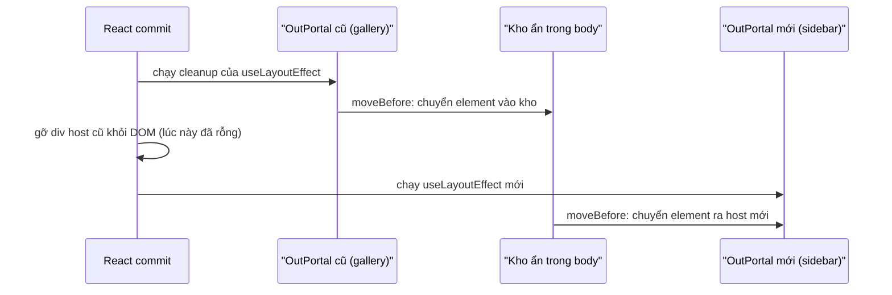

Trên trang sản phẩm của Zappos có một widget "♥ Lưu vào bộ sưu tập". Tuỳ nhánh A/B test, widget nằm ở hai chỗ khác nhau: góc ảnh trong gallery, hoặc cột thông tin bên phải. Khi người dùng bật chế độ zoom ảnh, chỗ trong gallery biến mất, rồi quay lại khi tắt zoom.

Cách viết tự nhiên trong React là render widget ở cả hai chỗ, kèm điều kiện:

```tsx
<Gallery>{inGallery && !zoom && <CollectionWidget />}</Gallery>
<Sidebar>{!inGallery && <CollectionWidget />}</Sidebar>
```

Vị trí trong cây React đổi thì React coi đó là một component **khác**: unmount cái cũ, mount cái mới. Mọi thứ bên trong widget mất sạch: state, chữ đang gõ dở, request đang chạy, iframe (nếu có) tải lại từ đầu, video đang phát dừng lại. Với widget đơn giản thì chịu được. Với trình phát video, bản đồ, editor, hay một iframe thanh toán thì không.

> [!TIP]
> **Tóm tắt**
> - React gắn state với **vị trí trong cây**. Muốn đổi chỗ trên màn hình mà không mất state, phải tách "chỗ render" (cây React) khỏi "chỗ hiển thị" (DOM).
> - Reverse portal: render component **một lần** vào một element tách rời bằng `createPortal`, rồi di chuyển chính element đó tới chỗ cần hiển thị.
> - Di chuyển bằng `Element.moveBefore()` thì iframe không tải lại, video không dừng, focus không mất (Chrome có từ bản 133, xem [caniuse](https://caniuse.com/mdn-api_element_movebefore)). Trình duyệt chưa có thì vẫn giữ được state React.
> - Thư viện có sẵn: [react-reverse-portal](https://github.com/httptoolkit/react-reverse-portal).

<iframe class="demo-frame" src="/demos/web-patterns/index.html?theme=dark#/reverse-portal" title="Demo reverse-portal" loading="lazy" style="height: 860px"></iframe>

<p class="demo-links">▶ <a href="/demos/web-patterns/index.html#/reverse-portal" target="_blank" rel="noopener">Mở demo toàn màn hình ↗</a> · <a href="https://stackblitz.com/github/hunghg255/blog-hunghg/tree/master/examples/web-patterns?file=src/lib/reversePortal.tsx" target="_blank" rel="noopener">Sửa code trên StackBlitz ↗</a> · <a href="https://github.com/hunghg255/blog-hunghg/blob/master/examples/web-patterns/src/lib/reversePortal.tsx" target="_blank" rel="noopener">Xem source trên GitHub ↗</a></p>

Thử trong demo: bấm ♥ vài lần, gõ ghi chú, đợi iframe đếm vài giây rồi đổi chỗ. Ở chế độ "Cách ngây thơ", số lần mount tăng, ♥ về 0, iframe đếm lại từ 0. Ở chế độ reverse portal, không gì mất cả.

## Zappos làm thế nào?

File `zappos.com/src/helpers/PortalNodeManager.tsx` ([xem trong repo](https://github.com/hunghg255/codebase/blob/main/zappos.com/src/helpers/PortalNodeManager.tsx)) có ba thứ:

- `createInjectionContext()` tạo một "portal node": một `<div>` tạo bằng `document.createElement`, chưa gắn vào đâu, kèm hai hàm `mount` và `unmount`.
- `BranchPortal` render children vào div đó bằng `createPortal`. Đây là chỗ cây React thực sự sống.
- `LeafPortal` render một `<div>` rỗng làm chỗ giữ (placeholder). Trong effect, nó **thay** placeholder bằng div của portal node bằng `replaceChild`.

Phần `mount` rút gọn (`unmount` làm ngược lại: `replaceChild` placeholder về chỗ cũ):

```ts
mount: (newParent, newPlaceholder) => {
  if (newPlaceholder === lastPlaceholder) return; // đã gắn ở đây rồi
  portalNode.unmount();
  newParent.replaceChild(portalNode.element, newPlaceholder);
  parent = newParent;
  lastPlaceholder = newPlaceholder;
},
```

Cách dùng trong `src/containers/ProductDetail.tsx`: constructor gọi `this.blueSkyCollectionNode = createInjectionContext()`, hàm `makeFavoritesButton` bọc `SocialCollectionsWidget` trong `<BranchPortal node={...}>`. Hai `LeafPortal` nằm ở hai nơi: một trong `ProductDetail` (khi không ở nhánh `hydraBlueSkyPdp`), một trong `ProductGallery.tsx` (chỉ khi `!zoomIsActive`). Comment trong code nói rõ lý do:

> For the BlueSky PDP, we render the collection widget in a different spot. Instead of duplicating markup, we create two separate containers for each experience, and render into either via a portal depending on the treatment/control assignment.

`BranchPortal` còn nhận props từ `LeafPortal`: Leaf gọi `node.setPortalProps(props)`, Branch thay hàm này (bằng `Object.assign(node, …)`) để mỗi lần được gọi thì `setState`, rồi `cloneElement` children với props đó. Nhờ vậy mỗi chỗ hiển thị có thể truyền cấu hình riêng cho widget.

Ý tưởng này cùng họ với thư viện `react-reverse-portal` (`createHtmlPortalNode`, `InPortal`, `OutPortal`). Code của Zappos không ghi nguồn, nên không rõ họ viết lại từ đầu hay chép rồi sửa.

### Ba chỗ dễ vỡ trong bản của Zappos

Đọc kỹ thì bản này có ba vấn đề. Ở cách Zappos đang dùng thì chúng chưa gây lỗi, nhưng chép sang dự án khác sẽ dễ dính.

**1. Gỡ `LeafPortal` khỏi một cha vẫn còn thì React crash.** Placeholder đã bị `replaceChild` lấy ra khỏi DOM. Khi `LeafPortal` unmount, React gỡ node DOM của nó (`removeChild(placeholder)`) trong pha mutation, **trước** khi chạy cleanup của `useEffect`. Placeholder không còn là con của cha nữa, nên trình duyệt ném lỗi. Mình chạy thử file gốc với React 19: `<div>{show && <LeafPortal node={node} />}</div>`, đổi `show` thành `false`, kết quả là `Failed to execute 'removeChild' on 'Node': The node to be removed is not a child of this node.` và cả cây React bị gỡ. Zappos thoát được vì trong gallery `LeafPortal` nằm trong một `<div>` riêng (`AddToCollection`) bị gỡ cùng, còn ở `ProductDetail` thì điều kiện `hydraBlueSkyPdp` (có lẽ) không đổi trong lúc trang đang mở.

**2. Effect chạy lại ở mỗi lần render.** `LeafPortal` khai báo `useEffect(…, [node, props])`. `props` là object mới ở mỗi lần render, nên mỗi lần cha render lại là một lần `unmount` rồi `mount`: element bị tháo khỏi DOM rồi gắn lại. State React không mất, nhưng nút đang được focus sẽ mất focus, iframe bên trong (nếu có) sẽ tải lại.

**3. Thứ tự effect làm mất props lần đầu.** Ở `ProductDetail`, `LeafPortal` đứng trước `BranchPortal` trong JSX nên effect của Leaf chạy trước. Lúc đó Branch chưa kịp "thay" `setPortalProps`, nên props Leaf gửi đi chỉ được ghi vào biến `initialProps`, mà Branch đã đọc biến này lúc render (khi còn rỗng). Zappos không truyền props nào qua Leaf nên không thấy.

## Bên trong trình duyệt: di chuyển một node DOM

Có hai cách đưa element tới chỗ mới:

| Cách | Điều gì xảy ra |
| --- | --- |
| `appendChild` / `replaceChild` / `insertBefore` | Node bị **gỡ** khỏi document rồi **chèn lại**. Trình duyệt chạy các bước "removing steps": iframe bị huỷ và tải lại, phần tử đang focus mất focus, animation CSS và transition chạy lại, video có thể bị dừng. |
| `moveBefore` (mới) | Node được **chuyển** mà không rời document. Iframe, video, focus, animation giữ nguyên. Yêu cầu: node và chỗ đến đều đang ở trong cùng document. |

`moveBefore` có trong Chrome từ bản 133 (đầu 2025). Các trình duyệt khác đang triển khai, tính tới 10/2026 nên kiểm tra [caniuse](https://caniuse.com/mdn-api_element_movebefore) trước khi dựa vào nó. Bản viết lại bên dưới dùng `moveBefore` nếu có, không có thì quay về `appendChild`.

Điều kiện "node phải đang ở trong document" là chỗ khó. Khi widget chuyển từ gallery sang sidebar trong một lần render, thứ tự công việc của React là:



Nếu để element nằm yên trong host cũ, React gỡ host cũ thì element cũng rời document theo, và lần chuyển sau chỉ còn cách `appendChild`. Vì vậy cleanup phải chuyển element vào một "kho" ẩn trong `body` **trước** khi React gỡ host. Điều này chỉ đúng với `useLayoutEffect`: React chạy cleanup của layout effect trong lúc xử lý cây bị xoá, trước khi gỡ node DOM. Cleanup của `useEffect` chạy sau, khi node đã bị gỡ rồi (đây cũng là lý do bản của Zappos crash ở vấn đề 1).

## Viết lại

Ba phần: hàm di chuyển, portal node, và hai component `InPortal`/`OutPortal`.

### Di chuyển: `moveBefore` nếu được, không thì `appendChild`

```tsx title=src/lib/reversePortal.tsx
type MoveBefore = (node: Node, child: Node | null) => void;

/** Element.moveBefore: di chuyển node mà KHÔNG gỡ khỏi document (iframe không tải lại, video không dừng). */
function moveInto(parent: HTMLElement, node: HTMLElement): 'move' | 'insert' {
  const moveBefore = (parent as unknown as { moveBefore?: MoveBefore }).moveBefore;
  if (moveBefore && node.isConnected && parent.isConnected) {
    try {
      moveBefore.call(parent, node, null);
      return 'move';
    } catch {
      // khác document/shadow root… thì quay về cách thường
    }
  }
  parent.appendChild(node);
  return 'insert';
}
```

`moveBefore(node, null)` nghĩa là "chuyển vào cuối", giống `appendChild`. Hàm này ném lỗi nếu node chưa ở trong document hoặc khác document, nên có `try` để quay về cách thường.

### Portal node: mount, unmount và cái kho

```tsx title=src/lib/reversePortal.tsx
    mount(nextHost) {
      const el = getElement();
      if (host === nextHost && el.parentNode === nextHost) return 'noop';
      host = nextHost;
      const how = moveInto(nextHost, el);
      notify();
      return how;
    },
    unmount(prevHost) {
      // OutPortal khác đã nhận node rồi (mount mới chạy trước cleanup cũ): bỏ qua
      if (host !== prevHost) return;
      host = null;
      // Chuyển vào kho NGAY, trước khi React gỡ host khỏi DOM. Nhờ vậy node luôn ở trong
      // document và lần mount sau dùng được moveBefore.
      if (element) moveInto(getParking(), element);
      props = {};
      notify();
    },
  };
```

Khác Zappos ở hai điểm. Thứ nhất, không thay placeholder: element được **gắn vào bên trong** div host của `OutPortal`. Host là div rỗng do React tạo, React không quản lý con của nó, nên ta thêm/bớt con thoải mái. Khi React gỡ host thì không có gì bất ngờ: nó gỡ đúng node nó đã tạo. Vấn đề 1 biến mất.

Thứ hai, `unmount` chuyển element vào kho thay vì gỡ hẳn. Kiểm tra `host !== prevHost` để bỏ qua trường hợp một `OutPortal` khác đã nhận node trước đó (hai `OutPortal` cùng tồn tại một lúc: cái mới "giành" node).

### `InPortal` và `OutPortal`

`InPortal` rất ngắn: đọc props hiện tại của node bằng `useSyncExternalStore` (node là một external store nhỏ), `cloneElement` chúng vào child, rồi `createPortal(child, node.getElement())`. Đây là chỗ cây React sống, nên phải đặt ở chỗ **không bị unmount** khi đổi vị trí: thường là cha chung của mọi chỗ hiển thị.

`OutPortal` là phần đáng xem:

```tsx title=src/lib/reversePortal.tsx
/** Chỗ hiển thị: lấy element của node về đây, kèm props (nếu có) cho component bên trong. */
export function OutPortal<P extends AnyProps>({ node, ...props }: OutPortalProps<P>) {
  const hostRef = useRef<HTMLDivElement>(null);

  // useLayoutEffect: gắn trước khi trình duyệt vẽ (không nháy), và cleanup chạy TRƯỚC khi React
  // gỡ host khỏi DOM, nên unmount() kịp chuyển node vào kho.
  useLayoutEffect(() => {
    const host = hostRef.current!;
    node.mount(host);
    return () => node.unmount(host);
  }, [node]);

  // props đổi thì chỉ cập nhật props, không tháo/gắn lại DOM.
  // Không có mảng deps: `props` là object mới mỗi render, nên tự so nông với lần trước.
  useLayoutEffect(() => {
    if (node.getHost() !== hostRef.current) return;
    if (!shallowEqual(node.getProps(), props)) node.setProps(props as unknown as Partial<P>);
  });

  return <div ref={hostRef} style={{ display: 'contents' }} />;
}
```

- Effect thứ nhất chỉ phụ thuộc `node`, nên không tháo/gắn lại mỗi lần render (sửa vấn đề 2).
- Effect thứ hai không có mảng deps, chạy sau mỗi render, so nông props với lần trước rồi mới `setProps`. Props được đẩy đi sau khi `OutPortal` đã nhận node, nên không bị mất như vấn đề 3.
- Host và element đều `display: contents`, nên không thêm hộp layout nào: widget bố cục như con trực tiếp của chỗ hiển thị.

::: spoiler Xem toàn bộ src/lib/reversePortal.tsx

```tsx title=src/lib/reversePortal.tsx
import {
  Children,
  cloneElement,
  isValidElement,
  useLayoutEffect,
  useRef,
  useState,
  useSyncExternalStore,
  type ReactNode,
} from 'react';
import { createPortal } from 'react-dom';

/**
 * Reverse portal: render một cây React MỘT lần (InPortal), rồi "đặt" DOM của nó vào bất kỳ chỗ
 * nào trên trang (OutPortal). Đổi chỗ không làm cây remount: state, effect, input đang gõ…
 * vẫn nguyên. Ý tưởng từ `helpers/PortalNodeManager.tsx` của Zappos (LeafPortal / BranchPortal),
 * cùng họ với thư viện react-reverse-portal.
 */

type AnyProps = Record<string, unknown>;

export interface PortalNode<P extends AnyProps = AnyProps> {
  /** element chứa cây React của InPortal; chính element này được di chuyển giữa các OutPortal */
  getElement(): HTMLElement;
  /** OutPortal đang hiển thị node, null = không ai hiển thị (đang nằm trong "kho") */
  getHost(): HTMLElement | null;
  /** props do OutPortal hiện tại truyền vào, InPortal sẽ gắn vào child */
  getProps(): Partial<P>;
  setProps(props: Partial<P>): void;
  subscribe(listener: () => void): () => void;
  /** gắn node vào host; trả về cách đã làm để log/debug */
  mount(host: HTMLElement): 'move' | 'insert' | 'noop';
  unmount(host: HTMLElement): void;
}

type MoveBefore = (node: Node, child: Node | null) => void;

/** Element.moveBefore: di chuyển node mà KHÔNG gỡ khỏi document (iframe không tải lại, video không dừng). */
function moveInto(parent: HTMLElement, node: HTMLElement): 'move' | 'insert' {
  const moveBefore = (parent as unknown as { moveBefore?: MoveBefore }).moveBefore;
  if (moveBefore && node.isConnected && parent.isConnected) {
    try {
      moveBefore.call(parent, node, null);
      return 'move';
    } catch {
      // khác document/shadow root… thì quay về cách thường
    }
  }
  parent.appendChild(node);
  return 'insert';
}

function shallowEqual(a: AnyProps, b: AnyProps) {
  const keys = Object.keys(a);
  return keys.length === Object.keys(b).length && keys.every((key) => Object.is(a[key], b[key]));
}

let parking: HTMLElement | null = null;

/** "Kho" ẩn trong body: node không được OutPortal nào hiển thị thì nằm ở đây, vẫn ở trong document. */
function getParking(): HTMLElement {
  if (!parking || !parking.isConnected) {
    parking = document.createElement('div');
    parking.dataset.portalParking = '';
    parking.hidden = true;
    document.body.appendChild(parking);
  }
  return parking;
}

export function createPortalNode<P extends AnyProps = AnyProps>(): PortalNode<P> {
  let element: HTMLElement | null = null; // tạo lười: lúc SSR chưa có document
  let host: HTMLElement | null = null;
  let props: Partial<P> = {};
  const listeners = new Set<() => void>();
  const notify = () => listeners.forEach((listener) => listener());

  const getElement = () => {
    if (!element) {
      element = document.createElement('div');
      // không tạo thêm hộp layout: con bên trong bố cục như con trực tiếp của host
      element.style.display = 'contents';
    }
    return element;
  };

  return {
    getElement,
    getHost: () => host,
    getProps: () => props,
    setProps(next) {
      props = next;
      notify();
    },
    subscribe(listener) {
      listeners.add(listener);
      return () => listeners.delete(listener);
    },
    mount(nextHost) {
      const el = getElement();
      if (host === nextHost && el.parentNode === nextHost) return 'noop';
      host = nextHost;
      const how = moveInto(nextHost, el);
      notify();
      return how;
    },
    unmount(prevHost) {
      // OutPortal khác đã nhận node rồi (mount mới chạy trước cleanup cũ): bỏ qua
      if (host !== prevHost) return;
      host = null;
      // Chuyển vào kho NGAY, trước khi React gỡ host khỏi DOM. Nhờ vậy node luôn ở trong
      // document và lần mount sau dùng được moveBefore.
      if (element) moveInto(getParking(), element);
      props = {};
      notify();
    },
  };
}

/** Giữ một PortalNode ổn định suốt vòng đời component (tạo một lần). */
export function usePortalNode<P extends AnyProps = AnyProps>(): PortalNode<P> {
  const [node] = useState(() => createPortalNode<P>());
  return node;
}

/** Biết node đang được hiển thị ở đâu (vd: tự dừng video khi không ai hiển thị). */
export function usePortalHost<P extends AnyProps>(node: PortalNode<P>): HTMLElement | null {
  return useSyncExternalStore(node.subscribe, node.getHost, () => null);
}

/**
 * Render children MỘT lần vào element của node. Đặt InPortal ở chỗ "sống lâu" (cha chung của
 * mọi vị trí), không đặt bên trong vị trí sẽ biến mất.
 */
export function InPortal<P extends AnyProps>({
  node,
  children,
}: {
  node: PortalNode<P>;
  children: ReactNode;
}) {
  const props = useSyncExternalStore(node.subscribe, node.getProps, node.getProps);
  const content = Children.map(children, (child) =>
    isValidElement(child) ? cloneElement(child, props as Partial<unknown>) : child,
  );
  return createPortal(content, node.getElement());
}

export type OutPortalProps<P extends AnyProps> = { node: PortalNode<P> } & Partial<P>;

/** Chỗ hiển thị: lấy element của node về đây, kèm props (nếu có) cho component bên trong. */
export function OutPortal<P extends AnyProps>({ node, ...props }: OutPortalProps<P>) {
  const hostRef = useRef<HTMLDivElement>(null);

  // useLayoutEffect: gắn trước khi trình duyệt vẽ (không nháy), và cleanup chạy TRƯỚC khi React
  // gỡ host khỏi DOM, nên unmount() kịp chuyển node vào kho.
  useLayoutEffect(() => {
    const host = hostRef.current!;
    node.mount(host);
    return () => node.unmount(host);
  }, [node]);

  // props đổi thì chỉ cập nhật props, không tháo/gắn lại DOM.
  // Không có mảng deps: `props` là object mới mỗi render, nên tự so nông với lần trước.
  useLayoutEffect(() => {
    if (node.getHost() !== hostRef.current) return;
    if (!shallowEqual(node.getProps(), props)) node.setProps(props as unknown as Partial<P>);
  });

  return <div ref={hostRef} style={{ display: 'contents' }} />;
}
```

:::

**Khác bản gốc:** Zappos dùng `useEffect` + `replaceChild` placeholder, đẩy props bằng cách ghi đè hàm trên node, và gỡ element khỏi document khi không ai hiển thị. Bản viết lại gắn element vào trong host bằng `useLayoutEffect`, có kho ẩn, dùng `moveBefore` khi trình duyệt hỗ trợ, và coi node là external store cho cả props lẫn vị trí hiện tại (`usePortalHost`).

## Tại sao không làm cách khác?

**Nâng state lên cha chung.** Với state React thuần (số lần ♥, chữ đang gõ) thì đây là cách đúng và nên thử trước. Nhưng nó không giữ được những thứ nằm ngoài React: iframe, `<video>`, instance của thư viện bản đồ, editor (CodeMirror, Monaco), WebSocket mà component mở. Những thứ đó gắn với node DOM, node bị huỷ là mất.

**Render một chỗ, dùng CSS để "dời" đi.** `position: absolute` + đo toạ độ của chỗ đích. Được với overlay, nhưng mất luồng layout (chỗ đích không chừa khoảng trống, phải tự tính lại khi resize, cuộn).

**`key` cố định.** `key` chỉ có tác dụng giữa các anh em trong cùng một cha. Hai chỗ khác cha thì cùng `key` vẫn là hai component khác nhau.

**`<Activity>` của React (trước gọi là Offscreen).** Giữ cây React khi **ẩn**, không giúp khi **đổi chỗ**. Hai thứ bổ sung cho nhau, xem thêm [keep-alive tab của Facebook](/blogs/facebook-keep-alive-tabs).

## Edge case và cạm bẫy

- **`InPortal` đặt sai chỗ.** Nếu `InPortal` nằm trong gallery và gallery bị unmount thì widget vẫn unmount. Đặt nó ở cha chung sống lâu nhất (trang, layout).
- **Context đi theo `InPortal`, không theo `OutPortal`.** Component bên trong đọc context từ chỗ nó được render (cây React), không phải chỗ nó hiển thị. Theme provider ở sidebar sẽ không áp dụng cho widget. Cần thì truyền qua props của `OutPortal`.
- **Event cũng đi theo cây React.** Event React nổi bọt (bubble) qua `InPortal` lên cha của nó, không qua cha DOM ở chỗ hiển thị. Event DOM gốc (`addEventListener`) thì ngược lại: đi theo DOM.
- **Lúc chưa có chỗ hiển thị.** Component vẫn mount, nhưng element đang ở ngoài document (lần đầu) hoặc trong kho ẩn. Code đo kích thước (`getBoundingClientRect`, ResizeObserver) sẽ nhận 0. Dùng `usePortalHost(node)` để biết đang được hiển thị hay không.
- **Video vẫn phát trong kho.** Kho chỉ `hidden`, không dừng media. Nếu không ai hiển thị thì component nên tự `pause()`, dựa vào `usePortalHost`.
- **SSR.** `createPortal` cần element thật nên không render được ở server. Bản viết lại tạo element lười (chỉ khi gọi `getElement`), nhưng `InPortal` vẫn phải render ở client (bọc trong component chỉ render sau khi mount).
- **CSS theo vị trí.** Selector kiểu `.sidebar .widget` vẫn áp dụng vì DOM thật nằm trong sidebar. Nhưng CSS Modules/CSS-in-JS gắn với component thì đi theo component. Kiểm tra cả hai chỗ.

## Dùng trong dự án

Video đang phát ở trang chi tiết, thu nhỏ thành mini player khi cuộn xuống:

```tsx
function Page() {
  const playerNode = usePortalNode<{ compact: boolean }>();
  const mini = useScrolledPast(600); // tự viết: true khi đã cuộn qua video
  return (
    <>
      <InPortal node={playerNode}><VideoPlayer src='/talk.mp4' /></InPortal>
      <article>{!mini && <OutPortal node={playerNode} compact={false} />}</article>
      {mini && <aside className='mini-player'><OutPortal node={playerNode} compact /></aside>}
    </>
  );
}
```

Những chỗ hợp với reverse portal:

- Layout đổi theo A/B test hoặc breakpoint mà không muốn render hai bản (đúng trường hợp của Zappos).
- Mini player, picture-in-picture "giả", chat bubble bung ra thành panel.
- Kéo thả một panel nặng (editor, bản đồ) giữa các cột của dashboard.

Không nên dùng khi chỉ có state React đơn giản: nâng state lên là đủ, ít phép thuật hơn.

## Kiểm thử

::: spoiler Ví dụ test (bản phác, không có trong repo)

```tsx
import { act, render, screen, fireEvent } from '@testing-library/react';
import { useState } from 'react';
import { createPortalNode, InPortal, OutPortal } from './reversePortal';

function Counter() {
  const [n, setN] = useState(0);
  return <button onClick={() => setN(n + 1)}>count {n}</button>;
}

test('đổi chỗ không mất state', () => {
  const node = createPortalNode();
  function App({ slot }: { slot: 'a' | 'b' }) {
    return (
      <>
        <InPortal node={node}>
          <Counter />
        </InPortal>
        <div data-testid='a'>{slot === 'a' && <OutPortal node={node} />}</div>
        <div data-testid='b'>{slot === 'b' && <OutPortal node={node} />}</div>
      </>
    );
  }
  const { rerender } = render(<App slot='a' />);
  fireEvent.click(screen.getByText('count 0'));
  rerender(<App slot='b' />);
  expect(screen.getByTestId('b')).toHaveTextContent('count 1');
  expect(screen.getByTestId('a')).toBeEmptyDOMElement();
});

test('gỡ OutPortal khỏi cha vẫn còn thì không crash, node vào kho', () => {
  const node = createPortalNode();
  const { rerender } = render(
    <>
      <InPortal node={node}>
        <Counter />
      </InPortal>
      <div>{true && <OutPortal node={node} />}</div>
    </>,
  );
  rerender(
    <>
      <InPortal node={node}>
        <Counter />
      </InPortal>
      <div>{false}</div>
    </>,
  );
  expect(node.getHost()).toBeNull();
  expect(document.querySelector('[data-portal-parking]')).toContainElement(node.getElement());
});
```

jsdom không có `moveBefore`, nên test chạy nhánh `appendChild`. Phần giữ iframe cần test bằng trình duyệt thật (Playwright): đếm số lần sự kiện `load` của iframe trước và sau khi đổi chỗ.

:::

## So với thư viện

- **[react-reverse-portal](https://github.com/httptoolkit/react-reverse-portal)**: cùng ý tưởng (`createHtmlPortalNode`, `InPortal`, `OutPortal`), có thêm bản cho SVG, đã dùng lâu năm. Nếu không cần sửa gì thì dùng luôn thư viện này. Khi dùng, kiểm tra xem bản bạn cài đã dùng `moveBefore` chưa (đọc changelog), vì chuyện giữ iframe phụ thuộc vào đó.
- **Mã nguồn Zappos**: ngắn, đủ cho trường hợp của họ, nhưng có ba chỗ dễ vỡ ở trên.
- **Bản trong bài**: khoảng 170 dòng, không phụ thuộc gì, dùng để hiểu cơ chế hoặc chép khi cần điều chỉnh.

---

Bài này thuộc series **[Học từ mã nguồn các web lớn](/series/web)** (65 bài, đọc theo thứ tự).

::: spoiler Xem nhanh danh sách bài trong series

*Mở đầu*

- [Mở đầu: đọc code production của 28 trang web](/blogs/learn-from-big-web-apps)

*Phần 1: trải nghiệm người dùng*

- [#1 Dark mode không nháy (Gatsby)](/blogs/web-dark-mode-no-flash)
- [#2 useValueByMedia: giá trị theo breakpoint (Toptal)](/blogs/web-use-value-by-media)
- [#3 Đoán ý định: idle, exit-intent, lắc chuột (Toptal, InVision)](/blogs/web-user-intent-idle-exit-wiggle)
- [#4 Validate form thân thiện (Udacity, Pipedrive)](/blogs/web-form-validation-ux)
- [#5 Magic number, EXIF và dán ảnh (Ello)](/blogs/web-file-magic-number-exif-paste)
- [#6 fastSmoothScroll: cuộn xa vẫn nhanh (Telegram)](/blogs/web-telegram-fast-smooth-scroll)
- [#7 Countdown time-travel và tombstone giỏ hàng (Best Buy)](/blogs/web-countdown-time-travel-tombstone)

*Phần 2: hiệu năng và đo lường*

- [#8 Hàng đợi requestAnimationFrame 3ms (Apple)](/blogs/web-raf-queue-3ms)
- [#9 srcset cho artwork và preconnect tự động (Apple)](/blogs/web-responsive-artwork-preconnect)
- [#10 Quick-fetch: gọi API trước khi bundle tải xong (HubSpot)](/blogs/web-quick-fetch-early-requests)
- [#11 Performance span và long task (Postman, Calibre)](/blogs/web-performance-spans-long-tasks)
- [#12 Gọi Web Worker như hàm async (Telegram)](/blogs/web-worker-promise-rpc)
- [#13 Đồng hồ media: đếm giờ xem và sửa lệch (Skillshare, Simplified)](/blogs/web-media-clock-watch-time-drift)

*Phần 3: nhiều tab, phiên đăng nhập, cập nhật*

- [#14 Bầu tab chủ cho thông báo (HubSpot, Telegram)](/blogs/web-leader-tab-notifications)
- [#15 Đồng bộ đăng nhập giữa tab và giới hạn cookie (Elastic, InVision)](/blogs/web-cross-tab-auth-cookie-guard)
- [#16 SPA tự cập nhật: Trello, Zappos, Facebook, Elastic](/blogs/web-spa-self-update-strategies)

*Phần 4: kiến trúc*

- **#17 Reverse portal: di chuyển component không remount (Zappos)** (bài này)
- [#18 Page behaviors: gắn hành vi từ CMS (Intercom)](/blogs/web-page-behaviors-cms)
- [#19 Giới hạn tần suất hiển thị bằng bitmask (Outlook)](/blogs/web-frequency-cap-bitmask)
- [#20 Chuyển REST sang GraphQL dần dần (Coursera)](/blogs/web-rest-to-graphql-hybrid-link)

*Phần 5: soạn thảo và hiển thị nội dung*

- [#21 Autocomplete tại con trỏ trong contenteditable (Ello, Telegram)](/blogs/web-caret-autocomplete-contenteditable)
- [#22 Dark mode cho email HTML bằng CIELAB (Outlook)](/blogs/web-email-dark-mode-cielab)
- [#23 Thu nhỏ bảng rộng cho vừa khung, vá font emoji (Outlook)](/blogs/web-email-wide-content-scale)
- [#24 Cảnh báo quên đính kèm file (Outlook)](/blogs/web-forgotten-attachment-warning)
- [#25 Cắt chữ nhiều dòng chính xác (Pipedrive, Apple, Toptal)](/blogs/web-multiline-truncate-measure-text)
- [#26 Parse ngày giờ gõ tay khoan dung (Outlook, Elastic)](/blogs/web-lenient-date-parser)

*Phần 6: tương tác*

- [#27 menuAim: rê chéo vào submenu không bị đóng (Udemy)](/blogs/web-menu-aim-triangle)
- [#28 Kéo, vuốt chung cho chuột và cảm ứng (Telegram)](/blogs/web-unified-pointer-gestures)
- [#29 Phím tắt theo phạm vi, IME và bàn phím phi Latinh (Trello)](/blogs/web-scoped-keyboard-shortcuts)
- [#30 Nội suy màu: đổi theme và nền theo cuộn (Telegram, Anchor)](/blogs/web-color-interpolation-theme-scroll)
- [#31 Đường gióng hút cạnh và undo/redo trên canvas (Simplified)](/blogs/web-canvas-snap-guides-undo)
- [#32 Giả lập mù màu bằng feColorMatrix (Trello)](/blogs/web-color-vision-simulator)
- [#33 Vạch thước theo mức zoom và cấp phát màu cho biểu đồ (Anchor, Similarweb)](/blogs/web-timeline-ticks-color-stack)

*Phần 7: mạng, dữ liệu và async*

- [#34 Ô tìm kiếm chuẩn production (Similarweb, Udemy, Pipedrive)](/blogs/web-production-search-box)
- [#35 Điều phối async: latest-wins, single-flight (Glitch, Toptal)](/blogs/web-async-coordination-latest-wins)
- [#36 Polling thưa dần và debounce động (Trello)](/blogs/web-decaying-polling-dynamic-debounce)
- [#37 Cache phía client theo version (Similarweb, Telegram, Udemy)](/blogs/web-client-cache-versioned)
- [#38 Upload file lớn theo chunk (Outlook, Tribe)](/blogs/web-chunked-upload-pipeline)
- [#39 Phát video qua Service Worker bằng Range request (Telegram, Outlook)](/blogs/web-service-worker-range-streaming)

*Phần 8: hiệu năng và vận hành*

- [#40 TTI governor: hoãn việc phụ tới sau khi trang dùng được (Outlook)](/blogs/web-tti-governor)
- [#41 Tự đo LCP/CLS/TBT và phục vụ bản nhẹ cho máy yếu (Udemy)](/blogs/web-rum-adaptive-loading)

*Phần 9: thuật toán và dữ liệu phía client*

- [#42 Three-way merge ngay trên trình duyệt (Postman)](/blogs/web-three-way-merge-client)
- [#43 Dọn cache GraphQL bằng đếm tham chiếu (Outlook)](/blogs/web-graphql-cache-refcount-gc)
- [#44 LRU cache theo 3 cách (Apple, Similarweb, Outlook)](/blogs/web-lru-cache-three-ways)
- [#45 Lọc tăng dần trong Web Worker (Similarweb)](/blogs/web-incremental-filter-worker)
- [#46 Xếp hạng gợi ý trên client, so ngầm với server (Outlook)](/blogs/web-client-side-ranking-shadow-test)
- [#47 Nối OT với editor: undo stack và chặn echo (Glitch)](/blogs/web-ot-codemirror-undo)
- [#48 Ngôn ngữ markup riêng dịch hai chiều với HTML (Coursera)](/blogs/web-custom-markup-compiler)

*Phần 10: thời gian, ngôn ngữ, định dạng*

- [#49 Xử lý giờ mùa hè không cần thư viện (Udemy, Pipedrive)](/blogs/web-dst-without-library)
- [#50 Intl thực chiến: Segmenter, số rút gọn, số nhiều, fallback locale (Apple, Outlook)](/blogs/web-intl-in-production)
- [#51 WebVTT và bôi chọn transcript (Udemy, Coursera)](/blogs/web-webvtt-transcript-selection)

*Phần 11: tương tác và giao diện*

- [#52 Kéo-thả trên lịch (Pipedrive)](/blogs/web-calendar-drag-drop)
- [#53 Focus stack cho popup lồng nhau (Outlook)](/blogs/web-focus-stack-nested-popups)
- [#54 Clipboard: copy, dán chữ thuần, dán thông minh (Trello, Anchor, Pipedrive, Tribe)](/blogs/web-clipboard-tricks)
- [#55 Khôi phục vị trí cuộn khi trang còn đang tải (Apple, Zappos)](/blogs/web-scroll-restore-wait-height)
- [#56 Lấy màu từ ảnh: gradient nền, màu chữ (Apple, Telegram, Trello)](/blogs/web-colors-from-images)
- [#57 JS đọc breakpoint từ CSS, phát hiện chế độ PWA (Ello, Apple)](/blogs/web-css-js-breakpoint-bridge)

*Phần 12: media*

- [#58 Tin nhắn thoại: ghi âm, waveform realtime, nén 5-bit (Telegram)](/blogs/web-voice-message-waveform)
- [#59 Chụp frame video thành ảnh, canvas bị taint (Coursera, Outlook)](/blogs/web-video-frame-snapshot)

*Phần 13: đo lường, bảo mật, vận hành*

- [#60 Đo lúc ảnh màn hình đầu tải xong, cả khi chuyển trang SPA (Zappos, Best Buy, Outlook)](/blogs/web-above-the-fold-image-timing)
- [#61 Buffer analytics chờ SDK, phát hiện adblock (Best Buy)](/blogs/web-analytics-buffer-adblock)
- [#62 Proof-of-work trên client để chặn API ẩn danh (Udemy)](/blogs/web-client-proof-of-work)
- [#63 Prefetch không làm lệch số liệu, nén cài đặt bằng bit (Outlook)](/blogs/web-synthetic-prefetch-bit-flags)
- [#64 Micro-frontend: AngularJS và React chung app, giao tiếp xuyên frame (Similarweb, InVision, HubSpot)](/blogs/web-micro-frontend-bridges)

:::

Code + demo: [`examples/web-patterns`](https://github.com/hunghg255/blog-hunghg/tree/master/examples/web-patterns) · [Mở trên StackBlitz](https://stackblitz.com/github/hunghg255/blog-hunghg/tree/master/examples/web-patterns)
