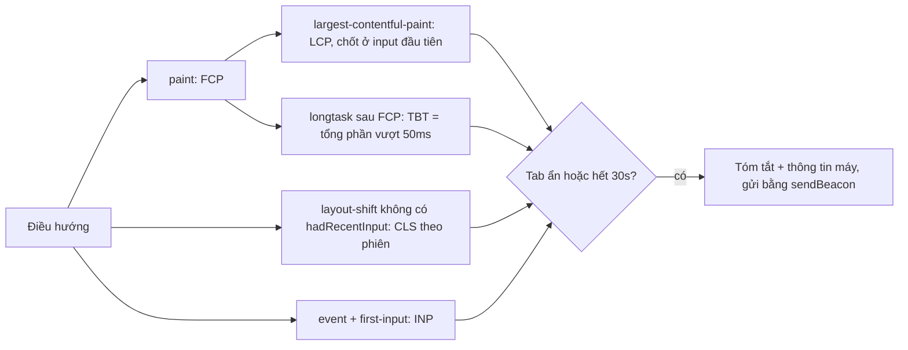

Lighthouse chạy trên máy của bạn, mạng của bạn, một lần. Người dùng thật thì mở trang trên điện thoại 4 nhân, mạng 3G, trong lúc ba tab khác đang chạy. Muốn biết trang **thật sự** nhanh hay chậm thì phải đo ngay trên máy người dùng rồi gửi số liệu về: đó là RUM (Real User Monitoring).

Udemy không dùng thư viện cho việc này. Họ tự viết một bộ đo nhỏ bằng `PerformanceObserver`: FCP, LCP, CLS, TBT, FID, kèm số nhân CPU, RAM, loại mạng để biết số liệu đến từ máy nào. Đọc bộ này là cách tốt để hiểu các chỉ số Web Vitals được tính **thế nào**, chứ không chỉ gọi `onLCP()`.

> [!TIP]
> **Tóm tắt**
> - Mỗi chỉ số là một `PerformanceObserver` với `buffered: true` (lấy cả entry xảy ra trước khi đăng ký), có kiểm tra `supportedEntryTypes` vì không phải trình duyệt nào cũng có.
> - Duyệt **hết** danh sách entry trong mỗi lần callback. Udemy lấy CLS bằng `.pop()` (chỉ entry cuối) nên đếm thiếu.
> - Dừng đo khi tab bị ẩn hoặc sau một khoảng cố định (Udemy: 30 giây) để số liệu giữa các phiên so sánh được, rồi gửi bằng `sendBeacon`.
> - Gửi kèm thông tin máy (CPU, RAM, mạng, tiết kiệm dữ liệu) để chia nhóm số liệu, và dùng chính thông tin đó để phục vụ bản nhẹ cho máy yếu. FID đã được thay bằng INP; bản viết lại đo INP.

<iframe class="demo-frame" src="/demos/web-patterns/index.html?theme=dark#/rum" title="Demo rum" loading="lazy" style="height: 1180px"></iframe>

<p class="demo-links">▶ <a href="/demos/web-patterns/index.html#/rum" target="_blank" rel="noopener">Mở demo toàn màn hình ↗</a> · <a href="https://stackblitz.com/github/hunghg255/blog-hunghg/tree/master/examples/web-patterns?file=src/lib/rum.ts" target="_blank" rel="noopener">Sửa code trên StackBlitz ↗</a> · <a href="https://github.com/hunghg255/blog-hunghg/blob/master/examples/web-patterns/src/lib/rum.ts" target="_blank" rel="noopener">Xem source trên GitHub ↗</a></p>

Số liệu trong demo là số đo thật trên trình duyệt của bạn. Bấm **Banner ngay**: CLS không đổi, vì shift xảy ra trong 500ms sau click được coi là do người dùng gây ra. Bấm **Banner sau 1s**: CLS tăng. Sau vài lần chèn banner, bấm **Đo lại bằng observer mới**: ô "kiểu Udemy" tụt hẳn xuống, còn "cộng mọi shift" vẫn đúng. Phần "Đi qua code" giải thích vì sao.

## Udemy làm thế nào?

Code nằm trong [`udemy.com/webpack---/src/observers/`](https://github.com/hunghg255/codebase/tree/main/udemy.com/webpack---/src/observers), cùng ba file ở thư mục cha: `create-performance-observers.ts`, `metrics-collector.ts`, `get-device-information.ts`.

### `po()`: một hàm bọc PerformanceObserver

```ts
export const po = (eventType: string, cb: Function): PerformanceObserver | false => {
    try {
        if (PerformanceObserver.supportedEntryTypes.includes(eventType)) {
            // More extensive feature detect needed for Firefox due to:
            // https://github.com/GoogleChrome/web-vitals/issues/142
            if (eventType === 'first-input' && !('PerformanceEventTiming' in self)) return false;
            const perfObserver = new PerformanceObserver((entryList) => cb(entryList.getEntries()));
            perfObserver.observe({type: eventType, buffered: true});
            return perfObserver;
        }
    } catch (e: unknown) { console.warn('po:', (e as Error).message); }
    return false;
};
```

Ba điểm đáng giữ: kiểm tra `supportedEntryTypes` trước khi đăng ký; `buffered: true` để không bỏ lỡ những gì đã xảy ra trước khi script đo được tải; và bọc `try/catch` để code đo không bao giờ làm hỏng trang. Comment trỏ tới một issue của thư viện web-vitals, cho thấy nhóm Udemy đọc kỹ thư viện đó rồi tự viết lại.

### Từng chỉ số

Mỗi chỉ số một file, cùng chia sẻ một object `metrics`:

- **FCP** (`first-paints.ts`): observer `paint`, lấy entry `first-contentful-paint`. Có FCP rồi mới bật observer long task để tính TBT, rồi tự ngắt.
- **TBT** (`total-blocking-time.ts`): với mỗi long task của chính trang (`entry.name === 'self'`) bắt đầu sau FCP, cộng `entry.duration - 50`.
- **LCP** (`largest-contentful-paint.ts`): lưu `startTime` của entry cuối, ngắt observer ở `keydown` hoặc `click` đầu tiên (capture, `once`), vì tương tác của người dùng thay đổi thứ đang hiển thị.
- **CLS** (`layout-shift.ts`): cộng dồn `value` của các shift không có `hadRecentInput`.
- **FID** (`first-input-delay.ts`): `processingStart - startTime` của input đầu tiên, giới hạn 5 giây. Đây cũng là lúc chụp LCP, CLS, TBT, rồi chụp TBT thêm hai lần sau 5 và 10 giây.

Mọi mốc thời gian đi qua `limitPerformanceTiming` (tối đa 60 giây), để vài giá trị bất thường không làm lệch thống kê.

### Thu thập và gửi

`MetricsCollector` (trong `metrics-collector.ts`) quyết định **khi nào** đo:

```ts
// If document is hidden, don't collect performance observer data because it can be unreliable
if (isDocumentVisible || forcePerformanceObserverInitialization === true) {
    this.disconnectObservers = this.initializeObservers();
    // We are only going to limit collection to 30 seconds max to keep data comparative
    this.observationTimeout = setTimeout(this.safeDisconnectObservers, 30000);
    window.document.addEventListener('visibilitychange', this.safeDisconnectObservers);
}
```

Trang mở ở tab nền thì không đo: số liệu khi tab ẩn không đáng tin (trình duyệt giảm ưu tiên, không vẽ). Đang đo mà tab bị ẩn thì dừng ngay. Tối đa 30 giây, để mọi phiên đo cùng một khoảng và so sánh được. Bản tóm tắt được gửi một lần, lúc trang đóng (`beacon.ts` đăng ký với `Tracker.addCloseListener`), cùng Navigation Timing, thời gian ở trang và thông tin thiết bị.

### Thông tin thiết bị

`getIsLowEndDevice()` trong `get-device-information.ts` coi là máy yếu nếu `navigator.hardwareConcurrency <= 4` (số luồng CPU) hoặc `navigator.deviceMemory <= 4` (GB RAM). `getIsLowEndExperience(ect, saveData)` thêm điều kiện mạng: `effectiveType` là `slow-2g`, `2g` hoặc `3g`, hoặc người dùng bật tiết kiệm dữ liệu. `getDeviceInformation` gửi kèm `downlink`, `rtt`, `ect`, `saveData`, `deviceMemory`, `hardwareConcurrency`, trạng thái service worker và dung lượng lưu trữ (`navigator.storage.estimate()`).

Trong bản dump, mình chỉ thấy hai cờ `isLowEndDevice` và `isLowEndExperience` được gửi kèm số liệu, để chia nhóm khi phân tích ("LCP của nhóm máy yếu là bao nhiêu?"). Không thấy chỗ nào dùng chúng để đổi giao diện. Phần "phục vụ bản nhẹ" trong bài là bước tiếp theo tự nhiên, không phải code của Udemy.

### Những chỗ chưa ổn trong bản gốc

1. **CLS đếm thiếu.** `layout-shift.ts` viết `const lastEntry = performanceEntries.pop()`: mỗi lần callback chỉ lấy **entry cuối**. Với LCP thì đúng (entry cuối là phần tử lớn nhất), nhưng với CLS thì mỗi entry là một lần shift riêng cần cộng. Một callback chứa nhiều entry thường xảy ra nhất ở lần đầu: `buffered: true` trả **mọi** shift đã xảy ra trước khi đăng ký trong **một** lần gọi, trong khi lúc tải trang lại là lúc có nhiều shift nhất. Demo tái hiện bằng nút "Đo lại bằng observer mới": ở lần chạy của mình, entry cuối là một shift ngay sau click (có `hadRecentInput`), nên kiểu Udemy cộng ra 0.
2. **CLS theo định nghĩa cũ.** Từ 2021, CLS không còn là tổng mọi shift trong cả phiên mà là **phiên shift lớn nhất** (shift cách nhau dưới 1 giây, cả phiên tối đa 5 giây). Cộng tất cả làm trang mở lâu bị phạt nặng một cách không công bằng.
3. **`convertToKB` thực ra đổi ra MB**: hàm chia cho `1024²` nhưng tên và comment nói KB, nên `storageQuota`, `storageUsage` trên dashboard lệch 1024 lần nếu ai đó tin vào tên.
4. **Comment nói một đằng, code làm một nẻo**: `marks-and-measures.ts` ghi "reporting any performance mark/measure prefixed with UD-", nhưng code gửi **mọi** mark và measure, không lọc tiền tố. Thư viện bên thứ ba nào gọi `performance.mark` cũng bị gửi theo.
5. **Ngưỡng "≤ 4 luồng CPU"** đánh dấu cả nhiều laptop 4 nhân là máy yếu. Với mục đích chia nhóm thì chấp nhận được; nếu dùng để quyết định giao diện thì nên kết hợp thêm RAM và mạng.

## Bên trong trình duyệt

`PerformanceObserver` là một hàng đợi sự kiện do trình duyệt đẩy vào: mỗi khi có một entry mới (một lần vẽ, một layout shift, một long task, một tương tác), trình duyệt thêm vào **buffer** và sau đó gọi callback, có thể gom **nhiều entry** trong một lần gọi. `buffered: true` yêu cầu trình duyệt trả cả các entry đã nằm sẵn trong buffer.



Vài quy tắc của trình duyệt mà bộ đo phải tôn trọng:

- **LCP** chỉ có ứng viên mới cho tới tương tác đầu tiên của người dùng (bấm, gõ phím, cuộn); sau đó trình duyệt ngừng báo. Udemy và bản viết lại cũng tự chốt ở đó.
- **Shift có `hadRecentInput`** là shift trong 500ms sau một input rời rạc (click, phím). Mở accordion khi bấm không bị phạt; banner tự chèn sau 1 giây thì có.
- **TBT** theo định nghĩa là tổng phần vượt 50ms của các long task **giữa FCP và TTI**. Trên máy người dùng không có TTI rõ ràng, nên Udemy tính tới lúc dừng đo, và chụp thêm ở FID + 5 giây, FID + 10 giây.
- **INP** (Interaction to Next Paint) thay FID làm Core Web Vital từ tháng 3/2024. FID chỉ đo **độ trễ trước khi bắt đầu xử lý** của **tương tác đầu tiên**. INP đo **toàn bộ thời gian từ input tới khi khung hình tiếp theo được vẽ**, cho **mọi** tương tác, rồi lấy giá trị gần tệ nhất.

## Viết lại

[`src/lib/rum.ts`](https://github.com/hunghg255/blog-hunghg/blob/master/examples/web-patterns/src/lib/rum.ts) giữ cấu trúc của Udemy (một hàm `observe`, một bộ thu thập dừng khi tab ẩn hoặc hết giờ), sửa CLS, thêm INP. [`src/lib/rumDevice.ts`](https://github.com/hunghg255/blog-hunghg/blob/master/examples/web-patterns/src/lib/rumDevice.ts) lo thông tin thiết bị.

CLS theo phiên, duyệt hết danh sách entry:

```ts title=src/lib/rum.ts
/**
 * CLS theo định nghĩa hiện tại: gom các shift thành "phiên" (cách nhau < 1s, cả phiên < 5s),
 * lấy phiên lớn nhất. Bỏ shift xảy ra trong 500ms sau input của người dùng (hadRecentInput).
 */
export function createClsTracker() {
  let current = 0;
  let firstTs = 0;
  let lastTs = 0;
  let max = 0;
  return {
    add(entries: PerformanceEntry[]) {
      // Duyệt HẾT danh sách: một lần callback có thể mang nhiều entry (nhất là lần đầu với
      // buffered: true). Udemy chỉ lấy entry cuối bằng .pop() nên đếm thiếu.
      for (const entry of entries as LayoutShiftEntry[]) {
        if (entry.hadRecentInput) continue;
        const sameSession = current > 0 && entry.startTime - lastTs < 1000 && entry.startTime - firstTs < 5000;
        if (sameSession) {
          current += entry.value;
        } else {
          current = entry.value;
          firstTs = entry.startTime;
        }
        lastTs = entry.startTime;
        max = Math.max(max, current);
      }
    },
    get value() {
      return max;
    },
  };
}
```

INP xấp xỉ: mỗi tương tác lấy event chậm nhất, rồi lấy giá trị gần tệ nhất:

```ts title=src/lib/rum.ts
/**
 * INP xấp xỉ: mỗi tương tác (interactionId) lấy event chậm nhất; INP là tương tác chậm nhất,
 * bỏ 1 tương tác cao nhất cho mỗi 50 tương tác (gần với cách web-vitals làm).
 */
export function createInpTracker() {
  const byInteraction = new Map<number, number>();
  return {
    add(entries: PerformanceEntry[]) {
      for (const entry of entries as EventTimingEntry[]) {
        if (!entry.interactionId) continue;
        const prev = byInteraction.get(entry.interactionId) ?? 0;
        byInteraction.set(entry.interactionId, Math.max(prev, entry.duration));
      }
    },
    get value(): number | undefined {
      if (byInteraction.size === 0) return undefined;
      const sorted = [...byInteraction.values()].sort((a, b) => b - a);
      return sorted[Math.min(sorted.length - 1, Math.floor(byInteraction.size / 50))];
    },
    get count() {
      return byInteraction.size;
    },
  };
}
```

Thông tin thiết bị, không đoán "yếu" khi trình duyệt không cho biết:

```ts title=src/lib/rumDevice.ts
export function getDeviceInfo(nav: NavigatorLike = navigator as NavigatorLike): DeviceInfo {
  const cores = Number.isFinite(nav.hardwareConcurrency) ? nav.hardwareConcurrency! : null;
  const memoryGb = Number.isFinite(nav.deviceMemory) ? nav.deviceMemory! : null;
  const effectiveType = nav.connection?.effectiveType ?? null;
  const saveData = !!nav.connection?.saveData;
  // Ngưỡng của Udemy: ≤ 4 luồng CPU hoặc ≤ 4GB RAM là máy yếu.
  // Không biết (null) thì KHÔNG coi là yếu: Safari/Firefox không có deviceMemory.
  const lowEndDevice = (cores != null && cores <= 4) || (memoryGb != null && memoryGb <= 4);
  const lowEndExperience =
    (effectiveType != null && SLOW_TYPES.has(effectiveType)) || saveData || lowEndDevice;
  return { cores, memoryGb, effectiveType, saveData, lowEndDevice, lowEndExperience };
}
```

::: spoiler Xem toàn bộ src/lib/rum.ts

```ts title=src/lib/rum.ts
/**
 * RUM (Real User Monitoring) tự viết bằng PerformanceObserver (ý tưởng từ observers/ của Udemy):
 * đo FCP, LCP, CLS, TBT, INP ngay trên máy người dùng, dừng khi tab bị ẩn hoặc sau một khoảng
 * thời gian cố định, rồi trả một bản tóm tắt để gửi đi bằng sendBeacon.
 */

export type ObserveCallback = (entries: PerformanceEntry[]) => void;

/**
 * Bọc PerformanceObserver: kiểm tra trình duyệt hỗ trợ loại entry, lấy cả entry đã xảy ra
 * trước khi đăng ký (`buffered`). Trả về hàm huỷ, hoặc null nếu không hỗ trợ.
 */
export function observe(
  type: string,
  callback: ObserveCallback,
  options: Record<string, unknown> = {},
): (() => void) | null {
  try {
    if (!PerformanceObserver.supportedEntryTypes?.includes(type)) return null;
    const observer = new PerformanceObserver((list) => callback(list.getEntries()));
    observer.observe({ type, buffered: true, ...options } as PerformanceObserverInit);
    return () => observer.disconnect();
  } catch {
    return null;
  }
}

// Các trường không có trong kiểu PerformanceEntry chung
interface LayoutShiftEntry extends PerformanceEntry {
  value: number;
  hadRecentInput: boolean;
}
interface EventTimingEntry extends PerformanceEntry {
  interactionId?: number;
}

/**
 * CLS theo định nghĩa hiện tại: gom các shift thành "phiên" (cách nhau < 1s, cả phiên < 5s),
 * lấy phiên lớn nhất. Bỏ shift xảy ra trong 500ms sau input của người dùng (hadRecentInput).
 */
export function createClsTracker() {
  let current = 0;
  let firstTs = 0;
  let lastTs = 0;
  let max = 0;
  return {
    add(entries: PerformanceEntry[]) {
      // Duyệt HẾT danh sách: một lần callback có thể mang nhiều entry (nhất là lần đầu với
      // buffered: true). Udemy chỉ lấy entry cuối bằng .pop() nên đếm thiếu.
      for (const entry of entries as LayoutShiftEntry[]) {
        if (entry.hadRecentInput) continue;
        const sameSession = current > 0 && entry.startTime - lastTs < 1000 && entry.startTime - firstTs < 5000;
        if (sameSession) {
          current += entry.value;
        } else {
          current = entry.value;
          firstTs = entry.startTime;
        }
        lastTs = entry.startTime;
        max = Math.max(max, current);
      }
    },
    get value() {
      return max;
    },
  };
}

/**
 * INP xấp xỉ: mỗi tương tác (interactionId) lấy event chậm nhất; INP là tương tác chậm nhất,
 * bỏ 1 tương tác cao nhất cho mỗi 50 tương tác (gần với cách web-vitals làm).
 */
export function createInpTracker() {
  const byInteraction = new Map<number, number>();
  return {
    add(entries: PerformanceEntry[]) {
      for (const entry of entries as EventTimingEntry[]) {
        if (!entry.interactionId) continue;
        const prev = byInteraction.get(entry.interactionId) ?? 0;
        byInteraction.set(entry.interactionId, Math.max(prev, entry.duration));
      }
    },
    get value(): number | undefined {
      if (byInteraction.size === 0) return undefined;
      const sorted = [...byInteraction.values()].sort((a, b) => b - a);
      return sorted[Math.min(sorted.length - 1, Math.floor(byInteraction.size / 50))];
    },
    get count() {
      return byInteraction.size;
    },
  };
}

export interface RumSummary {
  fcp?: number;
  lcp?: number;
  cls: number;
  tbt: number;
  inp?: number;
  interactions: number;
  longTasks: number;
  stoppedBy: 'hidden' | 'timeout' | 'manual' | null;
}

export interface RumOptions {
  /** gọi mỗi khi số liệu đổi (để vẽ lên màn hình) */
  onUpdate?: (summary: RumSummary) => void;
  /** gọi một lần khi dừng đo, nơi gửi beacon */
  onStop?: (summary: RumSummary) => void;
  /** Udemy: 30 giây, để số liệu giữa các phiên so sánh được với nhau */
  maxObservationMs?: number;
}

/** Giới hạn trên cho mốc thời gian, tránh vài giá trị cực lớn làm lệch thống kê (Udemy: 60s). */
const cap = (ms: number, max = 60_000) => Math.min(ms, max);

export function createRum({ onUpdate, onStop, maxObservationMs = 30_000 }: RumOptions = {}) {
  const cls = createClsTracker();
  const inp = createInpTracker();
  const longTasks: { start: number; duration: number }[] = [];
  let fcp: number | undefined;
  let lcp: number | undefined;
  let lcpFinal = false;
  let stoppedBy: RumSummary['stoppedBy'] = null;
  const cleanups: Array<() => void> = [];

  const summary = (): RumSummary => ({
    fcp,
    lcp,
    cls: Number(cls.value.toFixed(4)),
    // TBT: phần vượt 50ms của mỗi long task SAU FCP (trước FCP người dùng chưa thấy gì để bấm)
    tbt: fcp == null ? 0 : longTasks.filter((t) => t.start >= fcp!).reduce((sum, t) => sum + Math.max(0, t.duration - 50), 0),
    inp: inp.value,
    interactions: inp.count,
    longTasks: longTasks.length,
    stoppedBy,
  });
  const update = () => onUpdate?.(summary());
  const track = (stop: (() => void) | null) => stop && cleanups.push(stop);

  track(
    observe('paint', (entries) => {
      const entry = entries.find((e) => e.name === 'first-contentful-paint');
      if (entry) fcp = cap(entry.startTime);
      update();
    }),
  );
  track(
    observe('largest-contentful-paint', (entries) => {
      if (lcpFinal) return;
      // entry cuối cùng là phần tử lớn nhất tính tới lúc này
      lcp = cap(entries[entries.length - 1].startTime);
      update();
    }),
  );
  // Sau tương tác đầu tiên, LCP không còn ý nghĩa (nội dung đổi do người dùng): chốt lại.
  const finalizeLcp = () => {
    lcpFinal = true;
    update();
  };
  for (const type of ['keydown', 'pointerdown']) {
    addEventListener(type, finalizeLcp, { once: true, capture: true });
    cleanups.push(() => removeEventListener(type, finalizeLcp, { capture: true }));
  }
  track(
    observe('layout-shift', (entries) => {
      cls.add(entries);
      update();
    }),
  );
  track(
    observe('longtask', (entries) => {
      // name 'self': long task của chính trang này (không tính iframe khác origin)
      for (const e of entries) if (e.name === 'self') longTasks.push({ start: e.startTime, duration: e.duration });
      update();
    }),
  );
  track(
    observe(
      'event',
      (entries) => {
        inp.add(entries);
        update();
      },
      { durationThreshold: 40 },
    ),
  );
  // first-input: tương tác đầu tiên có thể nhanh hơn ngưỡng 40ms của 'event', vẫn cần đếm
  track(observe('first-input', (entries) => (inp.add(entries), update())));

  const stop = (reason: Exclude<RumSummary['stoppedBy'], null>) => {
    if (stoppedBy) return;
    stoppedBy = reason;
    cleanups.forEach((fn) => fn());
    clearTimeout(timer);
    removeEventListener('visibilitychange', onHidden);
    const result = summary();
    onUpdate?.(result);
    onStop?.(result);
  };
  // Tab bị ẩn: dừng đo và gửi ngay (có thể người dùng không bao giờ quay lại).
  const onHidden = () => document.visibilityState === 'hidden' && stop('hidden');
  addEventListener('visibilitychange', onHidden);
  const timer = setTimeout(() => stop('timeout'), maxObservationMs);

  return { summary, stop: () => stop('manual') };
}

/** Gửi bản tóm tắt khi trang sắp đóng: sendBeacon không bị huỷ khi trang unload. */
export function sendSummary(url: string, summary: RumSummary & Record<string, unknown>) {
  const body = JSON.stringify(summary);
  if (!navigator.sendBeacon?.(url, new Blob([body], { type: 'text/plain' }))) {
    void fetch(url, { method: 'POST', body, keepalive: true }).catch(() => {});
  }
}
```

:::

::: spoiler Xem toàn bộ src/lib/rumDevice.ts

```ts title=src/lib/rumDevice.ts
/**
 * Thông tin thiết bị + mạng để chia nhóm số liệu RUM và chọn bản nhẹ cho máy yếu
 * (ý tưởng từ get-device-information.ts của Udemy).
 * Các API này chưa có trên mọi trình duyệt: luôn coi giá trị là "có thể không biết" (null).
 */

interface NetworkInformationLike {
  effectiveType?: string;
  saveData?: boolean;
  downlink?: number;
  rtt?: number;
  addEventListener?: (type: 'change', listener: () => void) => void;
  removeEventListener?: (type: 'change', listener: () => void) => void;
}

export interface NavigatorLike {
  hardwareConcurrency?: number;
  deviceMemory?: number;
  connection?: NetworkInformationLike;
}

export interface DeviceInfo {
  /** số luồng CPU logic */
  cores: number | null;
  /** RAM xấp xỉ (GB); trình duyệt làm tròn và giới hạn giá trị để chống fingerprint */
  memoryGb: number | null;
  /** 'slow-2g' | '2g' | '3g' | '4g' theo đo đạc thực tế, không phải loại kết nối */
  effectiveType: string | null;
  saveData: boolean;
  lowEndDevice: boolean;
  lowEndExperience: boolean;
}

const SLOW_TYPES = new Set(['slow-2g', '2g', '3g']);

export function getDeviceInfo(nav: NavigatorLike = navigator as NavigatorLike): DeviceInfo {
  const cores = Number.isFinite(nav.hardwareConcurrency) ? nav.hardwareConcurrency! : null;
  const memoryGb = Number.isFinite(nav.deviceMemory) ? nav.deviceMemory! : null;
  const effectiveType = nav.connection?.effectiveType ?? null;
  const saveData = !!nav.connection?.saveData;
  // Ngưỡng của Udemy: ≤ 4 luồng CPU hoặc ≤ 4GB RAM là máy yếu.
  // Không biết (null) thì KHÔNG coi là yếu: Safari/Firefox không có deviceMemory.
  const lowEndDevice = (cores != null && cores <= 4) || (memoryGb != null && memoryGb <= 4);
  const lowEndExperience =
    (effectiveType != null && SLOW_TYPES.has(effectiveType)) || saveData || lowEndDevice;
  return { cores, memoryGb, effectiveType, saveData, lowEndDevice, lowEndExperience };
}

/** Mạng đổi (vào thang máy, bật tiết kiệm dữ liệu…) thì báo lại. Trả về hàm huỷ. */
export function watchDeviceInfo(
  callback: (info: DeviceInfo) => void,
  nav: NavigatorLike = navigator as NavigatorLike,
) {
  const onChange = () => callback(getDeviceInfo(nav));
  nav.connection?.addEventListener?.('change', onChange);
  return () => nav.connection?.removeEventListener?.('change', onChange);
}
```

:::

## Đi qua code

**`observe()`** gần giống `po()` của Udemy, nhưng trả về hàm huỷ thay vì observer, và nhận thêm option (`durationThreshold` cho event timing). Bỏ nhánh kiểm tra `PerformanceEventTiming` cho Firefox: `supportedEntryTypes` đã đủ để biết trình duyệt có hỗ trợ không.

**`createClsTracker()`** giữ phiên hiện tại (`current`, `firstTs`, `lastTs`) và giá trị lớn nhất (`max`). Shift mới thuộc phiên hiện tại nếu cách shift trước dưới 1 giây và cách đầu phiên dưới 5 giây; không thì mở phiên mới. Vòng `for` duyệt **mọi** entry, sửa lỗi số 1 và 2.

**`createInpTracker()`**: một tương tác (bấm một nút) sinh nhiều event (`pointerdown`, `pointerup`, `click`) cùng `interactionId`. Lấy event chậm nhất của mỗi tương tác. INP là tương tác chậm nhất, trừ khi có nhiều tương tác: cứ 50 tương tác thì bỏ một giá trị cao nhất, để một lần giật hiếm gặp không quyết định cả phiên. Observer `event` dùng `durationThreshold: 40`; thêm `first-input` vì tương tác đầu tiên có thể nhanh hơn ngưỡng đó.

**TBT tính lúc tóm tắt** từ danh sách long task, chỉ những task bắt đầu sau FCP. Không phụ thuộc vào thứ tự các observer gọi callback.

**`createRum()`** dừng ở một trong ba trường hợp: tab bị ẩn (`hidden`), hết `maxObservationMs` (`timeout`), hoặc gọi tay (`manual`). Khi dừng, mọi observer và listener được huỷ, rồi `onStop` nhận bản tóm tắt: đó là chỗ gọi `sendSummary`, dùng `sendBeacon` với `text/plain` (không cần preflight CORS), lùi về `fetch` với `keepalive` nếu beacon bị từ chối.

**`getDeviceInfo()`** nhận `navigator` làm tham số để test được. Giá trị nào trình duyệt không cung cấp thì là `null`, và `null` không bao giờ bị coi là "yếu". Bản gốc cũng vậy nhờ kiểm tra truthy, nhưng `null` rõ ràng hơn `undefined` lẫn với `0`.

**Khác bản gốc:**
- CLS duyệt hết entry và tính theo phiên (bản gốc: `.pop()` và cộng dồn cả phiên).
- Đo INP thay cho FID; bỏ các mốc `tbt5S`, `tbt10S` gắn với FID.
- Không gửi mark/measure, resource timing; thêm thì nên lọc theo tiền tố như comment của Udemy định làm.
- Cờ máy yếu được dùng để đổi giao diện trong demo (bản nhẹ: bỏ animation, ảnh nhỏ), không chỉ để chia nhóm số liệu.

## Tại sao không làm cách khác?

**Dùng thư viện [web-vitals](https://github.com/GoogleChrome/web-vitals)?** Với phần lớn dự án, nên dùng. Thư viện này do nhóm Chrome viết, theo sát định nghĩa mới nhất, xử lý những trường hợp khó như trang được khôi phục từ bfcache (back/forward cache), prerender, tab mở ở nền. Tự viết hợp khi bạn cần số liệu riêng (như TBT, vốn không có trong web-vitals vì là chỉ số lab), muốn gom mọi thứ vào **một** beacon cùng thông tin của riêng bạn, hoặc đơn giản là muốn hiểu cách các chỉ số được tính. Bài này là cách hiểu; khi dùng thật, so số của bạn với web-vitals trên cùng trang.

**Gửi một beacon cho mỗi chỉ số ngay khi có?** Nhiều request, và các chỉ số như CLS, INP còn thay đổi tới cuối phiên. Một bản tóm tắt khi tab ẩn gọn hơn; web-vitals cũng khuyên gửi ở `visibilitychange`.

**Gửi ở `unload` hoặc `beforeunload`?** Trên mobile, người dùng thường chuyển app hoặc vuốt tắt tab mà không có sự kiện `unload`. `visibilitychange` sang `hidden` là tín hiệu đáng tin nhất, như đã bàn trong [bài Banzai của series Facebook](/blogs/facebook-batch-logger).

**Đọc `navigator.userAgent` để đoán máy yếu?** Tên máy không nói lên RAM, CPU hay mạng hiện tại. `hardwareConcurrency`, `deviceMemory` và Network Information API đo trực tiếp thứ ta quan tâm, dù chưa có trên mọi trình duyệt.

## Edge case và cạm bẫy

- **Trang được khôi phục từ bfcache** không có điều hướng mới, không có FCP/LCP mới. Nghe `pageshow` với `event.persisted === true` để bắt đầu một phiên đo mới nếu cần.
- **SPA**: LCP và FCP chỉ đo lần tải đầu. Điều hướng phía client cần chỉ số riêng (xem [Performance span, bài #11](/blogs/web-performance-spans-long-tasks) và [Visual Completion của Facebook](/blogs/facebook-visual-completion)).
- **Tab mở ở nền**: Udemy không đo gì nếu trang bắt đầu ở trạng thái ẩn. Bản viết lại để quyết định đó cho nơi gọi; khi phân tích, nhớ loại hoặc tách nhóm này.
- **`deviceMemory` bị làm tròn và giới hạn** để chống fingerprint (nhận diện người dùng qua đặc điểm máy), nên chỉ dùng để chia nhóm thô.
- **`effectiveType` thay đổi** theo mạng thực tế; quyết định "bản nhẹ" lúc tải trang có thể sai sau đó. `watchDeviceInfo` báo lại khi mạng đổi, nhưng đổi giao diện giữa chừng cũng gây khó chịu; thường chỉ áp cho nội dung tải sau.
- **Tôn trọng lựa chọn của người dùng** trước mọi phỏng đoán: `saveData` (người dùng bật tiết kiệm dữ liệu) và `prefers-reduced-motion` đáng tin hơn đoán qua CPU.

## Dùng trong dự án

- Thêm một bộ RUM nhỏ khi chưa có công cụ giám sát hoặc khi cần số liệu riêng: gửi về endpoint của bạn, lưu vào kho số liệu sẵn có, vẽ biểu đồ theo phân vị 75 (p75), như cách Google đánh giá Core Web Vitals.
- Luôn gửi kèm `lowEndDevice`, `effectiveType`, `saveData`: số liệu trung bình che mất nhóm người dùng chịu thiệt nhất.
- Bản nhẹ cho máy yếu: tắt animation trang trí, giảm chất lượng ảnh, không tự phát video, hoãn widget bên thứ ba (xem [TTI governor, bài #40](/blogs/web-tti-governor)).
- Đặt ngân sách: ví dụ LCP p75 dưới 2,5 giây, CLS dưới 0,1, INP dưới 200ms (ngưỡng "tốt" của Core Web Vitals), cảnh báo khi một bản deploy làm vượt ngưỡng.

::: spoiler Ví dụ test (bản phác, không có trong repo)

```ts
import { describe, expect, it } from 'vitest';
import { createClsTracker, createInpTracker } from './rum';
import { getDeviceInfo } from './rumDevice';

const shift = (startTime: number, value: number, hadRecentInput = false) =>
  ({ startTime, value, hadRecentInput }) as unknown as PerformanceEntry;
const event = (interactionId: number, duration: number) =>
  ({ interactionId, duration }) as unknown as PerformanceEntry;

describe('CLS theo phiên', () => {
  it('đếm mọi entry trong một lần callback, bỏ shift ngay sau input', () => {
    const cls = createClsTracker();
    cls.add([shift(100, 0.1), shift(300, 0.05), shift(500, 0.2, true)]);
    expect(cls.value).toBeCloseTo(0.15);
  });

  it('shift cách nhau > 1s thuộc phiên khác, lấy phiên lớn nhất', () => {
    const cls = createClsTracker();
    cls.add([shift(0, 0.1), shift(500, 0.1)]); // phiên 1: 0.2
    cls.add([shift(3000, 0.15)]); // phiên 2: 0.15
    expect(cls.value).toBeCloseTo(0.2);
  });

  it('phiên dài quá 5s thì cắt', () => {
    const cls = createClsTracker();
    // mỗi shift cách 900ms, nhưng từ 0 tới 5400 > 5s nên shift cuối mở phiên mới
    cls.add([0, 900, 1800, 2700, 3600, 4500, 5400].map((t) => shift(t, 0.01)));
    expect(cls.value).toBeCloseTo(0.06);
  });
});

describe('INP', () => {
  it('mỗi tương tác lấy event chậm nhất, INP là tương tác chậm nhất khi < 50 tương tác', () => {
    const inp = createInpTracker();
    inp.add([event(1, 40), event(1, 120), event(2, 80), event(0, 999)]); // id 0: không phải tương tác
    expect(inp.count).toBe(2);
    expect(inp.value).toBe(120);
  });

  it('từ 50 tương tác: bỏ 1 giá trị cao nhất cho mỗi 50', () => {
    const inp = createInpTracker();
    inp.add(Array.from({ length: 100 }, (_, i) => event(i + 1, i + 1))); // 1..100ms
    expect(inp.value).toBe(98);
  });
});

describe('getDeviceInfo', () => {
  it('máy yếu theo CPU/RAM, mạng chậm hoặc tiết kiệm dữ liệu', () => {
    expect(getDeviceInfo({ hardwareConcurrency: 8, deviceMemory: 8, connection: { effectiveType: '4g' } }).lowEndExperience).toBe(false);
    expect(getDeviceInfo({ hardwareConcurrency: 4, deviceMemory: 8 }).lowEndDevice).toBe(true);
    expect(getDeviceInfo({ hardwareConcurrency: 8, connection: { effectiveType: '3g' } }).lowEndExperience).toBe(true);
    expect(getDeviceInfo({ hardwareConcurrency: 8, connection: { saveData: true } }).lowEndExperience).toBe(true);
  });

  it('không biết thì không đoán là yếu (Safari không có deviceMemory, connection)', () => {
    const info = getDeviceInfo({ hardwareConcurrency: 8 });
    expect(info).toMatchObject({ memoryGb: null, effectiveType: null, lowEndDevice: false, lowEndExperience: false });
  });
});
```

:::

## So với thư viện và chuẩn web

- **web-vitals** (`onLCP`, `onCLS`, `onINP`, `onFCP`, `onTTFB`) là lựa chọn mặc định; bản "attribution" của nó còn cho biết phần tử nào gây LCP, shift nào gây CLS, event nào gây INP chậm. Các bản mới của thư viện đã bỏ `onFID`.
- **Hỗ trợ trình duyệt**: Chromium có đủ các loại entry dùng trong bài (`largest-contentful-paint`, `layout-shift`, `longtask`, `event`). Các trình duyệt khác hỗ trợ một phần hoặc chưa hỗ trợ; xem [caniuse: LCP](https://caniuse.com/mdn-api_largestcontentfulpaint), [caniuse: Layout Instability](https://caniuse.com/mdn-api_layoutshift), [caniuse: Event Timing](https://caniuse.com/mdn-api_performanceeventtiming) (tính tới 10/2026). Code luôn feature-detect nên trình duyệt thiếu API chỉ gửi ít chỉ số hơn.
- **Long Animation Frames API** (`long-animation-frame`) là bản kế nhiệm của Long Tasks trên Chromium: đo theo khung hình thay vì theo task, kèm thông tin script nào gây chậm. Đáng cân nhắc thay `longtask` khi trình duyệt mục tiêu hỗ trợ.
- **Network Information API** (`navigator.connection`) và `navigator.deviceMemory` hiện chủ yếu có trên Chromium; header `Save-Data` cho phép server biết người dùng bật tiết kiệm dữ liệu ngay từ request đầu tiên.

---

Bài này thuộc series **[Học từ mã nguồn các web lớn](/series/web)** (42 bài, đọc theo thứ tự).

::: spoiler Xem nhanh danh sách bài trong series

*Mở đầu*

- [Mở đầu: đọc code production của 28 trang web](/blogs/learn-from-big-web-apps)

*Phần 1: trải nghiệm người dùng*

- [#1 Dark mode không nháy (Gatsby)](/blogs/web-dark-mode-no-flash)
- [#2 useValueByMedia: giá trị theo breakpoint (Toptal)](/blogs/web-use-value-by-media)
- [#3 Đoán ý định: idle, exit-intent, lắc chuột (Toptal, InVision)](/blogs/web-user-intent-idle-exit-wiggle)
- [#4 Validate form thân thiện (Udacity, Pipedrive)](/blogs/web-form-validation-ux)
- [#5 Magic number, EXIF và dán ảnh (Ello)](/blogs/web-file-magic-number-exif-paste)
- [#6 fastSmoothScroll: cuộn xa vẫn nhanh (Telegram)](/blogs/web-telegram-fast-smooth-scroll)
- [#7 Countdown time-travel và tombstone giỏ hàng (Best Buy)](/blogs/web-countdown-time-travel-tombstone)

*Phần 2: hiệu năng và đo lường*

- [#8 Hàng đợi requestAnimationFrame 3ms (Apple)](/blogs/web-raf-queue-3ms)
- [#9 srcset cho artwork và preconnect tự động (Apple)](/blogs/web-responsive-artwork-preconnect)
- [#10 Quick-fetch: gọi API trước khi bundle tải xong (HubSpot)](/blogs/web-quick-fetch-early-requests)
- [#11 Performance span và long task (Postman, Calibre)](/blogs/web-performance-spans-long-tasks)
- [#12 Gọi Web Worker như hàm async (Telegram)](/blogs/web-worker-promise-rpc)
- [#13 Đồng hồ media: đếm giờ xem và sửa lệch (Skillshare, Simplified)](/blogs/web-media-clock-watch-time-drift)

*Phần 3: nhiều tab, phiên đăng nhập, cập nhật*

- [#14 Bầu tab chủ cho thông báo (HubSpot, Telegram)](/blogs/web-leader-tab-notifications)
- [#15 Đồng bộ đăng nhập giữa tab và giới hạn cookie (Elastic, InVision)](/blogs/web-cross-tab-auth-cookie-guard)
- [#16 SPA tự cập nhật: Trello, Zappos, Facebook, Elastic](/blogs/web-spa-self-update-strategies)

*Phần 4: kiến trúc*

- [#17 Reverse portal: di chuyển component không remount (Zappos)](/blogs/web-reverse-portal)
- [#18 Page behaviors: gắn hành vi từ CMS (Intercom)](/blogs/web-page-behaviors-cms)
- [#19 Giới hạn tần suất hiển thị bằng bitmask (Outlook)](/blogs/web-frequency-cap-bitmask)
- [#20 Chuyển REST sang GraphQL dần dần (Coursera)](/blogs/web-rest-to-graphql-hybrid-link)

*Phần 5: soạn thảo và hiển thị nội dung*

- [#21 Autocomplete tại con trỏ trong contenteditable (Ello, Telegram)](/blogs/web-caret-autocomplete-contenteditable)
- [#22 Dark mode cho email HTML bằng CIELAB (Outlook)](/blogs/web-email-dark-mode-cielab)
- [#23 Thu nhỏ bảng rộng cho vừa khung, vá font emoji (Outlook)](/blogs/web-email-wide-content-scale)
- [#24 Cảnh báo quên đính kèm file (Outlook)](/blogs/web-forgotten-attachment-warning)
- [#25 Cắt chữ nhiều dòng chính xác (Pipedrive, Apple, Toptal)](/blogs/web-multiline-truncate-measure-text)
- [#26 Parse ngày giờ gõ tay khoan dung (Outlook, Elastic)](/blogs/web-lenient-date-parser)

*Phần 6: tương tác*

- [#27 menuAim: rê chéo vào submenu không bị đóng (Udemy)](/blogs/web-menu-aim-triangle)
- [#28 Kéo, vuốt chung cho chuột và cảm ứng (Telegram)](/blogs/web-unified-pointer-gestures)
- [#29 Phím tắt theo phạm vi, IME và bàn phím phi Latinh (Trello)](/blogs/web-scoped-keyboard-shortcuts)
- [#30 Nội suy màu: đổi theme và nền theo cuộn (Telegram, Anchor)](/blogs/web-color-interpolation-theme-scroll)
- [#31 Đường gióng hút cạnh và undo/redo trên canvas (Simplified)](/blogs/web-canvas-snap-guides-undo)
- [#32 Giả lập mù màu bằng feColorMatrix (Trello)](/blogs/web-color-vision-simulator)
- [#33 Vạch thước theo mức zoom và cấp phát màu cho biểu đồ (Anchor, Similarweb)](/blogs/web-timeline-ticks-color-stack)

*Phần 7: mạng, dữ liệu và async*

- [#34 Ô tìm kiếm chuẩn production (Similarweb, Udemy, Pipedrive)](/blogs/web-production-search-box)
- [#35 Điều phối async: latest-wins, single-flight (Glitch, Toptal)](/blogs/web-async-coordination-latest-wins)
- [#36 Polling thưa dần và debounce động (Trello)](/blogs/web-decaying-polling-dynamic-debounce)
- [#37 Cache phía client theo version (Similarweb, Telegram, Udemy)](/blogs/web-client-cache-versioned)
- [#38 Upload file lớn theo chunk (Outlook, Tribe)](/blogs/web-chunked-upload-pipeline)
- [#39 Phát video qua Service Worker bằng Range request (Telegram, Outlook)](/blogs/web-service-worker-range-streaming)

*Phần 8: hiệu năng và vận hành*

- [#40 TTI governor: hoãn việc phụ tới sau khi trang dùng được (Outlook)](/blogs/web-tti-governor)
- **#41 Tự đo LCP/CLS/TBT và phục vụ bản nhẹ cho máy yếu (Udemy)** (bài này)

:::

Code + demo: [`examples/web-patterns`](https://github.com/hunghg255/blog-hunghg/tree/master/examples/web-patterns) · [Mở trên StackBlitz](https://stackblitz.com/github/hunghg255/blog-hunghg/tree/master/examples/web-patterns)
