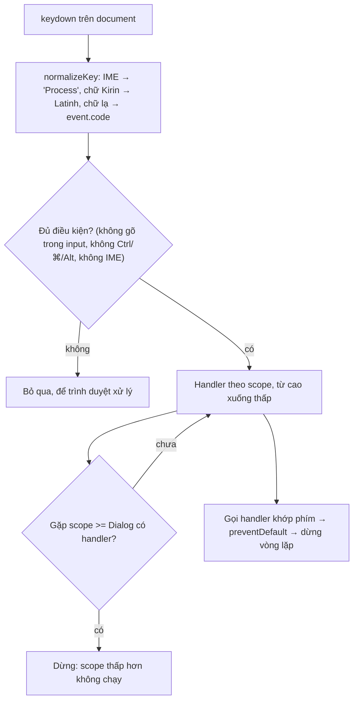

Trello có rất nhiều phím tắt một chữ cái: `j`/`k` để chọn thẻ, `f` để lọc, `q` để xem thẻ của tôi, `/` để tìm kiếm, `Esc` để đóng. Phím tắt một chữ cái rất tiện, nhưng dễ gây lỗi:

1. Người dùng gõ "jira" vào ô bình luận, và thẻ đang chọn nhảy xuống 1 lần, rồi nhảy lên 1 lần.
2. Mở dialog sửa thẻ lên, bấm `j` để gõ chữ… hoặc không gõ gì, thì board phía sau vẫn đổi thẻ đang chọn.
3. Bấm `Esc` khi popover nằm trong dialog: cả popover lẫn dialog cùng đóng, thay vì chỉ popover.
4. Người dùng tiếng Nhật đang soạn chữ bằng IME, bấm `k` để gõ "か", và phím tắt `k` chạy luôn.
5. Người dùng bàn phím tiếng Nga bấm phím có in chữ `J`, trình duyệt báo `о` (chữ Kirin), và phím tắt không chạy.

Mỗi component tự `addEventListener('keydown')` thì không component nào biết component nào đang nằm trên. Trello giải quyết bằng **một registry phím tắt dùng chung cho cả app**, với khái niệm **scope** (phạm vi).

> [!TIP]
> **Tóm tắt**
> - Một listener `keydown` duy nhất. Mỗi handler đăng ký kèm **scope** là một con số; scope cao chạy trước.
> - Có handler ở scope `>= Dialog` thì **dừng**, không xuống các scope thấp hơn. Mở dialog là phím tắt của trang tự tắt.
> - Bỏ qua phím khi đang gõ vào ô nhập (trừ `Esc`), khi đang soạn IME (`isComposing` hoặc `keyCode === 229`), khi giữ Ctrl/⌘/Alt.
> - Bàn phím phi Latinh: map chữ về phím Latinh cùng vị trí (Trello có bảng cho tiếng Nga), hoặc dựa vào `event.code`.

<iframe class="demo-frame" src="/demos/web-patterns/index.html?theme=dark#/shortcuts" title="Demo shortcuts" loading="lazy" style="height: 760px"></iframe>

<p class="demo-links">▶ <a href="/demos/web-patterns/index.html#/shortcuts" target="_blank" rel="noopener">Mở demo toàn màn hình ↗</a> · <a href="https://stackblitz.com/github/hunghg255/blog-hunghg/tree/master/examples/web-patterns?file=src/lib/shortcuts.ts" target="_blank" rel="noopener">Sửa code trên StackBlitz ↗</a> · <a href="https://github.com/hunghg255/blog-hunghg/blob/master/examples/web-patterns/src/lib/shortcuts.ts" target="_blank" rel="noopener">Xem source trên GitHub ↗</a></p>

Thử trong demo: gõ "j" trong ô tìm kiếm (thẻ không đổi), mở dialog rồi bấm `j` (board không đổi), mở popover trong dialog rồi bấm `Esc` (chỉ popover đóng). Bật "Cách ngây thơ" và làm lại cùng các bước để so sánh.

## Trello làm thế nào?

Code nằm trong package riêng [`trello.com/packages/keybindings/src/`](https://github.com/hunghg255/codebase/tree/main/trello.com/packages/keybindings/src): `shortcuts.ts` (registry), `keyboard.ts` (chuẩn hoá phím), `types.ts` (enum `Scope` và `Key`), `hooks.ts` (hook React).

### Scope là một con số

```ts
// types.ts (rút gọn)
export enum Scope {
  Global = 0, Default = 1, Header = 2, Board = 3, Sidebar = 10, Card = 20, BoardView = 30,
  Dialog = 100, DialogSection = 110, Overlay = 120, Modal = 125, Popover = 130,
}
```

Popover (130) nằm trên Overlay (120), Overlay nằm trên Dialog (100), Dialog nằm trên Board (3). Component `Popover` trong design system của Trello đăng ký `Esc` ở `Scope.Popover`; `Overlay` đăng ký `Esc` ở `Scope.Overlay`; `board-view.js` đăng ký một handler bắt mọi phím ở `Scope.Board`.

### Scope từ Dialog trở lên chặn mọi thứ bên dưới

Hàm quyết định handler nào được chạy (`shortcuts.ts`):

```ts
export const getScopedHandlers = (): Handler[] => {
  const sortedRegistrars = [...HandlerMap.entries()].sort(
    (a, b) => b[0] - a[0],
  );
  let results: Handler[] = [];
  for (const [scope, handlers] of sortedRegistrars) {
    results = results.concat(handlers);
    if (handlers.length && scope >= Scope.Dialog) {
      break;
    }
  }
  return results;
};
```

Sắp scope từ cao xuống thấp rồi gom handler. Gặp một scope **từ Dialog trở lên** mà có handler thì dừng. Kết quả: khi một popover đang mở, chỉ handler của popover chạy; board bên dưới "điếc" hoàn toàn, mà board không cần biết popover tồn tại.

Vòng gọi handler:

```ts
export const onKeyboardEvent = (event: ShortcutEvent): void => {
  if (!isKeyEligible(event)) return;
  for (const { callback, key } of getScopedHandlers()) {
    if (!key) {
      callback(event);                 // handler bắt mọi phím (vd: board-view)
    } else if (key && getKey(event) === key) {
      callback(event);
      event.preventDefault();
      event.stopPropagation();
    }
    if (event.defaultPrevented) break; // có người đã xử lý: dừng
  }
};
```

`preventDefault` vừa là tín hiệu "đã xử lý xong, đừng gọi handler sau", vừa chặn hành vi mặc định của trình duyệt.

### Khi nào **không** chạy phím tắt

Hàm `isKeyEligible` trả `false` (bỏ qua phím) khi: đang dùng thiết bị cảm ứng, registry bị tạm dừng, phím không nhận ra được, đang soạn IME (`Key.Process`), đang gõ trong ô nhập (trừ `Escape`), hoặc đang giữ Ctrl/⌘/Alt.

::: spoiler Xem code isKeyEligible

```ts
const isKeyEligible = (e: ShortcutEvent): boolean => {
  const key = getKey(e);
  return !(
    isTouch() ||
    isPaused ||
    key === Key.Unknown ||
    key === Key.Process ||
    (key !== Key.Escape && isInputElement(e.target as HTMLElement)) ||
    e.ctrlKey || e.metaKey || e.altKey
  );
};
```

:::

`isInputElement` có một chi tiết đáng chú ý, comment trong code ghi rõ:

> Due to some nonsense behavior in Safari, sometimes a focused input that is hidden via Javascript can still be the activeElement, so ensure the target element is also visible.

Nên ngoài `matches('textarea,input,select,[contenteditable]')` còn phải kiểm tra phần tử còn hiển thị (`offsetWidth || offsetHeight || getClientRects().length`). Đó chính là bản viết lại của selector `:visible` trong jQuery.

### IME và bàn phím tiếng Nga (`keyboard.ts`)

```ts
const isComposing: boolean = event.isComposing || keyCode === 229;
switch (event.type) {
  case 'keydown':
    key = isComposing ? Key.Process : KeyMap.get(event.key);
    break;
  case 'keypress':
    key = KeyMap.get(event.key) || NonLatinAlphabetKeypressCodes.get(keyCode);
    break;
}
```

Khi bộ gõ IME đang soạn chữ, `keydown` có `keyCode` bằng 229 và `isComposing = true`. Trello trả về `Key.Process`, mà `Process` không bao giờ được coi là đủ điều kiện, nên phím tắt không chạy.

Bàn phím tiếng Nga thì xử lý ở `keypress`. Bảng `NonLatinAlphabetKeypressCodes` map mã ký tự Kirin sang phím Latinh cùng vị trí: `1072` (а) → `f`, `1086` (о) → `j`, `1083` (л) → `k`… Thêm vài dấu câu toàn khổ của bộ gõ Wubi tiếng Trung: `65292` (，) → `,`, `12290` (。) → `.`. Comment trong code nói rõ các bố cục khác (Thái, Ả Rập…) chưa được hỗ trợ.

Vì sao lại dùng `keypress`? Registry nghe **cả** `keydown` lẫn `keypress`. Với bàn phím Latinh, handler xử lý ở `keydown` và gọi `preventDefault()`. Theo spec UI Events, `keydown` bị huỷ thì trình duyệt **không phát** `keypress`, nên handler không chạy hai lần. Với bàn phím Nga, `keydown` có `key = "о"`. `KeyMap` không có chữ này nên trả `Unknown`, sự kiện bị bỏ qua và không ai gọi `preventDefault`. Thế là `keypress` được phát, và lần này bảng map chữ Kirin sang `j`. Có thể nói `keypress` là **lượt thử thứ hai** dành riêng cho bàn phím phi Latinh.

Vấn đề: `keypress` đã bị spec đánh dấu là sự kiện cũ (legacy), không nên dùng cho code mới. Bản viết lại map ngay ở `keydown`.

### Một vài điểm chưa ổn của bản gốc

- `unregisterShortcutHandler(callback)` gỡ handler **theo callback, ở mọi scope**. Cùng một hàm đăng ký ở hai scope thì gỡ một lần là mất cả hai.
- Hook `useShortcut` có `callback` trong mảng deps của `useEffect`. Truyền arrow function mới mỗi render là **đăng ký lại mỗi render**. Do `addHandler` dùng `unshift`, handler đó còn bị đẩy lên đầu scope, nên thứ tự ưu tiên trong cùng scope thay đổi theo… thứ tự render. Các chỗ dùng mình đã xem (`Popover`, `Overlay`) đều bọc callback bằng `useCallback` để tránh chuyện này.
- Listener được gắn lần đầu có handler, và chỉ gỡ khi gọi `clearShortcuts()` (comment ghi "useful for testing").
- `Scope.BoardView` và `Scope.PowerUpsDirectory` cùng bằng 30, nên thực chất là **một** scope.
- Bảng tiếng Nga thiếu `х`, `ъ`, `э` (các phím `[`, `]`, `'`).

## Bên trong trình duyệt: `key`, `code` và `isComposing`

Mỗi `KeyboardEvent` có hai thông tin khác nhau:

| Thuộc tính | Ý nghĩa | Bàn phím Nga, bấm phím in chữ J |
|---|---|---|
| `event.key` | **Ký tự** mà bố cục hiện tại tạo ra | `"о"` |
| `event.code` | **Vị trí vật lý** của phím, luôn đặt tên theo QWERTY | `"KeyJ"` |
| `event.isComposing` | Đang trong một phiên soạn chữ IME | `false` |

Phím tắt kiểu "bấm `?` để mở trợ giúp" nên dựa vào `key`: trên bàn phím AZERTY dấu `?` nằm ở chỗ khác, người dùng tìm theo ký tự in trên phím. Còn khi bố cục không tạo ra chữ Latinh, `code` là lựa chọn dự phòng hợp lý. Trong lúc soạn IME, `keydown` vẫn được phát (với `keyCode` 229 trên hầu hết trình duyệt) nhưng chữ thật chưa được chốt, nên mọi phím tắt phải nhường.



## Viết lại

Phần chuẩn hoá phím. Map chữ Kirin và dấu toàn khổ ngay ở `keydown`, không cần `keypress`; bố cục không có bảng thì dựa vào `event.code`:

```ts title=src/lib/shortcuts.ts
export function normalizeKey(event: Pick<KeyboardEvent, 'key' | 'code' | 'isComposing' | 'keyCode'>): string {
  // Đang soạn chữ (tiếng Nhật, tiếng Trung, Telex trên một số bộ gõ…): keydown có keyCode 229
  // và `key` là chữ tạm, không phải phím người dùng định bấm.
  if (event.isComposing || event.keyCode === 229 || event.key === PROCESS_KEY) return PROCESS_KEY;

  const { key } = event;
  if (key.length !== 1) return key; // Escape, Enter, ArrowUp, F1…

  const lower = key.toLowerCase();
  const mapped = NON_LATIN_KEYS[lower];
  if (mapped) return key === lower ? mapped : mapped.toUpperCase();

  // Bố cục khác (Thái, Ả Rập, Hy Lạp…): không có bảng thì dựa vào vị trí vật lý của phím.
  // event.code luôn đặt tên theo QWERTY ("KeyF") bất kể bố cục đang dùng.
  if (key.charCodeAt(0) > 127 && /^Key[A-Z]$/.test(event.code)) {
    return event.code.slice(3).toLowerCase();
  }
  return key;
}
```

Phần lõi: lấy handler theo scope và gọi handler (hàm `isEligible` phía trên kiểm tra IME, Ctrl/⌘/Alt và ô nhập, giống Trello):

```ts title=src/lib/shortcuts.ts
/** Handler đang có hiệu lực, scope cao trước; dừng ở scope chặn đầu tiên có handler. */
export function getActiveEntries(): Entry[] {
  const scopes = [...registry.entries()].sort((a, b) => b[0] - a[0]);
  const result: Entry[] = [];
  for (const [scope, entries] of scopes) {
    result.push(...entries);
    if (entries.length > 0 && scope >= BLOCKING_SCOPE) break;
  }
  return result;
}

export function getTopScope(): number | null {
  const scopes = [...registry.entries()].filter(([, entries]) => entries.length > 0).map(([scope]) => scope);
  return scopes.length ? Math.max(...scopes) : null;
}

function onKeyDown(event: KeyboardEvent) {
  const key = normalizeKey(event);
  if (!isEligible(event, key)) return;

  for (const entry of getActiveEntries()) {
    if (entry.key !== null && entry.key !== key) continue;
    const handled = entry.callback(event) !== false;
    // handler theo phím cụ thể: coi như đã xử lý, chặn hành vi mặc định (vd: "/" mở Quick Find của Firefox)
    if (handled && entry.key !== null) event.preventDefault();
    if (event.defaultPrevented) break;
  }
}
```

Hook React giữ callback trong ref, nên chỉ đăng ký lại khi phím, scope hoặc `enabled` đổi:

```ts title=src/lib/shortcuts.ts
export function useShortcut(
  key: string | null,
  callback: ShortcutCallback,
  { scope = Scope.Page, enabled = true }: { scope?: number; enabled?: boolean } = {},
) {
  const callbackRef = useRef(callback);
  useEffect(() => {
    callbackRef.current = callback;
  });

  useEffect(() => {
    if (!enabled) return;
    return registerShortcut(key, (event) => callbackRef.current(event), scope);
  }, [key, scope, enabled]);
}
```

::: spoiler Xem toàn bộ src/lib/shortcuts.ts

```ts title=src/lib/shortcuts.ts
import { useEffect, useRef } from 'react';

/**
 * Phím tắt toàn cục có phạm vi (scope), ý tưởng từ packages/keybindings của Trello:
 * - Một listener `keydown` duy nhất trên document cho cả app.
 * - Mỗi handler đăng ký kèm một scope (số). Scope cao chạy trước.
 * - Khi có handler ở scope >= Dialog thì các scope thấp hơn bị chặn: mở dialog/popover là
 *   phím tắt của trang bên dưới tự tắt, không component nào phải tự gỡ listener.
 * - Bỏ qua phím khi đang gõ vào ô nhập (trừ Escape), khi đang soạn chữ bằng IME,
 *   khi giữ Ctrl/⌘/Alt (để không đụng phím tắt của trình duyệt/hệ điều hành).
 * - Bàn phím tiếng Nga, dấu câu toàn khổ tiếng Trung được quy về phím Latinh tương ứng.
 */

export const Scope = {
  Global: 0,
  Page: 10,
  Panel: 20,
  Dialog: 100,
  Popover: 130,
} as const;

/** Từ scope này trở lên, handler sẽ chặn mọi scope thấp hơn. */
export const BLOCKING_SCOPE = Scope.Dialog;

/** Trả về `false` nếu handler quyết định không xử lý phím này (để handler sau thử). */
export type ShortcutCallback = (event: KeyboardEvent) => void | boolean;

interface Entry {
  key: string | null; // null = nhận mọi phím (catch-all)
  callback: ShortcutCallback;
}

// ---- Chuẩn hoá phím ----

/**
 * Bàn phím tiếng Nga (ЙЦУКЕН) thường in kèm chữ Latinh QWERTY. Quy chữ Kirin về phím Latinh
 * cùng vị trí để phím tắt vẫn chạy. Bảng của Trello thiếu х ъ э, ở đây bổ sung đủ.
 * Dấu câu toàn khổ (bộ gõ tiếng Trung) quy về dấu ASCII.
 */
const NON_LATIN_KEYS: Record<string, string> = {
  й: 'q', ц: 'w', у: 'e', к: 'r', е: 't', н: 'y', г: 'u', ш: 'i', щ: 'o', з: 'p', х: '[', ъ: ']',
  ф: 'a', ы: 's', в: 'd', а: 'f', п: 'g', р: 'h', о: 'j', л: 'k', д: 'l', ж: ';', э: "'",
  я: 'z', ч: 'x', с: 'c', м: 'v', и: 'b', т: 'n', ь: 'm', б: ',', ю: '.',
  '。': '.', '《': '<', '》': '>', '，': ',', '；': ';', '？': '?',
};

/** Giá trị trả về khi đang soạn chữ bằng IME: không bao giờ khớp phím tắt nào. */
export const PROCESS_KEY = 'Process';

export function normalizeKey(event: Pick<KeyboardEvent, 'key' | 'code' | 'isComposing' | 'keyCode'>): string {
  // Đang soạn chữ (tiếng Nhật, tiếng Trung, Telex trên một số bộ gõ…): keydown có keyCode 229
  // và `key` là chữ tạm, không phải phím người dùng định bấm.
  if (event.isComposing || event.keyCode === 229 || event.key === PROCESS_KEY) return PROCESS_KEY;

  const { key } = event;
  if (key.length !== 1) return key; // Escape, Enter, ArrowUp, F1…

  const lower = key.toLowerCase();
  const mapped = NON_LATIN_KEYS[lower];
  if (mapped) return key === lower ? mapped : mapped.toUpperCase();

  // Bố cục khác (Thái, Ả Rập, Hy Lạp…): không có bảng thì dựa vào vị trí vật lý của phím.
  // event.code luôn đặt tên theo QWERTY ("KeyF") bất kể bố cục đang dùng.
  if (key.charCodeAt(0) > 127 && /^Key[A-Z]$/.test(event.code)) {
    return event.code.slice(3).toLowerCase();
  }
  return key;
}

// ---- Ô nhập đang được gõ ----

/** Các input không nhận chữ: phím tắt vẫn chạy khi chúng đang focus. */
const NON_TEXT_INPUTS = new Set(['checkbox', 'radio', 'button', 'submit', 'reset', 'range', 'color', 'file']);

export function isTypingTarget(target: EventTarget | null): boolean {
  if (!(target instanceof HTMLElement)) return false;
  const isInput =
    target.matches('textarea, select, [contenteditable]:not([contenteditable="false"])') ||
    (target instanceof HTMLInputElement && !NON_TEXT_INPUTS.has(target.type));
  if (!isInput) return false;
  // Safari đôi khi giữ activeElement là một input đã bị ẩn bằng JS: input ẩn thì coi như không gõ
  return !!(target.offsetWidth || target.offsetHeight || target.getClientRects().length);
}

// ---- Registry ----

const registry = new Map<number, Entry[]>();
let paused = false;
let listening = false;

export const pauseShortcuts = () => {
  paused = true;
};
export const resumeShortcuts = () => {
  paused = false;
};

function isEligible(event: KeyboardEvent, key: string) {
  return !(
    paused ||
    key === PROCESS_KEY ||
    key === 'Unidentified' ||
    event.ctrlKey ||
    event.metaKey ||
    event.altKey ||
    (key !== 'Escape' && isTypingTarget(event.target))
  );
}

/** Handler đang có hiệu lực, scope cao trước; dừng ở scope chặn đầu tiên có handler. */
export function getActiveEntries(): Entry[] {
  const scopes = [...registry.entries()].sort((a, b) => b[0] - a[0]);
  const result: Entry[] = [];
  for (const [scope, entries] of scopes) {
    result.push(...entries);
    if (entries.length > 0 && scope >= BLOCKING_SCOPE) break;
  }
  return result;
}

export function getTopScope(): number | null {
  const scopes = [...registry.entries()].filter(([, entries]) => entries.length > 0).map(([scope]) => scope);
  return scopes.length ? Math.max(...scopes) : null;
}

function onKeyDown(event: KeyboardEvent) {
  const key = normalizeKey(event);
  if (!isEligible(event, key)) return;

  for (const entry of getActiveEntries()) {
    if (entry.key !== null && entry.key !== key) continue;
    const handled = entry.callback(event) !== false;
    // handler theo phím cụ thể: coi như đã xử lý, chặn hành vi mặc định (vd: "/" mở Quick Find của Firefox)
    if (handled && entry.key !== null) event.preventDefault();
    if (event.defaultPrevented) break;
  }
}

function syncListener() {
  const hasEntries = [...registry.values()].some((entries) => entries.length > 0);
  if (hasEntries && !listening) {
    document.addEventListener('keydown', onKeyDown);
    listening = true;
  } else if (!hasEntries && listening) {
    document.removeEventListener('keydown', onKeyDown);
    listening = false;
  }
}

/**
 * Đăng ký phím tắt. `key = null` để nhận mọi phím (tự lọc trong callback).
 * Trả về hàm huỷ đăng ký, chỉ gỡ đúng lần đăng ký này.
 */
export function registerShortcut(key: string | null, callback: ShortcutCallback, scope: number = Scope.Page) {
  const entry: Entry = { key, callback };
  const entries = registry.get(scope) ?? [];
  // handler đăng ký sau đứng trước trong cùng scope (component mở sau thường nằm trên)
  entries.unshift(entry);
  registry.set(scope, entries);
  syncListener();

  return () => {
    const list = registry.get(scope);
    if (!list) return;
    const index = list.indexOf(entry);
    if (index !== -1) list.splice(index, 1);
    if (list.length === 0) registry.delete(scope);
    syncListener();
  };
}

export function clearShortcuts() {
  registry.clear();
  syncListener();
}

/**
 * Hook React. Callback được giữ trong ref nên truyền arrow function mới mỗi render cũng
 * không làm đăng ký lại (bản của Trello đăng ký lại mỗi khi callback đổi).
 */
export function useShortcut(
  key: string | null,
  callback: ShortcutCallback,
  { scope = Scope.Page, enabled = true }: { scope?: number; enabled?: boolean } = {},
) {
  const callbackRef = useRef(callback);
  useEffect(() => {
    callbackRef.current = callback;
  });

  useEffect(() => {
    if (!enabled) return;
    return registerShortcut(key, (event) => callbackRef.current(event), scope);
  }, [key, scope, enabled]);
}
```

:::

## Đi qua code

- **`normalizeKey`**: thứ tự kiểm tra quan trọng. IME đứng đầu, vì lúc soạn chữ `event.key` có thể là một chữ cái bình thường. Phím đặc biệt (`Escape`, `ArrowUp`…) có `key` dài hơn 1 ký tự, trả về nguyên. Chữ hoa vẫn giữ hoa (`О` → `J`), vì Trello phân biệt `j` với `J` (Shift+J).
- **`isTypingTarget`**: giống `isInputElement` của Trello, nhưng không chặn `<input type="checkbox">` hay `<input type="range">`. Focus đang ở checkbox thì người dùng không gõ chữ, phím tắt vẫn nên chạy. Phần kiểm tra "còn hiển thị" cho trường hợp của Safari được giữ nguyên.
- **`getActiveEntries`**: giữ nguyên thuật toán của Trello. Hằng `BLOCKING_SCOPE` thay cho `Scope.Dialog` viết cứng trong vòng lặp.
- **`onKeyDown`**: callback có thể trả `false` để nói "phím này không phải của tôi". Demo dùng để `Esc` chỉ rời ô tìm kiếm khi focus đang ở đó, còn không thì để handler sau xử lý.
- **`syncListener`**: hết handler thì gỡ listener khỏi document.
- **`useShortcut`**: deps chỉ có `key`, `scope`, `enabled`. Callback đổi mỗi render cũng không làm đăng ký lại, nên thứ tự trong scope ổn định.

**Khác bản gốc:**
- Chỉ nghe `keydown`; chữ Kirin được map ngay tại đây thay vì đợi `keypress`.
- Bổ sung `х ъ э` vào bảng tiếng Nga, và thêm `event.code` làm dự phòng cho bố cục khác.
- Huỷ đăng ký theo từng lần đăng ký thay vì theo callback.
- Không có `isTouch()`: phím tắt trên iPad có bàn phím rời vẫn hữu ích. Muốn tắt trên thiết bị cảm ứng thì gọi `pauseShortcuts()`.

## Tại sao không làm cách khác?

**Mỗi component tự `addEventListener`?** Đó là "Cách ngây thơ" trong demo. Thứ tự chạy là thứ tự gắn listener, không phải thứ tự hiển thị. `stopPropagation` không giúp được vì mọi listener đều nằm trên cùng một `document`, phải dùng `stopImmediatePropagation` và hy vọng mình được gắn sau. Mỗi component còn phải tự nhớ "có dialog nào đang mở không".

**Dựa vào DOM: chỉ xử lý khi focus nằm trong component?** Hợp với widget có focus rõ ràng (listbox, menu). Phím tắt toàn trang như `j`/`k` thì không gắn với phần tử nào đang focus, thường focus đang ở `body`.

**Dùng `stopPropagation` theo cây DOM, layer trong cùng bắt trước?** Portal (dialog, popover render ra cuối `body`) phá vỡ cây DOM. Scope dạng số không phụ thuộc DOM nằm ở đâu.

**Chỉ dùng `event.code` cho mọi phím?** Phím tắt sẽ đúng vị trí trên mọi bố cục, nhưng sai với người dùng AZERTY: họ bấm phím in chữ `A` (vị trí `KeyQ`) thì nhận phím tắt `q`. Dùng `key` làm chính, `code` làm dự phòng khi `key` không phải chữ Latinh là cách cân bằng hơn.

## Edge case và cạm bẫy

- **`Esc` vẫn chạy khi đang gõ**: cố ý, để đóng dialog khi focus nằm trong ô nhập của dialog. Nhưng như vậy `Esc` trong một ô nhập của trang cũng có thể đóng popover ở đâu đó. Nếu không muốn, handler kiểm tra `event.target` rồi trả `false`.
- **Hai dialog cùng mở**: cả hai ở `Scope.Dialog`. Trong một scope, handler đăng ký sau đứng trước (`unshift`), nên dialog mở sau nhận `Esc` trước, đúng với mong đợi. Khi đóng dialog trên, handler của nó bị gỡ và dialog dưới nhận lại phím. Cùng ý tưởng với [stack Esc theo layer của Facebook](/blogs/facebook-focus-trap).
- **Phím chết (dead key)**: bố cục có phím dấu (tiếng Pháp, tiếng Đức…) phát `key = "Dead"` khi bấm phím dấu. Chuỗi dài hơn 1 ký tự nên không khớp phím tắt nào. Đúng ý.
- **`keyCode` đã cũ nhưng vẫn cần**: `isComposing` không có trên trình duyệt đời cũ, và có lúc `keydown` đầu tiên của phiên soạn chữ có `isComposing = false` nhưng `keyCode = 229`. Giữ cả hai điều kiện như Trello cho chắc.
- **Shift**: không chặn Shift, vì `?`, `!`, chữ hoa đều cần Shift. Chặn Ctrl/⌘/Alt để không đụng `Ctrl+F`, `⌘+K` của trình duyệt. Phím tắt kiểu `⌘+K` cần một registry riêng, hoặc thêm trường modifier vào `Entry`.
- **Nhiều cửa sổ (iframe)**: listener nằm trên `document` của frame nào thì chỉ nghe phím trong frame đó.

## Dùng trong dự án

```tsx
// Trang danh sách
useShortcut('j', () => selectNext());
useShortcut('k', () => selectPrev());
useShortcut('/', () => searchRef.current?.focus());

// Dialog: chỉ khi đang mở mới đăng ký, ở scope Dialog → chặn mọi phím tắt của trang
useShortcut('Escape', onClose, { scope: Scope.Dialog, enabled: open });

// Popover lồng trong dialog: scope cao hơn → Esc đóng popover trước
useShortcut('Escape', closePopover, { scope: Scope.Popover, enabled: popoverOpen });
```

Một vài gợi ý:

- Định nghĩa scope một chỗ duy nhất, như enum của Trello, và chừa khoảng trống giữa các số (10, 20, 100…) để chèn scope mới sau này.
- Mọi component dạng "lớp phủ" (dialog, drawer, popover, command palette) đăng ký ở scope từ `Dialog` trở lên, kể cả khi chúng không có phím tắt nào: một handler `key = null` trả `false` là đủ để chặn trang bên dưới.
- Hiển thị danh sách phím tắt (`?`) từ chính registry để tài liệu không lệch với code.
- Cho người dùng tắt phím tắt một chữ cái. WCAG 2.1 tiêu chí 2.1.4 (Character Key Shortcuts) yêu cầu phím tắt chỉ gồm một ký tự phải tắt được, đổi được, hoặc chỉ chạy khi component đang focus. `pauseShortcuts()` là điểm bắt đầu.

## Kiểm thử

::: spoiler Ví dụ test (bản phác, không có trong repo)

```ts
import { afterEach, describe, expect, it, vi } from 'vitest';
import { clearShortcuts, normalizeKey, registerShortcut, Scope } from './shortcuts';

const press = (init: KeyboardEventInit, target: EventTarget = document.body) => {
  const event = new KeyboardEvent('keydown', { bubbles: true, cancelable: true, ...init });
  target.dispatchEvent(event);
  return event;
};

afterEach(() => {
  clearShortcuts();
  document.body.innerHTML = '';
});

describe('normalizeKey', () => {
  it('map chữ Kirin và dấu toàn khổ', () => {
    expect(normalizeKey({ key: 'о', code: 'KeyJ', isComposing: false, keyCode: 0 })).toBe('j');
    expect(normalizeKey({ key: 'О', code: 'KeyJ', isComposing: false, keyCode: 0 })).toBe('J');
    expect(normalizeKey({ key: '？', code: 'Slash', isComposing: false, keyCode: 0 })).toBe('?');
  });
  it('dùng event.code cho bố cục không có bảng', () => {
    expect(normalizeKey({ key: 'ล', code: 'KeyK', isComposing: false, keyCode: 0 })).toBe('k');
  });
  it('IME đang soạn → Process', () => {
    expect(normalizeKey({ key: 'k', code: 'KeyK', isComposing: true, keyCode: 229 })).toBe('Process');
  });
});

describe('registry', () => {
  it('scope Dialog chặn scope Page', () => {
    const page = vi.fn();
    const dialog = vi.fn();
    registerShortcut('j', page, Scope.Page);
    const off = registerShortcut('Escape', dialog, Scope.Dialog);
    press({ key: 'j' });
    expect(page).not.toHaveBeenCalled();
    off();
    press({ key: 'j' });
    expect(page).toHaveBeenCalledTimes(1);
  });

  it('Esc: popover trước, dialog sau', () => {
    const calls: string[] = [];
    registerShortcut('Escape', () => void calls.push('dialog'), Scope.Dialog);
    registerShortcut('Escape', () => void calls.push('popover'), Scope.Popover);
    press({ key: 'Escape' });
    expect(calls).toEqual(['popover']);
  });

  it('bỏ qua khi đang gõ, trừ Escape', () => {
    // jsdom không tính layout: giả lập "đang hiển thị"
    const input = document.body.appendChild(document.createElement('input'));
    Object.defineProperty(input, 'offsetWidth', { value: 100 });
    const j = vi.fn();
    const esc = vi.fn();
    registerShortcut('j', j);
    registerShortcut('Escape', esc);
    press({ key: 'j' }, input);
    press({ key: 'Escape' }, input);
    expect(j).not.toHaveBeenCalled();
    expect(esc).toHaveBeenCalled();
  });

  it('callback trả false thì handler sau được thử', () => {
    const second = vi.fn();
    registerShortcut('Escape', second);
    registerShortcut('Escape', () => false); // đăng ký sau → đứng trước
    const event = press({ key: 'Escape' });
    expect(second).toHaveBeenCalled();
    expect(event.defaultPrevented).toBe(true);
  });
});
```

:::

## So với thư viện và chuẩn web

- **Thư viện phím tắt** như `tinykeys`, `hotkeys-js`, `react-hotkeys-hook` lo phần cú pháp (`"$mod+K"`, chuỗi phím `g i`). `hotkeys-js` có khái niệm scope, nhưng là scope dạng tên, chỉ một scope hoạt động tại một thời điểm, không có thứ tự chồng lớp như Trello. Đọc tài liệu của từng thư viện xem chúng xử lý IME và ô nhập ra sao trước khi chọn.
- **`accesskey`** của HTML là phím tắt gắn vào phần tử, nhưng tổ hợp phím kích hoạt khác nhau theo trình duyệt và hệ điều hành, và hay đụng phím tắt có sẵn. Ít khi dùng cho ứng dụng web phức tạp.
- **`<dialog>` với `showModal()`**: trình duyệt tự đóng dialog khi bấm `Esc` và làm phần còn lại của trang trơ (inert). Nhưng listener `keydown` trên `document` vẫn nhận phím, nên vẫn cần cơ chế scope cho phím tắt của trang.
- **`KeyboardEvent.code`** và **`isComposing`** có trên mọi trình duyệt hiện đại (tính tới 10/2026). `keypress` vẫn được phát, nhưng spec UI Events coi là sự kiện cũ, không khuyến khích dùng cho code mới.

---

Bài này thuộc series **[Học từ mã nguồn các web lớn](/series/web)** (65 bài, đọc theo thứ tự).

::: spoiler Xem nhanh danh sách bài trong series

*Mở đầu*

- [Mở đầu: đọc code production của 28 trang web](/blogs/learn-from-big-web-apps)

*Phần 1: trải nghiệm người dùng*

- [#1 Dark mode không nháy (Gatsby)](/blogs/web-dark-mode-no-flash)
- [#2 useValueByMedia: giá trị theo breakpoint (Toptal)](/blogs/web-use-value-by-media)
- [#3 Đoán ý định: idle, exit-intent, lắc chuột (Toptal, InVision)](/blogs/web-user-intent-idle-exit-wiggle)
- [#4 Validate form thân thiện (Udacity, Pipedrive)](/blogs/web-form-validation-ux)
- [#5 Magic number, EXIF và dán ảnh (Ello)](/blogs/web-file-magic-number-exif-paste)
- [#6 fastSmoothScroll: cuộn xa vẫn nhanh (Telegram)](/blogs/web-telegram-fast-smooth-scroll)
- [#7 Countdown time-travel và tombstone giỏ hàng (Best Buy)](/blogs/web-countdown-time-travel-tombstone)

*Phần 2: hiệu năng và đo lường*

- [#8 Hàng đợi requestAnimationFrame 3ms (Apple)](/blogs/web-raf-queue-3ms)
- [#9 srcset cho artwork và preconnect tự động (Apple)](/blogs/web-responsive-artwork-preconnect)
- [#10 Quick-fetch: gọi API trước khi bundle tải xong (HubSpot)](/blogs/web-quick-fetch-early-requests)
- [#11 Performance span và long task (Postman, Calibre)](/blogs/web-performance-spans-long-tasks)
- [#12 Gọi Web Worker như hàm async (Telegram)](/blogs/web-worker-promise-rpc)
- [#13 Đồng hồ media: đếm giờ xem và sửa lệch (Skillshare, Simplified)](/blogs/web-media-clock-watch-time-drift)

*Phần 3: nhiều tab, phiên đăng nhập, cập nhật*

- [#14 Bầu tab chủ cho thông báo (HubSpot, Telegram)](/blogs/web-leader-tab-notifications)
- [#15 Đồng bộ đăng nhập giữa tab và giới hạn cookie (Elastic, InVision)](/blogs/web-cross-tab-auth-cookie-guard)
- [#16 SPA tự cập nhật: Trello, Zappos, Facebook, Elastic](/blogs/web-spa-self-update-strategies)

*Phần 4: kiến trúc*

- [#17 Reverse portal: di chuyển component không remount (Zappos)](/blogs/web-reverse-portal)
- [#18 Page behaviors: gắn hành vi từ CMS (Intercom)](/blogs/web-page-behaviors-cms)
- [#19 Giới hạn tần suất hiển thị bằng bitmask (Outlook)](/blogs/web-frequency-cap-bitmask)
- [#20 Chuyển REST sang GraphQL dần dần (Coursera)](/blogs/web-rest-to-graphql-hybrid-link)

*Phần 5: soạn thảo và hiển thị nội dung*

- [#21 Autocomplete tại con trỏ trong contenteditable (Ello, Telegram)](/blogs/web-caret-autocomplete-contenteditable)
- [#22 Dark mode cho email HTML bằng CIELAB (Outlook)](/blogs/web-email-dark-mode-cielab)
- [#23 Thu nhỏ bảng rộng cho vừa khung, vá font emoji (Outlook)](/blogs/web-email-wide-content-scale)
- [#24 Cảnh báo quên đính kèm file (Outlook)](/blogs/web-forgotten-attachment-warning)
- [#25 Cắt chữ nhiều dòng chính xác (Pipedrive, Apple, Toptal)](/blogs/web-multiline-truncate-measure-text)
- [#26 Parse ngày giờ gõ tay khoan dung (Outlook, Elastic)](/blogs/web-lenient-date-parser)

*Phần 6: tương tác*

- [#27 menuAim: rê chéo vào submenu không bị đóng (Udemy)](/blogs/web-menu-aim-triangle)
- [#28 Kéo, vuốt chung cho chuột và cảm ứng (Telegram)](/blogs/web-unified-pointer-gestures)
- **#29 Phím tắt theo phạm vi, IME và bàn phím phi Latinh (Trello)** (bài này)
- [#30 Nội suy màu: đổi theme và nền theo cuộn (Telegram, Anchor)](/blogs/web-color-interpolation-theme-scroll)
- [#31 Đường gióng hút cạnh và undo/redo trên canvas (Simplified)](/blogs/web-canvas-snap-guides-undo)
- [#32 Giả lập mù màu bằng feColorMatrix (Trello)](/blogs/web-color-vision-simulator)
- [#33 Vạch thước theo mức zoom và cấp phát màu cho biểu đồ (Anchor, Similarweb)](/blogs/web-timeline-ticks-color-stack)

*Phần 7: mạng, dữ liệu và async*

- [#34 Ô tìm kiếm chuẩn production (Similarweb, Udemy, Pipedrive)](/blogs/web-production-search-box)
- [#35 Điều phối async: latest-wins, single-flight (Glitch, Toptal)](/blogs/web-async-coordination-latest-wins)
- [#36 Polling thưa dần và debounce động (Trello)](/blogs/web-decaying-polling-dynamic-debounce)
- [#37 Cache phía client theo version (Similarweb, Telegram, Udemy)](/blogs/web-client-cache-versioned)
- [#38 Upload file lớn theo chunk (Outlook, Tribe)](/blogs/web-chunked-upload-pipeline)
- [#39 Phát video qua Service Worker bằng Range request (Telegram, Outlook)](/blogs/web-service-worker-range-streaming)

*Phần 8: hiệu năng và vận hành*

- [#40 TTI governor: hoãn việc phụ tới sau khi trang dùng được (Outlook)](/blogs/web-tti-governor)
- [#41 Tự đo LCP/CLS/TBT và phục vụ bản nhẹ cho máy yếu (Udemy)](/blogs/web-rum-adaptive-loading)

*Phần 9: thuật toán và dữ liệu phía client*

- [#42 Three-way merge ngay trên trình duyệt (Postman)](/blogs/web-three-way-merge-client)
- [#43 Dọn cache GraphQL bằng đếm tham chiếu (Outlook)](/blogs/web-graphql-cache-refcount-gc)
- [#44 LRU cache theo 3 cách (Apple, Similarweb, Outlook)](/blogs/web-lru-cache-three-ways)
- [#45 Lọc tăng dần trong Web Worker (Similarweb)](/blogs/web-incremental-filter-worker)
- [#46 Xếp hạng gợi ý trên client, so ngầm với server (Outlook)](/blogs/web-client-side-ranking-shadow-test)
- [#47 Nối OT với editor: undo stack và chặn echo (Glitch)](/blogs/web-ot-codemirror-undo)
- [#48 Ngôn ngữ markup riêng dịch hai chiều với HTML (Coursera)](/blogs/web-custom-markup-compiler)

*Phần 10: thời gian, ngôn ngữ, định dạng*

- [#49 Xử lý giờ mùa hè không cần thư viện (Udemy, Pipedrive)](/blogs/web-dst-without-library)
- [#50 Intl thực chiến: Segmenter, số rút gọn, số nhiều, fallback locale (Apple, Outlook)](/blogs/web-intl-in-production)
- [#51 WebVTT và bôi chọn transcript (Udemy, Coursera)](/blogs/web-webvtt-transcript-selection)

*Phần 11: tương tác và giao diện*

- [#52 Kéo-thả trên lịch (Pipedrive)](/blogs/web-calendar-drag-drop)
- [#53 Focus stack cho popup lồng nhau (Outlook)](/blogs/web-focus-stack-nested-popups)
- [#54 Clipboard: copy, dán chữ thuần, dán thông minh (Trello, Anchor, Pipedrive, Tribe)](/blogs/web-clipboard-tricks)
- [#55 Khôi phục vị trí cuộn khi trang còn đang tải (Apple, Zappos)](/blogs/web-scroll-restore-wait-height)
- [#56 Lấy màu từ ảnh: gradient nền, màu chữ (Apple, Telegram, Trello)](/blogs/web-colors-from-images)
- [#57 JS đọc breakpoint từ CSS, phát hiện chế độ PWA (Ello, Apple)](/blogs/web-css-js-breakpoint-bridge)

*Phần 12: media*

- [#58 Tin nhắn thoại: ghi âm, waveform realtime, nén 5-bit (Telegram)](/blogs/web-voice-message-waveform)
- [#59 Chụp frame video thành ảnh, canvas bị taint (Coursera, Outlook)](/blogs/web-video-frame-snapshot)

*Phần 13: đo lường, bảo mật, vận hành*

- [#60 Đo lúc ảnh màn hình đầu tải xong, cả khi chuyển trang SPA (Zappos, Best Buy, Outlook)](/blogs/web-above-the-fold-image-timing)
- [#61 Buffer analytics chờ SDK, phát hiện adblock (Best Buy)](/blogs/web-analytics-buffer-adblock)
- [#62 Proof-of-work trên client để chặn API ẩn danh (Udemy)](/blogs/web-client-proof-of-work)
- [#63 Prefetch không làm lệch số liệu, nén cài đặt bằng bit (Outlook)](/blogs/web-synthetic-prefetch-bit-flags)
- [#64 Micro-frontend: AngularJS và React chung app, giao tiếp xuyên frame (Similarweb, InVision, HubSpot)](/blogs/web-micro-frontend-bridges)

:::

Code + demo: [`examples/web-patterns`](https://github.com/hunghg255/blog-hunghg/tree/master/examples/web-patterns) · [Mở trên StackBlitz](https://stackblitz.com/github/hunghg255/blog-hunghg/tree/master/examples/web-patterns)
